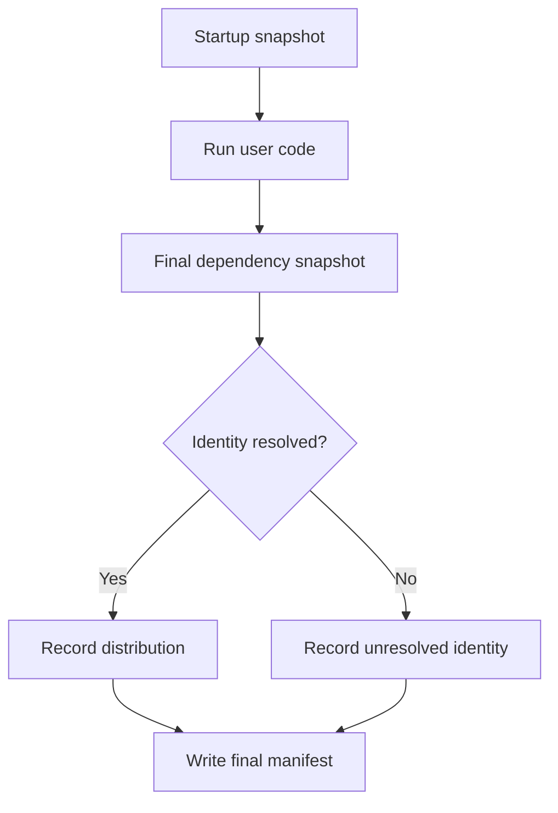

- Id: w4hxkh
- Status: done
- Graduated-To: dep-capture
- Blocks-Release: next
- Set: pubrun-improve
- Work-Kind: bug
- Priority: high
- Summary: Capture late imports and resolve import names to distributions
- Short-Description: Capture late imports and resolve import names to distributions

> Write and proofread this backlog item per the technical writing standard, `.aw/system/workflows/technical-writing/technical-writing.md` (`.agents/workflows/technical-writing/technical-writing.md` in a legacy-layout install), including requirement 12 (diagrams).

## Workflow history
- 2026-11-23 done (aw backlog): closed by aw oc run: IPD 6s7k9e executed (every IPD carrier is executed and this run executed .aw/records/plans/executed/20261121-dep-capture-00-6s7k9e-dependency-capture-accuracy-late-import-refresh-and-transiti.ipd.md); evidence .aw/records/plans/executed/20261121-dep-capture-00-6s7k9e-dependency-capture-accuracy-late-import-refresh-and-transiti.ipd.md
- 2026-11-22 graduated (aw backlog): graduated by run run-20261122T010822Z-2359880: 6s7k9e, fdqkrz, iflqsl, ijipnx, uil22c
- 2026-11-22 same-status (aw set): Gate next release per check.live-bug-ungated
- 2026-11-21 created (aw backlog): Maintainer requested detailed backlog capture; implementation remains future work.

## Context and execution boundary

Requested by the maintainer on 2026-11-21 as backlog capture following a source review of pushed main at `0d22020e678d9ac12a2f97b40f16cb16f22da073`. The maintainer is actively developing and has additional unpushed changes. Re-read the current implementation, tests, existing backlog, and plans before designing a fix; reconcile work already completed and do not overwrite concurrent work. These are source-review observations, not reproduced failures or benchmark results for this revision.

Preserve one-import adoption, the lightweight standard-library runtime on supported Python versions, optional capture, host-program behavior, redaction, existing import modes, and offline use. Do not introduce a service, scheduler, dashboard, mandatory scientific-framework dependency, or automatic replay. Names for new API/config fields below are proposals, not approved contracts.

This open item captures future work, not approval to implement it. Prepare an IPD through the applicable Agent Workflows process before execution. Cite this item's generated id with From-Backlog and record the forward graduation link with the owner verb. Preserve the repository's approval and validation gates. Do not mark the item done until the implementation and evidence support closure. For bug items, the creation tool cannot assign a next-release gate until this repository has a single planned release record; attach the appropriate gate with the owner verb when that record exists.

## Shared validation and documentation requirements

Use targeted behavioral tests, not assertions that merely mirror implementation. Capture actual runner output and exit codes. Changes to manifest contracts, capture output, import/CLI paths, or platform-dependent behavior require the repository's supported OS/Python CI matrix before completion. Update the schema, API/CLI/config references, examples, and methods/report behavior where affected, and reconcile stale specifications against code. Record measured performance with environment, revision, workload, baseline, repetitions, cold/warm distinctions, and dispersion. Do not claim a speedup without measurements. No application code changes are part of filing this backlog item.

## Problem and why it matters

The one-import promise encourages putting `import pubrun` at the top of a script. In the reviewed code, `Run._bootstrap_engines()` calls `get_packages()` once at startup; finalization does not refresh that set. Libraries imported later can therefore be absent from a completed manifest even though they performed the computation. `get_packages()` passes top-level module names directly to `importlib.metadata.version()`. Import and distribution names can differ, such as `sklearn`/`scikit-learn` and `PIL`/`Pillow`. A capture labeled complete can therefore omit real dependencies.

The imported-transitive implementation parses names and visits declared requirements for the initial imported set, rather than clearly computing a recursive, marker-aware closure. Installed optional extras can be incorrectly described as required. Inspect and clarify that contract while fixing identity resolution; do not silently broaden the default capture mode.

## Implementation guidance

Primary areas: `src/pubrun/capture/packages.py`, tracker startup/finalization, package-related schema/docs, `tests/test_capture_engines.py`, and package fixtures.

1. Preserve a useful startup snapshot and refresh/merge observed packages at finalization. Retain evidence for modules loaded and subsequently removed when observable; document limitations rather than claiming every historical import was seen. Avoid a global import hook by default.
2. Resolve modules to distributions using standard metadata facilities, with a supported-version fallback. Handle namespace packages, multiple candidate distributions, missing metadata, local modules, editable installs, normalization, and ambiguous mappings explicitly. Never import a library merely to identify it.
3. Cache module/distribution mappings and successful metadata reads within an appropriate run/environment scope. Do not introduce an expensive full-environment scan for every module. Define cache invalidation and behavior if packages change during a run.
4. Define whether transitive means recursive closure of applicable declared dependencies. Evaluate environment markers and handle extras honestly without adding a mandatory packaging dependency. If full fidelity cannot be provided, expose the limitation rather than labeling a one-hop or overinclusive set as complete.
5. Keep startup observations distinguishable from final observations where useful; represent failures or unresolved identities as partial capture with reasons. Keep snapshots coherent under concurrent changes to `sys.modules`.

## Acceptance criteria and tests

- Importing pubrun before a synthetic distribution is loaded still records that distribution in the final manifest; the startup snapshot remains truthful.
- A module whose import name differs from its distribution name resolves correctly, with deterministic local fixtures rather than mandatory sklearn/Pillow installation.
- Namespace, ambiguous, stdlib, local-only, editable, missing-metadata, and late-import cases have meaningful expected outcomes.
- Transitive tests cover a dependency chain, a cycle, a false environment marker, and optional extras; behavior matches the documented contract.
- No optional library is imported by capture and metadata failure cannot crash the host.
- Benchmark startup and finalization separately in small and large environments, including shared storage when available. Document remaining overhead and limits.

## Priority and dependencies

High: dependency accuracy is central to reproducibility. Can be designed independently of the startup and timing items. The reproducibility assessment item should consume these results rather than implement another package resolver.

## Proposed behavior at a glance

This diagram summarizes the requirements above. The text defines the required behavior.

