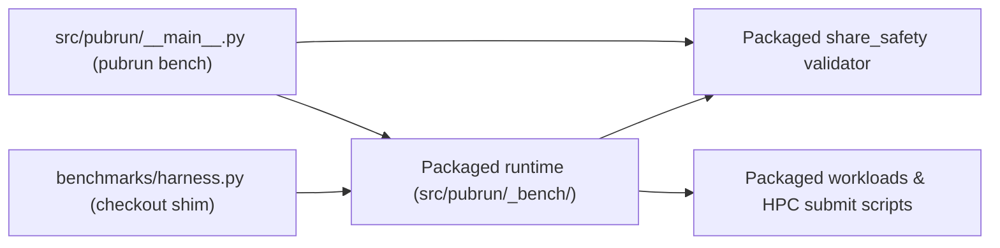

- Id: bej1qz
- Status: done
- Graduated-To: bej1qz
- Set: bej1qz
- Work-Kind: bug
- Priority: high
- Summary: Package benchmark runtime harness in wheel so pip-installed pubrun bench works without a git checkout
- Short-Description: Package benchmark runtime harness in wheel so pip-installed pubrun bench works without a git checkout
- Blocks-Release: g2qtg5

> Write and proofread this backlog item per the technical writing standard, `.aw/system/workflows/technical-writing/technical-writing.md` (`.agents/workflows/technical-writing/technical-writing.md` in a legacy-layout install), including requirement 12 (diagrams).

## Workflow history
- 2026-11-27 done (aw backlog): closed by aw agy run: IPD s3y296 executed (every IPD carrier is executed and this run executed .aw/records/plans/executed/20261127-bej1qz-00-s3y296-package-benchmark-runtime-harness-in-wheel.ipd.md, .aw/records/plans/executed/20261127-bej1qz-01-29nsim-package-benchmark-core-runtime-and-checkout-shims.ipd.md, .aw/records/plans/executed/20261127-bej1qz-02-c1zz3x-package-hpc-submission-scripts-and-checkout-shims.ipd.md, .aw/records/plans/executed/20261127-bej1qz-03-mfeptf-wire-pubrun-bench-cli-to-packaged-runtime-and-single-source.ipd.md, .aw/records/plans/executed/20261127-bej1qz-04-cuboum-update-benchmark-documentation-for-packaged-wheel-runtime.ipd.md, .aw/records/plans/executed/20261127-bej1qz-05-1r585o-add-benchmark-packaging-tests-ci-checks-and-end-to-end-verif.ipd.md); evidence .aw/records/plans/executed/20261127-bej1qz-00-s3y296-package-benchmark-runtime-harness-in-wheel.ipd.md
- 2026-11-27 graduated (aw backlog): graduated by run run-20261127T051342Z-1987922: 1r585o, 29nsim, c1zz3x, cuboum, mfeptf, s3y296
- 2026-11-27 created (aw backlog): Package benchmark runtime harness in wheel so pip-installed pubrun bench works without a git checkout

## Problem

The `pubrun` wheel ships the `pubrun bench` command-line interface (CLI) subcommand in `src/pubrun/__main__.py`, but `pyproject.toml` excludes `benchmarks/` from the wheel. When a user installs `pubrun` with `pip` and runs `pubrun bench` outside a source checkout, `_find_bench_harness` in `src/pubrun/__main__.py` cannot locate `benchmarks/harness.py` and exits with an error instructing the user to clone the repository.

This design originated in `.aw/records/plans/executed/20260706-2135-03-easy-benchmark-and-hpc-submit.md`, which left the packaging choice open and kept `benchmarks/` outside the wheel. Because `benchmarks/share_safety.py` is not packaged either, `src/pubrun/__main__.py` dynamically loads it by file path in `_load_share_safety` and maintains a duplicated fallback verifier (`_verify_redacted`) used by `_share_check`.

## Scope and required outcomes

1. **Package the benchmark runtime inside `src/pubrun/`.** Move or expose the runtime benchmark files (which use the Python standard library only) inside an internal subpackage (for example `src/pubrun/_bench/`):
   - `benchmarks/harness.py`
   - `benchmarks/scenarios.py`
   - `benchmarks/share_safety.py`
   - `benchmarks/workloads/`
   - the high-performance computing (HPC) submission scripts (`benchmarks/run_bench.sbatch`, `benchmarks/submit_bench.sh`, `benchmarks/submit_bench_pbs.sh`, `benchmarks/submit_bench_lsf.sh`, `benchmarks/submit_bench_sge.sh`)

2. **Keep non-runtime benchmark files out of the wheel.** Do not package `benchmarks/results/`, `benchmarks/data/`, `benchmarks/plot.py`, `benchmarks/aggregate.py`, `benchmarks/pull_submissions.py`, `benchmarks/startup_breakdown.py`, `benchmarks/package_capture_bench.py`, or benchmark test modules in the wheel.

3. **Keep `pubrun bench` zero-dependency.** Running `pubrun bench` from a wheel installation must require only the Python standard library and existing core `pubrun` dependencies.

4. **Resolve the packaged runtime first and preserve checkout compatibility.**
   - `pubrun bench` must run from any working directory in a non-editable wheel installation without requiring a source checkout.
   - Direct invocations of `benchmarks/harness.py` and the `benchmarks/submit_bench*.sh` scripts inside a source checkout must remain working (for example via thin shims or shared imports).

5. **Use a writable default output directory.** When `pubrun bench` runs outside a source checkout and `--out` is not given, it must write results to a writable location (for example `./pubrun-bench-results/` or a clearly printed default directory under the current working directory) instead of failing against a read-only `site-packages` path or a missing `benchmarks/results/` directory.

6. **Update HPC scheduler submission paths.** The packaged scheduler scripts and `_run_bench` in `src/pubrun/__main__.py` must invoke the installed benchmark harness module or packaged script path and pass an explicit writable results directory, rather than assuming `$PUBRUN_REPO/benchmarks/harness.py`.

7. **Remove duplicated share-safety logic.** Once `share_safety` is packaged inside `src/pubrun/`, `_share_check` in `src/pubrun/__main__.py` must import and call `check_share_safe_text` directly instead of loading `benchmarks/share_safety.py` via `_load_share_safety` or falling back to `_verify_redacted`.

8. **Update documentation.** Update `docs/cli.md`, `docs/performance.md`, and `benchmarks/README.md` so they no longer state that `pubrun bench` requires a source checkout.

## Component relationships

## Acceptance criteria

- Installing the built wheel (`dist/pubrun-*.whl`) into a clean temporary virtual environment and running `pubrun bench --quick --local` from a temporary directory outside any `pubrun` source checkout exits `0` and writes a share-safe redacted result JSON file whose path is printed to the user.
- `python3 -m twine check --strict dist/*` passes and the wheel contains none of `benchmarks/results/`, `benchmarks/data/`, or `.aw/`.
- Running `python benchmarks/harness.py --quick` inside a source checkout continues to pass.
- Automated tests cover wheel/non-checkout execution, default writable output directory selection, HPC submit script command generation without a source checkout, and single-source `share_safety` validation.
- Existing `tests/test_bench_command.py` and `benchmarks/test_benchmarks.py` suites pass.
