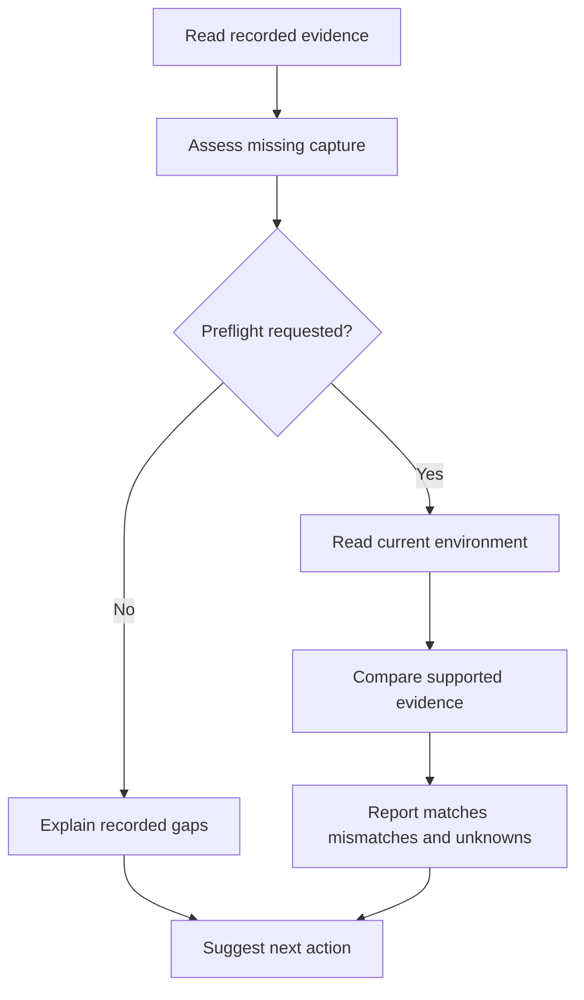

- Id: q3bll1
- Status: graduated
- Graduated-To: repro-check
- Set: pubrun-improve
- Work-Kind: feature
- Priority: medium
- Summary: Explain reproducibility gaps and compare recorded requirements before rerun
- Short-Description: Explain reproducibility gaps and compare recorded requirements before rerun

> Write and proofread this backlog item per the technical writing standard, `.aw/system/workflows/technical-writing/technical-writing.md` (`.agents/workflows/technical-writing/technical-writing.md` in a legacy-layout install), including requirement 12 (diagrams).

## Workflow history
- 2026-11-22 graduated (aw set): Graduated to repro-check IPD Set (salvaged from lane q3bll1)
- 2026-11-21 created (aw backlog): Maintainer requested detailed backlog capture; implementation remains future work.

## Context and execution boundary

Requested by the maintainer on 2026-11-21 as backlog capture following a source review of pushed main at `0d22020e678d9ac12a2f97b40f16cb16f22da073`. The maintainer is actively developing and has additional unpushed changes. Re-read the current implementation, tests, existing backlog, and plans before designing a fix; reconcile work already completed and do not overwrite concurrent work. These are source-review observations, not reproduced failures or benchmark results for this revision.

Preserve one-import adoption, the lightweight standard-library runtime on supported Python versions, optional capture, host-program behavior, redaction, existing import modes, and offline use. Do not introduce a service, scheduler, dashboard, mandatory scientific-framework dependency, or automatic replay. Names for new API/config fields below are proposals, not approved contracts.

This open item captures future work, not approval to implement it. Prepare an IPD through the applicable Agent Workflows process before execution. Cite this item's generated id with From-Backlog and record the forward graduation link with the owner verb. Preserve the repository's approval and validation gates. Do not mark the item done until the implementation and evidence support closure. For bug items, the creation tool cannot assign a next-release gate until this repository has a single planned release record; attach the appropriate gate with the owner verb when that record exists.

## Shared validation and documentation requirements

Use targeted behavioral tests, not assertions that merely mirror implementation. Capture actual runner output and exit codes. Changes to manifest contracts, capture output, import/CLI paths, or platform-dependent behavior require the repository's supported OS/Python CI matrix before completion. Update the schema, API/CLI/config references, examples, and methods/report behavior where affected, and reconcile stale specifications against code. Record measured performance with environment, revision, workload, baseline, repetitions, cold/warm distinctions, and dispersion. Do not claim a speedup without measurements. No application code changes are part of filing this backlog item.

## Problem and why it matters

Pubrun already has manifest completeness checks, report/inspect commands, semantic diff, metadata hydration, and rerun-command extraction. The desired improvement is a concise, actionable answer to what is known and what is missing, not another disconnected reporting subsystem. Capturing provenance supports reproduction but cannot guarantee equivalent results.

## Implementation guidance

Primary areas: `report/checks.py`, report diagnostics, existing CLI inspect/report/rerun entry points, diff helpers, hydration utilities, schema consumers, and CLI tests.

1. Inventory existing findings and commands first. Extend shared findings/data models so CLI, TUI, and machine-readable output agree. Avoid duplicate package resolution, schema loading, or incompatible notions of completeness.
2. Explain source identity/dirty state, runtime and dependency capture, input/output identity, missing capture, parent metadata availability, and recorded command/working directory. Distinguish observed, inferred, asserted, inherited, unavailable, and not checked evidence. State concrete next actions.
3. Add an explicitly invoked preflight comparison with the current environment. Compare only supported recorded evidence: Python/platform, package versions, source state, and accessible input identity. Separate material mismatches from incidental host/path differences, unknowns, and expected portability changes.
4. Do not promise scientific reproducibility, restore environments, install packages, fetch data, change random seeds, or execute a historical command automatically. Keep rerun extraction backwards compatible and preserve redaction. A redacted command is not necessarily executable.
5. Assess parent metadata identity/age and distinguish inherited context from direct child observations; mtime alone is not proof that dependencies match. Handle missing or moved parent snapshots without inventing completeness.
6. Offer a concise human summary plus stable structured findings. Prefer evidence categories with reasons over an unexplained numerical reproducibility score. Define optional strict exit behavior without breaking current piping or default exit contracts.

## Acceptance criteria and tests

- Examples cover adequate recorded evidence, dirty source without recorded changes, missing dependencies, package mismatch, missing/changed input, redacted arguments, unavailable parent snapshot, and partial/failed capture.
- No-finding does not imply reproduction is guaranteed, especially for legacy or sparse manifests.
- Unknown and not-checked differ from verified matches; runtime/platform differences are described without a blanket claim of incompatibility.
- Preflight is read-only, offline by default, and never executes recorded content or installs anything. Tests assert no network/process replay side effects.
- Human output explains the highest-value next step; structured findings and optional exit behavior are documented and tested.

## Priority and dependencies

Medium. Can be designed now using existing manifest fields. Reuse improved package identity, timing definitions, and file evidence when available; degrade honestly with older records. Do not require every proposed improvement before shipping a useful assessment.

## Proposed behavior at a glance

This diagram summarizes the requirements above. The text defines the required behavior.

