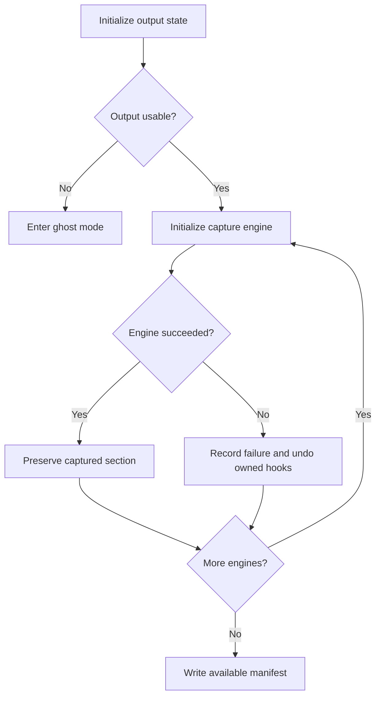

- Id: x21s6w
- Status: graduated
- Graduated-To: cap-isolation
- Blocks-Release: next
- Set: pubrun-improve
- Work-Kind: bug
- Priority: high
- Summary: Isolate capture failures and roll back partially installed hooks
- Short-Description: Isolate capture failures and roll back partially installed hooks

> Write and proofread this backlog item per the technical writing standard, `.aw/system/workflows/technical-writing/technical-writing.md` (`.agents/workflows/technical-writing/technical-writing.md` in a legacy-layout install), including requirement 12 (diagrams).

## Workflow history
- 2026-11-22 graduated (aw backlog): graduated by run run-20261122T010822Z-2359880: 26euz0, ed0yds, frzw20, p6pon8, zp2yyu
- 2026-11-22 same-status (aw set): Gate next release per check.live-bug-ungated
- 2026-11-21 created (aw backlog): Maintainer requested detailed backlog capture; implementation remains future work.

## Context and execution boundary

Requested by the maintainer on 2026-11-21 as backlog capture following a source review of pushed main at `0d22020e678d9ac12a2f97b40f16cb16f22da073`. The maintainer is actively developing and has additional unpushed changes. Re-read the current implementation, tests, existing backlog, and plans before designing a fix; reconcile work already completed and do not overwrite concurrent work. These are source-review observations, not reproduced failures or benchmark results for this revision.

Preserve one-import adoption, the lightweight standard-library runtime on supported Python versions, optional capture, host-program behavior, redaction, existing import modes, and offline use. Do not introduce a service, scheduler, dashboard, mandatory scientific-framework dependency, or automatic replay. Names for new API/config fields below are proposals, not approved contracts.

This open item captures future work, not approval to implement it. Prepare an IPD through the applicable Agent Workflows process before execution. Cite this item's generated id with From-Backlog and record the forward graduation link with the owner verb. Preserve the repository's approval and validation gates. Do not mark the item done until the implementation and evidence support closure. For bug items, the creation tool cannot assign a next-release gate until this repository has a single planned release record; attach the appropriate gate with the owner verb when that record exists.

## Shared validation and documentation requirements

Use targeted behavioral tests, not assertions that merely mirror implementation. Capture actual runner output and exit codes. Changes to manifest contracts, capture output, import/CLI paths, or platform-dependent behavior require the repository's supported OS/Python CI matrix before completion. Update the schema, API/CLI/config references, examples, and methods/report behavior where affected, and reconcile stale specifications against code. Record measured performance with environment, revision, workload, baseline, repetitions, cold/warm distinctions, and dispersion. Do not claim a speedup without measurements. No application code changes are part of filing this backlog item.

## Problem and why it matters

`Run.__init__()` catches an exception escaping `_bootstrap_engines()` and marks the entire run ghost/finalized. One engine failing can suppress unrelated useful capture. Engines already initialize many safe defaults and some catch their own failures, but an escaping failure still has a broad blast radius. Because bootstrap installs global hooks and starts background work progressively, a later failure also warrants checking rollback and ownership of already installed hooks.

Ghost mode is appropriate when no run output can be written. Failure of a hardware, package, Git, console, resource, or signal engine should usually yield a partial manifest rather than erase healthy observations or leave instrumentation attached without usable tracking.

## Implementation guidance

Primary areas: tracker bootstrap/finalization, capture-engine install/uninstall paths, writer failure behavior, events, global bootstrap state, import-mode behavior, and edge-case tests.

1. Define essential versus independent facilities. Keep a narrow fatal/ghost boundary for unusable output/state. Isolate individual capture calls and record section status plus bounded, redacted diagnostic reasons.
2. Preserve successful sections and continue safely. Do not retry an unsafe operation indefinitely or turn an optional failure into unbounded startup delay.
3. Treat partial hook installation transactionally: undo only hooks/resources this run owns. Restore prior stdout/stderr, signal handlers, subprocess wrappers, and faulthandler state without removing later third-party wrappers or previously installed handlers.
4. Ensure cleanup steps run independently even if another cleanup step fails. Preserve idempotence, reference counting, concurrent stop/background writes, and the finalized-manifest race protection.
5. Keep warnings useful and bounded. No traceback spam or sensitive configuration dumps; no claim of complete capture where a section failed. Record failure evidence without requiring the failed subsystem itself.

## Acceptance criteria and tests

- Fault injection into each engine shows unrelated sections survive and the user's script retains its normal result/exit behavior.
- An exception after a hook is installed restores owned state and does not leak sampling threads or open handles.
- Tests cover a second cleanup failure, output loss/read-only storage, nested runs, multiple stop calls, auto exit, and a slow background worker.
- Third-party wrappers/handlers installed before or after pubrun remain intact under documented ownership rules.
- Partial capture produces a valid, readable manifest with section failure evidence when writing remains possible; genuine output failure enters documented ghost mode.
- Measure additional startup/hot-path overhead from isolation; do not add broad global exception interception or mandatory dependencies.

## Priority and dependencies

High: protecting the host program and preserving useful evidence are fundamental. Reuse existing section capture states and coordinate lifecycle changes with startup/timing work. Expand scope only through a reviewed plan if a necessary change crosses the named areas.

## Proposed behavior at a glance

This diagram summarizes the requirements above. The text defines the required behavior.

