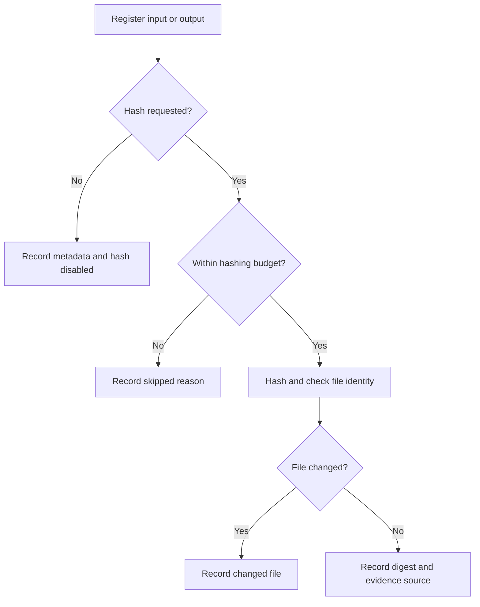

- Id: x6alw4
- Status: graduated
- Graduated-To: file-prov
- Set: pubrun-improve
- Work-Kind: feature
- Priority: medium
- Summary: Register external input and output files with explicit hashing guarantees
- Short-Description: Register external input and output files with explicit hashing guarantees

> Write and proofread this backlog item per the technical writing standard, `.aw/system/workflows/technical-writing/technical-writing.md` (`.agents/workflows/technical-writing/technical-writing.md` in a legacy-layout install), including requirement 12 (diagrams).

## Workflow history
- 2026-11-22 graduated (aw backlog): graduated by run run-20261122T010822Z-2359880: 4gpguy, 52dl55, 98j0a3, hm32d9, vtkkn1, xxi3nc
- 2026-11-21 created (aw backlog): Maintainer requested detailed backlog capture; implementation remains future work.

## Context and execution boundary

Requested by the maintainer on 2026-11-21 as backlog capture following a source review of pushed main at `0d22020e678d9ac12a2f97b40f16cb16f22da073`. The maintainer is actively developing and has additional unpushed changes. Re-read the current implementation, tests, existing backlog, and plans before designing a fix; reconcile work already completed and do not overwrite concurrent work. These are source-review observations, not reproduced failures or benchmark results for this revision.

Preserve one-import adoption, the lightweight standard-library runtime on supported Python versions, optional capture, host-program behavior, redaction, existing import modes, and offline use. Do not introduce a service, scheduler, dashboard, mandatory scientific-framework dependency, or automatic replay. Names for new API/config fields below are proposals, not approved contracts.

This open item captures future work, not approval to implement it. Prepare an IPD through the applicable Agent Workflows process before execution. Cite this item's generated id with From-Backlog and record the forward graduation link with the owner verb. Preserve the repository's approval and validation gates. Do not mark the item done until the implementation and evidence support closure. For bug items, the creation tool cannot assign a next-release gate until this repository has a single planned release record; attach the appropriate gate with the owner verb when that record exists.

## Shared validation and documentation requirements

Use targeted behavioral tests, not assertions that merely mirror implementation. Capture actual runner output and exit codes. Changes to manifest contracts, capture output, import/CLI paths, or platform-dependent behavior require the repository's supported OS/Python CI matrix before completion. Update the schema, API/CLI/config references, examples, and methods/report behavior where affected, and reconcile stale specifications against code. Record measured performance with environment, revision, workload, baseline, repetitions, cold/warm distinctions, and dispersion. Do not claim a speedup without measurements. No application code changes are part of filing this backlog item.

## Problem and why it matters

The existing `pubrun.open()` proxy provides opt-in per-file provenance and defaults to stat-level metadata. It does not patch builtin open. Data libraries may open files internally, so pandas/PyArrow-style workflows need a way to register files without replacing their I/O. `pubrun.artifact()` writes supplied content; verify its role and do not confuse it with registering an existing dataset.

At hash level, `ProvenanceFileProxy.close()` reopens and reads the whole path in 64 KiB chunks. A size cap exists. This can duplicate large I/O and can hash bytes changed after the computation read them. A post-read hash proves the file state at hashing time, not necessarily the bytes consumed by the computation. Read/write modes also need accurate classification.

## Implementation guidance

Primary areas: public API/core file proxy, tracker data_files records, config/schema, checks/reports, `tests/test_file_io_provenance.py`, and examples.

1. Add explicit registration of existing input/output paths with role, optional logical label, and optional caller-supplied digest/provenance. Final API names require design. Do not automatically read all files or add pandas/PyArrow as runtime dependencies.
2. Support the existing detail levels and size caps. Record hashing outcome explicitly: completed, disabled, over budget, unavailable, failed, or file changed. A null digest alone is insufficient to explain what happened.
3. Define digest algorithm, observation time, source, and strength. Caller-provided checksums are asserted evidence unless verified. File metadata or sampled hashes must never be represented as full content identity. Consider a total hashing byte/time budget for large batches as well as per-file limits.
4. Detect observable changes between open/read/close/hash using identity and metadata checks, and document race limits. Reopening a replaced path can identify a different file. Preserve enough information to avoid claiming the replacement was consumed.
5. Evaluate streaming hashing only where it preserves file semantics, including seek, reread, text decoding, readinto, iteration, append, and partial reads. Do not substitute a stream-of-reads hash for a whole-file digest.
6. Define r+/w+/a+ as appropriate mixed-role access, deduplication/repeated registrations, missing files, directories, symlinks, and output registration before/after creation. Start with local files; remote object-store support can remain explicitly out of scope.

## Acceptance criteria and tests

- A dependency-free example registers files written/read by another library-style component with no replacement of its I/O.
- A large sparse fixture or mocked reader proves a cap prevents content reads without creating terabytes of data.
- Hash disabled, cap exceeded, permission error, changed/replaced file, caller-supplied digest, partial read, seek, and mixed access have distinct honest records.
- Existing open proxy behavior and host exceptions remain compatible; no global I/O patch is added.
- Reports distinguish identified paths from verified content. Benchmark stat-only versus full hashing and report additional bytes read and close-time latency.

## Priority and dependencies

Medium: expands practical utility for research/ETL workloads. The reproducibility assessment should consume these evidence levels and avoid assuming a registered path proves content identity.

## Proposed behavior at a glance

This diagram summarizes the requirements above. The text defines the required behavior.

