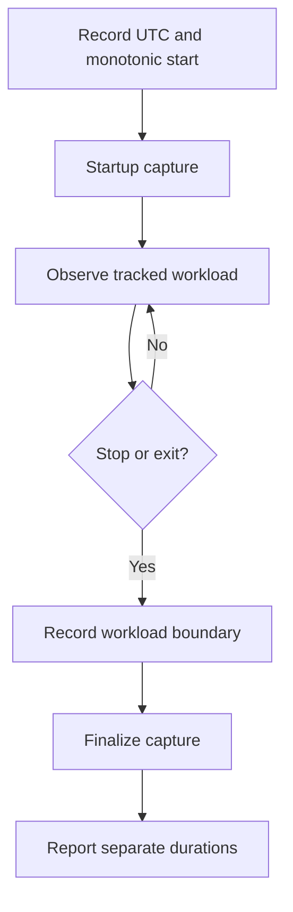

- Id: 6hp1zu
- Status: open
- Blocks-Release: next
- Set: pubrun-improve
- Work-Kind: bug
- Priority: high
- Summary: Use monotonic durations and separate workload time from capture overhead
- Short-Description: Use monotonic durations and separate workload time from capture overhead

> Write and proofread this backlog item per the technical writing standard, `.aw/system/workflows/technical-writing/technical-writing.md` (`.agents/workflows/technical-writing/technical-writing.md` in a legacy-layout install), including requirement 12 (diagrams).

## Workflow history
- 2026-11-22 same-status (aw set): Gate next release per check.live-bug-ungated
- 2026-11-21 created (aw backlog): Maintainer requested detailed backlog capture; implementation remains future work.

## Context and execution boundary

Requested by the maintainer on 2026-11-21 as backlog capture following a source review of pushed main at `0d22020e678d9ac12a2f97b40f16cb16f22da073`. The maintainer is actively developing and has additional unpushed changes. Re-read the current implementation, tests, existing backlog, and plans before designing a fix; reconcile work already completed and do not overwrite concurrent work. These are source-review observations, not reproduced failures or benchmark results for this revision.

Preserve one-import adoption, the lightweight standard-library runtime on supported Python versions, optional capture, host-program behavior, redaction, existing import modes, and offline use. Do not introduce a service, scheduler, dashboard, mandatory scientific-framework dependency, or automatic replay. Names for new API/config fields below are proposals, not approved contracts.

This open item captures future work, not approval to implement it. Prepare an IPD through the applicable Agent Workflows process before execution. Cite this item's generated id with From-Backlog and record the forward graduation link with the owner verb. Preserve the repository's approval and validation gates. Do not mark the item done until the implementation and evidence support closure. For bug items, the creation tool cannot assign a next-release gate until this repository has a single planned release record; attach the appropriate gate with the owner verb when that record exists.

## Shared validation and documentation requirements

Use targeted behavioral tests, not assertions that merely mirror implementation. Capture actual runner output and exit codes. Changes to manifest contracts, capture output, import/CLI paths, or platform-dependent behavior require the repository's supported OS/Python CI matrix before completion. Update the schema, API/CLI/config references, examples, and methods/report behavior where affected, and reconcile stale specifications against code. Record measured performance with environment, revision, workload, baseline, repetitions, cold/warm distinctions, and dispersion. Do not claim a speedup without measurements. No application code changes are part of filing this backlog item.

## Problem and why it matters

The reviewed tracker sets start/end UTC values with `time.time()` and derives `elapsed_seconds` by subtraction. Wall-clock corrections can distort elapsed duration. `_finalize_state()` waits up to two seconds for the hardware worker before setting the end timestamp. That wait can be counted as application runtime even when useful work has already finished. Startup capture is also included after the current start timestamp.

Users comparing runs need to know what interval each metric measures. A short script must not appear slower merely because shutdown metadata took longer, and the library must not pretend it knows full application time if imported midway through execution.

## Implementation guidance

Primary areas: tracker lifecycle and serialization, core phase timing, explicit subprocess wrappers, subprocess capture, resource metrics, manifest schema, diagnostic/methods reports, and timing tests.

1. Retain UTC epoch timestamps for absolute chronology. Use an appropriate monotonic clock, such as perf_counter, for durations. Do not store a process-local monotonic reading as a portable timestamp.
2. Define intervals before implementation: tracking session, setup/capture, observed workload, background collection, and finalization. Explicitly identify overlap; do not sum overlapping intervals or label process lifetime as measured application time.
3. Mark the workload/session boundary before blocking teardown. Report shutdown capture overhead separately. Account for explicit stop, atexit, decorators, context managers, nested/ref-counted runs, interruptions, exceptions, and partial startup.
4. Audit related phase/subprocess duration calculations to use consistent semantics. Preserve resource CPU sampling that already uses a monotonic clock.
5. Make additive schema changes where possible. If the meaning of `elapsed_seconds` changes, document compatibility and historical comparison behavior rather than silently interpreting older manifests under the new definition.

## Acceptance criteria and tests

- Inject forward and backward wall-clock changes; measured durations remain nonnegative and reflect monotonic elapsed time while UTC chronology remains available.
- Delay the hardware worker or writer deterministically; the delay is represented in tracking overhead rather than the newly defined workload interval.
- A script importing pubrun late is described as a tracked interval, not the full application lifetime.
- Tests cover short runs, normal auto exit, explicit stop, nested calls, context failure, interruption, and incomplete timing data without depending on flaky real-time sleeps.
- Existing manifests remain readable; diffs and reports label old/new semantics correctly and methods text does not overstate timing precision.
- Benchmark the instrumentation cost itself and update examples with an understandable explanation of what is measured.

## Priority and dependencies

High: timing accuracy affects the main run-comparison use case. Coordinate with startup/writer work but avoid making either item require the other's completion merely for convenience.

## Proposed behavior at a glance

This diagram summarizes the requirements above. The text defines the required behavior.

