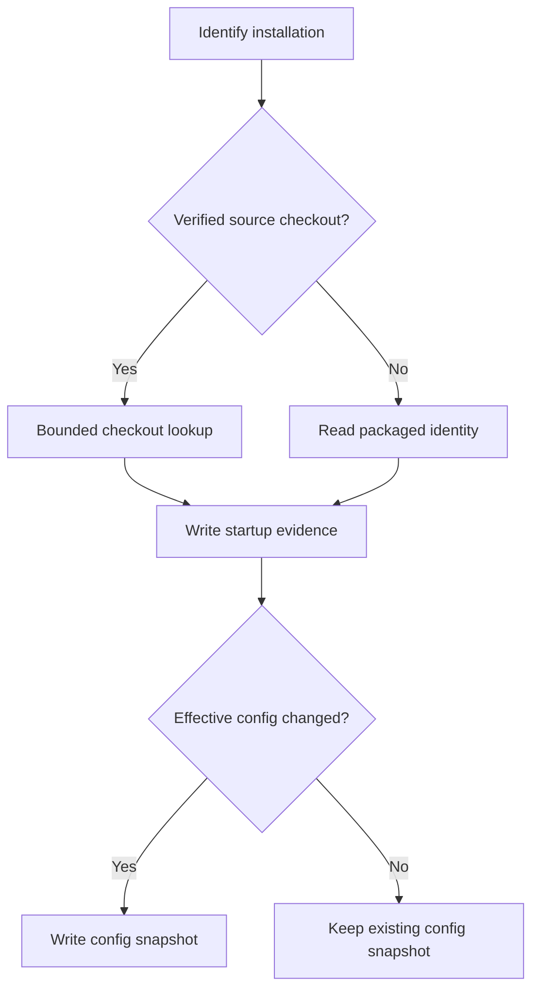

- Id: t1xqpw
- Status: open
- Set: pubrun-improve
- Work-Kind: followup
- Priority: high
- Summary: Bound startup overhead and avoid redundant artifact writes
- Short-Description: Bound startup overhead and avoid redundant artifact writes

> Write and proofread this backlog item per the technical writing standard, `.aw/system/workflows/technical-writing/technical-writing.md` (`.agents/workflows/technical-writing/technical-writing.md` in a legacy-layout install), including requirement 12 (diagrams).

## Workflow history
- 2026-11-21 created (aw backlog): Maintainer requested detailed backlog capture; implementation remains future work.

## Context and execution boundary

Requested by the maintainer on 2026-11-21 as backlog capture following a source review of pushed main at `0d22020e678d9ac12a2f97b40f16cb16f22da073`. The maintainer is actively developing and has additional unpushed changes. Re-read the current implementation, tests, existing backlog, and plans before designing a fix; reconcile work already completed and do not overwrite concurrent work. These are source-review observations, not reproduced failures or benchmark results for this revision.

Preserve one-import adoption, the lightweight standard-library runtime on supported Python versions, optional capture, host-program behavior, redaction, existing import modes, and offline use. Do not introduce a service, scheduler, dashboard, mandatory scientific-framework dependency, or automatic replay. Names for new API/config fields below are proposals, not approved contracts.

This open item captures future work, not approval to implement it. Prepare an IPD through the applicable Agent Workflows process before execution. Cite this item's generated id with From-Backlog and record the forward graduation link with the owner verb. Preserve the repository's approval and validation gates. Do not mark the item done until the implementation and evidence support closure. For bug items, the creation tool cannot assign a next-release gate until this repository has a single planned release record; attach the appropriate gate with the owner verb when that record exists.

## Shared validation and documentation requirements

Use targeted behavioral tests, not assertions that merely mirror implementation. Capture actual runner output and exit codes. Changes to manifest contracts, capture output, import/CLI paths, or platform-dependent behavior require the repository's supported OS/Python CI matrix before completion. Update the schema, API/CLI/config references, examples, and methods/report behavior where affected, and reconcile stale specifications against code. Record measured performance with environment, revision, workload, baseline, repetitions, cold/warm distinctions, and dispersion. Do not claim a speedup without measurements. No application code changes are part of filing this backlog item.

## Problem and why it matters

`src/pubrun/__init__.py` calls `_resolve_commit()` before import-mode routing. It imports subprocess and runs `git rev-parse HEAD` with a five-second timeout, including API-only/no-auto imports. Pubrun's own build identity should not impose an avoidable external-process startup cost. Be careful: resolving Git from an installed package's ancestor can identify an enclosing repository rather than pubrun's actual source tree.

`ArtifactWriter` synchronizes and atomically replaces both manifest and resolved config at startup, potentially repeats both after asynchronous hardware capture, and writes both at finalization. Resolved config is often unchanged. Repeated synchronization can be costly on shared storage. Existing committed benchmark results are historical single-machine measurements, not proof of current overhead or representative multi-platform performance.

## Implementation guidance

Primary areas: `src/pubrun/__init__.py`, bootstrap/config loading, `tracker.py`, `writer.py`, build metadata (`hatch_build.py`), and the existing benchmark harness.

1. Measure before changing behavior: import-only, auto-start, noauto/minimal, startup capture, finalization, subprocess creation, serialization, and synchronization. Distinguish cold and warm caches and local versus shared filesystem behavior.
2. Prefer build-stamped commit identity for installed artifacts. For genuine source checkouts, use bounded/deferred lookup and validate repository ownership. Preserve truthful development identity and unknown-state behavior; do not report a parent project's commit or a stale packaged hash as verified live HEAD.
3. Avoid rewriting unchanged config snapshots. Keep required artifacts available early enough for crash diagnosis, including runs that die before finalization. Handle legitimate mid-run reconfiguration explicitly.
4. Coalesce redundant snapshot writes. Preserve the existing protection against background hardware completion overwriting finalized state and against concurrent temporary-file collisions.
5. Evaluate an explicit durability policy separately from atomic visibility. Do not silently remove crash durability to manufacture a speedup. Document fsync behavior and platform limits; if claiming power-loss durability, assess directory synchronization too.
6. Bound total capture work as well as individual subprocess calls. Defer only metadata that can safely be observed later; do not move source-state capture past user modifications without recording the changed semantics.

## Acceptance criteria and tests

- Minimal/noauto installed-package import does not launch Git solely to identify pubrun.
- Wheel and source-checkout cases report correct or explicitly unknown identity, including nested repos, missing Git, timeout, and stale build metadata.
- An unchanged configuration is not rewritten during hardware refresh; changed effective configuration is represented correctly.
- Initial crash evidence, concurrent readers, read-only output, atomic replacement, and slow hardware finishing after stop retain correct behavior.
- Before/after measurements report fixed startup cost and finalization separately, plus absolute milliseconds and relative overhead for short and long workloads. Agree numerical targets from the baseline rather than inventing universal budgets.
- No benchmark submission, Gist publication, or scheduler job is performed without the authorization required by existing tooling.

## Priority and dependencies

High: fixed overhead matters for short scripts and high-volume jobs. Coordinate with the timing item so measurements separate useful work from capture overhead. Preserve the independent existing runs-index backlog item; this item concerns startup/writes, not status indexing.

## Proposed behavior at a glance

This diagram summarizes the requirements above. The text defines the required behavior.

