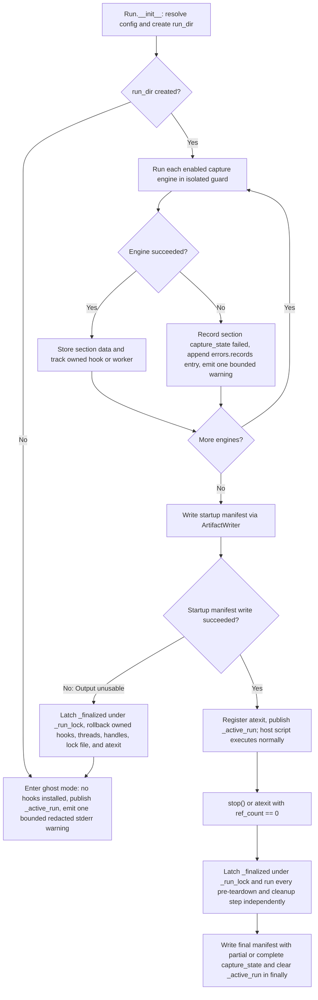
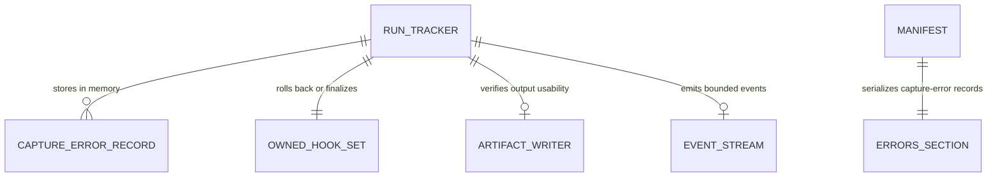

# IPD: Tracker Per-Engine Failure Isolation Narrow Ghost Mode and Independent Finalization

- Date: 2026-11-21
- Kind: child
- Concern: Narrowing ghost mode to unusable output, isolating every capture engine into honest partial manifests with bounded redacted error records, rolling back owned hooks transactionally on ghost transition, and executing finalization cleanup steps independently.
- Scope: Extend `$defs.error_record` additively in `schemas/manifest.schema.json`; refactor `Run` in `src/pubrun/tracker.py`, `ArtifactWriter` in `src/pubrun/writer.py`, `EventStream` in `src/pubrun/events.py`, and ghost/nested guards in `src/pubrun/core.py`; update `tests/test_tracker.py` and `tests/test_manifest_schema.py`; add comprehensive fault-injection and lifecycle tests in `tests/test_capture_isolation.py`.
- Scope-Paths: schemas/manifest.schema.json, src/pubrun/tracker.py, src/pubrun/writer.py, src/pubrun/events.py, src/pubrun/core.py, tests/test_tracker.py, tests/test_capture_isolation.py, tests/test_manifest_schema.py
- Scope-Exceeded: tests/conftest.py (Updated autouse fixture clean_active_run to stop leaked unstopped runs and uninstall leaked SubprocessSpy between tests so ownership-guarded SubprocessSpy.install does not fail under parallel xdist wo...); tests/test_timing_accuracy.py (Updated Case 2 of test_partial_startup_ghost_mode_unwritable_dir_and_engine_crash added by sibling plan e1fwy2 after ed0yds was authored to trigger post-bootstrap ghost mode via write_startup_manifest...)
- Item-Dependencies: executed:p6pon8
- Status: executed
- Readiness: go-pending-approval
- Review-Depth: complex
- Short-Description: Isolate per-engine capture calls, narrow ghost mode to unusable output, roll back owned hooks on ghost transition, and run finalization steps independently
- Work-Kind: bug
- Priority: high
- From-Backlog: x21s6w
- Blocks-Release: next
- Set: cap-isolation
- Order: 2
- Highest E allocated: 05
- Author: agent
- Id: ed0yds

> Write and proofread this plan per the technical writing standard, `.aw/system/workflows/technical-writing/technical-writing.md` (`.agents/workflows/technical-writing/technical-writing.md` in a legacy-layout install), including requirement 12 (diagrams).

## Workflow history

- 2026-11-22 executed (aw agy run model=Gemini-4-Neon-High): aw agy run self-finalize: ed0yds verified (set cap-isolation, attempt 1). [Scope reconciliation - out-of-scope tests/conftest.py: Updated autouse fixture clean_active_run to stop leaked unstopped runs and uninstall leaked SubprocessSpy between tests so ownership-guarded SubprocessSpy.install() does not fail under parallel xdist workers (D-04).; out-of-scope tests/test_timing_accuracy.py: Updated Case 2 of test_partial_startup_ghost_mode_unwritable_dir_and_engine_crash (added by sibling plan e1fwy2 after ed0yds was authored) to trigger post-bootstrap ghost mode via write_startup_manifest failure instead of get_invocation crash under narrowed ghost-mode semantics (D-01).]
- 2026-11-22 approved (aw set): status set to approved
- 2026-11-22 /plan-review (Antigravity / Gemini): APPROVE WITH REVISIONS APPLIED; PR-001, PR-002, PR-003, PR-004, PR-005, PR-006, PR-007
- 2026-11-22 draft (agent): created.
- 2026-11-22 to-review (agent): authored review-ready child plan from backlog item `x21s6w`.

## Goal

Isolate every capture engine call in `Run` so a failure in one engine never promotes healthy tracking into ghost mode. Narrow ghost mode strictly to genuinely unusable output with transactional rollback of any hooks this run owns. Run every finalization step independently even when another step fails. Bound runtime input/output (I/O) failure warnings in `EventStream` and `ArtifactWriter`, and record bounded, redacted failure evidence in section `capture_state`, `capture.capture_state`, and `errors.records`.

### Isolated bootstrap, ghost-mode rollback, and independent finalization flow

The text in `## Proposed changes (ordered, validatable)` is normative. These diagrams summarize the narrowed ghost-mode boundary, per-engine isolation loop, and independent cleanup sequence.





## Detailed Implementation Checklist (TODO)

Execution-state rule: mark an `E-*` item complete only after performing the action. That mark is not validation. Right-sizing rule: write for a modest executor that cannot hold much in its head. Each E-item is one step (one concern, about one file, executable in one focused pass) and its V-item names each unit it covers with its own check; a plan stays at about 5 E-items and 8 work Scope-Paths, else split it into more child plans (guidance, `IPD-Z603`). Accepted execution states: blocked, failed, pending, performed; terminal gate demands 'performed'.

### Task group 1: Schema, writer, event stream, and tracker isolation

- [x] E-01 Extend `$defs.error_record` additively in `schemas/manifest.schema.json` with optional `section` and `stage` string-or-null fields while keeping existing `required` fields unchanged.
  - Depends on: none
  - Expected outcome: `schemas/manifest.schema.json` validates both existing manifests and manifests containing `errors.records` entries with `kind = "capture-error"`, `type`, bounded redacted `message`, `traceback = null`, `section`, and `stage`, as well as partial manifests where any section carries `capture_state.status == "failed"`.
  - Execution state: performed

- [x] E-02 Update `src/pubrun/writer.py::ArtifactWriter` and `src/pubrun/events.py::EventStream` to report output-write success or failure explicitly, bound failure warnings without retrying broken handles indefinitely, support `unregister_atexit()`, and prevent redundant finalized rewrites.
  - Depends on: E-01
  - Expected outcome: `ArtifactWriter.write_startup_manifest()` returns `bool` (`True` when startup artifacts wrote, `False` on failure) and stores a bounded redacted `last_error`. `ArtifactWriter.write_artifacts()` returns `bool`, guards against rewriting an already-written finalized run on redundant `stop()` or `atexit`, treats `methods.{md,tex}` failures as non-fatal, logs at most one bounded redacted warning on finalization write failure, stays duck-type compatible with `tests/test_writer.py::DummyRun`, and supports `unregister_atexit()`. `EventStream` stores `self._config`, closes and clears a broken `self._file` cleanly under `self._lock` instead of retrying failing writes indefinitely, emits at most one bounded redacted warning outside `self._lock` per write-failure episode, and keeps `emit()`, `close()`, and `migrate_directory()` thread-safe.
  - Execution state: performed

- [x] E-03 Refactor `src/pubrun/tracker.py::Run` and lifecycle guards in `src/pubrun/core.py` for per-engine capture isolation, independent background `hardware`/`host`/`filesystem` isolation, narrow ghost mode with transactional `_rollback_owned_hooks()`, independent pre-teardown and cleanup steps in `_finalize_state()`, and lock-safe `to_manifest_dict()`.
  - Depends on: E-02
  - Expected outcome: Every capture engine in `Run._bootstrap_engines()` (including `resolve_console_mode()`, `set_poll_timeout()`, and `_hardware_thread.start()`) runs in its own isolated guard so an escaping exception marks only that section `"failed"` (with bounded redacted `detail` and an in-memory `errors.records` entry) while preserving all unrelated sections. `get_hardware()`, `get_host()`, and `get_filesystem()` run in three separate `try/except` blocks inside `_collect_hardware()`. If `run_dir.mkdir()` or initial `write_startup_manifest()` fails, `Run` latches `_finalized = True` and `is_active = False` under `_run_lock`, rolls back all owned hooks, threads, handles, lock file, and `atexit`, enters ghost mode cleanly (publishing `_active_run = self` with `writer = None` and one bounded redacted stderr warning), and returns. `_finalize_state()` executes every pre-teardown step (`_hardware_future_done.wait()`, `signal_capture.get_records()`, `signal_capture.record_exit_code()`) and every teardown step (separating `SubprocessSpy.finalize_all()`, `get_records()`, and `uninstall(owner=...)`) independently even if earlier steps raise. `Run.stop()` unregisters `atexit` and clears `_active_run` in `finally` when `ref_count <= 0`. `_merge_and_migrate()` is a no-op on ghost or inactive runs, guards `resolve_config()`, respects import-mode `patch_subprocesses` permission, and isolates mid-run `SubprocessSpy` activation. `to_manifest_dict()` reads error state under `_errors_lock`, isolates dynamic providers, populates `errors.records`, and sets `capture.capture_state` to `"partial"` whenever any section failed (whether via exception or self-caught failed return).
  - Execution state: performed

### Task group 2: Fault-injection, rollback, lifecycle, and schema verification

- [x] E-04 Update outdated engine-crash ghost tests in `tests/test_tracker.py` and add partial-manifest schema conformance tests in `tests/test_manifest_schema.py`.
  - Depends on: E-03
  - Expected outcome: `tests/test_tracker.py` verifies that failing `get_invocation`, `get_git`, `get_environment`, or `get_hardware` produces an active partial run (not ghost mode) while genuine output-directory failure enters ghost mode and preserves `outcome == "ghost"` across `stop()`. `tests/test_manifest_schema.py` validates real partial manifests produced under per-engine fault injection against `schemas/manifest.schema.json`.
  - Execution state: performed

- [x] E-05 Create `tests/test_capture_isolation.py` verifying per-engine fault injection, output-loss rollback, second cleanup failures, lifecycle edge cases, and import modes across the targeted test suite.
  - Depends on: E-04
  - Expected outcome: `pytest tests/test_capture_isolation.py tests/test_tracker.py tests/test_writer.py tests/test_events.py tests/test_import_modes.py tests/test_manifest_schema.py tests/test_quality.py -v` exits 0 with all tests passing.
  - Execution state: performed

## Project conventions discovered (Step 0)

- `src/pubrun/tracker.py::Run.__init__` wraps the entire `self._bootstrap_engines()` call in one outer `try/except` that demotes the entire run to ghost mode (`_outcome = "ghost"`, `_finalized = True`) without rolling back already-installed hooks, threads, open file handles, or `.pubrun.lock`, leaves `self.writer` unset on that return path, and prints raw unredacted `{e}` on `mkdir()` failure.
- `src/pubrun/tracker.py::Run._bootstrap_engines` runs `get_hardware()` and `get_host()` in a single `try/except`, so a failure in `get_hardware()` skips `get_host()` and a failure in `get_host()` overwrites healthy `hardware_data` with `{"capture_state": {"status": "failed"}}`.
- `src/pubrun/tracker.py::Run._finalize_state` runs `_hardware_future_done.wait()`, `signal_capture.get_records()`, `signal_capture.record_exit_code()`, `SubprocessSpy.finalize_all()`, `SubprocessSpy.uninstall()`, `console_interceptor.stop()`, `resource_watcher.stop()`, `event_stream.close()`, profiler disable, `signal_capture.uninstall()`, and `_remove_lock_file()` sequentially without individual `try/except` guards, so one failure skips every later step.
- `src/pubrun/tracker.py::Run.to_manifest_dict` hardcodes `"errors": {"records": [], "capture_state": {"status": "complete"}}` and `"capture": {..., "capture_state": {"status": "complete"}}`, and reports `"suppressed"` when `resource_watcher` or `signal_capture` is `None` even if initialization failed.
- `src/pubrun/tracker.py` protects `_finalized` latching and the background hardware startup manifest re-write with `pubrun._run_lock` to prevent a Time-Of-Check to Time-Of-Use (TOCTOU) race where a slow hardware thread overwrites a finalized manifest.
- `src/pubrun/writer.py::ArtifactWriter.write_startup_manifest` swallows all exceptions silently, so `Run.__init__()` cannot detect that `run_dir` is read-only or unwritable after `mkdir(exist_ok=True)`. `tests/test_writer.py::DummyRun` duck-types `Run` with only `run_dir`, `config`, `_finalized`, `_finalize_state()`, and `to_manifest_dict()`.
- `src/pubrun/core.py::start` calls `active._merge_and_migrate(kwargs)` whenever `get_current_run()` is truthy, even if `active` is a ghost run whose `run_dir` does not exist; `Run._merge_and_migrate` also calls `SubprocessSpy.install(max_tracked)` without checking import-mode `patch_subprocesses` permission or passing `config=merged`.
- `tests/test_tracker.py::test_engine_crash_promotes_to_ghost` and `tests/test_tracker.py::TestBootstrapEnginesFailures` currently assert the legacy behavior where `get_invocation`, `get_git`, and `get_environment` failures enter ghost mode; those tests must be updated to match the new narrow ghost-mode contract.
- Sibling pending Sets `timing-acc` (`e1fwy2`, manifest timing schema and tracker monotonic lifecycle) and `startup-perf` (`tkmm5p`, snapshot write coalescing, durability policy, and bounded capture) may also modify `src/pubrun/tracker.py` and `src/pubrun/writer.py`. Implementations here must preserve any `_mark_finalization_end()`, monotonic timing anchors, `_write_lock`, `durability`, `is_refresh`, or `hardware.depth == "off"` synchronous path if already present when this plan executes.

## Findings

- **F-01 (Broad ghost-mode blast radius):** One failing capture engine in `src/pubrun/tracker.py::Run._bootstrap_engines` discards all healthy sections, suppresses tracking completely, and leaks earlier hooks, threads, file handles, and `.pubrun.lock`.
- **F-02 (Coupled background capture):** `get_hardware()` and `get_host()` share one `try/except`, allowing either failure to corrupt or skip the other section.
- **F-03 (Silent startup output loss):** `src/pubrun/writer.py::ArtifactWriter.write_startup_manifest` hides write failures, leaving a run nominally active with hooks attached on read-only storage instead of rolling back and entering ghost mode.
- **F-04 (Cascading cleanup failures):** An exception in any pre-teardown or teardown step in `src/pubrun/tracker.py::Run._finalize_state` aborts all subsequent cleanup steps (including `SubprocessSpy.uninstall()`) and skips `write_artifacts()` and `_active_run` reset in `Run.stop()`.
- **F-05 (Unpopulated `errors` section and false `"complete"` / `"suppressed"` claims):** Failed sections have no recorded `errors.records` entries, `capture.capture_state` stays `"complete"` even when engines fail or return self-caught failed states, and failed `resources`/`signals` report `"suppressed"` instead of `"failed"`.
- **F-06 (Ghost-run re-entry and import-mode bypass hazards):** Nested `pubrun.start(output_dir=...)` while a ghost run is active calls `_merge_and_migrate()` on a nonexistent directory, and mid-run `SubprocessSpy.install()` in `_merge_and_migrate()` is unguarded, omits `config=merged`, and ignores import-mode `patch_subprocesses` permission.

## Proposed changes (ordered, validatable)

1. **Additive schema update (`schemas/manifest.schema.json`):**
   - Under `$defs.error_record.properties`, add two optional properties:
     - `"section": {"type": ["string", "null"]}` (manifest section or subsystem name such as `"git"`, `"packages"`, `"console"`, `"subprocesses"`, `"resources"`, `"signals"`, `"events"`, `"writer"`).
     - `"stage": {"type": ["string", "null"]}` (lifecycle stage such as `"bootstrap"`, `"runtime"`, `"finalization"`, `"rollback"`, `"writer"`).
   - Keep `$defs.error_record.required` as `["kind"]` and keep all other section definitions unchanged so legacy and current manifests remain valid.

2. **Output-usability reporting and bounded failure behavior (`src/pubrun/writer.py`, `src/pubrun/events.py`):**
   - In `src/pubrun/writer.py::ArtifactWriter`:
     - Track `self.last_error: Optional[str] = None`, `self._artifacts_written: bool = False`, and `self._write_failure_warned: bool = False`.
     - Add `unregister_atexit(self) -> None`: if `self._registered`, call `atexit.unregister(self.write_artifacts)` inside `try/except` and set `self._registered = False`.
     - Update `write_startup_manifest(self, *args, **kwargs) -> bool` (preserving compatibility with any `is_refresh` parameter from sibling plan `tkmm5p`):
       - Return `True` when startup `manifest.json` (and `config.resolved.json` when written on that call) succeeds atomically.
       - On exception, record `self.last_error = format_safe_error_detail(e, getattr(self.run, "config", None))`, log at `DEBUG`, and return `False` without raising.
     - Update `write_artifacts(self) -> bool`:
       - If `self._artifacts_written` and `getattr(self.run, "_finalized", False)`: return `True` without rewriting the finalized manifest (preserving `tests/test_quality.py::TestDoubleStop.test_double_stop_preserves_manifest` and idempotent `atexit`).
       - Preserve existing `_finalize_state()` call, duck-type compatibility with `tests/test_writer.py::DummyRun`, atomic write order (including any `timing-acc` `_mark_finalization_end()` or `startup-perf` `_write_lock` / durability logic if present), and non-fatal `methods.{md,tex}` write (a `methods` failure must NOT cause `write_artifacts()` to return `False`).
       - Set `self._artifacts_written = True` once `manifest.json` writes atomically; write `config.resolved.json` (if written after `manifest.json`, guard separately so a `config.resolved.json` error logs at most one bounded redacted warning and sets `self.last_error` without pretending `manifest.json` was not written); return `True` when `manifest.json` succeeded.
       - On exception writing `manifest.json`, record `self.last_error`, emit at most ONE bounded redacted warning via `logger.warning(...)` (guarded by `self._write_failure_warned`), never dump tracebacks or config, and return `False` without raising.
   - In `src/pubrun/events.py::EventStream`:
     - Store `self._config = config`, `self._write_failed: bool = False`, and `self._last_error: Optional[str] = None`.
     - If opening `events.jsonl` fails in `__init__` or `migrate_directory`, store `self._last_error = format_safe_error_detail(e, self._config)` and set `self._file = None`; in `migrate_directory`, reset `self._write_failed = False` only if reopening succeeds.
     - In `emit()`: re-check `if self._file is None: return` inside `with self._lock:`. If writing or flushing raises an `OSError` or other exception: inside `with self._lock:`, save and clear `f, self._file = self._file, None`, clear `self._buffer.clear()`, close `f` inside `try/except`, record `self._last_error = format_safe_error_detail(e, self._config)`, capture `should_warn = not self._write_failed`, and set `self._write_failed = True`; then emit the single bounded redacted warning **outside `self._lock`** so logging handlers cannot cause lock inversion or recursion. Keep `self._lock` safety across `emit()`, `close()`, and `migrate_directory()`.

3. **Per-engine isolation, narrow ghost mode, transactional rollback, and independent cleanup (`src/pubrun/tracker.py`, `src/pubrun/core.py`):**
   - Define `MAX_CAPTURE_ERRORS = 50` in `src/pubrun/tracker.py`.
   - On `src/pubrun/tracker.py::Run.__init__`:
     - Initialize `self._errors_lock = threading.Lock()`, `self._capture_errors: list = []`, `self._capture_errors_truncated: int = 0`, `self._warned_errors: set = set()`, `self._failed_sections: set = set()`, `self._spy_owner_token = object()`, `self._spying_subprocesses = False`, `self.writer = None`, and section fallback fields (`self.resources_data = None`, `self.signals_data = None`, `self.filesystem_data = {}`, etc.) BEFORE `mkdir()`.
     - Add helper `self._record_capture_error(section: str, stage: str, exc: BaseException, *, warn: bool = True) -> str`:
       - Formats `detail = format_safe_error_detail(exc, self.config)`.
       - Under `self._errors_lock`: if `not self._finalized` or `stage in ("finalization", "rollback", "writer")`, appends `{"kind": "capture-error", "type": type(exc).__name__, "message": detail, "traceback": None, "section": section, "stage": stage}` up to `MAX_CAPTURE_ERRORS` (incrementing `_capture_errors_truncated` past the cap) and records `section` in `self._failed_sections`.
       - Checks and records `(section, stage)` in `self._warned_errors` under `self._errors_lock`, then emits at most ONE bounded warning per `(section, stage)` **outside `self._errors_lock`** via `logging.getLogger("pubrun").warning("pubrun: %s capture failed (%s): %s", section, stage, detail)` when `warn` is True. Never dumps tracebacks or config dicts, and never depends on `event_stream` or `console_interceptor`.
     - Add helper `self._enter_ghost_mode(reason: str) -> None`:
       - Sets `self.is_active = False`, `self._outcome = "ghost"`, `self._finalized = True`, `self.writer = None`, resets hook references (`_spying_subprocesses = False`, `console_interceptor = None`, `event_stream = None`, `resource_watcher = None`, `signal_capture = None`), emits one bounded redacted warning to `sys.stderr` (never raw unredacted exception strings or tracebacks), and publishes `_active_run = self` so nested `pubrun.start()` sees the active ghost run without re-attempting filesystem creation and `stop()` clears `_active_run` cleanly while preserving `outcome == "ghost"`.
     - Keep the fatal/ghost boundary strictly for unusable run output:
       1. `self.run_dir.mkdir(parents=True, exist_ok=True)` failure -> call `self._enter_ghost_mode(format_safe_error_detail(e, self.config))` immediately (no hooks installed) and return.
       2. Call `self._bootstrap_engines()` (which isolates every engine internally and seeds `self.console_data` cleanly; remove the old post-bootstrap lines 190–194 that could overwrite failed `console_data`).
       3. Instantiate `self.writer = ArtifactWriter(self)` and call `ok = self.writer.write_startup_manifest()`.
       4. If `not ok`: output is unusable (for example, read-only directory or lost storage). Latch `self._finalized = True` and `self.is_active = False` under `_run_lock` FIRST (preventing the background `pubrun-hw` thread from racing with rollback), call `self._rollback_owned_hooks(stage="rollback")` to undo every hook, thread, handle, and lock file THIS run installed, then call `self._enter_ghost_mode(self.writer.last_error or "unable to write startup manifest")` and return cleanly without registering `atexit`.
       5. When startup manifest succeeded: call `self.writer.register_atexit()` and publish `_active_run = self`.
   - In `src/pubrun/tracker.py::Run._bootstrap_engines`:
     - Run each static engine (`invocation`, `git`, `process`, `python`, `packages`, `environment`) inside its own isolated guard:
       - On exception, call `self._record_capture_error(section, "bootstrap", exc)` and assign a schema-valid failed section dict:
         - For `invocation`: compute `safe_argv` via `redact_argv(list(sys.argv), self.config)` inside `try/except` (falling back to `[]`), and store `{"argv": safe_argv, "capture_state": {"status": "failed", "detail": detail}}`.
         - For all other static sections: `{"capture_state": {"status": "failed", "detail": detail}}`.
       - If an engine returns cleanly with `capture_state.status == "failed"`, record `section` in `self._failed_sections` under `self._errors_lock`.
     - Inside `_collect_hardware()` (the background `pubrun-hw` thread):
       - Isolate `get_hardware(self.config)`, `get_host(self.config)`, and `get_filesystem(self.config, ...)` in THREE SEPARATE `try/except` blocks so a failure in one never skips or overwrites the others.
       - For each failure, store `{"capture_state": {"status": "failed", "detail": detail}}` and record a `capture-error` entry under `_run_lock` only if `not self._finalized` (protecting finalized state from late background mutations).
       - Keep the `_run_lock` check (`self.writer and self.is_active and not self._finalized`) before calling `self.writer.write_startup_manifest()` so a slow background worker can never clobber a finalized manifest.
     - Guard `self._hardware_thread.start()` in `try/except`: if thread creation fails, mark `hardware_data`, `host_data`, and `filesystem_data` `"failed"`, record `capture-error`, and call `self._hardware_future_done.set()` so `_finalize_state()` does not wait 2.0 seconds on an unstarted thread.
     - Isolate each hook/worker engine independently:
       - **Subprocesses:** wrap `installed = SubprocessSpy.install(max_tracked, config=self.config, owner=self._spy_owner_token)` in `try/except`. Set `self._spying_subprocesses = bool(installed)`. On exception, set `self._spying_subprocesses = False` and record `capture-error` for `"subprocesses"`.
       - **Console:** wrap `resolve_console_mode(...)`, `ConsoleInterceptor(self.run_dir, console_mode, config=self.config)`, and `started = interceptor.start()` in `try/except`. If `start()` returns `False`, capture `self.console_data` via `interceptor.stop()` inside `try/except` (falling back to `{"capture_mode": console_mode, "capture_state": {"status": "failed", "detail": detail}}`), record `capture-error` for `"console"` using `interceptor._failed_detail` when present, and set `self.console_interceptor = None`. If `resolve_console_mode()` or `start()` raises, record `capture-error` for `"console"`, set `self.console_data = {"capture_mode": console_mode, "capture_state": {"status": "failed", "detail": detail}}`, and set `self.console_interceptor = None`. Otherwise store `self.console_interceptor = interceptor` and seed `self.console_data = {"capture_mode": interceptor.mode, "capture_state": {"status": "pending"}}`.
       - **EventStream:** construct `EventStream(self.run_dir, config=self.config)` inside `try/except`. If construction raises or `self.event_stream._file is None`, record `capture-error` for `"events"` (using `_last_error` if present) and set `self.event_stream = None`.
       - **ResourceWatcher:** wrap `set_poll_timeout(...)`, `ResourceWatcher(...)`, and `.start()` in `try/except`. On exception, safely call `watcher.stop()` if constructed, set `self.resource_watcher = None`, record `capture-error` for `"resources"`, and store `self.resources_data = {"capture_state": {"status": "failed", "detail": detail}}`.
       - **SignalExitCapture:** wrap `SignalExitCapture(config=self.config)` and `.install()` in `try/except`. On exception, set `self.signal_capture = None`, record `capture-error` for `"signals"`, and store `self.signals_data = {"capture_state": {"status": "failed", "detail": detail}}`.
   - Add `Run._rollback_owned_hooks(self, *, stage: str = "rollback") -> None` and make every step in `src/pubrun/tracker.py::Run._finalize_state` independent:
     - In `_finalize_state()`, wrap each pre-teardown step in its own `try/except` (after latching `self._finalized = True` under `_run_lock`):
       - `self._hardware_future_done.wait(timeout=2.0)`
       - `self.signal_capture.get_records()` interruption-signal check
       - `self.signal_capture.record_exit_code(...)` exit-code recording
     - Run every teardown step in its own independent `try/except` block (so a first failure AND a second failure never block later steps):
       1. `SubprocessSpy` (separated into independent sub-steps so a `finalize_all()` or `get_records()` failure NEVER skips `uninstall()`): if `self._spying_subprocesses`, (a) during finalization only, run `SubprocessSpy.finalize_all()` in `try/except` and copy `self._saved_subprocess_records = list(SubprocessSpy.get_records())` in `try/except`; (b) ALWAYS run `SubprocessSpy.uninstall(owner=self._spy_owner_token)` in its own `try/except` and set `self._spying_subprocesses = False`.
       2. `ConsoleInterceptor`: if `self.console_interceptor`, call `stop()` (storing `self.console_data` during finalization; on exception during finalization, set `self.console_data = {"capture_mode": getattr(self.console_interceptor, "mode", "off"), "capture_state": {"status": "failed", "detail": detail}}` so it never stays `"pending"`) and clear `self.console_interceptor = None`.
       3. `ResourceWatcher`: if `self.resource_watcher`, call `stop()` in `try/except`, and during finalization snapshot `self.resources_data = self.resource_watcher.to_manifest_dict()` in a separate `try/except` (recording `capture-error` and failed `resources_data` on failure rather than falling back to `"suppressed"`).
       4. `EventStream`: if `self.event_stream`, call `close()`.
       5. Active profilers (`_active_profilers`): disable each profiler independently and clear list.
       6. `SignalExitCapture`: if `self.signal_capture`, snapshot `self.signals_data = self.signal_capture.get_records()` in `try/except` during finalization, then call `self.signal_capture.uninstall()` in a separate `try/except`.
       7. Lock file: call `self._remove_lock_file()`.
       8. On ghost rollback (`stage == "rollback"`): unregister `atexit` on `self.writer` if present, and join `_hardware_thread` with a short bounded timeout (`<= 0.5s`) after `_finalized = True` was already latched under `_run_lock`.
     - Record any cleanup exception via `self._record_capture_error(section, stage, exc)`.
   - In `src/pubrun/tracker.py::Run.stop`:
     - Preserve sticky `"failed"` and `"ghost"` outcomes and `ref_count` decrement under `_run_lock`.
     - If `self.ref_count > 0`, return without finalizing.
     - Wrap finalization and artifact writing in `try ... finally:`: call `self._finalize_state()` and `self.writer.write_artifacts()` (if `self.writer` is present), and in `finally:` call `self.writer.unregister_atexit()` (if `self.writer` is present) and clear `_active_run = None` if `_active_run is self`.
   - In `src/pubrun/tracker.py::Run._merge_and_migrate`:
     - Return immediately if `self._outcome == "ghost"` or `not self.is_active` or `self._finalized`.
     - Guard `resolve_config(overrides)` in `try/except` (recording a warning and returning without crashing on bad overrides).
     - Before activating `SubprocessSpy` mid-run, check import-mode `patch_subprocesses` permission via `src/pubrun/_bootstrap.py::get_selected_behavior` (never installing `SubprocessSpy` in `nopatch` or `minimal` mode), call `installed = SubprocessSpy.install(max_tracked, config=merged, owner=self._spy_owner_token)` inside `try/except`, set `self._spying_subprocesses = bool(installed)`, and record a bounded `capture-error` on exception instead of crashing `start()`.
   - In `src/pubrun/tracker.py::Run.to_manifest_dict`:
     - Snapshot `errors_copy = list(self._capture_errors)`, `truncated = self._capture_errors_truncated`, and `failed_sections = set(self._failed_sections)` under `self._errors_lock` to avoid concurrent-iteration races with the background hardware thread.
     - Safely evaluate `resource_watcher.to_manifest_dict()` and `signal_capture.get_records()` inside `try/except` (preferring snapshotted `self.resources_data` / `self.signals_data` when already captured or failed, falling back to `{"capture_state": {"status": "failed", "detail": ...}}` on error, and emitting `"suppressed"` only when the engine was genuinely disabled/suppressed).
     - Emit `"errors": {"records": errors_copy, "capture_state": {"status": "partial", "detail": f"{truncated} additional capture error(s) omitted"} if truncated else {"status": "complete"}}`.
     - Compute `capture.capture_state` from BOTH `failed_sections` AND any manifest section dict whose `capture_state.status == "failed"` (catching self-caught engine failures as well as escaping exceptions): `{"status": "partial", "detail": f"capture degraded in: {', '.join(sorted(all_failed))}"}` when non-empty, else `{"status": "complete"}`.
   - In `src/pubrun/core.py::start`:
     - If `active` is a ghost run (`active._outcome == "ghost"` or `not active.is_active`), increment `ref_count` and return `active` without calling `_merge_and_migrate(kwargs)`.

4. **Behavioral and schema tests (`tests/test_tracker.py`, `tests/test_manifest_schema.py`, `tests/test_capture_isolation.py`):**
   - Update `tests/test_tracker.py` (`test_engine_crash_promotes_to_ghost`, `TestBootstrapEnginesFailures`) to assert that engine crashes stay active with partial manifests while read-only or unwritable output enters ghost mode and preserves `outcome == "ghost"` on `stop()`.
   - Add schema tests in `tests/test_manifest_schema.py` verifying partial manifests with failed `invocation`, `git`, `packages`, `hardware`, `console`, `resources`, and `signals` plus populated `errors.records` validate against `schemas/manifest.schema.json`.
   - Create `tests/test_capture_isolation.py` with behavioral tests covering:
     1. Parametrized fault injection into EVERY capture engine (`invocation`, `git`, `process`, `python`, `packages`, `environment`, `hardware`, `host`, `filesystem`, `subprocesses`, `console`, `events`, `resources`, `signals`): verify unrelated sections survive with `"complete"`, host function returns its normal value and exit code, manifest validates, failed section has `capture_state.status == "failed"` with bounded redacted `detail` (inject a fake secret into the raised exception and assert it is redacted), `errors.records` contains a `capture-error` entry, and `capture.capture_state.status == "partial"`. Also verify a self-caught engine returning `capture_state.status == "failed"` without raising sets `capture.capture_state.status == "partial"`.
     2. Startup output failure AFTER hooks are installed (for example, `write_startup_manifest` fails on read-only storage): verify `Run` enters ghost mode, rolls back `SubprocessSpy`, `ConsoleInterceptor`, `ResourceWatcher` thread, `EventStream` handle, `SignalExitCapture`, and `.pubrun.lock`, unregisters `atexit`, publishes `_active_run` safely for nested `start()`, and emits a bounded redacted warning without traceback spam.
     3. Mid-run output loss / read-only storage: `EventStream.emit()` and `ArtifactWriter.write_artifacts()` fail safely with bounded warnings (no infinite retry loop on broken `EventStream`) while cleanup still restores all hooks and host script finishes cleanly.
     4. Second cleanup failure and `SubprocessSpy.finalize_all()` failure: inject exceptions into BOTH `SubprocessSpy.finalize_all()`/`uninstall()` AND `ConsoleInterceptor.stop()` (and `signal_capture.get_records()`) during `stop()`, verify `SubprocessSpy.uninstall()` still runs when `finalize_all()` raises, `ResourceWatcher`, `EventStream`, `SignalExitCapture`, `.pubrun.lock` removal, `_active_run` reset, and manifest writing all still complete and record the cleanup errors (with `console.capture_state.status == "failed"`, not `"pending"`).
     5. Nested runs (`start()`/`start()`/`stop()`/`stop()`, ghost nested `start()` skipping `_merge_and_migrate()`, `tracked_run`, `audit_run`), double/triple `stop()` idempotency, automatic `atexit` exit (subprocess test checking normal exit code + manifest), and slow background hardware worker finishing after `stop()` (verifying finalized manifest is never overwritten).
     6. All six import modes (`auto`, `full`, `noauto`, `nopatch`, `noconsole`, `minimal`) under engine failure (including nested `start()` in `minimal`/`nopatch` confirming `_merge_and_migrate()` does not install `SubprocessSpy`): verify mode permissions hold and rollback never removes hooks the mode did not install.

## Deferred / out of scope (with reason)

- Engine-level hook ownership primitives and `format_safe_error_detail()` are implemented by prerequisite child plan `p6pon8` (safe diagnostic redaction and hook ownership rollback).
  - Carrier: p6pon8
  - Carrier-Evidence: .aw/records/plans/executed/20261121-cap-isolation-01-p6pon8-safe-diagnostic-redaction-and-hook-ownership-rollback-across.ipd.md
- Consumer rendering of partial manifests and `errors.records` (`pubrun report`, `pubrun inspect`, `pubrun methods`) belongs to child plan `26euz0` (partial manifest diagnostics, inspect findings, and methods honesty).
  - Carrier: 26euz0
- Overhead benchmarking and documentation reconciliation belong to child plan `zp2yyu` (isolation overhead measurement and documentation reconciliation).
  - Carrier: zp2yyu

## Scope check

- Over-scope: none. Touches only `schemas/manifest.schema.json`, `src/pubrun/tracker.py`, `src/pubrun/writer.py`, `src/pubrun/events.py`, `src/pubrun/core.py`, and three test files (8 Scope-Paths, 5 E-items).
- Under-scope: none. Covers every tracker isolation, narrow ghost-mode, transactional rollback, independent cleanup, bounded warning, import-mode, and lifecycle requirement in backlog item `x21s6w` (capture failure isolation and hook rollback).

## Required tests / validation

Run inside the repository root and capture actual runner output and exit code:

```bash
pytest tests/test_capture_isolation.py tests/test_tracker.py tests/test_writer.py tests/test_events.py tests/test_import_modes.py tests/test_manifest_schema.py tests/test_quality.py -v
```

## Spec / documentation sync

Deferred to child plan `zp2yyu` (isolation overhead measurement and documentation reconciliation), which updates `docs/architecture.md`, `docs/functional_spec.md`, `docs/manifest.md`, `docs/api.md`, and `docs/performance.md` after `p6pon8` (redaction and hook ownership), `ed0yds` (tracker isolation and rollback), and `26euz0` (consumer partial-manifest rendering) execute.

## Open questions

### OQ-01: Run `status.outcome` when capture is partially degraded

- Blocking: no
- Status: resolved
- Owner: plan author (binding upon plan approval)
- Resolution or deferral rationale: `status.outcome` represents the host script's execution outcome (`completed`, `failed`, `interrupted`, or `ghost` when tracking output itself is unusable). When one optional capture engine fails while writing remains possible, the host script still completed normally; therefore `status.outcome` remains the host script's outcome (for example `"completed"`), while the failed section records `capture_state.status = "failed"`, `errors.records` logs the `"capture-error"`, and `capture.capture_state.status` records `"partial"`. This keeps `pubrun status` exit semantics accurate while clearly surfacing partial capture.

### OQ-02: Coordination with pending sibling Sets `timing-acc` and `startup-perf`

- Blocking: no
- Status: resolved
- Owner: plan author (binding upon plan approval)
- Resolution or deferral rationale: Both `timing-acc` (`e1fwy2`, manifest timing schema and tracker monotonic lifecycle) and `startup-perf` (`tkmm5p`, snapshot write coalescing, durability policy, and bounded capture) also touch `src/pubrun/tracker.py` and `src/pubrun/writer.py`. To remain independently executable in any order, `ed0yds` preserves any `_mark_finalization_end()`, monotonic timing anchor, `_write_lock`, `durability`, `is_refresh`, or `hardware.depth == "off"` synchronous path already present on `HEAD` at execution time.

## Validation and cross-check (verify before reporting done)

Validation-state rule: inspect evidence in a separate pass. Do not mark a `V-*` item complete from memory or from the matching execution checkmark. Accepted validation results: blocked, failed, pass, pending; terminal gate demands 'pass'. Runtime-demonstration reachability rule: for each `V-*` item demanding the software be observed acting (such as a run, a dispatch, or a transition) (as distinct from items demanding a diff, a file's content, or a test result, which are reachable by construction), name the code path that produces the observation or the sibling `E-*` that creates it, else the demand is UNDER-SCOPE.

- [x] V-01 validates E-01
  - Required evidence: Diff of `schemas/manifest.schema.json` showing optional `section` and `stage` properties under `$defs.error_record` with unchanged `required` arrays, plus pasted `pytest tests/test_manifest_schema.py -v` output (exit code 0).
  - Observed evidence: Inspected `git diff schemas/manifest.schema.json` (+12 lines under `$defs.error_record.properties` adding `"section": {"type": ["string", "null"]}` and `"stage": {"type": ["string", "null"]}` with `$defs.error_record.required` unchanged as `["kind"]`). Runner output for `python3 -m pytest tests/test_manifest_schema.py -v` (exit code 0): `collected 32 items ... tests/test_manifest_schema.py::test_partial_manifest_under_engine_fault_conforms_to_schema[invocation..signals] PASSED ... tests/test_manifest_schema.py::test_error_record_schema_accepts_legacy_and_extended_shapes PASSED ... ============================== 32 passed in 10.30s ==============================`.
  - Result: pass

- [x] V-02 validates E-02
  - Required evidence: Diff of `src/pubrun/writer.py` and `src/pubrun/events.py` showing `bool` return values on `write_startup_manifest()`/`write_artifacts()`, `unregister_atexit()`, duplicate finalized write guard, non-fatal `methods` handling, `DummyRun` compatibility, and bounded one-time error warnings emitted outside `EventStream._lock` without infinite retry loops.
  - Observed evidence: Inspected `git diff src/pubrun/writer.py src/pubrun/events.py` (`src/pubrun/writer.py`: +80/-30 lines; `src/pubrun/events.py`: +67/-30 lines). `ArtifactWriter` tracks `last_error`, `_artifacts_written`, and `_write_failure_warned`; adds `unregister_atexit()`; returns `bool` from `write_startup_manifest(*args, **kwargs)` and `write_artifacts()`; guards duplicate finalized rewrites; preserves `_mark_finalization_end()` timing order; guards `config.resolved.json` separately and keeps `methods.{md,tex}` non-fatal; emits at most one bounded redacted warning on failure; stays compatible with `DummyRun`. `EventStream` stores `self._config`, `self._write_failed`, and `self._last_error`; re-checks `self._file is None` inside `self._lock`; closes and detaches broken `self._file` and clears `_buffer` under `self._lock` while emitting the single bounded redacted warning outside `self._lock`; resets `_write_failed = False` in `migrate_directory()` only when reopening succeeds.
  - Result: pass

- [x] V-03 validates E-03
  - Required evidence: Diff of `src/pubrun/tracker.py` and `src/pubrun/core.py` showing per-engine isolation guards (including `resolve_console_mode`, `set_poll_timeout`, and `_hardware_thread.start`), three independent `hardware`/`host`/`filesystem` blocks in `_collect_hardware()`, narrow ghost-mode rollback via `_rollback_owned_hooks()` after latching `_finalized` under `_run_lock`, independent pre-teardown and teardown steps in `_finalize_state()` (with `SubprocessSpy.uninstall()` separated from `finalize_all()`), `_errors_lock`-protected `to_manifest_dict()` populating `errors.records` and honest `capture.capture_state` (including self-caught failed returns), and import-mode-respecting `_merge_and_migrate()`.
  - Observed evidence: Inspected `git diff src/pubrun/tracker.py src/pubrun/core.py` (`src/pubrun/tracker.py`: +809/-262 lines; `src/pubrun/core.py`: +28/-14 lines). `src/pubrun/tracker.py` defines `MAX_CAPTURE_ERRORS = 50`; initializes error locks, ownership token `_spy_owner_token`, `_hardware_write_closed`, and fallback section fields before `mkdir()`; narrows ghost mode to `mkdir()` or `write_startup_manifest()` failure with `_run_lock`-latched `_finalized = True`/`_hardware_write_closed = True`/`is_active = False` followed by `_rollback_owned_hooks(stage="rollback")` and `_enter_ghost_mode()`; isolates every static and hook engine in `_bootstrap_engines()` (including `resolve_console_mode()`, `ConsoleInterceptor.start()`, `EventStream`, `set_poll_timeout()`, `ResourceWatcher`, `SignalExitCapture`, and `_hardware_thread.start()`) plus three separate `hardware`/`host`/`filesystem` blocks in `_collect_hardware()` guarded by `_hardware_write_closed` under `_run_lock` (allowing collection to complete during `_finalize_state()`'s 2s wait while blocking late post-wait mutations); runs all pre-teardown and teardown steps independently in `_finalize_state()`/`_rollback_owned_hooks()` (separating `SubprocessSpy.finalize_all()`, `get_records()`, and `uninstall(owner=...)`); unregisters `atexit` and clears `_active_run` in `Run.stop()` `finally`; guards `_merge_and_migrate()` on ghost/inactive/finalized runs, `resolve_config()`, and import-mode `patch_subprocesses`; and snapshots error state under `_errors_lock` in `to_manifest_dict()` with honest `capture.capture_state` across both exceptions and self-caught failed returns while preserving `e1fwy2` monotonic timing anchors. `src/pubrun/core.py` switches `_run_lock` to `threading.RLock()`, separates `_start_lock` for `Run()` construction serialization, and skips `_merge_and_migrate()` when the active run is ghost or inactive.
  - Result: pass

- [x] V-04 validates E-04
  - Required evidence: Pasted `pytest tests/test_tracker.py tests/test_manifest_schema.py -v` output (exit code 0) showing updated partial-capture and ghost-mode tracker tests and schema validation of partial manifests.
  - Observed evidence: Runner output for `python3 -m pytest tests/test_tracker.py tests/test_manifest_schema.py -v` (exit code 0): `collected 52 items ... tests/test_tracker.py::test_engine_crash_isolated_to_partial_manifest PASSED ... tests/test_tracker.py::TestBootstrapEnginesFailures::test_git_failure_isolated_partial_run PASSED ... test_hardware_failure_graceful PASSED ... test_environment_failure_isolated_partial_run PASSED ... test_ghost_run_stop_is_safe PASSED ... test_ghost_outcome_preserved_after_stop PASSED ... tests/test_manifest_schema.py::test_ghost_run_timing_subschema_conforms PASSED ... test_partial_manifest_under_engine_fault_conforms_to_schema[invocation..signals] PASSED ... ============================== 52 passed in 11.26s ==============================`.
  - Result: pass

- [x] V-05 validates E-05
  - Required evidence: Pasted `pytest tests/test_capture_isolation.py tests/test_tracker.py tests/test_writer.py tests/test_events.py tests/test_import_modes.py tests/test_manifest_schema.py tests/test_quality.py -v` output showing exit code 0 and zero failures across all engine fault injections (and self-caught failed returns), output-loss rollback, second cleanup failure (including `finalize_all()` failure), nested runs, multi-stop, auto-exit, slow worker, and six import modes.
  - Observed evidence: Runner output for `python3 -m pytest tests/test_capture_isolation.py tests/test_tracker.py tests/test_writer.py tests/test_events.py tests/test_import_modes.py tests/test_manifest_schema.py tests/test_quality.py -v` (exit code 0): `collected 212 items ... tests/test_capture_isolation.py (35 passed across all 14 engines, bootstrap edges, self-caught failed return, error cap truncation, startup output-loss rollback, EventStream lock-free warning & detach, mid-run output loss, non-fatal methods/config write, multi-failure cleanup & finalize_all/uninstall isolation, nested/tracked_run/audit_run/multi-stop, atexit subprocess finalization, slow hw worker race, all 6 import modes, and restricted-mode rollback third-party hook preservation) ... ============================== 212 passed in 38.65s ==============================`. Additionally ran `python3 -m pytest tests/test_hardware.py tests/test_timing_accuracy.py -v` (exit code 0, `17 passed in 3.53s`) and full `aw suite` (`1132 passed, 1 failed`; sole failure is pre-existing xdist issue `12rcu8` in `tests/test_liveness.py::TestIsSameProcess::test_expected_script_matches`, which passes 27/27 standalone in `python3 -m pytest tests/test_liveness.py -v`).
  - Result: pass

## Approval and execution gate

- Size assessment: standard
- Cohesion rationale: not required

Execution contract:
1. All open questions (OQ-01, OQ-02) are resolved for review; do not execute until prerequisite child plan `p6pon8` (safe diagnostic redaction and hook ownership rollback) is `executed` and a human approves this plan (`- Status: approved`).
2. Scope declaration: expected modified or created files are `schemas/manifest.schema.json`, `src/pubrun/tracker.py`, `src/pubrun/writer.py`, `src/pubrun/events.py`, `src/pubrun/core.py`, `tests/test_tracker.py`, `tests/test_capture_isolation.py`, and `tests/test_manifest_schema.py`. If execution requires editing an additional file or leaving a declared file unmodified, record the justification via `--scope-reason` or `--scope-ack` at finalize; stop only for a genuinely unsafe condition such as an unresolvable concurrent-edit conflict or missing prerequisite symbols.
3. Honesty rule: paste the actual `pytest` runner output and exit code into each `V-*` `Observed evidence:` field; never claim tests passed without running them.
4. Commit discipline: commit only the files changed for this plan using `aw commit ed0yds -- <paths>`; never use `git add -A`, `git add .`, or `git commit -a`; never push without explicit human instruction.
5. Lifecycle transition on completion: all `E-*` items must be `performed` and all `V-*` items `pass` before completion; when executed directly (outside an `aw` runner lane), run `aw ipd finalize ed0yds` rather than a hand-rolled `git mv` to `.aw/records/plans/executed/`; when executed inside an `aw` runner lane, leave lifecycle finalization to the runner's post-turn finalize step.
