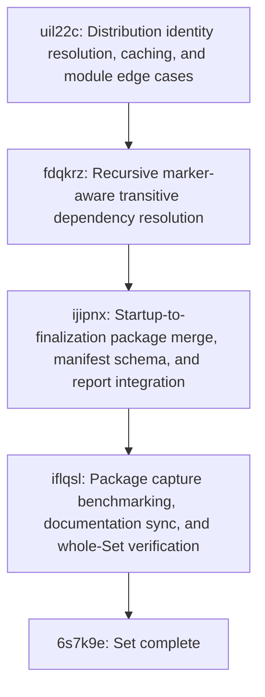
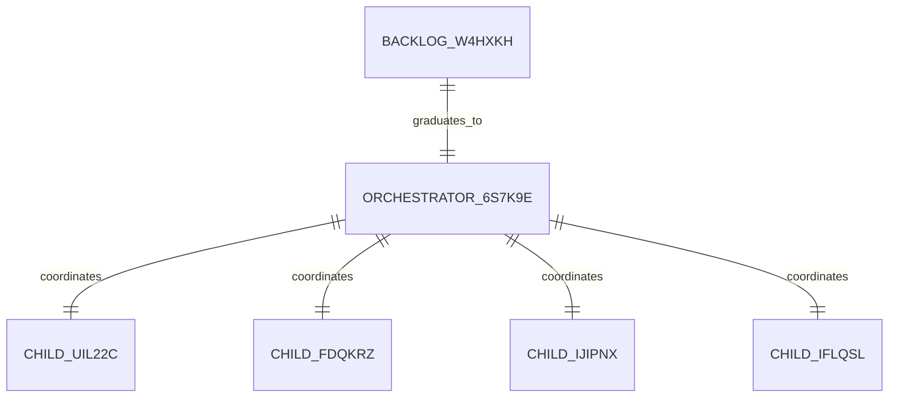

# IPD: Dependency capture accuracy, late-import refresh, and transitive resolution

- Date: 2026-11-21
- Kind: orchestrator
- Concern: Accurate import-to-distribution identity resolution, recursive marker-aware transitive closure, startup-to-finalization package refresh and merge, performance benchmarking, and documentation sync.
- Scope: Coordinate four ordered child plans graduating backlog item `w4hxkh` across distribution identity resolution and caching, recursive marker-aware transitive resolution, startup-to-finalization manifest lifecycle and consumer integration, and benchmarking plus documentation and whole-Set validation.
- Scope-Paths: .aw/records/plans/pending/20261121-dep-capture-00-6s7k9e-dependency-capture-accuracy-late-import-refresh-and-transiti.ipd.md
- Item-Dependencies: executed:uil22c, executed:fdqkrz, executed:ijipnx, executed:iflqsl
- Status: executed
- Readiness: go-pending-approval
- Review-Depth: orchestrator
- Coverage: pass
- Coverage-Fingerprint: f8de33231a6c58ff62eb960d8c5c15bf8b6db71373ac6503978321d24dc306d8
- Coverage-Checked: 2026-11-22 by uri/its_direct/pt3-claude-opus-5.5-1m-us
- Short-Description: Coordinate distribution identity resolution, marker-aware transitive closure, startup/finalization refresh, benchmarking, and docs sync
- Work-Kind: bug
- Priority: high
- From-Backlog: w4hxkh
- Blocks-Release: next
- Set: dep-capture
- Order: 0
- Highest E allocated: 04
- Author: agent
- Id: 6s7k9e

> Write and proofread this plan per the technical writing standard, `.aw/system/workflows/technical-writing/technical-writing.md` (`.agents/workflows/technical-writing/technical-writing.md` in a legacy-layout install), including requirement 12 (diagrams).

## Workflow history

- 2026-11-23 executed (aw oc run model=uri/its_direct/pt3-claude-opus-5.5-1m-us variant=high profile=opus): RETIRED as the orchestrator rollup step of a runner Set completion, not executed by an agent: every child of Set dep-capture reached executed, so the runner (run run-20261122T213711Z-2482986) retired this Order-0 plan as bookkeeping. Its own E-*/V-* items were NOT performed; the runner superseded them by enforcing the ordering, the isolation and the per-child merge gate. Justifying children: uil22c, fdqkrz, ijipnx, iflqsl.
- 2026-11-22 approved (aw set): status set to approved
- 2026-11-22 /plan-review (Gemini 4 Neon (High)): APPROVE WITH REVISIONS APPLIED; PR-001, PR-002, PR-003, PR-004
- 2026-11-22 coverage pass (aw oc run): fingerprint f8de33231a6c, model uri/its_direct/pt3-claude-opus-5.5-1m-us
- 2026-11-22 coverage pass (aw oc run): fingerprint 52d2930d50dd, model uri/its_direct/pt3-claude-opus-5.5-1m-us
- 2026-11-21 draft (agent): created.
- 2026-11-21 to-review (agent): authored review-ready orchestrator plan graduating backlog item `w4hxkh` into Set `dep-capture` with four child plans (`uil22c`, `fdqkrz`, `ijipnx`, `iflqsl`).

## Goal

Graduate backlog item `w4hxkh` (`.aw/records/backlog/graduated/20261121-pubrun-improve-01-w4hxkh-dependency-capture.backlog.md`) into four bounded, independently verifiable child Implementation Plan Documents (IPDs). Together, the four child plans capture libraries imported after `import pubrun`, resolve import module names to installed Python distribution names on Python 3.8 through 3.14 using only the Python standard library, and compute a truthful recursive marker-aware transitive closure. They also benchmark startup and finalization overhead separately in small and large environments, and synchronize the manifest schema, default configuration comments, and user documentation.

### Set structure and execution sequence

The child table and text below are normative. These diagrams summarize the execution sequence and artifact relationships in Set `dep-capture`.

## Detailed Implementation Checklist (TODO)

> Its own E-*/V-* items were NOT performed; the runner superseded them by enforcing the ordering, the isolation and the per-child merge gate.

Execution-state rule: mark an `E-*` item complete only after performing the action. That mark is not validation. Right-sizing rule: write for a modest executor that cannot hold much in its head. Each E-item is one step (one concern, about one file, executable in one focused pass) and its V-item names each unit it covers with its own check; a plan stays at about 5 E-items and 8 work Scope-Paths, else split it into more child plans (guidance, `IPD-Z603`). Accepted execution states: blocked, failed, pending, performed; terminal gate demands 'performed'.

### Task group 1: Confirm child IPD execution

- [ ] E-01 CONFIRM uil22c REACHED executed
  - Depends on: none
  - Expected outcome: Child plan `uil22c` (`20261121-dep-capture-01-uil22c-distribution-identity-resolution-caching-and-module-edge-cas.ipd.md`) is in `.aw/records/plans/executed/` with `- Status: executed`, all `E-*` items marked `performed`, and all `V-*` items marked `pass`.
  - Execution state: pending

- [ ] E-02 CONFIRM fdqkrz REACHED executed
  - Depends on: E-01
  - Expected outcome: Child plan `fdqkrz` (`20261121-dep-capture-02-fdqkrz-recursive-marker-aware-transitive-dependency-resolution.ipd.md`) is in `.aw/records/plans/executed/` with `- Status: executed`, all `E-*` items marked `performed`, and all `V-*` items marked `pass`.
  - Execution state: pending

- [ ] E-03 CONFIRM ijipnx REACHED executed
  - Depends on: E-02
  - Expected outcome: Child plan `ijipnx` (`20261121-dep-capture-03-ijipnx-startup-to-finalization-package-merge-manifest-schema-and-re.ipd.md`) is in `.aw/records/plans/executed/` with `- Status: executed`, all `E-*` items marked `performed`, and all `V-*` items marked `pass`.
  - Execution state: pending

- [ ] E-04 CONFIRM iflqsl REACHED executed
  - Depends on: E-03
  - Expected outcome: Child plan `iflqsl` (`20261121-dep-capture-04-iflqsl-package-capture-benchmarking-documentation-sync-and-whole-se.ipd.md`) is in `.aw/records/plans/executed/` with `- Status: executed`, all `E-*` items marked `performed`, and all `V-*` items marked `pass`.
  - Execution state: pending

## Child IPDs, sequence, and dependencies

| Order | Id | File | What it does | Depends on |
|---|---|---|---|---|
| 01 | `uil22c` | `20261121-dep-capture-01-uil22c-distribution-identity-resolution-caching-and-module-edge-cas.ipd.md` | Implements Python Enhancement Proposal (PEP) 503 normalization, a single-pass environment-fingerprinted distribution index and cache with Python 3.8 through 3.14 support, safe concurrent `sys.modules` snapshotting without importing modules, shared lookup helpers compatible with `repro-check`, genuine `top-level-installed` root filtering via `importlib.metadata`, explicit handling of mismatched import/distribution names, namespace packages, ambiguous distributions, standard-library modules, local-only modules, PEP 610 editable installs (without leaking `direct_url.json` URLs), and missing metadata while keeping `get_packages()` schema-valid until `ijipnx`, plus deterministic fixture tests. | none |
| 02 | `fdqkrz` | `20261121-dep-capture-02-fdqkrz-recursive-marker-aware-transitive-dependency-resolution.ipd.md` | Adds a Python standard-library PEP 508 requirement and marker evaluator with PEP 440 version comparison and legacy marker aliases (`src/pubrun/capture/_markers.py`), refactors `imported-transitive` mode to compute a recursive, cycle-safe, extra-honest closure that exposes missing applicable dependencies and unparseable markers as `partial` capture with `ijipnx`-compatible `unresolved` entries, and adds transitive behavioral tests. | 01 |
| 03 | `ijipnx` | `20261121-dep-capture-03-ijipnx-startup-to-finalization-package-merge-manifest-schema-and-re.ipd.md` | Extends `schemas/manifest.schema.json` additively (`$defs.unresolved_package_record`, `snapshot_stage`, `unresolved`, `local_modules`, `coverage_notes`, `import_names`, `observed_at`), implements non-mutating `merge_package_snapshots()` retaining removed startup modules and computing transitive closure once (`include_transitive=False`) without a global import hook, wires finalization refresh into `Run._finalize_state()`, updates `src/pubrun/report/methods.py` (PEP 503 highlights), `src/pubrun/report/diagnostics.py` (shared `[ Packages ]` renderer and `unresolved` summary), and `src/pubrun/tui/widgets/details.py` (`_filter_package_rows` null-version guard), and adds lifecycle and schema tests. | 02 |
| 04 | `iflqsl` | `20261121-dep-capture-04-iflqsl-package-capture-benchmarking-documentation-sync-and-whole-se.ipd.md` | Adds a local, non-publishing startup-versus-finalization benchmark across small (10 dists), large (300 dists), and ambient environments (`benchmarks/package_capture_bench.py`) plus `tests/test_package_benchmark.py`, extends `benchmarks/scenarios.py` (`feature-packages-transitive`), records single-machine measured results and limits in `docs/performance.md` (preserving `## Representative results` placeholder), reconciles `src/pubrun/resources/default.toml`, `docs/manifest.md`, `docs/configuration.md`, and `docs/architecture.md` with zero added em/en dashes, and runs full-Set validation. | 03 |

## Completion criteria (the whole Set is done only when)

- Modules whose import name differs from their installed distribution name resolve accurately using standard metadata facilities with a Python 3.8 and 3.9 fallback, cached per environment fingerprint with defined invalidation, without importing target libraries or crashing the host. Namespace, ambiguous, standard-library, local-only, editable (without leaking `direct_url.json` URLs), `top-level-installed`, missing-metadata, and concurrent `sys.modules` mutation cases produce deterministic, truthful outcomes and degrade to `partial` capture with explicit reasons when resolution fails or stays ambiguous. Owner: `uil22c`.
- `imported-transitive` mode computes a recursive, cycle-safe closure of applicable PEP 508 declared dependencies using a pure standard-library marker evaluator supporting PEP 440 comparisons and legacy aliases. It handles optional extras without mislabeling unrequested installed extras as required, propagates parent-requested extras, exposes missing applicable transitive dependencies or unparseable markers as `partial` capture rather than `complete`, and keeps `imported-only` as the default mode. Owner: `fdqkrz`.
- Importing `pubrun` before loading a synthetic distribution records that distribution in the final manifest while keeping the startup snapshot truthful, retains distributions observed at startup even if deleted from `sys.modules` before finalization, handles mid-run mode switches and `mode = "off"` (`"mode"` omitted), and avoids installing a global import hook by default. Final manifests validate against `schemas/manifest.schema.json` alongside legacy v1.0 manifests, and `methods.py`, `diagnostics.py`, and Terminal User Interface (TUI) details rendering (`_filter_package_rows`) handle null versions, PEP 503 highlight matching, and `unresolved` entries safely. Owner: `ijipnx`.
- Local, non-publishing benchmarks measure startup and finalization package capture separately in small (10 distributions), large (300 distributions), and ambient environments (with optional shared-storage `--workdir`), comparing against `mode = "off"` across cold and warm passes. Single-machine results with environment, Git revision, detected filesystem type, workload, repetitions, and dispersion are recorded in `docs/performance.md` while keeping `## Representative results` untouched as a placeholder, `src/pubrun/resources/default.toml`, `docs/manifest.md`, `docs/configuration.md`, and `docs/architecture.md` are reconciled with zero added em or en dashes, and whole-Set regression verification passes. Owner: `iflqsl`.

## Cross-IPD validation

- Identity-to-transitive contract: child `uil22c` establishes canonical distribution resolution, PEP 503 normalization (`normalize_package_name`), and shared lookup (`get_installed_distribution_versions`) consumed by both `fdqkrz` (recursive transitive closure) and sibling Set `repro-check` (`tusvtd`), verified by running `tests/test_package_resolution.py` alongside `tests/test_package_transitive.py` and `tests/test_manifest_schema.py` in `fdqkrz`. Owner: `fdqkrz`.
- Capture-to-manifest-and-report contract: child `ijipnx` integrates the resolver from `uil22c` and transitive closure from `fdqkrz` into `Run._bootstrap_engines()` and `Run._finalize_state()`, validating both startup and final manifests against `schemas/manifest.schema.json` and verifying late-imported highlighted distributions appear in `methods.md` and `pubrun show packages`. Owner: `ijipnx`.
- Whole-Set regression, benchmark, and hygiene verification: child `iflqsl` executes `pytest tests/ -v`, `pytest benchmarks/test_benchmarks.py benchmarks/test_share_safety.py -o addopts="" -v`, `python3 examples/verify_all.py`, `python3 scripts/sanitize_paths.py --check --all`, `git status --short`, and the diff-scoped em/en dash check after `uil22c`, `fdqkrz`, and `ijipnx` complete. Owner: `iflqsl`.

## Deferred / out of scope (with reason)

- Default global import hook (`sys.meta_path` or `builtins.__import__` patching): explicitly excluded by `w4hxkh` to preserve host-program behavior and zero-overhead import paths; transient mid-run import-then-delete limitations are documented honestly instead.
  - Carrier-Declined: explicitly excluded by backlog item w4hxkh; transient mid-run unload limitation is documented in ijipnx and iflqsl.
- Mandatory third-party `packaging` dependency or scientific-framework dependencies (`scikit-learn`, `Pillow`, `numpy`): explicitly prohibited by `w4hxkh`; all resolution, marker evaluation, and tests use the Python standard library and deterministic local fixtures.
  - Carrier-Declined: explicitly prohibited by backlog item w4hxkh.
- Reproducibility preflight assessment logic: owned by sibling Set `repro-check` (`osjxbz`, backlog item `q3bll1`), which consumes `normalize_package_name` and `get_installed_distribution_versions` from `src/pubrun/capture/packages.py` rather than building a second package resolver.
  - Carrier: osjxbz
- External benchmark submission, GitHub Gist creation, GitHub Issue posting, and High-Performance Computing (HPC) scheduler job submission: out of scope and prohibited without explicit maintainer authorization.
  - Carrier-Declined: prohibited by policy without explicit maintainer authorization.
- Multi-operating-system and multi-Python Continuous Integration (CI) matrix execution (`ubuntu-latest`, `ubuntu-24.04`, `windows-latest`, `macos-latest` across Python 3.8 through 3.14 in `.github/workflows/ci.yml`): cannot run inside a single local Linux worktree and must pass on pull request or push before release; noted explicitly by `iflqsl`.
  - Carrier-Declined: executed automatically by GitHub Actions CI (.github/workflows/ci.yml) on pull request or push; unavailable in a single local Linux worktree.

## Scope check

- Over-scope: none. Every child plan addresses only the dependency capture, identity resolution, caching, transitive closure, startup/finalization refresh, benchmarking, schema, and documentation requirements of `w4hxkh`.
- Under-scope: none. All five implementation guidance items, all six acceptance criteria, and all shared validation and documentation requirements in `w4hxkh` are assigned to child plans `uil22c`, `fdqkrz`, `ijipnx`, and `iflqsl`.

## Required tests / validation

This orchestrator plan runs no tests directly. Whole-Set validation is performed by its child plans:

- Child `uil22c` runs `pytest tests/test_package_resolution.py tests/test_capture_engines.py tests/test_edge_cases.py tests/test_new_features.py tests/test_manifest_schema.py -v`.
- Child `fdqkrz` runs `pytest tests/test_package_transitive.py tests/test_package_resolution.py tests/test_new_features.py tests/test_capture_engines.py tests/test_edge_cases.py tests/test_manifest_schema.py -v`.
- Child `ijipnx` runs `pytest tests/test_package_lifecycle.py tests/test_manifest_schema.py tests/test_package_resolution.py tests/test_package_transitive.py tests/test_capture_engines.py tests/test_edge_cases.py tests/test_new_features.py tests/test_tracker.py tests/test_reports.py tests/test_show_sections.py tests/test_methods_multi.py tests/test_tui.py tests/test_quality.py -v`.
- Child `iflqsl` runs `python3 benchmarks/package_capture_bench.py --small-count 10 --large-count 300 --repetitions 10 --cold-runs 3`, `pytest tests/test_package_benchmark.py -v`, `pytest tests/ -v`, `pytest benchmarks/test_benchmarks.py benchmarks/test_share_safety.py -o addopts="" -v`, `python3 examples/verify_all.py`, `python3 scripts/sanitize_paths.py --check --all`, `git status --short`, and the diff-scoped em/en dash check over updated documentation files.

## Open questions

### OQ-01: Proposed additive manifest field names under `packages`

- Blocking: no
- Status: resolved
- Owner: plan author (binding upon plan approval)
- Resolution or deferral rationale: Backlog item `w4hxkh` notes that new manifest and API field names are proposals rather than pre-approved contracts. Child `ijipnx` proposes additive optional fields in `schemas/manifest.schema.json`: `snapshot_stage`, `unresolved`, `local_modules`, and `coverage_notes` on `$defs.packages_section`, and `import_names` and `observed_at` on `$defs.package_record` (plus `$defs.unresolved_package_record`). All existing required fields remain unchanged so legacy v1.0 manifests stay valid. The maintainer may rename any proposed field during review before approving `ijipnx`.

### OQ-02: Shared-storage benchmark availability during local execution

- Blocking: no
- Status: resolved
- Owner: plan author (binding upon plan approval)
- Resolution or deferral rationale: Local developer machines and CI runners normally expose only local storage (such as `ext4` or `tmpfs`), while shared Network File System (NFS) or Lustre storage is available only on cluster nodes. Child `iflqsl` records the detected filesystem type via `src/pubrun/capture/filesystem.py::get_filesystem`, documents local-storage scope honestly, and provides an optional `--workdir` argument on `benchmarks/package_capture_bench.py` so the maintainer can re-run the identical benchmark on shared storage without code changes.

## Validation and cross-check (verify before reporting the Set complete)

Validation-state rule: inspect evidence in a separate pass. Do not mark a `V-*` item complete from memory or from the matching execution checkmark. Accepted validation results: blocked, failed, pass, pending; terminal gate demands 'pass'. Runtime-demonstration reachability rule: for each `V-*` item demanding the software be observed acting (such as a run, a dispatch, or a transition) (as distinct from items demanding a diff, a file's content, or a test result, which are reachable by construction), name the code path that produces the observation or the sibling `E-*` that creates it, else the demand is UNDER-SCOPE.

- [ ] V-01 validates E-01
  - Required evidence: Path `.aw/records/plans/executed/20261121-dep-capture-01-uil22c-distribution-identity-resolution-caching-and-module-edge-cas.ipd.md` exists, shows `- Status: executed`, has all `E-*` items `performed` and all `V-*` items `pass`, and `aw ipd lint --phase post-transition` exits 0 on it.
  - Observed evidence:
  - Result: pending

- [ ] V-02 validates E-02
  - Required evidence: Path `.aw/records/plans/executed/20261121-dep-capture-02-fdqkrz-recursive-marker-aware-transitive-dependency-resolution.ipd.md` exists, shows `- Status: executed`, has all `E-*` items `performed` and all `V-*` items `pass`, and `aw ipd lint --phase post-transition` exits 0 on it.
  - Observed evidence:
  - Result: pending

- [ ] V-03 validates E-03
  - Required evidence: Path `.aw/records/plans/executed/20261121-dep-capture-03-ijipnx-startup-to-finalization-package-merge-manifest-schema-and-re.ipd.md` exists, shows `- Status: executed`, has all `E-*` items `performed` and all `V-*` items `pass`, and `aw ipd lint --phase post-transition` exits 0 on it.
  - Observed evidence:
  - Result: pending

- [ ] V-04 validates E-04
  - Required evidence: Path `.aw/records/plans/executed/20261121-dep-capture-04-iflqsl-package-capture-benchmarking-documentation-sync-and-whole-se.ipd.md` exists, shows `- Status: executed`, has all `E-*` items `performed` and all `V-*` items `pass`, and `aw ipd lint --phase post-transition` exits 0 on it.
  - Observed evidence:
  - Result: pending

## Approval and execution gate

- Size assessment: standard
- Cohesion rationale: not required

This orchestrator plan coordinates Set `dep-capture` (`uil22c`, `fdqkrz`, `ijipnx`, `iflqsl`) and executes no application code directly.

Execution contract:
1. Open questions: all open questions (`OQ-01`, `OQ-02`) are resolved for review and become binding upon human approval of this Set (`- Status: approved`).
2. Scope declaration: this orchestrator declares only its own plan file as `- Scope-Paths:` for lifecycle retirement; it executes no application code and adds no non-confirmation checklist items.
3. Honesty rule (HARD MUST): confirm child completion only by inspecting the executed child plan files on disk and running `aw ipd lint --phase post-transition`, pasting actual runner output and exit codes into each `V-*` `Observed evidence:` field; never claim a child reached `executed` without verifying its file state.
4. Commit and push discipline: retire this orchestrator via `aw commit` path-scoped to its moved plan file (or let the `aw` runner retire it); never use `git add -A`, `git add .`, or `git commit -a`; never push without explicit human instruction.
5. Lifecycle transition on completion: once all four child plans (`uil22c`, `fdqkrz`, `ijipnx`, `iflqsl`) reach `executed` on disk, this orchestrator must reach `.aw/records/plans/executed/` with `- Status: executed` through `aw ipd finalize`. Under an `aw` runner, the runner automatically retires the orchestrator once every child is `executed` and coverage passes; in standalone execution, run `aw ipd finalize 6s7k9e` directly. Never hand-roll a raw `git mv` to `.aw/records/plans/executed/`.
