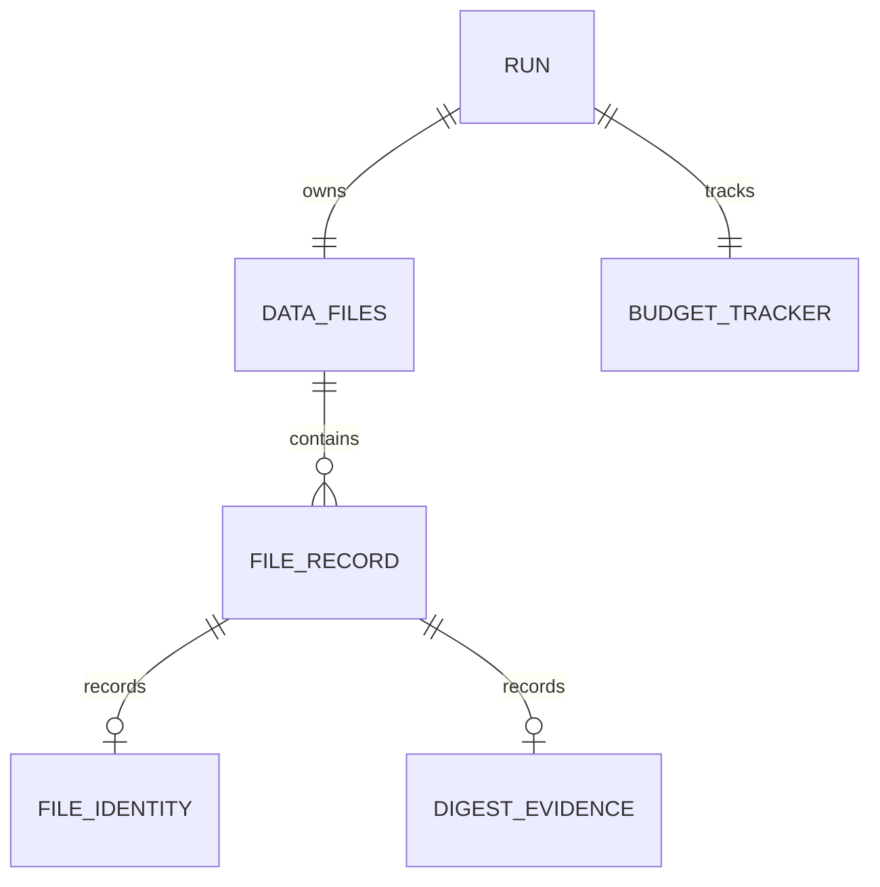
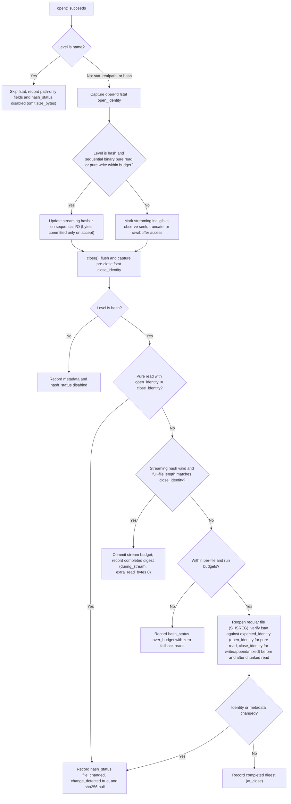

# IPD: File provenance engine, hashing guarantees, and proxy hardening

- Date: 2026-11-21
- Kind: child
- Concern: File provenance record contract, per-file and run-wide hashing budgets, identity and change detection, streaming-hash evaluation, manifest schema reconciliation, and `ProvenanceFileProxy` hardening
- Scope: Add run-wide hashing budget defaults in `src/pubrun/resources/default.toml`, reconcile and extend `data_files` in `schemas/manifest.schema.json`, create `src/pubrun/capture/file_io.py`, wire `src/pubrun/core.py` and `src/pubrun/tracker.py`, and add behavioral and schema tests in `tests/test_file_io_provenance.py` and `tests/test_manifest_schema.py`.
- Scope-Paths: src/pubrun/resources/default.toml, schemas/manifest.schema.json, src/pubrun/capture/file_io.py, src/pubrun/core.py, src/pubrun/tracker.py, tests/test_file_io_provenance.py, tests/test_manifest_schema.py
- Scope-Exceeded: .aw/records/backlog/open/20261122-12rcu8-01-12rcu8-fix-testissameprocess-test-expected-script-matches.backlog.md (Defect report backlog carrier required by driver contract for pre-existing xdist failure in tests/test_liveness.py)
- Item-Dependencies: none
- Status: executed
- Readiness: go-pending-approval
- Review-Depth: complex
- Short-Description: Build file provenance core, budgets, change detection, streaming evaluation, schema, and proxy hardening
- Work-Kind: feature
- Priority: medium
- From-Backlog: x6alw4
- Set: file-prov
- Order: 1
- Highest E allocated: 05
- Author: agent
- Id: xxi3nc

> Write and proofread this plan per the technical writing standard, `.aw/system/workflows/technical-writing/technical-writing.md` (`.agents/workflows/technical-writing/technical-writing.md` in a legacy-layout install), including requirement 12 (diagrams).

## Workflow history

- 2026-11-22 executed (aw agy run model=Gemini-4-Neon-High): aw agy run self-finalize: xxi3nc verified (set file-prov, attempt 1). [Scope reconciliation - out-of-scope .aw/records/backlog/open/20261122-12rcu8-01-12rcu8-fix-testissameprocess-test-expected-script-matches.backlog.md: Defect report backlog carrier required by driver contract for pre-existing xdist failure in tests/test_liveness.py]
- 2026-11-22 approved (aw set): status set to approved
- 2026-11-22 /plan-review (Antigravity / Gemini 4 Neon (High)): APPROVE WITH REVISIONS APPLIED; PR-001, PR-002, PR-003, PR-004, PR-005, PR-006, PR-007
- 2026-11-21 to-review (agent): authored child plan 01 of Set `file-prov` graduating backlog item `x6alw4`.

## Goal

Establish a dedicated, Python standard-library file-provenance engine in `src/pubrun/capture/file_io.py` with explicit hashing outcomes, per-file and run-wide byte and time budgets, file-identity change detection, honest mixed-mode (`r+`, `w+`, `a+`, `x+`) classification, and safe sequential-binary streaming hashing with whole-file fallback. Fix existing `data_files` schema drift in `schemas/manifest.schema.json` and harden `pubrun.open()` without patching `builtins.open`, adding startup import cost, or altering host exceptions.

### File provenance entities and hashing flow

These diagrams summarize the core entities and the `ProvenanceFileProxy` close-time decision flow. The text in `## Proposed changes (ordered, validatable)` is normative.

## Detailed Implementation Checklist (TODO)

Execution-state rule: mark an `E-*` item complete only after performing the action. That mark is not validation. Right-sizing rule: write for a modest executor that cannot hold much in its head. Each E-item is one step (one concern, about one file, executable in one focused pass) and its V-item names each unit it covers with its own check; a plan stays at about 5 E-items and 8 work Scope-Paths, else split it into more child plans (guidance, `IPD-Z603`). Accepted execution states: blocked, failed, pending, performed; terminal gate demands 'performed'.

### Task group 1: Configuration defaults and manifest schema contract

- [x] E-01 Add run-wide hashing budget and algorithm keys under `[capture.file_io]` in `src/pubrun/resources/default.toml` and update `schemas/manifest.schema.json` for `data_files`.
  - Depends on: none
  - Expected outcome: `src/pubrun/resources/default.toml` defines `[capture.file_io].max_total_hash_bytes = 0`, `max_total_hash_seconds = 0.0`, and `hash_algorithm = "sha256"` alongside existing `level = "stat"` and `max_hash_bytes = 0`, and updates the comment to describe open-file-descriptor (`fstat`) capture and budget behavior accurately. `schemas/manifest.schema.json` fixes existing `data_files` drift (making `sha256` nullable, `size_bytes` optional at `name` level, and allowing `mtime`, `ctime`, `realpath`), keeps `mixed` and `hashing_summary` optional for legacy manifest compatibility, and defines `$defs.file_provenance_record` with `"additionalProperties": false` covering all fields used by this plan and child plan `52dl55` (external file registration API).
  - Execution state: performed

### Task group 2: Core file provenance module and proxy hardening

- [x] E-02 Create `src/pubrun/capture/file_io.py` with identity snapshots, budget tracking, checked hashing, mode classification, deduplication, pending-registration hook, and hardened `ProvenanceFileProxy`.
  - Depends on: E-01
  - Expected outcome: `src/pubrun/capture/file_io.py` uses only the Python standard library (Python 3.8+) and implements `FileIoBudgetTracker` (thread-safe per-file byte cap, run-wide total byte cap, run-wide monotonic time cap, stream commit helper, and summary export), `FileIdentity` snapshots (comparing `st_ino`/`st_dev` only when non-zero), `classify_open_mode(mode)`, `hash_file_checked(...)` (regular-file `stat.S_ISREG` guard, pre-open budget checks, 64 kibibyte (KiB) chunked reads, before-and-after `fstat` verification), `append_or_deduplicate_record(...)`, a no-op `finalize_pending_registrations(run_instance)` hook extended by child plan `52dl55`, and `ProvenanceFileProxy`. `ProvenanceFileProxy` omits `fstat`/`size_bytes` at `level == "name"`, implements `__iter__` returning `self` with `__next__`, handles `readinto`/`readinto1`/`write` byte slices via `memoryview(...).cast("B")`, evaluates streaming hashing strictly for sequential binary pure reads and writes without double-counting budgets, uses `open_identity` for pure-read fallback and `close_identity` for write/append/mixed fallback, and never substitutes a partial or stream-of-reads hash for a whole-file digest.
  - Execution state: performed

### Task group 3: Wire `pubrun.core` and `pubrun.tracker`

- [x] E-03 Integrate `pubrun.capture.file_io` into `src/pubrun/core.py` and `src/pubrun/tracker.py`.
  - Depends on: E-02
  - Expected outcome: `src/pubrun/core.py` removes top-level `import hashlib`, loads `pubrun.capture.file_io` lazily inside `pubrun.open()`, exposes `ProvenanceFileProxy` via Python Enhancement Proposal (PEP) 562 module `__getattr__` (adding zero import cost and keeping `pubrun.capture.file_io` absent from `sys.modules` on cold `import pubrun`), and preserves exact `builtins.open()` return values, integer-fd handling, and host exceptions. `src/pubrun/tracker.py` initializes `self.data_files = {"inputs": [], "outputs": [], "mixed": []}` (including in Ghost Mode), adds `_data_files_lock`, `_file_io_budget = None`, and `_pending_file_registrations = []`, calls `finalize_pending_registrations(self)` inside an independent `try/except` in `Run._finalize_state()` only when `_pending_file_registrations` is non-empty, and snapshots `data_files` (with optional `hashing_summary` when `_file_io_budget is not None`) safely in `Run.to_manifest_dict()`.
  - Execution state: performed

### Task group 4: Behavioral and schema conformance tests

- [x] E-04 Expand `tests/test_file_io_provenance.py` to test every hashing guarantee, budget cap, change-detection case, streaming-vs-fallback read pattern, and mixed mode.
  - Depends on: E-03
  - Expected outcome: `tests/test_file_io_provenance.py` proves with targeted behavioral tests: (1) all five detail levels (`none`, `name` omitting `size_bytes`, `stat`, `realpath`, `hash`) produce distinct honest `hash_status` and `evidence_strength` values; (2) a large sparse file (or mocked `os.stat`/reader) exceeding `max_hash_bytes` or `max_total_hash_bytes` records `hash_status == "over_budget"` with zero content-read calls; (3) `max_total_hash_seconds` stops hashing cleanly with `hash_status == "over_budget"`; (4) permission error records `hash_status == "failed"` and non-regular files refuse hashing with `hash_status == "unavailable"`; (5) replacing or modifying a file between open, close, and hash records `hash_status == "file_changed"`, `change_detected == True`, and `sha256 is None`; (6) sequential binary `"rb"` (including `for line in f:` iteration and `readinto` on `bytearray`/`array.array`) and `"wb"` streams hash in one pass (`observation_time == "during_stream"`, `extra_read_bytes == 0`) with accurate budget accounting and zero double-counting on fallback, while partial read, `seek()`, reread, text mode (`"r"`, `"w"`), append (`"a"`), and mixed modes (`"r+"`, `"w+"`, `"a+"`, `"x+"`) preserve exact file semantics and whole-file digests; (7) `r+`/`w+`/`a+`/`x+` land in `data_files["mixed"]` with `role == "input_output"`; (8) `builtins.open` is never monkeypatched and host exceptions propagate unchanged.
  - Execution state: performed

- [x] E-05 Add populated `data_files` schema conformance tests in `tests/test_manifest_schema.py`.
  - Depends on: E-04
  - Expected outcome: `tests/test_manifest_schema.py` validates real manifests containing populated `data_files` (`inputs`, `outputs`, `mixed`, `hashing_summary`) across `name`, `stat`, `realpath`, and `hash` levels, over-budget skips, and changed-file records (alongside legacy manifests lacking `mixed` and `hashing_summary`) against `schemas/manifest.schema.json` using `jsonschema.validate`.
  - Execution state: performed

## Project conventions discovered (Step 0)

- `src/pubrun/core.py` currently imports `hashlib` at module top level (used only inside `ProvenanceFileProxy._compute_hash_on_disk`), defines `_FILE_IO_LEVELS`, `_file_io_level`, `ProvenanceFileProxy`, and `open` inline; `src/pubrun/core.py::ProvenanceFileProxy._is_read_mode` uses `"r" in self._mode and "w" not in self._mode and "a" not in self._mode`, and `ProvenanceFileProxy.__iter__` returns `iter(self._file_obj)` (bypassing `__next__`).
- `src/pubrun/tracker.py::Run.__init__` initializes `self.data_files = {"inputs": [], "outputs": []}` (omitting it on Ghost Mode early return) and serializes it in `src/pubrun/tracker.py::Run.to_manifest_dict`.
- `src/pubrun/resources/default.toml` defines `[capture.file_io]` with `level = "stat"` and `max_hash_bytes = 0`.
- `schemas/manifest.schema.json` defines `properties.data_files` with `"additionalProperties": false`, currently requires `size_bytes` (integer) and `sha256` (non-null string) on every item in `inputs` and `outputs`, and already defines `$defs.hash_record` (`algorithm`, `value`).
- `tests/test_manifest_schema.py` validates real manifests and `tests/fixtures/sample_manifest.json` via `jsonschema.validate`, but currently only generates manifests with empty `data_files`.
- `tests/test_file_io_provenance.py::TestFileIoLevels.test_name_level_no_stat_no_hash` explicitly asserts `"size_bytes" not in inp` at `level == "name"`; `tests/test_explicit_api.py::test_pubrun_open_provenance`, `tests/test_new_features.py::TestWriteModeHashing`, and `tests/test_file_io_provenance.py` assert that `inputs[0]["path"]`, `size_bytes`, `mtime`, `ctime`, `realpath`, and `sha256` remain populated at their respective levels.
- Runtime code supports Python 3.8+ using only the Python standard library (`tomli` on Python < 3.11 is the sole third-party dependency in `pyproject.toml`).
- Sibling pending plans `e1fwy2` (Set `timing-acc`), `ed0yds` (Set `cap-isolation`), and `tkmm5p` (Set `startup-perf`) also edit `src/pubrun/tracker.py` (and `ed0yds` edits `src/pubrun/core.py`). Wrapping `finalize_pending_registrations(self)` in an independent `try/except` in `Run._finalize_state()` and preserving any sibling timing/isolation/writer hooks keeps all Sets mutually compatible.

## Findings

1. **Silent `sha256: null` ambiguity (`src/pubrun/core.py::ProvenanceFileProxy._compute_hash_on_disk`)**: Returns `None` identically when hashing is disabled (`level != "hash"`), when `size > max_hash_bytes`, when the file does not exist, or when reading raises `OSError`/`PermissionError`.
2. **Post-close path reopen race (`src/pubrun/core.py::ProvenanceFileProxy.close` and `_register_provenance`)**: Closes `_file_obj` first, then calls `os.stat(self._path)` and reopens `self._path` by name. No open-time `os.fstat(fd)` identity is recorded, so a file replaced or modified between open and close is silently hashed as if it were the consumed input. Meanwhile, comments in `src/pubrun/resources/default.toml` and `docs/api.md` inaccurately state that `stat` uses `fstat` on the open file descriptor (fd).
3. **Mixed-mode misclassification (`src/pubrun/core.py::ProvenanceFileProxy._is_read_mode`)**: Treats `"r+"` / `"rb+"` as read-only inputs even though they can mutate the file, and treats `"w+"` / `"a+"` / `"x+"` as write-only outputs even though they allow reads.
4. **Duplicate full-file input/output (I/O) at `level = "hash"` (`src/pubrun/core.py::ProvenanceFileProxy._compute_hash_on_disk`)**: Always reopens and reads every byte a second time after `close()`, even for sequential binary reads or writes where a single-pass Secure Hash Algorithm 256-bit (SHA-256) hash would match the exact on-disk bytes.
5. **No run-wide hashing budget**: Only per-file `max_hash_bytes` exists; batch workloads opening or registering many medium files have no total byte or time cap.
6. **Pre-existing schema drift (`schemas/manifest.schema.json` `properties.data_files`)**: Requires non-null string `sha256` and integer `size_bytes` on all `data_files` items, which fails validation for real runs at default `level = "stat"` (`sha256: null`) and `level = "name"` (no `size_bytes`).

## Proposed changes (ordered, validatable)

1. **`src/pubrun/resources/default.toml`**:
   - Under `[capture.file_io]`, keep `level = "stat"` and `max_hash_bytes = 0` unchanged for backward compatibility.
   - Add `max_total_hash_bytes = 0` (`0` = no run-wide byte cap), `max_total_hash_seconds = 0.0` (`0.0` = no run-wide time cap), and `hash_algorithm = "sha256"`.
   - Correct the `[capture.file_io]` comment so it accurately describes open-fd `fstat` capture, streaming vs post-close hashing, and budget behavior.

2. **`schemas/manifest.schema.json`**:
   - Add `$defs.file_provenance_record` (`"type": "object"`, `"additionalProperties": false`) describing every record in `data_files.inputs`, `data_files.outputs`, and `data_files.mixed`:
     - Required: `["path"]`.
     - Optional typed fields: `path` (`string`), `realpath` (`["string", "null"]`), `label` (`["string", "null"]`), `role` (`enum: ["input", "output", "input_output"]`), `mode` (`["string", "null"]`), `open_disposition` (`["string", "null"]`, `enum: ["read", "write", "append", "exclusive_create", "read_write", null]`), `registration_source` (`["string", "null"]`, `enum: ["pubrun.open", "register_file", "register_input", "register_output", null]`), `entry_type` (`["string", "null"]`, `enum: ["file", "directory", "symlink", "special", "missing", "unsupported_remote_uri", null]`), `is_symlink` (`boolean`), `symlink_target` (`["string", "null"]`), `size_bytes` (`["integer", "null"]`, `minimum: 0`), `mtime` (`["number", "null"]`), `ctime` (`["number", "null"]`), `mtime_ns` (`["integer", "null"]`), `inode` (`["integer", "null"]`), `device` (`["integer", "null"]`), `sha256` (`["string", "null"]`), `digest` (`anyOf: [{"$ref": "#/$defs/hash_record"}, {"type": "null"}]`), `caller_digest` (`anyOf: [object with required algorithm/value strings and optional nullable boolean verified and additionalProperties false, null]`), `hash_status` (`["string", "null"]`, `enum: ["completed", "disabled", "over_budget", "unavailable", "failed", "file_changed", "asserted", "pending", null]`), `hash_status_detail` (`["string", "null"]`), `hash_algorithm` (`["string", "null"]`), `observation_time` (`["string", "null"]`, `enum: ["during_stream", "at_close", "at_registration", "at_finalization", "caller_supplied", "not_observed", null]`), `evidence_source` (`["string", "null"]`, `enum: ["observed", "asserted", "none", null]`), `evidence_strength` (`["string", "null"]`, `enum: ["verified_content", "asserted_content", "metadata_only", "path_only", "changed_unverified", "unavailable", null]`), `change_detected` (`boolean`), `change_details` (`["object", "null"]`), `access_observations` (`["object", "null"]`), `hash_stats` (`["object", "null"]`), `registration_count` (`integer`, `minimum: 1`), `registered_before_creation` (`boolean`), `accessed_at_utc` (`["number", "null"]`), `modified_at_utc` (`["number", "null"]`), `registered_at_utc` (`["number", "null"]`), `last_observed_at_utc` (`["number", "null"]`), `metadata` (`["object", "null"]`).
   - Update `properties.data_files` (keeping `"additionalProperties": false` and keeping `mixed` and `hashing_summary` optional so legacy manifests without them stay valid) to include `inputs`, `outputs`, `mixed` (arrays of `$ref: #/$defs/file_provenance_record`, default `[]`), and optional `hashing_summary` (`anyOf: [object with additionalProperties false reporting max_hash_bytes, max_total_hash_bytes, max_total_hash_seconds, hash_algorithm, total_bytes_hashed, total_hash_seconds, files_hashed, files_skipped_over_budget, files_changed, files_failed, null]`).

3. **`src/pubrun/capture/file_io.py`** (new stdlib-only module):
   - Constants: `FILE_IO_LEVELS = ("none", "name", "stat", "realpath", "hash")`, `HASH_STATUSES`, `EVIDENCE_SOURCES`, `EVIDENCE_STRENGTHS`, `OBSERVATION_TIMES`, `SUPPORTED_HASH_ALGORITHMS = ("sha256", "sha512", "sha1", "md5")` (default `"sha256"`).
   - Config validation helpers: validate `hash_algorithm` against `SUPPORTED_HASH_ALGORITHMS` (logging one warning per invalid value and falling back to `"sha256"`), and validate numeric caps (`max_hash_bytes`, `max_total_hash_bytes`, `max_total_hash_seconds`) for finite non-negative numbers (falling back safely to `0` / `0.0`).
   - `FileIdentity` helper capturing `(device, inode, size_bytes, mtime, ctime, mtime_ns, mode)` from `os.fstat(fd)` or `os.stat(path)`; identity equality compares `(size_bytes, mtime_ns)` always and compares `(device, inode)` whenever both sides have non-zero `inode` (avoiding false positives on Windows or virtual filesystems reporting `st_ino == 0`).
   - `FileIoBudgetTracker`: thread-safe (`threading.Lock`) tracker storing `max_hash_bytes`, `max_total_hash_bytes`, `max_total_hash_seconds`, `hash_algorithm`, cumulative `total_bytes_hashed`, `total_hash_seconds`, and outcome counters (`files_hashed`, `files_skipped_over_budget`, `files_changed`, `files_failed`). Provides:
     - `check_before_hash(size_bytes) -> Optional[str]` (read-only check returning an over-budget reason or `None`, checking per-file byte cap, remaining total byte cap, and remaining total time cap).
     - `consume_chunk(n_bytes, elapsed_seconds) -> Optional[str]` (increments cumulative totals during chunked fallback hashing and returns an over-budget reason if total byte or time cap is exceeded mid-file).
     - `commit_stream_hash(n_bytes, elapsed_seconds) -> None` (commits bytes and elapsed time once at `close()` when a streaming hash is accepted, ensuring invalidated streams never double-count bytes on fallback).
     - `record_outcome(status: str) -> None` and `to_summary_dict()`.
   - `classify_open_mode(mode: str) -> Tuple[str, str]`: returns `(role, open_disposition)`. Any mode containing `"+"` -> `("input_output", "read_write")`; pure `"w"` -> `("output", "write")`; pure `"a"` -> `("output", "append")`; pure `"x"` -> `("output", "exclusive_create")`; pure `"r"` (or default) -> `("input", "read")`.
   - `hash_file_checked(path, *, algorithm="sha256", budget=None, expected_identity=None, chunk_size=65536)`:
     - Checks `os.lstat` / `os.stat` safely: `FileNotFoundError` -> `hash_status="unavailable"` (`entry_type="missing"`); `PermissionError`/other `OSError` -> `hash_status="failed"` with bounded detail; directories and non-regular files (`not stat.S_ISREG(st.st_mode)`) -> `hash_status="unavailable"` BEFORE calling `open()` so FIFOs and devices never hang.
     - Checks `budget.check_before_hash(st.st_size)` BEFORE opening the file for reads so over-budget files perform zero content reads (critical for large sparse files and slow network filesystems).
     - Opens `path` in `"rb"`, captures `start_id = fstat(fd)`, verifies `stat.S_ISREG` and compares `start_id` against `expected_identity` (if supplied); on mismatch (replaced inode or changed size/mtime), closes immediately without reading and returns `hash_status="file_changed"`, `change_detected=True`, `sha256=None`, `digest=None`, `change_details=...`.
     - Streams 64 KiB chunks measuring monotonic time with `time.monotonic()`, calling `budget.consume_chunk(...)` per chunk; aborts cleanly with `hash_status="over_budget"` if a run-wide cap is hit mid-file.
     - Captures `end_id = fstat(fd)` before closing; if `end_id` differs from `start_id` or `bytes_hashed != end_id.size_bytes`, returns `hash_status="file_changed"`, `change_detected=True`, `sha256=None`, `digest=None`.
     - Otherwise returns `hash_status="completed"`, `digest={"algorithm": algorithm, "value": hex}`, `sha256=hex` (when `algorithm == "sha256"`, else `None`), and `hash_stats={"bytes_hashed": bytes_hashed, "extra_read_bytes": bytes_hashed, "hash_duration_seconds": duration}`.
   - `ProvenanceFileProxy`:
     - When `level == "name"`: skips `os.fstat` completely; at `close()`, emits path-only record omitting `size_bytes`, `mtime`, `ctime`, `mtime_ns`, `inode`, and `device` (preserving `tests/test_file_io_provenance.py::TestFileIoLevels.test_name_level_no_stat_no_hash`), with `hash_status="disabled"`, `evidence_source="observed"`, `evidence_strength="path_only"`, `sha256=None`.
     - When `level in ("stat", "realpath", "hash")`: captures `open_identity` immediately in `__init__` via `os.fstat(file_obj.fileno())` (when available) so `stat` metadata uses the open file descriptor and establishes a baseline for change detection.
     - Implements `__iter__(self)` returning `self` and `__next__(self)` calling `self.readline()` (raising `StopIteration` on empty return) so `for line in f:` participates cleanly in streaming tracking. In `__getattr__`, invalidates streaming (`self._stream_valid = False`) if caller accesses underlying `"raw"` or `"buffer"` attributes directly.
     - Evaluates streaming eligibility cleanly:
       - Binary pure-read (`role == "input"` and `"b" in mode` and `level == "hash"`): eligible only if `open_identity` is a regular file and passes `budget.check_before_hash(open_identity.size_bytes)` (if over budget at open, marks `_stream_over_budget = True` and skips streaming). Intercepts `read`, `read1`, `readline`, `readlines`, `__next__`, `readinto`, `readinto1`, `seek`, and `truncate`. Uses `memoryview(b).cast("B")[:n]` in `readinto`/`readinto1` so non-byte buffers (`array.array`) hash exact byte counts. Any `seek()` invalidates streaming (`_seek_used = True`, `_stream_valid = False`). Checks cumulative stream byte/time caps without permanently committing bytes until `close()`. At `close()`: captures `close_identity = fstat(fd)`; if `open_identity != close_identity`, records `hash_status="file_changed"`, `change_detected=True`, `sha256=None` directly without hashing the mutated file. Otherwise accepts the streaming digest if `_stream_valid and (_eof_reached or _bytes_read == close_identity.size_bytes) and _bytes_read == close_identity.size_bytes`, calling `budget.commit_stream_hash(...)` and recording `observation_time="during_stream"`, `extra_read_bytes=0`. Otherwise falls back after closing to `hash_file_checked(..., expected_identity=open_identity)` so a partial or seeked read never substitutes a stream-of-reads hash for a whole-file digest.
       - Binary pure-write (`open_disposition in ("write", "exclusive_create")` and `"b" in mode` and `level == "hash"`): intercepts `write(b)` / `writelines(lines)` (hashing `memoryview(b).cast("B")[:n]` for the exact byte count `n` written) and invalidates streaming on `seek()`, `truncate()`, or mid-stream budget overflow (checking caps without committing until `close()`). At `close()`, flushes `_file_obj`, captures `close_identity = fstat(fd)`, and accepts the streaming hash if `_stream_valid and _bytes_written == close_identity.size_bytes`, calling `budget.commit_stream_hash(...)` and recording `observation_time="during_stream"`, `extra_read_bytes=0`. Otherwise closes `_file_obj` and falls back to `hash_file_checked(..., expected_identity=close_identity)`.
       - Text mode (`"b" not in mode`), append (`"a"`), and mixed (`"+"`) modes: never use streaming hashing; observe `seek()`/`read()`/`write()` activity, flush and capture `close_identity` before closing, and fall back to `hash_file_checked(...)` using `expected_identity=open_identity` for pure text reads (`role == "input"`) and `expected_identity=close_identity` for writes, appends, and mixed (`+`) modes (since the run intentionally wrote to those files).
     - Makes `close()` idempotent (`if self._closed: return`), always closes `_file_obj` inside `try ... finally`, never suppresses host exceptions, wraps provenance registration in a failure-isolated `try ... except` logging a warning, and emits `"input_dataset"` / `"output_artifact"` / `"mixed_dataset"` to `event_stream` when active.
     - Populates `sha256` ONLY when `hash_status == "completed"` and `hash_algorithm == "sha256"` (otherwise `None`).
   - `append_or_deduplicate_record(run_instance, record)`: protects `run_instance.data_files` with a run-scoped `_data_files_lock`, routes `role == "input"` to `"inputs"`, `"output"` to `"outputs"`, and `"input_output"` to `"mixed"`, and deduplicates identical unchanged `(path, role, label, identity, hash_status, digest)` entries by incrementing `registration_count` while preserving distinct records whenever content or identity changed.
   - `finalize_pending_registrations(run_instance) -> None`: clean no-op placeholder hook on `src/pubrun/capture/file_io.py` (implemented in child plan `52dl55` for deferred outputs) so `Run._finalize_state()` never references an undefined symbol before `52dl55` lands.

4. **`src/pubrun/core.py` and `src/pubrun/tracker.py`**:
   - In `src/pubrun/core.py`: remove top-level `import hashlib`, replace the inline `ProvenanceFileProxy` implementation with a lazy import of `pubrun.capture.file_io` inside `open()` (gracefully returning raw `f_obj` if `file` is a non-path integer fd or if wrapping fails), and expose `ProvenanceFileProxy` via PEP 562 module `__getattr__(name)` so `from pubrun.core import ProvenanceFileProxy` keeps working while cold `import pubrun` never imports `pubrun.capture.file_io`.
   - In `src/pubrun/tracker.py`:
     - Initialize `self.data_files = {"inputs": [], "outputs": [], "mixed": []}`, `self._data_files_lock = threading.Lock()`, `self._file_io_budget = None`, and `self._pending_file_registrations = []` (in both normal and Ghost Mode initialization paths).
     - In `Run._finalize_state()`, call `finalize_pending_registrations(self)` inside its own independent `try/except` block only when `getattr(self, "_pending_file_registrations", None)` is non-empty (preserving zero import or execution cost when unused, and preserving any sibling timing/isolation hooks).
     - In `Run.to_manifest_dict()`, snapshot `data_files` under `self._data_files_lock` (copying `inputs`, `outputs`, `mixed` lists without mutating `self.data_files` in place, and adding `"hashing_summary": self._file_io_budget.to_summary_dict()` when `self._file_io_budget is not None`).

5. **`tests/test_file_io_provenance.py` and `tests/test_manifest_schema.py`**:
   - Keep all existing assertions passing while adding targeted behavioral tests for every scenario listed in `E-04` and `E-05` (including binary `for line in f:` streaming, `readinto` on `array.array`, non-double-counted fallback after `seek()`, text write `close_identity` baseline, invalid `hash_algorithm` fallback, FIFO/directory `unavailable`, and legacy `data_files` schema compatibility).
   - For the large-file cap test, create a sparse file (via `f.truncate(10 * 1024 * 1024 * 1024)` where supported, or a monkeypatched `os.stat` / mocked reader returning a multi-terabyte `st_size` with a spy on `builtins.open` proving zero read calls occur when `st_size > max_hash_bytes`), ensuring cross-platform determinism on Linux, macOS, and Windows.

## Deferred / out of scope (with reason)

- Public external file registration functions (`pubrun.register_file()`, `pubrun.register_input()`, `pubrun.register_output()`) belong to child plan `52dl55` (explicit external file registration API and lifecycle semantics, `Order: 2`) built on top of `src/pubrun/capture/file_io.py`.
  - Carrier: 52dl55
- Import-mode alias parity (`auto`, `full`, `noauto`, `nopatch`, `noconsole`, `minimal`) belongs to child plan `98j0a3` (import-mode API parity for file registration, `Order: 3`).
  - Carrier: 98j0a3
- Report, inspect, and methods rendering of the new evidence fields belongs to child plan `hm32d9` (report, inspect, and methods file-provenance evidence distinction, `Order: 4`).
  - Carrier: hm32d9
- Example script, stat-versus-hash benchmarks, and user documentation updates belong to child plan `4gpguy` (external file example, stat-vs-hash benchmarks, docs sync, and whole-Set verification, `Order: 5`).
  - Carrier: 4gpguy

## Scope check

- Over-scope: none. Touches only file-I/O config defaults, manifest schema, the new `src/pubrun/capture/file_io.py` engine, minimal `src/pubrun/core.py` and `src/pubrun/tracker.py` hooks, and unit/schema tests.
- Under-scope: none. Delivers the full hashing-guarantee, budget, change-detection, streaming-evaluation, mixed-mode, and schema foundation required by backlog item `x6alw4` (items 2, 3, 4, 5, and 6).

## Required tests / validation

- Run `pytest tests/test_file_io_provenance.py tests/test_manifest_schema.py tests/test_config.py tests/test_explicit_api.py tests/test_new_features.py tests/test_tracker.py -v` and paste actual runner output.
- Run a fresh Python subprocess check verifying `import pubrun` does not monkeypatch `builtins.open` and does not eagerly import `pubrun.capture.file_io` when `pubrun.open()` is not called.

## Spec / documentation sync

- `schemas/manifest.schema.json` and `src/pubrun/resources/default.toml` are updated in `E-01` of this plan.
- User documentation (`docs/api.md`, `docs/configuration.md`, `docs/manifest.md`, `docs/functional_spec.md`, `docs/performance.md`) is synchronized in child plan `4gpguy` (`Order: 5`) once all APIs and benchmarks are complete.

## Open questions

### OQ-01: Default value for `[capture.file_io].max_total_hash_bytes` and `max_total_hash_seconds`

- Blocking: no
- Status: resolved
- Owner: maintainer
- Resolution or deferral rationale: Existing `[capture.file_io].max_hash_bytes` defaults to `0` (unlimited) and `[capture.file_io].level` defaults to `"stat"` (hashing disabled unless explicitly enabled). Keeping `max_total_hash_bytes = 0` and `max_total_hash_seconds = 0.0` as defaults preserves exact backward compatibility for existing callers who explicitly set `level = "hash"`, while allowing batch workloads to set explicit byte and wall-time limits in `.pubrun.toml` or `pubrun.start(...)`. RESOLVED 2026-11-21 by the user via /askme: Default both `[capture.file_io].max_total_hash_bytes` to `0` (unlimited) and `[capture.file_io].max_total_hash_seconds` to `0.0` (unlimited). No reason was given.

## Validation and cross-check (verify before reporting done)

Validation-state rule: inspect evidence in a separate pass. Do not mark a `V-*` item complete from memory or from the matching execution checkmark. Accepted validation results: blocked, failed, pass, pending; terminal gate demands 'pass'. Runtime-demonstration reachability rule: for each `V-*` item demanding the software be observed acting (such as a run, a dispatch, or a transition) (as distinct from items demanding a diff, a file's content, or a test result, which are reachable by construction), name the code path that produces the observation or the sibling `E-*` that creates it, else the demand is UNDER-SCOPE.

- [x] V-01 validates E-01
  - Required evidence: Paste `pytest tests/test_manifest_schema.py tests/test_config.py -v` output showing exit code 0, plus command output confirming `[capture.file_io]` in `src/pubrun/resources/default.toml` resolves `max_total_hash_bytes`, `max_total_hash_seconds`, and `hash_algorithm` via `pubrun.config.load_default_config()` and `schemas/manifest.schema.json` passes `check_schema`.
  - Observed evidence: `python3 -m pytest tests/test_manifest_schema.py tests/test_config.py -v --no-cov` exited 0 (`55 passed in 4.23s`, including `test_schema_is_valid_draft`, all `test_populated_data_files_*` cases, `test_legacy_data_files_manifest_without_mixed_or_hashing_summary_conforms`, and all 35 `tests/test_config.py` tests). `PYTHONPATH=src python3 -c "... load_default_config()['capture']['file_io'] ... check_schema(schema) ..."` exited 0 with stdout `CONFIG_AND_SCHEMA_OK {'level': 'stat', 'max_hash_bytes': 0, 'max_total_hash_bytes': 0, 'max_total_hash_seconds': 0.0, 'hash_algorithm': 'sha256'}`.
  - Result: pass

- [x] V-02 validates E-02
  - Required evidence: Paste `pytest tests/test_file_io_provenance.py -v` output showing exit code 0 and passing assertions covering `FileIoBudgetTracker` (including stream-commit without fallback double-counting), `FileIdentity`, `classify_open_mode`, `hash_file_checked` (`S_ISREG` guard, pre-open cap, `fstat` checks), `append_or_deduplicate_record`, and `ProvenanceFileProxy` (`name`-level omitted `size_bytes`, `__iter__`/`__next__`, `readinto` `memoryview` byte slicing, `open_identity` vs `close_identity` fallback baselines, and streaming-versus-fallback behavior).
  - Observed evidence: `python3 -m pytest tests/test_file_io_provenance.py -v --no-cov` exited 0 (`33 passed in 3.09s`), passing all assertions across `TestFileIoLevels` (7 passed), `TestProcIoCounters` (2 passed), `TestDetailLevelHonesty` (2 passed: all 5 levels and zero `fstat`/`stat` at `name` level), `TestHashingBudgets` (4 passed: 10 GiB sparse file cap, mocked 2 TiB stat cap, `max_total_hash_bytes`, `max_total_hash_seconds`), `TestErrorsAndSpecialFiles` (3 passed: permission error, directory/missing, POSIX FIFO without hang), `TestChangeDetection` (4 passed: open-to-close in-place mutation, replaced file on text read, mid-hash modification, zero-inode `FileIdentity`), `TestStreamingVsFallback` (6 passed: sequential binary `read`, `for line in f:` iteration, `readinto` on `bytearray`/`array.array`, `write`/`writelines`, partial/seek/raw fallback with zero double-counting, text/append fallback), `TestMixedModesAndAlgorithms` (3 passed: `classify_open_mode`, `r+`/`w+`/`a+`/`x+` mixed bucket, `sha512` and invalid algorithm fallback), and `TestDeduplicationAndHostPreservation` (2 passed: `append_or_deduplicate_record` + `finalize_pending_registrations` hook, unpatched `builtins.open`, integer fd, host exception preservation).
  - Result: pass

- [x] V-03 validates E-03
  - Required evidence: Paste output of `pytest tests/test_explicit_api.py tests/test_new_features.py tests/test_tracker.py -v` (exit code 0) and fresh subprocess output of `python -c "import builtins, sys; orig = builtins.open; import pubrun; assert builtins.open is orig; assert 'pubrun.capture.file_io' not in sys.modules; from pubrun.core import ProvenanceFileProxy; assert ProvenanceFileProxy is not None; pubrun.stop(); print('LAZY_AND_UNPATCHED')"` printing `LAZY_AND_UNPATCHED` with exit code 0.
  - Observed evidence: `python3 -m pytest tests/test_explicit_api.py tests/test_new_features.py tests/test_tracker.py -v --no-cov` exited 0 (`41 passed in 2.18s`: 4 passed in `tests/test_explicit_api.py`, 17 passed in `tests/test_new_features.py`, 20 passed in `tests/test_tracker.py`). Fresh subprocess `PYTHONPATH=src python3 -c "import builtins, sys; orig = builtins.open; import pubrun; assert builtins.open is orig; assert 'pubrun.capture.file_io' not in sys.modules; from pubrun.core import ProvenanceFileProxy; assert ProvenanceFileProxy is not None; pubrun.stop(); print('LAZY_AND_UNPATCHED')"` exited 0 with stdout `LAZY_AND_UNPATCHED`.
  - Result: pass

- [x] V-04 validates E-04
  - Required evidence: Paste full `pytest tests/test_file_io_provenance.py -v` output (exit code 0) listing passing tests for: all five detail levels, sparse-file/mocked-reader cap preventing content reads, total byte and time budgets without fallback double-counting, permission error and non-regular file handling, replaced/modified file detection, sequential binary streaming (including iteration and `readinto`) vs text/seek/reread/append/partial-read fallback, `r+`/`w+`/`a+`/`x+` mixed access, invalid `hash_algorithm` fallback, and host exception preservation.
  - Observed evidence: `python3 -m pytest tests/test_file_io_provenance.py -v --no-cov` exited 0 (`33 passed in 3.09s`): `TestFileIoLevels::{test_default_is_stat_metadata_no_hash, test_hash_level_matches_on_disk, test_name_level_no_stat_no_hash, test_realpath_level_includes_realpath_but_no_hash, test_none_level_records_nothing, test_pubrun_open_returns_usable_file, test_max_hash_bytes_skips_large_files}`, `TestProcIoCounters::{test_get_proc_io_shape, test_io_counters_in_manifest}`, `TestDetailLevelHonesty::{test_all_five_levels_record_honest_status_and_evidence, test_name_level_performs_zero_fstat_or_stat_calls}`, `TestHashingBudgets::{test_sparse_file_over_per_file_cap_zero_fallback_reads, test_mocked_terabyte_stat_cap_zero_content_reads, test_max_total_hash_bytes_caps_across_files_with_zero_fallback_reads, test_max_total_hash_seconds_aborts_cleanly}`, `TestErrorsAndSpecialFiles::{test_permission_error_records_failed, test_directory_and_missing_refuse_hashing_as_unavailable, test_fifo_refuses_hashing_without_hanging}`, `TestChangeDetection::{test_modified_in_place_between_open_and_close_sets_file_changed, test_replaced_file_between_open_and_close_on_text_read_sets_file_changed, test_file_modified_during_hash_file_checked_sets_file_changed, test_file_identity_zero_inode_comparison}`, `TestStreamingVsFallback::{test_sequential_binary_read_hashes_during_stream, test_sequential_binary_iteration_hashes_during_stream, test_sequential_binary_readinto_bytearray_and_array, test_sequential_binary_write_and_writelines_hash_during_stream, test_partial_read_seek_reread_and_raw_access_fallback_without_double_counting, test_text_and_append_modes_fallback_with_exact_whole_file_digests}`, `TestMixedModesAndAlgorithms::{test_classify_open_mode_covers_all_python_modes, test_mixed_modes_land_in_data_files_mixed_with_whole_file_digests, test_non_sha256_algorithm_and_invalid_algorithm_fallback}`, `TestDeduplicationAndHostPreservation::{test_append_or_deduplicate_record_behavior, test_builtins_open_unpatched_integer_fd_and_host_exceptions_preserved}` all PASSED.
  - Result: pass

- [x] V-05 validates E-05
  - Required evidence: Paste `pytest tests/test_manifest_schema.py -v` output (exit code 0) confirming real manifests with populated `data_files` (`inputs`, `outputs`, `mixed`, `hashing_summary`) across levels and hash outcomes, as well as legacy manifests without `mixed`/`hashing_summary`, validate against `schemas/manifest.schema.json`.
  - Observed evidence: `python3 -m pytest tests/test_manifest_schema.py -v --no-cov` exited 0 (`20 passed in 4.03s`): `test_config_section_conforms_including_notices`, `test_config_section_conforms_without_notices`, `test_schema_is_valid_draft`, `test_full_manifest_conforms_to_schema`, `test_manifest_variants_conform_to_schema[default|profile-notice|console-on|tree-scope|packages-transitive]`, `test_packages_mode_written_to_manifest_is_in_schema_enum`, `test_committed_sample_fixture_conforms_to_schema`, `test_transient_capture_states_are_valid[pending|timeout]`, `test_startup_manifest_conforms_to_schema`, `test_populated_data_files_manifest_conforms_across_levels[name|stat|realpath|hash]`, `test_populated_data_files_over_budget_and_file_changed_conform`, and `test_legacy_data_files_manifest_without_mixed_or_hashing_summary_conforms` all PASSED.
  - Result: pass

## Approval and execution gate

- Size assessment: standard
- Cohesion rationale: not required

Execution contract:
1. Open questions: all open questions are resolved (`OQ-01` resolved by the maintainer on 2026-11-21); execution requires explicit human approval (`- Status: approved`).
2. Scope fence: restrict edits to `- Scope-Paths:` (`src/pubrun/resources/default.toml`, `schemas/manifest.schema.json`, `src/pubrun/capture/file_io.py`, `src/pubrun/core.py`, `src/pubrun/tracker.py`, `tests/test_file_io_provenance.py`, `tests/test_manifest_schema.py`). If an out-of-scope edit is genuinely required, justify it with `--scope-reason` at finalization; if a declared path needs no edit, acknowledge it with `--scope-ack`. Stop and report only for genuinely unsafe conditions (such as an unresolvable concurrent-edit conflict or a missing prerequisite symbol).
3. Honesty rule (HARD MUST): paste actual `pytest` and Python subprocess runner output and exit codes into each `V-*` `Observed evidence:` field; never claim tests passed without running them.
4. Commit and push discipline: commit only the files changed for this plan through `aw commit xxi3nc -- <paths>`; never use `git add -A`, `git add .`, or `git commit -a`, and never push without explicit human authorization.
5. Lifecycle transition: this plan must reach `.aw/records/plans/executed/` with `- Status: executed` through `aw ipd finalize` once all `E-*` are `performed` and all `V-*` are `pass`. In a runner-managed lane, the runner performs `aw ipd finalize`; in standalone execution, run `aw ipd lint --phase pre-transition` and finalize directly through `aw ipd finalize`. Never hand-roll a raw `git mv` to `executed/`.
