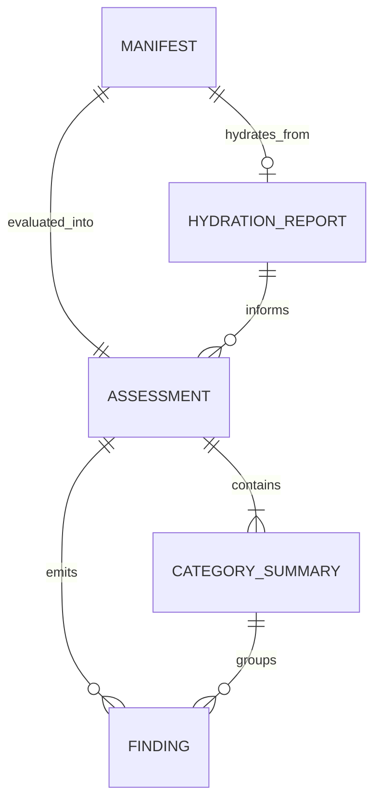

# IPD: Shared reproducibility evidence model and recorded gap analysis

- Date: 2026-11-21
- Kind: child
- Concern: Shared reproducibility evidence taxonomy, parent metadata hydration assessment, and recorded-manifest gap analysis
- Scope: Add structured parent hydration metadata in `src/pubrun/report/utils.py`, create `src/pubrun/report/reproducibility.py` with the shared evidence model and recorded-manifest gap engine, integrate it into `src/pubrun/report/checks.py`, and add unit tests in `tests/test_reproducibility_assessment.py`.
- Scope-Paths: src/pubrun/report/utils.py, src/pubrun/report/reproducibility.py, src/pubrun/report/checks.py, tests/test_reproducibility_assessment.py
- Item-Dependencies: none
- Status: executed
- Readiness: go-pending-approval
- Review-Depth: complex
- Work-Kind: feature
- Priority: medium
- From-Backlog: q3bll1
- Set: repro-check
- Order: 1
- Highest E allocated: 04
- Author: agent
- Id: 0b8i7x
- Short-Description: Build shared evidence taxonomy, structured parent hydration report, and recorded-manifest gap assessment

> Write and proofread this plan per the technical writing standard, `.aw/system/workflows/technical-writing/technical-writing.md` (`.agents/workflows/technical-writing/technical-writing.md` in a legacy-layout install), including requirement 12 (diagrams).

## Workflow history

- 2026-11-22 executed (aw agy run model=Gemini-4-Neon-High): aw agy run self-finalize: 0b8i7x verified (set repro-check, attempt 1).
- 2026-11-22 approved (aw set): status set to approved
- 2026-11-21 /plan-review (Gemini 4 Neon (High)): APPROVE WITH REVISIONS APPLIED; PR-001, PR-002, PR-003, PR-004, PR-005, PR-006, PR-007
- 2026-11-21 to-review (agent): created child plan 01 of Set `repro-check` graduating backlog item `q3bll1`.

## Goal

Establish a single, read-only, Python standard-library reproducibility evidence model and recorded-manifest gap engine shared by the command-line interface (CLI), terminal user interface (TUI), and JavaScript Object Notation (JSON) output. This plan upgrades parent `meta_ref` hydration reporting so inherited context stays distinct from direct child observations, explains recorded gaps across seven structured evidence categories (`source`, `runtime`, `dependencies`, `inputs_outputs`, `capture_completeness`, `parent_metadata`, `invocation`) with explicit evidence statuses and next actions, and never claims guaranteed scientific reproduction.

### Data model and assessment relationships

This diagram summarizes the entities introduced or extended in this plan. The text below is normative.

## Detailed Implementation Checklist (TODO)

Execution-state rule: mark an `E-*` item complete only after performing the action. That mark is not validation. Right-sizing rule: write for a modest executor that cannot hold much in its head. Each E-item is one step (one concern, about one file, executable in one focused pass) and its V-item names each unit it covers with its own check; a plan stays at about 5 E-items and 8 work Scope-Paths, else split it into more child plans (guidance, `IPD-Z603`). Accepted execution states: blocked, failed, pending, performed; terminal gate demands 'performed'.

### Task group 1: Structured parent hydration reporting

- [x] E-01 Add `HydrationReport` and `hydrate_manifest_with_report` to `src/pubrun/report/utils.py` while keeping `hydrate_manifest` backwards compatible.
  - Depends on: none
  - Expected outcome: `hydrate_manifest_with_report(manifest_path, manifest)` returns `(hydrated_manifest, warnings, report)` without mutating the caller's raw `manifest` dictionary in place, preserves the existing `.json` extension and `_is_meta_ref_allowed` policy check order before checking path existence or reading files, records `status` (`none`, `hydrated`, `missing`, `blocked_by_policy`, `invalid_extension`, `invalid_json`, `invalid_type`, `failed`), lists `inherited_sections` and `direct_sections` over the six hydrable sections, captures parent snapshot path, timestamp, and numeric age relative to child `timing.started_at_utc` (including negative age when the parent is newer than the child), compares parent and child `host`, `python`, and `git` identity when both exist (handling plain or redacted-dict `host.hostname`), handles malformed or non-dict inputs without raising, and preserves `hydrate_manifest(manifest_path, manifest)` returning `(hydrated_manifest, warnings)` for all existing callers.
  - Execution state: performed

### Task group 2: Shared reproducibility evidence model and recorded gap engine

- [x] E-02 Create `src/pubrun/report/reproducibility.py` with the shared evidence taxonomy, recorded-manifest gap analyzer, next-action prioritizer, `assess_run` facade, and plain-text formatters.
  - Depends on: E-01
  - Expected outcome: `src/pubrun/report/reproducibility.py` (CLI/report-only, Python standard library only, never imported by `import pubrun`) defines `EVIDENCE_STATUSES` (`observed`, `inferred`, `asserted`, `inherited`, `unavailable`, `not_checked`), `CATEGORY_STATUSES` (`adequate`, `gaps`, `mismatch`, `uncertain`, `not_checked`), `IMPACT_LEVELS` (`material`, `portability`, `incidental`, `informational`), `COMPARISON_OUTCOMES` (`match`, `mismatch`, `portability_diff`, `unknown`, `not_checked`), `NON_GUARANTEE_DISCLAIMER`, `assess_manifest_reproducibility(...)`, `assess_run(...)`, `format_reproducibility_summary(...)`, and `format_reproducibility_detail(...)` covering all seven structured evidence categories (`source`, `runtime`, `dependencies`, `inputs_outputs`, `capture_completeness`, `parent_metadata`, `invocation`), following explicit severity rules, and emitting zero numerical reproducibility scores.
  - Execution state: performed

### Task group 3: Integrate into shared checks module

- [x] E-03 Integrate `assess_manifest_reproducibility` and `assess_run` into `src/pubrun/report/checks.py` as the single shared findings engine.
  - Depends on: E-02
  - Expected outcome: `pubrun.report.checks.manifest_findings(manifest, current_hostname=None)` delegates to `assess_manifest_reproducibility(manifest, current_hostname=current_hostname)["findings"]` while preserving every existing finding code (`different_host`, `netfs_*`, `resources_off`, `resources_process_scope`, `console_off`, `hardware_off`, `packages_off`, `git_off`, `mode_no_subprocess_patch`, `subprocess_tracking_off`, `subprocess_unknown`, `no_file_provenance`, config notice codes) and dict keys (`severity`, `code`, `message`, `suggestion`), and `pubrun.report.checks` re-exports `assess_run` from `pubrun.report.reproducibility` without duplicating completeness checks or breaking `summarize()` or `--strict` contracts.
  - Execution state: performed

### Task group 4: Behavioral unit tests and import-isolation verification

- [x] E-04 Add behavioral unit tests in `tests/test_reproducibility_assessment.py` covering every recorded-evidence scenario, parent hydration case, and import-isolation invariant.
  - Depends on: E-03
  - Expected outcome: `tests/test_reproducibility_assessment.py` passes via `pytest` and proves behavior for adequate manifests (with explicit non-guarantee disclaimer), sparse and legacy manifests, dirty git state without recorded diff, missing/suppressed/partial/failed/timeout capture, package mode caveats and optional future fields, unhashed/stat-only/asserted versus observed file provenance, redacted CLI arguments and environment variables (both `redacted`/`hashed` representations and heuristic `[REDACTED]` in `plain` values), valid/stale/post-dated/mismatched/missing/policy-blocked/invalid `meta_ref` snapshots, and zero import of `pubrun.report.reproducibility` or `pubrun.report.checks` during `import pubrun`.
  - Execution state: performed

## Project conventions discovered (Step 0)

- `pubrun.report.checks` is CLI-only and must never be imported by `import pubrun` or the runtime capture path (enforced by `tests/test_checks_commands.py::test_import_pubrun_does_not_import_checks`).
- `src/pubrun/report/utils.py::hydrate_manifest` checks `.json` extension first, then enforces `src/pubrun/report/utils.py::_is_meta_ref_allowed`, then checks file existence, then loads JSON, compares `invocation.script.mtime` (file modification time) against `meta.timing.started_at_utc`, and sets `manifest[sec]["is_hydrated"] = True` for sections in `["hardware", "process", "python", "packages", "environment", "git"]` when missing or when `capture_state.status` is in `["suppressed", "off", "unavailable", "unknown", "partial"]`.
- Manifest fields follow `schemas/manifest.schema.json` v1.0: `capture_state.status` uses `complete`, `partial`, `unavailable`, `suppressed`, `failed`, `timeout`, `pending`; `status.outcome` uses `running`, `completed`, `failed`, `interrupted`, `partial`, `unknown`, `ghost`; redacted values use `{"representation": "plain"|"redacted"|"hashed"|"suppressed"|"unavailable"}` (and `src/pubrun/capture/redaction.py::redact_env_vars` also replaces heuristic secrets inside `plain` string values with `[REDACTED]`); CLI arguments use `[REDACTED]` strings (`src/pubrun/capture/redaction.py::redact_argv`).
- Default `pubrun.open()` level is `stat`, so `src/pubrun/core.py::ProvenanceFileProxy._register_provenance` sets `data_files.inputs[*].sha256` and `data_files.outputs[*].sha256` to `None` unless `[capture.file_io].level = "hash"`; `invocation.inputs[*].md5` is absent unless `[capture.inputs].compute_md5 = true` (`src/pubrun/capture/invocation.py::get_invocation`).
- Runtime code supports Python 3.8 or newer using only the Python standard library (`tomli` on Python < 3.11 is the sole third-party dependency in `pyproject.toml`).
- Existing tests in `tests/test_checks_commands.py`, `tests/test_profile_deprecation.py`, `tests/test_reports.py`, `tests/test_quality.py::TestMetaRefSecurity`, and `tests/test_hpc_hydration_e2e.py` assert current `manifest_findings()` and `hydrate_manifest()` contracts, including high-performance computing (HPC) parent-child hydration and `meta_ref` path-traversal security.
- Console formatting follows `src/pubrun/report/output.py`: textual labels are authoritative, color is optional reinforcement only, ANSI `DIM` (code `2`) is never used, and `NO_COLOR` suppresses ANSI escapes.

## Findings

1. `src/pubrun/report/checks.py::manifest_findings` currently checks only `different_host`, config notices, `filesystem` network mounts, `resources`, `console`, suppressed `hardware`/`packages`/`git`, `pubrun_imports.selected_behavior.patch_subprocesses`, `capture.subprocesses_enabled`, and empty `data_files`. It does not inspect `git.dirty`, missing `git.commit`, `git` timeout/failed/unavailable states, `invocation.script.sha256`, `packages.mode` coverage limits (`imported-only` versus `full-environment`), editable packages, unhashed `data_files`/`invocation.inputs`, redacted `invocation.argv`/`invocation.rerun_command`/`environment.variables` entries, non-completed `status.outcome`, `meta_ref` hydration status/age/identity, or unrecorded `determinism` seeds.
2. `src/pubrun/report/utils.py::hydrate_manifest` mutates the caller's `manifest` dictionary in place, returns only `(manifest, list[str])` warnings, lacks defensive type checks for non-dict sections or loaded JSON payloads, and uses only `invocation.script.mtime > meta.timing.started_at_utc` as a drift heuristic. It does not report which sections were inherited, how old the parent snapshot was relative to the child run, or whether parent `host`, `python`, or `git` identity differed from directly observed child fields.
3. No shared structured evidence taxonomy (`observed`, `inferred`, `asserted`, `inherited`, `unavailable`, `not_checked`) or prioritized next-action summary exists today.

## Proposed changes (ordered, validatable)

1. **`src/pubrun/report/utils.py`**:
   - Add a `HydrationReport` dataclass (with `.to_dict()`) capturing: `meta_ref`, `resolved_path`, `status` (`none`, `hydrated`, `missing`, `blocked_by_policy`, `invalid_extension`, `invalid_json`, `invalid_type`, `failed`), `inherited_sections` (list of section names copied from parent), `direct_sections` (list of sections among `["hardware", "process", "python", "packages", "environment", "git"]` already directly observed in the child, meaning present as a dict whose `capture_state.status` is not in `["suppressed", "off", "unavailable", "unknown", "partial"]`), `parent_started_at_utc`, `child_started_at_utc`, `age_seconds` (`child_started_at_utc - parent_started_at_utc` when both values are numeric `int`/`float` and not `bool`, else `None`), `script_modified_after_parent` (`bool` when both `invocation.script.mtime` and `parent_started_at_utc` are numeric, else `None`), `identity_mismatches` (list of structured diffs where both parent and child directly recorded `host.hostname`, `host.os_name`, `python.version`, or `git.commit` and they differ, unwrapping `hostname` if it is a redacted-value dict with `"value"`), and `warnings` (list of strings).
   - Implement `hydrate_manifest_with_report(manifest_path: str, manifest: Dict[str, Any]) -> Tuple[Dict[str, Any], List[str], HydrationReport]`:
     - Preserve the exact security check order before any filesystem existence probe or read: non-string/empty `meta_ref` handling -> `.json` extension check (`invalid_extension`) -> `_is_meta_ref_allowed(meta_path, manifest_dir)` check (`blocked_by_policy`) -> `meta_path.exists()` (`missing`) -> `json.load` (`invalid_json` on `json.JSONDecodeError`).
     - Validate that the loaded JSON payload is a `dict` and that `manifest_type`, when present, equals `"pubrun-meta-snapshot"`; otherwise return `status="invalid_type"` with a clear warning without merging or inventing completeness.
     - Shallow-copy `manifest` and `copy.deepcopy` each section dict copied from `meta` (guarding that `meta[sec]` is a `dict` before setting `is_hydrated = True`, and guarding that `manifest.get(sec)` is a `dict` before reading `capture_state`) so neither the caller's `manifest` nor `meta` is mutated in place.
   - Re-implement `hydrate_manifest(manifest_path, manifest)` as a thin wrapper over `hydrate_manifest_with_report` that preserves existing warning text patterns and `(hydrated_manifest, warnings)` return value so all tests in `tests/test_reports.py`, `tests/test_quality.py::TestMetaRefSecurity`, and `tests/test_hpc_hydration_e2e.py` remain green.

2. **`src/pubrun/report/reproducibility.py`** (new module):
   - Define module-level string constants/tuples:
     - `EVIDENCE_STATUSES = ("observed", "inferred", "asserted", "inherited", "unavailable", "not_checked")`
     - `CATEGORY_STATUSES = ("adequate", "gaps", "mismatch", "uncertain", "not_checked")`
     - `IMPACT_LEVELS = ("material", "portability", "incidental", "informational")`
     - `COMPARISON_OUTCOMES = ("match", "mismatch", "portability_diff", "unknown", "not_checked")`
     - `DEFAULT_STALE_PARENT_SECONDS = 86400.0` (24 hours; configurable parameter on `assess_manifest_reproducibility`)
     - `NON_GUARANTEE_DISCLAIMER`: plain-language statement that recorded provenance and an absence of findings support reproduction analysis but do not guarantee equivalent scientific or bitwise results, especially for legacy or sparse manifests.
   - Define finding builder `_make_finding(severity, code, message, suggestion=None, *, category, evidence_status, impact="informational", comparison=None, details=None)` returning a JSON-serializable dict that preserves all four legacy `pubrun.report.checks` keys (`severity`, `code`, `message`, `suggestion`).
   - Implement `assess_manifest_reproducibility(manifest, *, manifest_path=None, hydration_report=None, current_hostname=None, stale_parent_seconds=DEFAULT_STALE_PARENT_SECONDS) -> Dict[str, Any]` (never raises; tolerates empty, legacy, or malformed manifests):
     - Evaluates all seven structured categories (`source`, `runtime`, `dependencies`, `inputs_outputs`, `capture_completeness`, `parent_metadata`, `invocation`) using these explicit finding severities (preserving existing `checks.py` and `inspect --strict` contracts):
       - **Source (`source`)**: inspect `git` (`capture_state`, `commit`, `branch`, `dirty`, `repo_root`, `is_hydrated`), `invocation.entrypoint_type`, and `invocation.script` (`path`, `sha256`, `sha256_skipped`, `size`, `mtime`). Emit `git_dirty_unrecorded` (`warn`, `material`, `observed`, per resolved OQ-01) when `git.dirty is True` without a recorded diff or patch; `git_dirty_not_checked` (`info`, `informational`, `not_checked`) when `git.dirty is None` with a commit; `git_timeout` / `git_failed` (`warn`, `material`, `unavailable`); `git_unavailable` (`info`, `informational`, `unavailable`, so non-git directories do not fail `--strict`); `git_off` (`info`, `informational`, `unavailable`, preserving `checks.py`); and `script_unhashed` (`info`, `informational`, `not_checked`) when `invocation.entrypoint_type == "script"` and `invocation.script.sha256` is absent. Mark evidence `inherited` when `git.is_hydrated` is true.
       - **Runtime (`runtime`)**: inspect `python` (`version`, `implementation`, `environment_kind`, `capture_state`, `is_hydrated`), `host` (`os_name`, `os_version`, `hostname`, `capture_state`, `is_hydrated`), `hardware` (`capture_state`, `cpu.architecture`, `is_hydrated`), `hardware_off` (`info`, preserving `checks.py`), and `different_host` (`warn`, `portability`, `observed`, preserving `checks.py` message/code contract) when `current_hostname` differs from recorded `host.hostname` (unwrapping redacted-value dicts).
       - **Dependencies (`dependencies`)**: inspect `packages` (`mode`, `records`, `capture_state`, `is_hydrated`). Emit `packages_off` (`info`, preserving `checks.py`), `packages_partial` / `packages_failed` (`warn`, `material`, `unavailable`), `packages_empty` (`info`, `informational`, `observed`, when `packages` is complete with zero records and `mode` is present so minimal stdlib runs and legacy fixtures do not fail `--strict`), `packages_imported_only_scope` (`info`, `informational`, `observed`, explaining that `imported-only` captures only imported modules and may miss unrecorded environment packages), `packages_editable_present` (`info`, `portability`, `observed`, noting editable installs depend on local source state without breaking `--strict` on editable dev installs), and inspect optional future fields from `w4hxkh` defensively when present (for example `packages.unresolved` entries or `packages.snapshot_stage == "startup"`).
       - **Inputs and outputs (`inputs_outputs`)**: inspect `data_files.inputs`, `data_files.outputs`, optional `data_files.mixed` (defensive compatibility with `x6alw4`), and `invocation.inputs`. Distinguish `observed` content digests (`sha256`/`md5`), `asserted` caller-supplied digests (when an optional future record from `x6alw4` carries `evidence_source == "asserted"` or `source == "asserted"`), `inferred` argv inputs (`invocation.inputs`), `observed` stat-only metadata (explicitly noting content hash is `not_checked`), and optional future `hash_status` anomalies (`file_changed`, `over_budget`, `failed`, `unavailable`) when present. Emit `no_file_provenance` (`info`, `informational`, `not_checked`, preserving `checks.py` wording mentioning `pubrun.open()`/`open()`) when `data_files` (`inputs`, `outputs`, `mixed`) and `invocation.inputs` are all empty; when `data_files` is empty but `invocation.inputs` is non-empty, emit an `info` finding (`evidence_status="inferred"`) noting that only argv-inferred paths were recorded and `pubrun.open()` was not used.
       - **Capture completeness (`capture_completeness`)**: inspect `status.outcome` (emit `run_outcome_incomplete`, `warn`, `material`, `observed` for non-completed outcomes `running`, `failed`, `interrupted`, `partial`, `ghost`, `unknown`), every top-level section's `capture_state` (emit `warn` for `failed`/`timeout`/`partial`, `info` for `pending`, and preserve existing `checks.py` codes for `resources_off`, `resources_process_scope`, `console_off`, `hardware_off`, `packages_off`, `git_off`), optional `errors.records` `capture-error` entries (defensive tolerance for `x21s6w`), `capture.subprocesses_enabled` alongside `subprocesses` (`subprocess_tracking_off` as `warn` when `False`, `subprocess_unknown` as `info` when `None` and `subprocesses` is empty, preserving `checks.py` wording), `config.notices` (`warn`, preserving each notice's `code`), `filesystem` network mounts (`netfs_*` as `warn`, preserving `checks.py` reframing), `pubrun_imports.selected_behavior.patch_subprocesses` (`mode_no_subprocess_patch` as `info`), and `determinism` (`info`, `not_checked`: random seeds are not captured unless `determinism.registered_seeds` is non-empty). Detect sparse or legacy manifests (missing schema version or capture flags) and note that absence of warnings on sparse records does not imply completeness.
       - **Parent metadata (`parent_metadata`)**: inspect `hydration_report` (or raw `meta_ref` when `hydration_report` is absent). Distinguish `inherited` sections from direct child observations, report `meta_ref` missing, blocked, invalid, or failed as `unavailable` (`warn`, `material`, `unavailable`) without inventing completeness, report `script_modified_after_parent is True` (`parent_metadata_script_drift`, `warn`, `material`), `age_seconds < 0` (`parent_metadata_postdated`, `warn`, `material`), and parent-vs-child identity mismatches (`parent_metadata_identity_mismatch`, `warn`, `material`), report `age_seconds > stale_parent_seconds` (when `stale_parent_seconds` is not `None`) as `parent_metadata_stale` (`info`, `informational`, `inherited`, stating the measured age so long-queued HPC jobs are informed without breaking `--strict`), and emit an `info` (`inherited`) note whenever sections were hydrated explaining that inherited sections came from the parent snapshot and script `mtime` alone does not prove dependencies matched at child runtime.
       - **Invocation (`invocation`)**: inspect `invocation.argv`, `invocation.rerun_command`, `invocation.working_directory`, and `environment.variables`. Detect `[REDACTED]` markers in `invocation.argv` or `invocation.rerun_command` (`rerun_command_redacted`, `warn`, `material`, `observed`: command is not directly executable as printed without supplying redacted arguments) and redacted environment variables (`env_vars_redacted`, `info`, `informational`, `observed`, detecting both `value.representation in ("redacted", "hashed")` and `"[REDACTED]"` inside `plain` string values produced by `redact_env_vars` heuristics).
     - Compute `next_action` (single highest-value concrete next step) and `next_actions` (ordered deduplicated list) by deterministic priority: unavailable or broken evidence -> material recorded gaps (redacted command, dirty source, failed/partial capture, missing/mismatched/drifted parent snapshot, missing dependencies) -> capture-completeness improvements.
     - Return a stable JSON-serializable dict with keys: `schema_version` (`"1.0"`), `mode` (`"manifest"`), `summary`, `next_action`, `next_actions`, `disclaimer`, `categories` (list of category summary dicts), `findings` (list of finding dicts), `parent_metadata` (dict from `HydrationReport` or `None`), and `preflight` (`{"requested": False, "status": "not_checked", "counts": {}, "checks": []}`).
   - Define `assess_run(manifest, *, manifest_path=None, hydration_report=None, current_hostname=None, stale_parent_seconds=DEFAULT_STALE_PARENT_SECONDS) -> Dict[str, Any]` delegating to `assess_manifest_reproducibility(...)` (extended with `preflight=True` in child plan `tusvtd`).
   - Implement pure-text formatters `format_reproducibility_summary(assessment)` (terse summary + highest-value next step + disclaimer) and `format_reproducibility_detail(assessment, *, use_color=False)` (category table + per-finding lines with textual labels, evidence status, and concrete suggestions + disclaimer), usable by both CLI and TUI with zero `textual` dependency and following `src/pubrun/report/output.py` accessibility rules (no ANSI `DIM` code `2`; `use_color=False` or `NO_COLOR` emits zero ANSI escapes).

3. **`src/pubrun/report/checks.py`**:
   - Keep `live_findings()` and `live_checks()` untouched.
   - Update `manifest_findings(manifest, current_hostname=None)` to delegate to `assess_manifest_reproducibility(manifest, current_hostname=current_hostname)["findings"]` (ensuring every existing finding code and message contract in `tests/test_checks_commands.py` and `tests/test_profile_deprecation.py` continues to pass).
   - Re-export `assess_run` from `pubrun.report.reproducibility` (extended with `preflight=True` and `should_fail_strict` in child plan `tusvtd`).

4. **`tests/test_reproducibility_assessment.py`** (new test file):
   - Add targeted behavioral tests for `hydrate_manifest_with_report`, `assess_manifest_reproducibility`, `assess_run`, `format_reproducibility_summary`, `format_reproducibility_detail`, backwards compatibility of `manifest_findings`, and subprocess import-isolation (`import pubrun` must not import `pubrun.report.reproducibility` or `pubrun.report.checks`).

## Deferred / out of scope (with reason)

- Live environment preflight comparison (`compare_with_current_environment`): implemented in child plan `tusvtd` (`Order: 2`).
- CLI flag wiring (`pubrun inspect --preflight`, `pubrun rerun --preflight`, `--fail-on`) and TUI widget integration: implemented in child plan `3lqtlt` (`Order: 3`).
- User documentation updates and whole-Set end-to-end validation: implemented in child plan `sdg31l` (`Order: 4`).

## Scope check

- Over-scope: none. Only touches `src/pubrun/report/utils.py`, new `src/pubrun/report/reproducibility.py`, `src/pubrun/report/checks.py`, and `tests/test_reproducibility_assessment.py`; never modifies runtime capture paths or `schemas/manifest.schema.json`.
- Under-scope: none. Delivers the complete shared evidence taxonomy, structured hydration assessment, and recorded-manifest gap engine required by `q3bll1` items 1, 2, 5, and 6.

## Required tests / validation

- Run `pytest tests/test_reproducibility_assessment.py tests/test_checks_commands.py tests/test_profile_deprecation.py tests/test_reports.py tests/test_hpc_hydration_e2e.py tests/test_quality.py -v` (or `-k TestMetaRefSecurity` for the hydration security subset in `V-01`) and paste actual runner output.
- Verify import isolation in a fresh Python subprocess confirming neither `pubrun.report.checks` nor `pubrun.report.reproducibility` appears in `sys.modules` after `import pubrun`.

## Spec / documentation sync

- Documentation sync for `docs/cli.md`, `docs/hpc.md`, `docs/manifest.md`, and `docs/api.md` is scheduled in child plan `sdg31l` after CLI and TUI integration completes in `3lqtlt`.
- `schemas/manifest.schema.json`: N/A (this plan reads existing manifest v1.0 fields and does not alter `manifest.json` on disk).

## Open questions

### OQ-01: Severity of `git_dirty_unrecorded` on existing `pubrun inspect --strict` callers

- Blocking: no
- Status: resolved
- Owner: maintainer
- Resolution or deferral rationale: Existing tests in `tests/test_checks_commands.py` build fake manifests with `git: {"capture_state": {"status": "complete"}}` (no `dirty` key) or clean runs, so flagging `git.dirty is True` as `warn` with `impact="material"` preserves all existing tests while surfacing genuine dirty-source gaps under `--strict`. RESOLVED 2026-11-21 by the user via /askme: Report `git_dirty_unrecorded` as severity `warn` with `impact="material"` so `pubrun inspect --strict` exits non-zero on dirty runs. No reason was given.

## Validation and cross-check (verify before reporting done)

Validation-state rule: inspect evidence in a separate pass. Do not mark a `V-*` item complete from memory or from the matching execution checkmark. Accepted validation results: blocked, failed, pass, pending; terminal gate demands 'pass'. Runtime-demonstration reachability rule: for each `V-*` item demanding the software be observed acting (such as a run, a dispatch, or a transition)—as distinct from items demanding a diff, a file's content, or a test result, which are reachable by construction—name the code path that produces the observation or the sibling `E-*` that creates it, else the demand is UNDER-SCOPE.

- [x] V-01 validates E-01
  - Required evidence: Paste `pytest tests/test_reports.py tests/test_hpc_hydration_e2e.py tests/test_quality.py -k "Hydrate or hydration or MetaRef" -v` and `pytest tests/test_reproducibility_assessment.py -k hydration -v` output showing exit code 0 and passing assertions that `hydrate_manifest_with_report` leaves the caller's input dict unmutated, preserves extension and policy security checks before file reads, separates inherited versus direct sections, computes parent age and identity mismatches, handles missing/blocked/invalid parent snapshots without inventing completeness, and keeps `hydrate_manifest` backwards compatible.
  - Observed evidence: `pytest tests/test_reports.py tests/test_hpc_hydration_e2e.py tests/test_quality.py -k "Hydrate or hydration or MetaRef" -v -o addopts=""` exited 0 (`10 passed, 82 deselected in 0.58s`); `pytest tests/test_reproducibility_assessment.py -k hydration -v -o addopts=""` exited 0 (`7 passed, 12 deselected in 0.16s`).
  - Result: pass

- [x] V-02 validates E-02
  - Required evidence: Paste `pytest tests/test_reproducibility_assessment.py -v` output showing exit code 0 with behavioral tests covering all six evidence statuses (`observed`, `inferred`, `asserted`, `inherited`, `unavailable`, `not_checked`), all seven categories, explicit severity rules, no numerical reproducibility score, non-guarantee disclaimer on adequate and sparse/legacy manifests, prioritized `next_action`, `assess_run`, and plain-text summary/detail formatters (including zero ANSI escapes when `use_color=False` or `NO_COLOR=1`).
  - Observed evidence: `pytest tests/test_reproducibility_assessment.py -v -o addopts=""` exited 0 (`19 passed in 0.65s`, covering all 6 evidence statuses, all 7 categories, explicit severities, zero score, non-guarantee disclaimer, prioritized `next_action`, `assess_run`, and plain-text/NO_COLOR formatters).
  - Result: pass

- [x] V-03 validates E-03
  - Required evidence: Paste `pytest tests/test_checks_commands.py tests/test_profile_deprecation.py -v` output showing exit code 0 and all existing `manifest_findings`, `live_findings`, `live_checks`, config notice, and `inspect` tests passing after integrating `pubrun.report.checks` with `pubrun.report.reproducibility` and re-exporting `assess_run`.
  - Observed evidence: `pytest tests/test_checks_commands.py tests/test_profile_deprecation.py -v -o addopts=""` exited 0 (`39 passed in 3.24s`; all `manifest_findings`, `live_findings`, `live_checks`, config notice, and `inspect` tests passed).
  - Result: pass

- [x] V-04 validates E-04
  - Required evidence: Paste actual command output of `python -c "import pubrun, sys; assert 'pubrun.report.checks' not in sys.modules and 'pubrun.report.reproducibility' not in sys.modules; print('ISOLATED')"` (printing `ISOLATED`, exit code 0) and full output of `pytest tests/test_reproducibility_assessment.py tests/test_checks_commands.py tests/test_profile_deprecation.py tests/test_reports.py tests/test_hpc_hydration_e2e.py tests/test_quality.py -v` (exit code 0).
  - Observed evidence: `python -c "import pubrun, sys; assert 'pubrun.report.checks' not in sys.modules and 'pubrun.report.reproducibility' not in sys.modules; print('ISOLATED')"` exited 0 printing `ISOLATED`; `pytest tests/test_reproducibility_assessment.py tests/test_checks_commands.py tests/test_profile_deprecation.py tests/test_reports.py tests/test_hpc_hydration_e2e.py tests/test_quality.py -v -o addopts=""` exited 0 (`150 passed in 4.62s`).
  - Result: pass

## Approval and execution gate

- Size assessment: standard
- Cohesion rationale: not required

Execution contract:
1. Open questions: all open questions are resolved (`OQ-01` resolved by the maintainer on 2026-11-21); execution requires explicit human approval (`- Status: approved`).
2. Scope fence: restrict edits to `- Scope-Paths:` (`src/pubrun/report/utils.py`, `src/pubrun/report/reproducibility.py`, `src/pubrun/report/checks.py`, `tests/test_reproducibility_assessment.py`). If an out-of-scope edit is genuinely required, justify it with `--scope-reason` at finalization; if a declared path needs no edit, acknowledge it with `--scope-ack`.
3. Honesty rule (HARD MUST): paste actual test and command runner output into each `V-*` `Observed evidence` field; never claim a test passed without running it.
4. Commit and push discipline: commit only the files changed for this plan through `aw commit 0b8i7x -- <paths>`; never use `git add -A`, `git add .`, or `git commit -a`, and never push without explicit human authorization.
5. Lifecycle transition: this plan must reach `.aw/records/plans/executed/` with `- Status: executed` through `aw ipd finalize` once all `E-*` are `performed` and all `V-*` are `pass`. In a runner-managed lane with `self_finalize=True`, the runner performs `aw ipd finalize`; in standalone execution, the executor runs `aw ipd finalize` directly. Never hand-roll a raw `git mv` to `executed/`.
