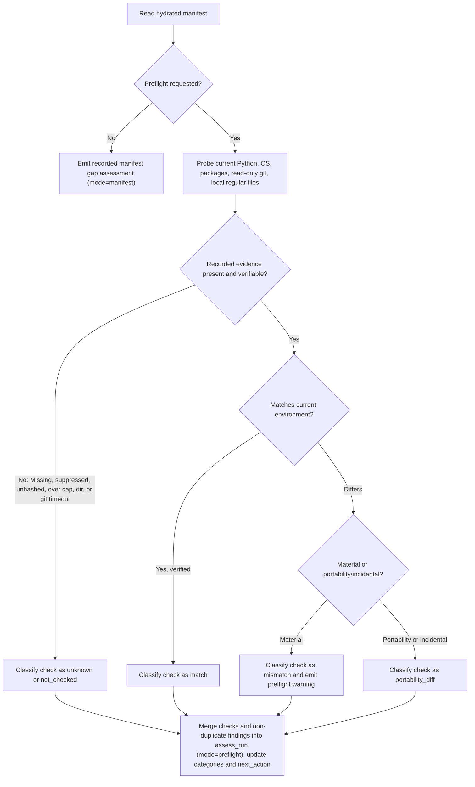

# IPD: Read-only offline rerun preflight comparison engine

- Date: 2026-11-21
- Kind: child
- Concern: Read-only offline comparison of recorded run requirements against the current environment
- Scope: Add shared package-name normalization and distribution lookup helpers in `src/pubrun/capture/packages.py`, implement `compare_with_current_environment` in `src/pubrun/report/reproducibility.py`, wire `preflight=True` into `assess_run` in `src/pubrun/report/reproducibility.py` and `src/pubrun/report/checks.py`, and add unit and safety-invariant tests in `tests/test_reproducibility_preflight.py`.
- Scope-Paths: src/pubrun/capture/packages.py, src/pubrun/report/reproducibility.py, src/pubrun/report/checks.py, tests/test_reproducibility_preflight.py
- Item-Dependencies: executed:0b8i7x
- Status: executed
- Readiness: go-pending-approval
- Review-Depth: complex
- Work-Kind: feature
- Priority: medium
- From-Backlog: q3bll1
- Set: repro-check
- Order: 2
- Highest E allocated: 04
- Author: agent
- Id: tusvtd
- Short-Description: Add read-only offline comparison of recorded runtime, package, source, and input evidence against current environment

> Write and proofread this plan per the technical writing standard, `.aw/system/workflows/technical-writing/technical-writing.md` (`.agents/workflows/technical-writing/technical-writing.md` in a legacy-layout install), including requirement 12 (diagrams).

## Workflow history

- 2026-11-22 executed (aw agy run model=Gemini-4-Neon-High): aw agy run self-finalize: tusvtd verified (set repro-check, attempt 1). [Scope reconciliation - in-scope-unmodified src/pubrun/capture/packages.py: declared-but-unmodified (auto-acknowledged by aw agy run)]
- 2026-11-22 approved (aw set): status set to approved
- 2026-11-22 /plan-review (Antigravity / Gemini 4 Neon (High)): APPROVE WITH REVISIONS APPLIED; PR-001, PR-002, PR-003, PR-004, PR-005, PR-006, PR-007
- 2026-11-21 to-review (agent): created child plan 02 of Set `repro-check` graduating backlog item `q3bll1`.

## Goal

Provide an explicitly invoked, strictly read-only, offline preflight comparison engine that compares supported recorded manifest evidence against the current local environment without ever executing recorded commands, installing packages, fetching remote data, or modifying files, environment variables, or random seeds. The engine separates material mismatches from incidental or expected portability differences and clearly distinguishes verified matches from `unknown` and `not_checked` outcomes.

### Preflight comparison flow

This diagram summarizes the preflight decision flow. The text in `## Proposed changes (ordered, validatable)` is normative.

## Detailed Implementation Checklist (TODO)

Execution-state rule: mark an `E-*` item complete only after performing the action. That mark is not validation. Right-sizing rule: write for a modest executor that cannot hold much in its head. Each E-item is one step (one concern, about one file, executable in one focused pass) and its V-item names each unit it covers with its own check; a plan stays at about 5 E-items and 8 work Scope-Paths, else split it into more child plans (guidance, `IPD-Z603`). Accepted execution states: blocked, failed, pending, performed; terminal gate demands 'performed'.

### Task group 1: Shared package normalization and read-only lookup

- [x] E-01 Add `normalize_package_name` and `get_installed_distribution_versions` in `src/pubrun/capture/packages.py` without changing `get_packages()` runtime behavior.
  - Depends on: none
  - Expected outcome: `src/pubrun/capture/packages.py` provides Python Enhancement Proposal (PEP) 503 name normalization (`normalize_package_name`) and a read-only `get_installed_distribution_versions(use_cache=True)` lookup over `importlib.metadata.distributions()`. The lookup returns `{normalized_name: {"name": ..., "version": ..., "editable": ...}}` (preserving `"location"` and cached-index backing if sibling plan `uil22c` has already landed), enforces first-wins `sys.path` precedence, skips distributions with missing or corrupt metadata safely, detects PEP 610 editable installs without exposing raw `direct_url.json` URLs, and never imports any user package.
  - Execution state: performed

### Task group 2: Read-only offline preflight comparison engine

- [x] E-02 Implement `compare_with_current_environment` in `src/pubrun/report/reproducibility.py` covering Python and platform, package versions, source state, accessible input identity, working directory, and command redaction.
  - Depends on: E-01
  - Expected outcome: `src/pubrun/report/reproducibility.py::compare_with_current_environment(manifest, *, manifest_path=None, cwd=None, check_hashes=True, max_hash_bytes=104857600, git_timeout=5.0)` runs strictly read-only and offline, never raises, and compares only supported recorded evidence. It classifies every check with explicit `comparison` (`match`, `mismatch`, `portability_diff`, `unknown`, `not_checked`), `evidence_status`, and `impact` (`material`, `portability`, `incidental`, `informational`). It strips inherited `GIT_*` variables on read-only Git probes under one shared monotonic timeout budget, guards file hashing with `stat.S_ISREG` so directories and named pipes never hang, and never executes recorded commands, installs packages, accesses the network, or mutates disk state.
  - Execution state: performed

### Task group 3: Integrate preflight into shared `assess_run` facade

- [x] E-03 Wire `preflight=True` into `assess_run` in `src/pubrun/report/reproducibility.py` and re-export it cleanly through `src/pubrun/report/checks.py` alongside `should_fail_strict`.
  - Depends on: E-02
  - Expected outcome: `src/pubrun/report/reproducibility.py::assess_run` preserves `stale_parent_seconds` from prerequisite plan `0b8i7x`, merges preflight checks and non-duplicate findings into the shared categories, `findings`, `summary`, `next_action`, `next_actions`, and `preflight` summary block when `preflight=True` (`mode="preflight"`), and stays consistent with `src/pubrun/report/checks.py::manifest_findings` when `preflight=False`. `should_fail_strict(assessment, *, fail_on="warn")` evaluates `warn`, `mismatch`, and `unknown` deterministically (raising `ValueError` on invalid `fail_on` values), and `src/pubrun/report/checks.py` re-exports both `assess_run` and `should_fail_strict`.
  - Execution state: performed

### Task group 4: Behavioral preflight and side-effect safety tests

- [x] E-04 Add behavioral unit tests in `tests/test_reproducibility_preflight.py` covering all comparison dimensions, classification boundaries, cross-API consistency, and read-only, offline, and no-replay guarantees.
  - Depends on: E-03
  - Expected outcome: `tests/test_reproducibility_preflight.py` passes via `pytest` for matching environments, Python major.minor vs patch and operating system (OS)/hostname portability differences (including redacted hostname dicts), package version match/mismatch/missing/PEP 503 normalization/PEP 610 editable caveats/null metadata, Git commit/dirty/unavailable/timeout/`GIT_DIR`-isolation and script hash/size/missing/non-script checks, accessible input verified hash match vs content mismatch vs missing vs directory vs non-regular file vs stat-only unverified vs `check_hashes=False` vs over-cap `not_checked` vs asserted digest basis, redacted command non-executability without duplicate warnings, `manifest_findings` vs `assess_run(preflight=False)` consistency, `should_fail_strict` modes and invalid `fail_on` rejection, and strict no-network/no-replay/read-only guarantees.
  - Execution state: performed

## Project conventions discovered (Step 0)

- `src/pubrun/capture/packages.py::get_packages` uses `importlib.metadata` (standard library on Python 3.8+) and checks `direct_url.json` for `"dir_info"` to detect editable installs. Sibling reviewed plan `uil22c` (Set `dep-capture`, distribution identity resolution and caching) also defines `normalize_package_name(name)` and `get_installed_distribution_versions(use_cache=True)` in `src/pubrun/capture/packages.py` with PEP 610 editable parsing (`dir_info.editable is True`), null-name guards, and first-wins `sys.path` precedence; keeping identical signatures and semantics ensures clean composition in either execution order.
- `src/pubrun/capture/python_runtime.py::environment_kind` returns a dictionary `{"environment_kind": kind, "in_venv": bool, "sys_path_len": int, "pyenv": bool}` (not a bare string) classifying the current interpreter (`conda`, `venv`, `virtualenv`, `system`, `frozen`) using only standard-library checks with no path exposure.
- `src/pubrun/capture/git.py::get_git` invokes `git` with a bounded timeout (default `5.0`s) via `subprocess.run(["git", ...])` and disables `pubrun.capture.subprocesses` spying via `src/pubrun/capture/subprocesses.py::disable_spy`.
- `src/pubrun/capture/invocation.py::get_invocation` computes script Secure Hash Algorithm 256-bit (SHA-256) up to 1 MiB (`_max_hash_size = 1_048_576`) and stores `invocation.inputs` with `"real_path"`, `"is_dir"`, `"size"`, and optional Message-Digest Algorithm 5 (MD5) `"md5"`; `src/pubrun/core.py::ProvenanceFileProxy._register_provenance` stores `data_files.inputs` with `"realpath"` (no underscore), `"size_bytes"`, and optional `"sha256"`.
- `src/pubrun/report/checks.py` and `src/pubrun/report/reproducibility.py` (created by prerequisite plan `0b8i7x`) are command-line interface (CLI) and report-only modules and must never be imported during `import pubrun`.
- Prerequisite reviewed plan `0b8i7x` (shared reproducibility evidence model and recorded gap analysis) defines `assess_run(manifest, *, manifest_path=None, hydration_report=None, current_hostname=None, stale_parent_seconds=DEFAULT_STALE_PARENT_SECONDS)` and emits `different_host`, `git_dirty_unrecorded`, and `rerun_command_redacted` during recorded-manifest analysis.

## Findings

1. `src/pubrun/report/checks.py` currently has `live_findings()` (machine health for `self-check`) and `manifest_findings()` (post-hoc manifest inspection), with no function that compares recorded manifest requirements against the current environment.
2. `src/pubrun/capture/packages.py` currently compares names with `.lower()` rather than PEP 503 normalization (`-`/`_`/`.` equivalence) and uses a naive `"dir_info" in direct_url` substring check, which would cause false package mismatches (for example `scikit_learn` vs `scikit-learn`) or false editable flags if preflight reused naive matching.
3. Preflight must never run automatically during normal `pubrun inspect` or `pubrun rerun`; it must be explicitly requested and must remain read-only, offline, bounded in time and input/output (I/O), and free of any replay or mutation side effects.

## Proposed changes (ordered, validatable)

1. **`src/pubrun/capture/packages.py`**:
   - Add `normalize_package_name(name: str) -> str` applying PEP 503 normalization (`re.sub(r"[-_.]+", "-", name).lower()`).
   - Add `get_installed_distribution_versions(use_cache: bool = True) -> Dict[str, Dict[str, Any]]` (matching sibling plan `uil22c`; if `uil22c` has already landed and backed this helper with `_get_distribution_index`, preserve that cached implementation rather than replacing it):
     - Iterates `importlib.metadata.distributions()` once (read-only, never importing third-party modules), wrapping each distribution read in `try/except` and skipping distributions with missing or non-string `Name`.
     - Uses first-wins `sys.path` precedence (`if norm not in result:`) so shadowed distributions do not overwrite the active one.
     - Detects PEP 610 editable status by parsing `direct_url.json` JSON when present (`isinstance(data.get("dir_info"), dict) and data["dir_info"].get("editable") is True`, falling back to `"dir_info" in direct_url` only if JSON parsing fails) without ever exposing raw `direct_url.json` Uniform Resource Locator (URL) strings.
     - Returns `{normalized_name: {"name": name, "version": version, "editable": editable}}` (retaining `"location"` if already returned by `uil22c`). Keep `get_packages()` output and performance unchanged.

2. **`src/pubrun/report/reproducibility.py`**:
   - Implement `compare_with_current_environment(manifest, *, manifest_path=None, cwd=None, check_hashes=True, max_hash_bytes=104_857_600, git_timeout=5.0) -> Dict[str, Any]` (never raises; tolerates empty, legacy, or malformed manifests and non-dict sections):
     - **Python and platform**:
       - Parse recorded `python.version` leading `^(\d+)\.(\d+)(?:\.(\d+))?` tuple via regex (handles full `sys.version` banners and pre-release suffixes safely) and compare against `sys.version_info[:3]`, plus `python.implementation` vs `sys.implementation.name`, and `python.environment_kind` vs `src/pubrun/capture/python_runtime.py::environment_kind().get("environment_kind")`.
       - Classify Python major.minor or implementation difference as `comparison="mismatch"`, `impact="material"`, `severity="warn"`, `evidence_status="observed"` (stating exact versions without claiming blanket incompatibility).
       - Classify Python patch difference or `environment_kind` difference as `comparison="portability_diff"`, `impact="portability"`, `severity="info"`, `evidence_status="observed"`.
       - Compare `host.os_name` vs `platform.system()`, `hardware.cpu.architecture` vs `platform.machine()`, and `host.hostname` vs `socket.gethostname()` (unwrapping `host.hostname` when stored as a redacted-value dict: if `representation == "plain"` use `"value"`, else treat hostname as `unavailable` rather than comparing a redacted marker against a real hostname). Classify OS family or central processing unit (CPU) architecture difference as `comparison="portability_diff"`, `impact="portability"`, `severity="info"` (factual description, no blanket incompatibility claim); classify hostname or OS minor release difference as `comparison="portability_diff"`, `impact="incidental"`, `severity="info"`.
       - When recorded `python`, `host`, or `hardware` section is missing, suppressed, unparseable, or unavailable, emit `comparison="unknown"`, `evidence_status="unavailable"` or `"not_checked"` (never a verified match).
     - **Package versions**:
       - Call `get_installed_distribution_versions()` once.
       - For each entry in `packages.records` (using `normalize_package_name`, skipping non-dict entries or missing names defensively):
         - Missing in current environment -> `comparison="mismatch"`, `impact="material"`, `severity="warn"`, `evidence_status="observed"`.
         - Installed version differs from recorded version -> `comparison="mismatch"`, `impact="material"`, `severity="warn"`, `evidence_status="observed"`, recording both versions in `details`.
         - Recorded version is `None` or `"unknown"` -> `comparison="unknown"`, `impact="informational"`, `severity="info"`, `evidence_status="unavailable"`.
         - Matching version -> count as verified `match` (note caveat if `editable` is true on either side or if `packages.mode` was `"imported-only"`, because unrecorded packages were not checked).
       - If `packages` was suppressed, unavailable, failed, or had zero records, emit a package preflight check with `comparison="unknown"` or `"not_checked"` rather than verified `match`.
     - **Source state**:
       - If recorded `git` section is missing, suppressed, unavailable, failed, timed out, or has no `commit`: emit a git preflight check with `comparison="unknown"`, `evidence_status="unavailable"` (or `"not_checked"` when suppressed), `impact="informational"`, `severity="info"` (never a verified match).
       - Otherwise determine `target_dir` deterministically: if caller passed `cwd` (`cwd is not None`), probe `Path(cwd)`; else probe `Path.cwd()`, falling back to recorded `git.repo_root` only when `Path.cwd()` is not inside a Git repository and `git.repo_root` exists locally as a directory (recording `probed_dir` in `details`).
       - Probe current Git state read-only (`["git", "-C", str(target_dir), "rev-parse", "HEAD"]` and `["git", "-C", str(target_dir), "status", "--porcelain"]`) using one shared monotonic deadline from finite `git_timeout` (default `5.0`s), `disable_spy()`, and a subprocess environment copy with `GIT_DIR`, `GIT_WORK_TREE`, `GIT_COMMON_DIR`, and `GIT_INDEX_FILE` stripped so inherited environment variables cannot redirect the probe. Never invoke `git fetch`, `git checkout`, or any network or write Git command.
       - Compare recorded `git.commit` vs current `HEAD`:
         - Subprocess timeout -> `comparison="unknown"`, `evidence_status="unavailable"`, `impact="material"`, `severity="warn"`, noting Git timed out.
         - Missing `git` binary or non-Git directory -> `comparison="unknown"`, `evidence_status="unavailable"`, `impact="informational"`, `severity="info"`.
         - Commit mismatch -> `comparison="mismatch"`, `impact="material"`, `severity="warn"`, `evidence_status="observed"`.
         - Matching `HEAD` when recorded `git.dirty is True` -> `comparison="unknown"`, `impact="material"`, `severity="warn"`, `evidence_status="observed"`, explaining uncommitted changes from the recorded run were not captured so `HEAD` equality does not prove identical source.
         - Matching `HEAD` when current working tree is dirty -> `comparison="mismatch"`, `impact="material"`, `severity="warn"`, `evidence_status="observed"`.
         - Matching `HEAD` when both recorded and current repos are clean -> `comparison="match"`, `impact="informational"`, `severity="info"`, `evidence_status="observed"`.
       - Compare recorded `invocation.script`:
         - If `invocation.entrypoint_type != "script"` or no script `path`/`real_path` was recorded -> `comparison="not_checked"`, `evidence_status="not_checked"`, `impact="informational"`, `severity="info"`.
         - Otherwise resolve the local script path (`path` resolved against `cwd` if relative, else `real_path` / `path`). If absent, unreadable, or not a regular file (`not stat.S_ISREG(st.st_mode)`): emit `comparison="mismatch"`, `impact="material"`, `severity="warn"`, `evidence_status="unavailable"` (cannot locate script to rerun).
         - If accessible regular file and recorded `sha256` exists and `check_hashes=True`: if local size exceeds `max_hash_bytes`, classify as `comparison="not_checked"`, `evidence_status="not_checked"`, `impact="informational"`, `severity="info"`, stating the cap; else stream-hash read-only in 64 KiB chunks and report `match` or `mismatch` (`material`, `warn`, `observed`).
         - If accessible regular file and (`check_hashes=False` or no recorded `sha256` exists): compare `size` when recorded (`mismatch`, `material`, `warn` if size differs; `unknown`, `not_checked`, `informational`, `info` if size matches or is absent, explicitly stating content hash was not checked).
     - **Accessible input identity**:
       - Collect unique input records from `data_files.inputs`, optional `data_files.mixed` (defensive compatibility with sibling Set `file-prov`), and `invocation.inputs`, deduplicating by normalized path while preferring richer `observed` (`data_files`) records with digests over `inferred` (`invocation.inputs`) records and preserving source (`observed` vs `inferred` vs `asserted` when `evidence_source == "asserted"` or `source == "asserted"`).
       - If no input records exist in the manifest, record an inputs preflight check with `comparison="not_checked"`, `evidence_status="not_checked"`, `impact="informational"`, `severity="info"` (never a verified match).
       - For each unique input record:
         - Resolve local path from `realpath`, `real_path`, or `path` (resolving relative paths against `Path(cwd)` or `Path.cwd()`).
         - If absent or `os.stat` fails -> `comparison="mismatch"`, `impact="material"`, `severity="warn"`, `evidence_status="unavailable"`.
         - If recorded `is_dir` is true (from `invocation.inputs`): if local path is a directory -> `comparison="unknown"`, `evidence_status="not_checked"`, `impact="informational"`, `severity="info"` (directory exists locally; contents not hashed); else -> `comparison="mismatch"`, `impact="material"`, `severity="warn"`, `evidence_status="unavailable"`.
         - If local path is not a regular file (`not stat.S_ISREG(st.st_mode)`, such as a directory, FIFO, or device node) -> `comparison="not_checked"`, `evidence_status="not_checked"`, `impact="informational"`, `severity="info"` (never open non-regular files to prevent hangs).
         - Determine recorded digest (`sha256` or `md5`) and recorded size (`size_bytes` if present, else `size`).
         - If a recorded digest exists and `check_hashes=True`: if local file size exceeds `max_hash_bytes`, classify as `comparison="not_checked"`, `evidence_status="not_checked"`, `impact="informational"`, `severity="info"`, stating the cap; otherwise stream-hash read-only in 64 KiB chunks (`hashlib.sha256` or `hashlib.md5`) and report `match` or `mismatch` (`material`, `warn`, `observed` or `asserted` when recorded digest was asserted, noting the asserted basis).
         - If no recorded digest exists OR `check_hashes=False`: compare recorded size when present (size difference -> `mismatch`, `material`, `warn`; same size or no recorded size -> `unknown` when unhashed or `not_checked` when `check_hashes=False`, with `evidence_status="not_checked"`, explaining content identity was not verified).
     - **Working directory and command executability**:
       - Check whether recorded `invocation.working_directory.path` exists locally as a directory (`match` if present; `portability_diff`, `portability`, `info` if relocated or missing; `not_checked` if not recorded).
       - Record a preflight check for `invocation.rerun_command` / `invocation.argv` redaction (`comparison="mismatch"`, `impact="material"`, `severity="warn"`, `evidence_status="observed"` when `[REDACTED]` is present, stating the command cannot be executed verbatim without supplying redacted values).
   - Extend `assess_run(manifest, *, manifest_path=None, hydration_report=None, current_hostname=None, stale_parent_seconds=DEFAULT_STALE_PARENT_SECONDS, preflight=False, cwd=None, check_hashes=True, max_hash_bytes=104_857_600, git_timeout=5.0) -> Dict[str, Any]`:
     - Calls `assess_manifest_reproducibility(manifest, manifest_path=manifest_path, hydration_report=hydration_report, current_hostname=current_hostname, stale_parent_seconds=stale_parent_seconds)` as its base.
     - When `preflight=False`: returns the manifest assessment directly (preserving 100% consistency with `pubrun.report.checks.manifest_findings()`).
     - When `preflight=True`: invokes `compare_with_current_environment(...)`, sets `mode = "preflight"`, populates `assessment["preflight"] = {"requested": True, "status": ..., "counts": {...}, "checks": [...]}`, merges new preflight findings (using distinct `preflight_*` finding codes) into `assessment["findings"]` WITHOUT duplicating recorded findings already emitted by `0b8i7x` (specifically: do not emit a second redacted-command `warn` when `rerun_command_redacted` is already present, and do not contradict `different_host` on hostname), updates affected category statuses (`mismatch` overrides `gaps`/`uncertain`/`adequate`), recomputes `summary`, `next_action`, and `next_actions`, and preserves `NON_GUARANTEE_DISCLAIMER`.
   - Implement `should_fail_strict(assessment, *, fail_on="warn") -> bool`:
     - Validate `fail_on in ("warn", "mismatch", "unknown")`, raising `ValueError` on unsupported values.
     - `fail_on="warn"`: returns `True` if any finding has `severity == "warn"` (matches existing `inspect --strict` behavior).
     - `fail_on="mismatch"`: returns `True` if any finding has `comparison == "mismatch"` or (`impact == "material"` and `severity == "warn"`), OR any check in `assessment["preflight"]["checks"]` has `comparison == "mismatch"`.
     - `fail_on="unknown"`: returns `True` if `fail_on="mismatch"` is true, OR any check in `assessment["preflight"]["checks"]` has `comparison in ("unknown", "not_checked")`, OR (when `preflight.requested` is false) any category in `assessment["categories"]` has `status in ("uncertain", "not_checked")`.

3. **`src/pubrun/report/checks.py`**:
   - Re-export `assess_run` and `should_fail_strict` from `src/pubrun/report/reproducibility.py` so CLI and Python callers have a single import point in `pubrun.report.checks`.

4. **`tests/test_reproducibility_preflight.py`** (new test file):
   - Add targeted behavioral tests for every preflight comparison dimension (including `environment_kind()` dict unwrapping, redacted `host.hostname` dict handling, PEP 503 package name normalization, PEP 610 editable detection, null-name metadata tolerance, `GIT_DIR` isolation, Git timeout vs non-repo, missing script vs non-script, `is_dir` and non-regular input safety, `real_path` and `realpath` inputs, `check_hashes=False`, over-cap `not_checked`, asserted digest basis, non-duplicated redacted-command and hostname findings on `assess_run(..., preflight=True)`, `manifest_findings` vs `assess_run(preflight=False)` parity, `should_fail_strict` modes including invalid `fail_on` `ValueError`).
   - Add an explicit side-effect guard test that monkeypatches `socket.create_connection`, `urllib.request.urlopen`, and `subprocess.Popen` (allowing only read-only `git rev-parse`/`status` calls) while verifying zero files are created or modified in `tmp_path` and a recorded script containing a sentinel side effect is never executed.

## Deferred / out of scope (with reason)

- CLI flag parsing (`--preflight`, `--fail-on`, `rerun --preflight`) and terminal user interface (TUI) display belong to child plan `3lqtlt` (CLI and TUI integration for reproducibility assessment and preflight, `Order: 3`).
  - Carrier: 3lqtlt
- Documentation updates and whole-Set end-to-end tests belong to child plan `sdg31l` (documentation sync, subpackage guard, and whole-Set validation, `Order: 4`).
  - Carrier: sdg31l
- Remote object-store or URL input fetching during preflight is explicitly out of scope because preflight is strictly offline and local-only.
  - Carrier-Declined: explicitly prohibited by backlog item q3bll1 (reproducibility gap assessment and rerun preflight is offline and local-only)

## Scope check

- Over-scope: none. Only adds pure standard-library read-only helpers in `src/pubrun/capture/packages.py`, preflight logic in `src/pubrun/report/reproducibility.py`, facade wiring in `src/pubrun/report/checks.py`, and preflight tests in `tests/test_reproducibility_preflight.py`.
- Under-scope: none. Covers every comparison dimension, classification rule, cross-API consistency requirement, and read-only/offline/no-replay requirement in backlog item `q3bll1` (items 3, 4, and 6) and orchestrator `osjxbz`.

## Required tests / validation

- Run `pytest tests/test_reproducibility_preflight.py tests/test_reproducibility_assessment.py tests/test_capture_engines.py tests/test_checks_commands.py -v` and paste actual runner output.
- Verify import isolation in a fresh Python subprocess confirming `import pubrun` does not import `pubrun.report.reproducibility` or `pubrun.report.checks`.

## Spec / documentation sync

- CLI, HPC, manifest, and API documentation updates are performed in child plan `sdg31l` (documentation sync, subpackage guard, and whole-Set validation) after CLI and TUI integration completes in `3lqtlt`.
- `schemas/manifest.schema.json`: N/A (preflight is strictly read-only and introduces no manifest schema changes).

## Open questions

### OQ-01: Default file-hashing size cap during preflight

- Blocking: no
- Status: resolved
- Owner: maintainer
- Resolution or deferral rationale: Defaulting `max_hash_bytes` to 100 MiB (`104_857_600` bytes, overridable by callers and tests) bounds preflight latency on large scientific datasets while still hashing typical inputs; files above the cap are explicitly reported as `not_checked` with the reason rather than skipped silently. RESOLVED 2026-11-21 by the user via /askme: Default preflight `max_hash_bytes` to 100 MiB (`104_857_600` bytes), overridable by callers and tests, reporting larger files as `not_checked`. No reason was given.

## Validation and cross-check (verify before reporting done)

Validation-state rule: inspect evidence in a separate pass. Do not mark a `V-*` item complete from memory or from the matching execution checkmark. Accepted validation results: blocked, failed, pass, pending; terminal gate demands 'pass'. Runtime-demonstration reachability rule: for each `V-*` item demanding the software be observed acting (such as a run, a dispatch, or a transition) (as distinct from items demanding a diff, a file's content, or a test result, which are reachable by construction), name the code path that produces the observation or the sibling `E-*` that creates it, else the demand is UNDER-SCOPE.

- [x] V-01 validates E-01
  - Required evidence: Paste `pytest tests/test_reproducibility_preflight.py -k package -v` and `pytest tests/test_capture_engines.py -v` output showing exit code 0, proving `normalize_package_name` and `get_installed_distribution_versions` handle PEP 503 variants (`-`, `_`, `.`, mixed case), PEP 610 editable flags, null/corrupt metadata, and first-wins `sys.path` precedence without importing target modules and without regressing `get_packages()`.
  - Observed evidence: Sibling plan `uil22c` already landed `normalize_package_name` and `_get_distribution_index`-backed `get_installed_distribution_versions(use_cache=True)` in `src/pubrun/capture/packages.py`; preserved untouched as specified. `pytest tests/test_reproducibility_preflight.py -k package -v --no-cov` exited 0 (`3 passed, 10 deselected in 0.40s`: `test_package_normalize_pep503_variants`, `test_package_lookup_precedence_editable_null_and_no_import`, `test_package_comparison_match_mismatch_missing_unknown_and_caveats`). `pytest tests/test_capture_engines.py -v --no-cov` exited 0 (`33 passed in 0.28s`). `python3 -m pytest tests/test_package_resolution.py -q --no-cov` exited 0 (`18 passed in 9.20s`).
  - Result: pass

- [x] V-02 validates E-02
  - Required evidence: Paste `pytest tests/test_reproducibility_preflight.py -v` output showing exit code 0 with passing behavioral tests for Python/platform material vs portability differences (including `environment_kind()` dict unwrapping and redacted hostname dicts), package match/mismatch/missing, clean/dirty/unavailable/timeout/`GIT_DIR`-isolated Git and script hash/size/missing/non-script checks, accessible input hash match/mismatch/missing/directory/non-regular/stat-only/`check_hashes=False`/over-cap/asserted-digest checks, and redacted rerun command warning.
  - Observed evidence: `pytest tests/test_reproducibility_preflight.py -v --no-cov` exited 0 (`13 passed in 0.88s`, covering matching environment, Python/platform material vs portability diffs with `environment_kind()` dict unwrapping and redacted hostname dicts, PEP 503 package match/mismatch/missing/unknown/editable/imported-only caveats, clean/dirty/unavailable/timeout/`GIT_DIR`-isolated/repo_root-fallback Git checks, script hash/size/missing/over-cap/non-script checks, accessible inputs including `data_files.inputs`/`mixed`/`invocation.inputs` deduplication, directory/FIFO non-regular safety, stat-only, `check_hashes=False`, over-cap, asserted digest match and mismatch, working directory, redacted command, and malformed manifest resilience).
  - Result: pass

- [x] V-03 validates E-03
  - Required evidence: Paste `pytest tests/test_reproducibility_preflight.py tests/test_reproducibility_assessment.py tests/test_checks_commands.py -v` output showing exit code 0, verifying `pubrun.report.checks.assess_run(..., preflight=True)` merges preflight outcomes without duplicating recorded findings, `assess_run(..., preflight=False)` stays consistent with `manifest_findings()` and preserves `stale_parent_seconds`, and `should_fail_strict` behaves accurately for `warn`, `mismatch`, `unknown`, and invalid `fail_on` values.
  - Observed evidence: `pytest tests/test_reproducibility_preflight.py tests/test_reproducibility_assessment.py tests/test_checks_commands.py -v --no-cov` exited 0 (`63 passed in 4.48s`, confirming `pubrun.report.checks.assess_run` and `pubrun.report.checks.should_fail_strict` re-exports, zero duplicate `rerun_command_redacted` or `different_host` findings under `preflight=True`, exact `manifest_findings()` parity and `stale_parent_seconds` passthrough under `preflight=False`, and deterministic `should_fail_strict` behavior for `warn`, `mismatch`, `unknown`, and `ValueError` on invalid `fail_on`).
  - Result: pass

- [x] V-04 validates E-04
  - Required evidence: Paste actual test output from `pytest tests/test_reproducibility_preflight.py -k "offline or readonly or no_replay" -v` (exit code 0) proving no network call, no file mutation, and no execution of recorded commands occurs during preflight, plus `python -c "import pubrun, sys; assert 'pubrun.report.checks' not in sys.modules and 'pubrun.report.reproducibility' not in sys.modules; print('ISOLATED')"` printing `ISOLATED` (exit code 0).
  - Observed evidence: `pytest tests/test_reproducibility_preflight.py -k "offline or readonly or no_replay" -v --no-cov` exited 0 (`1 passed, 12 deselected in 0.28s`: `TestPreflightSafetyInvariants::test_preflight_offline_readonly_no_replay_invariants` confirmed zero network calls, zero non-readonly subprocess calls, zero file or env mutations, and sentinel script never executed). `python -c "import pubrun, sys; assert 'pubrun.report.checks' not in sys.modules and 'pubrun.report.reproducibility' not in sys.modules; print('ISOLATED')"` exited 0 printing `ISOLATED`.
  - Result: pass

## Approval and execution gate

- Size assessment: standard
- Cohesion rationale: not required

Execution contract:
1. Open questions: all open questions are resolved (`OQ-01` resolved by the maintainer on 2026-11-21); do not execute until prerequisite `0b8i7x` (shared reproducibility evidence model and recorded gap analysis) is `executed` and a human approves this plan (`- Status: approved`).
2. Scope fence: restrict edits to `- Scope-Paths:` (`src/pubrun/capture/packages.py`, `src/pubrun/report/reproducibility.py`, `src/pubrun/report/checks.py`, `tests/test_reproducibility_preflight.py`). If an out-of-scope edit is genuinely required, justify it with `--scope-reason` at finalization; if a declared path needs no edit, acknowledge it with `--scope-ack`. Stop and report only for genuinely unsafe conditions (such as an unresolvable concurrent-edit conflict or a missing prerequisite symbol).
3. Honesty rule (HARD MUST): paste actual `pytest` and Python subprocess runner output and exit codes into each `V-*` `Observed evidence:` field; never claim tests passed without running them.
4. Commit and push discipline: commit only the files changed for this plan through `aw commit tusvtd -- <paths>`; never use `git add -A`, `git add .`, or `git commit -a`, and never push without explicit human authorization.
5. Lifecycle transition: this plan must reach `.aw/records/plans/executed/` with `- Status: executed` through `aw ipd finalize` once all `E-*` are `performed` and all `V-*` are `pass`. In a runner-managed lane, the runner performs `aw ipd finalize`; in standalone execution, run `aw ipd lint --phase pre-transition` and finalize directly through `aw ipd finalize`. Never hand-roll a raw `git mv` to `executed/`.
