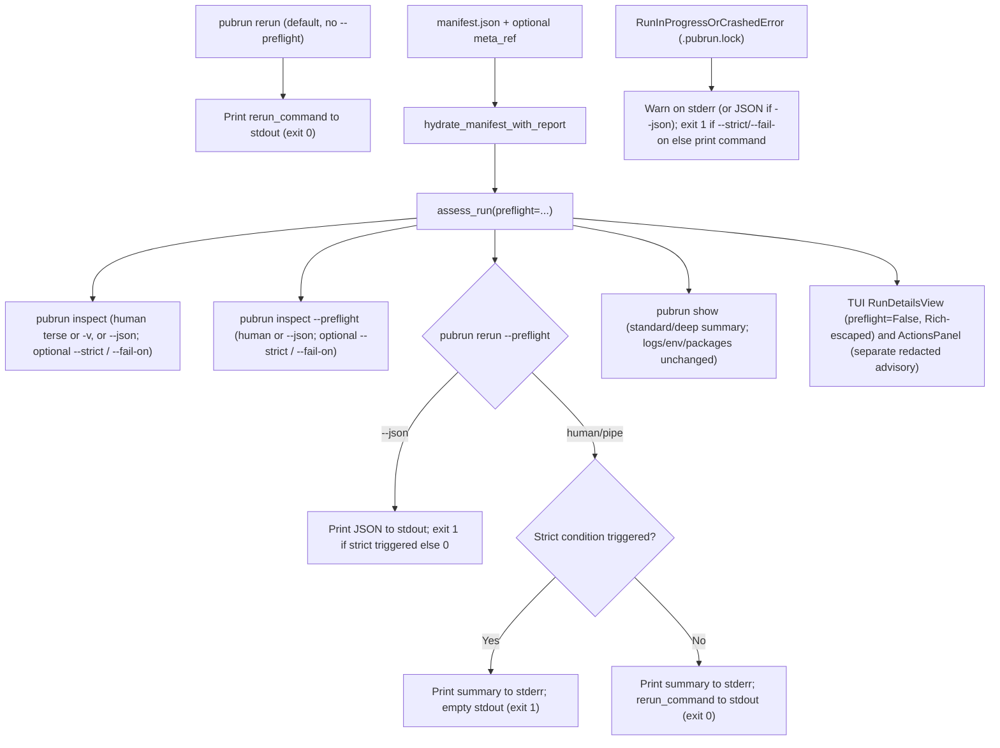

# IPD: CLI and TUI integration for reproducibility assessment and preflight

- Date: 2026-11-21
- Kind: child
- Concern: Command-line interface (CLI), terminal user interface (TUI), and machine-readable JavaScript Object Notation (JSON) integration with backwards-compatible exit and piping contracts
- Scope: Wire the shared reproducibility assessment and opt-in `--preflight` engine into `pubrun inspect`, `pubrun rerun`, `pubrun show`, and TUI widgets (`RunDetailsView`, `ActionsPanel`), add `--strict` / `--fail-on` exit options without breaking default exit codes or `pubrun rerun` stdout piping, and add CLI and TUI behavioral tests.
- Scope-Paths: src/pubrun/__main__.py, src/pubrun/report/diagnostics.py, src/pubrun/tui/widgets/details.py, src/pubrun/tui/widgets/actions.py, tests/test_checks_commands.py, tests/test_cli.py, tests/test_tui.py
- Scope-Exceeded: .aw/records/backlog/open/20261122-bjgca2-01-bjgca2-unify-file-provenance-and-capture-error-finding-co.backlog.md (Required defect-report backlog carrier filed for file-provenance and capture-error finding-code divergence between reproducibility.py and checks.py worked around in __main__.py)
- Item-Dependencies: executed:tusvtd
- Status: executed
- Readiness: go-pending-approval
- Review-Depth: complex
- Work-Kind: feature
- Priority: medium
- From-Backlog: q3bll1
- Set: repro-check
- Order: 3
- Highest E allocated: 05
- Author: agent
- Id: 3lqtlt
- Short-Description: Integrate shared reproducibility assessment and preflight into inspect, rerun, show, and TUI with strict exit behavior

> Write and proofread this plan per the technical writing standard, `.aw/system/workflows/technical-writing/technical-writing.md` (`.agents/workflows/technical-writing/technical-writing.md` in a legacy-layout install), including requirement 12 (diagrams).

## Workflow history

- 2026-11-22 executed (aw agy run model=Gemini-4-Neon-High): aw agy run self-finalize: 3lqtlt verified (set repro-check, attempt 2). [Scope reconciliation - out-of-scope .aw/records/backlog/open/20261122-bjgca2-01-bjgca2-unify-file-provenance-and-capture-error-finding-co.backlog.md: Required defect-report backlog carrier filed for file-provenance and capture-error finding-code divergence between reproducibility.py and checks.py worked around in __main__.py]
- 2026-11-22 approved (aw set): status set to approved
- 2026-11-22 /plan-review (Antigravity / Gemini 4 Neon (High)): APPROVE WITH REVISIONS APPLIED; PR-001, PR-002, PR-003, PR-004, PR-005, PR-006
- 2026-11-21 to-review (agent): created child plan 03 of Set `repro-check` graduating backlog item `q3bll1`.

## Goal

Expose the shared reproducibility gap assessment and opt-in offline preflight comparison through existing `pubrun` user surfaces (`pubrun inspect`, `pubrun rerun`, `pubrun show`, and the interactive terminal user interface (TUI)) so human summaries, TUI views, and JavaScript Object Notation (`--json`) output all come from one engine (`src/pubrun/report/reproducibility.py`). Preserve backwards compatibility for `pubrun rerun` standard-output (`stdout`) piping, default exit codes, `NO_COLOR` and non-teletype (non-TTY) accessibility, and optional TUI dependency isolation.

### CLI and TUI dispatch flow

This diagram summarizes how existing commands and TUI widgets consume the shared assessment engine. The text in `## Proposed changes (ordered, validatable)` is normative.



## Detailed Implementation Checklist (TODO)

Execution-state rule: mark an `E-*` item complete only after performing the action. That mark is not validation. Right-sizing rule: write for a modest executor that cannot hold much in its head. Each E-item is one step (one concern, about one file, executable in one focused pass) and its V-item names each unit it covers with its own check; a plan stays at about 5 E-items and 8 work Scope-Paths, else split it into more child plans (guidance, `IPD-Z603`). Accepted execution states: blocked, failed, pending, performed; terminal gate demands 'performed'.

### Task group 1: Wire `pubrun inspect` and `pubrun rerun` in CLI

- [x] E-01 Update `_run_inspect` and `inspect` argument parser in `src/pubrun/__main__.py` to hydrate `meta_ref`, run `assess_run(preflight=...)`, render concise or detailed human output with the highest-value next step and non-guarantee disclaimer, emit structured `--json` preserving top-level `"findings"`, and support `--preflight` and `--fail-on {warn,mismatch,unknown}` with `--strict`.
  - Depends on: none
  - Expected outcome: `src/pubrun/__main__.py::_run_inspect` hydrates `meta_ref` via `hydrate_manifest_with_report` and calls `assess_run(..., preflight=preflight)`. In human mode, it preserves the `pubrun inspect` header, renders the different-host banner once without duplicating it in the detail list, prints a concise summary plus next step and disclaimer by default, and prints category-grouped detail with `->` suggestion arrows under `--show-suggestions` / `-v`. In `--json` mode, it prints `json.dumps(assessment, indent=2)` directly (preserving top-level `"findings"` alongside `"schema_version"`, `"mode"`, `"summary"`, `"next_action"`, `"next_actions"`, `"disclaimer"`, `"categories"`, `"parent_metadata"`, and `"preflight"`). It runs offline preflight only when `--preflight` is passed, exits `0` by default, and exits `1` when `--strict` or `--fail-on` triggers via `should_fail_strict`.
  - Execution state: performed

- [x] E-02 Update `_run_rerun` and `rerun` argument parser in `src/pubrun/__main__.py` to add opt-in `--preflight`, `--strict`, `--fail-on`, and `--json` while keeping default `pubrun rerun` output and piping 100% backwards compatible.
  - Depends on: E-01
  - Expected outcome: Default `pubrun rerun [RUN_DIR]` prints only `rerun_command` to `stdout` with exit code `0` (safe for `pubrun rerun | bash`). Passing `--strict`, `--fail-on`, or `--json` without `--preflight` fails fast with a clear `stderr` error, empty `stdout`, and exit code `2`. Missing `rerun_command` exits `1` cleanly without crashing. `pubrun rerun --preflight` prints the preflight summary and any redacted-command advisory to `stderr` (gating color on `NO_COLOR` and `sys.stderr.isatty()`) while printing `rerun_command` to `stdout` without executing it. `pubrun rerun --preflight --strict` (or `--fail-on`) exits `1` with empty `stdout` when the strict condition triggers. `pubrun rerun --preflight --json` emits valid JSON (`rerun_command`, `executable_as_printed`, `assessment`) to `stdout` for both finalized and lock-file reconstructed runs.
  - Execution state: performed

### Task group 2: Surface shared summary in `pubrun show` and TUI widgets

- [x] E-03 Update `src/pubrun/report/diagnostics.py`, `src/pubrun/tui/widgets/details.py`, and `src/pubrun/tui/widgets/actions.py` to display the shared reproducibility summary and redacted-rerun advisory using `pubrun.report.reproducibility` formatters.
  - Depends on: E-01
  - Expected outcome: `src/pubrun/report/diagnostics.py` defines pure-Python `format_redacted_rerun_advisory(rerun_cmd)` and updates `print_report` (at `standard` and `deep` depths only, never in `basic` or `logs`/`env`/`packages` section extracts) to display a concise reproducibility summary, highest-value next step, and inherited-section note when `meta_ref` hydrated sections, using lazy imports and zero American National Standards Institute (ANSI) `DIM` codes. `RunDetailsView` in `src/pubrun/tui/widgets/details.py` renders the shared reproducibility summary (with `rich.markup.escape` and safe preliminary handling for running runs, never running live preflight). `ActionsPanel` in `src/pubrun/tui/widgets/actions.py` renders `rerun_command` cleanly in `#lbl-rerun-command` (without contaminating clipboard copies or breaking Rich markup) and displays `format_redacted_rerun_advisory` in a dedicated `#lbl-rerun-advisory` widget. No duplicate assessment logic is introduced and TUI stays optional.
  - Execution state: performed

### Task group 3: CLI and TUI behavioral tests

- [x] E-04 Expand `tests/test_checks_commands.py` and `tests/test_cli.py` with behavioral CLI tests for `pubrun inspect`, `pubrun inspect --preflight`, `--json`, `--strict`, `--fail-on`, `NO_COLOR`, `pubrun rerun` piping plus `--preflight` / `--strict` / `--fail-on` / `--json`, `pubrun show` reproducibility output, and cross-surface JSON agreement.
  - Depends on: E-02
  - Expected outcome: All existing CLI tests pass unchanged. New tests verify `pubrun inspect` with `meta_ref` hydration, `pubrun inspect --preflight` (terse, `-v`, `--json`, `--strict`, `--fail-on mismatch`, `--fail-on unknown`, different-host banner deduplication), invalid `pubrun rerun` flag combinations without `--preflight` (exit `2`, empty `stdout`), default `pubrun rerun` stdout cleanliness for piping, `pubrun rerun --preflight` writing diagnostics only to `stderr`, `pubrun rerun --preflight --strict` / `--fail-on` aborting with exit code `1` and empty `stdout` on mismatch or redacted command, crashed/running lock-file handling with `--preflight` / `--fail-on` / `--json`, `pubrun show` reproducibility rendering (and untouched `basic` / `logs` / `env` / `packages`), cross-surface agreement across `inspect --json`, `inspect --preflight --json`, `rerun --preflight --json`, `show`, and the TUI formatter, and zero ANSI escape sequences under `NO_COLOR=1`.
  - Execution state: performed

- [x] E-05 Expand `tests/test_tui.py` with behavioral tests verifying pure-Python reproducibility summary and redacted-rerun advisory formatters (unconditional, zero `textual` dependency) plus live `RunDetailsView` and `ActionsPanel` widget rendering via Textual `Pilot` when `textual` is installed.
  - Depends on: E-03
  - Expected outcome: `tests/test_tui.py` passes via `pytest` (running pure-Python formatter and advisory unit tests unconditionally, skipping live `Pilot` tests cleanly via `pytest.importorskip("textual")` when `textual` is absent, and verifying `RunDetailsView` reproducibility rendering, Rich-markup safety, running-run handling, and `ActionsPanel` `#lbl-rerun-advisory` plus clean `#lbl-rerun-command` clipboard text when `textual` is installed).
  - Execution state: performed

## Project conventions discovered (Step 0)

- `src/pubrun/__main__.py::_run_inspect` and `src/pubrun/__main__.py::_run_rerun` resolve manifests through `src/pubrun/__main__.py::_get_manifest_path`, handle `RunInProgressOrCrashedError` (reconstructing a rerun command from `.pubrun.lock` in `_run_rerun`), respect `NO_COLOR` / `--no-color` globally (`main` strips `--no-color` and sets `os.environ["NO_COLOR"] = "1"`), and use `src/pubrun/report/output.py` (`[INFO ]`, `[WARN ]`, `[ERROR]`, `[ OK  ]`, stderr by default for info/warn/error) for status prefixes.
- `src/pubrun/__main__.py::main` defines `inspect_parser` with `run_dir`, `--show-suggestions` / `-v`, `--json` (`dest="as_json"`), `--strict`, and `_add_run_filter_args`. Existing tests in `tests/test_checks_commands.py::TestInspectCLI` assert `"inspect" in res.stdout.lower()` in terse mode, `"->" in res.stdout` under `--show-suggestions`, and `"findings" in data` under `--json`.
- `src/pubrun/__main__.py::main` defines `rerun_parser` with `run_dir` and `_add_run_filter_args`, and `_run_rerun` prints only `rerun_command` to `stdout` (warnings go to `stderr`), matching `docs/cli.md` (`pubrun rerun ./runs/pubrun-A | bash`). On Windows (`sys.platform == "win32"`), `_run_rerun` converts `" && python "` to `"\npython "` and single quotes to double quotes.
- `src/pubrun/report/diagnostics.py::print_report` supports `basic`, `standard`, and `deep` depths, `utc`, and bare section tokens `SHOW_SECTIONS = ("logs", "env", "packages")`. Existing tests in `tests/test_show_sections.py` assert that section extracts do not print the full diagnostics header.
- `src/pubrun/tui/widgets/details.py::RunDetailsView` and `src/pubrun/tui/widgets/actions.py::ActionsPanel` import `textual` at module top level. `RunDetailsView.update_general_pane` passes Rich markup strings to `Static.update` and is called every `1.0`s by `refresh_live_metrics` when `r.status == STATUS_RUNNING`. `ActionsPanel.on_button_pressed` copies `self.query_one("#lbl-rerun-command", Static).renderable` to the clipboard.
- `tests/test_tui.py` runs pure-Python formatter tests unconditionally (`TestResourceDigest` importing `pubrun.report.diagnostics::format_resource_digest`) and uses `pytest.importorskip("textual")` with `PubrunTUIApp.run_test()` for live widget rendering (`TestTuiResourceView`).
- Prerequisite reviewed plans `0b8i7x` (shared reproducibility evidence model) and `tusvtd` (read-only offline preflight comparison engine) provide `src/pubrun/report/utils.py::hydrate_manifest_with_report`, `src/pubrun/report/checks.py::assess_run`, `src/pubrun/report/checks.py::should_fail_strict`, `src/pubrun/report/reproducibility.py::format_reproducibility_summary`, `src/pubrun/report/reproducibility.py::format_reproducibility_detail`, and `src/pubrun/report/reproducibility.py::NON_GUARANTEE_DISCLAIMER`.

## Findings

1. `src/pubrun/__main__.py::_run_inspect` currently reads raw `manifest.json` without calling `hydrate_manifest_with_report`, so high-performance computing (HPC) child runs with `meta_ref` appear to have missing hardware or packages even when a valid parent `meta.json` exists.
2. `src/pubrun/__main__.py::_run_rerun` prints a `[REDACTED]` command with no preflight check option and no advisory that redacted arguments make the command non-executable verbatim.
3. Neither `src/pubrun/report/diagnostics.py::print_report` nor the TUI (`RunDetailsView`, `ActionsPanel`) surfaces reproducibility gaps, inherited `meta_ref` context, or redacted-rerun advisories today.

## Proposed changes (ordered, validatable)

1. **`src/pubrun/__main__.py` (`inspect_parser` and `_run_inspect`)**:
   - Update `inspect_parser` description/epilog and add `--preflight` (`action="store_true"`, help explaining read-only offline comparison of supported recorded requirements against the current environment) and `--fail-on` (`choices=["warn", "mismatch", "unknown"]`, default `None`, help explaining strict exit threshold; passing `--fail-on` implies strict exit checking, `--strict` alone defaults to `"warn"` for backwards compatibility, and `--fail-on` works both with and without `--preflight`).
   - Pass `preflight=getattr(args, "preflight", False)` and `fail_on=getattr(args, "fail_on", None)` from `main()` into `_run_inspect`.
   - In `_run_inspect`: call `hydrate_manifest_with_report(manifest_path, manifest)` and `assess_run(hydrated, manifest_path=manifest_path, hydration_report=hydration_report, current_hostname=current_hostname, preflight=preflight)`.
   - In `--json` mode: print `json.dumps(assessment, indent=2)` directly to `stdout` (emitting zero non-JSON lines on `stdout` and preserving top-level `"findings"` alongside `"schema_version"`, `"mode"`, `"summary"`, `"next_action"`, `"next_actions"`, `"disclaimer"`, `"categories"`, `"parent_metadata"`, and `"preflight"`).
   - In human mode:
     - Determine `use_color = not os.environ.get("NO_COLOR", "") and sys.stdout.isatty()` (never emitting ANSI `DIM` code `2`).
     - Keep the different-host banner behavior intact: if a `different_host` finding is present, print the existing `=`-bordered banner once and pass a shallow copy `{**assessment, "findings": [f for f in assessment["findings"] if f.get("code") != "different_host"]}` into `format_reproducibility_detail` so `different_host` is not printed twice (while keeping `different_host` in `assessment["findings"]` for `--json` and `should_fail_strict`).
     - Print a `pubrun inspect` header line (preserving `tests/test_checks_commands.py::TestInspectCLI.test_inspect_terse_default`) followed by `format_reproducibility_summary(assessment)` plus a single nudge to pass `--show-suggestions` / `-v` (and `--preflight` when `not preflight`) in terse mode, or `format_reproducibility_detail(..., use_color=use_color)` with `->` suggestion arrows (preserving `test_inspect_show_suggestions_expands`) when `show_suggestions` is true.
   - Exit `1` if `(strict or fail_on is not None)` and `should_fail_strict(assessment, fail_on=fail_on or "warn")` is `True`; otherwise exit `0`.

2. **`src/pubrun/__main__.py` (`rerun_parser` and `_run_rerun`)**:
   - Update `rerun_parser` description/epilog and add opt-in flags: `--preflight` (`action="store_true"`), `--strict` (`action="store_true"`), `--fail-on` (`choices=["warn", "mismatch", "unknown"]`, default `None`), and `--json` (`action="store_true"`, `dest="as_json"`).
   - Pass `preflight`, `strict`, `fail_on`, and `as_json` from `main()` into `_run_rerun`.
   - Validate flag combinations BEFORE resolving the run: if `(strict or fail_on is not None or as_json)` and not `preflight`, print a clear error on `stderr` explaining that `--strict`, `--fail-on`, and `--json` require `--preflight`, emit nothing to `stdout`, and `sys.exit(2)`.
   - When `preflight` is `False`: execute the exact existing `rerun` code path (`stdout` contains only `rerun_command`; exit `0`).
   - When `preflight` is `True`:
     - Extract `rerun_cmd = inv.get("rerun_command")`. If `not rerun_cmd`, print the existing error to `stderr` (`Target manifest does not contain a valid 'rerun_command' payload.`) and `sys.exit(1)` (never calling `"[REDACTED]" not in None`). Apply the existing Windows `rerun_cmd` formatting when `sys.platform == "win32"`.
     - Hydrate via `hydrate_manifest_with_report(manifest_path, manifest)`, capture `current_hostname` defensively via `socket.gethostname()`, and call `assess_run(hydrated, manifest_path=manifest_path, hydration_report=hydration_report, current_hostname=current_hostname, preflight=True)` so `rerun --preflight --json` agrees with `inspect --preflight --json`.
     - Compute `strict_enabled = bool(strict or fail_on is not None)`, `strict_failed = strict_enabled and should_fail_strict(assessment, fail_on=fail_on or "warn")`, and `executable_as_printed = ("[REDACTED]" not in rerun_cmd)`.
     - If `as_json`: print `json.dumps({"rerun_command": rerun_cmd, "executable_as_printed": executable_as_printed, "assessment": assessment}, indent=2)` to `stdout`; `sys.exit(1)` if `strict_failed`, else return (exit `0`).
     - Else (human/pipe mode): compute `use_color = not os.environ.get("NO_COLOR", "") and sys.stderr.isatty()`, print `format_reproducibility_summary(assessment)` and any `format_redacted_rerun_advisory(rerun_cmd)` warning to `stderr` (never executing `rerun_cmd`). If `strict_failed`, `sys.exit(1)` WITHOUT printing `rerun_command` to `stdout` (preventing downstream pipes from running on failed preflight). Otherwise print `rerun_command` to `stdout` and return (exit `0`).
     - On `RunInProgressOrCrashedError` when `preflight` is `True`:
       - If `lock_data` is absent, emit error to `stderr` and `sys.exit(1)` as before.
       - If `lock_data` exists, reconstruct `rerun_cmd` using the existing lock-file logic (including Windows formatting) and compute `executable_as_printed = ("[REDACTED]" not in rerun_cmd)` and `strict_enabled = bool(strict or fail_on is not None)`.
       - If `as_json`: print valid JSON `{"rerun_command": rerun_cmd, "executable_as_printed": executable_as_printed, "assessment": {"schema_version": "1.0", "mode": "preflight", "summary": ..., "next_action": ..., "next_actions": [...], "disclaimer": NON_GUARANTEE_DISCLAIMER, "categories": [], "findings": [...], "parent_metadata": None, "preflight": {"requested": True, "status": "unknown", "counts": {"unknown": 1}, "checks": [...]}}}` (marking the lock-file command `evidence_status="inferred"` and explaining preflight requires a finalized `manifest.json`) to `stdout`, and `sys.exit(1)` if `strict_enabled` else return (`0`).
       - Else (human/pipe mode): emit the honest `stderr` warning that preflight cannot run without a finalized `manifest.json` (lock-file command is `inferred`) plus `format_redacted_rerun_advisory(rerun_cmd)` if redacted; `sys.exit(1)` with empty `stdout` if `strict_enabled`, else print `rerun_cmd` to `stdout` and return (`0`).

3. **`src/pubrun/report/diagnostics.py`, `src/pubrun/tui/widgets/details.py`, and `src/pubrun/tui/widgets/actions.py`**:
   - In `src/pubrun/report/diagnostics.py`:
     - Add pure-Python `format_redacted_rerun_advisory(rerun_cmd: Optional[str]) -> Optional[str]` returning a clear plain-text advisory when `isinstance(rerun_cmd, str) and "[REDACTED]" in rerun_cmd` (stating that redacted arguments must be supplied manually before executing the command) and `None` otherwise.
     - In `print_report`: switch `hydrate_manifest` to `hydrate_manifest_with_report` (preserving all existing warning lines and early returns for `logs`, `env`, `packages`, and `basic`). At the end of the `standard` block (before `if depth == "standard": print(); return`, so both `standard` and `deep` include it while `basic` and section extracts do not), lazily import `assess_run` and `format_reproducibility_summary` from `pubrun.report.reproducibility`, run `assess_run(manifest, manifest_path=manifest_path, hydration_report=hydration_report, current_hostname=current_hostname, preflight=False)`, and print a concise `Reproducibility` block (using zero ANSI `DIM` codes and honoring `_has_color()` / `NO_COLOR`), including the inherited-section note when `hydration_report.inherited_sections` is non-empty and a nudge to run `pubrun inspect --preflight` for environment comparison.
   - In `src/pubrun/tui/widgets/details.py` (`RunDetailsView.update_general_pane`):
     - Append a `[bold #cba6f7]=== REPRODUCIBILITY & EVIDENCE ===[/bold #cba6f7]` section.
     - When `r.status == STATUS_RUNNING`, display a concise preliminary note that the run is still in progress and full reproducibility assessment is available once `manifest.json` finalizes (avoiding per-second disk hydration from the `1.0`s `refresh_live_metrics` timer).
     - When `r.manifest` exists and `r.status != STATUS_RUNNING`, hydrate safely with `hydrate_manifest_with_report(str(Path(r.run_dir) / "manifest.json"), r.manifest)`, call `assess_run(hydrated, manifest_path=..., hydration_report=hydration_report, current_hostname=current_hostname, preflight=False)`, and render every line of `format_reproducibility_summary(assessment)` escaped through `rich.markup.escape(line)` so bracketed tokens (`[WARN ]`, `[REDACTED]`, paths) never trigger Rich markup errors. Never run live preflight on sidebar selection.
   - In `src/pubrun/tui/widgets/actions.py` (`ActionsPanel`):
     - In `compose()`, yield a dedicated `Static("", id="lbl-rerun-advisory", classes="info-value")` directly beneath `#lbl-rerun-command` so `#lbl-rerun-command` contains only the raw command string.
     - Store `self.rerun_command: Optional[str] = None` in `__init__` and update it in `display_run`. Update `#lbl-rerun-command` using `Text(rerun_cmd)` (avoiding Rich markup parsing on `[REDACTED]` or arbitrary shell brackets). Populate `#lbl-rerun-advisory` with `Text(advisory)` when `format_redacted_rerun_advisory(rerun_cmd)` returns text, and clear it to `""` when switching to a non-redacted or empty run.
     - In `on_button_pressed` for `btn-copy-rerun`: copy `self.rerun_command` (keeping copied text free of the advisory) and emit a `severity="warning"` notification when `"[REDACTED]"` is present reminding the user to supply redacted arguments before running.

4. **`tests/test_checks_commands.py`, `tests/test_cli.py`, and `tests/test_tui.py`**:
   - In `tests/test_checks_commands.py`: add subprocess CLI tests for `pubrun inspect` (`meta_ref` hydration, concise output with header and disclaimer, `-v` with `->` suggestions, different-host banner deduplication, `--json` 10-key schema, `--preflight`, `--strict`, `--fail-on mismatch`, `--fail-on unknown`, `NO_COLOR=1` zero ANSI escapes) and a cross-surface consistency test verifying `pubrun inspect --json`, `pubrun inspect --preflight --json`, `pubrun rerun --preflight --json`, `pubrun show`, and `format_reproducibility_summary` agree on categories, findings, and `next_action`.
   - In `tests/test_cli.py`: add subprocess CLI tests for `pubrun rerun` (unchanged default stdout piping, invalid `--strict`/`--fail-on`/`--json` without `--preflight` exiting `2` with empty `stdout`, missing `rerun_command` with `--preflight` exiting `1`, `--preflight` stderr vs stdout separation, `--preflight --strict` and `--preflight --fail-on` aborting with exit `1` and empty `stdout` on mismatch or redacted command, `--preflight --json`, crashed/running lock-file handling under `--preflight` / `--fail-on` / `--json`, `NO_COLOR=1`) and `pubrun show` (`standard`/`deep` reproducibility note and `meta_ref` inherited note, `basic` exclusion, unaffected `logs`/`env`/`packages` section extracts).
   - In `tests/test_tui.py`: add unconditional pure-Python unit tests (no `textual` import) for `format_reproducibility_summary` and `format_redacted_rerun_advisory`, plus live `pytest.importorskip("textual")` `PubrunTUIApp.run_test()` `Pilot` tests verifying `RunDetailsView` reproducibility rendering (including bracket/redaction Rich-markup safety and `STATUS_RUNNING` handling) and `ActionsPanel` `#lbl-rerun-advisory` display, clearing on run switch, and clean `#lbl-rerun-command` / `self.rerun_command` clipboard separation.

## Deferred / out of scope (with reason)

- User documentation updates (`docs/cli.md`, `docs/hpc.md`, `docs/manifest.md`, `docs/api.md`): performed in child plan `sdg31l` (documentation sync, subpackage guard, and whole-Set validation, `Order: 4`).
  - Carrier: sdg31l
- Subpackage import-integrity regression update (`tests/test_report_subpackage_integrity.py`) and whole-Set scenario test suite (`tests/test_reproducibility_e2e.py`): performed in child plan `sdg31l` (documentation sync, subpackage guard, and whole-Set validation, `Order: 4`).
  - Carrier: sdg31l
- Interactive TUI button to trigger live preflight on demand: intentionally deferred to keep TUI browsing strictly non-blocking and lightweight; CLI `pubrun inspect --preflight` and `pubrun rerun --preflight` provide explicit on-demand preflight.
  - Carrier-Declined: deferred intentionally to keep interactive TUI browsing non-blocking; CLI pubrun inspect --preflight and pubrun rerun --preflight provide explicit on-demand preflight

## Scope check

- Over-scope: none. Only wires the shared reproducibility and preflight engine built in prerequisite plans `0b8i7x` and `tusvtd` into existing CLI commands, `src/pubrun/report/diagnostics.py`, and TUI widgets with behavioral tests.
- Under-scope: none. Covers CLI, TUI, JSON agreement, cross-surface consistency required by orchestrator `osjxbz`, backwards-compatible `rerun` piping, `NO_COLOR` / non-TTY accessibility, and optional strict exit behavior required by backlog item `q3bll1` (items 1, 4, and 6).

## Required tests / validation

- Run `pytest tests/test_checks_commands.py tests/test_cli.py tests/test_tui.py tests/test_reports.py tests/test_show_sections.py -v` and paste actual runner output.
- Confirm in a fresh Python subprocess that `import pubrun` still does not import `pubrun.report.checks` or `pubrun.report.reproducibility`.

## Spec / documentation sync

- User-facing CLI, HPC, manifest, and API docs (`docs/cli.md`, `docs/hpc.md`, `docs/manifest.md`, `docs/api.md`) are updated in child plan `sdg31l` (documentation sync, subpackage guard, and whole-Set validation, `Order: 4`).
- `schemas/manifest.schema.json`: N/A (unchanged; this plan only consumes existing manifest fields and introduces no on-disk manifest schema changes).

## Open questions

### OQ-01: `--fail-on` flag behavior when passed without `--strict`

- Blocking: no
- Status: resolved
- Owner: maintainer
- Resolution or deferral rationale: Passing `--fail-on <level>` expresses an explicit non-zero exit criterion, so treating `--fail-on` as activating strict exit checking (without forcing users to type both `--strict --fail-on mismatch`) avoids silent no-op flags while keeping `--strict` alone mapped to `warn` for backwards compatibility. RESOLVED 2026-11-21 by the user via /askme: Treat `--fail-on <level>` as implicitly activating strict exit checking, while keeping `--strict` alone mapped to `warn` for backward compatibility. No reason was given.

## Validation and cross-check (verify before reporting done)

Validation-state rule: inspect evidence in a separate pass. Do not mark a `V-*` item complete from memory or from the matching execution checkmark. Accepted validation results: blocked, failed, pass, pending; terminal gate demands 'pass'. Runtime-demonstration reachability rule: for each `V-*` item demanding the software be observed acting (such as a run, a dispatch, or a transition) (as distinct from items demanding a diff, a file's content, or a test result, which are reachable by construction), name the code path that produces the observation or the sibling `E-*` that creates it, else the demand is UNDER-SCOPE.

- [x] V-01 validates E-01
  - Required evidence: Paste `pytest tests/test_checks_commands.py -v` output showing exit code 0 with passing CLI subprocess tests for `pubrun inspect` (terse header, `-v` `->` suggestions, different-host banner deduplication, `meta_ref` hydration), `pubrun inspect --preflight`, `pubrun inspect --json` (preserving top-level `"findings"` and full 10-key schema), `pubrun inspect --strict`, `pubrun inspect --preflight --fail-on mismatch`, `pubrun inspect --preflight --fail-on unknown`, and `NO_COLOR=1`.
  - Observed evidence:
    ```text
    $ PYTHONPATH=src python3 -m pytest tests/test_checks_commands.py -v --no-cov
    collected 46 items
    tests/test_checks_commands.py::TestInspectCLI::test_inspect_terse_default PASSED [ 67%]
    tests/test_checks_commands.py::TestInspectCLI::test_inspect_show_suggestions_expands PASSED [ 69%]
    tests/test_checks_commands.py::TestInspectCLI::test_inspect_json_full PASSED [ 71%]
    tests/test_checks_commands.py::TestInspectCLI::test_inspect_no_runs_errors PASSED [ 73%]
    tests/test_checks_commands.py::TestFileProvenanceManifestFindings::test_inspect_strict_exits_nonzero_on_warn_and_zero_on_info_only PASSED [ 89%]
    tests/test_checks_commands.py::TestInspectReproducibilityAndPreflightCLI::test_inspect_json_ten_key_schema_and_preflight_mode PASSED [ 91%]
    tests/test_checks_commands.py::TestInspectReproducibilityAndPreflightCLI::test_inspect_human_terse_verbose_no_color_and_different_host_deduplication PASSED [ 93%]
    tests/test_checks_commands.py::TestInspectReproducibilityAndPreflightCLI::test_inspect_hydrates_meta_ref_parent_snapshot PASSED [ 95%]
    tests/test_checks_commands.py::TestInspectReproducibilityAndPreflightCLI::test_inspect_strict_and_fail_on_thresholds PASSED [ 97%]
    tests/test_checks_commands.py::TestInspectReproducibilityAndPreflightCLI::test_cross_surface_agreement_inspect_rerun_show_and_tui_formatter PASSED [100%]
    ============================== 46 passed in 7.37s ==============================
    exit code: 0
    ```
  - Result: pass

- [x] V-02 validates E-02
  - Required evidence: Paste `pytest tests/test_cli.py -k rerun -v` output showing exit code 0, proving default `pubrun rerun` prints only the rerun command to `stdout`, invalid `--strict`/`--fail-on`/`--json` without `--preflight` exits `2` with empty `stdout`, missing `rerun_command` with `--preflight` exits `1`, `pubrun rerun --preflight` prints diagnostics only to `stderr`, `pubrun rerun --preflight --strict` and `--fail-on` exit `1` with empty `stdout` on mismatch or redacted command, `pubrun rerun --preflight --json` emits valid JSON with `executable_as_printed`, and lock-file runs handle `--preflight` / `--fail-on` / `--json` accurately.
  - Observed evidence:
    ```text
    $ PYTHONPATH=src python3 -m pytest tests/test_cli.py -k rerun -v --no-cov
    collected 107 items / 89 deselected / 18 selected
    tests/test_cli.py::TestCliHelp::test_rerun_help PASSED                   [  5%]
    tests/test_cli.py::TestCliRerun::test_rerun_prints_command PASSED        [ 11%]
    tests/test_cli.py::TestCliRerun::test_rerun_running_run PASSED           [ 16%]
    tests/test_cli.py::TestCliRerun::test_rerun_crashed_run_reconstruction PASSED [ 22%]
    tests/test_cli.py::TestCliRerun::test_rerun_crashed_run_no_color PASSED  [ 27%]
    tests/test_cli.py::TestCliErrorExitCodes::test_rerun_missing_manifest_exits_1 PASSED [ 33%]
    tests/test_cli.py::TestCliErrorExitCodes::test_rerun_manifest_without_rerun_command_exits_1 PASSED [ 38%]
    tests/test_cli.py::TestCliRerunPreflightAndShowReproducibility::test_rerun_default_stdout_is_pipe_clean PASSED [ 44%]
    tests/test_cli.py::TestCliRerunPreflightAndShowReproducibility::test_rerun_rejects_preflight_only_flags_without_preflight[extra_flags0] PASSED [ 50%]
    tests/test_cli.py::TestCliRerunPreflightAndShowReproducibility::test_rerun_rejects_preflight_only_flags_without_preflight[extra_flags1] PASSED [ 55%]
    tests/test_cli.py::TestCliRerunPreflightAndShowReproducibility::test_rerun_rejects_preflight_only_flags_without_preflight[extra_flags2] PASSED [ 61%]
    tests/test_cli.py::TestCliRerunPreflightAndShowReproducibility::test_rerun_rejects_preflight_only_flags_without_preflight[extra_flags3] PASSED [ 66%]
    tests/test_cli.py::TestCliRerunPreflightAndShowReproducibility::test_rerun_rejects_preflight_only_flags_without_preflight[extra_flags4] PASSED [ 72%]
    tests/test_cli.py::TestCliRerunPreflightAndShowReproducibility::test_rerun_preflight_missing_rerun_command_exits_1_cleanly PASSED [ 77%]
    tests/test_cli.py::TestCliRerunPreflightAndShowReproducibility::test_rerun_preflight_separates_stderr_and_stdout_and_never_executes PASSED [ 83%]
    tests/test_cli.py::TestCliRerunPreflightAndShowReproducibility::test_rerun_preflight_strict_and_fail_on_suppress_stdout_on_mismatch_and_redaction PASSED [ 88%]
    tests/test_cli.py::TestCliRerunPreflightAndShowReproducibility::test_rerun_preflight_lock_file_running_and_crashed_runs PASSED [ 94%]
    tests/test_cli.py::TestCliRerunPreflightAndShowReproducibility::test_show_reproducibility_depths_sections_and_meta_ref PASSED [100%]
    ====================== 18 passed, 89 deselected in 5.68s =======================
    exit code: 0
    ```
  - Result: pass

- [x] V-03 validates E-03
  - Required evidence: Paste `pytest tests/test_reports.py tests/test_show_sections.py tests/test_tui.py -v` and `pytest tests/test_cli.py -k "show or report" -v` output showing exit code 0, confirming `print_report` surfaces the concise reproducibility note and inherited-section note in `standard` and `deep` depths without breaking `basic` or `logs`/`env`/`packages` section extracts, `format_redacted_rerun_advisory` works without `textual`, and TUI views render the shared summary and separated redacted-rerun advisory safely.
  - Observed evidence:
    ```text
    $ PYTHONPATH=src python3 -m pytest tests/test_reports.py tests/test_show_sections.py tests/test_tui.py -v --no-cov
    collected 83 items
    tests/test_reports.py::... (57 passed)
    tests/test_show_sections.py::test_show_full_report PASSED                [ 69%]
    tests/test_show_sections.py::test_show_env PASSED                        [ 71%]
    tests/test_show_sections.py::test_show_packages PASSED                   [ 72%]
    tests/test_show_sections.py::test_show_logs PASSED                       [ 73%]
    tests/test_show_sections.py::TestShowDataFilesProvenance::test_cli_show_standard_and_deep_with_no_color_and_all_badges PASSED [ 85%]
    tests/test_show_sections.py::TestShowDataFilesProvenance::test_print_report_color_uses_no_dim_and_handles_legacy_malformed_and_sections PASSED [ 86%]
    tests/test_tui.py::TestReproducibilityTuiHelpers::test_format_redacted_rerun_advisory PASSED [ 96%]
    tests/test_tui.py::TestReproducibilityTuiHelpers::test_format_reproducibility_summary_pure_python PASSED [ 97%]
    tests/test_tui.py::TestTuiReproducibilityAndActions::test_details_reproducibility_markup_safety_running_and_no_live_preflight PASSED [ 98%]
    tests/test_tui.py::TestTuiReproducibilityAndActions::test_actions_panel_redacted_advisory_clearing_and_clean_clipboard PASSED [100%]
    ============================== 83 passed in 5.36s ==============================
    exit code: 0

    $ PYTHONPATH=src python3 -m pytest tests/test_cli.py -k "show or report" -v --no-cov
    collected 107 items / 78 deselected / 29 selected
    tests/test_cli.py::TestCliReport::test_report_valid_run PASSED           [ 13%]
    tests/test_cli.py::TestCliReport::test_report_basic_depth PASSED         [ 17%]
    tests/test_cli.py::TestCliReport::test_report_deep_depth PASSED          [ 20%]
    tests/test_cli.py::TestCliRerunPreflightAndShowReproducibility::test_show_reproducibility_depths_sections_and_meta_ref PASSED [100%]
    ====================== 29 passed, 78 deselected in 6.99s =======================
    exit code: 0
    ```
  - Result: pass

- [x] V-04 validates E-04
  - Required evidence: Paste full output of `pytest tests/test_checks_commands.py tests/test_cli.py -v` showing exit code 0, zero regressions across existing CLI tests (including `NO_COLOR=1` ANSI suppression), and passing cross-surface agreement checks across `inspect --json`, `inspect --preflight --json`, `rerun --preflight --json`, `show`, and the TUI formatter, plus `python -c "import pubrun, sys; assert 'pubrun.report.checks' not in sys.modules and 'pubrun.report.reproducibility' not in sys.modules; print('ISOLATED')"` printing `ISOLATED` (exit code 0).
  - Observed evidence:
    ```text
    $ PYTHONPATH=src python3 -m pytest tests/test_checks_commands.py tests/test_cli.py -v --no-cov -n 4
    4 workers [153 items]
    tests/test_checks_commands.py::... (46 passed, including TestInspectReproducibilityAndPreflightCLI::test_cross_surface_agreement_inspect_rerun_show_and_tui_formatter PASSED)
    tests/test_cli.py::... (107 passed, including TestCliRerunPreflightAndShowReproducibility::test_rerun_default_stdout_is_pipe_clean through test_show_reproducibility_depths_sections_and_meta_ref PASSED)
    ============================= 153 passed in 11.47s =============================
    exit code: 0

    $ PYTHONPATH=src python3 -c "import pubrun, sys; assert 'pubrun.report.checks' not in sys.modules and 'pubrun.report.reproducibility' not in sys.modules; print('ISOLATED')"
    ISOLATED
    exit code: 0
    ```
  - Result: pass

- [x] V-05 validates E-05
  - Required evidence: Paste full output of `pytest tests/test_tui.py -v` showing exit code 0 (noting whether `textual` was installed in the test environment), proving pure-Python formatter and advisory tests pass unconditionally and live `RunDetailsView` and `ActionsPanel` `Pilot` tests pass when `textual` is installed (or skip cleanly when absent).
  - Observed evidence:
    ```text
    Environment note: textual 8.2.8 was installed in this test environment, so both pure-Python and live Pilot tests executed.

    $ PYTHONPATH=src python3 -m pytest tests/test_tui.py -v --no-cov
    collected 11 items
    tests/test_tui.py::test_tui_cli_parser_and_run PASSED                    [  9%]
    tests/test_tui.py::test_tui_missing_dependencies_prints_notice PASSED    [ 18%]
    tests/test_tui.py::test_tui_toml_serialization PASSED                    [ 27%]
    tests/test_tui.py::TestResourceDigest::test_summary_and_sparklines PASSED [ 36%]
    tests/test_tui.py::TestResourceDigest::test_empty_series_message PASSED  [ 45%]
    tests/test_tui.py::TestResourceDigest::test_tree_metrics_shown_when_present PASSED [ 54%]
    tests/test_tui.py::TestTuiResourceView::test_resource_view_populates_and_degrades PASSED [ 63%]
    tests/test_tui.py::TestReproducibilityTuiHelpers::test_format_redacted_rerun_advisory PASSED [ 72%]
    tests/test_tui.py::TestReproducibilityTuiHelpers::test_format_reproducibility_summary_pure_python PASSED [ 81%]
    tests/test_tui.py::TestTuiReproducibilityAndActions::test_details_reproducibility_markup_safety_running_and_no_live_preflight PASSED [ 90%]
    tests/test_tui.py::TestTuiReproducibilityAndActions::test_actions_panel_redacted_advisory_clearing_and_clean_clipboard PASSED [100%]
    ============================== 11 passed in 2.36s ==============================
    exit code: 0
    ```
  - Result: pass

## Approval and execution gate

- Size assessment: standard
- Cohesion rationale: not required

Execution contract:
1. Open questions: all open questions are resolved (`OQ-01` resolved by the maintainer on 2026-11-21); do not execute until prerequisite `tusvtd` (read-only offline rerun preflight comparison engine) is `executed` and a human approves this plan (`- Status: approved`).
2. Scope fence: restrict edits to `- Scope-Paths:` (`src/pubrun/__main__.py`, `src/pubrun/report/diagnostics.py`, `src/pubrun/tui/widgets/details.py`, `src/pubrun/tui/widgets/actions.py`, `tests/test_checks_commands.py`, `tests/test_cli.py`, `tests/test_tui.py`). If an out-of-scope edit is genuinely required, justify it with `--scope-reason` at finalization; if a declared path needs no edit, acknowledge it with `--scope-ack`. Stop and report only for genuinely unsafe conditions (such as an unresolvable concurrent-edit conflict or a missing prerequisite symbol).
3. Honesty rule (HARD MUST): paste actual `pytest` and Python subprocess runner output and exit codes into each `V-*` `Observed evidence:` field; never claim tests passed without running them.
4. Commit and push discipline: commit only the files changed for this plan through `aw commit 3lqtlt -- <paths>`; never use `git add -A`, `git add .`, or `git commit -a`, and never push without explicit human authorization.
5. Lifecycle transition: this plan must reach `.aw/records/plans/executed/` with `- Status: executed` through `aw ipd finalize` once all `E-*` are `performed` and all `V-*` are `pass`. In a runner-managed lane, the runner performs `aw ipd finalize`; in standalone execution, run `aw ipd lint --phase pre-transition` and finalize directly through `aw ipd finalize`. Never hand-roll a raw `git mv` to `executed/`.
