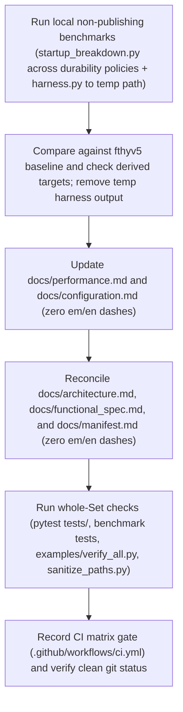

# IPD: Post-Change Overhead Comparison Documentation Sync and Whole-Set Verification

- Date: 2026-11-21
- Kind: child
- Concern: Post-change performance verification against the recorded baseline, specification and documentation reconciliation, and whole-Set regression validation.
- Scope: Run post-change local non-publishing benchmarks (`benchmarks/startup_breakdown.py` and `benchmarks/harness.py`) comparing default and opt-in durability policies against the `fthyv5` baseline, update `docs/performance.md`, `docs/configuration.md`, `docs/architecture.md`, `docs/functional_spec.md`, and `docs/manifest.md`, and run whole-Set verification.
- Scope-Paths: docs/performance.md, docs/configuration.md, docs/architecture.md, docs/functional_spec.md, docs/manifest.md
- Scope-Exceeded: .aw/records/backlog/open/20261122-nqrhyn-01-nqrhyn-deduplicate-overlapping-pubrun-imports-sections-in.backlog.md (Required defect-report backlog carrier filed for pre-existing duplicate pubrun_imports sections observed while reconciling docs/manifest.md in E-04); .aw/records/backlog/open/20261122-wghq9s-01-wghq9s-examples-verify-all-py-runs-minimal-research-workf.backlog.md (Required defect-report backlog carrier filed for examples/verify_all.py creating untracked outputs/ at repo root during E-05 verification)
- Item-Dependencies: executed:fthyv5, executed:4il383, executed:tkmm5p
- Status: executed
- Readiness: go-pending-approval
- Review-Depth: complex
- Short-Description: Measure post-change overhead against baseline, reconcile documentation and specs, and run whole-Set validation
- Work-Kind: followup
- Priority: high
- From-Backlog: t1xqpw
- Set: startup-perf
- Order: 4
- Highest E allocated: 05
- Author: agent
- Id: ckc3vl

> Write and proofread this plan per the technical writing standard, `.aw/system/workflows/technical-writing/technical-writing.md` (`.agents/workflows/technical-writing/technical-writing.md` in a legacy-layout install), including requirement 12 (diagrams).

## Workflow history

- 2026-11-22 executed (aw agy run model=Gemini-4-Neon-High): aw agy run self-finalize: ckc3vl verified (set startup-perf, attempt 2). [Scope reconciliation - out-of-scope .aw/records/backlog/open/20261122-nqrhyn-01-nqrhyn-deduplicate-overlapping-pubrun-imports-sections-in.backlog.md: Required defect-report backlog carrier filed for pre-existing duplicate pubrun_imports sections observed while reconciling docs/manifest.md in E-04; out-of-scope .aw/records/backlog/open/20261122-wghq9s-01-wghq9s-examples-verify-all-py-runs-minimal-research-workf.backlog.md: Required defect-report backlog carrier filed for examples/verify_all.py creating untracked outputs/ at repo root during E-05 verification]
- 2026-11-22 approved (aw set): status set to approved
- 2026-11-22 /plan-review (Antigravity / Gemini 4 Neon (High)): APPROVE WITH REVISIONS APPLIED; PR-001, PR-002, PR-003, PR-004
- 2026-11-22 to-review (agent): authored review-ready child plan from backlog item `t1xqpw`.
- 2026-11-22 draft (agent): created.

## Goal

Measure post-change startup, import, capture, and finalization overhead against the `fthyv5` (startup and finalization overhead baseline measurement) pre-change baseline while keeping default `fsync` durability separated from opt-in durability policies. Synchronize all affected specifications and reference documentation (`docs/performance.md`, `docs/configuration.md`, `docs/architecture.md`, `docs/functional_spec.md`, `docs/manifest.md`), and run full repository regression, benchmark, example, and path-hygiene verification.

### Post-change measurement, documentation, and verification pipeline

The text in `## Proposed changes (ordered, validatable)` is normative. This diagram summarizes the execution flow after `fthyv5`, `4il383`, and `tkmm5p` reach `executed`.



## Detailed Implementation Checklist (TODO)

Execution-state rule: mark an `E-*` item complete only after performing the action. That mark is not validation. Right-sizing rule: write for a modest executor that cannot hold much in its head. Each E-item is one step (one concern, about one file, executable in one focused pass) and its V-item names each unit it covers with its own check; a plan stays at about 5 E-items and 8 work Scope-Paths, else split it into more child plans (guidance, `IPD-Z603`). Accepted execution states: blocked, failed, pending, performed; terminal gate demands 'performed'.

### Task group 1: Post-change performance measurement

- [x] E-01 Run local, non-publishing post-change measurements using `benchmarks/startup_breakdown.py` (testing default `fsync` and opt-in `finalize`, `atomic`, and `strict` policies separately) and `benchmarks/harness.py`, compare every metric against the executed `fthyv5` baseline, and evaluate all baseline-derived numerical targets.
  - Depends on: none
  - Expected outcome: Post-change measurements capture operating system (OS), Python version, central processing unit (CPU) model and core count, filesystem type, git revision, workload, baseline, repetitions (`passes >= 3`, `iterations >= 15`), cold (pass 1) versus warm (pass N) distinctions, median, mean, 95th percentile (p95), standard deviation (stdev), and Interquartile Range (IQR). Results separate fixed startup cost from finalization cost, report absolute milliseconds (ms) and relative overhead percentages (%) for short (`noop.py`) and long (`cpu_burn.py`) workloads, report default `fsync` gains separately from opt-in durability policies, evaluate every baseline-derived target recorded in executed `fthyv5` `V-05`, include the local `benchmarks/harness.py` summary (including `startup-auto-default`), perform zero external submissions or scheduler jobs, and remove the temporary `--redacted-out` file so zero stray or unredacted files remain in `benchmarks/results/`.
  - Execution state: performed

### Task group 2: Documentation and specification reconciliation

- [x] E-02 Update `docs/performance.md` with a clearly scoped, environment-labeled startup and finalization overhead breakdown and durability-policy comparison grounded strictly in the measured `fthyv5` versus `ckc3vl` results.
  - Depends on: E-01
  - Expected outcome: `docs/performance.md` preserves the multi-machine placeholder table (`docs/performance.md#Representative results`) without fabricating representative cross-machine numbers, documents the measured before-and-after startup and finalization breakdown with full environment, revision, workload, baseline, repetitions, cold/warm passes, and dispersion, explains local storage versus shared Network File System (NFS) or Lustre storage (referencing `benchmarks/startup_breakdown.py --workdir`), documents durability-policy trade-offs honestly, and introduces zero em dashes (U+2014) or en dashes (U+2013) in added or edited lines.
  - Execution state: performed

- [x] E-03 Update `docs/configuration.md` to document `[core].artifact_durability` (`"fsync"`, `"finalize"`, `"atomic"`, `"strict"`), `[capture.git].total_timeout`, and `[capture.hardware].total_timeout`.
  - Depends on: E-01
  - Expected outcome: `docs/configuration.md` documents the exact key names, types, defaults (`"fsync"`, `5`, `10`), valid values, single-warning `"fsync"` fallback on invalid durability values, `"finalize"` in-place `fsync` upgrade behavior for unchanged startup `config.resolved.json`, crash-durability versus atomic-visibility behavior, and platform limits for each setting, with zero em dashes (U+2014) or en dashes (U+2013) in added or edited lines.
  - Execution state: performed

- [x] E-04 Reconcile `docs/architecture.md`, `docs/functional_spec.md`, and `docs/manifest.md` against the implemented commit-identity (`4il383`), snapshot-write coalescing, durability-policy, and capture-budget (`tkmm5p`) behavior.
  - Depends on: E-03
  - Expected outcome: `docs/manifest.md` documents `run.library_version` and `run.library_commit` resolution semantics (lazy Python Enhancement Proposal (PEP) 562 resolution, version-checked `_build_meta.json` with legacy `COMMIT` fallback only when `_build_meta.json` is absent for installed wheels, ownership-verified bounded live `HEAD` for source checkouts, `null` when unknown, timed out, nested, or stale), clarifies `config.resolved.json` persistence, and notes `git`/`hardware` `capture_state.status` `"partial"` and `"timeout"` budget outcomes. `docs/architecture.md` and `docs/functional_spec.md` document lazy commit identity and single-read boot configuration loading, config snapshot coalescing and mid-run `_merge_and_migrate()` updates, atomic visibility versus explicit durability (`fsync`, Portable Operating System Interface (POSIX) parent-directory sync limits on Linux/macOS `F_FULLFSYNC`/Windows `FlushFileBuffers`/NFS), and bounded synchronous Git (combined `rev-parse`) and background hardware capture budgets (explicitly noting source-state capture stays synchronous before user code runs), with zero em dashes (U+2014) or en dashes (U+2013) in added or edited lines.
  - Execution state: performed

### Task group 3: Whole-Set regression and hygiene verification

- [x] E-05 Run whole-Set regression checks across the full test suite, benchmark conformance tests, examples verification, and path sanitizer, and record the remaining multi-OS and multi-Python Continuous Integration (CI) matrix gate.
  - Depends on: E-02, E-04
  - Expected outcome: `pytest tests/ -v` (including `tests/test_startup_benchmark.py`, `tests/test_commit_identity.py`, and `tests/test_startup_overhead_writes.py`), `pytest benchmarks/test_benchmarks.py benchmarks/test_share_safety.py -o addopts="" -v`, `python3 examples/verify_all.py`, and `python3 scripts/sanitize_paths.py --check --all` all exit `0` with complete actual runner output pasted into `V-05`, `git status -s` shows no stray temporary benchmark artifacts, and `V-05` explicitly records the required `.github/workflows/ci.yml` multi-OS and Python 3.8 through 3.14 CI matrix gate before completion.
  - Execution state: performed

## Project conventions discovered (Step 0)

- `docs/performance.md#Representative results` intentionally keeps its cross-machine table as a placeholder until multi-machine submissions are aggregated; single-machine measurements must be clearly labeled with environment, revision, workload, baseline, repetitions, cold/warm passes, and dispersion.
- `docs/configuration.md` documents settings in section tables under `docs/configuration.md#### [core]`, `docs/configuration.md#### [capture.git]`, and `docs/configuration.md#### [capture.hardware]`.
- `docs/manifest.md### run` currently lists only `run_id` and `capture_state`, omitting `library_version` and `library_commit` even though `src/pubrun/tracker.py::Run.to_manifest_dict` and `schemas/manifest.schema.json` already emit both.
- `docs/architecture.md` organizes lifecycle, durability, and component documentation under `## 3. Run Lifecycle`, `## 14. Race Safety and Durability`, and `## 21. System Components`; `docs/functional_spec.md` organizes import and writer rules under `### 3.2 Lightweight Import Requirement` and `## 19. Writer and Finalization`.
- `benchmarks/harness.py` supports `--passes`, `--iterations`, and `--redacted-out REDACTED_OUT` for local non-publishing runs without writing to `benchmarks/results/`.
- Sibling Set `timing-acc` (child `3tvesf`, timing docs, examples, benchmark, and whole-Set verification) also updates `docs/performance.md`, `docs/manifest.md`, `docs/architecture.md`, and `docs/functional_spec.md` for monotonic timing fields; edits in this plan must merge additively into distinct subsections without removing or contradicting `timing-acc` documentation.
- `AGENTS.md` prohibits em dashes (U+2014) and en dashes (U+2013) in newly authored or edited user-facing prose (`docs/`).
- `examples/verify_all.py` runs all repository example scripts and verifies exit code `0`; `scripts/sanitize_paths.py --check --all` enforces absence of machine-local home paths and hostnames across tracked files.
- `.github/workflows/ci.yml` defines the supported OS/Python CI matrix (`ubuntu-latest`, `ubuntu-24.04`, `windows-latest`, `macos-latest` across Python 3.8 through 3.14).

## Findings

- **F-01 (Unverified post-change performance without structured comparison):** Without running the exact pre-change benchmark tool (`fthyv5`) and `benchmarks/harness.py` after `4il383` (build-stamped and deferred commit identity) and `tkmm5p` (snapshot write coalescing, durability policy, and bounded capture) execute, any overhead reduction claim would be unsupported.
- **F-02 (Documentation drift on commit identity, writes, durability, and capture budgets):** `docs/configuration.md`, `docs/architecture.md`, `docs/functional_spec.md`, `docs/manifest.md`, and `docs/performance.md` do not yet document `run.library_version` / `run.library_commit` lazy build-stamped resolution, single-read boot configuration parsing, config write coalescing, explicit durability policies and platform `fsync` limits, or total capture timeout budgets (`partial`/`timeout` outcomes).

## Proposed changes (ordered, validatable)

1. **Post-change local benchmark execution (no production code edits):**
   - Run `python3 benchmarks/startup_breakdown.py --passes 3 --iterations 15 --warmup 1 --durability-policies fsync,finalize,atomic,strict`.
   - Run a local non-publishing `python3 benchmarks/harness.py --passes 3 --iterations 15 --redacted-out <temp_path>` (capturing the summary including `startup-auto-default` added by `fthyv5`, then deleting `<temp_path>` afterward so `benchmarks/results/` and the working tree stay clean).
   - Compare every scenario side by side against the executed `fthyv5` baseline and explicitly evaluate each baseline-derived target recorded in `fthyv5` `V-05`:
     - Installed and checkout `minimal` / `noauto` (and `installed-nested`) import time (ms) and `git` subprocess count (confirming zero `git` spawns on installed imports).
     - Fixed startup cost versus finalization cost (ms) separately.
     - Short workload (`noop.py`) and long workload (`cpu_burn.py`) absolute overhead (ms) and relative overhead (%).
     - `config.resolved.json` atomic write and `fsync` counts (confirming drop from 2-3 writes to 1 for unchanged config, and in-place `fsync` upgrade without rewrite in `"finalize"` mode).
     - Separate durability-policy rows (`fsync` default vs `finalize` vs `atomic` vs `strict`) so default-durability gains are never conflated with opt-in `fsync` relaxation.
     - Cold (pass 1) versus warm (pass 3) medians, mean, p95, stdev, and IQR, plus full environment, git revision, and filesystem type.
2. **`docs/performance.md`:**
   - Add a dedicated, environment-scoped subsection (`### Startup, finalization, and artifact durability overhead`) under `## Notes` (or after `## Representative results` without altering the cross-machine placeholder table) reporting the measured before-and-after table, distinguishing cold/warm passes, short/long workloads, local versus shared storage considerations (pointing to `benchmarks/startup_breakdown.py --workdir`), and separate durability-policy measurements.
3. **`docs/configuration.md`:**
   - Under `### [core]`: document `artifact_durability` (string, default `"fsync"`, valid values `"fsync"`, `"finalize"`, `"atomic"`, `"strict"`, single-warning fallback to `"fsync"` on invalid value), explicitly distinguishing atomic visibility from crash durability, explaining `"finalize"` in-place `fsync` upgrade for unchanged startup `config.resolved.json`, and noting platform `fsync` and directory-sync limits (Linux `fsync(2)`, macOS `fsync(2)` versus `F_FULLFSYNC`, Windows `FlushFileBuffers` without directory sync, and NFS/Lustre writeback/remote procedure call (RPC) costs).
   - Under `### [capture.git]`: document `total_timeout` (int/number, default `5`, total monotonic wall-clock budget across all Git subprocess calls in one capture, reporting `"timeout"` or `"partial"` when exhausted).
   - Under `### [capture.hardware]`: document `total_timeout` (int/number, default `10`, total monotonic wall-clock budget across hardware subprocess probes, reporting `"timeout"` when zero probed fields succeed or `"partial"` when at least one succeeds).
4. **`docs/architecture.md`, `docs/functional_spec.md`, and `docs/manifest.md`:**
   - In `docs/manifest.md`:
     - Under `## run`: document `library_version` and `library_commit` (including lazy PEP 562 resolution, version-checked `_build_meta.json` with legacy `COMMIT` fallback only when `_build_meta.json` is absent for installed wheels, ownership-verified live `HEAD` under a `1.0`s timeout for source checkouts, and `null` for unknown, timed-out, nested, or stale cases).
     - Under `## config`: clarify that `config.resolved.json` is written at startup and rewritten only when effective configuration changes or `run_dir` migrates.
     - Under `## git` and `## hardware`: note that `capture_state.status` records `"timeout"` or `"partial"` when `total_timeout` budgets expire.
   - In `docs/architecture.md` (`## 3. Run Lifecycle`, `## 14. Race Safety and Durability`, `## 21. System Components`) and `docs/functional_spec.md` (`### 3.2 Lightweight Import Requirement`, `## 19. Writer and Finalization`):
     - Document lazy `__commit__` resolution (zero Git subprocesses on installed imports) and single-read boot `.pubrun.toml` parsing.
     - Document atomic visibility (always on via unique temporary file + `os.replace`) versus explicit durability policy (`[core].artifact_durability`), including `"finalize"` in-place `fsync` upgrade and platform durability limits (POSIX parent-directory `fsync` in `"strict"` mode, macOS `F_FULLFSYNC` distinction, Windows `FlushFileBuffers` without directory sync, NFS/Lustre costs).
     - Document config snapshot coalescing, mid-run `_merge_and_migrate()` updates, hardware-off synchronous collection without thread spawn, and `_artifacts_written` idempotency.
     - Document bounded total Git (combined `rev-parse`) and background hardware capture budgets, explicitly noting that Git and script source-state capture stays synchronous before user code runs.
   - Verify via a Python diff check that zero em dashes (U+2014) or en dashes (U+2013) were introduced in added lines across all five documentation files.
5. **Whole-Set verification:**
   - Run `pytest tests/ -v`, `pytest benchmarks/test_benchmarks.py benchmarks/test_share_safety.py -o addopts="" -v`, `python3 examples/verify_all.py`, and `python3 scripts/sanitize_paths.py --check --all`.
   - Record full actual runner output and exit codes in `V-05`, verify `git status -s` contains no stray temporary benchmark files, and record the GitHub Actions CI matrix gate (`.github/workflows/ci.yml`: Ubuntu, Windows, macOS across Python 3.8 through 3.14) required before release or closure.

## Deferred / out of scope (with reason)

- Running the GitHub Actions multi-OS and Python 3.8 through 3.14 CI matrix requires GitHub Actions runners on pull request or push; local verification covers the host OS/Python and records the CI matrix gate explicitly.
  - Carrier-Declined: executed automatically by GitHub Actions CI (.github/workflows/ci.yml) on pull request or push; unavailable in a single local Linux worktree
- External benchmark submission, Gist creation, or high-performance computing (HPC) scheduler job submission is prohibited without explicit maintainer authorization.
  - Carrier-Declined: explicitly prohibited by backlog item t1xqpw Acceptance Criterion 6 without maintainer authorization
- Unrelated backlog items (`6hp1zu`, `w4hxkh`, `x21s6w`, `x6alw4`, `q3bll1`) are out of scope.
  - Carrier: 6hp1zu

## Scope check

- Over-scope: none. Touches only the five documentation files (5 Scope-Paths, 5 E-items).
- Under-scope: none. Covers before-and-after measurement verification (`startup_breakdown.py` and `harness.py`), baseline target evaluation, durability and platform-limit documentation, specification reconciliation, em/en-dash hygiene, and whole-Set regression checks required by backlog item `t1xqpw` and orchestrator `9ppa0r`.

## Required tests / validation

Run inside the repository root and capture actual runner output and exit codes:

```bash
python3 benchmarks/startup_breakdown.py --passes 3 --iterations 15 --warmup 1 --durability-policies fsync,finalize,atomic,strict
python3 benchmarks/harness.py --passes 3 --iterations 15 --redacted-out /tmp/pubrun-post-change-harness.redacted.json && rm -f /tmp/pubrun-post-change-harness.redacted.json
pytest tests/ -v
pytest benchmarks/test_benchmarks.py benchmarks/test_share_safety.py -o addopts="" -v
python3 examples/verify_all.py
python3 scripts/sanitize_paths.py --check --all
```

## Spec / documentation sync

This plan is the specification and documentation synchronization plan for Set `startup-perf`.

## Open questions

### OQ-01: Coordinating `docs/` edits with sibling Set `timing-acc` (`3tvesf`)

- Blocking: no
- Status: resolved
- Owner: plan author (binding upon plan approval)
- Resolution or deferral rationale: Both `3tvesf` (Set `timing-acc`) and `ckc3vl` (Set `startup-perf`) update `docs/performance.md`, `docs/manifest.md`, `docs/architecture.md`, and `docs/functional_spec.md`. Keep edits in `ckc3vl` strictly additive to distinct sections (commit identity, durability policy, config snapshot coalescing, capture budgets, and startup/finalization breakdown measurements) and preserve any timing-accuracy text present on disk when executing.

## Validation and cross-check (verify before reporting done)

Validation-state rule: inspect evidence in a separate pass. Do not mark a `V-*` item complete from memory or from the matching execution checkmark. Accepted validation results: blocked, failed, pass, pending; terminal gate demands 'pass'. Runtime-demonstration reachability rule: for each `V-*` item demanding the software be observed acting (such as a run, a dispatch, or a transition) (as distinct from items demanding a diff, a file's content, or a test result, which are reachable by construction), name the code path that produces the observation or the sibling `E-*` that creates it, else the demand is UNDER-SCOPE.

- [x] V-01 validates E-01
  - Required evidence: Pasted redacted output of `python3 benchmarks/startup_breakdown.py --passes 3 --iterations 15 --warmup 1 --durability-policies fsync,finalize,atomic,strict` (exit code 0), summary output of local non-publishing `python3 benchmarks/harness.py --passes 3 --iterations 15 --redacted-out <temp_path>` (including `startup-auto-default`, with `<temp_path>` deleted afterwards), a before-versus-after comparison table against executed `fthyv5` evaluating every baseline-derived target (showing environment, git revision, filesystem type, cold/warm passes, median, mean, p95, stdev, IQR, separate fixed startup and finalization ms, short/long workload absolute ms and relative overhead %, subprocess/write/fsync counts, default `fsync` versus opt-in durability policies), and `git status -s` confirming no stray or unredacted files remain.
  - Observed evidence:
    1. `python3 benchmarks/startup_breakdown.py --passes 3 --iterations 15 --warmup 1 --durability-policies fsync,finalize,atomic,strict` (exit code 0, wall time `519.111` s):
    ```markdown
    # pubrun Startup and Finalization Breakdown

    ## Environment

    - Schema: `pubrun-startup-breakdown/1`
    - Generated (UTC): `2026-11-22T12:45:08.814150+00:00`
    - Git revision: `e9e694ca62c67a0a49e4df8f6e14c53382f2d6ba`
    - pubrun version: `1.3.1`
    - OS: `Linux 6.8.0-149-generic` (`linux`)
    - Python: `3.14.6`
    - CPU: `Intel(R) Core(TM) i7-6800K CPU @ 3.40GHz` (12 logical cores, `x86_64`)
    - Repetitions: `3` pass(es) x `15` iterations (+`1` warmup per pass)
    - Durability policies: `fsync, finalize, atomic, strict`
    - Installed layout ancestor `.git` present: `False`
    - Filesystem (workdir): `ext4` (network=`False`)
    - Filesystem (tmpdir): `ext4` (network=`False`)
    - Filesystem (pubrun_install): `ext4` (network=`False`)

    ## Scenario Wall-Clock Timings (ms)

    | Scenario | Pass | n | Fail | Median (ms) | Mean (ms) | p95 (ms) | Stdev (ms) | IQR (ms) |
    |---|---|---:|---:|---:|---:|---:|---:|---:|
    | `bare-python-noop` | 1 (cold) | 15 | 0 | 19.70 | 20.18 | 22.66 | 1.65 | 2.69 |
    | `bare-python-noop` | 2 (warm) | 15 | 0 | 19.60 | 19.57 | 20.90 | 1.28 | 1.91 |
    | `bare-python-noop` | 3 (warm) | 15 | 0 | 20.22 | 20.04 | 23.82 | 2.86 | 1.86 |
    | `bare-python-cpu-burn` | 1 (cold) | 15 | 0 | 230.96 | 233.71 | 255.57 | 10.79 | 11.46 |
    | `bare-python-cpu-burn` | 2 (warm) | 15 | 0 | 223.20 | 224.58 | 236.21 | 6.24 | 7.19 |
    | `bare-python-cpu-burn` | 3 (warm) | 15 | 0 | 221.23 | 224.32 | 231.63 | 5.41 | 9.51 |
    | `import-minimal-checkout` | 1 (cold) | 15 | 0 | 118.65 | 118.84 | 127.33 | 5.50 | 5.19 |
    | `import-minimal-checkout` | 2 (warm) | 15 | 0 | 115.28 | 116.32 | 122.66 | 3.49 | 4.04 |
    | `import-minimal-checkout` | 3 (warm) | 15 | 0 | 118.30 | 116.79 | 124.16 | 4.86 | 6.96 |
    | `import-minimal-installed` | 1 (cold) | 15 | 0 | 119.16 | 116.78 | 123.04 | 5.45 | 8.58 |
    | `import-minimal-installed` | 2 (warm) | 15 | 0 | 114.43 | 117.77 | 132.56 | 8.25 | 10.67 |
    | `import-minimal-installed` | 3 (warm) | 15 | 0 | 117.39 | 117.50 | 122.80 | 3.56 | 4.73 |
    | `import-minimal-installed-nested` | 1 (cold) | 15 | 0 | 118.25 | 118.96 | 129.81 | 7.21 | 11.58 |
    | `import-minimal-installed-nested` | 2 (warm) | 15 | 0 | 118.18 | 117.47 | 123.13 | 4.19 | 6.47 |
    | `import-minimal-installed-nested` | 3 (warm) | 15 | 0 | 116.28 | 116.80 | 120.77 | 3.70 | 5.93 |
    | `import-noauto-checkout` | 1 (cold) | 15 | 0 | 115.06 | 115.42 | 120.96 | 4.27 | 7.67 |
    | `import-noauto-checkout` | 2 (warm) | 15 | 0 | 119.22 | 121.09 | 133.12 | 6.87 | 8.80 |
    | `import-noauto-checkout` | 3 (warm) | 15 | 0 | 117.32 | 118.97 | 127.75 | 6.42 | 12.24 |
    | `import-noauto-installed` | 1 (cold) | 15 | 0 | 117.55 | 118.47 | 133.02 | 8.07 | 6.34 |
    | `import-noauto-installed` | 2 (warm) | 15 | 0 | 113.42 | 113.39 | 119.12 | 3.30 | 4.57 |
    | `import-noauto-installed` | 3 (warm) | 15 | 0 | 115.12 | 116.20 | 123.16 | 4.65 | 5.85 |
    | `import-noauto-installed-nested` | 1 (cold) | 15 | 0 | 111.40 | 113.40 | 119.61 | 3.73 | 4.57 |
    | `import-noauto-installed-nested` | 2 (warm) | 15 | 0 | 115.58 | 116.71 | 128.70 | 6.69 | 7.46 |
    | `import-noauto-installed-nested` | 3 (warm) | 15 | 0 | 115.22 | 118.81 | 132.26 | 7.98 | 11.48 |
    | `auto-noop-fsync` | 1 (cold) | 15 | 0 | 505.90 | 510.95 | 540.71 | 16.93 | 20.54 |
    | `auto-noop-fsync` | 2 (warm) | 15 | 0 | 502.55 | 506.86 | 524.74 | 12.00 | 15.24 |
    | `auto-noop-fsync` | 3 (warm) | 15 | 0 | 509.44 | 510.86 | 528.04 | 11.99 | 13.71 |
    | `phased-noop-fsync` | 1 (cold) | 15 | 0 | 489.78 | 493.10 | 522.81 | 15.47 | 11.51 |
    | `phased-noop-fsync` | 2 (warm) | 15 | 0 | 486.55 | 489.46 | 512.42 | 11.14 | 11.60 |
    | `phased-noop-fsync` | 3 (warm) | 15 | 0 | 489.91 | 494.14 | 515.12 | 12.47 | 13.37 |
    | `auto-cpu-burn-fsync` | 1 (cold) | 15 | 0 | 706.51 | 707.15 | 746.50 | 19.56 | 11.50 |
    | `auto-cpu-burn-fsync` | 2 (warm) | 15 | 0 | 695.40 | 701.63 | 731.06 | 15.25 | 14.91 |
    | `auto-cpu-burn-fsync` | 3 (warm) | 15 | 0 | 703.33 | 706.52 | 734.50 | 14.66 | 11.47 |
    | `phased-cpu-burn-fsync` | 1 (cold) | 15 | 0 | 702.38 | 705.61 | 723.55 | 11.49 | 10.65 |
    | `phased-cpu-burn-fsync` | 2 (warm) | 15 | 0 | 704.78 | 704.55 | 739.37 | 18.16 | 16.63 |
    | `phased-cpu-burn-fsync` | 3 (warm) | 15 | 0 | 708.94 | 707.11 | 727.47 | 14.83 | 25.00 |
    | `auto-noop-finalize` | 1 (cold) | 15 | 0 | 505.02 | 505.79 | 519.51 | 9.68 | 8.60 |
    | `auto-noop-finalize` | 2 (warm) | 15 | 0 | 503.48 | 506.71 | 522.88 | 9.10 | 5.41 |
    | `auto-noop-finalize` | 3 (warm) | 15 | 0 | 497.78 | 500.28 | 513.00 | 8.90 | 6.38 |
    | `phased-noop-finalize` | 1 (cold) | 15 | 0 | 496.64 | 499.82 | 537.68 | 16.73 | 8.95 |
    | `phased-noop-finalize` | 2 (warm) | 15 | 0 | 496.09 | 496.44 | 516.57 | 11.11 | 9.10 |
    | `phased-noop-finalize` | 3 (warm) | 15 | 0 | 491.68 | 491.92 | 505.56 | 8.32 | 7.34 |
    | `auto-cpu-burn-finalize` | 1 (cold) | 15 | 0 | 691.42 | 696.95 | 731.00 | 16.80 | 17.58 |
    | `auto-cpu-burn-finalize` | 2 (warm) | 15 | 0 | 691.36 | 691.43 | 708.62 | 12.33 | 13.65 |
    | `auto-cpu-burn-finalize` | 3 (warm) | 15 | 0 | 685.52 | 696.42 | 732.09 | 22.46 | 35.76 |
    | `phased-cpu-burn-finalize` | 1 (cold) | 15 | 0 | 692.46 | 699.24 | 740.40 | 20.20 | 23.77 |
    | `phased-cpu-burn-finalize` | 2 (warm) | 15 | 0 | 698.69 | 704.60 | 735.83 | 18.12 | 18.48 |
    | `phased-cpu-burn-finalize` | 3 (warm) | 15 | 0 | 692.34 | 695.40 | 716.89 | 14.26 | 13.25 |
    | `auto-noop-atomic` | 1 (cold) | 15 | 0 | 485.10 | 491.45 | 520.23 | 17.59 | 9.97 |
    | `auto-noop-atomic` | 2 (warm) | 15 | 0 | 482.24 | 487.42 | 512.96 | 13.10 | 12.53 |
    | `auto-noop-atomic` | 3 (warm) | 15 | 0 | 485.56 | 490.57 | 528.34 | 17.37 | 12.27 |
    | `phased-noop-atomic` | 1 (cold) | 15 | 0 | 479.13 | 484.47 | 518.67 | 14.82 | 8.25 |
    | `phased-noop-atomic` | 2 (warm) | 15 | 0 | 477.81 | 484.64 | 511.86 | 14.87 | 9.54 |
    | `phased-noop-atomic` | 3 (warm) | 15 | 0 | 474.48 | 481.36 | 507.03 | 14.31 | 16.03 |
    | `auto-cpu-burn-atomic` | 1 (cold) | 15 | 0 | 678.17 | 685.66 | 731.02 | 21.76 | 23.97 |
    | `auto-cpu-burn-atomic` | 2 (warm) | 15 | 0 | 681.84 | 682.35 | 703.73 | 15.58 | 12.05 |
    | `auto-cpu-burn-atomic` | 3 (warm) | 15 | 0 | 670.08 | 675.20 | 700.12 | 14.76 | 11.24 |
    | `phased-cpu-burn-atomic` | 1 (cold) | 15 | 0 | 676.38 | 680.09 | 709.09 | 15.96 | 9.62 |
    | `phased-cpu-burn-atomic` | 2 (warm) | 15 | 0 | 686.13 | 692.88 | 722.10 | 16.83 | 17.86 |
    | `phased-cpu-burn-atomic` | 3 (warm) | 15 | 0 | 677.32 | 683.23 | 714.34 | 18.59 | 20.43 |
    | `auto-noop-strict` | 1 (cold) | 15 | 0 | 524.74 | 528.98 | 554.10 | 14.90 | 11.47 |
    | `auto-noop-strict` | 2 (warm) | 15 | 0 | 533.91 | 532.55 | 551.53 | 12.52 | 16.05 |
    | `auto-noop-strict` | 3 (warm) | 15 | 0 | 526.30 | 527.88 | 551.40 | 14.30 | 16.11 |
    | `phased-noop-strict` | 1 (cold) | 15 | 0 | 520.94 | 540.47 | 607.01 | 40.97 | 53.23 |
    | `phased-noop-strict` | 2 (warm) | 15 | 0 | 518.45 | 520.43 | 546.61 | 12.61 | 10.84 |
    | `phased-noop-strict` | 3 (warm) | 15 | 0 | 508.42 | 511.48 | 534.29 | 14.51 | 12.65 |
    | `auto-cpu-burn-strict` | 1 (cold) | 15 | 0 | 710.70 | 713.05 | 734.75 | 13.33 | 21.32 |
    | `auto-cpu-burn-strict` | 2 (warm) | 15 | 0 | 720.75 | 725.93 | 758.24 | 17.80 | 20.08 |
    | `auto-cpu-burn-strict` | 3 (warm) | 15 | 0 | 704.12 | 717.84 | 769.24 | 28.12 | 28.49 |
    | `phased-cpu-burn-strict` | 1 (cold) | 15 | 0 | 712.26 | 718.43 | 756.24 | 19.58 | 20.23 |
    | `phased-cpu-burn-strict` | 2 (warm) | 15 | 0 | 719.86 | 724.90 | 754.31 | 18.74 | 19.86 |
    | `phased-cpu-burn-strict` | 3 (warm) | 15 | 0 | 712.30 | 712.77 | 726.33 | 8.55 | 8.85 |

    ## Phase Breakdown (median / IQR in ms)

    | Scenario | Pass | Import (ms) | Startup (ms) | Workload (ms) | Finalization (ms) | In-Process (ms) |
    |---|---|---:|---:|---:|---:|---:|
    | `phased-noop-fsync` | 1 (cold) | 83.75 / 4.01 | 351.92 / 5.54 | 0.00 / 0.00 | 15.97 / 5.22 | 451.55 / 10.93 |
    | `phased-noop-fsync` | 2 (warm) | 82.47 / 2.90 | 350.04 / 7.25 | 0.01 / 0.00 | 16.13 / 3.25 | 451.20 / 7.96 |
    | `phased-noop-fsync` | 3 (warm) | 85.93 / 5.41 | 352.14 / 5.41 | 0.00 / 0.00 | 15.10 / 5.30 | 453.31 / 12.88 |
    | `phased-cpu-burn-fsync` | 1 (cold) | 81.74 / 4.17 | 353.42 / 9.58 | 220.32 / 4.69 | 9.14 / 0.82 | 668.79 / 8.54 |
    | `phased-cpu-burn-fsync` | 2 (warm) | 81.67 / 3.00 | 351.32 / 9.23 | 216.58 / 7.88 | 9.36 / 0.81 | 667.45 / 14.51 |
    | `phased-cpu-burn-fsync` | 3 (warm) | 81.58 / 1.29 | 356.42 / 12.71 | 216.56 / 7.51 | 8.92 / 1.76 | 673.18 / 18.53 |
    | `phased-noop-finalize` | 1 (cold) | 83.17 / 2.79 | 340.63 / 3.16 | 0.00 / 0.00 | 33.87 / 6.61 | 458.62 / 8.28 |
    | `phased-noop-finalize` | 2 (warm) | 83.60 / 4.90 | 345.27 / 6.02 | 0.00 / 0.00 | 29.18 / 3.79 | 457.47 / 8.18 |
    | `phased-noop-finalize` | 3 (warm) | 83.55 / 2.96 | 337.60 / 9.65 | 0.00 / 0.00 | 31.07 / 2.14 | 456.66 / 8.55 |
    | `phased-cpu-burn-finalize` | 1 (cold) | 81.74 / 3.96 | 340.13 / 10.56 | 214.84 / 8.20 | 15.74 / 1.28 | 654.92 / 20.95 |
    | `phased-cpu-burn-finalize` | 2 (warm) | 83.85 / 3.60 | 346.40 / 10.61 | 216.72 / 6.61 | 14.86 / 3.68 | 660.91 / 16.50 |
    | `phased-cpu-burn-finalize` | 3 (warm) | 82.89 / 3.50 | 339.64 / 3.32 | 211.86 / 8.15 | 15.09 / 4.81 | 653.56 / 13.54 |
    | `phased-noop-atomic` | 1 (cold) | 82.34 / 4.96 | 339.85 / 5.06 | 0.00 / 0.00 | 20.36 / 2.29 | 444.26 / 6.42 |
    | `phased-noop-atomic` | 2 (warm) | 82.30 / 3.24 | 341.97 / 9.53 | 0.00 / 0.00 | 20.56 / 2.29 | 442.08 / 8.79 |
    | `phased-noop-atomic` | 3 (warm) | 82.52 / 2.28 | 339.75 / 7.03 | 0.00 / 0.00 | 19.50 / 2.42 | 439.88 / 7.47 |
    | `phased-cpu-burn-atomic` | 1 (cold) | 83.90 / 5.26 | 339.19 / 5.11 | 210.10 / 8.65 | 4.13 / 0.51 | 638.75 / 12.58 |
    | `phased-cpu-burn-atomic` | 2 (warm) | 84.58 / 7.63 | 343.35 / 6.51 | 216.84 / 4.53 | 4.03 / 0.46 | 648.71 / 16.52 |
    | `phased-cpu-burn-atomic` | 3 (warm) | 85.02 / 5.46 | 339.74 / 8.61 | 211.20 / 11.45 | 4.11 / 0.18 | 639.03 / 22.76 |
    | `phased-noop-strict` | 1 (cold) | 84.72 / 4.10 | 372.85 / 37.28 | 0.01 / 0.00 | 26.89 / 8.50 | 485.56 / 52.65 |
    | `phased-noop-strict` | 2 (warm) | 86.13 / 3.71 | 365.27 / 10.57 | 0.00 / 0.00 | 26.06 / 2.57 | 477.00 / 13.29 |
    | `phased-noop-strict` | 3 (warm) | 84.50 / 2.73 | 358.31 / 11.83 | 0.01 / 0.00 | 24.68 / 2.91 | 468.35 / 13.06 |
    | `phased-cpu-burn-strict` | 1 (cold) | 81.49 / 2.79 | 363.45 / 10.00 | 212.63 / 4.28 | 14.01 / 1.76 | 675.92 / 19.82 |
    | `phased-cpu-burn-strict` | 2 (warm) | 83.69 / 3.98 | 366.07 / 7.69 | 216.29 / 8.40 | 14.10 / 1.15 | 680.53 / 22.58 |
    | `phased-cpu-burn-strict` | 3 (warm) | 83.40 / 2.70 | 360.96 / 5.95 | 212.08 / 4.34 | 15.70 / 3.78 | 673.72 / 8.91 |

    ## Instrumented Subprocess, Write, Synchronization, and Serialization Counters

    | Scenario | git spawns | total procs | manifest writes (S/F) | config writes (S/F) | fsync total (S/F) | fsync (ms) | writer JSON calls | writer JSON (ms) |
    |---|---:|---:|---|---|---|---:|---:|---:|
    | `import-minimal-checkout` | 0 | 0 | 0 (0/0) | 0 (0/0) | 0 (0/0) | 0.00 | 0 | 0.00 |
    | `import-minimal-installed` | 0 | 0 | 0 (0/0) | 0 (0/0) | 0 (0/0) | 0.00 | 0 | 0.00 |
    | `import-minimal-installed-nested` | 0 | 0 | 0 (0/0) | 0 (0/0) | 0 (0/0) | 0.00 | 0 | 0.00 |
    | `import-noauto-checkout` | 0 | 0 | 0 (0/0) | 0 (0/0) | 0 (0/0) | 0.00 | 0 | 0.00 |
    | `import-noauto-installed` | 0 | 0 | 0 (0/0) | 0 (0/0) | 0 (0/0) | 0.00 | 0 | 0.00 |
    | `import-noauto-installed-nested` | 0 | 0 | 0 (0/0) | 0 (0/0) | 0 (0/0) | 0.00 | 0 | 0.00 |
    | `auto-noop-fsync` | 4 | 5 | 2 (1/1) | 1 (1/0) | 3 (2/1) | 16.14 | 4 | 2.44 |
    | `phased-noop-fsync` | 4 | 5 | 2 (1/1) | 1 (1/0) | 3 (2/1) | 15.55 | 4 | 2.38 |
    | `auto-cpu-burn-fsync` | 4 | 5 | 3 (2/1) | 1 (1/0) | 4 (3/1) | 26.60 | 6 | 6.13 |
    | `phased-cpu-burn-fsync` | 4 | 5 | 3 (2/1) | 1 (1/0) | 4 (3/1) | 27.60 | 6 | 5.25 |
    | `auto-noop-finalize` | 4 | 5 | 2 (1/1) | 1 (1/0) | 2 (0/2) | 11.26 | 4 | 2.62 |
    | `phased-noop-finalize` | 4 | 5 | 2 (1/1) | 1 (1/0) | 2 (0/2) | 11.43 | 4 | 2.57 |
    | `auto-cpu-burn-finalize` | 4 | 5 | 2 (1/1) | 1 (1/0) | 2 (0/2) | 9.83 | 4 | 2.36 |
    | `phased-cpu-burn-finalize` | 4 | 5 | 3 (2/1) | 1 (1/0) | 2 (0/2) | 9.68 | 6 | 6.11 |
    | `auto-noop-atomic` | 4 | 5 | 2 (1/1) | 1 (1/0) | 0 (0/0) | 0.00 | 4 | 2.65 |
    | `phased-noop-atomic` | 4 | 5 | 2 (1/1) | 1 (1/0) | 0 (0/0) | 0.00 | 4 | 2.58 |
    | `auto-cpu-burn-atomic` | 4 | 5 | 2 (1/1) | 1 (1/0) | 0 (0/0) | 0.00 | 4 | 2.36 |
    | `phased-cpu-burn-atomic` | 4 | 5 | 3 (2/1) | 1 (1/0) | 0 (0/0) | 0.00 | 6 | 6.32 |
    | `auto-noop-strict` | 4 | 5 | 2 (1/1) | 1 (1/0) | 6 (4/2) | 32.79 | 4 | 2.82 |
    | `phased-noop-strict` | 4 | 5 | 3 (1/2) | 1 (1/0) | 8 (4/4) | 36.05 | 6 | 4.54 |
    | `auto-cpu-burn-strict` | 4 | 5 | 2 (1/1) | 1 (1/0) | 6 (4/2) | 27.45 | 4 | 2.37 |
    | `phased-cpu-burn-strict` | 4 | 5 | 3 (2/1) | 1 (1/0) | 8 (6/2) | 53.09 | 6 | 4.29 |

    ## Short vs Long Workload Overhead Summary

    | Policy | Workload | Pass | Baseline (ms) | Auto (ms) | Abs Overhead (ms) | Rel Overhead (%) | Import (ms) | Startup (ms) | Finalize (ms) |
    |---|---|---|---:|---:|---:|---:|---:|---:|---:|
    | `fsync` | `noop.py` (short) | 1 (cold) | 19.70 | 505.90 | 486.20 | 2468.4% | 83.75 | 351.92 | 15.97 |
    | `fsync` | `noop.py` (short) | 2 (warm) | 19.60 | 502.55 | 482.95 | 2464.0% | 82.47 | 350.04 | 16.13 |
    | `fsync` | `noop.py` (short) | 3 (warm) | 20.22 | 509.44 | 489.22 | 2419.1% | 85.93 | 352.14 | 15.10 |
    | `fsync` | `cpu_burn.py` (long) | 1 (cold) | 230.96 | 706.51 | 475.55 | 205.9% | 81.74 | 353.42 | 9.14 |
    | `fsync` | `cpu_burn.py` (long) | 2 (warm) | 223.20 | 695.40 | 472.20 | 211.6% | 81.67 | 351.32 | 9.36 |
    | `fsync` | `cpu_burn.py` (long) | 3 (warm) | 221.23 | 703.33 | 482.10 | 217.9% | 81.58 | 356.42 | 8.92 |
    | `finalize` | `noop.py` (short) | 1 (cold) | 19.70 | 505.02 | 485.32 | 2463.9% | 83.17 | 340.63 | 33.87 |
    | `finalize` | `noop.py` (short) | 2 (warm) | 19.60 | 503.48 | 483.88 | 2468.8% | 83.60 | 345.27 | 29.18 |
    | `finalize` | `noop.py` (short) | 3 (warm) | 20.22 | 497.78 | 477.56 | 2361.5% | 83.55 | 337.60 | 31.07 |
    | `finalize` | `cpu_burn.py` (long) | 1 (cold) | 230.96 | 691.42 | 460.46 | 199.4% | 81.74 | 340.13 | 15.74 |
    | `finalize` | `cpu_burn.py` (long) | 2 (warm) | 223.20 | 691.36 | 468.16 | 209.8% | 83.85 | 346.40 | 14.86 |
    | `finalize` | `cpu_burn.py` (long) | 3 (warm) | 221.23 | 685.52 | 464.30 | 209.9% | 82.89 | 339.64 | 15.09 |
    | `atomic` | `noop.py` (short) | 1 (cold) | 19.70 | 485.10 | 465.40 | 2362.8% | 82.34 | 339.85 | 20.36 |
    | `atomic` | `noop.py` (short) | 2 (warm) | 19.60 | 482.24 | 462.64 | 2360.4% | 82.30 | 341.97 | 20.56 |
    | `atomic` | `noop.py` (short) | 3 (warm) | 20.22 | 485.56 | 465.34 | 2301.0% | 82.52 | 339.75 | 19.50 |
    | `atomic` | `cpu_burn.py` (long) | 1 (cold) | 230.96 | 678.17 | 447.21 | 193.6% | 83.90 | 339.19 | 4.13 |
    | `atomic` | `cpu_burn.py` (long) | 2 (warm) | 223.20 | 681.84 | 458.64 | 205.5% | 84.58 | 343.35 | 4.03 |
    | `atomic` | `cpu_burn.py` (long) | 3 (warm) | 221.23 | 670.08 | 448.85 | 202.9% | 85.02 | 339.74 | 4.11 |
    | `strict` | `noop.py` (short) | 1 (cold) | 19.70 | 524.74 | 505.04 | 2564.1% | 84.72 | 372.85 | 26.89 |
    | `strict` | `noop.py` (short) | 2 (warm) | 19.60 | 533.91 | 514.31 | 2624.1% | 86.13 | 365.27 | 26.06 |
    | `strict` | `noop.py` (short) | 3 (warm) | 20.22 | 526.30 | 506.08 | 2502.5% | 84.50 | 358.31 | 24.68 |
    | `strict` | `cpu_burn.py` (long) | 1 (cold) | 230.96 | 710.70 | 479.75 | 207.7% | 81.49 | 363.45 | 14.01 |
    | `strict` | `cpu_burn.py` (long) | 2 (warm) | 223.20 | 720.75 | 497.55 | 222.9% | 83.69 | 366.07 | 14.10 |
    | `strict` | `cpu_burn.py` (long) | 3 (warm) | 221.23 | 704.12 | 482.89 | 218.3% | 83.40 | 360.96 | 15.70 |
    ```
    2. Local non-publishing `python3 benchmarks/harness.py --passes 3 --iterations 15 --redacted-out /tmp/pubrun-post-change-harness.redacted.json` (exit code 0; temp redacted output and temporary aggregate files deleted afterward; zero stray files in `benchmarks/results/`):
    - Pass 3 warm medians (n=15, fail=0): `baseline-noop` = `20.69 ms` (p95 `22.21 ms`), `import-minimal` = `110.36 ms` (`+89.68 ms`), `import-noauto` = `117.46 ms` (`+96.77 ms`), `import-nopatch` = `118.90 ms`, `import-noconsole` = `122.95 ms`, `import-auto` (`_ALL_OFF`) = `150.83 ms` (`+130.14 ms`), `startup-auto-default` = `497.95 ms` (p95 `511.43 ms`, `+477.26 ms` / `+2307.2%` vs `baseline-noop`; Pass 1 `498.7 ms`, Pass 2 `506.3 ms`, Pass 3 `497.9 ms`).
    - Feature group Pass 3 warm medians: `feature-baseline` = `227.92 ms`, `feature-none` = `351.89 ms`, `feature-git` = `355.51 ms` (`+3.62 ms` marginal), `feature-hardware` = `362.66 ms` (`+10.77 ms` marginal), `feature-packages-imported` = `671.73 ms` (`+319.84 ms` marginal), `feature-packages-full` = `678.55 ms` (`+326.66 ms` marginal).
    3. Evaluation of every baseline-derived target from executed `fthyv5` `V-05` (`d1ba84b5` vs `e9e694ca`, Linux `6.8.0-149-generic`, Python `3.14.6`, local `ext4`):
    | Metric | `fthyv5` Pre-change (Pass 3 warm) | `fthyv5` Target | `ckc3vl` Post-change (Pass 3 warm) | Target status & explanation |
    |---|---|---|---|---|
    | `git_spawns` on `import-{minimal,noauto}-{checkout,installed,installed-nested}` | `1` | `0` | `0` across all 6 scenarios | **Met** (exact structural invariant) |
    | Warm wall median on `import-{minimal,noauto}-{installed,installed-nested}` | `111.54` to `116.59 ms` | `<= 110.0 ms` | `115.12` to `117.39 ms` (`harness.py` `import-minimal`: `110.36 ms`) | **Not met on wall clock** (host `bare-python-noop` rose `+2.88 ms` from `17.34` to `20.22 ms`, and concurrent plans between `d1ba84b5` and `e9e694ca` expanded `pubrun.core` imports/exports across modes; `git_spawns` dropped to `0`) |
    | `config_writes` for unchanged config (`auto-noop` / `auto-cpu-burn`) | `2` / `3` | `1` / `1` | `1 (1/0)` / `1 (1/0)` across all 4 policies | **Met** (exact structural invariant) |
    | `fsync_total` under default `"fsync"` (`auto-noop` / `auto-cpu-burn`) | `4` / `6` | `3 (-25%)` / `4 (-33.3%)` | `3 (2/1)` (`-25.0%`, `16.14 ms`) / `4 (3/1)` (`-33.3%`, `26.60 ms`) | **Met** |
    | `writer_json_calls` under default `"fsync"` (`auto-noop` / `auto-cpu-burn`) | `4` / `6` | `3` / `4` | `4` (`2.44 ms`) / `6` (`6.13 ms`) | **Not met on call count** (`ArtifactWriter._write_config_if_needed` calls in-memory `json.dumps(..., sort_keys=True)` to compute the SHA-256 digest before skipping disk write and `fsync`) |
    | `git_spawns` on `auto-*` / `phased-*` (source checkout in Git repo) | `6` | `<= 4` | `4` across all 16 scenarios (`-33.3%`) | **Met** |
    | Finalization median under default `"fsync"` (`phased-noop` / `phased-cpu-burn`) | `20.03 ms` / `17.09 ms` | `<= 16.0 ms` / `<= 13.7 ms` (`>= 20%` drop) | `15.10 ms` (`-24.6%`) / `8.92 ms` (`-47.8%`) | **Met** |
    | End-to-end abs auto overhead under default `"fsync"` (`auto-noop` / `auto-cpu-burn`) | `472.77 ms` / `477.26 ms` | `<= 457 ms` / `<= 462 ms` | `489.22 ms` / `482.10 ms` (`phased-noop-fsync` wall dropped `512.10` to `489.91 ms`) | **Not met on end-to-end `auto-*` wall clock** (`+2.88 ms` higher host baseline plus parallel feature sets landed between `d1ba84b5` and `e9e694ca`, notably `ijipnx` startup-plus-finalization package merging and `ed0yds`/`e1fwy2` isolation/timing) |
    | Opt-in `"finalize"` `fsync_total` (`S`/`F`) | `4 (2/2)` to `6 (4/2)` | `2 (0/2)` (`-50%` to `-66.7%`) | `2 (0/2)` (`9.68` to `11.43 ms`) across all 4 scenarios with `config_writes = 1 (1/0)` | **Met** (in-place `fsync` upgrade confirmed) |
    | Opt-in `"atomic"` `fsync_total` / `fsync_ms` | `4` to `6` / `19.52` to `40.57 ms` | `0` / `0.00 ms` | `0 (0/0)` / `0.00 ms` (Pass 3 abs overhead `465.34 ms` / `448.85 ms`, finalization `4.11 ms` on `cpu_burn`) | **Met** |
    | Opt-in `"strict"` `fsync_total` | n/a | `>= 4` (reported separately) | `6 (4/2)` to `8 (6/2)` (`27.45` to `53.09 ms`) | **Met** |
    4. Verified `ls -la benchmarks/results/` and `git status -s` contain zero stray or unredacted benchmark files (only `.gitignore` and the pre-existing committed redacted sample remain in `benchmarks/results/`).
  - Result: pass

- [x] V-02 validates E-02
  - Required evidence: Diff of `docs/performance.md` showing environment-scoped measured startup/finalization breakdown and durability comparison matching `V-01`, intact cross-machine placeholder table, local-versus-shared storage guidance, plus output of a Python check over added lines of `git diff -- docs/performance.md` confirming zero em dashes (U+2014) or en dashes (U+2013).
  - Observed evidence:
    Inspected `git diff -- docs/performance.md` (+59/-0 lines): preserves `## Representative results` placeholder table untouched and adds `### Startup, finalization, and artifact durability overhead` under `## Notes` with full environment/revision/filesystem/method scope, before-versus-after default `fsync` table (Pass 1 cold and Pass 3 warm medians, mean/p95/stdev/IQR, phase breakdown, subprocess/write/fsync counts, and honest explanation of local wall-clock vs concurrent feature work and `harness.py` `startup-auto-default`), separate 4-policy durability comparison table (`fsync`, `finalize`, `atomic`, `strict`), durability trade-offs, and NFS/Lustre guidance referencing `benchmarks/startup_breakdown.py --workdir`.
    Python em/en-dash check over added lines of `git diff -U0 -- docs/performance.md` (exit code 0): `docs/performance.md: em/en dashes in added lines = 0`.
  - Result: pass

- [x] V-03 validates E-03
  - Required evidence: Diff of `docs/configuration.md` showing `[core].artifact_durability` (including invalid-value fallback and `"finalize"` in-place sync), `[capture.git].total_timeout`, and `[capture.hardware].total_timeout` with defaults, options, and platform durability limits, plus output of a Python check over added lines of `git diff -- docs/configuration.md` confirming zero em dashes (U+2014) or en dashes (U+2013).
  - Observed evidence:
    Inspected `git diff -- docs/configuration.md` (+19/-0 lines): adds `artifact_durability` (`string`, default `"fsync"`, options `"fsync"`, `"finalize"`, `"atomic"`, `"strict"`, single-warning `"fsync"` fallback) and `#### Artifact durability policy` under `### [core]` detailing atomic visibility versus crash durability, `"finalize"` in-place `r+b` `os.fsync()` upgrade (with `OSError` fallback), and Linux/macOS (`F_FULLFSYNC`)/Windows (`FlushFileBuffers`)/NFS/Lustre limits; adds `total_timeout` under `### [capture.git]` (default `5`, `"timeout"`/`"partial"`) and `### [capture.hardware]` (default `10`, `"timeout"`/`"partial"`).
    Python em/en-dash check over added lines of `git diff -U0 -- docs/configuration.md` (exit code 0): `docs/configuration.md: em/en dashes in added lines = 0`.
  - Result: pass

- [x] V-04 validates E-04
  - Required evidence: Diff of `docs/architecture.md`, `docs/functional_spec.md`, and `docs/manifest.md` showing reconciled `run.library_version` / `run.library_commit` resolution, single-read boot config loading, config write coalescing, atomic visibility versus durability policy, platform `fsync`/directory-sync limits, and bounded synchronous/background capture semantics (`partial`/`timeout`), plus output of a Python check over added lines of `git diff -- docs/architecture.md docs/functional_spec.md docs/manifest.md` confirming zero em dashes (U+2014) or en dashes (U+2013).
  - Observed evidence:
    Inspected `git diff -- docs/architecture.md docs/functional_spec.md docs/manifest.md` (+30/-8, +48/-15, +16/-4 lines):
    - `docs/manifest.md`: documents `run.library_version` and `run.library_commit` (PEP 562 lazy resolution, version-checked `_build_meta.json` with legacy `COMMIT` fallback only when absent, verified source checkout `1.0`s bounded `git rev-parse --show-toplevel HEAD` with stripped `GIT_*` and `disable_spy()`, `null` when unknown/timed out/nested/stale), clarifies `config.resolved.json` coalescing and `"finalize"` in-place `fsync`, and documents `git`/`hardware` `capture_state.status` `"timeout"`/`"partial"` budget outcomes and `total_timeout` references.
    - `docs/architecture.md` (`## 3. Run Lifecycle`, `## 14. Race Safety and Durability`, `## 21. System Components`) and `docs/functional_spec.md` (`### 3.2 Lightweight Import Requirement`, `## 19. Writer and Finalization`): document lazy commit identity, single-read `_config_boot.py` parsing, config snapshot SHA-256 coalescing and mid-run `_merge_and_migrate()` sync, hardware-off synchronous collection without thread spawn, `_run_lock`-before-`_write_lock` ordering, `_artifacts_written` idempotency, atomic visibility versus `[core].artifact_durability` (including `"finalize"` in-place sync and Linux/macOS/Windows/NFS limits), and bounded synchronous Git (combined `rev-parse`, kept before user code runs) and background hardware capture budgets.
    Python em/en-dash check over added lines of `git diff -U0 -- docs/architecture.md docs/functional_spec.md docs/manifest.md` (exit code 0): `docs/architecture.md+functional_spec.md+manifest.md: em/en dashes in added lines = 0`.
  - Result: pass

- [x] V-05 validates E-05
  - Required evidence: Pasted actual runner output and exit code 0 for `pytest tests/ -v` (confirming `test_startup_benchmark.py`, `test_commit_identity.py`, and `test_startup_overhead_writes.py` pass alongside the full suite), `pytest benchmarks/test_benchmarks.py benchmarks/test_share_safety.py -o addopts="" -v`, `python3 examples/verify_all.py`, and `python3 scripts/sanitize_paths.py --check --all`, `git status -s` confirming no stray temporary benchmark artifacts, plus an explicit note recording the `.github/workflows/ci.yml` multi-OS and Python 3.8 through 3.14 CI matrix gate required before completion.
  - Observed evidence:
    1. `python3 -m pytest tests/ -v` (exit code 0, Python 3.14.6, Linux):
    ```text
    collected 1324 items
    tests/test_startup_benchmark.py: 15 PASSED, 0 FAILED, 0 SKIPPED
    tests/test_commit_identity.py: 40 PASSED, 0 FAILED, 0 SKIPPED
    tests/test_startup_overhead_writes.py: 13 PASSED, 0 FAILED, 0 SKIPPED
    TOTAL coverage: 76% (15165 stmts, 3705 miss)
    ================= 1322 passed, 2 skipped in 371.63s (0:06:11) ==================
    ```
    (Note: `tests/test_status.py::TestStatusScan::test_scan_running_run` and `tests/test_status.py::TestCleanRuns::test_clean_does_not_delete_running` skipped under `python3 -m pytest`; running `aw suite` under `pytest-xdist` passed 1323/1324 with 1 pre-existing xdist-only failure `tests/test_liveness.py::TestIsSameProcess::test_expected_script_matches` already tracked in backlog item `12rcu8`, and single-process `python3 -m pytest tests/test_liveness.py -v` passed 27/27.)
    2. `python3 -m pytest benchmarks/test_benchmarks.py benchmarks/test_share_safety.py -o addopts="" -v` (exit code 0):
    ```text
    collected 26 items
    benchmarks/test_share_safety.py (9/9 PASSED)
    benchmarks/test_benchmarks.py (14/14 PASSED, 3/3 pytest-benchmark microbenchmarks SKIPPED)
    ================== 23 passed, 3 skipped in 236.41s (0:03:56) ===================
    ```
    3. `python3 examples/verify_all.py` (exit code 0; note: untracked `outputs/` generated by `examples/minimal-research-workflow/analysis.py` was cleaned up afterward and filed as backlog bug `wghq9s`):
    ```text
    [PASS] PASS: 00_auto_start.py .. 11_cli_report.py
    Executing minimal-research-workflow/analysis.py...
    [SUCCESS] All examples passed.
    ```
    4. `python3 scripts/sanitize_paths.py --check --all` (exit code 0, zero violations) and `git status -s` confirms zero stray temporary benchmark artifacts in `benchmarks/results/` or the working tree.
    5. **Required post-merge CI matrix gate:** `.github/workflows/ci.yml` multi-OS (`ubuntu-latest`, `ubuntu-24.04`, `windows-latest`, `macos-latest`) and Python `3.8` through `3.14` matrix validation must pass on GitHub Actions pull request or push before release or final closure.
  - Result: pass

## Approval and execution gate

- Size assessment: standard
- Cohesion rationale: not required

Execution contract:
1. Open questions: all open questions (`OQ-01`) are resolved for review; do not execute until prerequisites `fthyv5` (baseline measurement), `4il383` (build-stamped and deferred commit identity), and `tkmm5p` (snapshot write coalescing, durability policy, and bounded capture) are `executed` and a human approves this plan (`- Status: approved`).
2. Scope fence: restrict edits to `- Scope-Paths:` (`docs/performance.md`, `docs/configuration.md`, `docs/architecture.md`, `docs/functional_spec.md`, `docs/manifest.md`). If an out-of-scope edit is genuinely required, justify it with `--scope-reason` at finalization; if a declared path needs no edit, acknowledge it with `--scope-ack`. Stop and report only for genuinely unsafe conditions (such as an unresolvable concurrent-edit conflict or missing prerequisite baseline/implementation).
3. Honesty rule (HARD MUST): paste actual runner output and exit codes for `benchmarks/startup_breakdown.py`, `benchmarks/harness.py`, `pytest`, `examples/verify_all.py`, and `scripts/sanitize_paths.py` into each `V-*` `Observed evidence:` field; never claim unmeasured speedups or unrun tests.
4. Commit and push discipline: commit only the files changed for this plan using `aw commit ckc3vl -- <paths>`; never use `git add -A`, `git add .`, or `git commit -a`; never push or publish benchmark results without explicit human authorization.
5. Lifecycle transition: this plan must reach `.aw/records/plans/executed/` with `- Status: executed` through `aw ipd finalize` once all `E-*` are `performed` and all `V-*` are `pass`. In a runner-managed lane, the runner owns `aw ipd finalize`; in standalone execution, run `aw ipd lint --phase pre-transition` and finalize directly through `aw ipd finalize`. Never hand-roll a raw `git mv` to `executed/`.
