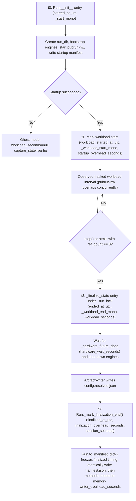
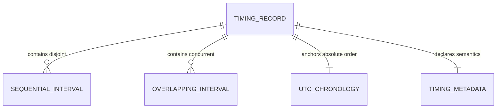

# IPD: Manifest Timing Schema and Tracker Monotonic Lifecycle

- Date: 2026-11-21
- Kind: child
- Concern: Monotonic run duration measurement, workload/capture overhead separation, and additive manifest timing schema.
- Scope: Define the run timing interval model; update `schemas/manifest.schema.json` additively; update `Run` (`src/pubrun/tracker.py`) and `ArtifactWriter` (`src/pubrun/writer.py`); add deterministic timing and schema conformance tests.
- Scope-Paths: schemas/manifest.schema.json, src/pubrun/tracker.py, src/pubrun/writer.py, tests/test_timing_accuracy.py, tests/test_manifest_schema.py
- Item-Dependencies: none
- Status: executed
- Readiness: go-pending-approval
- Review-Depth: complex
- Short-Description: Add monotonic interval schema fields and separate startup, workload, and finalization timing in Run and ArtifactWriter
- Work-Kind: bug
- Priority: high
- From-Backlog: 6hp1zu
- Blocks-Release: next
- Set: timing-acc
- Order: 1
- Highest E allocated: 05
- Author: agent
- Id: e1fwy2

> Write and proofread this plan per the technical writing standard, `.aw/system/workflows/technical-writing/technical-writing.md` (`.agents/workflows/technical-writing/technical-writing.md` in a legacy-layout install), including requirement 12 (diagrams).

## Workflow history

- 2026-11-22 executed (aw agy run model=Gemini-4-Neon-High): aw agy run self-finalize: e1fwy2 verified (set timing-acc, attempt 1).
- 2026-11-22 approved (aw set): status set to approved
- 2026-11-22 /plan-review (Gemini 4 Neon (High)): APPROVE WITH REVISIONS APPLIED; PR-001, PR-002, PR-003, PR-004, PR-005, PR-006
- 2026-11-22 draft (agent): created.
- 2026-11-22 to-review (agent): authored review-ready child plan from backlog item `6hp1zu`.

## Goal

Replace wall-clock subtraction in `Run` with monotonic duration tracking (`time.perf_counter()`), separate synchronous startup capture, observed tracked workload, synchronous finalization overhead, and overlapping background hardware capture, and extend `schemas/manifest.schema.json` additively so both legacy v1.0 manifests and new manifests validate.

### Timing interval model and lifecycle

The text in `## Proposed changes (ordered, validatable)` is normative. These diagrams summarize the `Run` timing lifecycle and the relationships between persisted timing entities.





## Detailed Implementation Checklist (TODO)

Execution-state rule: mark an `E-*` item complete only after performing the action. That mark is not validation. Right-sizing rule: write for a modest executor that cannot hold much in its head. Each E-item is one step (one concern, about one file, executable in one focused pass) and its V-item names each unit it covers with its own check; a plan stays at about 5 E-items and 8 work Scope-Paths, else split it into more child plans (guidance, `IPD-Z603`). Accepted execution states: blocked, failed, pending, performed; terminal gate demands 'performed'.

### Task group 1: Schema and core lifecycle implementation

- [x] E-01 Extend `schemas/manifest.schema.json` additively under `$defs.timing` and `$defs.subprocess_record`.
  - Depends on: none
  - Expected outcome: `$defs.timing` declares optional fields `workload_started_at_utc`, `finalized_at_utc`, `workload_seconds`, `startup_overhead_seconds`, `finalization_overhead_seconds`, `session_seconds`, `hardware_wait_seconds`, `background_hardware_seconds`, `duration_clock`, `elapsed_basis`, and `interval_scope` with nonnegativity constraints (`minimum: 0`) and strict enums; `$defs.subprocess_record` declares optional `elapsed_seconds` (`minimum: 0`), `duration_clock`, `pid`, and `error` so child `8co0wy` records also validate cleanly; `required` arrays remain unchanged so all legacy v1.0 manifests stay valid.
  - Execution state: performed

- [x] E-02 Implement monotonic interval anchors and workload/overhead separation in `src/pubrun/tracker.py` (`Run.__init__`, `Run._bootstrap_engines`, `Run._finalize_state`, `Run._mark_finalization_end`, `Run.stop`, `Run.to_manifest_dict`).
  - Depends on: E-01
  - Expected outcome: `Run` captures Coordinated Universal Time (UTC) epoch floats via `time.time()` for chronology and monotonic counter readings via `time.perf_counter()` in private attributes only (never serialized); marks `t1` after `write_startup_manifest()`; tracks background hardware wall duration (`background_hardware_seconds`) separately as an overlapping interval; marks workload end `t2` under `_run_lock` at the start of `_finalize_state()` before waiting on `_hardware_future_done.wait(timeout=2.0)`; measures `hardware_wait_seconds`; marks pre-manifest finalization end `t3` via `_mark_finalization_end()`; sets `elapsed_seconds = workload_seconds`, `duration_clock = "monotonic"`, `elapsed_basis = "workload"`, and `interval_scope = "tracked_interval"`; handles partial startup/ghost mode, nested `ref_count`, exceptions, interruptions, and double-`stop()` idempotency.
  - Execution state: performed

- [x] E-03 Update `src/pubrun/writer.py` (`ArtifactWriter.write_artifacts`) to write `config.resolved.json` before `manifest.json`, stamp `t3` before `to_manifest_dict()`, and record post-manifest writer duration in memory.
  - Depends on: E-02
  - Expected outcome: `src/pubrun/writer.py` imports `time`, and `ArtifactWriter.write_artifacts()` guards against re-writing a finalized run (`_artifacts_written`), calls `self.run._finalize_state()`, writes `config.resolved.json` atomically, calls `self.run._mark_finalization_end()` when present (`hasattr` guard preserving duck-typed test doubles such as `tests/test_writer.py::DummyRun`) right before `self.run.to_manifest_dict()`, writes `manifest.json` once atomically, writes `methods.{md,tex}`, and records total writer duration on `self.run.writer_overhead_seconds` in memory without performing a second `manifest.json` write.
  - Execution state: performed

### Task group 2: Deterministic behavioral and schema verification

- [x] E-04 Create `tests/test_timing_accuracy.py` with deterministic behavioral tests using controlled fake wall and monotonic clocks.
  - Depends on: E-03
  - Expected outcome: Tests exercise forward and backward wall-clock jumps, deterministic hardware-worker delay, deterministic writer delay, short runs, automatic `atexit` finalization, explicit `stop()`, nested reference-counted `start()`/`stop()`, `tracked_run` and `audit_run` normal and exception paths, `KeyboardInterrupt`/signal interruption, partial startup/ghost mode, double-`stop()` idempotency, and verification that no raw monotonic counter values appear in `manifest.json`, without depending on real-time sleeps.
  - Execution state: performed

- [x] E-05 Extend `tests/test_manifest_schema.py` with conformance tests for new timing-rich manifests, legacy v1.0 manifests (without new timing fields), startup manifests, and ghost-run `timing` subschema validation, then run the targeted test suite.
  - Depends on: E-04
  - Expected outcome: `pytest tests/test_timing_accuracy.py tests/test_manifest_schema.py tests/test_tracker.py tests/test_writer.py -v`, `pytest tests/test_quality.py -k TestDoubleStop -v`, and `pytest tests/test_api.py -k test_timing_values_are_floats -v` exit 0 with all tests passing.
  - Execution state: performed

## Project conventions discovered (Step 0)

- `src/pubrun/tracker.py::Run.__init__`, `Run._finalize_state`, and `Run.to_manifest_dict` use `time.time()` for `started_at_utc` and `ended_at_utc`, set `ended_at_utc` after `self._hardware_future_done.wait(timeout=2.0)`, and compute `elapsed = self.ended_at_utc - self.started_at_utc`.
- `src/pubrun/tracker.py::Run._bootstrap_engines` and `Run._finalize_state` protect `_finalized` latching and the background hardware thread startup re-write with `pubrun._run_lock` to prevent a Time-Of-Check to Time-Of-Use (TOCTOU) race where the background thread overwrites a finalized manifest.
- `src/pubrun/writer.py::ArtifactWriter.write_artifacts` currently does not import `time`, writes `manifest.json`, then `config.resolved.json`, then `methods.{md,tex}` using `src/pubrun/writer.py::_atomic_json_write` (temp file + `fsync` + `os.replace`), and catches all exceptions so `pubrun` never crashes the host script; `tests/test_writer.py::DummyRun` provides only `run_dir`, `config`, `_finalized`, `_finalize_state()`, and `to_manifest_dict()`.
- `schemas/manifest.schema.json` enforces `"additionalProperties": false` on `$defs.timing` and `$defs.subprocess_record` (and uses `"anyOf": [{"$ref": "#/$defs/utc_datetime"}, {"type": "null"}]` for nullable timestamps), and `tests/test_manifest_schema.py` (`test_full_manifest_conforms_to_schema`, `test_startup_manifest_conforms_to_schema`, `_config_subschema`) acts as a hard schema gate.
- `src/pubrun/tracker.py::Run.__init__` ghost-mode early returns leave unrelated section dicts (`invocation_data`, `git_data`, `host_data`, etc.) as `{}` and `self.writer = None`, so ghost-run schema validation must check the `$defs.timing` subschema rather than whole-manifest validation.
- `pyproject.toml` supports Python `>=3.8` through `3.14` with standard-library runtime only (except `tomli` on Python `<3.11`).
- Tests must assert on observable behavior, outputs, exit codes, and side effects rather than inspecting production source code.

## Findings

- **F-01 (Wall-clock distortion):** `src/pubrun/tracker.py::Run.to_manifest_dict` derives `elapsed_seconds` by subtracting `self.started_at_utc` from `self.ended_at_utc`. A Network Time Protocol (NTP) adjustment or manual clock step shifts `elapsed_seconds` and can produce a negative number that violates `schemas/manifest.schema.json` (`minimum: 0`).
- **F-02 (Teardown inflation):** `src/pubrun/tracker.py::Run._finalize_state` waits up to `2.0` seconds on `self._hardware_future_done.wait(timeout=2.0)` before setting `self.ended_at_utc`. A short script therefore reports up to 2 seconds of hardware-detection wait inside its run duration.
- **F-03 (Startup capture mixed into run duration):** `src/pubrun/tracker.py::Run.__init__` sets `self.started_at_utc` before `mkdir()`, `_bootstrap_engines()`, and `write_startup_manifest()`, mixing synchronous startup capture cost with user workload time.
- **F-04 (Unlabeled interval semantics):** `timing` does not state which clock produced `elapsed_seconds`, what interval `elapsed_seconds` spans, or that a late import observes only the tracked interval rather than full process lifetime.

## Proposed changes (ordered, validatable)

### 1. Normative timing interval contract

Every `Run` records four ordered monotonic anchor points in memory using `time.perf_counter()` (never persisted as raw counter values) alongside Portable Operating System Interface (POSIX) UTC epoch floats (`time.time()`) for chronology:

| Anchor | When captured | UTC field (persisted) | Monotonic attribute (in-memory only) |
|---|---|---|---|
| `t0` | Entry to `Run.__init__` before directory creation and engine bootstrap | `started_at_utc` | `_start_mono` |
| `t1` | End of `Run.__init__` immediately after `write_startup_manifest()` returns | `workload_started_at_utc` | `_workload_start_mono` |
| `t2` | Entry to `Run._finalize_state()` under `_run_lock` when `_finalized` transitions `False -> True`, before `_hardware_future_done.wait(timeout=2.0)` | `ended_at_utc` | `_workload_end_mono` |
| `t3` | End of pre-manifest finalization (`Run._mark_finalization_end()`), refreshed after `_finalize_state()` teardown and `config.resolved.json` write, immediately before `to_manifest_dict()` freezes finalized timing | `finalized_at_utc` | `_finalize_end_mono` |

Intervals derived from these anchors (all clamped with `max(0.0, ...)` and `None` when an endpoint was not reached):

- **Sequential disjoint intervals (non-overlapping):**
  - `startup_overhead_seconds = max(0.0, t1 - t0)`: synchronous initialization (`mkdir`, `_bootstrap_engines`, initial `write_startup_manifest`).
  - `workload_seconds = max(0.0, t2 - t1)`: observed tracked workload interval. Measures only the tracked window between startup completion and stop/exit boundary, not full process lifetime when `pubrun` is imported or started late.
  - `finalization_overhead_seconds = max(0.0, t3 - t2)`: synchronous finalization before `manifest.json` serialization (blocking hardware wait, engine shutdown, and pre-manifest `config.resolved.json` write). Excludes the final atomic write of `manifest.json` and `methods.{md,tex}` so `manifest.json` is never written twice; total writer time is tracked in memory on `Run.writer_overhead_seconds`.
  - `session_seconds = max(0.0, t3 - t0)`: total tracked session span from `Run.__init__` entry to pre-manifest finalization completion.
- **Overlapping intervals (MUST NOT be summed with `workload_seconds` or `finalization_overhead_seconds`):**
  - `background_hardware_seconds`: monotonic duration of the background `pubrun-hw` daemon thread from thread entry to `_hardware_future_done.set()` (or `None` if hardware capture did not finish before `t3` or did not run). Overlaps concurrently with `workload_seconds` and potentially with `finalization_overhead_seconds`.
  - `hardware_wait_seconds`: monotonic time `_finalize_state()` spent blocked in `_hardware_future_done.wait(timeout=2.0)`. This is a sub-interval of `finalization_overhead_seconds`.
- **Compatibility and self-describing metadata:**
  - `elapsed_seconds`: equals `workload_seconds` when `t1` and `t2` exist; `None` while still running (including startup and async hardware-thread startup snapshots) or on ghost/partial startup where `t1` or `t2` was not reached.
  - `duration_clock`: `"monotonic"` for tracker-measured runs (both startup and finalized; `None` on ghost startup where no duration was measured; `"wall_clock_estimated"` reserved for crashed closeout in child `vrr1fv`).
  - `elapsed_basis`: `"workload"` for tracker-measured runs (`None` on ghost startup where `t1` was not reached; `"crashed_estimate"` reserved for crashed closeout; absence of `elapsed_basis` identifies legacy wall-clock manifests).
  - `interval_scope`: `"tracked_interval"`.
  - `capture_state`: `{"status": "complete"}` on finalized runs with valid `t0..t3`; `{"status": "partial"}` on startup snapshots (both initial write before `t1` and async hardware-thread re-write before `t2`); and `{"status": "partial", "detail": "ghost mode: startup did not complete"}` on ghost/partial startup where initialization aborted before `t1`.

### 2. Schema updates (`schemas/manifest.schema.json`)

- Under `$defs.timing.properties`, add optional properties:
  - `workload_started_at_utc` (`{"anyOf": [{"$ref": "#/$defs/utc_datetime"}, {"type": "null"}]}`)
  - `finalized_at_utc` (`{"anyOf": [{"$ref": "#/$defs/utc_datetime"}, {"type": "null"}]}`)
  - `workload_seconds` (`number | null`, `minimum: 0`)
  - `startup_overhead_seconds` (`number | null`, `minimum: 0`)
  - `finalization_overhead_seconds` (`number | null`, `minimum: 0`)
  - `session_seconds` (`number | null`, `minimum: 0`)
  - `hardware_wait_seconds` (`number | null`, `minimum: 0`)
  - `background_hardware_seconds` (`number | null`, `minimum: 0`)
  - `duration_clock` (`string | null`, enum `["monotonic", "wall_clock", "wall_clock_estimated", null]`)
  - `elapsed_basis` (`string | null`, enum `["workload", "session", "wall_clock_legacy", "crashed_estimate", null]`)
  - `interval_scope` (`string | null`, enum `["tracked_interval", null]`)
- Under `$defs.subprocess_record.properties`, add optional properties needed by child `8co0wy`:
  - `elapsed_seconds` (`number | null`, `minimum: 0`)
  - `duration_clock` (`string | null`, enum `["monotonic", "wall_clock", null]`)
  - `pid` (`integer | null`, `minimum: 0`)
  - `error` (`string | null`)
- Keep `$defs.timing.required` (`["started_at_utc", "capture_state"]`) and `$defs.subprocess_record.required` (`["argv", "capture_state"]`) unchanged so legacy v1.0 manifests validate without modification.

### 3. Tracker lifecycle (`src/pubrun/tracker.py`)

- In `Run.__init__`:
  - Capture `self.started_at_utc = time.time()` and `self._start_mono = time.perf_counter()` at `t0`.
  - Initialize `self.workload_started_at_utc = None`, `self._workload_start_mono = None`, `self.ended_at_utc = None`, `self._workload_end_mono = None`, `self.finalized_at_utc = None`, `self._finalize_end_mono = None`, `self._hardware_wait_seconds = None`, `self._background_hardware_seconds = None`, `self.writer_overhead_seconds = None`, `self._manifest_timing_frozen = False`, and `self._frozen_timing_dict = None` BEFORE the `self.run_dir.mkdir(...)` `try/except` block so ghost-mode early returns always have every timing attribute defined.
  - In ghost-mode early returns (unwritable `run_dir` or `_bootstrap_engines()` exception), leave `_workload_start_mono = None` and `_workload_end_mono = None`, and emit `capture_state = {"status": "partial", "detail": "ghost mode: startup did not complete"}`, `elapsed_seconds = None`, `workload_seconds = None`, `duration_clock = None`, `elapsed_basis = None`, `interval_scope = "tracked_interval"` in `timing`.
  - After `self.writer.write_startup_manifest()`, record `t1`: `self._workload_start_mono = time.perf_counter()` and `self.workload_started_at_utc = time.time()`. Because the initial startup manifest is written before `t1`, it cleanly reports `workload_started_at_utc: None`, `startup_overhead_seconds: None`, `elapsed_seconds: None`, and `capture_state: {"status": "partial"}`; if `_collect_hardware()` subsequently re-writes the startup manifest before `t2`, `startup_overhead_seconds` is populated while `elapsed_seconds` remains `None` and `capture_state` remains `{"status": "partial"}`.
- In `Run._bootstrap_engines`:
  - Inside `_collect_hardware()`, record `hw_start = time.perf_counter()` at thread start and `self._background_hardware_seconds = max(0.0, time.perf_counter() - hw_start)` before `self._hardware_future_done.set()`.
- In `Run._finalize_state`:
  - Under `_run_lock`, right after setting `self._finalized = True` and while `self.is_active` is true, record `t2` BEFORE releasing the lock and BEFORE waiting for hardware: `self._workload_end_mono = time.perf_counter()`, `self.ended_at_utc = time.time()`, and `self.is_active = False`.
  - Around `self._hardware_future_done.wait(timeout=2.0)`, measure `hw_wait_start = time.perf_counter()`, call `wait(timeout=2.0)`, and record `self._hardware_wait_seconds = max(0.0, time.perf_counter() - hw_wait_start)`.
  - At the end of `_finalize_state()` (after shutting down all engines and removing `.pubrun.lock`), call `self._mark_finalization_end()` so direct callers of `_finalize_state()` always have a valid `t3` while `_manifest_timing_frozen` remains `False` until `to_manifest_dict()` freezes finalized timing.
- Add `Run._mark_finalization_end()`:
  - Updates `self._finalize_end_mono = time.perf_counter()` and `self.finalized_at_utc = time.time()` only if `self._workload_end_mono is not None` and `not getattr(self, "_manifest_timing_frozen", False)`.
  - Because `_manifest_timing_frozen` stays `False` until finalized serialization, `ArtifactWriter.write_artifacts()` calling `_mark_finalization_end()` after writing `config.resolved.json` refreshes `t3` to include `config.resolved.json` write duration before `to_manifest_dict()` freezes it.
- In `Run.to_manifest_dict()`:
  - Compute durations strictly from monotonic deltas (`max(0.0, ...)`) without serializing any `_*_mono` attribute.
  - When `self._finalized` is `False` (startup or async hardware-thread startup snapshot), build and return the current partial `timing` dict WITHOUT setting `_manifest_timing_frozen = True`.
  - When `self._finalized` is `True`: if `self._frozen_timing_dict` is already cached, return a shallow copy of it so repeated `to_manifest_dict()` or double-`stop()` calls never mutate `elapsed_seconds` or `finalization_overhead_seconds`; otherwise compute the `timing` dict, cache it in `self._frozen_timing_dict`, and set `self._manifest_timing_frozen = True`.
- In `Run.stop()`:
  - Preserve nested reference-count behavior: when `self.ref_count > 0` after decrement, return immediately without marking `t2` or finalizing.
  - When `self.ref_count` reaches `0`, call `self._finalize_state()` and `self.writer.write_artifacts()`.

### 4. Writer ordering and overhead accounting (`src/pubrun/writer.py`)

- Add `import time` to `src/pubrun/writer.py` and initialize `self._artifacts_written = False` in `ArtifactWriter.__init__`.
- In `ArtifactWriter.write_artifacts()`:
  - Guard against re-writing a finalized run on a second `stop()` or redundant `atexit` invocation: if `self._artifacts_written and getattr(self.run, "_finalized", False)`, return immediately (preserving `tests/test_quality.py::TestDoubleStop.test_double_stop_preserves_manifest`).
  - Record `write_start_mono = time.perf_counter()`.
  - Call `self.run._finalize_state()`.
  - Ensure `out_dir` exists.
  - Write `config.resolved.json` atomically BEFORE serializing `manifest.json`.
  - Call `if hasattr(self.run, "_mark_finalization_end"): self.run._mark_finalization_end()` (duck-type safe for `tests/test_writer.py::DummyRun`) so hardware wait, engine teardown, and `config.resolved.json` write duration are captured in `finalization_overhead_seconds`, then build `manifest_data = self.run.to_manifest_dict()` (which freezes finalized timing on `Run`).
  - Write `manifest.json` atomically (single write).
  - Mark `self._artifacts_written = True` once `manifest.json` is written.
  - Write `methods.{md,tex}` (best-effort, non-fatal).
  - Record `self.run.writer_overhead_seconds = max(0.0, time.perf_counter() - write_start_mono)` in memory.

### 5. Deterministic behavioral tests (`tests/test_timing_accuracy.py`, `tests/test_manifest_schema.py`)

- Implement a deterministic fake clock helper in `tests/test_timing_accuracy.py` that patches `pubrun.tracker.time` and `pubrun.writer.time` (or uses scoped `monkeypatch.setattr` on `time.time` and `time.perf_counter` restored cleanly per test so `pytest` runner timing is not distorted) so tests control wall-clock jumps (`+7200s`, `-7200s`) and exact monotonic advances with zero `time.sleep` flakiness.
- Test cases required:
  1. Forward wall-clock jump (`+7200s`) during workload: `workload_seconds` and `elapsed_seconds` match monotonic delta, remain unaffected by wall-clock jump, and `started_at_utc` / `ended_at_utc` retain UTC chronology.
  2. Backward wall-clock jump (`-7200s`) during workload: `workload_seconds`, `elapsed_seconds`, `startup_overhead_seconds`, `finalization_overhead_seconds`, and `session_seconds` are all nonnegative (`>= 0.0`) and match monotonic deltas.
  3. Deterministic hardware-worker delay (e.g., fake monotonic clock advances by `+1.5s` inside `_hardware_future_done.wait` or a blocked hardware thread released after a controlled event): `hardware_wait_seconds` and `finalization_overhead_seconds` reflect the `+1.5s` delay while `workload_seconds` and `elapsed_seconds` remain at the small workload delta (e.g., `0.05s`).
  4. Deterministic writer delay (advancing monotonic clock during `config.resolved.json` write and during `manifest.json` write): `config.resolved.json` delay appears in `finalization_overhead_seconds` and `writer_overhead_seconds`, `manifest.json` write delay appears in `writer_overhead_seconds`, and neither inflates `workload_seconds` or `elapsed_seconds`.
  5. Short run (`0.001s` workload with `0.2s` startup capture): `startup_overhead_seconds` captures startup cost, `workload_seconds` captures only `0.001s`, and `session_seconds == startup_overhead_seconds + workload_seconds + finalization_overhead_seconds` within floating-point tolerance (`1e-9`).
  6. Lifecycle entry/exit modes: explicit `start()`/`stop()`, `atexit` finalization (`writer.write_artifacts()` directly without prior `stop()`), nested reference-counted `start()`/`stop()` (inner `stop()` does not freeze `t2`; outer `stop()` does), `tracked_run` normal and exception paths, `@audit_run` normal and exception paths, `KeyboardInterrupt` / termination signal interruption (exercised via active `KeyboardInterrupt` during `_finalize_state()`/`atexit` and/or recorded `SIGINT` in `SignalExitCapture`, confirming `outcome == "interrupted"` and accurate monotonic durations), double-`stop()` idempotency (second `stop()` does not alter recorded durations or rewrite `manifest.json`), and partial startup / ghost mode (read-only `run_dir` or engine init crash).
  7. No raw monotonic counter values leaked: set fake `perf_counter()` base to a distinctive large offset (e.g., `987654.321`) and assert no field in `manifest.json` contains that offset or any value derived directly from raw `perf_counter()`.
- In `tests/test_manifest_schema.py`: validate new finalized manifests, startup manifests, and a legacy v1.0 manifest fixture lacking the new timing fields against the full `schemas/manifest.schema.json`, and validate a ghost-mode `Run`'s `timing` dict against the `$defs.timing` subschema (mirroring `_config_subschema`, because ghost runs never write manifests and leave unrelated section dicts empty).

## Deferred / out of scope (with reason)

- `pubrun.phase()`, `SubprocessSpy`, explicit `pubrun.subprocess.*`/`pubrun.popen`, and `ResourceWatcher` timing updates are owned by child plan `8co0wy`.
- Consumer rendering, legacy semantic labeling, `status.py`, `report/diagnostics.py`, `analysis/diff.py`, and TUI updates are owned by child plan `vrr1fv`.
- Documentation, example updates, and instrumentation benchmarking are owned by child plan `3tvesf`.
- Coalescing redundant `config.resolved.json` writes across startup/hardware-refresh/finalization is owned by backlog item `t1xqpw`; this plan preserves atomic single-write behavior at finalization without blocking `t1xqpw`.

## Scope check

- Over-scope: none. Touches only schema, `tracker.py`, `writer.py`, and their direct tests (5 Scope-Paths, 5 E-items).
- Under-scope: none. Covers every tracker, writer, and schema requirement from `6hp1zu`.

## Required tests / validation

Run inside the repository root and capture actual runner output and exit code:

```bash
pytest tests/test_timing_accuracy.py tests/test_manifest_schema.py tests/test_tracker.py tests/test_writer.py -v
pytest tests/test_quality.py -k TestDoubleStop -v
pytest tests/test_api.py -k test_timing_values_are_floats -v
```

## Spec / documentation sync

Deferred to child plan `3tvesf`, which updates `docs/manifest.md`, `docs/architecture.md`, `docs/functional_spec.md`, `docs/api.md`, `docs/performance.md`, and `examples/` after `e1fwy2`, `8co0wy`, and `vrr1fv` land.

## Open questions

### OQ-01: Semantics of `timing.elapsed_seconds`

- Blocking: no
- Status: resolved
- Owner: plan author
- Resolution or deferral rationale: Set `timing.elapsed_seconds` to `workload_seconds` (monotonic `[t1, t2]`) and emit `elapsed_basis: "workload"`, `duration_clock: "monotonic"`, and `interval_scope: "tracked_interval"`, alongside `session_seconds`, `startup_overhead_seconds`, and `finalization_overhead_seconds`. This directly resolves the backlog problem (`6hp1zu`) that short scripts appear slow due to capture overhead, while allowing consumers (`vrr1fv`) to distinguish old wall-clock manifests (missing `elapsed_basis`/`duration_clock`) from new manifests. Human plan approval confirms these field names and semantics before execution.

### OQ-02: Accounting for `ArtifactWriter` delay without double-writing `manifest.json`

- Blocking: no
- Status: resolved
- Owner: plan author
- Resolution or deferral rationale: Write `config.resolved.json` before `manifest.json`, stamp `t3` immediately before `to_manifest_dict()` so pre-manifest teardown and `config.resolved.json` write delays are persisted in `finalization_overhead_seconds`, and record total writer duration (including `manifest.json` and `methods` writes) in memory on `Run.writer_overhead_seconds`. This avoids a second `manifest.json` write (staying aligned with `t1xqpw`) while ensuring writer delays never inflate `workload_seconds`. Human plan approval confirms this design before execution.

## Validation and cross-check (verify before reporting done)

Validation-state rule: inspect evidence in a separate pass. Do not mark a `V-*` item complete from memory or from the matching execution checkmark. Accepted validation results: blocked, failed, pass, pending; terminal gate demands 'pass'. Runtime-demonstration reachability rule: for each `V-*` item demanding the software be observed acting (such as a run, a dispatch, or a transition)—as distinct from items demanding a diff, a file's content, or a test result, which are reachable by construction—name the code path that produces the observation or the sibling `E-*` that creates it, else the demand is UNDER-SCOPE.

- [x] V-01 validates E-01
  - Required evidence: Diff of `schemas/manifest.schema.json` showing the additive `$defs.timing` (using `anyOf` for nullable `utc_datetime` fields) and `$defs.subprocess_record` properties with `minimum: 0` constraints and unchanged `required` lists, plus pasted `pytest tests/test_manifest_schema.py -v` output showing schema draft check passes.
  - Observed evidence: Verified `git diff -- schemas/manifest.schema.json` (+128 lines): `$defs.timing.properties` adds `workload_started_at_utc` and `finalized_at_utc` (each using `anyOf: [$ref utc_datetime, null]`), `workload_seconds`, `startup_overhead_seconds`, `finalization_overhead_seconds`, `session_seconds`, `hardware_wait_seconds`, `background_hardware_seconds` (`type: ["number", "null"], minimum: 0`), `duration_clock`, `elapsed_basis`, and `interval_scope` with strict enums; `$defs.subprocess_record.properties` adds `elapsed_seconds` (`minimum: 0`), `duration_clock`, `pid` (`minimum: 0`), and `error`; both `required` arrays remain unchanged. Runner output (`python3 -m pytest tests/test_manifest_schema.py -v`, exit 0): `collected 24 items` -> `test_schema_is_valid_draft PASSED`, `test_full_manifest_conforms_to_schema PASSED`, `test_startup_manifest_conforms_to_schema PASSED`, `test_finalized_manifest_timing_fields_conform_to_schema PASSED`, `test_legacy_v1_timing_manifest_without_new_fields_conforms PASSED`, `test_ghost_run_timing_subschema_conforms PASSED`, `test_timing_and_subprocess_schema_constraints PASSED`, `24 passed in 7.56s`.
  - Result: pass

- [x] V-02 validates E-02
  - Required evidence: Diff of `src/pubrun/tracker.py` showing timing attributes initialized before `mkdir()`, monotonic anchors (`t0..t3`), `t2` captured under `_run_lock` before `_hardware_future_done.wait(timeout=2.0)`, separate overlapping `background_hardware_seconds` and `hardware_wait_seconds`, finalized-only timing freeze in `to_manifest_dict()`, and no raw monotonic readings serialized in `to_manifest_dict()`.
  - Observed evidence: Verified `git diff -- src/pubrun/tracker.py` (+157/-46 lines): `Run.__init__` initializes `started_at_utc`, `_start_mono`, `workload_started_at_utc`, `_workload_start_mono`, `ended_at_utc`, `_workload_end_mono`, `finalized_at_utc`, `_finalize_end_mono`, `_hardware_wait_seconds`, `_background_hardware_seconds`, `writer_overhead_seconds`, `_manifest_timing_frozen`, and `_frozen_timing_dict` at entry before `resolve_config` and `run_dir.mkdir()`; marks `t1` immediately after `write_startup_manifest()`; `_collect_hardware` records `_background_hardware_seconds` before `_hardware_future_done.set()`; `_finalize_state` records `t2` (`_workload_end_mono`, `ended_at_utc`, `is_active = False`) under `_run_lock` before `_hardware_future_done.wait(timeout=2.0)`, measures `_hardware_wait_seconds`, and calls `_mark_finalization_end()` after `_remove_lock_file()`; `_build_timing_dict` computes `max(0.0, ...)` deltas without serializing any `_*_mono` attributes and distinguishes startup partial, ghost partial, and finalized complete states; `to_manifest_dict()` freezes `_frozen_timing_dict` only when `_finalized` is `True`.
  - Result: pass

- [x] V-03 validates E-03
  - Required evidence: Diff of `src/pubrun/writer.py` showing `import time`, `_artifacts_written` guard, `config.resolved.json` written before `manifest.json`, `hasattr`-guarded `_mark_finalization_end()` called before `to_manifest_dict()`, single atomic `manifest.json` write, and `writer_overhead_seconds` recorded on `Run`, plus pasted `pytest tests/test_writer.py -v` output.
  - Observed evidence: Verified `git diff -- src/pubrun/writer.py` (+24/-11 lines): imports `time`, initializes `self._artifacts_written = False`, returns early in `write_artifacts()` when `self._artifacts_written and getattr(self.run, "_finalized", False)`, captures `write_start_mono = time.perf_counter()`, calls `self.run._finalize_state()`, writes `config.resolved.json` atomically before `manifest.json`, calls `if hasattr(self.run, "_mark_finalization_end"): self.run._mark_finalization_end()`, calls `self.run.to_manifest_dict()`, writes `manifest.json` once atomically and sets `self._artifacts_written = True`, writes `methods.{md,tex}`, and sets `self.run.writer_overhead_seconds = max(0.0, time.perf_counter() - write_start_mono)`. Runner output (`python3 -m pytest tests/test_writer.py -v`, exit 0): `collected 4 items` -> `test_atomic_json_write_success PASSED`, `test_atomic_json_write_failure_cleanup PASSED`, `test_artifact_writer_success PASSED`, `test_artifact_writer_latex_format PASSED`, `4 passed in 2.00s`.
  - Result: pass

- [x] V-04 validates E-04
  - Required evidence: Pasted `pytest tests/test_timing_accuracy.py -v` output showing every deterministic behavioral test (wall-clock forward/backward jumps, hardware delay, writer delay, short run, auto-exit, explicit stop, nested ref-counted runs, `tracked_run`/`audit_run` success and failure, interruption, partial startup/ghost mode, double-stop idempotency, no leaked monotonic offset) passes with exit code 0.
  - Observed evidence: Runner output (`python3 -m pytest tests/test_timing_accuracy.py -v`, exit 0): `collected 15 items`; `test_forward_wall_clock_jump_does_not_distort_duration PASSED`, `test_backward_wall_clock_jump_keeps_durations_nonnegative PASSED`, `test_hardware_worker_delay_isolated_from_workload PASSED`, `test_hardware_timeout_leaves_background_hardware_seconds_none PASSED`, `test_writer_delay_isolated_from_workload_and_single_manifest_write PASSED`, `test_short_run_startup_overhead_separated_and_disjoint_sum PASSED`, `test_startup_manifest_and_async_hardware_snapshot_stay_partial_and_unfrozen PASSED`, `test_atexit_direct_write_artifacts_finalization PASSED`, `test_nested_ref_counted_start_stop_freezes_only_on_outer_stop PASSED`, `test_tracked_run_normal_and_exception_paths PASSED`, `test_audit_run_normal_and_exception_paths PASSED`, `test_keyboard_interrupt_and_signal_interruption_paths PASSED`, `test_double_stop_idempotency_preserves_timing_and_skips_rewrite PASSED`, `test_partial_startup_ghost_mode_unwritable_dir_and_engine_crash PASSED`, `test_no_raw_monotonic_counter_values_leaked_in_manifest PASSED`; `15 passed in 3.33s`.
  - Result: pass

- [x] V-05 validates E-05
  - Required evidence: Pasted `pytest tests/test_timing_accuracy.py tests/test_manifest_schema.py tests/test_tracker.py tests/test_writer.py -v`, `pytest tests/test_quality.py -k TestDoubleStop -v`, and `pytest tests/test_api.py -k test_timing_values_are_floats -v` output showing exit code 0 and zero failures across new, startup, ghost-timing subschema, and legacy v1.0 manifests.
  - Observed evidence: All three required test commands exited 0: (1) `python3 -m pytest tests/test_timing_accuracy.py tests/test_manifest_schema.py tests/test_tracker.py tests/test_writer.py -v` -> `collected 63 items`, `63 passed in 9.74s`; (2) `python3 -m pytest tests/test_quality.py -k TestDoubleStop -v` -> `collected 41 items / 39 deselected / 2 selected`, `TestDoubleStop::test_double_stop_no_crash PASSED`, `TestDoubleStop::test_double_stop_preserves_manifest PASSED`, `2 passed, 39 deselected in 2.39s`; (3) `python3 -m pytest tests/test_api.py -k test_timing_values_are_floats -v` -> `collected 43 items / 42 deselected / 1 selected`, `TestManifestSchema::test_timing_values_are_floats PASSED`, `1 passed, 42 deselected in 2.35s`. Full suite (`aw suite`, 6 xdist workers): `1089 passed, 1 failed` (`tests/test_liveness.py::TestIsSameProcess::test_expected_script_matches`, pre-existing xdist-only defect already tracked in backlog item `12rcu8`; `python3 -m pytest tests/test_liveness.py -v` passed `27 passed`).
  - Result: pass

## Approval and execution gate

- Size assessment: standard
- Cohesion rationale: not required

Execution contract:
1. Open questions: all open questions (`OQ-01`, `OQ-02`) are resolved; execution requires explicit human approval (`- Status: approved`).
2. Scope fence: restrict edits to `- Scope-Paths:` (`schemas/manifest.schema.json`, `src/pubrun/tracker.py`, `src/pubrun/writer.py`, `tests/test_timing_accuracy.py`, `tests/test_manifest_schema.py`). If an out-of-scope edit is genuinely required, justify it with `--scope-reason` at finalization; if a declared path needs no edit, acknowledge it with `--scope-ack`.
3. Honesty rule (HARD MUST): paste actual `pytest` runner output and exit code into each `V-*` `Observed evidence:` field; never claim tests passed without running them.
4. Commit and push discipline: commit only the files changed for this plan using `aw commit e1fwy2 -- <paths>`; never use `git add -A`, `git add .`, or `git commit -a`; never push without explicit human instruction.
5. Lifecycle transition: this plan must reach `.aw/records/plans/executed/` with `- Status: executed` through `aw ipd finalize` once all `E-*` are `performed` and all `V-*` are `pass`. In a runner-managed lane with `self_finalize=True`, the runner performs `aw ipd finalize`; in standalone execution, the executor runs `aw ipd finalize` directly. Never hand-roll a raw `git mv` to `executed/`.
