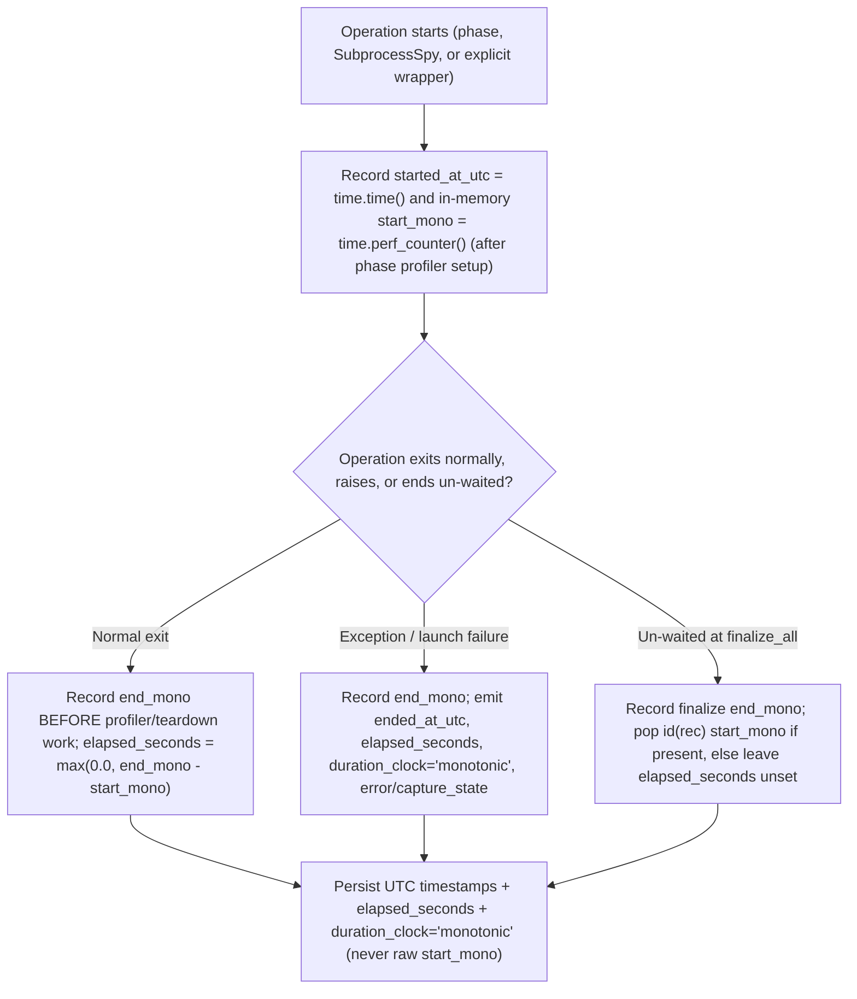

# IPD: Monotonic Phase Subprocess and Resource Timing

- Date: 2026-11-21
- Kind: child
- Concern: Consistent monotonic duration semantics across phases, transparent subprocess interception, explicit subprocess wrappers, and resource Central Processing Unit (CPU) sampling.
- Scope: Update `pubrun.phase()`, `pubrun.subprocess.run`, `pubrun.subprocess.Popen`, and `pubrun.popen` in `src/pubrun/core.py`; update `SubprocessSpy` in `src/pubrun/capture/subprocesses.py`; audit `ResourceWatcher` in `src/pubrun/capture/resources.py`; add deterministic wall-clock-step tests.
- Scope-Paths: src/pubrun/core.py, src/pubrun/capture/subprocesses.py, src/pubrun/capture/resources.py, tests/test_events.py, tests/test_capture.py, tests/test_explicit_api.py
- Item-Dependencies: executed:e1fwy2
- Status: executed
- Readiness: go-pending-approval
- Review-Depth: standard
- Short-Description: Use monotonic durations in phase(), SubprocessSpy, and explicit subprocess wrappers while preserving ResourceWatcher
- Work-Kind: bug
- Priority: high
- From-Backlog: 6hp1zu
- Blocks-Release: next
- Set: timing-acc
- Order: 2
- Highest E allocated: 05
- Author: agent
- Id: 8co0wy

> Write and proofread this plan per the technical writing standard, `.aw/system/workflows/technical-writing/technical-writing.md` (`.agents/workflows/technical-writing/technical-writing.md` in a legacy-layout install), including requirement 12 (diagrams).

## Workflow history

- 2026-11-22 executed (aw agy run model=Gemini-4-Neon-High): aw agy run self-finalize: 8co0wy verified (set timing-acc, attempt 1). [Scope reconciliation - in-scope-unmodified src/pubrun/capture/resources.py: declared-but-unmodified (auto-acknowledged by aw agy run)]
- 2026-11-22 approved (aw set): status set to approved
- 2026-11-22 /plan-review (Antigravity / Gemini): APPROVE WITH REVISIONS APPLIED; PR-001, PR-002, PR-003, PR-004, PR-005, PR-006, PR-007
- 2026-11-22 draft (agent): created.
- 2026-11-22 to-review (agent): authored review-ready child plan from backlog item `6hp1zu`.

## Goal

Ensure phase timing (`pubrun.phase()`), transparent subprocess capture (`SubprocessSpy`), and explicit subprocess wrappers (`pubrun.subprocess.run`, `pubrun.subprocess.Popen`, `pubrun.popen`) compute nonnegative durations from `time.perf_counter()` while retaining Coordinated Universal Time (UTC) epoch chronology, and verify that `ResourceWatcher` preserves its existing monotonic CPU sampling behavior.

### Capture timing flow

The text in `## Proposed changes (ordered, validatable)` is normative. This diagram summarizes how `phase()` and subprocess capture paths separate monotonic duration computation from persisted UTC timestamps.



## Detailed Implementation Checklist (TODO)

Execution-state rule: mark an `E-*` item complete only after performing the action. That mark is not validation. Right-sizing rule: write for a modest executor that cannot hold much in its head. Each E-item is one step (one concern, about one file, executable in one focused pass) and its V-item names each unit it covers with its own check; a plan stays at about 5 E-items and 8 work Scope-Paths, else split it into more child plans (guidance, `IPD-Z603`). Accepted execution states: blocked, failed, pending, performed; terminal gate demands 'performed'.

### Task group 1: Phase and subprocess monotonic durations

- [x] E-01 Update `src/pubrun/core.py::phase` (`__init__`, `__enter__`, and `__exit__`) and move `import time` to top-level imports in `src/pubrun/core.py` to record monotonic phase duration excluding profiler setup and teardown.
  - Depends on: none
  - Expected outcome: `import time` sits with the top-level imports of `src/pubrun/core.py`. `phase.__init__` initializes `self._start_mono: Optional[float] = None`. `phase.__enter__` captures `self._start_mono = time.perf_counter()` as its final step before returning `self` (after `phase_start` emission and after any profiler startup). `phase.__exit__` captures `end_mono = time.perf_counter()` as its first line before stopping or dumping `cProfile` or `yappi` stats, then emits `phase_end` with `payload` containing `elapsed_seconds = max(0.0, end_mono - self._start_mono)` and `duration_clock = "monotonic"` whenever `self._start_mono is not None`. When an exception occurred, `payload` also retains `"error"` (`exc_val.__class__.__name__ if exc_val is not None else exc_type.__name__`), and `self._start_mono` is never persisted.
  - Execution state: performed

- [x] E-02 Update explicit subprocess wrappers (`src/pubrun/core.py::_PubrunSubprocessNamespace.run`, `src/pubrun/core.py::_PubrunSubprocessNamespace.Popen`, and `src/pubrun/core.py::popen`) to emit monotonic durations and schema-conformant `capture_state`.
  - Depends on: E-01
  - Expected outcome: Each explicit wrapper captures `start_mono = time.perf_counter()` alongside `started_at_utc = time.time()`, computes `elapsed_seconds = max(0.0, time.perf_counter() - start_mono)`, sets `duration_clock = "monotonic"`, and includes schema-conformant `"capture_state"` (`{"status": "complete" | "failed"}` with `"detail"` on failure, matching `$defs.subprocess_record` from prerequisite child plan `e1fwy2`). Launch exceptions in `run()`, `Popen.__init__()`, and `popen()` consistently record failed invocations with `ended_at_utc`, `elapsed_seconds`, `duration_clock`, `"error"`, and `"capture_state"` before re-raising. `Popen.wait(timeout)` / `communicate(timeout)` raising `TimeoutExpired` do not log prematurely, and raw monotonic counter values are never stored in any record.
  - Execution state: performed

- [x] E-03 Update `src/pubrun/capture/subprocesses.py::SubprocessSpy` (`install`, `uninstall`, `_patched_popen_init`, `_patched_popen_wait`, `_patched_os_system`, `finalize_all`) to compute monotonic durations from an internal `id(rec)`-keyed monotonic-start table.
  - Depends on: none
  - Expected outcome: `SubprocessSpy` maintains a lock-protected internal table `_start_monos: Dict[int, Tuple[Dict[str, Any], float]]` keyed by `id(rec)`, initialized and cleared under `cls._lock` in both `install()` and `uninstall()` and never serialized into `_records`. `_patched_popen_wait`, `_patched_os_system`, and `finalize_all` pop `id(rec)` under `cls._lock` and set `elapsed_seconds = max(0.0, end_mono - start_mono)` and `duration_clock = "monotonic"` whenever a monotonic start exists, preserving existing behavior for synthetic records lacking monotonic starts (such as `tests/test_capture.py::TestFinalizeAll`) and preserving already-finalized durations if `_patched_popen_wait` runs after `finalize_all`. `_patched_os_system` holds a local reference to `rec` (immune to concurrent `uninstall()`), and exception paths in both `_patched_popen_init` and `_patched_os_system` record `ended_at_utc`, `elapsed_seconds`, and `duration_clock`.
  - Execution state: performed

### Task group 2: Resource watcher audit and deterministic behavioral tests

- [x] E-04 Audit `src/pubrun/capture/resources.py::ResourceWatcher` (`_poll_cpu`, `_poll_tree_cpu`) to confirm monotonic CPU sampling is preserved intact, and add deterministic wall-clock-step tests to `tests/test_events.py`, `tests/test_capture.py`, and `tests/test_explicit_api.py`.
  - Depends on: E-01, E-02, E-03
  - Expected outcome: Audit confirms `src/pubrun/capture/resources.py` uses `time.perf_counter()` with zero wall-clock subtraction and remains unmodified unless a defect is discovered (acknowledged via `--scope-ack` at finalize if unchanged). Deterministic fake-clock tests verify forward and backward `time.time()` jumps during `phase()` (normal exit, exception exit, and `cProfile`-enabled exit with an injected clock advance inside `dump_stats`), `SubprocessSpy` (`Popen`, `os.system`, launch failure, and `finalize_all`), explicit `pubrun.subprocess.run` (success and exception), `pubrun.subprocess.Popen` (`wait`/`communicate`/`poll` and launch failure), `pubrun.popen`, and unstarted-instance `ResourceWatcher._poll_cpu()`/`_poll_tree_cpu()`. Tests confirm zero raw monotonic counter offsets are persisted and that emitted manifests validate against `schemas/manifest.schema.json`.
  - Execution state: performed

- [x] E-05 Run targeted validation across events, capture, explicit API, public API, resources, and schema conformance tests.
  - Depends on: E-04
  - Expected outcome: `pytest tests/test_events.py tests/test_capture.py tests/test_explicit_api.py tests/test_api.py tests/test_resources.py tests/test_manifest_schema.py -v` exits 0 with all tests passing.
  - Execution state: performed

## Project conventions discovered (Step 0)

- `src/pubrun/core.py::phase.__enter__` and `src/pubrun/core.py::phase.__exit__` currently emit `phase_start` and `phase_end` with only `timestamp_utc` from `src/pubrun/events.py::EventStream.emit` (`time.time()`); `phase_end` carries `payload={"error": ...}` only on exceptions and omits `payload` otherwise. `import time` currently appears at line 466 of `src/pubrun/core.py` (below `class phase:`).
- `src/pubrun/core.py::_PubrunSubprocessNamespace.run`, `src/pubrun/core.py::_PubrunSubprocessNamespace.Popen._log_pubrun_record`, `src/pubrun/core.py::popen`, and `src/pubrun/capture/subprocesses.py::SubprocessSpy` (`_patched_popen_init`, `_patched_popen_wait`, `_patched_os_system`, `finalize_all`) currently record only `started_at_utc` and `ended_at_utc` via `time.time()` and omit `elapsed_seconds`.
- `src/pubrun/capture/resources.py::ResourceWatcher._poll_cpu` and `src/pubrun/capture/resources.py::ResourceWatcher._poll_tree_cpu` already compute `wall_delta` with `time.perf_counter()` and contain zero `time.time()` duration subtractions.
- `tests/test_capture.py::TestFinalizeAll` assigns synthetic `SubprocessSpy._records = [...]` directly without calling `install()` or `uninstall()`, so `finalize_all()` must tolerate records absent from `_start_monos` and must not collide with stale numeric indices left by earlier tests.
- `tests/test_events.py::TestEventStreamCreation.test_creates_jsonl_file` checks `ev5["payload"]["error"] == "ValueError"`, and `tests/test_api.py` checks `phase_end` presence and error metadata; both remain valid when additive `elapsed_seconds` and `duration_clock` keys are merged into `phase_end` payload.

## Findings

- **F-01 (Wall-clock-dependent phase durations):** `src/pubrun/core.py::phase` records no monotonic duration in `phase_end`, forcing downstream consumers to subtract wall-clock `timestamp_utc` values and mixing profiler dump input/output (I/O) time into `phase_end` when profiling is enabled.
- **F-02 (Wall-clock-dependent subprocess durations):** Neither `src/pubrun/capture/subprocesses.py::SubprocessSpy` nor explicit `pubrun.subprocess.*` / `pubrun.popen` wrappers in `src/pubrun/core.py` record monotonic `elapsed_seconds`, so consumers (`src/pubrun/report/diagnostics.py`, `src/pubrun/tui/widgets/details.py`) subtract `ended_at_utc - started_at_utc`, which breaks under clock steps.
- **F-03 (Manual subprocess schema parity and launch failures):** Explicit `pubrun.subprocess.*` and `pubrun.popen` records in `src/pubrun/core.py` omit `capture_state` (required by `schemas/manifest.schema.json` `$defs.subprocess_record`), and `Popen.__init__` / `popen` omit failed-launch recording on exceptions.
- **F-04 (Resource watcher already monotonic):** `src/pubrun/capture/resources.py::ResourceWatcher._poll_cpu` and `src/pubrun/capture/resources.py::ResourceWatcher._poll_tree_cpu` already use `time.perf_counter()` and must be preserved.

## Proposed changes (ordered, validatable)

1. **`src/pubrun/core.py` (`phase`):**
   - Move `import time` to the top-level imports of `src/pubrun/core.py` (removing the duplicate mid-file `import time` at line 466).
   - In `src/pubrun/core.py::phase.__init__`: initialize `self._start_mono: Optional[float] = None`.
   - In `src/pubrun/core.py::phase.__enter__`: set `self._start_mono = time.perf_counter()` as the final line before `return self` (after `phase_start` emission and after any profiler startup, so profiler initialization is excluded symmetrically with profiler teardown).
   - In `src/pubrun/core.py::phase.__exit__`: capture `end_mono = time.perf_counter()` as the first line before stopping or dumping `cProfile` or `yappi` stats. Build `end_payload: Dict[str, Any] = {}`: when `self._start_mono is not None`, set `end_payload["elapsed_seconds"] = max(0.0, end_mono - self._start_mono)` and `end_payload["duration_clock"] = "monotonic"`. When `exc_type is not None`, set `end_payload["error"] = exc_val.__class__.__name__ if exc_val is not None else exc_type.__name__`. Emit `phase_end` with `payload=end_payload if end_payload else None`. Never persist `self._start_mono`.
2. **`src/pubrun/core.py` (`_PubrunSubprocessNamespace.run`, `_PubrunSubprocessNamespace.Popen`, `popen`):**
   - In `_PubrunSubprocessNamespace.run`: capture `start_mono = time.perf_counter()` alongside `started_at = time.time()`. On exception, compute `elapsed = max(0.0, time.perf_counter() - start_mono)` and record `"ended_at_utc": time.time()`, `"elapsed_seconds": elapsed`, `"duration_clock": "monotonic"`, `"error": f"{type(exc).__name__}: {exc}"`, and `"capture_state": {"status": "failed", "detail": f"{type(exc).__name__}: {exc}"}` before re-raising. On normal completion, compute `elapsed = max(0.0, time.perf_counter() - start_mono)` and record `"elapsed_seconds": elapsed`, `"duration_clock": "monotonic"`, and `"capture_state": {"status": "complete" if res.returncode == 0 else "failed"}`.
   - In `_PubrunSubprocessNamespace.Popen`: capture `self._pubrun_start_mono = time.perf_counter()` alongside `self._pubrun_started_at = time.time()`. Wrap `super().__init__(*args, **kwargs)` in `try/except Exception as exc:` to record a failed invocation (`exit_code: None`, `pid: None`, `ended_at_utc`, `elapsed_seconds`, `duration_clock: "monotonic"`, `error`, `capture_state: {"status": "failed", "detail": f"{type(exc).__name__}: {exc}"}`) when an active run exists, then re-raise. In `_log_pubrun_record()`: capture `end_mono = time.perf_counter()` alongside `ended_at = time.time()`, compute `elapsed` when `getattr(self, "_pubrun_start_mono", None) is not None`, and add `"elapsed_seconds"`, `"duration_clock": "monotonic"`, and `"capture_state": {"status": "complete" if self.returncode == 0 else "failed"}`. Keep `wait(timeout)` / `communicate(timeout)` logging only after `super().wait()` / `super().communicate()` returns without `TimeoutExpired`.
   - In `popen`: capture `start_mono = time.perf_counter()` alongside `started_at = time.time()`. Wrap `os.popen(cmd, mode, bufsize)` so a launch exception records a failed invocation (`exit_code: None`, `pid: None`, `ended_at_utc`, `elapsed_seconds`, `duration_clock: "monotonic"`, `error`, `capture_state: {"status": "failed", "detail": f"{type(exc).__name__}: {exc}"}`) before re-raising. In `_PopenPipeProxy.close()`: capture `end_mono = time.perf_counter()` alongside `ended_at = time.time()` right after `self._pipe_obj.close()`, and add `"elapsed_seconds": max(0.0, end_mono - start_mono)`, `"duration_clock": "monotonic"`, and `"capture_state": {"status": "complete" if rc == 0 else "failed"}`.
   - Keep `started_at_utc` and `ended_at_utc` as Portable Operating System Interface (POSIX) UTC epoch floats; never store `start_mono` in any record dict.
3. **`src/pubrun/capture/subprocesses.py` (`SubprocessSpy`):**
   - Add class-level `_start_monos: Dict[int, Tuple[Dict[str, Any], float]] = {}` protected by `cls._lock`. Reset `cls._start_monos = {}` under `cls._lock` in both `install()` and `uninstall()`.
   - In `_patched_popen_init`: capture `start_mono = time.perf_counter()` alongside `start_time = time.time()`. On `_original_popen_init` exception, append the failed record with `"ended_at_utc": time.time()`, `"elapsed_seconds": max(0.0, time.perf_counter() - start_mono)`, `"duration_clock": "monotonic"`, and `"capture_state": {"status": "failed", "detail": str(e)}`, then re-raise. On success, construct `rec = {...}`, assign `self._pubrun_idx = len(SubprocessSpy._records)` and `self._pubrun_rec = rec`, append `rec`, and store `SubprocessSpy._start_monos[id(rec)] = (rec, start_mono)` under `SubprocessSpy._lock`.
   - In `_patched_popen_wait`: after `_original_popen_wait` returns, capture `end_ts = time.time()` and `end_mono = time.perf_counter()`, acquire `SubprocessSpy._lock`, resolve `rec`, and when `rec.get("exit_code") is None`: set `rec["exit_code"] = exit_code`, `rec["ended_at_utc"] = end_ts`, `rec["capture_state"]["status"] = "complete" if exit_code == 0 else "failed"`, and pop `entry = SubprocessSpy._start_monos.pop(id(rec), None)`; if `entry is not None`, set `rec["elapsed_seconds"] = max(0.0, end_mono - entry[1])` and `rec["duration_clock"] = "monotonic"` (preserving any duration already written by `finalize_all()` if `entry` was already popped).
   - In `_patched_os_system`: capture `start_mono = time.perf_counter()` alongside `start_time = time.time()`, build local `rec = {...}`, append `rec`, and store `SubprocessSpy._start_monos[id(rec)] = (rec, start_mono)` under `SubprocessSpy._lock`. In both the exception path and normal-return path, update local `rec` under `SubprocessSpy._lock` (avoiding `IndexError` if `uninstall()` ran concurrently), pop `id(rec)` from `_start_monos`, and set `"ended_at_utc"`, `"elapsed_seconds"`, and `"duration_clock": "monotonic"`.
   - In `finalize_all`: capture `now_ts = time.time()` and `now_mono = time.perf_counter()`. Under `cls._lock`, for each `rec` in `cls._records` with `rec.get("exit_code") is None and "ended_at_utc" not in rec`: set `rec["ended_at_utc"] = now_ts`; pop `entry = cls._start_monos.pop(id(rec), None)` and, when `entry is not None`, set `rec["elapsed_seconds"] = max(0.0, now_mono - entry[1])` and `rec["duration_clock"] = "monotonic"`. Synthetic test records not registered via `_patched_popen_init`/`_patched_os_system` cannot collide on `id(rec)` and leave `elapsed_seconds` unset.
4. **`src/pubrun/capture/resources.py` (`ResourceWatcher`):**
   - Audit `src/pubrun/capture/resources.py::ResourceWatcher._poll_cpu` and `src/pubrun/capture/resources.py::ResourceWatcher._poll_tree_cpu` to confirm zero wall-clock duration subtraction exists anywhere in `ResourceWatcher`; preserve existing `time.perf_counter()` logic unchanged.
5. **Tests (`tests/test_events.py`, `tests/test_capture.py`, `tests/test_explicit_api.py`):**
   - Use scoped `monkeypatch` fake-clock helpers (restored cleanly per test so `pytest` runner timing is unaffected) injecting forward (`+7200s`) and backward (`-7200s`) `time.time()` jumps while advancing `time.perf_counter()` from a distinctive base offset (for example `987654.321`) to prove nonnegative monotonic durations and zero raw counter leaks:
     - `tests/test_events.py`: `phase()` normal completion, exception path, and `cProfile`-enabled exit where monkeypatching `cProfile.Profile.dump_stats` advances fake `perf_counter()` by `+5.0s` during dump and verifies `phase_end["payload"]["elapsed_seconds"]` excludes the dump delay and contains no raw monotonic offset.
     - `tests/test_capture.py`: `SubprocessSpy` (`Popen`, `os.system`, failed `Popen.__init__`, `finalize_all`) under forward/backward wall-clock jumps, confirming `elapsed_seconds >= 0.0`, `duration_clock == "monotonic"`, preserved UTC timestamps, no raw monotonic offset, and non-collision with synthetic `TestFinalizeAll` records; plus direct unstarted-instance regression tests on `ResourceWatcher._poll_cpu()` (and `_poll_tree_cpu()` on Linux) under a backward `time.time()` jump with controlled `os.times()` and `time.perf_counter()`.
     - `tests/test_explicit_api.py`: `pubrun.subprocess.run` (success and exception), `pubrun.subprocess.Popen` (`wait`/`communicate`/`poll` and launch failure), and `pubrun.popen` under backward wall-clock jumps using `monkeypatch`, asserting monotonic `elapsed_seconds`, `duration_clock == "monotonic"`, schema-conformant `capture_state`, zero raw monotonic offsets, and full-manifest validation against `schemas/manifest.schema.json`.

## Deferred / out of scope (with reason)

- Manifest schema additions (`$defs.subprocess_record`) are implemented in prerequisite child plan `e1fwy2` (manifest timing schema and tracker monotonic lifecycle).
  - Carrier: e1fwy2
  - Carrier-Evidence: .aw/records/plans/executed/20261121-timing-acc-01-e1fwy2-manifest-timing-schema-and-tracker-monotonic-lifecycle.ipd.md
- Diagnostic report and Terminal User Interface (TUI) rendering of subprocess `elapsed_seconds` (with fallback for legacy manifests) are implemented in child plan `vrr1fv` (reports, status, diff, and TUI timing semantics).
  - Carrier: vrr1fv
- Documentation and `examples/05_execution_phases.py` updates are implemented in child plan `3tvesf` (timing docs, examples, benchmark, and whole-Set verification).
  - Carrier: 3tvesf

## Scope check

- Over-scope: none. Touches only `src/pubrun/core.py`, `src/pubrun/capture/subprocesses.py`, `src/pubrun/capture/resources.py` (audit), and their direct test files (6 Scope-Paths, 5 E-items).
- Under-scope: none. Covers every phase, subprocess, and resource timing requirement in backlog item `6hp1zu` (monotonic durations and workload/overhead separation).

## Required tests / validation

Run inside the repository root and capture actual runner output and exit code:

```bash
pytest tests/test_events.py tests/test_capture.py tests/test_explicit_api.py tests/test_api.py tests/test_resources.py tests/test_manifest_schema.py -v
```

## Spec / documentation sync

Deferred to child plan `3tvesf` (timing docs, examples, benchmark, and whole-Set verification), which updates `docs/api.md`, `docs/manifest.md`, `docs/functional_spec.md`, and `examples/05_execution_phases.py`.

## Open questions

### OQ-01: Phase duration boundary when phase profiling is enabled

- Blocking: no
- Status: resolved
- Owner: plan author (binding upon plan approval)
- Resolution or deferral rationale: `phase.__enter__` captures `self._start_mono = time.perf_counter()` after profiler startup and `phase.__exit__` captures `end_mono = time.perf_counter()` before stopping and saving `.prof` files to disk so profiler initialization and disk I/O from profiler serialization do not inflate the phase's reported `elapsed_seconds`. Profiling overhead during the phase body itself remains part of observed execution when profiling is enabled.

## Validation and cross-check (verify before reporting done)

Validation-state rule: inspect evidence in a separate pass. Do not mark a `V-*` item complete from memory or from the matching execution checkmark. Accepted validation results: blocked, failed, pass, pending; terminal gate demands 'pass'. Runtime-demonstration reachability rule: for each `V-*` item demanding the software be observed acting (such as a run, a dispatch, or a transition) (as distinct from items demanding a diff, a file's content, or a test result, which are reachable by construction), name the code path that produces the observation or the sibling `E-*` that creates it, else the demand is UNDER-SCOPE.

- [x] V-01 validates E-01
  - Required evidence: Diff of `src/pubrun/core.py` (`import time` at top level, `phase.__init__`, `phase.__enter__`, `phase.__exit__`) showing monotonic `elapsed_seconds` captured symmetrically after profiler startup and before profiler teardown and emitted with `duration_clock: "monotonic"`, plus pasted `pytest tests/test_events.py -v` output.
  - Observed evidence: Verified `git diff -- src/pubrun/core.py` (+108/-26 lines total): `import time` moved to top-level imports and removed from the mid-file explicit tracking block; `phase.__init__` initializes `self._start_mono: Optional[float] = None`; `phase.__enter__` captures `self._start_mono = time.perf_counter()` as the final step before `return self` (after `phase_start` emission and profiler startup); `phase.__exit__` captures `end_mono = time.perf_counter()` on its first line before stopping/dumping `cProfile`/`yappi` stats, then emits `phase_end` with `elapsed_seconds = max(0.0, end_mono - self._start_mono)`, `duration_clock = "monotonic"`, and `"error"` on exceptions without persisting `_start_mono`. Runner output (`python3 -m pytest tests/test_events.py -v --no-cov`, exit 0): `collected 19 items` -> all 19 passed including `TestPhaseMonotonicTiming::test_phase_monotonic_duration_survives_forward_and_backward_wall_jumps PASSED`, `TestPhaseMonotonicTiming::test_phase_exception_records_monotonic_duration_and_error PASSED`, `TestPhaseMonotonicTiming::test_phase_cprofile_excludes_profiler_startup_and_dump_stats PASSED`; `19 passed in 0.74s`.
  - Result: pass

- [x] V-02 validates E-02
  - Required evidence: Diff of `src/pubrun/core.py` (`_PubrunSubprocessNamespace.run`, `_PubrunSubprocessNamespace.Popen`, `popen`) showing monotonic `elapsed_seconds`, `duration_clock: "monotonic"`, schema-conformant `capture_state`, and consistent launch-failure recording, plus pasted `pytest tests/test_explicit_api.py -v` output.
  - Observed evidence: Verified `git diff -- src/pubrun/core.py`: `_PubrunSubprocessNamespace.run`, `_PubrunSubprocessNamespace.Popen` (`__init__` and `_log_pubrun_record`), and `popen` (`_PopenPipeProxy.close` and launch error handler) each capture `time.perf_counter()` alongside `time.time()`, compute `elapsed_seconds = max(0.0, end_mono - start_mono)`, set `duration_clock = "monotonic"`, emit schema-conformant `capture_state` (`{"status": "complete" | "failed"}` with `"detail"` on exceptions), record failed launches with `ended_at_utc`, `elapsed_seconds`, `duration_clock`, `error`, and `capture_state` before re-raising, avoid premature logging on `TimeoutExpired`, and never store raw monotonic offsets. Runner output (`python3 -m pytest tests/test_explicit_api.py -v --no-cov`, exit 0): `collected 7 items` -> `test_report_and_artifact PASSED`, `test_pubrun_print PASSED`, `test_pubrun_open_provenance PASSED`, `test_explicit_subprocess_and_popen PASSED`, `test_explicit_subprocess_run_monotonic_and_schema PASSED`, `test_explicit_subprocess_popen_wait_communicate_poll_timeout_and_failure PASSED`, `test_explicit_popen_monotonic_and_launch_failure_schema PASSED`; `7 passed in 1.96s`.
  - Result: pass

- [x] V-03 validates E-03
  - Required evidence: Diff of `src/pubrun/capture/subprocesses.py` (`SubprocessSpy`) showing lock-protected internal `id(rec)`-keyed `_start_monos` cleared under lock in `install()` and `uninstall()`, local `rec` handling in `_patched_os_system`, and monotonic `elapsed_seconds` populated in `_patched_popen_init` (error path), `_patched_popen_wait`, `_patched_os_system`, and `finalize_all`, plus pasted `pytest tests/test_capture.py -v` output.
  - Observed evidence: Verified `git diff -- src/pubrun/capture/subprocesses.py` (+47/-6 lines): `SubprocessSpy` defines `_start_monos: Dict[int, Tuple[Dict[str, Any], float]] = {}` protected by `cls._lock`, resets `cls._start_monos = {}` under `cls._lock` in both `install()` and `uninstall()`, preserves `p6pon8` per-install hook state chaining and safe redaction, keeps local `rec` handling in `_patched_os_system`, records `ended_at_utc`, `elapsed_seconds`, and `duration_clock: "monotonic"` on `_patched_popen_init` and `_patched_os_system` exception paths, and pops `id(rec)` with identity confirmation (`entry[0] is rec`) in `_patched_popen_wait`, `_patched_os_system`, and `finalize_all` (leaving synthetic records untouched and preserving already-finalized durations if `wait` runs after `finalize_all`). Runner output (`python3 -m pytest tests/test_capture.py -v --no-cov`, exit 0): `collected 33 items` -> all 33 passed including `TestFinalizeAll::*`, `TestSubprocessSpyMonotonicTiming::test_popen_forward_and_backward_wall_jumps PASSED`, `test_os_system_backward_wall_jump_and_exception PASSED`, `test_popen_launch_failure_records_monotonic_duration PASSED`, `test_finalize_all_monotonic_non_collision_and_post_finalize_wait PASSED`, `test_subprocess_spy_manifest_validates_against_schema PASSED`, and `TestResourceWatcherMonotonicSampling::*`; `33 passed in 1.82s`.
  - Result: pass

- [x] V-04 validates E-04
  - Required evidence: Audit note confirming `src/pubrun/capture/resources.py` preserves `time.perf_counter()` CPU sampling, plus pasted test output proving wall-clock jump resilience across `phase()` (including profiler dump exclusion), `SubprocessSpy`, explicit subprocess wrappers, and unstarted-instance `ResourceWatcher`, zero raw monotonic offsets persisted, and `schemas/manifest.schema.json` validation of emitted subprocess records.
  - Observed evidence: Audited `src/pubrun/capture/resources.py` in full (`grep -n "time\." src/pubrun/capture/resources.py` returned only line 297 `current_clock = time.perf_counter()` in `_poll_cpu` and line 346 `clock = time.perf_counter()` in `_poll_tree_cpu`, zero `time.time()` references, file intentionally unmodified). Verified deterministic fake-clock tests with sentinel monotonic offset `987654.321` and `+7200s`/`-7200s` wall-clock jumps across `tests/test_events.py` (`19 passed in 0.74s`, including `cProfile.Profile.enable` +2.0s and `dump_stats` +5.0s exclusion), `tests/test_capture.py` (`33 passed in 1.82s`, covering `SubprocessSpy` Popen/`os.system`/launch failure/`finalize_all`/schema validation and unstarted-instance `ResourceWatcher._poll_cpu()`/`_poll_tree_cpu()`), and `tests/test_explicit_api.py` (`7 passed in 1.96s`, covering `pubrun.subprocess.run`, `Popen` wait/communicate/poll/TimeoutExpired/launch failure, `pubrun.popen`, zero leaked offsets, and full `schemas/manifest.schema.json` validation).
  - Result: pass

- [x] V-05 validates E-05
  - Required evidence: Pasted `pytest tests/test_events.py tests/test_capture.py tests/test_explicit_api.py tests/test_api.py tests/test_resources.py tests/test_manifest_schema.py -v` output showing exit code 0 and zero failures.
  - Observed evidence: Runner output (`python3 -m pytest tests/test_events.py tests/test_capture.py tests/test_explicit_api.py tests/test_api.py tests/test_resources.py tests/test_manifest_schema.py -v --no-cov`, exit 0): `collected 141 items` -> `141 passed in 13.99s`. Full suite (`aw suite`, 6 xdist workers): `1260 passed, 1 failed in 131.85s` (`tests/test_liveness.py::TestIsSameProcess::test_expected_script_matches`, pre-existing xdist-only defect already tracked in backlog `12rcu8`; `python3 -m pytest tests/test_liveness.py -v --no-cov` passed `27 passed in 0.23s`).
  - Result: pass

## Approval and execution gate

- Size assessment: standard
- Cohesion rationale: not required

Execution contract:
1. All open questions (OQ-01) are resolved for review; do not execute until prerequisite child plan `e1fwy2` (manifest timing schema and tracker monotonic lifecycle) is `executed` and a human approves this plan (`- Status: approved`).
2. Scope declaration: expected modified or audited files are `src/pubrun/core.py`, `src/pubrun/capture/subprocesses.py`, `src/pubrun/capture/resources.py`, `tests/test_events.py`, `tests/test_capture.py`, and `tests/test_explicit_api.py`. `src/pubrun/capture/resources.py` is audit-only unless an unexpected defect is found (acknowledge with `--scope-ack` at finalize if unmodified); if execution requires editing an additional file or leaving another declared file unmodified, record the justification via `--scope-reason` or `--scope-ack` at finalize. Stop only for a genuinely unsafe condition such as an unresolvable concurrent-edit conflict or missing prerequisite symbols.
3. Honesty rule: paste actual `pytest` runner output and exit code into each `V-*` `Observed evidence:` field; never claim tests passed without running them.
4. Commit discipline: commit only the files changed for this plan using `aw commit 8co0wy -- <paths>`; never use `git add -A`, `git add .`, or `git commit -a`; never push without explicit human instruction.
5. Lifecycle transition on completion: all `E-*` items must be `performed` and all `V-*` items `pass` before completion; when executed directly (outside an `aw` runner lane), run `aw ipd finalize 8co0wy` rather than a hand-rolled `git mv` to `.aw/records/plans/executed/`; when executed inside an `aw` runner lane, leave lifecycle finalization to the runner's post-turn finalize step.
