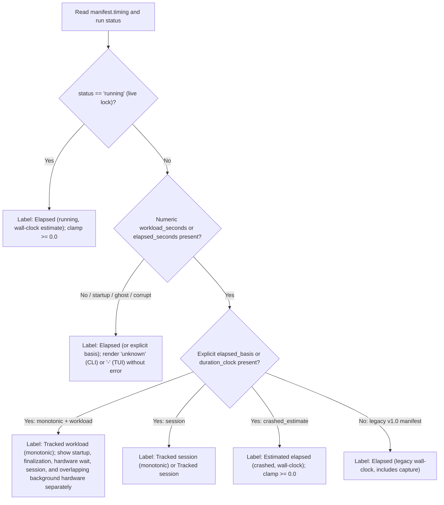
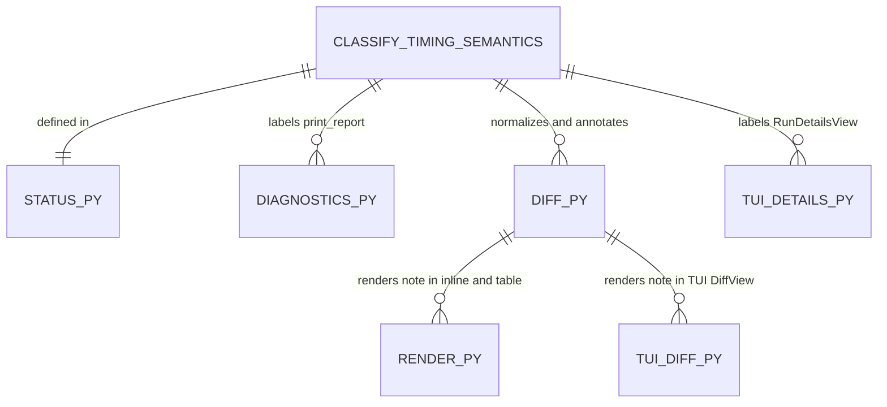

# IPD: Reports Status Diff and TUI Timing Semantics

- Date: 2026-11-21
- Kind: child
- Concern: Backward compatibility, explicit legacy-versus-monotonic semantic labeling, and tracked-interval clarity across status, diagnostic reports, diffs, methods verification, and TUI views.
- Scope: Update `src/pubrun/status.py`, `src/pubrun/report/diagnostics.py`, `src/pubrun/analysis/diff.py`, `src/pubrun/analysis/render.py`, `src/pubrun/tui/widgets/details.py`, and `src/pubrun/tui/widgets/diff.py`; add behavioral compatibility and labeling tests in `tests/test_timing_consumers.py` and `tests/test_diff_usability.py`.
- Scope-Paths: src/pubrun/status.py, src/pubrun/report/diagnostics.py, src/pubrun/analysis/diff.py, src/pubrun/analysis/render.py, src/pubrun/tui/widgets/details.py, src/pubrun/tui/widgets/diff.py, tests/test_timing_consumers.py, tests/test_diff_usability.py
- Item-Dependencies: executed:e1fwy2, executed:8co0wy
- Status: executed
- Readiness: go-pending-approval
- Review-Depth: complex
- Short-Description: Preserve legacy manifest readability and label old vs new timing semantics across status, diagnostics, diff, and TUI
- Work-Kind: bug
- Priority: high
- From-Backlog: 6hp1zu
- Blocks-Release: next
- Set: timing-acc
- Order: 3
- Highest E allocated: 05
- Author: agent
- Id: vrr1fv

> Write and proofread this plan per the technical writing standard, `.aw/system/workflows/technical-writing/technical-writing.md` (`.agents/workflows/technical-writing/technical-writing.md` in a legacy-layout install), including requirement 12 (diagrams).

## Workflow history

- 2026-11-22 executed (aw agy run model=Gemini-4-Neon-High): aw agy run self-finalize: vrr1fv verified (set timing-acc, attempt 1).
- 2026-11-22 approved (aw set): status set to approved
- 2026-11-22 /plan-review (Gemini 4 Neon (High)): APPROVE WITH REVISIONS APPLIED; PR-001, PR-002, PR-003, PR-004, PR-005, PR-006, PR-007
- 2026-11-22 draft (agent): created.
- 2026-11-22 to-review (agent): authored review-ready child plan from backlog item `6hp1zu`.

## Goal

Update all manifest timing consumers (`src/pubrun/status.py`, `src/pubrun/report/diagnostics.py`, `src/pubrun/analysis/diff.py`, `src/pubrun/analysis/render.py`, `src/pubrun/tui/widgets/details.py`, and `src/pubrun/tui/widgets/diff.py`) so pre-change legacy manifests remain fully readable without error. Label legacy wall-clock durations and new monotonic tracked-workload durations distinctly without summing overlapping intervals. Describe late-import runs as tracked intervals rather than full application lifetime, and render live, crashed, or incomplete timing states safely without negative durations.

### Timing classification across consumers

The text in `## Proposed changes (ordered, validatable)` is normative. These diagrams summarize how consumers classify timing records and how the shared classifier connects to each command-line interface (CLI) and Terminal User Interface (TUI) consumer.





## Detailed Implementation Checklist (TODO)

Execution-state rule: mark an `E-*` item complete only after performing the action. That mark is not validation. Right-sizing rule: write for a modest executor that cannot hold much in its head. Each E-item is one step (one concern, about one file, executable in one focused pass) and its V-item names each unit it covers with its own check; a plan stays at about 5 E-items and 8 work Scope-Paths, else split it into more child plans (guidance, `IPD-Z603`). Accepted execution states: blocked, failed, pending, performed; terminal gate demands 'performed'.

### Task group 1: Status, diagnostics, diff, and TUI consumers

- [x] E-01 Update `src/pubrun/status.py` (`classify_timing_semantics`, `_format_duration_detail`, `RunInfo.__init__`, `RunInfo._load_from_manifest`, `RunInfo._load_from_lock`, `close_out_crashed_run`, `render_inspect`) for monotonic timing fields, legacy inference, nonnegative live and crashed durations, and tracked-interval labeling.
  - Depends on: none
  - Expected outcome: `src/pubrun/status.py::classify_timing_semantics` normalizes explicit, legacy wall-clock, live-running, crashed-estimate, session, and incomplete timing dicts safely without crashing on non-dict or non-numeric inputs. `src/pubrun/status.py::_format_duration_detail` formats sub-minute breakdown intervals with millisecond precision while `src/pubrun/status.py::_format_elapsed` preserves existing formatting (including `_format_elapsed(-10) == "-00:00:10"`). `RunInfo` initializes and parses optional timing fields via `_as_float`, clamps both remote-host and local live lock elapsed calculations with `max(0.0, ...)`, and never mislabels a live lock run as finalized monotonic workload. `close_out_crashed_run` keeps `ended_at_utc: None` and `elapsed_seconds: None` on lock-only fallback manifests, clamps `elapsed_seconds >= 0.0` via `_as_float` on existing manifests with `duration_clock="wall_clock_estimated"` and `elapsed_basis="crashed_estimate"` (leaving `workload_seconds` untouched), and degrades to `None` when `started_at_utc` is missing or non-numeric. `render_inspect` renders the semantic elapsed label, tracked-interval note, and separate overhead lines without summing overlapping intervals.
  - Execution state: performed

- [x] E-02 Update `src/pubrun/report/diagnostics.py` (`print_report`) to display labeled tracked-interval timing, separate capture overheads, legacy fallback labels, and monotonic subprocess durations.
  - Depends on: E-01
  - Expected outcome: `src/pubrun/report/diagnostics.py::print_report` guards non-dict `timing` and non-numeric `started_at_utc`/`elapsed_seconds` via `_as_float`, renders an explicit labeled elapsed line (including `"unknown"` when duration is missing or incomplete, and handling `0.0` via `is not None`), and clearly states tracked-interval scope rather than full application lifetime. When present, `print_report` prints startup overhead, finalization overhead (noting hardware wait as a sub-interval), tracked session, and overlapping background hardware using `_format_duration_detail` without summing overlaps. Deep-mode subprocess rendering guards non-list/non-dict entries, prefers `_as_float(sp.get("elapsed_seconds"))` with `is not None` (clamped `>= 0.0` and tagged with `duration_clock`), and falls back to `round(max(0.0, ended - started), 3)` labeled `wall-clock` for legacy subprocess records. Any partial-capture warning blocks from sibling plan `26euz0` (if already executed) are preserved intact.
  - Execution state: performed

- [x] E-03 Update `src/pubrun/analysis/diff.py` (`_normalize_manifest`, `compare_manifests`) and `src/pubrun/analysis/render.py` (`_render_inline`, `_summarize_change`, `_render_table`) so comparing legacy and new manifests surfaces timing semantic differences explicitly when `timing` is not ignored.
  - Depends on: E-01
  - Expected outcome: When `timing` is not ignored (`--deep` or custom `ignores`), `src/pubrun/analysis/diff.py::_normalize_manifest` reuses `classify_timing_semantics` to inject `timing.duration_clock = "wall_clock"` and `timing.elapsed_basis = "wall_clock_legacy"` only for legacy manifests that carry a valid numeric `elapsed_seconds` and lack both explicit fields (respecting `_should_ignore` per key). `src/pubrun/analysis/diff.py::compare_manifests` computes effective semantics for both manifests and attaches `"note": "timing definition changed (<old_basis>/<old_clock> -> <new_basis>/<new_clock>)"` to `diff_report["modified"]["timing.elapsed_seconds"]` whenever effective basis or clock differs (preserving `"type": "standard"`, `"old"`, and `"new"`). Even when legacy and new `elapsed_seconds` are numerically equal, `timing.duration_clock` and `timing.elapsed_basis` surface the definition change. `src/pubrun/analysis/render.py::_render_inline`, `_summarize_change`, and `_render_table` display `mod["note"]` when present (honoring `NO_COLOR`), while default `basic` and `standard` diffs continue to ignore `timing` unchanged.
  - Execution state: performed

- [x] E-04 Update `src/pubrun/tui/widgets/details.py` (`RunDetailsView.on_mount`, `RunDetailsView.update_general_pane`, `RunDetailsView.update_subprocesses_pane`) and `src/pubrun/tui/widgets/diff.py` (`DiffView.run_difference`, `DiffView.render_diff_report`) to label timing semantics, display capture overhead fields, prefer monotonic subprocess durations, and surface mixed-definition diff notes in the TUI.
  - Depends on: E-01, E-03
  - Expected outcome: `RunDetailsView.update_general_pane` uses `r.timing_semantics` (safe when `r.manifest is None`), displays the semantic elapsed label with tracked-interval note, renders `"-"` when duration is incomplete, and displays startup overhead, finalization overhead (with hardware wait sub-interval), tracked session, and overlapping background hardware using `_format_duration_detail` when present without summing overlaps. `RunDetailsView.update_subprocesses_pane` guards non-list/non-dict entries and non-string `argv` items, prefers `_as_float(sub.get("elapsed_seconds"))` with `is not None` (clamped `>= 0.0`), falls back to `max(0.0, end_val - start_val)` for legacy records, and widens the `Elapsed` column in `on_mount()` if needed so clock tags are not truncated. `DiffView.run_difference` passes `depth=depth` to `compare_manifests`, and `DiffView.render_diff_report` renders `mod["note"]` when present.
  - Execution state: performed

### Task group 2: Consumer compatibility tests and validation

- [x] E-05 Add behavioral tests in `tests/test_timing_consumers.py` and `tests/test_diff_usability.py`, including verification that `pubrun.report.methods.generate_report` and `generate_report_multi` handle legacy and new manifests without overstating timing precision, then run the targeted regression suite.
  - Depends on: E-02, E-03, E-04
  - Expected outcome: Behavioral tests cover legacy manifest readability, new monotonic manifests with sub-second overheads and non-summed overlapping intervals, live-running lock runs enriched with startup manifests, late-import tracked-interval wording, incomplete/corrupt timing data (`None`, missing keys, non-dict, non-numeric, `0.0`), crashed closeout with backward `mtime` and lock-only fallback, mixed legacy-vs-new diffs (differing and equal `elapsed_seconds`) across structured output, inline, table, and TUI `DiffView`, TUI `RunDetailsView` panes (guarded by `pytest.importorskip("textual")`), `_format_elapsed(-10)` compatibility, and `methods.py` precision check. Running `pytest tests/test_timing_consumers.py tests/test_diff_usability.py tests/test_reports.py tests/test_status.py tests/test_tui.py tests/test_edge_cases.py tests/test_tracker.py tests/test_quality.py tests/test_show_sections.py tests/test_methods_multi.py -v` exits 0 with zero failures.
  - Execution state: performed

## Project conventions discovered (Step 0)

- `src/pubrun/status.py::_as_float` rejects `bool`, `str`, `NaN`, and infinity for numeric timing fields, and `src/pubrun/status.py` renders run tables (`render_short_list`, `render_verbose_list`) and single-run inspection (`render_inspect`).
- `src/pubrun/status.py::_format_elapsed` formats whole-second `HH:MM:SS` strings and is pinned by `tests/test_status.py::TestStatusFormattingHelpers.test_format_elapsed` (including `_format_elapsed(-10) == "-00:00:10"`).
- `src/pubrun/status.py::RunInfo._classify` calls `_load_from_lock` and then `_enrich_from_manifest` for live runs that have both a lock file and a startup manifest; `_load_from_lock` computes `time.time() - self.started_at_utc` in both the remote-host (`< 48h`) and local-PID branches without clamping to `0.0`.
- `src/pubrun/status.py::close_out_crashed_run` has two branches: a lock-only fallback branch (tested by `tests/test_status.py::TestStatusFormattingHelpers.test_crashed_run_elapsed_time_unknown`, expecting `ended_at_utc: None` and `elapsed_seconds: None`) and an existing-manifest branch (tested by `tests/test_tracker.py::TestRunLifecycle.test_crashed_closeout_preserves_and_updates_manifest`) that currently computes `ended_at - timing["started_at_utc"]` outside `try/except` without `_as_float` or `0.0` clamping.
- `src/pubrun/report/diagnostics.py::print_report` prints `Elapsed : <str>` only when `timing.get("elapsed_seconds") is not None` without `_as_float` guarding, and in deep mode computes subprocess elapsed time via `round(ended - started, 3)` using truthiness on `started and ended`.
- `src/pubrun/analysis/diff.py::_normalize_manifest` and `src/pubrun/analysis/diff.py::compare_manifests` ignore `timing` by default at `basic` and `standard` depths (via `src/pubrun/resources/default.toml`) and include `timing` at `deep` depth or when callers pass custom `ignores`; `tests/test_quality.py::TestDiffEngine` and `TestDiffNormalization` pin identical-manifest and normalization behavior.
- `src/pubrun/report/methods.py::generate_report`, `src/pubrun/report/methods.py::generate_report_multi`, and `src/pubrun/report/templates.py` report OS, CPU, RAM, Python, packages, Git commit, and `pubrun` version without reporting run durations; verifying methods output requires behavioral tests rather than editing `methods.py`.
- `src/pubrun/tui/widgets/details.py::RunDetailsView` uses `RunInfo` and `manifest.get("subprocesses", [])` (subtracting `end_val - start_val`), `src/pubrun/tui/widgets/diff.py::DiffView` calls `compare_manifests` without passing `depth=depth` and ignores `mod["note"]`, and `tests/test_tui.py::TestTuiResourceView` guards Textual tests with `pytest.importorskip("textual")` because `textual` is an optional dependency.
- `tests/fixtures/sample_manifest.json` provides a real legacy v1.0 manifest with both wall-clock `timing.elapsed_seconds` (`45.530865`, no `duration_clock`/`elapsed_basis`) and a legacy `subprocesses` record (UTC timestamps only, no `elapsed_seconds`).

## Findings

- **F-01 (Silent semantic mismatch in diffs):** Comparing an older v1.0 manifest (wall-clock start-to-post-hardware-wait) with a new manifest (monotonic tracked workload) under `--deep` or custom `ignores` in `src/pubrun/analysis/diff.py::compare_manifests`, `src/pubrun/analysis/render.py`, and `src/pubrun/tui/widgets/diff.py::DiffView` currently shows only a raw numeric change on `timing.elapsed_seconds` without signaling that the metric definition changed.
- **F-02 (Negative or unsafe elapsed values in crashed closeout and live lock reads):** `src/pubrun/status.py::close_out_crashed_run` and `src/pubrun/status.py::RunInfo._load_from_lock` (both remote-host and local-PID paths) subtract `started_at_utc` without `_as_float` coercion or `0.0` flooring, which can produce negative durations or raise `TypeError` on malformed timestamps.
- **F-03 (Unlabeled durations, sub-second loss, and live-lock mislabeling in reports and TUI):** `src/pubrun/status.py::render_inspect`, `src/pubrun/report/diagnostics.py::print_report`, and `src/pubrun/tui/widgets/details.py::RunDetailsView` show a bare `Elapsed` label with whole-second rounding (hiding sub-second capture overheads) and no distinction among tracked workload, live wall-clock estimate, crashed estimate, legacy wall-clock totals, or late-import tracked-interval scope.
- **F-04 (Subprocess duration fallback and falsiness):** `src/pubrun/report/diagnostics.py::print_report` and `src/pubrun/tui/widgets/details.py::RunDetailsView.update_subprocesses_pane` unconditionally subtract `ended_at_utc - started_at_utc` using truthiness checks instead of preferring monotonic `elapsed_seconds` (from prerequisite plan `8co0wy`) via `_as_float` with `is not None`.

## Proposed changes (ordered, validatable)

1. **`src/pubrun/status.py`:**
   - Add `classify_timing_semantics(timing: Optional[Dict[str, Any]], *, status: Optional[str] = None) -> Dict[str, Any]` reused by `status.py`, `report/diagnostics.py`, `analysis/diff.py`, and `tui/widgets/details.py`:
     - Guard `if not isinstance(timing, dict): timing = {}`.
     - If `status == STATUS_RUNNING`: return `duration_clock="wall_clock_estimated"`, `elapsed_basis="running_estimate"`, `interval_scope="tracked_interval"`, `label="Elapsed (running, wall-clock estimate)"`, `is_legacy=False`, `is_incomplete=False` (preventing a live lock run enriched with a startup manifest from being mislabeled as finalized monotonic workload).
     - Otherwise, read `raw_clock = timing.get("duration_clock")` and `raw_basis = timing.get("elapsed_basis")` (accepting only `str` values) and coerce `workload_val = _as_float(timing.get("workload_seconds"))` and `elapsed_val = _as_float(timing.get("elapsed_seconds"))`.
     - Infer legacy wall-clock semantics ONLY when BOTH `raw_clock is None` and `raw_basis is None` and `elapsed_val is not None`: set `duration_clock = "wall_clock"`, `elapsed_basis = "wall_clock_legacy"`, `is_legacy = True`.
     - Set `interval_scope` to `timing.get("interval_scope")` if it is a non-empty `str`, else `"tracked_interval"`.
     - Set `has_duration = (workload_val is not None) or (elapsed_val is not None)` and `is_incomplete = not has_duration`.
     - Map human-readable elapsed label:
       - `elapsed_basis == "workload"` and `duration_clock == "monotonic"` -> `"Tracked workload (monotonic)"`
       - `elapsed_basis == "session"` and `duration_clock == "monotonic"` -> `"Tracked session (monotonic)"`
       - `elapsed_basis == "session"` -> `"Tracked session"`
       - `elapsed_basis == "crashed_estimate"` -> `"Estimated elapsed (crashed, wall-clock)"`
       - `elapsed_basis == "wall_clock_legacy"` -> `"Elapsed (legacy wall-clock, includes capture)"`
       - Missing/incomplete or unrecognized -> `"Elapsed"` (consumers render `"unknown"` in CLI and `"-"` in TUI when `is_incomplete` is `True`).
   - Add `_format_duration_detail(seconds: Optional[float]) -> str` (keeping `_format_elapsed` unchanged so `tests/test_status.py::TestStatusFormattingHelpers.test_format_elapsed` stays intact): returns `"unknown"` for `None`, `f"{max(0.0, seconds):.3f}s"` for `< 60.0`, and `f"{_format_elapsed(seconds)} ({seconds:.1f}s)"` (or `_format_elapsed(seconds)`) for `>= 60.0` so sub-second startup, finalization, hardware-wait, and background-hardware overheads are visible rather than collapsing to `00:00:00`.
   - In `RunInfo.__init__`: initialize `self.timing_semantics: Dict[str, Any] = classify_timing_semantics({})`, `self.workload_seconds: Optional[float] = None`, `self.startup_overhead_seconds: Optional[float] = None`, `self.finalization_overhead_seconds: Optional[float] = None`, `self.session_seconds: Optional[float] = None`, `self.hardware_wait_seconds: Optional[float] = None`, and `self.background_hardware_seconds: Optional[float] = None` so `_make_degraded()` and lock-only runs always have every attribute defined.
   - In `RunInfo._load_from_manifest`: guard `timing = data.get("timing")` as `dict` (`{}` if not a `dict`), parse all optional timing floats via `_as_float`, set `self.elapsed = self.workload_seconds if self.workload_seconds is not None else _as_float(timing.get("elapsed_seconds"))`, and compute `self.timing_semantics = classify_timing_semantics(timing, status=self.status)`.
   - In `RunInfo._load_from_lock`: clamp BOTH live elapsed branches (remote host `< 48h` and local live PID) using `max(0.0, time.time() - self.started_at_utc)` guarded with `self.started_at_utc is not None`, and set `self.timing_semantics = classify_timing_semantics({}, status=self.status)`.
   - In `close_out_crashed_run`:
     - In the `if not manifest:` (lock-only fallback) branch: keep `"ended_at_utc": None` and `"elapsed_seconds": None` (preserving `test_crashed_run_elapsed_time_unknown`), and add `"duration_clock": None`, `"elapsed_basis": None`, `"interval_scope": "tracked_interval"`, `"capture_state": {"status": "partial"}`.
     - In the `else:` (existing manifest) branch: guard `timing = manifest.get("timing")` as `dict`, set `timing["ended_at_utc"] = ended_at`, coerce `started_at_val = _as_float(timing.get("started_at_utc"))`. When `started_at_val is not None`: set `timing["elapsed_seconds"] = max(0.0, ended_at - started_at_val)`, `timing["duration_clock"] = "wall_clock_estimated"`, `timing["elapsed_basis"] = "crashed_estimate"`, and `timing["interval_scope"] = "tracked_interval"` (leaving any `workload_seconds` as `None`). When `started_at_val is None`: set `timing["elapsed_seconds"] = None`, `timing["duration_clock"] = None`, `timing["elapsed_basis"] = None`, and `timing["interval_scope"] = "tracked_interval"`. Always set `timing["capture_state"] = {"status": "partial"}`.
   - In `render_inspect`: display the semantic elapsed label from `run_info.timing_semantics` (showing `"unknown"` when `run_info.elapsed is None`, and appending a brief tracked-interval scope note explaining it covers the tracked interval rather than full process lifetime when imported late). When present (`is not None`), display separate lines using `_format_duration_detail` for `Startup overhead`, `Finalization overhead` (noting `Hardware wait` as a sub-interval when present), `Tracked session`, and `Background hardware (overlaps workload)` without summing overlapping intervals.
2. **`src/pubrun/report/diagnostics.py`:**
   - In `print_report`:
     - Guard `timing = manifest.get("timing")` as `dict` (`{}` if not a `dict`), coerce `started_at_utc` via `_as_float`, and wrap `datetime.fromtimestamp` in `try/except (ValueError, OverflowError, OSError)` degrading to `"unknown"`.
     - Call `classify_timing_semantics(timing)` and parse `workload_seconds`, `elapsed_seconds`, `startup_overhead_seconds`, `finalization_overhead_seconds`, `hardware_wait_seconds`, `session_seconds`, and `background_hardware_seconds` via `_as_float`.
     - Always print the labeled elapsed line (rendering `"unknown"` when `elapsed_val is None`, and formatting numeric durations cleanly while honoring `0.0` via `is not None`), noting tracked-interval scope rather than full application lifetime. Print separate overhead lines using `_format_duration_detail` when present without summing overlaps.
     - Preserve any partial-capture warning blocks or `_as_dict` guards introduced if sibling plan `26euz0` (Set `cap-isolation`) has already landed.
     - In deep-mode subprocess rendering: guard `subprocs` as a list of dicts, check `sp_elapsed = _as_float(sp.get("elapsed_seconds"))` with `is not None`, clamp `max(0.0, sp_elapsed)`, and label `(<val>s, monotonic)` when `duration_clock == "monotonic"`, `(<val>s, wall-clock)` when `duration_clock == "wall_clock"`, or `(<val>s)` otherwise. When `sp_elapsed is None`, coerce `started` and `ended` via `_as_float` with `is not None` and fall back to `(round(max(0.0, ended - started), 3)s, wall-clock)`.
3. **`src/pubrun/analysis/diff.py` and `src/pubrun/analysis/render.py`:**
   - In `src/pubrun/analysis/diff.py::_normalize_manifest`: when `isinstance(manifest.get("timing"), dict)` and not `_should_ignore("timing")`, call `classify_timing_semantics(manifest["timing"])`; when `sem["is_legacy"]` is `True` (valid numeric `elapsed_seconds` and both `duration_clock` and `elapsed_basis` absent), inject `timing.duration_clock = "wall_clock"` and `timing.elapsed_basis = "wall_clock_legacy"` (respecting `_should_ignore` on each individual key).
   - In `src/pubrun/analysis/diff.py::compare_manifests`: compute `sem_a = classify_timing_semantics(raw_a.get("timing"))` and `sem_b = classify_timing_semantics(raw_b.get("timing"))`. When `"timing.elapsed_seconds"` is in `diff_report["modified"]` and `(sem_a["elapsed_basis"], sem_a["duration_clock"]) != (sem_b["elapsed_basis"], sem_b["duration_clock"])`, attach `"note": f"timing definition changed ({sem_a['elapsed_basis'] or 'unknown'}/{sem_a['duration_clock'] or 'unknown'} -> {sem_b['elapsed_basis'] or 'unknown'}/{sem_b['duration_clock'] or 'unknown'})"` to `diff_report["modified"]["timing.elapsed_seconds"]` (preserving `"type": "standard"`, `"old"`, and `"new"` for backward compatibility).
   - In `src/pubrun/analysis/render.py`:
     - In `_render_inline`: when `mod.get("note")` is present, print an indented note line (for example `    {yel}note: {mod['note']}{rst}`), emitting zero ANSI escapes when `use_color` is `False`.
     - In `_summarize_change` and `_render_table`: when `mod.get("note")` is present, append ` [{mod['note']}]` to the change summary (respecting `max_length` so default `max_length=300` displays the full note cleanly).
4. **`src/pubrun/tui/widgets/details.py` and `src/pubrun/tui/widgets/diff.py`:**
   - In `src/pubrun/tui/widgets/details.py::RunDetailsView`:
     - In `on_mount`: widen the `Elapsed` column of `#subprocesses-table` from `12` to `18` so sub-second durations and clock labels fit without truncation.
     - In `update_general_pane`: use `r.timing_semantics` (safe even when `r.manifest is None`), render the semantic elapsed label with value `"-"` when `r.elapsed is None` (otherwise formatted duration) plus a tracked-interval scope note, and render separate lines using `_format_duration_detail` for `Startup overhead`, `Finalization overhead` (noting `Hardware wait` as a sub-interval when present), `Tracked session`, and `Background hardware (overlaps workload)` when present without summing overlaps.
     - In `update_subprocesses_pane`: guard `subprocesses` as a list of dicts and coerce `argv` elements with `str(...)`; prefer `sp_elapsed = _as_float(sub.get("elapsed_seconds"))` with `is not None` (clamped `>= 0.0`, formatted via `_format_duration_detail` with compact clock tag when `duration_clock` is set), falling back to `_as_float(start_val)` and `_as_float(end_val)` with `is not None` and `max(0.0, end_val - start_val)` labeled as wall-clock fallback for legacy records.
   - In `src/pubrun/tui/widgets/diff.py::DiffView`:
     - In `run_difference`: pass `depth=depth` to `compare_manifests(manifest_a, manifest_b, ignores, show_same=show_same, depth=depth)`.
     - In `render_diff_report`: when `mod.get("note")` is present on a modified entry, write a visible note line (for example `output.write(Text(f"      ! Note: {mod['note']}", style="#f9e2af"))`).
5. **Tests (`tests/test_timing_consumers.py`, `tests/test_diff_usability.py`):**
   - Test legacy manifest fixture (`tests/fixtures/sample_manifest.json` and inline legacy dicts) through `RunInfo`, `render_inspect`, `print_report`, `compare_manifests`, `print_diff` (inline and table, including `NO_COLOR`), `generate_report` / `generate_report_multi`, and TUI `RunDetailsView` / `DiffView` (guarding Textual imports inside TUI tests with `pytest.importorskip("textual")` so stdlib-only CI environments never fail collection).
   - Test new monotonic manifests (including `0.0s` and sub-second overheads) through all of the same consumers, asserting separate overhead display with millisecond visibility, no summing of overlapping background hardware time into workload time, and tracked-interval wording (never claiming "full application lifetime").
   - Test live `STATUS_RUNNING` lock runs enriched with a startup manifest (asserting live wall-clock estimate label rather than finalized monotonic workload, and clamping negative `time.time() - started_at_utc` to `0.0` on both local and remote-host branches).
   - Test mixed legacy-vs-new diff under `depth="deep"` and `ignores=[]` for both differing and equal `elapsed_seconds` values, verifying explicit semantic labeling in structured diff output, inline, table, and TUI `DiffView`, and verifying default `basic`/`standard` diffs still ignore `timing`.
   - Test incomplete and malformed timing data (`timing: {}`, `timing: None`, `ended_at_utc: None`, `elapsed_seconds: None`, non-numeric/`bool`/`NaN` values, out-of-range `started_at_utc`), crashed closeout with lock `mtime < started_at_utc` (nonnegative elapsed, `crashed_estimate` basis, untouched `workload_seconds`), lock-only crashed closeout (`elapsed_seconds: None`), and backward compatibility of `_format_elapsed(-10) == "-00:00:10"`.

## Deferred / out of scope (with reason)

- Producer timing mechanics in `src/pubrun/tracker.py`, `src/pubrun/writer.py`, and `schemas/manifest.schema.json` are implemented in prerequisite child plan `e1fwy2` (manifest timing schema and tracker monotonic lifecycle).
  - Carrier: e1fwy2
  - Carrier-Evidence: .aw/records/plans/executed/20261121-timing-acc-01-e1fwy2-manifest-timing-schema-and-tracker-monotonic-lifecycle.ipd.md
- Phase, `SubprocessSpy`, explicit subprocess wrapper, and `ResourceWatcher` timing mechanics in `src/pubrun/core.py`, `src/pubrun/capture/subprocesses.py`, and `src/pubrun/capture/resources.py` are implemented in prerequisite child plan `8co0wy` (monotonic phase, subprocess, and resource timing).
  - Carrier: 8co0wy
  - Carrier-Evidence: .aw/records/plans/executed/20261121-timing-acc-02-8co0wy-monotonic-phase-subprocess-and-resource-timing.ipd.md
- Documentation, examples, benchmarking, and whole-Set verification are implemented in downstream child plan `3tvesf` (timing docs, examples, benchmark, and whole-Set verification).
  - Carrier: 3tvesf
- `src/pubrun/report/methods.py` and `src/pubrun/report/templates.py` are not modified because they do not emit run duration claims; `E-05` of this plan (`vrr1fv`) verifies via behavioral tests that both functions read legacy and new manifests cleanly and do not overstate timing precision.
  - Carrier-Declined: no code edits needed; behavioral verification is performed in E-05 of this plan (vrr1fv).

## Scope check

- Over-scope: none. Touches only the six consumer modules and two test modules (8 Scope-Paths, 5 E-items).
- Under-scope: none. Covers every report, status, inspect, diff (CLI and TUI), TUI details, and methods-precision requirement in backlog item `6hp1zu` (monotonic durations and workload/overhead separation).

## Required tests / validation

Run inside the repository root and capture actual runner output and exit code:

```bash
pytest tests/test_timing_consumers.py tests/test_diff_usability.py tests/test_reports.py tests/test_status.py tests/test_tui.py tests/test_edge_cases.py tests/test_tracker.py tests/test_quality.py tests/test_show_sections.py tests/test_methods_multi.py -v
```

## Spec / documentation sync

Deferred to downstream child plan `3tvesf` (timing docs, examples, benchmark, and whole-Set verification), which updates `docs/manifest.md`, `docs/architecture.md`, `docs/functional_spec.md`, `docs/api.md`, `docs/performance.md`, and `examples/`.

## Open questions

### OQ-01: Default diff ignore list for `timing`

- Blocking: no
- Status: resolved
- Owner: plan author (binding upon plan approval)
- Resolution or deferral rationale: Keep `"timing"` in `ignore_basic` and `ignore_standard` in `src/pubrun/resources/default.toml` so two identical runs do not produce noisy timing diffs at default depths (`tests/test_diff_usability.py::TestIgnoreMonotonicity`). When timing IS compared (`--deep` or custom `ignores`), synthesize legacy semantics and display the explicit definition-change note across CLI inline, CLI table, and TUI diff views. Human approval of this plan confirms this default before execution.

## Validation and cross-check (verify before reporting done)

Validation-state rule: inspect evidence in a separate pass. Do not mark a `V-*` item complete from memory or from the matching execution checkmark. Accepted validation results: blocked, failed, pass, pending; terminal gate demands 'pass'. Runtime-demonstration reachability rule: for each `V-*` item demanding the software be observed acting (such as a run, a dispatch, or a transition) (as distinct from items demanding a diff, a file's content, or a test result, which are reachable by construction), name the code path that produces the observation or the sibling `E-*` that creates it, else the demand is UNDER-SCOPE.

- [x] V-01 validates E-01
  - Required evidence: Diff of `src/pubrun/status.py` showing `classify_timing_semantics` (including `STATUS_RUNNING`, `session`, legacy, crashed, and incomplete paths), `_format_duration_detail` (with `_format_elapsed` preserved), nonnegative live and crashed elapsed clamping across both lock branches and `close_out_crashed_run` branches, and separated overhead display in `render_inspect`, plus pasted `pytest tests/test_status.py tests/test_edge_cases.py tests/test_tracker.py -v` output.
  - Observed evidence: `git diff --stat src/pubrun/status.py` (`+195/-17`): added `classify_timing_semantics` covering `STATUS_RUNNING`, `workload`/`monotonic`, `session` (monotonic and non-monotonic), `crashed_estimate`, legacy wall-clock inference, and incomplete/malformed guards; added `_format_duration_detail` keeping `_format_elapsed` untouched; initialized and coerced timing fields in `RunInfo.__init__` and `RunInfo._load_from_manifest`; clamped remote-host and local live lock elapsed with `max(0.0, ...)` in `RunInfo._load_from_lock`; updated both lock-only and existing-manifest branches of `close_out_crashed_run`; updated `render_inspect` with semantic elapsed label, tracked-interval note, and separate overhead lines. Command `pytest tests/test_status.py tests/test_edge_cases.py tests/test_tracker.py -v --no-cov` exited 0: `100 passed in 5.10s`.
  - Result: pass

- [x] V-02 validates E-02
  - Required evidence: Diff of `src/pubrun/report/diagnostics.py` showing `_as_float`/non-dict guards, labeled tracked-interval timing with `"unknown"` incomplete fallback, separate millisecond-precision overhead lines, and monotonic subprocess duration preference with wall-clock fallback, plus pasted `pytest tests/test_reports.py tests/test_show_sections.py -v` output.
  - Observed evidence: `git diff --stat src/pubrun/report/diagnostics.py` (`+62/-16`): updated `_format_report_timestamp` to coerce via `_as_float` and preserve exception guards; updated `print_report` to classify timing via `classify_timing_semantics`, render labeled elapsed with `"unknown"` fallback and `0.0` support via `is not None`, print tracked-interval scope note and separate `_format_duration_detail` overhead lines without summing overlaps, preserve `26euz0` partial-capture warning blocks intact, and prefer `_as_float(sp.get("elapsed_seconds"))` with clock tags and clamped wall-clock fallback in deep-mode subprocess rendering. Command `pytest tests/test_reports.py tests/test_show_sections.py -v --no-cov` exited 0: `72 passed in 3.00s`.
  - Result: pass

- [x] V-03 validates E-03
  - Required evidence: Diff of `src/pubrun/analysis/diff.py` and `src/pubrun/analysis/render.py` showing `classify_timing_semantics`-backed legacy normalization, mixed-definition change notes on `timing.elapsed_seconds`, and note rendering in both inline and table renderers, plus pasted `pytest tests/test_diff_usability.py tests/test_quality.py -v` output.
  - Observed evidence: `git diff --stat src/pubrun/analysis/diff.py src/pubrun/analysis/render.py` (`+35/-0` and `+15/-3`): `_normalize_manifest` injects `timing.duration_clock="wall_clock"` and `timing.elapsed_basis="wall_clock_legacy"` when `classify_timing_semantics` reports `is_legacy` and keys are not ignored; `compare_manifests` attaches `"note": "timing definition changed (<old_basis>/<old_clock> -> <new_basis>/<new_clock>)"` to `diff_report["modified"]["timing.elapsed_seconds"]` while preserving `type`/`old`/`new`; `_render_inline` and `_summarize_change` (used by `_render_table`) render `mod["note"]` while honoring `NO_COLOR`. Command `pytest tests/test_diff_usability.py tests/test_quality.py -v --no-cov` exited 0: `53 passed in 0.45s`.
  - Result: pass

- [x] V-04 validates E-04
  - Required evidence: Diff of `src/pubrun/tui/widgets/details.py` and `src/pubrun/tui/widgets/diff.py` showing `r.timing_semantics`-backed general pane breakdown, widened subprocess elapsed column with monotonic duration preference, `depth=depth` forwarding, and `mod["note"]` rendering in `DiffView`, plus pasted `pytest tests/test_tui.py -v` output.
  - Observed evidence: `git diff --stat src/pubrun/tui/widgets/details.py src/pubrun/tui/widgets/diff.py` (`+98/-18` and `+6/-1`): widened `#subprocesses-table` `Elapsed` column from 12 to 18 in `RunDetailsView.on_mount`; updated `update_general_pane` to use `r.timing_semantics`, render `"-"` when incomplete, note tracked-interval scope, and display separated overhead lines via `_format_duration_detail`; added `_format_subprocess_rows` helper used by `update_subprocesses_pane` preferring monotonic `elapsed_seconds` with clamped wall-clock fallback and malformed-entry guards; forwarded `depth=depth` in `DiffView.run_difference` and rendered `mod["note"]` in `DiffView.render_diff_report`. Command `pytest tests/test_tui.py -v --no-cov` exited 0: `11 passed in 2.60s`.
  - Result: pass

- [x] V-05 validates E-05
  - Required evidence: Pasted `pytest tests/test_timing_consumers.py tests/test_diff_usability.py tests/test_reports.py tests/test_status.py tests/test_tui.py tests/test_edge_cases.py tests/test_tracker.py tests/test_quality.py tests/test_show_sections.py tests/test_methods_multi.py -v` output showing exit code 0 and zero failures (confirming `textual`-dependent tests use `pytest.importorskip("textual")` and `methods.py` single/multi precision behavior is verified).
  - Observed evidence: Added `tests/test_timing_consumers.py` (including `pytest.importorskip("textual")` guards for TUI Pilot tests and `methods.py` single/multi precision checks) and expanded `tests/test_diff_usability.py`. Command `pytest tests/test_timing_consumers.py tests/test_diff_usability.py tests/test_reports.py tests/test_status.py tests/test_tui.py tests/test_edge_cases.py tests/test_tracker.py tests/test_quality.py tests/test_show_sections.py tests/test_methods_multi.py -v --no-cov` exited 0: `272 passed in 12.98s` (zero failures, zero skips).
  - Result: pass

## Approval and execution gate

- Size assessment: standard
- Cohesion rationale: not required

Execution contract:
1. Open questions: all open questions (`OQ-01`) are resolved for review; do not execute until prerequisites `e1fwy2` (manifest timing schema and tracker monotonic lifecycle) and `8co0wy` (monotonic phase, subprocess, and resource timing) are `executed` and a human approves this plan (`- Status: approved`).
2. Scope declaration: expected modified files are `- Scope-Paths:` (`src/pubrun/status.py`, `src/pubrun/report/diagnostics.py`, `src/pubrun/analysis/diff.py`, `src/pubrun/analysis/render.py`, `src/pubrun/tui/widgets/details.py`, `src/pubrun/tui/widgets/diff.py`, `tests/test_timing_consumers.py`, `tests/test_diff_usability.py`). If execution genuinely requires editing an out-of-scope file, justify it with `--scope-reason` at finalization; if a declared file requires no edit, acknowledge it with `--scope-ack`. Stop only for a genuinely unsafe condition such as an unresolvable concurrent-edit conflict or missing prerequisite symbols.
3. Honesty rule (HARD MUST): paste actual `pytest` runner output and exit code into each `V-*` `Observed evidence:` field; never claim tests passed without running them.
4. Commit and push discipline: commit only the files changed for this plan using `aw commit vrr1fv -- <paths>`; never use `git add -A`, `git add .`, or `git commit -a`; never push without explicit human instruction.
5. Lifecycle transition on completion: this plan must reach `.aw/records/plans/executed/` with `- Status: executed` through `aw ipd finalize` once all `E-*` items are `performed` and all `V-*` items are `pass`. In a runner-managed lane with `self_finalize=True`, leave lifecycle finalization to the runner's post-turn finalize step; in standalone execution, run `aw ipd finalize vrr1fv` directly. Never hand-roll a raw `git mv` to `.aw/records/plans/executed/`.
