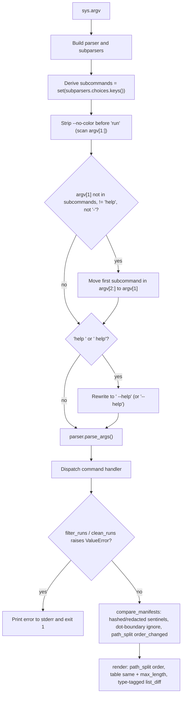

# IPD: Fix CLI subcommand routing, argument handling, and diff or render bugs

- Date: 2026-11-22
- Kind: child
- Concern: Bugs and correctness (command-line interface routing, exit codes, command flags, hashed-redaction manifest diffing, diff rendering accuracy, and CLI documentation sync).
- Scope: `src/pubrun/__main__.py`, `src/pubrun/analysis/diff.py`, `src/pubrun/analysis/render.py`, dedicated regression tests in `tests/test_cli_diff_bugs.py`, and additive `show` documentation sync in `docs/cli.md`.
- Scope-Paths: src/pubrun/__main__.py, src/pubrun/analysis/diff.py, src/pubrun/analysis/render.py, tests/test_cli_diff_bugs.py, docs/cli.md
- Item-Dependencies: executed:njn1up
- Status: executed
- Readiness: go-pending-approval
- Review-Depth: complex
- Short-Description: Fix CLI subcommands allowlist, exit codes, show/combined/diff/bench flags, hashed-redaction diff, and path/table rendering bugs
- Work-Kind: bug
- Priority: high
- Blocks-Release: next
- Set: bugs-audit
- Order: 5
- Highest E allocated: 05
- Author: Antigravity
- Id: r68o07

> Write and proofread this plan per the technical writing standard, `.aw/system/workflows/technical-writing/technical-writing.md`, including requirement 12 (diagrams).

## Workflow history

- 2026-11-23 executed (aw oc run model=uri/its_direct/pt3-claude-opus-5.5-1m-us variant=high profile=opus): aw oc run self-finalize: r68o07 verified (set bugs-audit, attempt 1).
- 2026-11-22 approved (aw set): status set to approved
- 2026-11-22 /plan-review (Gemini 4 Neon (High)): APPROVE WITH REVISIONS APPLIED; PR-001, PR-002, PR-003, PR-004, PR-005, PR-006
- 2026-11-22 to-review (Antigravity): authored fix steps, citations, and falsifiable validation criteria.
- 2026-11-22 draft (Antigravity): created from `/assess-bugs` audit.

## Goal

Fix 11 confirmed command-line interface (CLI) and diff/render correctness bugs across `src/pubrun/__main__.py`, `src/pubrun/analysis/diff.py`, and `src/pubrun/analysis/render.py`, and synchronize `show` documentation in `docs/cli.md`. Eliminate the incomplete `subcommands` allowlist that misroutes `pubrun inspect -f run` into `subprocess.Popen`, fix misleading exit codes and ignored filter flags, catch `ValueError` from `src/pubrun/status.py::filter_runs` and `src/pubrun/status.py::clean_runs` (`njn1up`) cleanly with exit code 1, and repair hashed-redaction manifest diffing plus path/table/array rendering defects.

### CLI pre-parse routing and diff pipeline (target behavior)



## Detailed Implementation Checklist (TODO)

Execution-state rule: mark an `E-*` item complete only after performing the action. That mark is not validation. Right-sizing rule: each E-item is one focused pass with its own V-item check (`IPD-Z603`). Accepted execution states: blocked, failed, pending, performed; terminal gate demands 'performed'.

### Task group 1: CLI subcommand routing, argument handling, and exit codes

- [x] E-01 Fix `src/pubrun/__main__.py::main` subcommand allowlist, `src/pubrun/__main__.py::_run_combined` filter detection, bare `show` run limiting, `src/pubrun/__main__.py::_run_diff` single-path self-comparison, and `--older-than` `ValueError` handling across all unguarded CLI call sites, and add regression tests in `tests/test_cli_diff_bugs.py`.
  - Depends on: none
  - Expected outcome: `src/pubrun/__main__.py::main` builds `parser` and `subparsers` before argument preprocessing and derives `subcommands = set(subparsers.choices.keys())` (covering `init`, `report-bug`, `feedback`, `self-check`, `inspect`, `bench`, and every existing command and alias), scans `sys.argv[1:]` when locating `run_idx`, and skips run-first reordering when `sys.argv[1] == "help"`. As a result, `pubrun inspect -f run` routes to `inspect` without invoking `subprocess.Popen`, while `pubrun help init`, `pubrun init help`, `pubrun help inspect`, and `pubrun 1 inspect` route accurately. `src/pubrun/__main__.py::_run_combined` includes `not_filter_str` (`-F`/`--not-filter`) and `not_status_filter` (`-S`/`--not-status`) in `has_filters` so filtered runs are not truncated to 1. In `src/pubrun/__main__.py::main` (`show`/`report` branch), bare invocations without a `run_dir`, filter flag, or `-n`/`--limit` default to `limit=1` (the single most recent run), while invocations with any of the six filter flags default to all matching runs (`limit=None`) and explicit `-n`/`--limit` is respected. In `src/pubrun/__main__.py::_run_diff`, when `len(run_dirs) == 1` and `run_dir_a_path` points to a `manifest.json` file (`run_dir_a_path.is_file() and run_dir_a_path.name == "manifest.json"`), it normalizes `run_dir_a_path = run_dir_a_path.parent` so `pubrun diff runs/X/manifest.json` never compares a run against itself and exits 1 when no other valid run exists. Every unguarded CLI call site of `filter_runs` and `clean_runs` (`_get_manifest_path`, `_run_methods_aggregate`, `_run_status`, `_run_clean`, `_run_combined`, and `main`'s `show`/`report` branch) catches `ValueError`, prints the message to `stderr` via `_print_error`, and exits 1 with no traceback. Tests in `tests/test_cli_diff_bugs.py` cover `BUG-11`, `BUG-43`, `BUG-44` (bare `show`), `BUG-68`, and invalid `--older-than` across CLI commands.
  - Execution state: performed

- [x] E-02 Fix lock-only run exit codes in `src/pubrun/__main__.py::_run_methods` and `src/pubrun/__main__.py::_run_resources`, multi-run `show logs` in `src/pubrun/__main__.py::_run_report`, scheduler handling in `src/pubrun/__main__.py::_run_bench`, gist rollback in `src/pubrun/__main__.py::_create_result_gist`, and interpreter/exit codes in `src/pubrun/__main__.py::_run_tests`, adding regression tests in `tests/test_cli_diff_bugs.py`.
  - Depends on: E-01
  - Expected outcome: Both `src/pubrun/__main__.py::_run_methods` and `src/pubrun/__main__.py::_run_resources` call `sys.exit(1)` inside their `except RunInProgressOrCrashedError` blocks after printing the error message instead of returning exit code 0. In `src/pubrun/__main__.py::_run_report`, when `RunInProgressOrCrashedError` is caught and `section == "logs"`, it prints the lock-only run's `stdout.log` and `stderr.log` and calls `return` instead of `sys.exit(0)`, so multi-run `pubrun show logs -f ...` prints logs for the lock-only run and continues through all remaining matched runs (while non-`logs` single-run crashed/running `show`/`report` calls continue exiting 1 as pinned by `tests/test_cli.py`). In `src/pubrun/__main__.py::_run_bench`, when `scheduler == "auto"`, `not local`, `not detected`, and `_qsub_ambiguous()` is `True`, the Portable Batch System (PBS) vs Sun Grid Engine (SGE) ambiguity warning prints to `stderr` before falling back to local execution; and after `_sp.run(cmd, ...)` for non-Slurm schedulers (PBS, Load Sharing Facility (LSF), SGE), a non-zero `proc.returncode` prints an error to `stderr` and exits non-zero instead of printing `"Submitted."` and returning 0. In `src/pubrun/__main__.py::_create_result_gist`, blank or unparseable `page_url` output raises `_GhError` without `IndexError`; after `gist_id` is created, any failure during `gh api /gists/{gist_id}`, JavaScript Object Notation (JSON) parsing (`json.loads`), non-dict file entry inspection, unexpected file count, or raw Uniform Resource Locator (URL) validation calls `_delete_gist_best_effort(gist_id)` before raising `_GhError` so no orphaned gist leaks and `_submit_benchmark_result` cleanly falls back instead of crashing on `json.JSONDecodeError`. In `src/pubrun/__main__.py::_run_tests`, the `pytest` invocation uses `sys.executable` instead of hardcoded `"python"`, and `_run_tests` exits non-zero if `pytest` exits non-zero or raises, or if the mock script fails or produces no valid manifest. Tests in `tests/test_cli_diff_bugs.py` cover `BUG-42`, `BUG-44` (`_run_report`), `BUG-45`, `BUG-66`, and `BUG-67a`.
  - Execution state: performed

### Task group 2: Manifest diff and rendering fixes

- [x] E-03 Fix `src/pubrun/analysis/diff.py::_normalize_manifest`, `src/pubrun/analysis/diff.py::_is_path_var`, `src/pubrun/analysis/diff.py::compare_manifests` (`path_split` order tracking), and `_should_ignore`, adding regression tests in `tests/test_cli_diff_bugs.py`.
  - Depends on: none
  - Expected outcome: In `src/pubrun/analysis/diff.py::_normalize_manifest`, environment variable dicts with `"representation": "hashed"` normalize to a canonical non-empty sentinel carrying `hash_value` (and `hash_algorithm` when present, e.g., `f"[HASHED:{algo}:{hash_value}]"` or `f"[HASHED:{hash_value}]"`, falling back to `"[HASHED]"` if absent) and `"representation": "redacted"` normalizes to `"[REDACTED]"`, so changed hashed secrets appear as modifications in `compare_manifests` and never alias plain empty strings `""` (preserving `tests/test_quality.py::TestDiffNormalization::test_env_vars_flatten`). `src/pubrun/analysis/diff.py::_is_path_var` restricts `PATH`-style splitting to keys starting with `"environment."` whose variable name contains `"PATH"` (case-insensitive), leaving manifest fields such as `invocation.script.path`, `invocation.script.real_path`, `filesystem.run_dir.path`, and `data_files.inputs.0.path` as standard scalar diffs. In `src/pubrun/analysis/diff.py::compare_manifests`, `path_split` entries retain `"type"`, `"added"`, and `"removed"` and also record `"order_changed"` (comparing common ordered segments from `val_a.split(os.pathsep)` vs `val_b.split(os.pathsep)`), `"old": val_a`, and `"new": val_b`. Inside `_normalize_manifest`, `_should_ignore` enforces exact key match or a dot boundary (`key == ig or key.startswith(ig if ig.endswith(".") else ig + ".")`) for non-wildcard ignore entries so ignoring `"environment.FOO"` never hides `"environment.FOO_BAR"`. Tests in `tests/test_cli_diff_bugs.py` cover `BUG-12`, `BUG-50` (diff engine), and `BUG-64` (`_should_ignore`).
  - Execution state: performed

- [x] E-04 Fix `path_split` order-change rendering, `_render_table` `same` and `max_length` handling, and bool/int type tagging in `_render_inline` and `_format_array_diff` in `src/pubrun/analysis/render.py`, adding regression tests in `tests/test_cli_diff_bugs.py`.
  - Depends on: E-03
  - Expected outcome: In `src/pubrun/analysis/render.py::_render_inline`, `path_split` diffs print `~ [ORDER CHANGED]` (and old/new values when `old`/`new` are present) whenever `mod.get("order_changed")` is `True` (or when both `added` and `removed` are empty), and `src/pubrun/analysis/render.py::_summarize_change` includes `"reordered"` in `path_split` summaries when `order_changed` is `True`. `src/pubrun/analysis/render.py::_render_table` truncates `added`, `removed`, and `same` cells to `max_length` (matching `_summarize_change`), and renders `diff_report.get("same", {})` entries with the `"="` change mark even when `added`, `removed`, and `modified` are empty (while still printing `(no differences)` when no differences exist). In `src/pubrun/analysis/render.py::_render_inline` (`list_diff` at `depth in ("standard", "deep")`) and `src/pubrun/analysis/render.py::_format_array_diff`, set membership and common-element index comparisons use `(type(x).__name__, x)` type-tagged keys so `True` vs `1` and `False` vs `0` never alias. Tests in `tests/test_cli_diff_bugs.py` cover `BUG-50` (rendering) and `BUG-64` (`_render_table`, `_render_inline`).
  - Execution state: performed

### Task group 3: Documentation sync and full-suite regression verification

- [x] E-05 Synchronize `show` default-run documentation in `docs/cli.md` and run the full `pytest` regression suite.
  - Depends on: E-01, E-02, E-03, E-04
  - Expected outcome: `docs/cli.md` (the `methods` comparison note and the `### show` section) accurately states that bare `pubrun show` (with no run directory, filter, or `-n`/`--limit`) defaults to the single most recent run, while passing run filters or `-n` prints a separate report per matching run. Edits are additive to those `show`-related lines (disjoint from `njn1up`'s `clean` row) and introduce zero em dashes (`U+2014`) or en dashes (`U+2013`) in added diff lines. Both `pytest tests/test_cli_diff_bugs.py -v` and full `pytest -q` pass with zero failures.
  - Execution state: performed

## Project conventions discovered (Step 0)

- Depends on `njn1up` (Order 01, `- Item-Dependencies: executed:njn1up`) for `src/pubrun/status.py::filter_runs` and `src/pubrun/status.py::clean_runs` raising `ValueError` on invalid `older_than` inputs.
- Pending IPD Sets `repro-check`, `timing-acc`, and `file-prov` also touch `src/pubrun/__main__.py`; deriving `subcommands = set(subparsers.choices.keys())` dynamically in `main` ensures any subcommand added by another Set stays synchronized automatically, and keeping edits strictly inside the affected functions minimizes merge overlap.
- `docs/cli.md` is also edited by prerequisite `njn1up` (only the `clean` options table `--older-than` row); because `r68o07` declares `- Item-Dependencies: executed:njn1up` and edits only the `methods`/`show` lines, the two edits are ordered and disjoint.
- `tests/test_cli.py` pins that single-run `pubrun report` on a lock-only crashed/running run exits 1, `tests/test_quality.py::TestDiffNormalization::test_env_vars_flatten` checks `"environment.API_KEY" in flat`, and `tests/test_bench_command.py` pins `_qsub_ambiguous()` and `_submit_benchmark_result` fallback behavior.
- Tests must assert observable behavior, outputs, and exit codes (no code-pinning via `inspect`, `ast`, or source regex).

## Findings

| Bug ID | Severity | Remediation Risk | Location (symbol) | Defect |
|---|---|---|---|---|
| `BUG-11` | High | Low | `src/pubrun/__main__.py::main` | Hardcoded `subcommands` allowlist omits `init`, `report-bug`, `feedback`, `self-check`, `inspect`, and `bench`, causing `pubrun inspect -f run` to swap `run` to index 1 and invoke `subprocess.Popen(['inspect', '-f'])`, and breaking `help` and run-first ordering for those commands. |
| `BUG-12` | High | Low | `src/pubrun/analysis/diff.py::_normalize_manifest` | Unwraps `val.get("value")` on environment variable dicts, collapsing `{"representation": "hashed", "hash_value": "..."}` and `{"representation": "redacted"}` to `""`, which hides changed hashed secrets and aliases empty plain strings. |
| `BUG-42` | Medium | Low | `src/pubrun/__main__.py::_run_methods`, `src/pubrun/__main__.py::_run_resources` | Catch `RunInProgressOrCrashedError` and print an error without calling `sys.exit(1)`, returning exit code 0 on lock-only crashed or running runs. |
| `BUG-43` | Medium | Low | `src/pubrun/__main__.py::_run_combined` | `has_filters` omits `not_filter_str` (`-F`/`--not-filter`) and `not_status_filter` (`-S`/`--not-status`), truncating filtered results to `limit=1`. |
| `BUG-44` | Medium | Low | `src/pubrun/__main__.py::main`, `src/pubrun/__main__.py::_run_report` | Bare `pubrun show` passes `limit=None` to `filter_runs` and dumps every run instead of defaulting to the single most recent run; `_run_report` calls `sys.exit(0)` instead of `return` after printing lock-only logs during multi-run `show logs`. |
| `BUG-45` | Medium | Low | `src/pubrun/__main__.py::_run_bench`, `src/pubrun/__main__.py::_qsub_ambiguous` | Returns 0 and prints `"Submitted."` for non-Slurm (PBS/LSF/SGE) submissions before checking `proc.returncode != 0`; `_qsub_ambiguous()` warning sits inside `if detected:`, making it unreachable when bare `qsub` has no PBS or SGE markers. |
| `BUG-50` | Medium | Low | `src/pubrun/analysis/diff.py::_is_path_var`, `src/pubrun/analysis/diff.py::compare_manifests`, `src/pubrun/analysis/render.py::_render_inline`, `src/pubrun/analysis/render.py::_summarize_change` | `_is_path_var` matches `"PATH"` anywhere in a key path, misclassifying scalar fields like `invocation.script.path` and `.real_path`; `path_split` discards segment order (`set(...)`) and emits no `order_changed`, `old`, or `new`, hiding order-only `PATH` changes in both inline and table views. |
| `BUG-64` | Low | Low | `src/pubrun/analysis/diff.py::_normalize_manifest` (`_should_ignore`), `src/pubrun/analysis/render.py::_render_table`, `src/pubrun/analysis/render.py::_render_inline`, `src/pubrun/analysis/render.py::_format_array_diff` | `_should_ignore` uses raw `key.startswith(ig)` without a dot boundary; `_render_table` ignores `diff_report["same"]` and skips `max_length` truncation on `added`/`removed` cells; `_render_inline` and `_format_array_diff` drop `(type(x).__name__, x)` tagging so `True`/`1` and `False`/`0` alias in `list_diff` rendering. |
| `BUG-66` | Low | Low | `src/pubrun/__main__.py::_create_result_gist` | Leaks an orphaned GitHub gist when `gh api /gists/{gist_id}`, `json.loads`, file-count checks, or raw URL validation fail after `gh gist create`; raises unhandled `json.JSONDecodeError`, `IndexError`, or `AttributeError` past `_submit_benchmark_result`'s `except _GhError`. |
| `BUG-67a` | Low | Low | `src/pubrun/__main__.py::_run_tests` | Hardcodes `"python"` instead of `sys.executable`, ignores `pytest`'s non-zero return code, and returns exit code 0 when the mock script fails or produces no valid manifest. |
| `BUG-68` | Low | Low | `src/pubrun/__main__.py::_run_diff` | Passing one explicit `manifest.json` file path (`pubrun diff runs/X/manifest.json`) leaves `run_dir_a_path` as the file instead of its parent run directory, causing `r.run_dir.resolve() != run_dir_a_path.resolve()` to match and compare the run against itself. |

## Proposed changes (ordered, validatable)

1. In `src/pubrun/__main__.py::main`, `_run_combined`, `_run_diff`, `_get_manifest_path`, `_run_methods_aggregate`, `_run_status`, and `_run_clean`: construct `parser` and `subparsers` before argv preprocessing and derive `subcommands = set(subparsers.choices.keys())`; scan `sys.argv[1:]` for `run_idx`; skip run-first reordering when `sys.argv[1] == "help"`; include `not_filter_str` and `not_status_filter` in `_run_combined`'s `has_filters`; compute `has_filters` and `run_limit = limit if limit is not None else (None if has_filters else 1)` in `main`'s `show`/`report` branch; normalize `run_dir_a_path = run_dir_a_path.parent` in `_run_diff` when `run_dir_a_path.is_file() and run_dir_a_path.name == "manifest.json"`; and catch `ValueError` from `filter_runs`/`clean_runs` at every unguarded CLI call site (`_get_manifest_path`, `_run_methods_aggregate`, `_run_status`, `_run_clean`, `_run_combined`, and `main`'s `show`/`report` branch) to print via `_print_error` and exit 1.
2. In `src/pubrun/__main__.py::_run_methods`, `_run_resources`, `_run_report`, `_run_bench`, `_create_result_gist`, and `_run_tests`: add `sys.exit(1)` to `except RunInProgressOrCrashedError` in `_run_methods` and `_run_resources`; replace `sys.exit(0)` with `return` inside `_run_report`'s lock-only `section == "logs"` handler; print the `_qsub_ambiguous()` warning in `_run_bench` when `scheduler == "auto"`, `not local`, `not detected`, and `_qsub_ambiguous()` is `True`; check `proc.returncode != 0` before returning for non-Slurm (PBS/LSF/SGE) submissions and exit non-zero on failure; guard blank `page_url` and wrap post-create steps in `_create_result_gist` with `try/except` that calls `_delete_gist_best_effort(gist_id)` and raises `_GhError`; and replace `"python"` with `sys.executable` in `_run_tests` and exit non-zero on failed `pytest` or failed/incomplete mock-script validation.
3. In `src/pubrun/analysis/diff.py`: normalize `environment.variables` dicts with `"representation": "hashed"` to a non-empty sentinel carrying `hash_value` (and `hash_algorithm` when present) and `"representation": "redacted"` to `"[REDACTED]"`; restrict `_is_path_var` to `"environment."`-prefixed keys whose variable name contains `"PATH"`; compute `order_changed`, `old`, and `new` on `path_split` entries in `compare_manifests`; and enforce exact-or-dot-boundary matching (`key == ig or key.startswith(ig if ig.endswith(".") else ig + ".")`) in `_should_ignore`.
4. In `src/pubrun/analysis/render.py`: render `order_changed` (and old/new order) for `path_split` diffs in `_render_inline` and include `"reordered"` in `_summarize_change`; truncate `added`/`removed`/`same` values to `max_length` and render `same` rows with `"="` in `_render_table`; and use `(type(x).__name__, x)` type-tagged keys in `_render_inline` and `_format_array_diff` for `list_diff`.
5. Add `tests/test_cli_diff_bugs.py` covering all 11 bugs plus CLI `--older-than` `ValueError` handling across entry points, and update `docs/cli.md` (`methods` note on `show` and `### show`) additively with zero newly added em or en dashes.

## Deferred / out of scope (with reason)

None.

## Scope check

- Over-scope: none. Only `src/pubrun/__main__.py`, `src/pubrun/analysis/diff.py`, `src/pubrun/analysis/render.py`, `tests/test_cli_diff_bugs.py`, and targeted `show` lines in `docs/cli.md` are modified.
- Under-scope: none. All 11 bugs assigned to `r68o07` in Set `bugs-audit`, all unguarded CLI `--older-than` `ValueError` call sites, the `diff.py` half of `path_split` order tracking, and `docs/cli.md` synchronization for bare `pubrun show` are covered.

## Required tests / validation

- Run `pytest tests/test_cli_diff_bugs.py -v` and paste actual output.
- Run a diff-scoped Python check over added lines of `git diff -- docs/cli.md` confirming zero em dashes (`U+2014`) or en dashes (`U+2013`), and paste actual output.
- Run full `pytest -q` and paste actual output confirming zero regressions across `tests/test_cli.py`, `tests/test_show_sections.py`, `tests/test_combined.py`, `tests/test_bench_command.py`, `tests/test_diff_usability.py`, `tests/test_render.py`, `tests/test_quality.py`, `tests/test_edge_cases.py`, `tests/test_cli_diff_bugs.py`, and the entire suite.

## Spec / documentation sync

- `docs/cli.md` (`### methods` note comparing `methods` with `show`, and `### show` diagnostic viewer): document that bare `pubrun show` (no run directory, filter, or `-n`/`--limit`) defaults to the single most recent run, while `pubrun show` with filters or `-n` prints a separate report per matching run.
- `docs/functional_spec.md#11.6 Run Diagnostics (report)`: no change needed; it already states that omitting the directory auto-detects the most recent run in `./runs/`.
- Other fixes (`BUG-11`, `BUG-12`, `BUG-42`, `BUG-43`, `BUG-45`, `BUG-50`, `BUG-64`, `BUG-66`, `BUG-67a`, `BUG-68`): no doc changes needed; they bring runtime behavior into alignment with existing `--help` text, `docs/cli.md`, `docs/functional_spec.md`, and `src/pubrun/resources/default.toml`.

## Open questions

None.

## Validation and cross-check (verify before reporting done)

Validation-state rule: inspect evidence in a separate pass. Do not mark a `V-*` item complete from memory or from the matching execution checkmark. Accepted validation results: blocked, failed, pass, pending; terminal gate demands 'pass'.

- [x] V-01 validates E-01
  - Required evidence: Pasted `pytest tests/test_cli_diff_bugs.py -v` output confirming `pubrun inspect -f run` routes to `inspect` without calling `subprocess.Popen`, `pubrun help init` / `pubrun init help` / `pubrun help inspect` / `pubrun 1 inspect` route properly, `pubrun combined -S failed` and `-F ...` retain all matching runs, bare `pubrun show` selects only the single most recent run while filtered `pubrun show -f ...` returns all matching runs, `pubrun diff runs/X/manifest.json` does not compare `X` against itself (and exits 1 when no other run exists), and invalid `--older-than bogus` exits 1 with a stderr error and no traceback across `status`, `clean`, `combined`, `show`, `inspect`, and `methods --all`.
  - Observed evidence:
    ```text
    $ python3 -m pytest -v -p no:cacheprovider --no-cov tests/test_cli_diff_bugs.py   (2026-11-22, lane r68o07, uncommitted tree before the r68o07 commit)
    TestSubcommandRouting::test_inspect_with_run_filter_routes_to_inspect PASSED
    TestSubcommandRouting::test_help_for_init[argv0] PASSED
    TestSubcommandRouting::test_help_for_init[argv1] PASSED
    TestSubcommandRouting::test_help_inspect PASSED
    TestSubcommandRouting::test_run_selector_before_inspect PASSED
    TestCombinedFilters::test_not_status_keeps_all_matches PASSED
    TestCombinedFilters::test_not_filter_keeps_all_matches PASSED
    TestShowRunLimit::test_bare_show_reports_only_most_recent PASSED
    TestShowRunLimit::test_filtered_show_reports_all_matches PASSED
    TestShowRunLimit::test_explicit_limit_is_respected PASSED
    TestDiffManifestPath::test_single_manifest_path_alone_exits_1 PASSED
    TestDiffManifestPath::test_single_manifest_path_compares_against_other_run PASSED
    TestOlderThanValueError::test_invalid_older_than_exits_1_without_traceback[argv0] PASSED
    TestOlderThanValueError::test_invalid_older_than_exits_1_without_traceback[argv1] PASSED
    TestOlderThanValueError::test_invalid_older_than_exits_1_without_traceback[argv2] PASSED
    TestOlderThanValueError::test_invalid_older_than_exits_1_without_traceback[argv3] PASSED
    TestOlderThanValueError::test_invalid_older_than_exits_1_without_traceback[argv4] PASSED
    TestOlderThanValueError::test_invalid_older_than_exits_1_without_traceback[argv5] PASSED
    TestOlderThanValueError::test_invalid_older_than_exits_1_without_traceback[argv6] PASSED
    TestOlderThanValueError::test_invalid_older_than_exits_1_without_traceback[argv7] PASSED
    ... (58 collected; subset relevant to this item shown above)
    ============================== 58 passed in 3.90s ==============================
    Parametrization of TestOlderThanValueError argv0..argv7: status, clean --yes, combined, show, inspect, methods --all, methods, res
    (each run as a real `python -m pubrun ... --older-than bogus` subprocess; asserts exit 1, no 'Traceback', and the
    "Invalid --older-than value 'bogus'" stderr message). TestSubcommandRouting::test_inspect_with_run_filter_routes_to_inspect
    monkeypatches subprocess.Popen to raise, so passing proves no child process was launched.
    Baseline check: the same test file run against `git archive HEAD src` (f632558, pre-fix) fails 48 of 58 tests.
    ```
  - Result: pass

- [x] V-02 validates E-02
  - Required evidence: Pasted `pytest tests/test_cli_diff_bugs.py -v` output confirming `_run_methods` and `_run_resources` exit 1 on lock-only crashed/running runs, multi-run `pubrun show logs` prints logs from a lock-only run and continues to print logs from subsequent matched runs without exiting mid-loop (while single-run `pubrun report` on a crashed run still exits 1), `_run_bench` prints the `_qsub_ambiguous()` warning to stderr when `qsub` is present without PBS/SGE markers in `auto` mode and exits non-zero without printing `"Submitted."` when PBS/LSF/SGE submission fails, `_create_result_gist` rolls back via `_delete_gist_best_effort(gist_id)` and raises `_GhError` on non-JSON `gh api` output / bad URL / bad file count (letting `_submit_benchmark_result` fall back cleanly), and `_run_tests` invokes `sys.executable` and exits non-zero when `pytest` or mock validation fails.
  - Observed evidence:
    ```text
    $ python3 -m pytest -v -p no:cacheprovider --no-cov tests/test_cli_diff_bugs.py   (2026-11-22, lane r68o07, uncommitted tree before the r68o07 commit)
    TestLockOnlyExitCodes::test_methods_lock_only_exits_1 PASSED
    TestLockOnlyExitCodes::test_resources_lock_only_exits_1 PASSED
    TestShowLogsMultiRun::test_lock_only_run_does_not_stop_loop PASSED
    TestShowLogsMultiRun::test_single_crashed_report_still_exits_1 PASSED
    TestBenchScheduler::test_failed_pbs_submission_exits_nonzero PASSED
    TestBenchScheduler::test_ambiguous_qsub_warns_when_nothing_detected PASSED
    TestGistRollback::test_blank_page_url_raises_gh_error PASSED
    TestGistRollback::test_post_create_failure_deletes_gist[this is not json] PASSED
    TestGistRollback::test_post_create_failure_deletes_gist[{"files": {}}] PASSED
    TestGistRollback::test_post_create_failure_deletes_gist[{"files": {"a": {}, "b": {}}}] PASSED
    TestGistRollback::test_post_create_failure_deletes_gist[{"files": {"a": "not-a-dict"}}] PASSED
    TestGistRollback::test_post_create_failure_deletes_gist[{"files": {"a": {"raw_url": "https://evil.example.com/r.json"}}}] PASSED
    TestGistRollback::test_submit_falls_back_to_inline_on_bad_metadata PASSED
    TestRunTests::test_failed_pytest_exits_nonzero_and_uses_sys_executable PASSED
    TestRunTests::test_mock_script_failure_exits_nonzero PASSED
    TestRunTests::test_mock_script_without_manifest_exits_nonzero PASSED
    ... (58 collected; subset relevant to this item shown above)
    ============================== 58 passed in 3.90s ==============================
    ```
  - Result: pass

- [x] V-03 validates E-03
  - Required evidence: Pasted `pytest tests/test_cli_diff_bugs.py -v` output confirming `compare_manifests` detects changed `hash_value` dicts and distinguishes `redacted` and `hashed` values from plain `""`, `_is_path_var` returns `False` for `invocation.script.path` / `.real_path` / `filesystem.run_dir.path` while returning `True` for `environment.PATH` / `environment.LD_LIBRARY_PATH`, `compare_manifests` records `order_changed=True` plus `old`/`new` for reordered `environment.PATH`, and `_should_ignore` ignores `environment.FOO` and `environment.FOO.sub` without hiding `environment.FOO_BAR`.
  - Observed evidence:
    ```text
    $ python3 -m pytest -v -p no:cacheprovider --no-cov tests/test_cli_diff_bugs.py   (2026-11-22, lane r68o07, uncommitted tree before the r68o07 commit)
    TestDiffEngine::test_changed_hash_value_is_modified PASSED
    TestDiffEngine::test_hashed_and_redacted_differ_from_empty_plain PASSED
    TestDiffEngine::test_identical_hashes_are_same PASSED
    TestDiffEngine::test_non_env_path_fields_are_scalar[invocation.script.path] PASSED
    TestDiffEngine::test_non_env_path_fields_are_scalar[invocation.script.real_path] PASSED
    TestDiffEngine::test_non_env_path_fields_are_scalar[filesystem.run_dir.path] PASSED
    TestDiffEngine::test_non_env_path_fields_are_scalar[data_files.inputs.0.path] PASSED
    TestDiffEngine::test_env_path_vars_split[environment.PATH] PASSED
    TestDiffEngine::test_env_path_vars_split[environment.LD_LIBRARY_PATH] PASSED
    TestDiffEngine::test_env_path_vars_split[environment.PythonPath] PASSED
    TestDiffEngine::test_script_path_change_is_standard_diff PASSED
    TestDiffEngine::test_reordered_path_records_order_changed PASSED
    TestDiffEngine::test_path_add_without_reorder PASSED
    TestDiffEngine::test_ignore_respects_dot_boundary PASSED
    TestDiffEngine::test_ignore_with_trailing_dot_and_wildcard PASSED
    ... (58 collected; subset relevant to this item shown above)
    ============================== 58 passed in 3.90s ==============================
    ```
  - Result: pass

- [x] V-04 validates E-04
  - Required evidence: Pasted `pytest tests/test_cli_diff_bugs.py -v` output confirming order-only `PATH` changes render visibly in both `_render_inline` (`[ORDER CHANGED]` and old/new order) and `_render_table` (`reordered`), `_render_table` displays `same` rows (including when no differences exist) and truncates long `added`/`removed`/`same` values to `max_length`, and `_render_inline` at `depth="standard"`/`"deep"` distinguishes `True` vs `1` and `False` vs `0` without aliasing.
  - Observed evidence:
    ```text
    $ python3 -m pytest -v -p no:cacheprovider --no-cov tests/test_cli_diff_bugs.py   (2026-11-22, lane r68o07, uncommitted tree before the r68o07 commit)
    TestRender::test_inline_shows_order_change PASSED
    TestRender::test_table_shows_reordered PASSED
    TestRender::test_table_renders_same_rows_when_no_differences PASSED
    TestRender::test_table_truncates_added_removed_same PASSED
    TestRender::test_inline_list_diff_bool_int_common_not_marked_moved PASSED
    TestRender::test_inline_list_diff_bool_int_reorder_marked PASSED
    TestRender::test_inline_list_diff_false_zero_distinct PASSED
    ... (58 collected; subset relevant to this item shown above)
    ============================== 58 passed in 3.90s ==============================
    ```
  - Result: pass

- [x] V-05 validates E-05
  - Required evidence: Pasted `git diff -- docs/cli.md` plus Python check output confirming zero `U+2014`/`U+2013` characters in added doc lines, and pasted full `pytest -q` summary confirming `tests/test_cli_diff_bugs.py` and the full repository test suite pass with zero failures.
  - Observed evidence:
    ```text
    $ git diff -- docs/cli.md | python3 -c "<count added lines containing U+2014/U+2013>"
    added lines: 4; lines with U+2014/U+2013: 0
    (The single removed line contained a pre-existing em dash "This is deliberate — a methods section..."; the replacement uses a colon.)

    $ python3 -m pytest -v -p no:cacheprovider --no-cov tests/test_cli_diff_bugs.py
    ============================== 58 passed in 3.90s ==============================

    $ python3 -m pytest -q -p no:cacheprovider   (full suite, project addopts, single process; coverage table elided)
    Coverage XML written to file coverage.xml
    1753 passed, 2 skipped in 491.49s (0:08:11)

    Additional: aw suite (xdist workers) -> "1 failed, 1754 passed in 135.46s"; the one failure is
    tests/test_liveness.py::TestIsSameProcess::test_expected_script_matches, which also fails on the untouched base
    f632558 (git archive HEAD src into /tmp, `pytest -n 2 tests/test_liveness.py` -> "1 failed, 26 passed"), passes
    single-process ("27 passed in 0.24s"), and is already tracked as backlog sd7kvt / 12rcu8. This plan touches no
    file that test imports.
    ```
  - Result: pass

## Approval and execution gate

- Size assessment: standard
- Cohesion rationale: not required

Execution contract:
1. Precondition: wait for human approval (`- Status: approved`) with no unresolved `Blocking: yes` open questions before writing code or documentation.
2. Scope declaration: expected modified files are `- Scope-Paths:` (`src/pubrun/__main__.py`, `src/pubrun/analysis/diff.py`, `src/pubrun/analysis/render.py`, `tests/test_cli_diff_bugs.py`, `docs/cli.md`). If execution requires modifying an out-of-scope file, justify it with `--scope-reason` at finalization; if a declared file requires no edit, acknowledge it with `--scope-ack`. Stop only for a genuinely unsafe condition such as an unresolvable concurrent-edit conflict or missing prerequisite behavior.
3. Validation honesty (HARD MUST): run the required validation commands and paste the actual runner output verbatim into each `V-*` `Observed evidence:` field; never mark a `V-*` item `pass` without captured output from that run.
4. Commit and push discipline: commit only the paths you changed through `aw commit r68o07 -- src/pubrun/__main__.py src/pubrun/analysis/diff.py src/pubrun/analysis/render.py tests/test_cli_diff_bugs.py docs/cli.md` (never `git add -A` or raw `git commit`), and never push without explicit human instruction.
5. Lifecycle transition: this plan must be finalized through `aw ipd finalize r68o07` (never a hand-rolled `git mv` to `.aw/records/plans/executed/`). When executing inside a runner execution lane (`aw oc run` or `aw agy run`), the runner performs `aw ipd finalize` after the turn; when executing standalone outside a runner, the executor runs `aw ipd finalize r68o07`.
