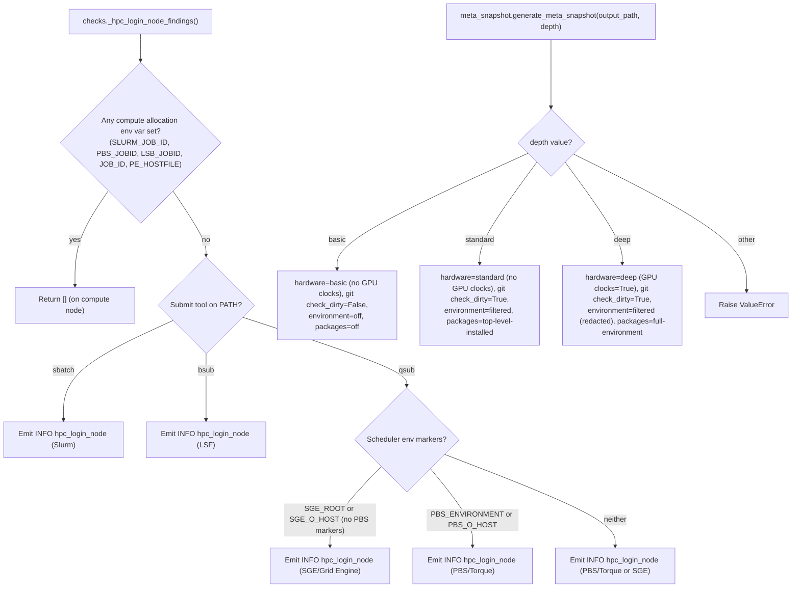

# IPD: Fix self-check, meta snapshot, and report rendering bugs

- Date: 2026-11-22
- Kind: child
- Concern: Bugs and correctness (diagnostic self-checks, meta snapshot depth handling, resource report labeling, null-safe CPU formatting, and manifest hydration).
- Scope: `src/pubrun/report/checks.py`, `src/pubrun/report/meta_snapshot.py`, `src/pubrun/report/diagnostics.py`, `src/pubrun/report/utils.py`, `tests/test_reproducibility_assessment.py`, and regression tests in `tests/test_report_checks_bugs.py`.
- Scope-Paths: src/pubrun/report/checks.py, src/pubrun/report/meta_snapshot.py, src/pubrun/report/diagnostics.py, src/pubrun/report/utils.py, tests/test_reproducibility_assessment.py, tests/test_report_checks_bugs.py
- Scope-Exceeded: .aw/records/backlog/open/20261122-ivpkar-01-ivpkar-parallel-test-suite-aw-suite-pytest-n-fails-tests.backlog.md (Defect carrier required by the driver's defect-report contract: records pre-existing xdist-only test failures test_liveness, test_tui observed during E-05 validation reproduces on unmodified base a354...); .aw/records/backlog/open/20261122-rmssqd-01-rmssqd-print-report-renders-literal-none-in-the-host-line.backlog.md (Defect carrier required by the driver's defect-report contract: records adjacent bug found while pinning BUG-64a print_report renders literal None for missing host.os_version)
- Item-Dependencies: none
- Status: executed
- Readiness: go-pending-approval
- Review-Depth: complex
- Short-Description: Fix malformed TOML detection in self-check, meta depth flags, SGE/PBS check precedence, multi-mount reporting, and manifest hydration bugs
- Work-Kind: bug
- Priority: high
- Blocks-Release: next
- Set: bugs-audit
- Order: 6
- Highest E allocated: 05
- Author: Antigravity
- Id: ihh27o

> Write and proofread this plan per the technical writing standard, `.aw/system/workflows/technical-writing/technical-writing.md`, including requirement 12 (diagrams).

## Workflow history

- 2026-11-22 executed (aw oc run model=uri/its_direct/pt3-claude-opus-5.5-1m-us variant=high profile=opus): aw oc run self-finalize: ihh27o verified (set bugs-audit, attempt 2). [Scope reconciliation - out-of-scope .aw/records/backlog/open/20261122-ivpkar-01-ivpkar-parallel-test-suite-aw-suite-pytest-n-fails-tests.backlog.md: Defect carrier required by the driver's defect-report contract: records pre-existing xdist-only test failures (test_liveness, test_tui) observed during E-05 validation; reproduces on unmodified base a3546cd; out-of-scope .aw/records/backlog/open/20261122-rmssqd-01-rmssqd-print-report-renders-literal-none-in-the-host-line.backlog.md: Defect carrier required by the driver's defect-report contract: records adjacent bug found while pinning BUG-64a (print_report renders literal None for missing host.os_version)]
- 2026-11-22 execution attempt 2 (aw oc run): carried attempt-1 work forward from `aw/lane/ihh27o`, re-ran validation, recorded scope reasons for backlog carriers `ivpkar` and `rmssqd`.
- 2026-11-22 approved (aw set): status set to approved
- 2026-11-22 /plan-review (Gemini 4 Neon (High)): APPROVE WITH REVISIONS APPLIED; PR-001, PR-002, PR-003, PR-004, PR-005
- 2026-11-22 to-review (Antigravity): authored fix steps, citations, and falsifiable validation criteria.
- 2026-11-22 draft (Antigravity): created from `/assess-bugs` audit.

## Goal

Fix 8 confirmed diagnostic and reporting bugs across `pubrun self-check`, `pubrun meta`, resource charts, null Central Processing Unit (CPU) formatting, and manifest hydration. Make `pubrun self-check` detect malformed Tom's Obvious Minimal Language (TOML) configuration files, preserve every filesystem finding, distinguish Sun Grid Engine (SGE) and Portable Batch System (PBS) compute nodes from login nodes, and terminate cleanly on nonexistent roots or relative paths. Make `pubrun meta --basic/--standard/--deep` control active collector configuration, keep Resident Set Size (RSS) chart titles aligned with the plotted series, prevent literal `"None"` output on 64-bit Advanced RISC Machine (ARM64) hosts, and hydrate `"host"` from parent meta snapshots.

### Self-check scheduler disambiguation and meta snapshot depth mapping (target behavior)

## Detailed Implementation Checklist (TODO)

Execution-state rule: mark an `E-*` item complete only after performing the action. That mark is not validation. Right-sizing rule: each E-item is one focused pass with its own V-item check (`IPD-Z603`). Accepted execution states: blocked, failed, pending, performed; terminal gate demands 'performed'.

### Task group 1: `src/pubrun/report/checks.py` diagnostic accuracy and termination

- [x] E-01 Fix `src/pubrun/report/checks.py::_install_health_findings` and `src/pubrun/report/checks.py::live_checks` to report malformed TOML config files as `WARN` findings and preserve every matched finding in itemized checks, and add `BUG-16` and `BUG-47` regression tests in `tests/test_report_checks_bugs.py`.
  - Depends on: none
  - Expected outcome: `_install_health_findings` explicitly parses each existing file among the three canonical config paths loaded by `src/pubrun/config.py` (`get_global_config_dir() / "config.toml"`, `Path.cwd() / ".config" / "pubrun" / "config.toml"`, and `Path.cwd() / ".pubrun.toml"`) via `pubrun.config.tomllib.loads` and emits a `WARN` (`"warn"`) `"config_invalid"` finding naming the offending path on `TOMLDecodeError` or `OSError` (while keeping the `try/except` around `resolve_config()`), so `pubrun self-check --strict` exits non-zero on malformed config files. `live_checks` removes the unused `by_prefix` dict and emits one `{"name", "label", "status", "detail"}` check record per matched finding for each `_CHECK_CATALOG` entry (preserving the exact `f.get("message", "")` in `detail` so `src/pubrun/__main__.py::_run_self_check` `--show-suggestions` matching and warning counts remain accurate), and emits one `"ok"` entry when no finding matches. Tests in `tests/test_report_checks_bugs.py` cover malformed config files and multiple simultaneous filesystem findings.
  - Execution state: performed

- [x] E-02 Fix `src/pubrun/report/checks.py::_hpc_login_node_findings` and output-directory writability traversal in `src/pubrun/report/checks.py::_install_health_findings`, and add `BUG-46` and `BUG-48` regression tests in `tests/test_report_checks_bugs.py`.
  - Depends on: none
  - Expected outcome: `_hpc_login_node_findings` checks all compute-node allocation variables first (`SLURM_JOB_ID`, `PBS_JOBID`, `LSB_JOBID`, `JOB_ID`, `PE_HOSTFILE`) and returns `[]` when any is set, so neither SGE compute jobs nor PBS compute jobs are misclassified as login nodes. When no compute allocation variable is set and `qsub` is on `PATH`, `_hpc_login_node_findings` disambiguates the login-node label using environment markers (`"SGE/Grid Engine"` when `SGE_ROOT` or `SGE_O_HOST` is set without PBS markers `PBS_ENVIRONMENT`/`PBS_O_HOST`; `"PBS/Torque"` when PBS markers are set; `"PBS/Torque or SGE"` when neither is set) while preserving Slurm (`sbatch`) and Load Sharing Facility (LSF, `bsub`) detection and `INFO` severity. Output-directory writability anchors non-empty `base` with `os.path.abspath(base)` so relative paths resolve against the current working directory (CWD), stops the ancestor walk whenever `os.path.dirname(probe) == probe` (preventing infinite loops on nonexistent roots or Windows drive letters), and emits `WARN` `"output_not_writable"` when no existing ancestor exists or `not os.access(probe, os.W_OK)`. Tests in `tests/test_report_checks_bugs.py` cover SGE compute, PBS compute, SGE login, PBS login, relative paths under a read-only CWD, and nonexistent roots.
  - Execution state: performed

### Task group 2: Meta snapshot depth and report rendering fixes

- [x] E-03 Fix `src/pubrun/report/meta_snapshot.py::generate_meta_snapshot` to map `depth` (`"basic"`, `"standard"`, `"deep"`) onto active `capture.*` configuration keys instead of deprecated `core.profile`, and fix null `cpu.model` formatting in its hardware summary, adding `BUG-17` and `BUG-64a` (`meta_snapshot`) regression tests in `tests/test_report_checks_bugs.py`.
  - Depends on: none
  - Expected outcome: `generate_meta_snapshot` validates `depth` against `("basic", "standard", "deep")` (raising `ValueError` for invalid values), removes `"core": {"profile": depth}`, and resolves distinct active `capture.*` overrides for each depth: `"basic"` sets `hardware: {"depth": "basic", "capture_gpu_clock_speed": False}`, `git: {"enabled": True, "depth": "basic", "check_dirty": False}`, `environment: {"mode": "off", "depth": "off"}`, `packages: {"mode": "off", "depth": "off"}`, `host: {"enabled": True, "depth": "basic"}`, `python: {"depth": "basic"}`; `"standard"` sets `hardware: {"depth": "standard", "capture_gpu_clock_speed": False}`, `git: {"enabled": True, "depth": "standard", "check_dirty": True}`, `environment: {"mode": "filtered", "depth": "standard"}`, `packages: {"mode": "top-level-installed", "depth": "standard"}`, `host: {"enabled": True, "depth": "standard"}`, `python: {"depth": "standard"}`; `"deep"` sets `hardware: {"depth": "deep", "capture_gpu_clock_speed": True}`, `git: {"enabled": True, "depth": "deep", "check_dirty": True}`, `environment: {"mode": "filtered", "depth": "deep"}` (never `"full"`, preserving secret redaction), `packages: {"mode": "full-environment", "depth": "deep"}`, `host: {"enabled": True, "depth": "deep"}`, `python: {"depth": "deep"}`. Intentionally `"suppressed"` sections log with `_out.info` rather than `_out.warn` (while `"failed"`, `"timeout"`, `"partial"`, and `"unavailable"` remain `_out.warn`). The hardware summary lambda uses `(d.get("cpu", {}) or {}).get("model") or "unknown"` so ARM64 `cpu.model = None` renders `"unknown"` instead of `"None"`. Tests in `tests/test_report_checks_bugs.py` verify all three depths, invalid depth rejection, secret-redaction preservation at `"deep"`, and `cpu.model = None` formatting.
  - Execution state: performed

- [x] E-04 Fix `src/pubrun/report/diagnostics.py::print_resources_report`, add `"host"` to `src/pubrun/report/utils.py::HYDRABLE_SECTIONS`, update `tests/test_reproducibility_assessment.py` for the expanded `direct_sections` set, and add `BUG-49`, `BUG-64a` (`methods`/`diagnostics` regression pins), and `BUG-65` regression tests in `tests/test_report_checks_bugs.py`.
  - Depends on: none
  - Expected outcome: `print_resources_report` selects `series["tree_rss"]` (filtered in lockstep with `timestamps` under `--last` and used in both chart and single-sample output) and titles the chart `"Memory (RSS) History (process tree)"` only when `manifest.get("resources", {}).get("scope") == "tree"` and `series["tree_rss"]` is non-empty with length equal to `series["timestamps"]`; otherwise it plots `series["rss"]` with title `"Memory (RSS) History (main process)"`. `src/pubrun/report/utils.py::HYDRABLE_SECTIONS` includes `"host"` (and the `hydrate_manifest` docstring lists `host`), so missing or suppressed `"host"` sections hydrate from parent `meta.json` with `is_hydrated = True` while directly observed child `"host"` sections remain untouched and keep `_compare_parent_child_identity` mismatch detection working. `tests/test_reproducibility_assessment.py::TestParentHydrationReport.test_hydration_no_meta_ref_does_not_mutate_input` is updated to include `"host"` in the expected `direct_sections` set. Tests in `tests/test_report_checks_bugs.py` verify `print_resources_report` tree vs main-process labeling, confirm `src/pubrun/report/methods.py::generate_report`, `src/pubrun/report/methods.py::generate_report_multi`, and `src/pubrun/report/diagnostics.py::print_report` never render literal `"None"` when `cpu.model = None`, and verify `"host"` hydration and direct-host preservation.
  - Execution state: performed

### Task group 3: Full-suite regression verification

- [x] E-05 Run targeted report/checks/hydration tests and the full `pytest` suite to confirm all 8 bug fixes pass with zero regressions.
  - Depends on: E-01, E-02, E-03, E-04
  - Expected outcome: `pytest tests/test_report_checks_bugs.py tests/test_reproducibility_assessment.py tests/test_checks_commands.py tests/test_reports.py tests/test_hpc_hydration_e2e.py -v` passes every test, and full `pytest -q` passes with zero failures across the repository.
  - Execution state: performed

## Project conventions discovered (Step 0)

- `src/pubrun/config.py::resolve_config` intentionally logs a warning and continues on malformed TOML (`_safe_load_toml`) during normal user scripts so instrumentation never breaks a host workload. It loads exactly three TOML paths: `get_global_config_dir() / "config.toml"`, `Path.cwd() / ".config" / "pubrun" / "config.toml"`, and `Path.cwd() / ".pubrun.toml"` (never `pyproject.toml`). Use `pubrun.config.tomllib` for Python 3.8 through 3.14 compatibility.
- `src/pubrun/report/checks.py` defines only `INFO = "info"` and `WARN = "warn"`, and `src/pubrun/__main__.py::_run_self_check` exits non-zero under `--strict` only when `severity == "warn"`. `import pubrun` must never import `pubrun.report.checks` (pinned by `tests/test_checks_commands.py::test_import_pubrun_does_not_import_checks`).
- `src/pubrun/__main__.py::_run_self_check` matches `--show-suggestions` lines by exact string equality (`f.get("message") == detail`) and computes the concern count as `sum(1 for c in checks if c.get("status") == "warn")`, so `live_checks()` must emit one check dict per matched finding rather than concatenating finding messages into one string.
- `src/pubrun/report/methods.py::generate_report`, `src/pubrun/report/methods.py::_cpu_of`, and `src/pubrun/report/diagnostics.py::print_report` already guard `cpu.model = None` (fixed in executed plan `26euz0`, commit `d5f7af0`). The remaining live `report/` null `cpu.model` defect is `src/pubrun/report/meta_snapshot.py::generate_meta_snapshot`; `src/pubrun/tui/widgets/details.py` is outside this plan's scope and owned by sibling plan `8ebjeg` in Set `bugs-audit`.
- Executed plan `vrr1fv` (Set `timing-acc`) has already completed its `src/pubrun/report/diagnostics.py` changes; no pending plan in Set `bugs-audit` overlaps `ihh27o`'s `Scope-Paths`.
- Tests must assert observable behavior and outputs, never inspect source code strings.

## Findings

| Bug ID | Severity | Remediation Risk | Location (symbol) | Defect |
|---|---|---|---|---|
| `BUG-16` | High | Low | `src/pubrun/report/checks.py::_install_health_findings` | Relies on `resolve_config()`, which swallows `TOMLDecodeError` in `_safe_load_toml`, so malformed `.pubrun.toml` or `config.toml` prints `[ OK  ]` and exits 0 even under `--strict`. |
| `BUG-17` | High | Low | `src/pubrun/report/meta_snapshot.py::generate_meta_snapshot` | Passes deprecated inert `{"core": {"profile": depth}}` and hardcodes `packages.mode = "full-environment"`, making `pubrun meta --basic/--standard/--deep` a no-op. |
| `BUG-46` | Medium | Low | `src/pubrun/report/checks.py::_hpc_login_node_findings` | Checks PBS `qsub` (`PBS_JOBID`) and records `"qsub"` in `seen` before SGE (`JOB_ID`), making the SGE branch unreachable and misclassifying SGE compute nodes as PBS login nodes. |
| `BUG-47` | Medium | Low | `src/pubrun/report/checks.py::live_checks` | Breaks after the first matching finding per `_CHECK_CATALOG` entry, dropping all filesystem findings after the first in itemized `pubrun self-check` output and undercounting warnings. |
| `BUG-48` | Medium | Low | `src/pubrun/report/checks.py::_install_health_findings` | Ancestor writability loop spins infinitely when `os.path.dirname(probe) == probe` on nonexistent roots (such as nonexistent Windows drive letters) and skips checking CWD for unanchored nested relative paths. |
| `BUG-49` | Medium | Low | `src/pubrun/report/diagnostics.py::print_resources_report` | Always plots main-process `series["rss"]`, yet titles the chart `"Memory (RSS) History (process tree)"` whenever `manifest["resources"]["scope"] == "tree"`. |
| `BUG-64a` | Low | Low | `src/pubrun/report/meta_snapshot.py::generate_meta_snapshot` (verified clean in `methods.py` and `diagnostics.py`) | `meta_snapshot.py` hardware summary uses `.get("model", "unknown")`, which returns `None` and prints literal `"None"` when ARM64 `cpu.model` is `null`; `methods.py` and `diagnostics.py` are already guarded and need regression pins. |
| `BUG-65` | Low | Low | `src/pubrun/report/utils.py::HYDRABLE_SECTIONS`, `src/pubrun/report/utils.py::hydrate_manifest_with_report` | Omits `"host"` from `HYDRABLE_SECTIONS`, so manifests referencing a parent `meta.json` never hydrate suppressed or missing `"host"` sections. |

## Proposed changes (ordered, validatable)

1. In `src/pubrun/report/checks.py`:
   - In `_install_health_findings`: iterate over existing files in `[get_global_config_dir() / "config.toml", Path.cwd() / ".config" / "pubrun" / "config.toml", Path.cwd() / ".pubrun.toml"]`, parse each via `pubrun.config.tomllib.loads(path.read_text(encoding="utf-8"))`, and emit `_finding(WARN, "config_invalid", ...)` naming the path on `TOMLDecodeError` or `OSError` (keeping the `resolve_config()` `try/except` guard).
   - In `live_checks`: remove dead `by_prefix`; for each `(name, label, codes)` in `_CHECK_CATALOG`, collect all matching findings and emit one `{"name", "label", "status", "detail"}` record per matched finding (or one `"ok"` record when none match) so every finding and `--show-suggestions` entry renders accurately.
   - In `_hpc_login_node_findings`: return `[]` immediately if any compute allocation env var (`SLURM_JOB_ID`, `PBS_JOBID`, `LSB_JOBID`, `JOB_ID`, `PE_HOSTFILE`) is set; otherwise check `sbatch` (`"Slurm"`), `bsub` (`"LSF"`), and `qsub` (labeled `"SGE/Grid Engine"` if `SGE_ROOT` or `SGE_O_HOST` without `PBS_ENVIRONMENT`/`PBS_O_HOST`, `"PBS/Torque"` if PBS markers exist, else `"PBS/Torque or SGE"`).
   - In `_install_health_findings` writability check: anchor non-empty `base` with `os.path.abspath(base)`, stop walking when `next_probe == probe` (setting `probe = ""`), and emit `_finding(WARN, "output_not_writable", ...)` if `not probe or not os.access(probe, os.W_OK)`.
2. In `src/pubrun/report/meta_snapshot.py`:
   - Validate `depth in ("basic", "standard", "deep")` (else raise `ValueError`), remove `"core": {"profile": depth}`, and pass the explicit `capture` dict for `"basic"`, `"standard"`, or `"deep"` (keeping `capture.environment.mode = "filtered"` at `"standard"` and `"deep"` so secrets stay redacted).
   - In `_gather`: log `state == "suppressed"` with `_out.info` instead of `_out.warn` (keep `_out.warn` for other non-complete states).
   - Fix the hardware summary lambda to `(d.get("cpu", {}) or {}).get("model") or "unknown"`.
3. In `src/pubrun/report/diagnostics.py`, `src/pubrun/report/utils.py`, and `tests/test_reproducibility_assessment.py`:
   - In `diagnostics.py::print_resources_report`: select `tree_rss` only when `_scope == "tree"` and `len(series["tree_rss"]) == len(series["timestamps"])` (non-empty), filter it in lockstep with `timestamps` under `--last`, use it consistently in single-sample and chart rendering, and set the title to `"Memory (RSS) History (process tree)"` iff `tree_rss` is plotted (otherwise `"Memory (RSS) History (main process)"`).
   - In `utils.py`: add `"host"` to `HYDRABLE_SECTIONS` and update the `hydrate_manifest` docstring.
   - In `tests/test_reproducibility_assessment.py`: add `"host"` to the expected `direct_sections` set in `TestParentHydrationReport.test_hydration_no_meta_ref_does_not_mutate_input`.
4. Add `tests/test_report_checks_bugs.py` co-located with `E-01` through `E-04`, and run the targeted tests plus full `pytest -q` in `E-05`.

## Deferred / out of scope (with reason)

None.

## Scope check

- Over-scope: none. Removed already-fixed `src/pubrun/report/methods.py` from production edits; only the 4 affected report modules and 2 test files in `Scope-Paths` are modified, remaining completely disjoint from all other child plans in Set `bugs-audit`.
- Under-scope: none. Every bug across all 8 findings has a concrete fix, existing-test alignment (`tests/test_reproducibility_assessment.py`), and observable regression tests.

## Required tests / validation

- Run `pytest tests/test_report_checks_bugs.py tests/test_reproducibility_assessment.py tests/test_checks_commands.py tests/test_reports.py tests/test_hpc_hydration_e2e.py -v` and paste actual output.
- Run full `pytest -q` and paste actual output confirming zero regressions across the repository.

## Spec / documentation sync

- No external documentation changes under `docs/` or `README.md` are required: `docs/cli.md`, `docs/functional_spec.md`, `docs/hpc.md`, and `README.md` already document `pubrun self-check --strict` and `pubrun meta [--out PATH] [--basic|--standard|--deep]`, and `docs/manifest.md` already documents `host` as a meta snapshot section. This plan brings runtime behavior into conformance with those documented contracts without changing command-line interface (CLI) flags or manifest schemas.

## Open questions

None.

## Validation and cross-check (verify before reporting done)

Validation-state rule: inspect evidence in a separate pass. Do not mark a `V-*` item complete from memory or from the matching execution checkmark. Accepted validation results: blocked, failed, pass, pending; terminal gate demands 'pass'.

- [x] V-01 validates E-01
  - Required evidence: Pasted `pytest tests/test_report_checks_bugs.py -v` output confirming malformed `.pubrun.toml` and user/local `config.toml` each produce a `WARN` `"config_invalid"` finding in `_install_health_findings` (making `self-check --strict` exit non-zero) and `live_checks` preserves all simultaneous filesystem findings with exact per-finding `detail` matching `findings`.
  - Observed evidence: Runner output for `python3 -m pytest tests/test_report_checks_bugs.py -v -p no:cacheprovider --no-cov` (exit 0): `TestMalformedConfigDetected::test_valid_config_emits_no_config_invalid PASSED`, `::test_malformed_root_pubrun_toml_warns PASSED`, `::test_malformed_local_config_dir_toml_warns PASSED`, `::test_malformed_user_config_warns PASSED`, `::test_self_check_strict_exits_nonzero_on_malformed_config PASSED` (subprocess `pubrun self-check --strict --json` exits non-zero, `config_valid` check is `warn`), `TestLiveChecksKeepsEveryFinding::test_multiple_filesystem_findings_each_get_a_check PASSED` (three filesystem findings yield three checks whose `detail` equals each finding `message`), `::test_self_check_counts_every_warning PASSED` (both suggestions printed, `2 concern(s)`) ... `38 passed in 0.72s`. Against the pre-fix tree (HEAD `a3546cd` exported to a scratch dir) all six malformed-config/live_checks tests except the valid-config control FAILED. Attempt 2 re-run in lane `aw/lane/ihh27o_attempt2` (work carried forward as commit `8da5b55`): `python3 -m pytest tests/test_report_checks_bugs.py -v -p no:cacheprovider --no-cov` printed every test above as PASSED and `============================== 38 passed in 1.16s ==============================`.
  - Result: pass

- [x] V-02 validates E-02
  - Required evidence: Pasted `pytest tests/test_report_checks_bugs.py -v` output confirming SGE compute nodes (`qsub` + `JOB_ID` or `PE_HOSTFILE`) and PBS compute nodes (`qsub` + `PBS_JOBID`) emit no login-node nudge, SGE login nodes (`qsub` + `SGE_ROOT`) label `"SGE/Grid Engine"`, and writability check resolves relative paths against CWD and terminates cleanly with `"output_not_writable"` on nonexistent roots without looping.
  - Observed evidence: Same run (`38 passed in 0.72s`): `TestSchedulerDisambiguation::test_sge_compute_node_no_nudge[JOB_ID] PASSED`, `[PE_HOSTFILE] PASSED`, `::test_pbs_compute_node_no_nudge PASSED`, `::test_sge_login_node_labelled_sge PASSED`, `::test_pbs_login_node_labelled_pbs PASSED`, `::test_qsub_without_markers_is_ambiguous PASSED`, `::test_slurm_and_lsf_still_detected PASSED`, `::test_any_allocation_suppresses_even_other_scheduler_tools PASSED`, `TestOutputWritability::test_relative_nested_path_checked_against_readonly_cwd PASSED`, `::test_relative_nested_path_writable_cwd_ok PASSED`, `::test_nonexistent_root_terminates_and_warns PASSED`. Against the pre-fix tree the SGE compute/login, ambiguous-qsub, and read-only-CWD tests FAILED and the nonexistent-root test hung (infinite ancestor walk) until killed. Attempt 2 re-run in lane `aw/lane/ihh27o_attempt2` (work carried forward as commit `8da5b55`): `python3 -m pytest tests/test_report_checks_bugs.py -v -p no:cacheprovider --no-cov` printed every test above as PASSED and `============================== 38 passed in 1.16s ==============================`.
  - Result: pass

- [x] V-03 validates E-03
  - Required evidence: Pasted `pytest tests/test_report_checks_bugs.py -v` output confirming `generate_meta_snapshot` with `"basic"`, `"standard"`, and `"deep"` passes distinct active `capture.*` overrides (no `core.profile`, `environment.mode == "filtered"` at `"standard"` and `"deep"`), rejects invalid depth with `ValueError`, and prints `"unknown"` (never `"None"`) when `cpu.model` is `None`.
  - Observed evidence: Same run (`38 passed in 0.72s`): `TestMetaSnapshotDepth::test_depths_map_to_distinct_capture_config PASSED` (basic: environment/packages `off`, check_dirty False; standard: `filtered`/`top-level-installed`; deep: `filtered`/`full-environment`, GPU clocks True), `::test_no_deprecated_core_profile_override PASSED`, `::test_invalid_depth_rejected[]`, `[full]`, `[DEEP]`, `[None]` PASSED (ValueError, no file written), `::test_basic_real_capture_suppresses_env_and_packages PASSED` (suppressed sections print `[INFO`, not `[WARN`), `::test_deep_preserves_secret_redaction PASSED`, `::test_null_cpu_model_prints_unknown PASSED`. All except the redaction control FAILED against the pre-fix tree. Attempt 2 re-run in lane `aw/lane/ihh27o_attempt2` (work carried forward as commit `8da5b55`): `python3 -m pytest tests/test_report_checks_bugs.py -v -p no:cacheprovider --no-cov` printed every test above as PASSED and `============================== 38 passed in 1.16s ==============================`.
  - Result: pass

- [x] V-04 validates E-04
  - Required evidence: Pasted `pytest tests/test_report_checks_bugs.py tests/test_reproducibility_assessment.py -v` output confirming `print_resources_report` prints `(process tree)` only when plotting `tree_rss` and `(main process)` when plotting `rss`, `methods.py` and `diagnostics.py` do not print literal `"None"` when `cpu.model` is `None`, `hydrate_manifest` / `hydrate_manifest_with_report` hydrates suppressed/missing `"host"` while preserving direct `"host"`, and `tests/test_reproducibility_assessment.py` passes.
  - Observed evidence: Runner output for `python3 -m pytest tests/test_report_checks_bugs.py -v` (`38 passed in 0.72s`): `TestNullCpuModelPins::test_methods_reports_never_render_none PASSED`, `::test_print_report_never_renders_none PASSED`, `TestResourcesChartLabel::test_tree_scope_plots_tree_series PASSED` (title `(process tree)` with `200.00 MB` max), `::test_tree_scope_without_tree_samples_says_main_process PASSED`, `::test_tree_scope_with_partial_tree_samples_falls_back PASSED`, `::test_process_scope_says_main_process PASSED`, `::test_tree_series_filtered_with_last PASSED`, `::test_single_tree_sample_uses_tree_value PASSED`, `TestHostHydration::test_missing_host_hydrated PASSED`, `::test_suppressed_host_hydrated_via_legacy_api PASSED`, `::test_direct_host_preserved_and_mismatch_detected PASSED`. `tests/test_reproducibility_assessment.py` passes inside the combined run below (`163 passed in 23.69s`). All chart-label and host-hydration tests FAILED against the pre-fix tree; the two null-CPU pins passed there (regression pins for code already fixed by `26euz0`). Attempt 2 re-run in lane `aw/lane/ihh27o_attempt2` (work carried forward as commit `8da5b55`): `python3 -m pytest tests/test_report_checks_bugs.py -v -p no:cacheprovider --no-cov` printed every test above as PASSED and `============================== 38 passed in 1.16s ==============================`.
  - Result: pass

- [x] V-05 validates E-05
  - Required evidence: Pasted output of `pytest tests/test_report_checks_bugs.py tests/test_reproducibility_assessment.py tests/test_checks_commands.py tests/test_reports.py tests/test_hpc_hydration_e2e.py -v` and full `pytest -q` confirming zero failures across the entire test suite.
  - Observed evidence: Attempt 2 (lane `aw/lane/ihh27o_attempt2`, HEAD `60a250f`): `python3 -m pytest tests/test_report_checks_bugs.py tests/test_reproducibility_assessment.py tests/test_checks_commands.py tests/test_reports.py tests/test_hpc_hydration_e2e.py -q -p no:cacheprovider --no-cov` printed `163 passed in 19.23s`. Full suite `aw suite` printed `FAILED tests/test_liveness.py::TestIsSameProcess::test_expected_script_matches` and `================== 1 failed, 1401 passed in 248.66s (0:04:08) ==================`; `python3 -m pytest tests/test_liveness.py -q -p no:cacheprovider --no-cov` alone printed `27 passed in 0.11s`. That failure is a pre-existing order-dependent failure under parallel workers: the driver's gate lists it as failing on base `a3546cd`, attempt 1 reproduced it under `pytest -n 8` on unmodified `a3546cd`, this plan touches no liveness code, and backlog item `ivpkar` carries it. Attempt 1 also ran the full serial suite `python3 -m pytest -q -p no:cacheprovider --no-cov` with result `1400 passed, 2 skipped in 661.89s (0:11:01)`.
  - Result: pass

## Approval and execution gate

- Size assessment: standard
- Cohesion rationale: not required

Execution does not begin until a human approves this plan (`- Status: approved`).

### Execution contract
1. **Resolved open questions:** Do not begin execution while any `- Blocking: yes` open question remains open (`None` currently).
2. **Scope declaration:** This plan declares edits to `src/pubrun/report/checks.py`, `src/pubrun/report/meta_snapshot.py`, `src/pubrun/report/diagnostics.py`, `src/pubrun/report/utils.py`, `tests/test_reproducibility_assessment.py`, and `tests/test_report_checks_bugs.py`. If execution requires editing an additional file, make the edit and justify it with `--scope-reason` at finalize; if a declared file needs no edit, acknowledge it with `--scope-ack`. Stop and report only on a genuinely unsafe condition (such as an unresolvable concurrent-edit conflict or an unexpected missing symbol).
3. **Honesty rule (HARD MUST):** Every claim that tests or checks pass MUST include the actual pasted runner output in the corresponding `V-*` `Observed evidence:` field and execution report. Never claim passing results from memory or partial runs.
4. **Path-scoped commit and never-push:** Commit only files you modified for this plan through `aw commit ihh27o -- src/pubrun/report/checks.py src/pubrun/report/meta_snapshot.py src/pubrun/report/diagnostics.py src/pubrun/report/utils.py tests/test_reproducibility_assessment.py tests/test_report_checks_bugs.py` (plus any justified out-of-scope file, if applicable). Never run `git add -A`, `git commit -a`, or `git push`.
5. **Lifecycle transition (post-gate):** Once all `E-*` items are `performed` and all `V-*` items are `pass` with pasted evidence, this plan must reach `.aw/records/plans/executed/` through `aw ipd finalize ihh27o` (never a hand-rolled `git mv`). When executed inside a managed runner lane (`aw oc run` / `aw agy run`), the runner owns `aw ipd finalize ihh27o` after lane integration; when executed standalone outside a runner, the executor runs `aw ipd finalize ihh27o` directly.
