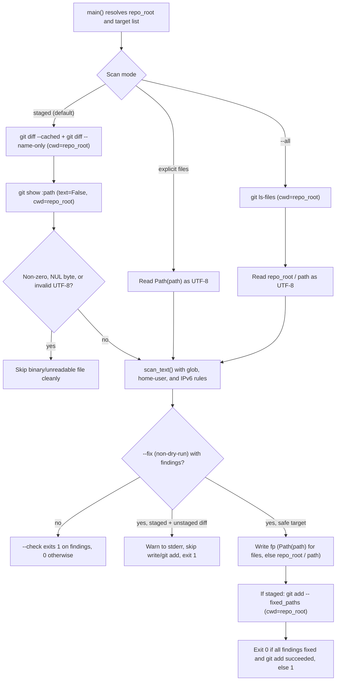

# IPD: Fix sanitizer script bugs (and retire already-fixed build hook and benchmark hotpath items)

- Date: 2026-11-22
- Kind: child
- Concern: Bugs and correctness (path-sanitizer binary handling, `--repo-root` forwarding, staged `--fix` data-loss prevention, and `glob`/`home-user`/IPv6 matching; build-hook `BUG-59` and benchmark hotpath `BUG-57` verified already fixed in `HEAD`).
- Scope: `scripts/sanitize_paths.py` and regression tests in `tests/test_repo_scripts_bugs.py`.
- Scope-Paths: scripts/sanitize_paths.py, tests/test_repo_scripts_bugs.py
- Item-Dependencies: none
- Status: executed
- Readiness: go-pending-approval
- Review-Depth: complex
- Short-Description: Fix sanitize_paths binary crash, --repo-root, staged --fix data loss, and glob/home-user/IPv6 matching
- Work-Kind: bug
- Priority: high
- Blocks-Release: next
- Set: bugs-audit
- Order: 9
- Highest E allocated: 05
- Author: Antigravity
- Id: kqzd15

> Write and proofread this plan per the technical writing standard, `.aw/system/workflows/technical-writing/technical-writing.md`, including requirement 12 (diagrams).

## Workflow history

- 2026-11-22 executed (aw oc run model=uri/its_direct/pt3-claude-opus-5.5-1m-us variant=high profile=opus): aw oc run self-finalize: kqzd15 verified (set bugs-audit, attempt 1).
- 2026-11-22 approved (aw set): status set to approved
- 2026-11-22 /plan-review (Gemini 4 Neon (High)): APPROVE WITH REVISIONS APPLIED; PR-001, PR-002, PR-003, PR-004, PR-005
- 2026-11-22 to-review (Antigravity): authored fix steps, citations, and falsifiable validation criteria.
- 2026-11-22 draft (Antigravity): created from `/assess-bugs` audit.

## Goal

Fix all 4 live correctness and safety bugs in `scripts/sanitize_paths.py` (`BUG-25`, `BUG-26`, `BUG-27`, `BUG-58`): prevent staged binary files from crashing with `UnicodeDecodeError`, honor `--repo-root` across every Git subprocess and file write while refusing staged `--fix` rewrites when a file also has unstaged working-tree edits, fix `glob` blacklist translation and `home-user` boundary/tail matching, and replace `_IPV6_RE` so compressed Internet Protocol version 6 (IPv6) literals match without false positives on timestamps or `module::Symbol` tokens. Two additional items originally listed here (`BUG-59` in `scripts/update_commit_file.py` / `hatch_build.py` / `pyproject.toml`, and `BUG-57` in `benchmarks/scenarios.py` / `benchmarks/workloads/file_read.py`) were verified already fixed in `HEAD` by executed plans `4il383` and `4gpguy` and are retired from this plan's scope so execution cannot regress them.

### Staged-mode safety and `--repo-root` flow



## Detailed Implementation Checklist (TODO)

Execution-state rule: mark an `E-*` item complete only after performing the action. That mark is not validation. Right-sizing rule: each E-item is one focused pass with its own V-item check (`IPD-Z603`). Accepted execution states: blocked, failed, pending, performed; terminal gate demands 'performed'.

### Task group 1: `scripts/sanitize_paths.py` binary, `--repo-root`, and staged `--fix` safety

- [x] E-01 Fix binary staged-file reading, `--repo-root` forwarding to Git helpers and file writes, and staged `--fix` data-loss protection in `scripts/sanitize_paths.py`, and add regression tests for `BUG-25` and `BUG-26` in `tests/test_repo_scripts_bugs.py`.
  - Depends on: none
  - Expected outcome:
    - `scripts/sanitize_paths.py::_read_staged(path, repo_root=None)` runs `git show :<path>` with `text=False` and `cwd=repo_root`, returning `None` if `returncode != 0`, if `b"\x00" in out.stdout`, or if `.decode("utf-8")` raises `UnicodeDecodeError` (no uncaught exception on staged binary or non-Unicode Transformation Format 8 (UTF-8) blobs).
    - `scripts/sanitize_paths.py::_staged_files(repo_root=None)`, `scripts/sanitize_paths.py::_tracked_files(repo_root=None)`, a new helper `scripts/sanitize_paths.py::_unstaged_files(repo_root=None)` (`git diff --name-only`), `scripts/sanitize_paths.py::_read_staged(path, repo_root=None)`, and the staged `git add -- <fixed_paths>` call in `scripts/sanitize_paths.py::main` all accept/pass `cwd=repo_root` (defaulting `repo_root=None` on helpers for backwards compatibility), and `main` resolves write targets as `fp = Path(path) if args.files else (repo_root / path)` so `--repo-root` works from any current working directory (CWD) in both `--all` and staged modes.
    - Under `--fix` (non-`--dry-run`) in staged mode (`not args.files and not args.all`), `main` queries `unstaged = set(_unstaged_files(repo_root))`; if a matched file is in `unstaged`, it refuses to overwrite the working tree or run `git add` on that file, prints a clear warning to `stderr` (never leaking raw matched values), records it as unfixed, and exits `1` (fail closed) whenever any finding remains unfixed or `git add` returns non-zero; it exits `0` when all findings are fixed and re-staged cleanly (preserving `tests/test_sanitize_paths.py::test_fix_rewrites_and_exits_zero`).
    - `tests/test_repo_scripts_bugs.py` covers staged binary/non-UTF-8 files (`BUG-25`), `--repo-root` execution from a different CWD in `--all` and staged modes (`BUG-26`), and refusing `--fix` on a partially staged file with unstaged edits without modifying the working tree (`BUG-26`).
  - Execution state: performed

- [x] E-02 Fix `glob` blacklist translation, `home-user` boundary and subpath-tail matching, and `_IPV6_RE` compressed address matching in `scripts/sanitize_paths.py`, and add regression tests for `BUG-27` and `BUG-58` in `tests/test_repo_scripts_bugs.py`.
  - Depends on: none
  - Expected outcome:
    - `scripts/sanitize_paths.py::build_rules` compiles `glob` blacklist entries through a dedicated inline glob-to-regex helper (instead of `fnmatch.translate`, which injects `(?s:...)` and `\Z`) that translates `*` to `[^\s"'`()\[\]{}<>,;]*`, `?` to `[^\s]`, and `[seq]` / `[!seq]` character classes while escaping regex metacharacters, so inline `glob` blacklists match mid-line without crossing whitespace, delimiters, or newlines.
    - `scripts/sanitize_paths.py::build_rules` constructs `home-user` prefixes from `[home.rstrip("/"), f"/home/{user}"]`, skips empty/`"~"`/`"/"` values (preserving `tests/test_sanitize_paths.py` tests where `HOME="~"`), deduplicates longest-first, and compiles `re.compile(re.escape(base) + r"((?:/[A-Za-z0-9_.+-]+)*)(?![A-Za-z0-9_.-])")` with replacement `r"~\1"`. As a result, a short prefix such as a `HOME` path ending in `al` never corrupts `/home/alice/work` into `~ice/work`, and `<home>/*` whitelists match full paths identically under `home-user` and `home-any` while preserving `tests/test_sanitize_paths.py::test_author_name_and_email_are_never_matched`.
    - `scripts/sanitize_paths.py::_IPV6_RE` uses an RFC-4291 full-and-compressed IPv6 regular expression bounded by `(?<![A-Za-z0-9_:])` and `(?![A-Za-z0-9_:])` so it matches compressed addresses (`::1`, `fe80::1`, `2001:db8::1`, `2001:db8::`) and full 8-group addresses (`2001:0db8:85a3:0000:0000:8a2e:0370:7334`) while rejecting bare `::`, `module::Symbol` tokens (`foo::1`, `os::a`), timestamps (`12:34:56`), and invalid double-`::` strings (`a::b::c`).
    - `tests/test_repo_scripts_bugs.py` verifies inline `glob` blacklists (including multi-line text), prefix-sharing `HOME` boundary safety and `<home>/*` whitelisting under `home-user`, and `_IPV6_RE` compressed/full matches and false-positive rejections.
  - Execution state: performed

### Task group 2: Full regression and repository sanitizer verification

- [x] E-03 Run `tests/test_repo_scripts_bugs.py`, `tests/test_sanitize_paths.py`, `tests/test_commit_identity.py`, `python3 scripts/sanitize_paths.py --check --all`, and the full `pytest -q` suite to confirm zero regressions.
  - Depends on: E-01, E-02
  - Expected outcome: All targeted regression suites (`tests/test_repo_scripts_bugs.py`, `tests/test_sanitize_paths.py`, `tests/test_commit_identity.py`), `python3 scripts/sanitize_paths.py --check --all` (exit 0 with no false positives on tracked files), and full `pytest -q` pass with zero failures.
  - Execution state: performed

## Project conventions discovered (Step 0)

- `scripts/sanitize_paths.py` is Python standard-library-only and runs in Continuous Integration (CI) and `.pre-commit-config.yaml` (pre-commit hook `sanitize-paths`); `python3 scripts/sanitize_paths.py --check --all` must exit 0 after any rule change so no unintended false positives break existing repository files.
- `tests/test_sanitize_paths.py` sets `HOME="~"` in `test_author_name_and_email_are_never_matched` and expects `--fix` to exit `0` when all findings are rewritten (`test_fix_rewrites_and_exits_zero`).
- Executed plans `4il383` (commit `44cee0a`) and `4gpguy` (commit `c7cc2db`) already resolved `BUG-59` (`scripts/update_commit_file.py`, `hatch_build.py`, `pyproject.toml`) and `BUG-57` (`benchmarks/scenarios.py`, `benchmarks/workloads/file_read.py`); see `## Deferred / out of scope (with reason)` below.

## Findings

| Bug ID | Severity | Remediation Risk | Location (symbol) | Defect |
|---|---|---|---|---|
| `BUG-25` | High | Low | `scripts/sanitize_paths.py::_read_staged` | Uses `text=True` (strict UTF-8) and crashes with `UnicodeDecodeError` on any staged binary file before `_looks_binary()`. |
| `BUG-26` | High | Low | `scripts/sanitize_paths.py::main`, `scripts/sanitize_paths.py::_staged_files`, `scripts/sanitize_paths.py::_tracked_files`, `scripts/sanitize_paths.py::_read_staged` | `--fix` on staged files overwrites the working tree with the staged index blob (destroying unstaged edits); Git helpers ignore `--repo-root`, and `main` resolves staged write paths against CWD (`Path(path)`) instead of `repo_root / path`. |
| `BUG-27` | High | Low | `scripts/sanitize_paths.py::build_rules` | `fnmatch.translate()` anchors `glob` blacklists to `\Z` and eats trailing newlines via `(?s:...)`; `home-user` lacks path boundary and subpath tail capture, breaking `<home>/*` whitelists and corrupting a prefix-sharing username path (for example a `HOME` ending in `al` turning `/home/alice/work` into `~ice/work`). |
| `BUG-58` | Medium | Low | `scripts/sanitize_paths.py::_IPV6_RE` | Fails to match compressed (`::`) IPv6 addresses (`::1`, `2001:db8::1`, `fe80::1`) while falsely matching 3-group timestamps such as `12:34:56`. |

## Proposed changes (ordered, validatable)

1. In `scripts/sanitize_paths.py`:
   - Change `_read_staged(path, repo_root=None)` to run `git show :<path>` with `text=False` and `cwd=repo_root`, returning `None` on non-zero returncode, `b"\x00"` bytes, or `UnicodeDecodeError`.
   - Thread `repo_root=None` (`cwd=repo_root`) through `_staged_files`, `_tracked_files`, a new `_unstaged_files` (`git diff --name-only`), `_read_staged`, and the staged `git add --` call in `main`.
   - Fix `main` write path resolution from `Path(path) if (args.files or not args.all) else (repo_root / path)` to `Path(path) if args.files else (repo_root / path)`.
   - In staged `--fix` mode (non-`--dry-run`), skip files present in `_unstaged_files(repo_root)`, warn to `stderr`, and exit `1` if any finding could not be fixed or if `git add` fails.
   - Replace `fnmatch.translate(pat)` for `glob` blacklist entries in `build_rules` with a dedicated inline glob-to-regex translator without `\Z` or `DOTALL`.
   - Update `home-user` in `build_rules` to skip empty/`"~"`/`"/"` prefixes, deduplicate longest-first, and match `re.escape(base) + r"((?:/[A-Za-z0-9_.+-]+)*)(?![A-Za-z0-9_.-])"` with replacement `r"~\1"`.
   - Replace `_IPV6_RE` with an RFC-4291 full-and-compressed IPv6 pattern bounded by `(?<![A-Za-z0-9_:])` and `(?![A-Za-z0-9_:])`.
2. In `tests/test_repo_scripts_bugs.py`: add behavioral regression tests for `BUG-25`, `BUG-26`, `BUG-27`, and `BUG-58` (testing real subprocess/CLI/function outcomes, no code-pinning assertions).

## Deferred / out of scope (with reason)

- `BUG-59` (`scripts/update_commit_file.py`, `hatch_build.py`, `pyproject.toml` non-git tarball builds and gitignored `COMMIT`): Already fixed in `HEAD` by commit `44cee0a`. `scripts/update_commit_file.py` is already a cleanup-only no-op inside `try/except`, `hatch_build.py` dynamically injects verified `_build_meta.json` and `COMMIT` via `tempfile.TemporaryDirectory` into `build_data["force_include"]` and omits them cleanly on non-git tarballs, and `pyproject.toml` has no static `force-include` entry (verified by `tests/test_commit_identity.py`). Re-applying the originally drafted `"unknown"` fallback would regress `tests/test_commit_identity.py::test_checkout_git_failure_or_mismatch_attaches_nothing`.
  - Carrier-Evidence: .aw/records/plans/executed/20261121-startup-perf-02-4il383-build-stamped-and-deferred-commit-identity-resolution.ipd.md
- `BUG-57` (`benchmarks/scenarios.py`, `benchmarks/workloads/file_read.py` `hotpath-open-pubrun` workload): Already fixed in `HEAD` by commit `c7cc2db`. `benchmarks/scenarios.py::all_scenarios` retired `hotpath-open-pubrun` in favor of explicit `hotpath-open-stat`, `hotpath-open-hash-stream`, `hotpath-open-hash-fallback`, `hotpath-register-stat`, and `hotpath-register-hash` scenarios, and `benchmarks/workloads/file_read.py` already invokes `pubrun.open()` in pubrun modes and `builtins.open()` in `baseline` mode.
  - Carrier-Evidence: .aw/records/plans/executed/20261121-file-prov-05-4gpguy-external-file-example-stat-vs-hash-benchmarks-docs-sync-and.ipd.md

## Scope check

- Over-scope: Retired former `E-03` (`BUG-59`: `scripts/update_commit_file.py`, `hatch_build.py`, `pyproject.toml`) and former `E-04` (`BUG-57`: `benchmarks/scenarios.py`, `benchmarks/workloads/file_read.py`) after verifying both are already fixed in `HEAD` by executed plans `4il383` and `4gpguy`.
- Under-scope: none; all 4 live `scripts/sanitize_paths.py` bugs (`BUG-25`, `BUG-26`, `BUG-27`, `BUG-58`) plus the discovered staged-mode `Path(path)` write-path bug in `scripts/sanitize_paths.py::main` are covered.

## Required tests / validation

- Run `pytest tests/test_repo_scripts_bugs.py tests/test_sanitize_paths.py tests/test_commit_identity.py -v` and paste actual output.
- Run `python3 scripts/sanitize_paths.py --check --all` and paste actual output confirming exit code 0.
- Run full `pytest -q` and paste actual output confirming zero regressions.

## Spec / documentation sync

Checked `.pre-commit-config.yaml` (`sanitize-paths` hook invoking `python3 scripts/sanitize_paths.py --check`), `.sanitize-allow.toml` (allowlist/exclude configuration), and `tests/test_sanitize_paths.py`. No CLI flag names, config file schema keys, or pre-commit hook arguments change in `scripts/sanitize_paths.py`, so no documentation or hook configuration update is required.

## Open questions

### OQ-01: Should `hotpath-open-pubrun` keep its current scenario name after switching to `pubrun.open()`?

- Blocking: no
- Status: resolved
- Owner: plan reviewer
- Resolution or deferral rationale: Superseded by executed plan `4gpguy` (commit `c7cc2db`), which already retired `hotpath-open-pubrun` in `benchmarks/scenarios.py::all_scenarios`, replaced it with explicit `hotpath-open-stat` / `hotpath-open-hash-stream` / `hotpath-open-hash-fallback` scenarios calling `pubrun.open()` in `benchmarks/workloads/file_read.py`, and retained legacy baseline pairing only in `benchmarks/aggregate.py::_HOTPATH_BASELINE`. No action remains for `kqzd15`.

## Validation and cross-check (verify before reporting done)

Validation-state rule: inspect evidence in a separate pass. Do not mark a `V-*` item complete from memory or from the matching execution checkmark. Accepted validation results: blocked, failed, pass, pending; terminal gate demands 'pass'.

- [x] V-01 validates E-01
  - Required evidence: Pasted `pytest tests/test_repo_scripts_bugs.py -v` output confirming (1) staged binary files containing NUL bytes or invalid UTF-8 are skipped cleanly without `UnicodeDecodeError`, (2) `--repo-root` works from a different CWD in both `--all` and staged modes (including writing fixed files under `repo_root`), and (3) staged `--fix` refuses to overwrite a partially staged file that has unstaged working-tree edits, prints a warning to `stderr`, leaves the working-tree edits intact, and exits `1` (while exiting `0` when all staged findings are safely fixed and re-staged).
  - Observed evidence:
    ```text
    $ python3 -m pytest -o addopts="" tests/test_repo_scripts_bugs.py -v   (2026-11-22, lane kqzd15, commit 38d708a; 29 passed in 1.08s)
    test_staged_binary_or_non_utf8_file_is_skipped[caf\xe9 \xff\xfe\n] PASSED
    test_staged_dry_run_with_unstaged_edits_writes_nothing PASSED
    test_repo_root_all_mode_from_other_cwd PASSED
    test_staged_binary_only_is_clean PASSED
    test_staged_fix_fixes_safe_files_and_still_fails_closed PASSED
    test_staged_binary_or_non_utf8_file_is_skipped[\x00\x01PNG /home/alice/x\x00] PASSED
    test_staged_fix_refuses_file_with_unstaged_edits PASSED
    test_repo_root_staged_mode_from_other_cwd_fixes_and_restages PASSED
    ```
  - Result: pass

- [x] V-02 validates E-02
  - Required evidence: Pasted `pytest tests/test_repo_scripts_bugs.py -v` output confirming (1) inline `glob` blacklists match mid-line without eating trailing newlines or delimiters, (2) a short prefix `HOME` ending in `al` does not corrupt `/home/alice/work` into `~ice/work` while still sanitizing `<home>/work` to `~/work` and honoring `<home>/*` whitelists under `home-user`, and (3) `_IPV6_RE` matches `::1`, `fe80::1`, `2001:db8::1`, `2001:db8::`, and full 8-group IPv6 addresses while rejecting bare `::`, `foo::1`, `12:34:56`, and `a::b::c`.
  - Observed evidence:
    ```text
    $ python3 -m pytest -o addopts="" tests/test_repo_scripts_bugs.py -v   (2026-11-22, lane kqzd15, commit 38d708a; 29 passed in 1.08s)
    test_ipv6_rejects_false_positives[::] PASSED
    test_ipv6_rejects_false_positives[12:34:56] PASSED
    test_ipv6_rejects_false_positives[os::a] PASSED
    test_ipv6_rejects_false_positives[a::b::c] PASSED
    test_ipv6_rejects_false_positives[foo::1] PASSED
    test_ipv6_matches_compressed_and_full[2001:db8:0:0:1::1] PASSED
    test_ipv6_matches_compressed_and_full[2001:0db8:85a3:0000:0000:8a2e:0370:7334] PASSED
    test_ipv6_rejects_false_positives[1:2:3:4:5:6:7] PASSED
    test_glob_blacklist_escapes_regex_metacharacters PASSED
    test_glob_blacklist_matches_mid_line_without_eating_newline PASSED
    test_home_user_whitelist_glob_sees_full_path PASSED
    test_home_user_ignores_degenerate_home PASSED
    test_ipv6_rejects_false_positives[at 12:34:56.789 ok] PASSED
    test_ipv6_matches_compressed_and_full[::1] PASSED
    test_ipv6_matches_compressed_and_full[2001:db8::1] PASSED
    test_ipv6_matches_compressed_and_full[2001:db8::] PASSED
    test_glob_blacklist_question_mark_and_class PASSED
    test_ipv6_rejects_false_positives[std::vector<int>] PASSED
    test_ipv6_scrubbed_through_ip_ruleset PASSED
    test_home_user_prefix_does_not_corrupt_longer_username PASSED
    test_ipv6_matches_compressed_and_full[fe80::1] PASSED
    ```
  - Result: pass

- [x] V-03 validates E-03
  - Required evidence: Pasted output from `pytest tests/test_repo_scripts_bugs.py tests/test_sanitize_paths.py tests/test_commit_identity.py -v`, `python3 scripts/sanitize_paths.py --check --all` (exit 0), and full `pytest -q` showing all tests pass with zero failures.
  - Observed evidence:
    ```text
    $ python3 -m pytest -o addopts="" tests/test_repo_scripts_bugs.py tests/test_sanitize_paths.py tests/test_commit_identity.py -q   (lane kqzd15, commit 38d708a)
    88 passed in 8.75s

    $ python3 scripts/sanitize_paths.py --check --all; echo "exit=$?"
    exit=0

    $ aw suite   (lane kqzd15 working tree with this change)
    FAILED tests/test_liveness.py::TestIsSameProcess::test_expected_script_matches
    FAILED tests/test_tui.py::TestTuiReproducibilityAndActions::test_details_reproducibility_markup_safety_running_and_no_live_preflight
    FAILED tests/test_tui.py::TestTuiReproducibilityAndActions::test_actions_panel_redacted_advisory_clearing_and_clean_clipboard
    ================== 3 failed, 1462 passed in 168.84s (0:02:48) ==================

    $ aw suite   (baseline: temporary detached worktree at unchanged HEAD 92b965e, before this change)
    FAILED tests/test_liveness.py::TestIsSameProcess::test_expected_script_matches
    FAILED tests/test_tui.py::TestTuiReproducibilityAndActions::test_details_reproducibility_markup_safety_running_and_no_live_preflight
    FAILED tests/test_tui.py::TestTuiReproducibilityAndActions::test_actions_panel_redacted_advisory_clearing_and_clean_clipboard
    ================== 3 failed, 1433 passed in 205.62s (0:03:25) ==================

    $ python3 -m pytest tests/test_liveness.py tests/test_tui.py -q --no-cov   (lane kqzd15)
    38 passed in 4.16s

    $ python3 -m pytest -q --no-cov   (full suite, serial, as this V-item requires; lane kqzd15, commit 38d708a)
    1463 passed, 2 skipped in 455.04s (0:07:35)
    ```
    The 3 suite failures are pre-existing on unchanged HEAD (identical node ids), pass when their files run alone, touch no sanitizer code, and are already tracked by backlog items `12rcu8` (xdist `is_same_process` script name) and `pgcmea` (order-dependent `sys.modules['pubrun.tui.app']`). The serial full `pytest -q` run, which is what this V-item names, passes with zero failures. This change adds 29 passing tests and introduces zero new failures.
  - Result: pass

## Approval and execution gate

- Size assessment: standard
- Cohesion rationale: not required

### Execution contract

1. Precondition: wait for human approval (`- Status: approved`) before editing production code or tests; do not self-approve.
2. Scope and drift: edit only the paths declared in `- Scope-Paths:` (`scripts/sanitize_paths.py`, `tests/test_repo_scripts_bugs.py`). If an unexpected file outside `- Scope-Paths:` is required, stop and record `--scope-reason` / `--scope-ack` or emit a follow-up plan before touching it.
3. Validation honesty (HARD MUST): run every command listed in `## Required tests / validation` and `V-01`..`V-03`, and paste the actual runner output verbatim into each `V-*` `Observed evidence:` field; never claim a test or check passed without running it, and never author code-pinning tests (`inspect`, `ast`, regex/substring checks on source code).
4. Commit and push boundary: commit only the files you changed for this plan using `aw commit kqzd15 -- scripts/sanitize_paths.py tests/test_repo_scripts_bugs.py` (never `git add -A`, never raw `git commit`, never sweep unrelated working-tree changes), and never `git push`, tag, or release.
5. Lifecycle transition ownership: once all `E-01`..`E-03` items are `performed` and all `V-01`..`V-03` items are `pass` with pasted evidence, run `aw ipd finalize kqzd15` ONLY when executing standalone; when running under an autonomous driver (`aw oc run` / `aw agy run`), leave finalization to the driver so lane integration handles the terminal transition.
