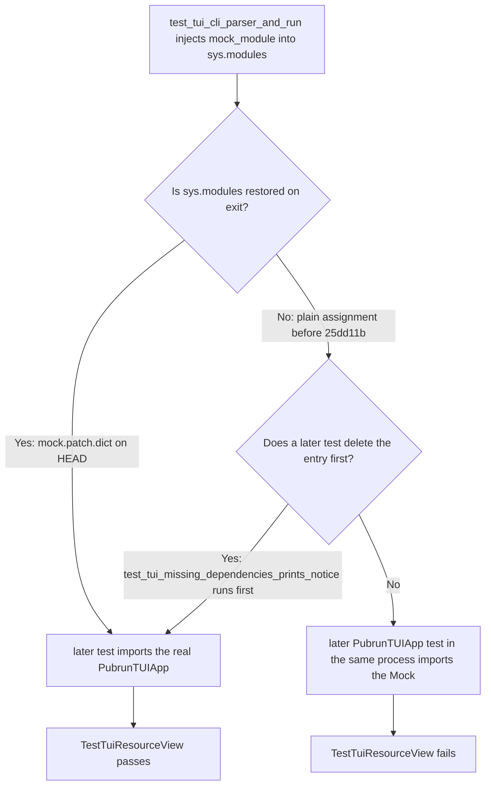

# IPD: Confirm the pubrun.tui.app sys.modules restore and add a regression guard in tests/test_tui.py

- Date: 2026-11-22
- Kind: child
- Concern: testing (a test that replaces a module in `sys.modules` must put the real module back, or later tests in the same process import the replacement and fail depending on test order).
- Scope: Confirm that `tests/test_tui.py::test_tui_cli_parser_and_run` restores `sys.modules["pubrun.tui.app"]` on HEAD, which commit `25dd11b` already does with `mock.patch.dict`. Add one new test function to `tests/test_tui.py` that fails if the injected `mock.Mock` module stays in `sys.modules` after `test_tui_cli_parser_and_run` returns. Run the TUI tests in file order, in shuffled order, and under xdist. No production code changes.
- Scope-Paths: tests/test_tui.py
- Item-Dependencies: none
- Status: executed
- Readiness: go-pending-approval
- Review-Depth: simple
- Short-Description: Confirm test_tui_cli_parser_and_run restores sys.modules['pubrun.tui.app'] and add a test that fails if the Mock leaks again
- Work-Kind: bug
- Priority: low
- From-Backlog: pgcmea
- Blocks-Release: next
- Set: pgcmea
- Order: 1
- Highest E allocated: 03
- Author: Claude Opus 5.5
- Id: whacr3

> Write and proofread this plan per the technical writing standard, `.aw/system/workflows/technical-writing/technical-writing.md` (`.agents/workflows/technical-writing/technical-writing.md` in a legacy-layout install), including requirement 12 (diagrams).

## Workflow history

- 2026-11-23 executed (aw oc run model=uri/its_direct/pt3-claude-opus-5.5-1m-us variant=high profile=opus): aw oc run self-finalize: whacr3 verified (set pgcmea, attempt 1).
- 2026-11-23 approved (aw set): status set to approved
- 2026-11-23 /plan-review (Claude Opus 5.5): APPROVE WITH REVISIONS APPLIED; PR-001, PR-002, PR-003, PR-004, PR-005
- 2026-11-23 draft (Claude Opus 5.5): created.
- 2026-11-23 to-review (Claude Opus 5.5): authored from backlog item `pgcmea`; the leak was reproduced on the pre-fix copy of `tests/test_tui.py`, the fix was confirmed on HEAD, and the proposed guard test was prototyped in a scratch copy before authoring (see Findings).

## Goal

Backlog item `pgcmea` reports that `tests/test_tui.py::test_tui_cli_parser_and_run` leaves a `unittest.mock.Mock` in `sys.modules["pubrun.tui.app"]`. When a later test in the same process imports `PubrunTUIApp`, it gets the Mock and fails. This plan confirms that the fix on HEAD (commit `25dd11b`) removes the failure in every test order the item names. It also adds a regression test, so that a future edit that removes the restore fails a named test directly instead of causing an order-dependent failure in a different test.

## Detailed Implementation Checklist (TODO)

Execution-state rule: mark an `E-*` item complete only after performing the action. That mark is not validation. Right-sizing rule: write for a modest executor that cannot hold much in its head. Each E-item is one step (one concern, about one file, executable in one focused pass) and its V-item names each unit it covers with its own check; a plan stays at about 5 E-items and 8 work Scope-Paths, else split it into more child plans (guidance, `IPD-Z603`). Accepted execution states: blocked, failed, pending, performed; terminal gate demands 'performed'.

### Task group 1: Confirm the restore and add the guard

- [x] E-01 Inspect `test_tui_cli_parser_and_run` in `tests/test_tui.py` and confirm that the injected module is restored. The function must inject `mock_module` only through a context manager or fixture that restores `sys.modules` on exit: `mock.patch.dict(sys.modules, {"pubrun.tui.app": mock_module})` (current HEAD), or `monkeypatch.setitem(sys.modules, "pubrun.tui.app", mock_module)`, or an equivalent `try`/`finally` restore. If the function instead assigns `sys.modules["pubrun.tui.app"] = mock_module` with no restore, replace that assignment with the `mock.patch.dict` form shown in Finding F-01, and keep the rest of the function unchanged.
  - Depends on: none
  - Expected outcome: `test_tui_cli_parser_and_run` injects `mock_module` only inside a restoring construct. On HEAD this is already true, and E-01 makes no edit.
  - Execution state: performed
- [x] E-02 Add the test function `test_tui_cli_parser_and_run_leaves_real_tui_module` to `tests/test_tui.py`, directly after `test_tui_cli_parser_and_run`, with the body given in "Proposed changes" (P-02).
  - Depends on: E-01
  - Expected outcome: The new test passes on the fixed file, and fails with an `AssertionError` that shows a `Mock` object when the restore in `test_tui_cli_parser_and_run` is removed.
  - Execution state: performed

### Task group 2: Run the TUI tests in every order the item names

- [x] E-03 Run the commands in P-03: `tests/test_tui.py` in file order in one process, in shuffled order with `pytest-randomly` for seeds `1` to `5`, under `pytest-xdist` with `--dist loadfile`, and the targeted two-test order that exposed the leak. Then run the leak-reintroduction check in P-04 on a scratch copy, and delete the scratch copy.
  - Depends on: E-02
  - Expected outcome: Every P-03 run exits 0 with no failed test, and `TestTuiResourceView::test_resource_view_populates_and_degrades` reports `PASSED` in each run. The P-04 check reports `1 failed` for `test_tui_cli_parser_and_run_leaves_real_tui_module`, and `git status --short` shows no scratch file afterwards.
  - Execution state: performed

## Project conventions discovered (Step 0)

- Tests live in `tests/` and use plain pytest functions and classes. `tests/test_tui.py` imports `sys`, `pytest`, `unittest.mock` as `mock`, and `argparse` at module level.
- TUI tests that need the optional `textual` dependency call `pytest.importorskip("textual")` first (for example `TestTuiResourceView.test_resource_view_populates_and_degrades`). The new guard test follows the same convention.
- `pyproject.toml` (`[tool.pytest.ini_options]`) sets `addopts = "--cov=src --cov-report=term-missing --cov-report=xml -p no:randomly"`. Shuffled order therefore needs `-o addopts=""` (clears that default) and `-p randomly` (loads `pytest-randomly`, a plugin that shuffles test order). `pytest-randomly>=3.0` is a dev dependency in `pyproject.toml`. Clearing `addopts` also removes `-p no:randomly`, and `pytest-randomly` then loads automatically with a random seed, so a run that must keep file order and also clears `addopts` needs `-p no:randomly` explicitly.
- `aw suite` refuses narrowed selections (file paths, `-k`, `-m`, `::` node ids), so the targeted checks in this plan use plain `python3 -m pytest`.
- `AGENTS.md` forbids tests that read production or test source code with `inspect`, `ast`, regex, or substring search. The guard test calls `test_tui_cli_parser_and_run` and asserts on the resulting `sys.modules` entry, which is observable runtime state, so it is a behavior test.

## Findings

How the leak turns into a failure in a different test:



| ID | Finding | Evidence |
| --- | --- | --- |
| F-01 | The leak is already fixed on HEAD. Commit `25dd11b` ("test(tui): restore sys.modules['pubrun.tui.app'] after test_tui_cli_parser_and_run (2nm0pq combined-red)") injects the Mock with `with mock.patch.dict(sys.modules, {"pubrun.tui.app": mock_module}):`. `mock.patch.dict` restores the original dictionary contents when the `with` block exits. Its commit message cites backlog item `pgcmea`. | `git log --oneline -- tests/test_tui.py` lists `25dd11b` as the newest commit; `git show --stat 25dd11b` shows `tests/test_tui.py | 16 ++++++++--------`. |
| F-02 | The pre-fix copy passes in file order and fails only in some other orders, so whole-file runs are a weak detector of the leak. In file order, the test right after the leaking test, `test_tui_missing_dependencies_prints_notice`, deletes `sys.modules["pubrun.tui.app"]` before any `PubrunTUIApp` test runs, which removes the leaked Mock. The leak shows only when a `PubrunTUIApp` test runs after `test_tui_cli_parser_and_run` and before that cleanup. Authoring recorded `3 failed, 8 passed` for a run with `-p no:xdist -o addopts=""`. That command clears `-p no:randomly`, so it ran in a random order, not in file order. Which seeds fail depends on the test node ids, so results from one scratch file name do not carry over to another. This is one reason for the guard test in P-02, which checks the cause regardless of order. | Re-run at review on 2026-11-23 from a scratch copy of `25dd11b^:tests/test_tui.py`, deleted afterwards: `-p no:xdist -o addopts="" -p no:randomly` printed `11 passed`; the two node ids `test_tui_cli_parser_and_run` and `TestTuiResourceView` alone printed `1 failed, 1 passed` (`FAILED ...::TestTuiResourceView::test_resource_view_populates_and_degrades`); `-p randomly` with seeds `1` to `5` printed `11 passed`, `11 passed`, `1 failed, 10 passed`, `1 failed, 10 passed`, `11 passed`. Cleanup at `tests/test_tui.py::test_tui_missing_dependencies_prints_notice` ("Remove mock module if populated"). |
| F-03 | HEAD passes in the orders checked so far. `test_tui_cli_parser_and_run` followed by `TestTuiResourceView::test_resource_view_populates_and_degrades` in one process printed `2 passed`. The whole file under `-p randomly` with seeds `1`, `2`, and `3` printed `11 passed` each time. | Lane worktree, Linux, Python 3.14. Re-run at review on 2026-11-23 with `-o addopts="" -p no:randomly`: the pair printed `2 passed`; the whole file in file order, with seeds `1` and `2`, and with `-n 2 --dist loadfile` printed `11 passed`. |
| F-04 | No test fails directly when the restore is missing. The symptom appears in whichever `PubrunTUIApp` test runs next in the same process, so a regression looks like a defect in an unrelated test. A guard test that calls `test_tui_cli_parser_and_run` and then checks `sys.modules["pubrun.tui.app"]` points at the cause directly. | Prototype on a scratch copy: with the HEAD body, the file printed `12 passed`. With the `mock.patch.dict` call replaced by a plain `sys.modules` assignment, the guard failed with `AssertionError: assert <Mock id='...'> is <module 'pubrun.tui.app' from '.../src/pubrun/tui/app.py'>`. Both scratch files were deleted. |
| F-05 | Plan `vv4vdd` (Set `ivpkar`, `- Status: reviewed`) also runs `tests/test_tui.py` in several orders to confirm the same fix, but it declares no edit to `tests/test_tui.py`. Its "Deferred / out of scope" entry for `tests/test_tui.py` names this plan as the carrier (`- Carrier: whacr3`) of backlog item `pgcmea`, which is `graduated` to this plan. This plan does not depend on `vv4vdd`, and `vv4vdd` does not depend on this plan. | `.aw/records/plans/pending/20261122-ivpkar-01-vv4vdd-make-the-parallel-test-suite-pass-fix-test-expected-script-m.ipd.md`, Findings F-06 and F-07 and "Deferred / out of scope"; `.aw/records/backlog/graduated/20261122-pgcmea-01-pgcmea-restore-sys-modules-pubrun-tui-app-in-tests-test-t.backlog.md` ("graduated by run run-20261123T005542Z-1001883: whacr3"). |

## Proposed changes (ordered, validatable)

P-01 (performed by E-01). Keep the HEAD injection in `test_tui_cli_parser_and_run`:

```python
with mock.patch.dict(sys.modules, {"pubrun.tui.app": mock_module}):
    ...
```

Edit the function only if E-01 finds a non-restoring assignment.

P-02 (performed by E-02). Add this function to `tests/test_tui.py`, directly after `test_tui_cli_parser_and_run`:

```python
def test_tui_cli_parser_and_run_leaves_real_tui_module():
    """Running the CLI launch test must leave the real pubrun.tui.app module in sys.modules."""
    pytest.importorskip("textual")
    import pubrun.tui.app as real_app_module

    test_tui_cli_parser_and_run()

    assert sys.modules.get("pubrun.tui.app") is real_app_module
    from pubrun.tui.app import PubrunTUIApp
    assert PubrunTUIApp is real_app_module.PubrunTUIApp
```

The test imports the real module first, so the expected object exists before the call. It then runs the CLI launch test body and checks that both the `sys.modules` entry and a fresh `from ... import` resolve to the real module.

P-03 (performed by E-03). Run each command from the repository root:

1. `python3 -m pytest tests/test_tui.py -v -p no:xdist -o addopts="" -p no:randomly -p no:cacheprovider` (file order, one process; `-p no:randomly` is required because `-o addopts=""` drops the default that disables `pytest-randomly`).
2. `python3 -m pytest tests/test_tui.py -v -p no:xdist -o addopts="" -p randomly --randomly-seed=<seed> -p no:cacheprovider`, five times, with `<seed>` set to `1`, `2`, `3`, `4`, and `5`.
3. `python3 -m pytest tests/test_tui.py -v -n 2 --dist loadfile -o addopts="" -p no:randomly -p no:cacheprovider` (xdist; `--dist loadfile` sends the whole file to one worker, so the tests share one process).
4. `python3 -m pytest "tests/test_tui.py::test_tui_cli_parser_and_run" "tests/test_tui.py::TestTuiResourceView" -v -p no:xdist -o addopts="" -p no:randomly -p no:cacheprovider` (targeted order: the leaking test, then a `PubrunTUIApp` test, with no `sys.modules` cleanup in between). On the pre-fix copy this exact pair printed `1 failed, 1 passed` (Finding F-02), so it is the run that proves the restore, while runs 1 to 3 can pass even with the leak.

P-04 (performed by E-03). Check that the guard detects a leak:

1. Create `tests/_pgcmea_leak_probe.py` as a copy of `tests/test_tui.py` in which `with mock.patch.dict(sys.modules, {"pubrun.tui.app": mock_module}):` is replaced by a non-restoring assignment, for example `sys.modules["pubrun.tui.app"] = mock_module` followed by `if True:` to keep the indented block valid.
2. Run `python3 -m pytest "tests/_pgcmea_leak_probe.py::test_tui_cli_parser_and_run_leaves_real_tui_module" -p no:xdist -o addopts="" -p no:randomly -p no:cacheprovider -q`. The scratch name does not match pytest's default `test_*.py` pattern, so `aw suite` would not collect it even if it were left behind; pytest still runs it when named explicitly.
3. Delete `tests/_pgcmea_leak_probe.py` and run `git status --short`.

## Deferred / out of scope (with reason)

- Validation on the full CI matrix (3 operating systems and Python 3.8 to 3.14, per the `AGENTS.md` matrix-validation section) is not part of this plan. The change touches one test file and no import path, CLI entry path, or manifest shape, and a push needs a human request.
  - Carrier-Declined: a push is a human act; the CI matrix runs when the maintainer pushes the integrated change.
- No change to `src/pubrun/tui/app.py` or `src/pubrun/__main__.py`. The defect is in test isolation, not in production code.
  - Carrier-Declined: production code is correct, so no production change is owed.

## Scope check

- Over-scope: none. The plan adds one test function to `tests/test_tui.py` and runs checks.
- Under-scope: none. The backlog item asks that `sys.modules["pubrun.tui.app"]` be restored after `test_tui_cli_parser_and_run` so that `TestTuiResourceView.test_resource_view_populates_and_degrades` passes out of file order. E-01 confirms the restore, E-02 adds a guard that keeps it in place, and E-03 runs the file in file order, in shuffled order, and under xdist.

## Required tests / validation

- `python3 -m pytest tests/test_tui.py -v -p no:xdist -o addopts="" -p no:randomly -p no:cacheprovider` exits 0, and `test_resource_view_populates_and_degrades` and `test_tui_cli_parser_and_run_leaves_real_tui_module` report `PASSED` (E-03).
- `python3 -m pytest tests/test_tui.py -v -p no:xdist -o addopts="" -p randomly --randomly-seed=<seed> -p no:cacheprovider` exits 0 for seeds `1` to `5` (E-03).
- `python3 -m pytest tests/test_tui.py -v -n 2 --dist loadfile -o addopts="" -p no:randomly -p no:cacheprovider` exits 0 (E-03).
- The P-03 run 4 targeted pair exits 0 with both `test_tui_cli_parser_and_run` and `test_resource_view_populates_and_degrades` `PASSED` (E-03).
- The P-04 leak-reintroduction check reports `1 failed` for the guard test, and no scratch file remains (E-03).

## Spec / documentation sync

N/A. The change adds one test and changes no user-visible behavior, configuration key, command, or API. No spec or documentation describes this test.

## Open questions

### OQ-01: Should `test_tui_cli_parser_and_run` switch from `mock.patch.dict` to `monkeypatch.setitem`?

- Blocking: no
- Status: resolved
- Owner: none
- Resolution or deferral rationale: No. The backlog item accepts either `monkeypatch.setitem(sys.modules, 'pubrun.tui.app', mock_module)` or a `try`/`finally` restore. `mock.patch.dict` gives the same restore-on-exit behavior, it is already on HEAD (Finding F-01), and it passes in file order and shuffled order (Finding F-03). Changing it would add churn with no behavior difference.

## Validation and cross-check (verify before reporting done)

Validation-state rule: inspect evidence in a separate pass. Do not mark a `V-*` item complete from memory or from the matching execution checkmark. Accepted validation results: blocked, failed, pass, pending; terminal gate demands 'pass'. Runtime-demonstration reachability rule: for each `V-*` item demanding the software be observed acting (such as a run, a dispatch, or a transition), as distinct from items demanding a diff, a file's content, or a test result (which are reachable by construction), name the code path that produces the observation or the sibling `E-*` that creates it, else the demand is UNDER-SCOPE.

- [x] V-01 validates E-01
  - Required evidence: Paste the current body of `test_tui_cli_parser_and_run` from `tests/test_tui.py`. It must inject `mock_module` only through `mock.patch.dict(sys.modules, ...)`, `monkeypatch.setitem(sys.modules, ...)`, or a `try`/`finally` restore, and must contain no bare `sys.modules["pubrun.tui.app"] = ` assignment. If E-01 edited the function, also paste the part of `git diff -- tests/test_tui.py` that touches it.
  - Observed evidence: E-01 made no edit; the function on HEAD `422056b` already injects through `mock.patch.dict`:
    ```text
    def test_tui_cli_parser_and_run():
        """Verify that pubrun ui parses correctly and launches when dependencies exist."""
        from pubrun.__main__ import main

        for sub in ("ui", "tui", "gui"):
            with mock.patch("sys.argv", ["pubrun", sub, "--dir", "/tmp/runs"]):
                with mock.patch("pubrun.tui.app.PubrunTUIApp") as mock_app:
                    # Inject mocked module; patch.dict restores the real module on exit so
                    # later tests in the same worker never import this Mock.
                    mock_module = mock.Mock()
                    mock_module.PubrunTUIApp = mock_app
                    with mock.patch.dict(sys.modules, {"pubrun.tui.app": mock_module}):
                        try:
                            main()
                        except SystemExit as e:
                            # main() might exit 0 after executing command
                            assert e.code in (0, None)

                    mock_app.assert_called_once_with(output_dir="/tmp/runs")
                    mock_app.return_value.run.assert_called_once()
    ```
    No bare `sys.modules["pubrun.tui.app"] = ` assignment is present.
  - Result: pass
- [x] V-02 validates E-02
  - Required evidence: Paste `git diff -- tests/test_tui.py`. It must add `test_tui_cli_parser_and_run_leaves_real_tui_module` with the P-02 body, and must not change any other test function except a change recorded under V-01.
  - Observed evidence: `git diff -- tests/test_tui.py` (only change in the file):
    ```text
    @@ -26,6 +26,18 @@ def test_tui_cli_parser_and_run():
                     mock_app.return_value.run.assert_called_once()


    +def test_tui_cli_parser_and_run_leaves_real_tui_module():
    +    """Running the CLI launch test must leave the real pubrun.tui.app module in sys.modules."""
    +    pytest.importorskip("textual")
    +    import pubrun.tui.app as real_app_module
    +
    +    test_tui_cli_parser_and_run()
    +
    +    assert sys.modules.get("pubrun.tui.app") is real_app_module
    +    from pubrun.tui.app import PubrunTUIApp
    +    assert PubrunTUIApp is real_app_module.PubrunTUIApp
    +
    +
     def test_tui_missing_dependencies_prints_notice(capsys):
    ```
  - Result: pass
- [x] V-03 validates E-03
  - Required evidence: Paste the result line of each P-03 run, and the `PASSED` lines for `test_resource_view_populates_and_degrades` and `test_tui_cli_parser_and_run_leaves_real_tui_module`: (1) the file-order run, whose header must not contain a `Using --randomly-seed=` line, (2) the five `-p randomly` runs for seeds `1` to `5`, (3) the `-n 2 --dist loadfile` run, and (4) the targeted pair run, which must show `test_tui_cli_parser_and_run PASSED` followed by `test_resource_view_populates_and_degrades PASSED` and `2 passed`. Every run must report 0 failed. A `SKIPPED` result for either named test fails this item, because it means `textual` is missing and the check did not run. Then paste the P-04 output, which must show `FAILED ...::test_tui_cli_parser_and_run_leaves_real_tui_module` and `1 failed`, followed by `git status --short` output that does not list `tests/_pgcmea_leak_probe.py`.
  - Observed evidence: run in the lane worktree (Linux, Python 3.14), output filtered with grep:
    ```text
    == RUN1 (file order; no "Using --randomly-seed=" line in header)
    tests/test_tui.py::test_tui_cli_parser_and_run_leaves_real_tui_module PASSED [ 16%]
    tests/test_tui.py::TestTuiResourceView::test_resource_view_populates_and_degrades PASSED [ 66%]
    ============================== 12 passed in 2.66s ==============================
    == SEED 1
    Using --randomly-seed=1
    tests/test_tui.py::test_tui_cli_parser_and_run_leaves_real_tui_module PASSED [ 33%]
    tests/test_tui.py::TestTuiResourceView::test_resource_view_populates_and_degrades PASSED [ 83%]
    ============================== 12 passed in 2.63s ==============================
    == SEED 2
    Using --randomly-seed=2
    tests/test_tui.py::test_tui_cli_parser_and_run_leaves_real_tui_module PASSED [ 66%]
    tests/test_tui.py::TestTuiResourceView::test_resource_view_populates_and_degrades PASSED [100%]
    ============================== 12 passed in 2.09s ==============================
    == SEED 3
    Using --randomly-seed=3
    tests/test_tui.py::TestTuiResourceView::test_resource_view_populates_and_degrades PASSED [ 50%]
    tests/test_tui.py::test_tui_cli_parser_and_run_leaves_real_tui_module PASSED [ 66%]
    ============================== 12 passed in 2.57s ==============================
    == SEED 4
    Using --randomly-seed=4
    tests/test_tui.py::TestTuiResourceView::test_resource_view_populates_and_degrades PASSED [ 25%]
    tests/test_tui.py::test_tui_cli_parser_and_run_leaves_real_tui_module PASSED [ 41%]
    ============================== 12 passed in 2.26s ==============================
    == SEED 5
    Using --randomly-seed=5
    tests/test_tui.py::TestTuiResourceView::test_resource_view_populates_and_degrades PASSED [  8%]
    tests/test_tui.py::test_tui_cli_parser_and_run_leaves_real_tui_module PASSED [ 50%]
    ============================== 12 passed in 3.07s ==============================
    == XDIST (-n 2 --dist loadfile)
    [gw1] [ 16%] PASSED tests/test_tui.py::test_tui_cli_parser_and_run_leaves_real_tui_module
    [gw1] [ 66%] PASSED tests/test_tui.py::TestTuiResourceView::test_resource_view_populates_and_degrades
    ============================== 12 passed in 4.25s ==============================
    == PAIR
    tests/test_tui.py::test_tui_cli_parser_and_run PASSED                    [ 50%]
    tests/test_tui.py::TestTuiResourceView::test_resource_view_populates_and_degrades PASSED [100%]
    ============================== 2 passed in 1.46s ===============================
    == P04 (scratch tests/_pgcmea_leak_probe.py with a non-restoring assignment)
    E       AssertionError: assert <Mock id='131464910732800'> is <module 'pubrun.tui.app' from '.../.aw/worktrees/whacr3/src/pubrun/tui/app.py'>
    FAILED tests/_pgcmea_leak_probe.py::test_tui_cli_parser_and_run_leaves_real_tui_module
    1 failed in 0.78s
    == git status --short (after rm tests/_pgcmea_leak_probe.py)
     M tests/test_tui.py
    ```
    No SKIPPED results; 0 failed in every P-03 run; the scratch file is gone.
  - Result: pass

## Approval and execution gate

- Size assessment: standard
- Cohesion rationale: not required

Execution contract:
1. Precondition: wait for human approval (`- Status: approved`) with no unresolved `Blocking: yes` open question before you change code. OQ-01 is resolved and non-blocking.
2. Scope declaration: the only expected modified file is the `- Scope-Paths:` entry `tests/test_tui.py`. If execution requires an out-of-scope file, justify it with `--scope-reason` at finalization. The P-04 scratch file is created and deleted inside E-03 and is never committed.
3. Validation honesty: run each required validation command and paste its actual output into the matching `V-*` `Observed evidence:` field. Do not mark a `V-*` item `pass` without output captured from that run.
4. Commit discipline: commit only the paths you changed with `aw commit whacr3 -- tests/test_tui.py`. Do not use `git add -A` or raw `git commit`. Do not push without an explicit human instruction.
5. Lifecycle transition: after every `E-*` item is `performed` and every `V-*` item is `pass`, `aw ipd lint --phase pre-transition` must conform. Finalize with `aw ipd finalize whacr3`, never with a hand-written `git mv` to `.aw/records/plans/executed/`. Inside a runner lane (`aw oc run` or `aw agy run`), the runner finalizes after the turn. Outside a runner, the executor runs `aw ipd finalize whacr3`. The lifecycle is defined in `.aw/system/workflows/ipd-lifecycle/ipd-lifecycle.md`.
