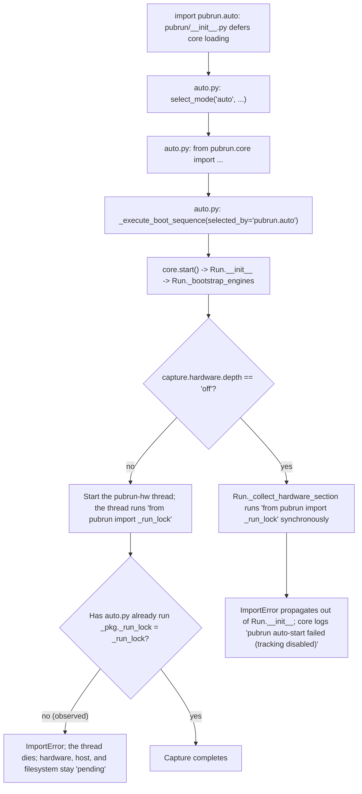

# IPD: Import _run_lock from pubrun.core so mode-module background capture cannot fail

- Date: 2026-11-22
- Kind: child
- Concern: Bugs and correctness (import modes): `import pubrun.auto`, `pubrun.full`, `pubrun.nopatch`, and `pubrun.noconsole` start the `pubrun-hw` background thread before `pubrun._run_lock` exists, so the thread dies with `ImportError` and the manifest's `hardware`, `host`, and `filesystem` sections stay `pending`. With `[capture.hardware].depth = "off"` the same import fails synchronously and auto-start is disabled for the whole run.
- Scope: `src/pubrun/tracker.py` (the six function-local `from pubrun import _run_lock` imports in `Run`), behavioral regression tests in `tests/test_import_modes.py`, and a `### Fixed` entry in `CHANGELOG.md`.
- Scope-Paths: src/pubrun/tracker.py, tests/test_import_modes.py, CHANGELOG.md
- Item-Dependencies: none
- Status: executed
- Readiness: go-pending-approval
- Review-Depth: standard
- Work-Kind: bug
- Priority: high
- From-Backlog: tmngjn
- Blocks-Release: next
- Set: tmngjn
- Order: 1
- Highest E allocated: 04
- Author: OpenCode agent
- Id: updt75

> Write and proofread this plan per the technical writing standard, `.aw/system/workflows/technical-writing/technical-writing.md` (`.agents/workflows/technical-writing/technical-writing.md` in a legacy-layout install), including requirement 12 (diagrams).

## Workflow history

- 2026-11-23 executed (aw oc run model=uri/its_direct/pt3-claude-opus-5.5-1m-us variant=high profile=opus): aw oc run self-finalize: updt75 verified (set tmngjn, attempt 1).
- 2026-11-23 approved (aw set): status set to approved
- 2026-11-23 /plan-review (Claude Opus 5.5): APPROVE WITH REVISIONS APPLIED; PR-001, PR-002, PR-003, PR-004
- 2026-11-23 to-review (aw set): authored from backlog tmngjn: reproduction on 00636a1, pubrun.core lock import, subprocess regression tests over all six mode modules, changelog
- 2026-11-23 draft (OpenCode agent): created.

## Goal

The `Run` class in `src/pubrun/tracker.py` reads the shared run lock with `from pubrun import _run_lock`. The lock is defined in `src/pubrun/core.py` as `_run_lock = threading.RLock()`. A plain `import pubrun` binds `pubrun._run_lock` before it starts a run, but each explicit mode module (`src/pubrun/auto.py`, `full.py`, `nopatch.py`, `noconsole.py`, `noauto.py`, `minimal.py`) binds `pubrun._run_lock` only after it calls `pubrun.core._execute_boot_sequence`, which can start a run. This plan makes `Run` import `_run_lock` from `pubrun.core`, where it always exists, so hardware, host, and filesystem capture succeed in every import mode. It adds subprocess tests that import each mode module and check stderr and the manifest.

### Current import order in an auto-starting mode module



After this plan, every node that runs `from pubrun import _run_lock` runs `from pubrun.core import _run_lock` instead, so branches `J` and `L` no longer occur.

## Detailed Implementation Checklist (TODO)

Execution-state rule: mark an `E-*` item complete only after performing the action. That mark is not validation. Right-sizing rule: write for a modest executor that cannot hold much in its head. Each E-item is one step (one concern, about one file, executable in one focused pass) and its V-item names each unit it covers with its own check; a plan stays at about 5 E-items and 8 work Scope-Paths, else split it into more child plans (guidance, `IPD-Z603`). Accepted execution states: blocked, failed, pending, performed; terminal gate demands 'performed'.

### Task group 1: Fix the lock import

- [x] E-01 In `src/pubrun/tracker.py`, replace each function-local `from pubrun import _run_lock` with `from pubrun.core import _run_lock`.
  - Depends on: none
  - Expected outcome: The six imports in `Run.__init__` (the startup-failure rollback branch), `Run._collect_hardware_section`, `Run._collect_host_and_filesystem`, the nested `_collect_hardware` function inside `Run._bootstrap_engines`, `Run._finalize_state`, and `Run.stop` each read `from pubrun.core import _run_lock`. Each import stays inside its function, because `src/pubrun/core.py` imports `pubrun.tracker` at module level and a module-level import in `tracker.py` would be circular. `grep -n "from pubrun import _run_lock" src/pubrun/tracker.py` prints nothing, and `grep -c "from pubrun.core import _run_lock" src/pubrun/tracker.py` prints `6`. The `from pubrun import __version__, __commit__` import in `Run.to_manifest_dict` is unchanged (see `## Findings`). No other line changes, and the six mode modules and `src/pubrun/__init__.py` are not edited.
  - Execution state: performed

### Task group 2: Regression tests

- [x] E-02 Add a `TestModeModuleBackgroundCapture` class to `tests/test_import_modes.py` with subprocess tests that import each explicit mode module and inspect stderr and the final manifest.
  - Depends on: E-01
  - Expected outcome: Each test runs `[sys.executable, "-c", script]` with `subprocess.run(..., capture_output=True, text=True, timeout=60)`, `cwd=str(tmp_path)`, and an environment copied from `os.environ` with this checkout's `src` directory (`Path(__file__).resolve().parents[1] / "src"`) prepended to `PYTHONPATH` and `PUBRUN_IMPORT_MODE` and `PUBRUN_AUTO_START` removed. (1) `test_mode_module_captures_hardware` is parametrized over the module names `pubrun`, `pubrun.auto`, `pubrun.full`, `pubrun.noauto`, `pubrun.nopatch`, `pubrun.noconsole`, and `pubrun.minimal`. The plain `pubrun` case is a control: it passes before and after E-01 and pins the `CHANGELOG.md` claim that plain `import pubrun` was not affected. Its script runs `import <module> as pubrun`, gets the run with `pubrun.get_current_run() or pubrun.start()`, polls `<run_dir>/manifest.json` every 0.1 s for up to 20 s until `hardware.capture_state.status` is not `pending`, calls `pubrun.stop()`, and prints the final manifest's `hardware` status, whether `hardware` contains a `cpu` key, and the `host` status. The test asserts return code `0`, that stderr contains neither `Exception in thread pubrun-hw` nor `cannot import name '_run_lock'`, that the final `hardware` status is not `pending`, that `hardware` contains `cpu`, and that the `host` status is not `pending`. (2) `test_mode_module_autostarts_with_hardware_off` is parametrized over `pubrun` (the control) and the four auto-starting modules `pubrun.auto`, `pubrun.full`, `pubrun.nopatch`, and `pubrun.noconsole`. It writes `tmp_path / ".pubrun.toml"` containing `[capture.hardware]` and `depth = "off"`. Its script imports the module, prints whether `pubrun.get_current_run()` is not `None`, and only when a run is active stops it and prints the final `hardware` status, so that on the pre-fix code the test fails on the "run is active" assertion rather than on an `AttributeError` raised inside the script. The test asserts return code `0`, that a run is active, that stderr does not contain `auto-start failed` or `cannot import name '_run_lock'`, and that the `hardware` status is `suppressed`. No test reads production source code.
  - Execution state: performed

### Task group 3: Changelog

- [x] E-03 Add a `### Fixed` entry to the `## [Unreleased]` section of `CHANGELOG.md`.
  - Depends on: E-01
  - Expected outcome: The `### Fixed` list under `## [Unreleased]` starts with a bold one-line title followed by two to four sentences. The entry states that `import pubrun.auto`, `pubrun.full`, `pubrun.nopatch`, and `pubrun.noconsole` could print `Exception in thread pubrun-hw: ... ImportError: cannot import name '_run_lock'` and leave the `hardware`, `host`, and `filesystem` manifest sections `pending`, that with `[capture.hardware].depth = "off"` these imports disabled tracking entirely, that plain `import pubrun` was not affected, and that a regression test now covers all six mode modules and plain `import pubrun`. The added lines contain no em or en dash, because `CHANGELOG.md` is user-facing.
  - Execution state: performed

### Task group 4: Verification

- [x] E-04 Run the new tests, the neighboring import-mode and capture tests, the reproduction script, and the full test suite.
  - Depends on: E-02, E-03
  - Expected outcome: `python3 -m pytest tests/test_import_modes.py -v --no-cov`, `python3 -m pytest tests/test_full_mode.py tests/test_capture_isolation.py tests/test_startup_overhead_writes.py tests/test_hook_ownership_rollback.py -q --no-cov`, and `python3 -m pytest -q` each finish with zero failures, or with only failures that also occur on the unchanged base commit and that `V-04` names. The reproduction script from `## Findings` prints `hardware=complete host=complete | stderr: clean` (or `partial` instead of `complete` on a host whose hardware probe exceeds its budget) for all six modes.
  - Execution state: performed

## Project conventions discovered (Step 0)

- `src/pubrun/core.py` defines `_run_lock = threading.RLock()` and `_start_lock` at module level and imports `from pubrun.tracker import Run, get_current_run` at module level. `src/pubrun/tracker.py` therefore cannot import `pubrun.core` at module level, and it already reads the lock through function-local imports.
- `src/pubrun/__init__.py` calls `pubrun._bootstrap.is_mode_submodule_import_in_progress()`. For a root import it runs `from pubrun.core import (..., _run_lock, _execute_boot_sequence)` and then `_execute_boot_sequence()`, so `pubrun._run_lock` exists before any run starts. For a mode-module import it defers all of this to the mode module and registers the `atexit` fallback `_ensure_core_loaded`.
- Each mode module (`auto.py`, `full.py`, `nopatch.py`, `noconsole.py`, `noauto.py`, `minimal.py`) calls `select_mode(...)`, imports the API from `pubrun.core`, calls the boot sequence, and only then assigns `_pkg.start = start` through `_pkg._run_lock = _run_lock` on the top-level package. `_MODES` in `src/pubrun/_modes.py` sets `auto_start: True` for `auto`, `full`, `nopatch`, and `noconsole`, and `False` for `noauto` and `minimal`.
- `Run._bootstrap_engines` collects hardware, host, and filesystem data synchronously when `capture.hardware.depth` is `"off"`. Otherwise it starts a daemon thread named `pubrun-hw` that runs the nested `_collect_hardware` function and then rewrites the startup manifest (the coalesced refresh). The sections start as `{"capture_state": {"status": "pending"}}`.
- Subprocess tests in this repository prepend this checkout's `src` to `PYTHONPATH` and drop `PUBRUN_IMPORT_MODE` and `PUBRUN_AUTO_START` (for example `tests/test_capture_isolation.py::_worktree_env`). An installed `pubrun` elsewhere on the machine would otherwise be imported instead of the checkout under test. `tests/test_import_modes.py::TestNamespacedImportModes` already runs mode-module imports in subprocesses.
- `pyproject.toml` sets `addopts = "--cov=src --cov-report=term-missing --cov-report=xml -p no:randomly"`, so targeted runs pass `--no-cov`. Tests assert observable behavior as `AGENTS.md` requires: no `inspect`, `ast`, source regex, or call counts.
- `CHANGELOG.md` follows Keep a Changelog, and `## [Unreleased]` already has a `### Fixed` list.

## Findings

Reproduction on the lane base (commit `00636a1`), recorded 2026-11-22 with Python 3.14.6 on Linux. Save the script below as `/tmp/opencode/tmngjn_repro.py` and run `python3 /tmp/opencode/tmngjn_repro.py` from the repository root. For each mode it starts a fresh interpreter in an empty temporary directory, imports the mode module, waits up to 15 s for background capture to finish, stops the run, and prints the final manifest status of `hardware` and `host`.

```python
import json, os, subprocess, sys, tempfile
SRC = os.path.join(os.getcwd(), "src")
SCRIPT = """
import json
import pubrun.{mode} as pubrun
run = pubrun.get_current_run() or pubrun.start()
run._hardware_future_done.wait(15)
rd = str(run.run_dir)
pubrun.stop()
m = json.load(open(rd + "/manifest.json"))
print("hardware=" + m["hardware"]["capture_state"]["status"], "host=" + m["host"]["capture_state"]["status"])
"""
env = {k: v for k, v in os.environ.items() if k not in ("PUBRUN_IMPORT_MODE", "PUBRUN_AUTO_START")}
env["PYTHONPATH"] = SRC
for mode in ("auto", "full", "noauto", "nopatch", "noconsole", "minimal"):
    with tempfile.TemporaryDirectory() as cwd:
        r = subprocess.run([sys.executable, "-c", SCRIPT.format(mode=mode)], cwd=cwd, env=env,
                           capture_output=True, text=True, timeout=60)
        err = "ImportError(_run_lock)" if "cannot import name '_run_lock'" in r.stderr else "clean"
        print(mode, "|", r.stdout.strip(), "| stderr:", err)
```

Observed output:

```text
auto | hardware=pending host=pending | stderr: ImportError(_run_lock)
full | hardware=pending host=pending | stderr: ImportError(_run_lock)
noauto | hardware=complete host=complete | stderr: clean
nopatch | hardware=pending host=pending | stderr: ImportError(_run_lock)
noconsole | hardware=pending host=pending | stderr: ImportError(_run_lock)
minimal | hardware=complete host=complete | stderr: clean
```

| Observation | Explanation |
|---|---|
| The four auto-starting modes fail on every run, not intermittently. | The `pubrun-hw` thread starts inside `_execute_boot_sequence`, and the mode module binds `_pkg._run_lock` only after that call returns. On the observed runs the thread always reached its import first. The backlog item calls this a race; on this machine it lost every time. |
| `noauto` and `minimal` succeed. | They do not auto-start. The test script calls `pubrun.start()` after the module finished importing, when `pubrun._run_lock` is already bound. |
| `pubrun.stop()` took 2.01 s in `auto` mode before the fix, and 0.01 s to 0.03 s in the four auto-starting modes after it. | In the nested `_collect_hardware` function, `from pubrun import _run_lock` is the first statement, before the `try ... finally` block that calls `self._hardware_future_done.set()`. The failed import therefore never sets the event, and `Run._finalize_state` waits its full 2.0 s timeout on `_hardware_future_done`. |
| With `.pubrun.toml` containing `[capture.hardware]` and `depth = "off"`, `import pubrun.auto` printed `pubrun auto-start failed (tracking disabled): cannot import name '_run_lock' from 'pubrun'`, and `get_current_run()` returned `None` for `auto`, `full`, `nopatch`, and `noconsole`. | With hardware depth `off`, `Run._bootstrap_engines` calls `Run._collect_hardware_section` synchronously inside `Run.__init__`. The `ImportError` propagates to `_execute_boot_sequence`, which logs the warning and leaves no run. This is a larger impact than the backlog item records, and the same fix covers it. |

Fix trial: in a scratch copy of `src/` under `/tmp/opencode/`, replacing the six `from pubrun import _run_lock` lines in `tracker.py` with `from pubrun.core import _run_lock` gave `complete` for `hardware`, `host`, and `filesystem` in all six modes with default configuration, `suppressed` hardware with an active run with `depth = "off"` (an auto-started run in the four auto-starting modes; `noauto` and `minimal` do not auto-start, so their run comes from an explicit `pubrun.start()`), and `complete` for plain `import pubrun`. It printed no traceback. Python 3.12 gave the same result for `auto`.

Choice of fix: the backlog item allows either binding `_run_lock` before boot or importing it from `pubrun.core`. This plan imports it from `pubrun.core`. That change touches one file, removes the dependency on the order in which the six mode modules and `src/pubrun/__init__.py::_ensure_core_loaded` bind package attributes, and keeps the same lock object, because `pubrun._run_lock` is bound from `pubrun.core._run_lock` on every import path. No test or source file replaces `pubrun._run_lock`; `grep -rn "_run_lock" tests` finds only a docstring in `tests/test_capture_isolation.py`.

Other attributes that `Run` imports from `pubrun`: `Run.to_manifest_dict` runs `from pubrun import __version__, __commit__` inside `try ... except ImportError`. `__version__` is assigned near the top of `src/pubrun/__init__.py`, before the import-mode routing, and `__commit__` is resolved by the module-level `__getattr__` in the same file. Both therefore exist on every import path, so this plan leaves that import unchanged. No other `from pubrun import` statement exists in `src/pubrun/tracker.py`, `src/pubrun/writer.py`, or `src/pubrun/capture/`.

Re-checked at review on 2026-11-23 on the lane tree (commit `00636a1` is an ancestor; `src/` changed since, but not in the lines involved). The reproduction script, extended to print `filesystem` and the `stop()` time, printed `hardware=pending host=pending fs=pending stop=2.01` with the `_run_lock` `ImportError` for `auto`, `full`, `nopatch`, and `noconsole`, and `complete` for `noauto` and `minimal`. With `depth = "off"` the four auto-starting modes printed `pubrun auto-start failed (tracking disabled): cannot import name '_run_lock' from 'pubrun'` and had no active run. On a scratch copy of `src/` with the E-01 change, all six modes printed `complete` for all three sections with `stop=0.02`, under Python 3.14, 3.12, and 3.11; with `depth = "off"` the four auto-starting modes had an active run with `suppressed` hardware and clean stderr. A prototype of the E-02 class, including the plain `pubrun` control, gave `8 failed, 4 passed` on the base `src/` and `12 passed` on the fixed copy, also with `-n 6`. On this tree, before any change, `python3 -m pytest -q` printed `1819 passed, 2 skipped` at the preceding review in the same lane, so V-04's zero-failure bar starts from a green suite.

Plan `3aalwv` (Set `uatvzh`, pending) edits `Run.stop` and `Run._finalize_state` in the same file. It states that it leaves each `_run_lock` import line as it is and does not depend on which form is present, so the two plans do not depend on each other.

## Proposed changes (ordered, validatable)

1. In `src/pubrun/tracker.py`, change the six function-local `_run_lock` imports to `from pubrun.core import _run_lock` (E-01).
2. In `tests/test_import_modes.py`, add `TestModeModuleBackgroundCapture` with the default-configuration test over plain `pubrun` and the six mode modules and the `depth = "off"` test over plain `pubrun` and the four auto-starting modules (E-02).
3. In `CHANGELOG.md`, add the `### Fixed` entry (E-03).
4. Run the targeted tests, the neighboring suites, the reproduction script, and the full suite (E-04).

## Deferred / out of scope (with reason)

- Moving the `_pkg.* = ...` assignments in the six mode modules above the boot call. Reason: after E-01 no pubrun code reads `_run_lock` from the top-level package during boot, so the order no longer affects capture. Reordering six files adds risk to the public-namespace setup and changes nothing a test can observe.
  - Carrier-Declined: not needed once `Run` reads the lock from `pubrun.core`; the existing late binding still provides `pubrun._run_lock` to any external caller.
- Running the full continuous integration (CI) matrix (3 operating systems x Python 3.8 to 3.14) as an execution step. Reason: this lane may not push. `AGENTS.md` "Matrix-validation discipline" applies because the change affects import entry paths. The import change is platform-independent Python, but the new tests run `get_hardware` and `get_filesystem`, whose timing differs by operating system (on macOS `get_filesystem` runs a `mount` subprocess bounded at 2 s). The tests therefore poll for up to 20 s and accept any non-`pending` status. The maintainer should watch the CI matrix after this change is pushed.
  - Carrier-Declined: a release-process step owned by the maintainer, not an unfinished part of this plan's change.

## Scope check

- Over-scope: none. Only `src/pubrun/tracker.py`, `tests/test_import_modes.py`, and `CHANGELOG.md` change.
- Under-scope: none. `grep -rn "from pubrun import _run_lock" src/pubrun` lists only the six lines in `src/pubrun/tracker.py` that E-01 changes. `src/pubrun/writer.py` and `src/pubrun/capture/` do not import `_run_lock`.

## Required tests / validation

- Run `python3 -m pytest tests/test_import_modes.py -v --no-cov` and paste the output. It must list all twelve `TestModeModuleBackgroundCapture` cases (seven for `test_mode_module_captures_hardware`, five for `test_mode_module_autostarts_with_hardware_off`) as PASSED (E-01, E-02).
- Show that the new tests fail on the unchanged base, before committing: run `git worktree add /tmp/opencode/updt75-prefix HEAD`, copy the new `tests/test_import_modes.py` into it, run `python3 -m pytest tests/test_import_modes.py -k TestModeModuleBackgroundCapture -v --no-cov` from that worktree's root, paste the output, then run `git worktree remove --force /tmp/opencode/updt75-prefix` and paste `git worktree list` showing it is gone. The tests prepend `Path(__file__).resolve().parents[1] / "src"`, so in that worktree they import its unfixed `src/`. Do not use `git stash` in the shared checkout (E-02).
- Paste `git diff -- CHANGELOG.md` and the output of `git diff -U0 -- CHANGELOG.md | grep '^+' | grep -c $'\u2014\|\u2013'`, which must print `0` (E-03).
- Run `python3 -m pytest tests/test_full_mode.py tests/test_capture_isolation.py tests/test_startup_overhead_writes.py tests/test_hook_ownership_rollback.py -q --no-cov` and paste the summary (E-04).
- Run the reproduction script from `## Findings` and paste its six lines (E-04).
- Run `python3 -m pytest -q` and paste the summary line (E-04).

## Spec / documentation sync

- `CHANGELOG.md`: E-03 adds a `### Fixed` entry.
- `docs/architecture.md` and `docs/functional_spec.md` describe `_run_lock` lock ordering without naming the module it is imported from. The lock object and its ordering do not change, so they need no edit.
- `docs/api.md` and the mode-module docstrings describe what each mode captures; after this plan the behavior matches that text, so they need no edit.
- No specification under `.aw/records/specs/` describes the mode-module boot order or `_run_lock`. The manifest schema does not change.

## Open questions

### OQ-01: Bind `_run_lock` earlier in each mode module, or import it from `pubrun.core`?

- Blocking: no
- Status: resolved
- Owner: none
- Resolution or deferral rationale: Import it from `pubrun.core`. The backlog item's acceptance permits either fix. The `pubrun.core` import changes one file instead of six, covers any future mode module and the `_ensure_core_loaded` fallback in `src/pubrun/__init__.py` without further edits, and keeps the same lock object on every import path. The fix trial in `## Findings` showed it resolves both the background-thread failure and the `depth = "off"` auto-start failure.

## Validation and cross-check (verify before reporting done)

Validation-state rule: inspect evidence in a separate pass. Do not mark a `V-*` item complete from memory or from the matching execution checkmark. Accepted validation results: blocked, failed, pass, pending; terminal gate demands 'pass'. Runtime-demonstration reachability rule: for each `V-*` item demanding the software be observed acting (such as a run, a dispatch, or a transition), as distinct from items demanding a diff, a file's content, or a test result (which are reachable by construction), name the code path that produces the observation or the sibling `E-*` that creates it, else the demand is UNDER-SCOPE.

- [x] V-01 validates E-01
  - Required evidence: The pasted `git diff -- src/pubrun/tracker.py`, showing exactly six changed import lines and no other change. The pasted output of `grep -n "from pubrun import _run_lock" src/pubrun/tracker.py` (empty) and `grep -c "from pubrun.core import _run_lock" src/pubrun/tracker.py` (`6`).
  - Observed evidence:
    ```text
    $ git diff -- src/pubrun/tracker.py   (six hunks, each exactly one line)
    @@ -273,7 +273,7 @@  Run.__init__ startup-failure rollback
    -            from pubrun import _run_lock
    +            from pubrun.core import _run_lock
    @@ -480,7 +480,7 @@  Run._collect_hardware_section
    -        from pubrun import _run_lock
    +        from pubrun.core import _run_lock
    @@ -509,7 +509,7 @@  Run._collect_host_and_filesystem
    -        from pubrun import _run_lock
    +        from pubrun.core import _run_lock
    @@ -649,7 +649,7 @@  nested _collect_hardware in Run._bootstrap_engines
    -                from pubrun import _run_lock
    +                from pubrun.core import _run_lock
    @@ -1105,7 +1105,7 @@  Run._finalize_state
    -        from pubrun import _run_lock
    +        from pubrun.core import _run_lock
    @@ -1382,7 +1382,7 @@  Run.stop
    -        from pubrun import _run_lock
    +        from pubrun.core import _run_lock
    $ git diff --stat -- src/pubrun/tracker.py
     src/pubrun/tracker.py | 12 ++++++------
    $ grep -n "from pubrun import _run_lock" src/pubrun/tracker.py
    (no output)
    $ grep -c "from pubrun.core import _run_lock" src/pubrun/tracker.py
    6
    ```
  - Result: pass

- [x] V-02 validates E-02
  - Required evidence: Pasted `python3 -m pytest tests/test_import_modes.py -v --no-cov` output listing the seven `test_mode_module_captures_hardware` cases and the five `test_mode_module_autostarts_with_hardware_off` cases as PASSED. Also the pasted output of the same `-k TestModeModuleBackgroundCapture` run in the temporary pre-fix worktree described under `## Required tests / validation`, showing exactly the `pubrun.auto`, `pubrun.full`, `pubrun.nopatch`, and `pubrun.noconsole` cases of both tests FAILED (eight cases) and the `pubrun`, `pubrun.noauto`, and `pubrun.minimal` cases PASSED (four cases), plus the pasted `git worktree list` after removal. The subprocesses in these tests run `Run._bootstrap_engines` through `pubrun.core._execute_boot_sequence` and `pubrun.start`, which is the code path E-01 changes.
  - Observed evidence:
    ```text
    $ python3 -m pytest tests/test_import_modes.py -v --no-cov
    ...
    tests/test_import_modes.py::TestModeModuleBackgroundCapture::test_mode_module_captures_hardware[pubrun] PASSED [ 85%]
    tests/test_import_modes.py::TestModeModuleBackgroundCapture::test_mode_module_captures_hardware[pubrun.auto] PASSED [ 87%]
    tests/test_import_modes.py::TestModeModuleBackgroundCapture::test_mode_module_captures_hardware[pubrun.full] PASSED [ 88%]
    tests/test_import_modes.py::TestModeModuleBackgroundCapture::test_mode_module_captures_hardware[pubrun.noauto] PASSED [ 89%]
    tests/test_import_modes.py::TestModeModuleBackgroundCapture::test_mode_module_captures_hardware[pubrun.nopatch] PASSED [ 91%]
    tests/test_import_modes.py::TestModeModuleBackgroundCapture::test_mode_module_captures_hardware[pubrun.noconsole] PASSED [ 92%]
    tests/test_import_modes.py::TestModeModuleBackgroundCapture::test_mode_module_captures_hardware[pubrun.minimal] PASSED [ 93%]
    tests/test_import_modes.py::TestModeModuleBackgroundCapture::test_mode_module_autostarts_with_hardware_off[pubrun] PASSED [ 94%]
    tests/test_import_modes.py::TestModeModuleBackgroundCapture::test_mode_module_autostarts_with_hardware_off[pubrun.auto] PASSED [ 96%]
    tests/test_import_modes.py::TestModeModuleBackgroundCapture::test_mode_module_autostarts_with_hardware_off[pubrun.full] PASSED [ 97%]
    tests/test_import_modes.py::TestModeModuleBackgroundCapture::test_mode_module_autostarts_with_hardware_off[pubrun.nopatch] PASSED [ 98%]
    tests/test_import_modes.py::TestModeModuleBackgroundCapture::test_mode_module_autostarts_with_hardware_off[pubrun.noconsole] PASSED [100%]
    ============================= 78 passed in 27.24s ==============================

    $ git worktree add /tmp/opencode/updt75-prefix HEAD   (HEAD = bf2a959, unfixed src/)
    $ cp tests/test_import_modes.py /tmp/opencode/updt75-prefix/tests/
    $ (cd /tmp/opencode/updt75-prefix && python3 -m pytest tests/test_import_modes.py -k TestModeModuleBackgroundCapture -v --no-cov)
    ...::test_mode_module_captures_hardware[pubrun] PASSED
    ...::test_mode_module_captures_hardware[pubrun.auto] FAILED
    ...::test_mode_module_captures_hardware[pubrun.full] FAILED
    ...::test_mode_module_captures_hardware[pubrun.noauto] PASSED
    ...::test_mode_module_captures_hardware[pubrun.nopatch] FAILED
    ...::test_mode_module_captures_hardware[pubrun.noconsole] FAILED
    ...::test_mode_module_captures_hardware[pubrun.minimal] PASSED
    ...::test_mode_module_autostarts_with_hardware_off[pubrun] PASSED
    ...::test_mode_module_autostarts_with_hardware_off[pubrun.auto] FAILED
    ...::test_mode_module_autostarts_with_hardware_off[pubrun.full] FAILED
    ...::test_mode_module_autostarts_with_hardware_off[pubrun.nopatch] FAILED
    ...::test_mode_module_autostarts_with_hardware_off[pubrun.noconsole] FAILED
    E           AssertionError: stderr: pubrun auto-start failed (tracking disabled): cannot import name '_run_lock' from 'pubrun' (/tmp/opencode/updt75-prefix/src/pubrun/__init__.py)
    ============ 8 failed, 4 passed, 66 deselected in 95.25s (0:01:35) =============
    $ git worktree remove --force /tmp/opencode/updt75-prefix
    $ git worktree list | grep -c updt75-prefix
    0
    ```
  - Result: pass

- [x] V-03 validates E-03
  - Required evidence: The pasted `git diff -- CHANGELOG.md` hunk, showing the entry under `## [Unreleased]` / `### Fixed` with the facts E-03 lists, and the pasted dash count `0`.
  - Observed evidence:
    ```text
    $ git diff -- CHANGELOG.md
    @@ -103,6 +103,12 @@ The format is based on [Keep a Changelog](https://keepachangelog.com/en/1.1.0/).
       the deep pages, never the README front door.

     ### Fixed
    +- **Hardware, host, and filesystem capture no longer fails under `import pubrun.auto`, `pubrun.full`,
    +  `pubrun.nopatch`, or `pubrun.noconsole`.** These imports could print
    +  `Exception in thread pubrun-hw: ... ImportError: cannot import name '_run_lock'` and leave the
    +  `hardware`, `host`, and `filesystem` manifest sections `pending`. With
    +  `[capture.hardware].depth = "off"` the same imports disabled tracking entirely. Plain `import pubrun`
    +  was not affected, and a regression test now covers all six mode modules and plain `import pubrun`.
     - **`[imports].on_conflict` set in `./.config/pubrun/config.toml` or in the user config file is
    $ git diff -U0 -- CHANGELOG.md | grep '^+' | grep -c $'\u2014\|\u2013'
    0
    ```
  - Result: pass

- [x] V-04 validates E-04
  - Required evidence: Pasted summary lines of the neighboring-suite command and of `python3 -m pytest -q`, each with zero failures; any failure must be shown to also occur on the base commit, with its pasted base-commit output. The pasted six lines of the reproduction script, each showing a non-`pending` `hardware` and `host` status and `stderr: clean`. The script drives `pubrun.<mode>` imports in fresh interpreters, which reach `Run._bootstrap_engines` through the boot sequence that E-01 fixes.
  - Observed evidence:
    ```text
    $ python3 -m pytest tests/test_full_mode.py tests/test_capture_isolation.py tests/test_startup_overhead_writes.py tests/test_hook_ownership_rollback.py -q --no-cov
    107 passed in 29.22s
    $ python3 /tmp/opencode/tmngjn_repro.py
    auto | hardware=complete host=complete | stderr: clean
    full | hardware=complete host=complete | stderr: clean
    noauto | hardware=complete host=complete | stderr: clean
    nopatch | hardware=complete host=complete | stderr: clean
    noconsole | hardware=complete host=complete | stderr: clean
    minimal | hardware=complete host=complete | stderr: clean
    $ aw suite   (full suite, equivalent of python3 -m pytest -q with coverage)
    TOTAL                                  16078   3308    79%
    ======================= 1869 passed in 142.58s (0:02:22) =======================
    ```
  - Result: pass

## Approval and execution gate

- Size assessment: standard
- Cohesion rationale: not required

Execution contract:
1. Precondition: wait for human approval (`- Status: approved`) with no unresolved `Blocking: yes` open question before you change code. OQ-01 is resolved and non-blocking.
2. Scope declaration: the expected modified files are the `- Scope-Paths:` entries (`src/pubrun/tracker.py`, `tests/test_import_modes.py`, `CHANGELOG.md`). If execution requires an out-of-scope file, justify it with `--scope-reason` at finalization. If a declared file needs no edit, acknowledge it with `--scope-ack`.
3. Validation honesty: run each required validation command and paste its actual output into the matching `V-*` `Observed evidence:` field. Do not mark a `V-*` item `pass` without output captured from that run.
4. Commit discipline: commit only the paths you changed with `aw commit updt75 -- src/pubrun/tracker.py tests/test_import_modes.py CHANGELOG.md`. Do not use `git add -A` or raw `git commit`. Do not push without an explicit human instruction.
5. Lifecycle transition: after every `E-*` item is `performed` and every `V-*` item is `pass`, `aw ipd lint --phase pre-transition` must conform. Then finalize this plan with `aw ipd finalize updt75`, never with a hand-written `git mv` to `.aw/records/plans/executed/`. Inside a runner lane (`aw oc run` or `aw agy run`), the runner finalizes after the turn. Outside a runner, the executor runs `aw ipd finalize updt75`.
