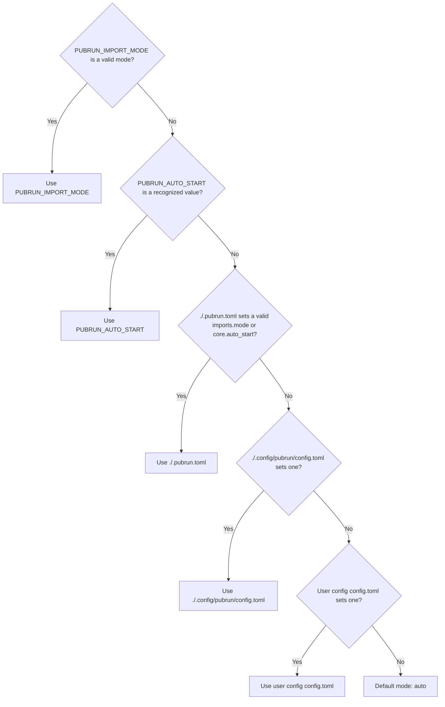

# IPD: Sync functional spec and architecture docs with multi-file boot config and PUBRUN_AUTO_START values

- Date: 2026-11-23
- Kind: child
- Concern: Documentation accuracy for boot-time configuration and environment-variable parsing
- Scope: Update `docs/functional_spec.md` and `docs/architecture.md` to match the multi-file boot configuration search order, the malformed-file fallthrough, and the accepted `PUBRUN_AUTO_START` values implemented in `src/pubrun/_config_boot.py` (landed in `l7ko8p` and `2e6xfq`).
- Scope-Paths: docs/functional_spec.md, docs/architecture.md
- Scope-Exceeded: .aw/records/backlog/open/20261124-m8buxe-01-m8buxe-fix-stale-mode-name-list-in-src-pubrun-config-boot.backlog.md (Follow-up backlog item filed per turn defect-report contract); .aw/records/backlog/open/20261124-mv1g3x-01-mv1g3x-sync-docs-functional-spec-md-sections-3-4-10-2-and.backlog.md (Follow-up backlog item filed per turn defect-report contract)
- Item-Dependencies: none
- Status: executed
- Readiness: go-pending-approval
- Review-Depth: simple
- Work-Kind: followup
- Priority: low
- From-Backlog: 2rhs16
- Set: 2rhs16
- Order: 1
- Highest E allocated: 02
- Author: Antigravity
- Id: mspqm6

> Write and proofread this plan per the technical writing standard, `.aw/system/workflows/technical-writing/technical-writing.md` (`.agents/workflows/technical-writing/technical-writing.md` in a legacy-layout install), including requirement 12 (diagrams).

## Workflow history

- 2026-11-24 executed (aw agy run model=Gemini-4-Neon-High): aw agy run self-finalize: mspqm6 verified (set 2rhs16, attempt 1). [Scope reconciliation - out-of-scope .aw/records/backlog/open/20261124-m8buxe-01-m8buxe-fix-stale-mode-name-list-in-src-pubrun-config-boot.backlog.md: Follow-up backlog item filed per turn defect-report contract; out-of-scope .aw/records/backlog/open/20261124-mv1g3x-01-mv1g3x-sync-docs-functional-spec-md-sections-3-4-10-2-and.backlog.md: Follow-up backlog item filed per turn defect-report contract]
- 2026-11-24 approved (aw set): status set to approved
- 2026-11-24 /plan-review (uri/its_direct/pt3-claude-opus-5.5-1m-us): APPROVE WITH REVISIONS APPLIED; PR-001, PR-002, PR-003, PR-004, PR-005, PR-006
- 2026-11-24 to-review (Antigravity): graduated from backlog item `2rhs16` into a review-ready plan.
- 2026-11-24 draft (Antigravity): created.

## Goal

Make `docs/functional_spec.md` and `docs/architecture.md` describe what the boot resolver in `src/pubrun/_config_boot.py` actually does. The boot resolver is the code that runs at `import pubrun` and picks the import mode (and so whether `pubrun` starts tracking automatically) without loading the full configuration engine `pubrun.config`. The two documents still describe the behavior from before `l7ko8p`: one config file, and `PUBRUN_AUTO_START` accepting only `"true"`/`"false"`. `docs/configuration.md` "The import mode chosen at `import pubrun` time" already describes the current behavior correctly; this plan brings the other two documents in line with it.

## Detailed Implementation Checklist (TODO)

Execution-state rule: mark an `E-*` item complete only after performing the action. That mark is not validation. Right-sizing rule: write for a modest executor that cannot hold much in its head. Each E-item is one step (one concern, about one file, executable in one focused pass) and its V-item names each unit it covers with its own check; a plan stays at about 5 E-items and 8 work Scope-Paths, else split it into more child plans (guidance, `IPD-Z603`). Accepted execution states: blocked, failed, pending, performed; terminal gate demands 'performed'.

### Task group 1: Update user-facing design and architecture documentation

- [x] E-01 Update three places in `docs/functional_spec.md`, all under `## 3.` and before `### 3.4 Import Modes`, to match `src/pubrun/_config_boot.py::resolve_import_mode`.
  - Depends on: none
  - Expected outcome:
    1. In `docs/functional_spec.md#3.2 Lightweight Import Requirement`, the paragraph starting "The boot sequence is wrapped in `try/except`." no longer claims that corrupt TOML disables auto-start. It states that a malformed, unreadable, or missing config file does not raise: the boot resolver skips it and continues with the next file. It also states that an exception raised during mode resolution or selection (`src/pubrun/core.py::_execute_boot_sequence`) does not fail the import: pubrun logs a warning on the `pubrun` logger and disables tracking.
    2. The `**Single-read boot configuration:**` bullet in the same section names the three config files in search order (`./.pubrun.toml`, then `./.config/pubrun/config.toml`, then the user config `config.toml`: `%APPDATA%/pubrun/config.toml` on Windows, else `$XDG_CONFIG_HOME/pubrun/config.toml` or `~/.config/pubrun/config.toml`). It states that each file is opened and parsed at most once per lookup, and that the first file setting a valid `[imports].mode` or a recognized `[core].auto_start` value decides. It states that `[imports].mode` wins over `[core].auto_start` within one file, and that `[imports].on_conflict` is read from the same files in the same order.
    3. In `docs/functional_spec.md#3.3 Auto-Start Behavior`, the bullet "The `PUBRUN_AUTO_START` environment variable is set to `"false"`." lists all four false values (`"0"`, `"false"`, `"no"`, `"off"`). The section also states that the true values (`"1"`, `"true"`, `"yes"`, `"on"`) enable auto-start, that matching ignores case and surrounding whitespace, that `[core].auto_start` accepts the same values, that any other value is ignored, and that `PUBRUN_IMPORT_MODE` takes precedence over `PUBRUN_AUTO_START`.
    4. Added or edited lines contain no em dash (U+2014) and no en dash (U+2013).
  - Execution state: performed

- [x] E-02 Update two places in `docs/architecture.md` to match `src/pubrun/_config_boot.py`.
  - Depends on: none
  - Expected outcome:
    1. In `docs/architecture.md#Initialization` (under `## 3. Run Lifecycle`), the sentence "`_config_boot.py` reads and parses `./.pubrun.toml` at most once when checking `[imports].mode` and `[core].auto_start`." is replaced. The new text names the same three config files in the same search order as E-01 item 2, states that each is parsed at most once without importing `pubrun.config`, that a malformed or missing file is skipped, and lists the accepted `PUBRUN_AUTO_START` values (`"1"`, `"true"`, `"yes"`, `"on"` enable; `"0"`, `"false"`, `"no"`, `"off"` disable).
    2. In `docs/architecture.md#21. System Components`, the `**Boot Config Resolver** (`_config_boot.py`)` bullet no longer says it "parses `./.pubrun.toml` at most once". It says the resolver searches the three boot config files, parsing each at most once.
    3. Added or edited lines contain no em dash (U+2014) and no en dash (U+2013). Pre-existing em dashes on untouched lines (for example the `**Bootstrap State**` bullet) stay unchanged.
  - Execution state: performed

## Project conventions discovered (Step 0)

- Cite code by symbol (`path::Name`), Markdown by heading (`path#Heading text`), or by a quoted content string. A line number may follow one of those as a hint, but never stands alone (`IPD-C801`).
- Authoritative implementation in `src/pubrun/_config_boot.py`:
  - `src/pubrun/_config_boot.py::_AUTO_START_TRUE` is `("1", "true", "yes", "on")` and `src/pubrun/_config_boot.py::_AUTO_START_FALSE` is `("0", "false", "no", "off")`. `src/pubrun/_config_boot.py::_auto_start_mode` matches them after `.strip().lower()`, returns `None` for any other value, and is used for both `PUBRUN_AUTO_START` and `[core].auto_start`.
  - `src/pubrun/_config_boot.py::_boot_config_paths` returns the candidates highest precedence first: `./.pubrun.toml`, `./.config/pubrun/config.toml`, then `config.toml` in `src/pubrun/_config_boot.py::_global_config_dir`. That directory mirrors `src/pubrun/config.py::get_global_config_dir`: `%APPDATA%/pubrun` on Windows when `APPDATA` is set and non-empty, else `$XDG_CONFIG_HOME/pubrun` or `~/.config/pubrun`.
  - `src/pubrun/_config_boot.py::_load_toml_file` returns `None` for a missing file, a missing TOML parser, or a parse error, so `src/pubrun/_config_boot.py::resolve_import_mode` skips that file.
  - `src/pubrun/_config_boot.py::_read_boot_toml_key` searches the same files in the same order; `src/pubrun/_bootstrap.py::_resolve_conflict_policy` uses it for `[imports].on_conflict` after checking `PUBRUN_IMPORT_CONFLICT`.
- Reference wording that is already correct: `docs/configuration.md` "The import mode chosen at `import pubrun` time" and the `PUBRUN_AUTO_START` row of its environment-variable table. Use the same terms so the three documents agree.
- `AGENTS.md` agent execution contract: user-facing documentation (`docs/*.md`) must contain no em or en dashes in authored or edited prose.

## Findings

Two user-facing documents describe boot-config behavior from before `l7ko8p`, in five places:

1. `docs/functional_spec.md#3.2 Lightweight Import Requirement`, bullet `**Single-read boot configuration:**`, says the resolver "opens and parses `./.pubrun.toml` at most once". It omits `./.config/pubrun/config.toml` and the user config file.
2. The same section says "If configuration resolution fails (e.g., corrupt TOML), the import succeeds silently with auto-start disabled." This is false. At review, with a malformed `./.pubrun.toml` as the only config file, `resolve_import_mode()` returned `('auto', 'default')`, so auto-start stays on. With a malformed `./.pubrun.toml` and `[core] auto_start = "off"` in `./.config/pubrun/config.toml`, it returned `('noauto', 'config:[core].auto_start')`. A malformed file is skipped, not fatal.
3. `docs/functional_spec.md#3.3 Auto-Start Behavior` names only `"false"` for `PUBRUN_AUTO_START`. The code also accepts `"0"`, `"no"`, and `"off"` as false values and `"1"`, `"true"`, `"yes"`, and `"on"` as true values. At review, `PUBRUN_AUTO_START=" YES "` returned `('auto', 'env:PUBRUN_AUTO_START')`, and `PUBRUN_AUTO_START="maybe"` was ignored.
4. `docs/architecture.md#Initialization` says "`_config_boot.py` reads and parses `./.pubrun.toml` at most once", omitting the multi-file search.
5. `docs/architecture.md#21. System Components`, bullet `**Boot Config Resolver**`, makes the same one-file claim.

The flowchart shows the resolution order of `src/pubrun/_config_boot.py::resolve_import_mode`. Each config-file step skips a missing or malformed file.



## Proposed changes (ordered, validatable)

1. **`docs/functional_spec.md` (E-01):**
   - Rewrite the "The boot sequence is wrapped in `try/except`." paragraph in Section 3.2: a malformed or missing config file is skipped, and an exception during boot disables tracking with a warning on the `pubrun` logger.
   - Rewrite the `**Single-read boot configuration:**` bullet in Section 3.2: the three files in search order, at most one parse per file per lookup, `[imports].mode` before `[core].auto_start` within one file, and the same order for `[imports].on_conflict`.
   - Update Section 3.3: all true and false `PUBRUN_AUTO_START` values, matching that ignores case and whitespace, `[core].auto_start` accepting the same values, other values ignored, and `PUBRUN_IMPORT_MODE` taking precedence.
2. **`docs/architecture.md` (E-02):**
   - Replace the one-file sentence in `### Initialization` with the three-file search and the accepted `PUBRUN_AUTO_START` values.
   - Update the `**Boot Config Resolver**` bullet in `## 21. System Components` to name the three-file search.

## Deferred / out of scope (with reason)

None.

## Scope check

- Over-scope: none. Only `docs/functional_spec.md` and `docs/architecture.md` are edited; `src/pubrun/_config_boot.py` is a read-only reference.
- Under-scope: none after review. The backlog item `2rhs16` names three places. The review added two more with the same stale behavior: the corrupt-TOML claim in functional-spec Section 3.2 and the `**Boot Config Resolver**` bullet in architecture Section 21.

## Required tests / validation

- Compare the diffs of both files against `src/pubrun/_config_boot.py` for the same file paths, search order, and `PUBRUN_AUTO_START` values.
- Count em and en dashes in added lines with `git diff -U0 -- <file> | grep '^+[^+]' | grep -c '[—–]'` (expected `0`).
- Search for remaining one-file claims with `grep -n 'parses ...\.pubrun\.toml. at most once' docs/functional_spec.md docs/architecture.md` and `grep -n 'corrupt TOML' docs/functional_spec.md` (expected: no output).
- Run `python3 scripts/sanitize_paths.py --check --all` and confirm exit code 0.

No code changes, so no test suite run is required.

## Spec / documentation sync

This plan is itself the documentation sync for the `src/pubrun/_config_boot.py` behavior from `l7ko8p` and `2e6xfq`. `docs/configuration.md` and `CHANGELOG.md` already describe that behavior ("`[imports].on_conflict` set in `./.config/pubrun/config.toml` or in the user config file is"), so they need no edit. No `.spec.md` file under `.aw/records/specs/` is touched.

## Open questions

None.

## Validation and cross-check (verify before reporting done)

Validation-state rule: inspect evidence in a separate pass. Do not mark a `V-*` item complete from memory or from the matching execution checkmark. Accepted validation results: blocked, failed, pass, pending; terminal gate demands 'pass'. Runtime-demonstration reachability rule: for each `V-*` item demanding the software be observed acting (such as a run, a dispatch, or a transition), name the code path that produces the observation or the sibling `E-*` that creates it, else the demand is UNDER-SCOPE.

- [x] V-01 validates E-01
  - Required evidence: (1) Paste `git diff -- docs/functional_spec.md` and, for each of E-01 outcomes 1 to 3, name the added line that satisfies it: malformed-file skip and exception warning; three file paths in order with the parse-once rule, the `[imports].mode` before `[core].auto_start` rule, and `[imports].on_conflict`; all eight `PUBRUN_AUTO_START` values, case and whitespace handling, `[core].auto_start` parity, other values ignored, and `PUBRUN_IMPORT_MODE` precedence. (2) Paste the output of `git diff -U0 -- docs/functional_spec.md | grep '^+[^+]' | grep -c '[—–]'` showing `0`. (3) Paste the output of `grep -n 'parses ...\.pubrun\.toml. at most once' docs/functional_spec.md` and `grep -n 'corrupt TOML' docs/functional_spec.md`, both showing no match.
  - Observed evidence:
    1. `git diff -- docs/functional_spec.md`:
       ```diff
       diff --git a/docs/functional_spec.md b/docs/functional_spec.md
       index 1b94f8f..7600ed3 100644
       --- a/docs/functional_spec.md
       +++ b/docs/functional_spec.md
       @@ -66,23 +66,25 @@ Importing `pubrun` MUST NOT:
        - wrap stdout/stderr unless configured to do so
        - write output unless configured to do so

       -The boot sequence is wrapped in `try/except`. If configuration resolution fails (e.g., corrupt TOML), the import succeeds silently with auto-start disabled.
       +The boot sequence is wrapped in `try/except`. A malformed, unreadable, or missing config file does not raise an exception: the boot resolver skips it and continues with the next file. If an exception is raised during mode resolution or selection (`src/pubrun/core.py::_execute_boot_sequence`), the import still succeeds: `pubrun` logs a warning on the `pubrun` logger and disables tracking.

        To keep import and startup overhead bounded:

        - **Lazy commit identity:** `pubrun.__commit__` resolves lazily via Python Enhancement Proposal 562 (PEP 562) module `__getattr__` and caches under a lock. Importing `pubrun.minimal` or `pubrun.noauto`, or importing an installed wheel, spawns zero `git` processes. Installed packages read version-checked `_build_meta.json` (falling back to legacy `COMMIT` only when `_build_meta.json` is absent) and never launch `git`. Verified `pubrun` source checkouts run one bounded (`1.0`s timeout) `git -C <repo_root> rev-parse --show-toplevel HEAD` call with `GIT_*` override variables stripped and `SubprocessSpy` disabled when loaded, returning `None` on missing Git, timeout, error, or ownership mismatch without falling back to an on-disk `COMMIT` file.
       -- **Single-read boot configuration:** `src/pubrun/_config_boot.py::resolve_import_mode` opens and parses `./.pubrun.toml` at most once when checking `[imports].mode` and `[core].auto_start`.
       +- **Single-read boot configuration:** `src/pubrun/_config_boot.py::resolve_import_mode` searches three config files in precedence order: `./.pubrun.toml`, then `./.config/pubrun/config.toml`, then the user config `config.toml` (`%APPDATA%/pubrun/config.toml` on Windows when `APPDATA` is set and non-empty, else `$XDG_CONFIG_HOME/pubrun/config.toml` or `~/.config/pubrun/config.toml`). It opens and parses each file at most once per lookup without importing `pubrun.config`, and the first file that sets a valid `[imports].mode` or a recognized `[core].auto_start` value decides. Within one file, `[imports].mode` wins over `[core].auto_start`. The import-conflict policy `[imports].on_conflict` is read from the same three files in the same order.
        - **Bounded capture budgets:** Git and script source-state capture stay synchronous before user code runs so user modifications cannot invalidate captured state. `get_git()` combines `--show-toplevel`, `HEAD`, and `--abbrev-ref HEAD` into one `git rev-parse` subprocess call on normal repositories and enforces `[capture.git].total_timeout` (default `5`s), reporting `capture_state.status` `"timeout"` or `"partial"` when the budget expires. Hardware inspection runs in the background `pubrun-hw` thread within `[capture.hardware].total_timeout` (default `10`s), reporting `"timeout"` when zero probed fields succeed or `"partial"` when at least one succeeds; when `[capture.hardware].depth == "off"`, hardware, host, and filesystem run synchronously in separate failure-isolated guards with no background thread spawn.

        ### 3.3 Auto-Start Behavior

        When `auto_start = true` (the default), `import pubrun` automatically calls `start()`. This is suppressed when:

       -- The `PUBRUN_AUTO_START` environment variable is set to `"false"`.
       +- The `PUBRUN_AUTO_START` environment variable is set to `"0"`, `"false"`, `"no"`, or `"off"`.
        - The `PUBRUN_IMPORT_MODE` environment variable is set to `"noauto"` or `"minimal"`.
        - The `[imports].mode` config is set to `"noauto"` or `"minimal"`.
        - The process is running the `pubrun` CLI itself (detected by checking `sys.argv[0]`).

       +For `PUBRUN_AUTO_START`, `"1"`, `"true"`, `"yes"`, and `"on"` enable auto-start (`auto` mode), and `"0"`, `"false"`, `"no"`, and `"off"` disable it (`noauto` mode). Matching ignores case and surrounding whitespace, and `[core].auto_start` accepts the same values (including TOML booleans `true` and `false`). Any other value is ignored and falls through to the next configuration source. `PUBRUN_IMPORT_MODE` takes precedence over `PUBRUN_AUTO_START` when set to a valid import mode.
       +
        ### 3.4 Import Modes

        The library supports five namespaced import modes via submodule imports:
       ```
       - Outcome 1 (`docs/functional_spec.md#3.2 Lightweight Import Requirement`): satisfied by added line `+The boot sequence is wrapped in \`try/except\`. A malformed, unreadable, or missing config file does not raise an exception: the boot resolver skips it and continues with the next file. If an exception is raised during mode resolution or selection (\`src/pubrun/core.py::_execute_boot_sequence\`), the import still succeeds: \`pubrun\` logs a warning on the \`pubrun\` logger and disables tracking.`
       - Outcome 2 (`docs/functional_spec.md#3.2 Lightweight Import Requirement`, `**Single-read boot configuration:**` bullet): satisfied by added line `+- **Single-read boot configuration:** \`src/pubrun/_config_boot.py::resolve_import_mode\` searches three config files in precedence order: ...` (names the three paths in order, parse-once per lookup without `pubrun.config`, first valid `[imports].mode` or recognized `[core].auto_start` wins, `[imports].mode` beats `[core].auto_start` within one file, and `[imports].on_conflict` uses the same three files in the same order).
       - Outcome 3 (`docs/functional_spec.md#3.3 Auto-Start Behavior`): satisfied by added bullet `+- The \`PUBRUN_AUTO_START\` environment variable is set to \`"0"\`, \`"false"\`, \`"no"\`, or \`"off"\`.` and added paragraph `+For \`PUBRUN_AUTO_START\`, \`"1"\`, \`"true"\`, \`"yes"\`, and \`"on"\` enable auto-start (\`auto\` mode), and \`"0"\`, \`"false"\`, \`"no"\`, and \`"off"\` disable it (\`noauto\` mode). ...` (all eight values, case and whitespace handling, `[core].auto_start` parity, other values ignored, `PUBRUN_IMPORT_MODE` precedence).
    2. `git diff -U0 -- docs/functional_spec.md | grep '^+[^+]' | grep -c '[—–]'`:
       ```text
       0
       ```
    3. `grep -n 'parses ...\.pubrun\.toml. at most once' docs/functional_spec.md` and `grep -n 'corrupt TOML' docs/functional_spec.md`:
       ```text
       === V-01 STALE GREP 1 ===
       exit=1
       === V-01 STALE GREP 2 ===
       exit=1
       ```
       Both returned no matches.
  - Result: pass

- [x] V-02 validates E-02
  - Required evidence: (1) Paste `git diff -- docs/architecture.md` and name the added lines in `### Initialization` (three files in order, parse-once without `pubrun.config`, malformed-file skip, eight `PUBRUN_AUTO_START` values) and in the `**Boot Config Resolver**` bullet (three-file search). (2) Paste the output of `git diff -U0 -- docs/architecture.md | grep '^+[^+]' | grep -c '[—–]'` showing `0`. (3) Paste the output of `grep -n 'parses ...\.pubrun\.toml. at most once' docs/architecture.md` showing no match. (4) Paste the output and exit code of `python3 scripts/sanitize_paths.py --check --all`, which must be 0.
  - Observed evidence:
    1. `git diff -- docs/architecture.md`:
       ```diff
       diff --git a/docs/architecture.md b/docs/architecture.md
       index 526fbe2..afcd640 100644
       --- a/docs/architecture.md
       +++ b/docs/architecture.md
       @@ -29,7 +29,7 @@ Structured events may be emitted during execution to `events.jsonl`, providing a
        ## 3. Run Lifecycle

        ### Initialization
       -Resolve the import mode without importing the full configuration engine: `_config_boot.py` reads and parses `./.pubrun.toml` at most once when checking `[imports].mode` and `[core].auto_start`. Library commit identity (`pubrun.__commit__`) resolves lazily through Python Enhancement Proposal 562 (PEP 562) module `__getattr__` only when requested, so installed imports and `minimal` or `noauto` imports spawn zero `git` processes.
       +`_config_boot.py` resolves the import mode without importing `pubrun.config`. It checks `PUBRUN_IMPORT_MODE`, then `PUBRUN_AUTO_START` (`"1"`, `"true"`, `"yes"`, and `"on"` enable auto-start; `"0"`, `"false"`, `"no"`, and `"off"` disable it, ignoring case and surrounding whitespace), and then searches three config files in precedence order: `./.pubrun.toml`, then `./.config/pubrun/config.toml`, then the user config `config.toml` (`%APPDATA%/pubrun/config.toml` on Windows when `APPDATA` is set and non-empty, else `$XDG_CONFIG_HOME/pubrun/config.toml` or `~/.config/pubrun/config.toml`). It parses each file at most once per lookup, skips any malformed, unreadable, or missing file, and uses the first file that sets a valid `[imports].mode` or a recognized `[core].auto_start` value (`[imports].mode` wins within one file). Library commit identity (`pubrun.__commit__`) resolves lazily through Python Enhancement Proposal 562 (PEP 562) module `__getattr__` only when requested, so installed imports and `minimal` or `noauto` imports spawn zero `git` processes.

        When a run starts, `pubrun` assigns a run ID, creates the run directory, and runs every capture engine (`invocation`, `git`, `process`, `python`, `packages`, `environment`, `hardware`, `host`, `filesystem`, `subprocesses`, `console`, `events`, `resources`, and `signals`) inside its own isolated failure guard. A failure in one engine marks only that section `"failed"`, records a bounded redacted entry in `errors.records`, and never promotes healthy tracking into ghost mode. Package capture at this stage records a startup snapshot (`packages.snapshot_stage = "startup"`), so a run that crashes before finalization still records which distributions were loaded; the installed-distribution index it builds is cached under a fingerprint of `sys.path` and reused by the finalization refresh. Git and script source-state capture stay synchronous before user code runs so user edits cannot race with provenance capture; `get_git()` combines `--show-toplevel`, `HEAD`, and `--abbrev-ref HEAD` into one `git rev-parse` subprocess call and enforces a shared monotonic budget (`[capture.git].total_timeout`, default `5`s).

       @@ -289,7 +289,7 @@ The execution engine is divided into these key systems:

        - **Import Mode Router** (`__init__.py`): Target-aware package initializer that detects mode submodule imports, defers core loading when appropriate, and resolves `pubrun.__commit__` lazily via PEP 562 `__getattr__` (version-checked build metadata for installed wheels with zero `git` spawns; bounded ownership-verified live `HEAD` lookup for verified source checkouts).
        - **Bootstrap State** (`_bootstrap.py`) — Singleton tracking selected import mode, conflict detection, and provenance metadata.
       -- **Boot Config Resolver** (`_config_boot.py`): Lightweight import-mode resolver that reads environment variables and parses `./.pubrun.toml` at most once without importing the full config system.
       +- **Boot Config Resolver** (`_config_boot.py`): Lightweight import-mode resolver that reads environment variables and searches the three boot config files (`./.pubrun.toml`, `./.config/pubrun/config.toml`, and the user config `config.toml`), parsing each at most once without importing `pubrun.config`.
        - **Mode Definitions** (`_modes.py`) — Six import presets (auto, full, noauto, nopatch, noconsole, minimal) with behavior flags.
        - **Core API** (`core.py`) — Public API implementation (start, stop, annotate, phase, diff, audit_run, tracked_run) and boot sequence logic.
        - **Configuration Resolver** (`config.py`) — Merges and applies settings from API > env vars > local config > user config > defaults.
       ```
       - `### Initialization`: satisfied by added line `+\`_config_boot.py\` resolves the import mode without importing \`pubrun.config\`. ...` (names the three config files in precedence order, parses each at most once without importing `pubrun.config`, skips any malformed/unreadable/missing file, and lists all eight accepted `PUBRUN_AUTO_START` values).
       - `## 21. System Components`, `**Boot Config Resolver**` bullet: satisfied by added line `+- **Boot Config Resolver** (\`_config_boot.py\`): Lightweight import-mode resolver that reads environment variables and searches the three boot config files (\`./.pubrun.toml\`, \`./.config/pubrun/config.toml\`, and the user config \`config.toml\`), parsing each at most once without importing \`pubrun.config\`.` (pre-existing em dashes on untouched lines such as `**Bootstrap State**` remain unchanged).
    2. `git diff -U0 -- docs/architecture.md | grep '^+[^+]' | grep -c '[—–]'`:
       ```text
       0
       ```
    3. `grep -n 'parses ...\.pubrun\.toml. at most once' docs/architecture.md`:
       ```text
       === V-02 STALE GREP ===
       exit=1
       ```
       Returned no match.
    4. `python3 scripts/sanitize_paths.py --check --all`:
       ```text
       === SANITIZE PATHS ===
       exit=0
       ```
       No stdout/stderr output; exit code 0.
  - Result: pass

## Approval and execution gate

- Size assessment: standard
- Cohesion rationale: not required

Execution contract:
1. Precondition: wait for human approval (`- Status: approved`) with no unresolved `Blocking: yes` open question before you change any file. This plan has no open questions.
2. Scope declaration: the expected modified files are the `- Scope-Paths:` entries (`docs/functional_spec.md`, `docs/architecture.md`). If execution requires an out-of-scope file, justify it with `--scope-reason` at finalization. If a declared file needs no edit, acknowledge it with `--scope-ack`. Do not edit `src/pubrun/_config_boot.py`; it is the reference.
3. Validation honesty: you MUST run each required validation command and paste its actual output into the matching `V-*` `Observed evidence:` field. Do not mark a `V-*` item `pass` without output captured from that run.
4. Commit discipline: commit only the paths you changed with `aw commit mspqm6 -- <paths>`. Do not use `git add -A` or raw `git commit`. Do not push without an explicit human instruction.
5. Lifecycle transition: finalize this plan with `aw ipd finalize mspqm6`, never with a hand-written `git mv` to `.aw/records/plans/executed/`. Inside a runner lane (`aw oc run` or `aw agy run`), the runner finalizes after the turn. Outside a runner, the executor runs `aw ipd finalize mspqm6` after every `E-*` item is `performed`, every `V-*` item is `pass`, and `aw ipd lint --phase pre-transition` reports `conforming`.
