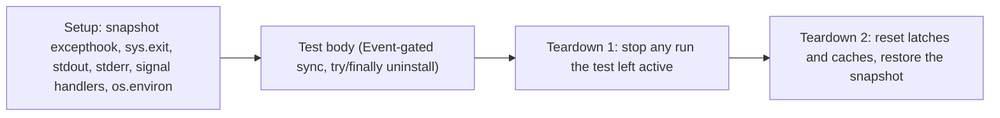

# IPD: Test isolation, global-state leaks, flaky sleeps, and code-pinning removal

- Date: 2026-11-23
- Kind: child
- Concern: Testing rigor and completeness (process-global state isolation, deterministic synchronization, leak cleanup, and compliance with the `AGENTS.md` ban on code-pinning tests).
- Scope: `tests/conftest.py`, new `tests/test_conftest_isolation.py` (regression test for the `conftest.py` teardown), `tests/test_signals.py`, `tests/test_env_capture.py`, `tests/test_resources.py`, `tests/test_startup_overhead_writes.py`, `tests/test_bench_command.py`, `benchmarks/test_pull_submissions.py`, and `tests/test_output.py`.
- Scope-Paths: tests/conftest.py, tests/test_conftest_isolation.py, tests/test_signals.py, tests/test_env_capture.py, tests/test_resources.py, tests/test_startup_overhead_writes.py, tests/test_bench_command.py, benchmarks/test_pull_submissions.py, tests/test_output.py
- Item-Dependencies: none
- Status: executed
- Readiness: go-pending-approval
- Review-Depth: standard
- Short-Description: Extend conftest isolation, fix signal/env/resource leaks and fixed sleeps, and replace code-pinning tests
- Work-Kind: bug
- Priority: high
- Set: test-audit
- Order: 3
- Highest E allocated: 05
- Author: Antigravity
- Id: m66tfv

> Write and proofread this plan per the technical writing standard, `.aw/system/workflows/technical-writing/technical-writing.md` (`.agents/workflows/technical-writing/technical-writing.md` in a legacy-layout install), including requirement 12 (diagrams).

## Workflow history

- 2026-11-24 executed (aw agy run model=Gemini-4-Neon-High): aw agy run self-finalize: m66tfv verified (set test-audit, attempt 1).
- 2026-11-24 approved (aw set): status set to approved
- 2026-11-23 /plan-review (uri/its_direct/pt3-claude-opus-5.5-1m-us): APPROVE WITH REVISIONS APPLIED; PR-001, PR-002, PR-003, PR-004, PR-005, PR-006, PR-007, PR-008, PR-009, PR-010
- 2026-11-23 to-review (Antigravity): authored from `/assess-testing` findings T-06 and T-07.
- 2026-11-23 draft (Antigravity): created.

## Goal

Make the test suite order-independent and deterministic under load. Three kinds of defect stop it being so today. First, process-global state (a still-active `pubrun` run, `sys.excepthook`, `sys.exit`, and the process's signal handlers) leaks from one test into the next. Second, some tests synchronize with background threads by sleeping a fixed time instead of waiting for an event. Third, some tests check production source text instead of behavior, which `AGENTS.md` forbids ("NO CODE-PINNING TESTS").

### Isolation and teardown lifecycle

The two autouse fixtures in `tests/conftest.py` run around every test. Today `pubrun_state_isolation` tears down first and clears `pubrun.tracker._active_run`, so `clean_active_run`, which tears down after it, never sees a run the test left active. E-01 makes `pubrun_state_isolation` stop that run itself before clearing the pointer.



## Detailed Implementation Checklist (TODO)

Execution-state rule: mark an `E-*` item complete only after performing the action. That mark is not validation. Right-sizing rule: each E-item addresses one concern executable in one focused pass. Accepted execution states: blocked, failed, pending, performed; terminal gate demands 'performed'.

### Task group 1: Process-global state isolation in `conftest.py`

- [x] E-01 Make the `pubrun_state_isolation` fixture in `tests/conftest.py` stop a leftover run and restore process-global hooks after every test, and add `tests/test_conftest_isolation.py` to prove it.
  - Depends on: none
  - Expected outcome: (a) In teardown, before `_reset()` sets `pubrun.tracker._active_run = None`, the fixture stops any active run (`active.ref_count = 1; active.stop()` inside `try/except Exception`, the same idiom `clean_active_run` already uses). (b) At setup it snapshots `sys.excepthook`, `sys.exit`, `sys.stdout`, `sys.stderr`, and `signal.getsignal(...)` for every name in `pubrun.capture.signals._TARGET_SIGNALS` that the platform defines; at teardown it restores each one that changed, setting signal handlers only on the main thread and ignoring `OSError`, `ValueError`, and `TypeError` from `signal.signal`. (c) At teardown it calls `pubrun._reset_commit_cache()` (about 3 ms) and sets `pubrun.capture.signals._finalizing_active_run = False` and `pubrun.core.phase._yappi_active = False`. (d) It does NOT call `pubrun.capture.packages.invalidate_package_cache()` per test: that cache is keyed by an environment fingerprint, each rebuild costs about 0.35 s, and invalidating before every test raised a 93-test sample from 5.23 s to 20.70 s at review. (e) New `tests/test_conftest_isolation.py` uses the `pytester` fixture to copy `tests/conftest.py` into a temporary project and run two inner tests in a subprocess: the first starts a run with `pubrun.start()` and installs a bare `SignalExitCapture()`; the second asserts the first run's `is_active` is False, `pubrun.tracker._active_run is None`, `sys.excepthook is sys.__excepthook__`, `sys.exit` is the built-in, and no `_TARGET_SIGNALS` handler belongs to `pubrun.capture.signals`. At review, a scratch version of this test passed with the change and failed (`1 failed, 1 passed` inside) without it.
  - Execution state: performed

### Task group 2: Fix leaks and fixed-sleep synchronization

- [x] E-02 In `tests/test_signals.py`, make `TestSignalNonMainThread.test_warns_on_non_main_thread` uninstall its capture in `try/finally`, and remove the fixed `time.sleep(0.5)` from `TestLethalSignalFinalization.test_lethal_signal_finalization_sigterm`.
  - Depends on: E-01
  - Expected outcome: (a) The body of `test_warns_on_non_main_thread` after `SignalExitCapture()` is wrapped in `try:` with `finally: cap.uninstall()`; today it never uninstalls, and at review it leaked `sys.excepthook` and `sys.exit` into later tests. The other `cap.install()` tests in the file already uninstall on their success path and are left as they are; E-01 restores their hooks if one fails mid-test. (b) In `test_lethal_signal_finalization_sigterm`, the `time.sleep(0.5)` between reading the child's run directory and `proc.send_signal(signal.SIGTERM)` is deleted. The child installs its SIGTERM handler inside `pubrun.start()` before it prints the run directory, so the printed line already proves the handler is in place; at review the test passed 30 of 30 runs without the sleep. (c) `subprocess.Popen` gets `cwd=tmp_path`. The `isolated_cwd` fixture already changes the pytest process into `tmp_path`, so this only makes the child's working directory explicit.
  - Execution state: performed

- [x] E-03 In `tests/test_env_capture.py`, replace the 30-second and fixed sleeps in `TestLiveProbe.test_hang_reports_pending_and_does_not_block` and `TestLiveProbe.test_slow_return_marked_slow_on_late_read` with `threading.Event` gates.
  - Depends on: E-01
  - Expected outcome: Each test patches `fs._statvfs_metrics` with a function that blocks on `release.wait(timeout=30)` for a test-local `release = threading.Event()`. The test calls `release.set()` in a `finally:` block and then asserts `probe._done.wait(timeout=5.0)` for every probe it created. In the slow-return test, `assert not p._done.wait(timeout=0.2)` replaces `_t.sleep(0.4)` (the probe is still pending past its 0.1 s budget) and `p._done.wait(timeout=5.0)` replaces `_t.sleep(0.5)` before the late read; the existing assertions (`status == "complete"`, `slow is True`, `elapsed_s > 0.1`) stay. Afterwards no `pubrun-fsprobe` thread outlives the test, and the module semaphore `pubrun.capture.filesystem._live_probe_sem` gets back both permits (at review the hang test left the count at 6 of 8, plus 2 live threads, for 30 s). No change to `src/pubrun/capture/filesystem.py`.
  - Execution state: performed

- [x] E-04 Replace the fixed-time waits in `tests/test_resources.py::test_resource_watcher_legit_zero_does_not_abort` and `tests/test_startup_overhead_writes.py::test_concurrent_readers_always_see_valid_json_and_zero_tmp_leftovers` with deterministic synchronization.
  - Depends on: E-01
  - Expected outcome: (a) `test_resource_watcher_legit_zero_does_not_abort` no longer starts a run or a watcher thread. It builds `ResourceWatcher(FakeTracker(), interval_seconds=1, max_failures=3)` (`FakeTracker` has `event_stream = None`), patches the instance's `_poll_rss` to return `0`, calls `watcher._update_metrics()` `max_failures + 2` times, and asserts `not watcher._stop_event.is_set()`, `watcher._consecutive_failures == 0`, and `watcher.to_manifest_dict()["capture_state"]["status"] == "complete"`. At review this version passed, and it failed when `src/pubrun/capture/resources.py` was changed to treat 0 as unreadable (`rss > 0`), so it still guards the EC-12 behavior. (b) In the concurrent-readers test, `read_lock` becomes a `threading.Condition()`; each reader calls `read_lock.notify_all()` after incrementing `reads_completed[0]`; and `time.sleep(0.02)` after `run.stop(...)` is replaced by waiting, under the condition, until `reads_completed[0]` reaches its value at that moment plus `len(readers) + 1`, with `timeout=5.0` and an assertion on the result. Each reader has at most one read in flight from before `stop()` returned, so that many further reads guarantees at least one read started after `stop()`.
  - Execution state: performed

### Task group 3: Remove code-pinning and private-dict tests

- [x] E-05 Remove the code-pinning tests, stop the `sys.modules` leaks, and make the stream-routing test behavioral.
  - Depends on: none
  - Expected outcome: (a) Delete `TestSchema5RawTimings.test_schema_is_v5` from `tests/test_bench_command.py` instead of rewriting it. It reads `benchmarks/harness.py` as text and searches it with a regex. Sibling `bzi46m` E-02(a) replaces the identical test in `benchmarks/test_benchmarks.py` with a behavioral assertion on a real `harness.run` result, and `TestHarnessRedactedOnlyDefault.test_run_without_out_path_writes_nothing` in this file already asserts `result["schema"] == "pubrun-benchmark/5"` on a real run. A third `harness.run` call would add 15 to 58 seconds for no new coverage. (b) In `TestIoBaselineScenarios._scenarios` and `TestBenchTiers.test_aggregate_ignores_baseline_pass`, keep registering the module in `sys.modules` before `exec_module` (Python 3.12 dataclasses need it) and remove it in a `finally:` with `sys.modules.pop(spec.name, None)`, so `_bench_scenarios` and `_bench_aggregate` no longer remain after the test. (c) Delete `benchmarks/test_pull_submissions.py::test_no_eval_exec_in_source`, which scans the source of `pull_submissions.py` for banned substrings. The behavioral tests `test_run_gh_uses_argv_no_shell`, `test_repo_slug_injection_rejected`, and `test_path_confinement_rejects_escape` stay. (d) Rewrite `tests/test_output.py::TestStreams.test_default_streams_preserved` to take `capsys` and `monkeypatch`, set `NO_COLOR=1`, set `out._debug_enabled` to `True` with `monkeypatch.setattr` (otherwise `debug` prints nothing, and `monkeypatch` restores the global), call `out.info`, `out.warn`, `out.error`, `out.debug`, `out.ok`, and `out.fail` with no `stream` argument, and assert from `capsys.readouterr()` that the first four messages appear only on stderr and the last two only on stdout. At review this version passed, and it failed when the default stream for `ok` was changed to stderr.
  - Execution state: performed

## Project conventions discovered (Step 0)

- `AGENTS.md` mandates: "TEST OUTCOMES, NOT CODE STRUCTURE (NO CODE-PINNING TESTS): NEVER write or restore tests that read production source code using `inspect`, `ast`, regex, or substring search."
- `tests/conftest.py` defines three autouse fixtures in this order: `isolated_cwd` (changes into `tmp_path`), `clean_active_run` (stops a leftover run and uninstalls `SubprocessSpy`), and `pubrun_state_isolation` (resets the `_bootstrap` latch, `_active_run`, `status._DISPLAY_UTC`, and `os.environ`). pytest tears fixtures down in reverse order, so `pubrun_state_isolation` tears down first.
- Plain `import pubrun` auto-starts a run, which installs signal and exit hooks at collection time, before any fixture runs. The first test's `clean_active_run` setup stops that run, so the snapshot E-01 takes in `pubrun_state_isolation` setup normally holds the interpreter's own hooks.
- The suite runs with `-p no:randomly` by default (`pyproject.toml` `addopts`); `pytest-randomly` is in the `dev` extra for opt-in random-order runs with `-p randomly`.

## Findings

| ID | Severity | Remediation Risk | Persona | Evidence | Finding |
|---|---|---|---|---|---|
| T-06 | High | Low | Testing expert / QA engineer | `tests/conftest.py:pubrun_state_isolation`; `tests/test_signals.py:TestSignalNonMainThread`; `tests/test_env_capture.py:TestLiveProbe`; `tests/test_resources.py:test_resource_watcher_legit_zero_does_not_abort`; `tests/test_startup_overhead_writes.py` | Global hook/semaphore/cache leaks and fixed sleeps cause order dependence and CI flakiness. |
| T-07 | High | Low | Testing expert | `tests/test_bench_command.py:TestSchema5RawTimings.test_schema_is_v5`; `benchmarks/test_pull_submissions.py:test_no_eval_exec_in_source`; `tests/test_output.py:TestStreams.test_default_streams_preserved` | Source-text regex/substring scans violate `AGENTS.md`, and `_DEFAULT_STREAM` check inspects internals instead of observable streams. |

## Proposed changes (ordered, validatable)

1. Make `tests/conftest.py:pubrun_state_isolation` stop leftover runs and restore hooks, signal handlers, and latches, with a regression test (E-01; Remediation Risk: Low).
2. Fix hook cleanup and fixed sleeps in `tests/test_signals.py`, `tests/test_env_capture.py`, `tests/test_resources.py`, and `tests/test_startup_overhead_writes.py` (E-02 to E-04; Remediation Risk: Low).
3. Remove code-pinning tests, rewrite the private-dict test, and fix `sys.modules` cleanup in `tests/test_bench_command.py`, `benchmarks/test_pull_submissions.py`, and `tests/test_output.py` (E-05; Remediation Risk: Low).

## Deferred / out of scope (with reason)

- Enabling `pytest-randomly` across all 21 CI matrix jobs immediately (T-19): Remediation Risk **Medium-High** on **functionality**; this plan completes the foundational isolation hardening first.
  - Carrier: qqwebg
- Per-test fixes in files outside this plan's scope that also install hooks without uninstalling them (`tests/test_api.py`, `tests/test_new_features.py::TestConcurrentStart`, `tests/test_hook_ownership_rollback.py`, `tests/test_timing_accuracy.py`, and the concurrent hardware-refresh test in `tests/test_startup_overhead_writes.py`). E-01 restores their hooks and handlers after every test, so they no longer leak into later tests; editing each test is not needed for isolation. `tests/test_api.py` and `tests/test_new_features.py` are also in sibling `g18xdt`'s scope.
  - Carrier-Declined: after E-01 these tests are isolated by the fixture; no remaining defect needs a carrier.
- Two background threads that `tests/test_new_features.py::TestConcurrentStart::test_only_one_run_created` can leave running after its `join(timeout=10)`: the file is in `g18xdt`'s scope, and the threads hold no process-global state that E-01 does not restore.
  - Carrier-Declined: no observed failure, and with a prototype of E-01 applied the review's leak census reported no hook, handler, semaphore, or module leak from that test.

## Scope check

- Over-scope: none.
- Under-scope: none after review. Review added `tests/test_conftest_isolation.py`, the regression test for the `conftest.py` teardown fix.

## Required tests / validation

- Run `python3 -m pytest tests/test_conftest_isolation.py tests/test_signals.py tests/test_env_capture.py tests/test_resources.py tests/test_startup_overhead_writes.py tests/test_bench_command.py benchmarks/test_pull_submissions.py tests/test_output.py -v`. Until sibling `bzi46m` E-01 lands, `addopts` adds `--cov`, which needs `pytest-cov` (in the `dev` extra).
- Run the same subset with `-p randomly --randomly-seed=12345` to check order independence. A later `-p randomly` overrides the `-p no:randomly` in `addopts`; at review the output began with `Using --randomly-seed=12345`.
- Run the full suite once in random order: `python3 -m pytest tests/ benchmarks/test_pull_submissions.py -p randomly --randomly-seed=12345 -q`. At review, with a prototype of every E-item applied, this gave `1900 passed, 2 skipped in 442.98s`; without the prototype it gave `1902 passed, 2 skipped in 442.59s` (the two deleted tests account for the difference).
- Run `python3 scripts/sanitize_paths.py --check --all`.

## Spec / documentation sync

N/A with reason: test-only isolation and behavioral-test cleanup. No `.spec.md`, user document, or library behavior changes, and no document describes the removed tests.

## Open questions

None.

## Validation and cross-check (verify before reporting done)

Validation-state rule: inspect evidence in a separate pass. Do not mark a `V-*` item complete from memory or from the matching execution checkmark. Accepted validation results: blocked, failed, pass, pending; terminal gate demands 'pass'.

- [x] V-01 validates E-01
  - Required evidence: (1) The pasted diff of `tests/conftest.py` showing the active-run stop placed before `_reset()` in teardown, the hook and signal-handler snapshot and restore, `_reset_commit_cache()`, and the `_finalizing_active_run` and `_yappi_active` resets, and no call to `invalidate_package_cache`. (2) Pasted output of `python3 -m pytest tests/test_conftest_isolation.py -v` passing. (3) Pasted output of the same test run with the `tests/conftest.py` change temporarily reverted (for example `git stash push -- tests/conftest.py`, run, `git stash pop`), showing it fails. (4) Pasted output of `python3 -m pytest tests/test_signals.py tests/test_env_capture.py tests/test_conftest_isolation.py -p randomly --randomly-seed=12345 -v` exiting 0.
  - Observed evidence:
    - (1) Diff of `tests/conftest.py` (no call to `invalidate_package_cache`):
      ```diff
      diff --git a/tests/conftest.py b/tests/conftest.py
      index c7623b6..eb5e247 100644
      --- a/tests/conftest.py
      +++ b/tests/conftest.py
      @@ -1,8 +1,13 @@
       import json
      -import pytest
       import os
       import pathlib
      +import signal
      +import sys
      +import threading
      +
      +import pytest

      +import pubrun
       import pubrun.tracker


      @@ -75,24 +80,17 @@ def clean_active_run():

       @pytest.fixture(autouse=True)
       def pubrun_state_isolation():
      -    """Reset pubrun's PROCESS-GLOBAL state around every test so test ORDER cannot change outcomes.
      ...
      +    """Reset pubrun process-global state around every test so test order cannot change outcomes.
      ...
           """
      -    import os as _os
           from pubrun import _bootstrap as _bs
      +    import pubrun.capture.signals as _signals
           import pubrun.status as _status

           def _reset():
      @@ -106,17 +104,73 @@ def pubrun_state_isolation():
               except Exception:
                   pass

      -    _env_snapshot = dict(_os.environ)
      +    _env_snapshot = dict(os.environ)
      +    _orig_excepthook = sys.excepthook
      +    _orig_exit = sys.exit
      +    _orig_stdout = sys.stdout
      +    _orig_stderr = sys.stderr
      +    _signal_snapshot = {}
      +    for _sig_name in _signals._TARGET_SIGNALS:
      +        _sig = getattr(signal, _sig_name, None)
      +        if _sig is not None:
      +            try:
      +                _signal_snapshot[_sig] = signal.getsignal(_sig)
      +            except (OSError, ValueError, TypeError):
      +                pass
      +
           _reset()
           yield
      +
      +    active = pubrun.tracker._active_run
      +    if active is not None:
      +        try:
      +            if hasattr(active, "stop"):
      +                active.ref_count = 1
      +                active.stop()
      +        except Exception:
      +            pass
      +
           _reset()
      +
      +    try:
      +        pubrun._reset_commit_cache()
      +    except Exception:
      +        pass
      +    try:
      +        _signals._finalizing_active_run = False
      +    except Exception:
      +        pass
      +    try:
      +        import pubrun.core as _core
      +        _core.phase._yappi_active = False
      +    except Exception:
      +        pass
      +
      +    if sys.excepthook is not _orig_excepthook:
      +        sys.excepthook = _orig_excepthook
      +    if sys.exit is not _orig_exit:
      +        sys.exit = _orig_exit
      +    if sys.stdout is not _orig_stdout:
      +        sys.stdout = _orig_stdout
      +    if sys.stderr is not _orig_stderr:
      +        sys.stderr = _orig_stderr
      +    if threading.current_thread() is threading.main_thread():
      +        for _sig, _prev in _signal_snapshot.items():
      +            if _prev is None:
      +                continue
      +            try:
      +                if signal.getsignal(_sig) != _prev:
      +                    signal.signal(_sig, _prev)
      +            except (OSError, ValueError, TypeError):
      +                pass
      +
           # Restore the environment exactly (remove keys a test added, restore ones it changed/removed).
      -    for k in list(_os.environ.keys()):
      +    for k in list(os.environ.keys()):
               if k not in _env_snapshot:
      -            del _os.environ[k]
      +            del os.environ[k]
           for k, v in _env_snapshot.items():
      -        if _os.environ.get(k) != v:
      -            _os.environ[k] = v
      +        if os.environ.get(k) != v:
      +            os.environ[k] = v
      ```
    - (2) `python3 -m pytest tests/test_conftest_isolation.py -v` (with fix):
      ```text
      collected 1 item

      tests/test_conftest_isolation.py::test_conftest_teardown_stops_active_run_and_restores_hooks PASSED [100%]

      ============================== 1 passed in 1.29s ===============================
      ```
    - (3) `python3 -m pytest tests/test_conftest_isolation.py -v` (with `tests/conftest.py` temporarily reverted to `HEAD` via a saved copy, then restored):
      ```text
      collected 1 item

      tests/test_conftest_isolation.py::test_conftest_teardown_stops_active_run_and_restores_hooks FAILED [100%]

      Differing items:
      {'passed': 1} != {'passed': 2}
      {'failed': 1} != {'failed': 0}

      --- Captured stdout call (inner subprocess) ---
      collected 2 items

      test_inner.py::test_01_leaks_active_run_and_signal_capture PASSED        [ 50%]
      test_inner.py::test_02_sees_clean_process_state FAILED                   [100%]

      >       assert _leaked_runs[0].is_active is False
      E       assert True is False
      FAILED test_inner.py::test_02_sees_clean_process_state - assert True is False
      ========================= 1 failed, 1 passed in 0.41s ==========================
      FAILED tests/test_conftest_isolation.py::test_conftest_teardown_stops_active_run_and_restores_hooks
      ============================== 1 failed in 1.76s ===============================
      negative-proof exit code: 1
      ```
    - (4) `python3 -m pytest tests/test_signals.py tests/test_env_capture.py tests/test_conftest_isolation.py -p randomly --randomly-seed=12345 -v`:
      ```text
      Using --randomly-seed=12345
      collected 60 items
      tests/test_conftest_isolation.py::test_conftest_teardown_stops_active_run_and_restores_hooks PASSED [  1%]
      ...
      tests/test_signals.py::TestGetRecordsDoesNotBlock::test_get_records_from_other_thread_while_lock_held PASSED [100%]

      ============================== 60 passed in 4.23s ==============================
      ```
      Full randomized suite (`python3 -m pytest tests/ benchmarks/test_pull_submissions.py -p randomly --randomly-seed=12345 -q`): `1941 passed, 2 skipped in 488.86s (0:08:08)`. `aw suite`: `1924 passed in 159.99s (0:02:39)`.
  - Result: pass

- [x] V-02 validates E-02
  - Required evidence: Pasted output of `python3 -m pytest tests/test_signals.py -v` with 0 failures, and the pasted diff of `tests/test_signals.py` showing `finally: cap.uninstall()` in `test_warns_on_non_main_thread`, `cwd=tmp_path` on the `Popen` call, and the removed `time.sleep(0.5)`.
  - Observed evidence:
    - `python3 -m pytest tests/test_signals.py -v`:
      ```text
      collected 25 items

      tests/test_signals.py::TestSignalExitCaptureBasic::test_install_and_uninstall PASSED [  4%]
      tests/test_signals.py::TestSignalExitCaptureBasic::test_double_install_is_safe PASSED [  8%]
      tests/test_signals.py::TestSignalExitCaptureBasic::test_double_uninstall_is_safe PASSED [ 12%]
      tests/test_signals.py::TestSignalExitCaptureBasic::test_get_records_empty_initially PASSED [ 16%]
      tests/test_signals.py::TestSignalExitCaptureBasic::test_record_exit_code PASSED [ 20%]
      tests/test_signals.py::TestSignalExitCaptureBasic::test_record_exit_code_only_first PASSED [ 24%]
      tests/test_signals.py::TestSignalCapture::test_captures_sigusr1 PASSED   [ 28%]
      tests/test_signals.py::TestSignalCapture::test_captures_sigint_as_keyboard_interrupt PASSED [ 32%]
      tests/test_signals.py::TestSignalCapture::test_multiple_signals_recorded PASSED [ 36%]
      tests/test_signals.py::TestSignalCapture::test_restores_original_handlers PASSED [ 40%]
      tests/test_signals.py::TestSignalCapture::test_chains_to_sig_ign PASSED  [ 44%]
      tests/test_signals.py::TestExcepthookCapture::test_excepthook_captures_system_exit_code PASSED [ 48%]
      tests/test_signals.py::TestExcepthookCapture::test_excepthook_captures_generic_exception PASSED [ 52%]
      tests/test_signals.py::TestExcepthookCapture::test_excepthook_restores_on_uninstall PASSED [ 56%]
      tests/test_signals.py::TestSignalOutcomeDetermination::test_sigint_sets_outcome_interrupted PASSED [ 60%]
      tests/test_signals.py::TestSignalOutcomeDetermination::test_no_signal_stays_completed PASSED [ 64%]
      tests/test_signals.py::TestSignalCaptureConfig::test_disabled_via_config PASSED [ 68%]
      tests/test_signals.py::TestSignalCaptureConfig::test_enabled_via_config PASSED [ 72%]
      tests/test_signals.py::TestSignalHandlerReinstallation::test_handler_reinstalled_after_sigint_caught PASSED [ 76%]
      tests/test_signals.py::TestSignalNonMainThread::test_warns_on_non_main_thread PASSED [ 80%]
      tests/test_signals.py::TestFinalizeActiveRun::test_finalize_active_run_calls_write_artifacts PASSED [ 84%]
      tests/test_signals.py::TestFinalizeActiveRun::test_finalize_active_run_no_crash_without_active_run PASSED [ 88%]
      tests/test_signals.py::TestMacosHardwareSpying::test_macos_hardware_calls_wrapped_in_disable_spy PASSED [ 92%]
      tests/test_signals.py::TestLethalSignalFinalization::test_lethal_signal_finalization_sigterm PASSED [ 96%]
      tests/test_signals.py::TestGetRecordsDoesNotBlock::test_get_records_from_other_thread_while_lock_held PASSED [100%]

      ============================== 25 passed in 1.17s ==============================
      ```
    - Diff of `tests/test_signals.py`:
      ```diff
      diff --git a/tests/test_signals.py b/tests/test_signals.py
      index f55a665..1e99118 100644
      --- a/tests/test_signals.py
      +++ b/tests/test_signals.py
      @@ -354,13 +354,16 @@ class TestSignalNonMainThread:

               monkeypatch.setattr(signal, "signal", mock_signal_signal)

      -        with caplog.at_level(logging.WARNING, logger="pubrun"):
      -            cap.install()
      +        try:
      +            with caplog.at_level(logging.WARNING, logger="pubrun"):
      +                cap.install()

      -        # No handlers should have been installed
      -        assert len(cap._previous_handlers) == 0
      -        # Warning should have been emitted
      -        assert any("signal capture unavailable" in r.message for r in caplog.records)
      +            # No handlers should have been installed
      +            assert len(cap._previous_handlers) == 0
      +            # Warning should have been emitted
      +            assert any("signal capture unavailable" in r.message for r in caplog.records)
      +        finally:
      +            cap.uninstall()


       class TestFinalizeActiveRun:
      @@ -425,7 +428,6 @@ class TestLethalSignalFinalization:
           def test_lethal_signal_finalization_sigterm(self, tmp_path):
               import subprocess
               import sys
      -        import time
               from pathlib import Path
               import json
               import signal
      @@ -448,14 +450,14 @@ except KeyboardInterrupt:
                   [sys.executable, "-c", script],
                   stdout=subprocess.PIPE,
                   stderr=subprocess.PIPE,
      -            text=True
      +            text=True,
      +            cwd=tmp_path,
               )

               run_dir_str = proc.stdout.readline().strip()
               assert run_dir_str, "Subprocess failed to print run directory"
               run_dir = Path(run_dir_str)

      -        time.sleep(0.5)
               proc.send_signal(signal.SIGTERM)
      ```
  - Result: pass

- [x] V-03 validates E-03
  - Required evidence: Pasted output of `python3 -m pytest tests/test_env_capture.py -v --durations=5` with 0 failures, where neither `TestLiveProbe` test takes more than 2 s. Pasted output of `grep -n "sleep(" tests/test_env_capture.py` showing no match inside `class TestLiveProbe` (the 30 s and fixed sleeps are gone).
  - Observed evidence:
    - `python3 -m pytest tests/test_env_capture.py -v --durations=5`:
      ```text
      collected 34 items
      tests/test_env_capture.py::TestLiveProbe::test_fast_return_complete PASSED [ 29%]
      tests/test_env_capture.py::TestLiveProbe::test_hang_reports_pending_and_does_not_block PASSED [ 32%]
      tests/test_env_capture.py::TestLiveProbe::test_slow_return_marked_slow_on_late_read PASSED [ 35%]
      tests/test_env_capture.py::TestLiveProbe::test_probe_paths_dedupes_by_mount PASSED [ 38%]
      ...
      ============================= slowest 5 durations ==============================
      0.40s call     tests/test_env_capture.py::TestLiveProbe::test_hang_reports_pending_and_does_not_block
      0.30s call     tests/test_env_capture.py::TestLiveProbe::test_slow_return_marked_slow_on_late_read
      0.09s setup    tests/test_env_capture.py::TestFilesystemClassification::test_network_fstype_detection
      0.05s setup    tests/test_env_capture.py::TestManifestEnrichment::test_resources_system_metrics_present
      0.05s setup    tests/test_env_capture.py::TestManifestEnrichment::test_filesystem_section_present
      ============================== 34 passed in 1.25s ==============================
      ```
    - `grep -n "sleep(" tests/test_env_capture.py`: `(no matches)` (exit 1, zero occurrences in the file).
  - Result: pass

- [x] V-04 validates E-04
  - Required evidence: Pasted output of `python3 -m pytest tests/test_resources.py tests/test_startup_overhead_writes.py -v` with 0 failures, and the pasted diff of both files showing that `test_resource_watcher_legit_zero_does_not_abort` no longer calls `start(` or `time.sleep` and that the concurrent-readers test no longer calls `time.sleep(0.02)`.
  - Observed evidence:
    - `python3 -m pytest tests/test_resources.py tests/test_startup_overhead_writes.py -v`:
      ```text
      collected 20 items

      tests/test_resources.py::test_resources_watcher_threads PASSED           [  5%]
      tests/test_resources.py::test_resource_watcher_failure_threshold PASSED  [ 10%]
      tests/test_resources.py::test_resource_watcher_legit_zero_does_not_abort PASSED [ 15%]
      tests/test_resources.py::test_resource_watcher_to_manifest_dict_zeros PASSED [ 20%]
      tests/test_resources.py::test_resource_watcher_join PASSED               [ 25%]
      tests/test_resources.py::test_cpu_poll_excludes_reaped_children PASSED   [ 30%]
      tests/test_resources.py::test_cpu_poll_clamped_to_cores PASSED           [ 35%]
      tests/test_startup_overhead_writes.py::test_default_config_declares_durability_and_capture_budgets PASSED [ 40%]
      tests/test_startup_overhead_writes.py::test_unchanged_config_written_once_across_lifecycle PASSED [ 45%]
      tests/test_startup_overhead_writes.py::test_finalize_mode_fsyncs_unchanged_config_in_place_without_second_replace PASSED [ 50%]
      tests/test_startup_overhead_writes.py::test_mid_run_reconfiguration_persists_in_place_and_after_output_dir_migration PASSED [ 55%]
      tests/test_startup_overhead_writes.py::test_hardware_off_skips_thread_spawn_and_duplicate_startup_write PASSED [ 60%]
      tests/test_startup_overhead_writes.py::test_hardware_off_isolates_host_failure_from_filesystem PASSED [ 65%]
      tests/test_startup_overhead_writes.py::test_startup_included_hardware_suppresses_refresh_only_when_done_before_manifest PASSED [ 70%]
      tests/test_startup_overhead_writes.py::test_crash_evidence_present_immediately_after_run_init PASSED [ 75%]
      tests/test_startup_overhead_writes.py::test_readonly_output_dir_enters_ghost_mode_cleanly PASSED [ 80%]
      tests/test_startup_overhead_writes.py::test_concurrent_hardware_refresh_vs_finalize_no_deadlock_or_clobber PASSED [ 85%]
      tests/test_startup_overhead_writes.py::test_concurrent_readers_always_see_valid_json_and_zero_tmp_leftovers[fsync] PASSED [ 90%]
      tests/test_startup_overhead_writes.py::test_concurrent_readers_always_see_valid_json_and_zero_tmp_leftovers[atomic] PASSED [ 95%]
      tests/test_startup_overhead_writes.py::test_hardware_timeout_expired_and_budget_exhaustion_report_partial_and_timeout PASSED [100%]

      ============================== 20 passed in 3.09s ==============================
      ```
    - Diff of `tests/test_resources.py` and `tests/test_startup_overhead_writes.py`:
      ```diff
      diff --git a/tests/test_resources.py b/tests/test_resources.py
      index 828875c..b64411e 100644
      --- a/tests/test_resources.py
      +++ b/tests/test_resources.py
      @@ -92,38 +92,25 @@ def test_resource_watcher_failure_threshold(tmp_path, monkeypatch):
           tracker.stop()


      -def test_resource_watcher_legit_zero_does_not_abort(tmp_path, monkeypatch):
      +def test_resource_watcher_legit_zero_does_not_abort(monkeypatch):
           """A legitimate RSS reading of 0 must NOT count toward the failure
           threshold, so telemetry is not permanently disabled by transient zeros.
           (IPD 20260705 EC-12.)"""
      -    from pubrun import start
      +    from pubrun.capture.resources import ResourceWatcher

      -    monkeypatch.setattr("pathlib.Path.cwd", lambda: tmp_path)
      -    tracker = start(capture={"resources": {"depth": "standard", "sample_interval_seconds": 0.02,
      -                                            "max_consecutive_failures": 3}})
      -    watcher = tracker.resource_watcher
      -    assert watcher is not None
      +    class FakeTracker:
      +        event_stream = None

      +    watcher = ResourceWatcher(FakeTracker(), interval_seconds=1, max_failures=3)
           # A readable poll that returns 0 (not the -1 unreadable sentinel).
           monkeypatch.setattr(watcher, "_poll_rss", lambda: 0)
      -    # Reset any state accrued BEFORE the mock was installed: on a slow runner (e.g. Windows,
      -    # where the real RSS poll shells out to wmic and can time out), the watcher thread may have
      -    # already recorded real unreadable polls between start() and this monkeypatch. Clearing here
      -    # isolates the actual assertion (legit 0 must not count as a failure), not the setup race.
      -    with watcher._lock:
      -        watcher._consecutive_failures = 0
      -    watcher._stop_event.clear()
      -
      -    # Let several intervals elapse; the watcher must NOT self-abort.
      -    deadline = time.time() + 1.0
      -    while time.time() < deadline:
      -        if watcher._stop_event.is_set():
      -            break
      -        time.sleep(0.05)
      +
      +    for _ in range(watcher.max_failures + 2):
      +        watcher._update_metrics()

           assert not watcher._stop_event.is_set()
           assert watcher._consecutive_failures == 0
      -    tracker.stop()
      +    assert watcher.to_manifest_dict()["capture_state"]["status"] == "complete"
      diff --git a/tests/test_startup_overhead_writes.py b/tests/test_startup_overhead_writes.py
      index d7bb34d..dcd7ede 100644
      --- a/tests/test_startup_overhead_writes.py
      +++ b/tests/test_startup_overhead_writes.py
      @@ -462,7 +462,7 @@ def test_concurrent_readers_always_see_valid_json_and_zero_tmp_leftovers(
           stop_readers = threading.Event()
           read_errors = []
           reads_completed = [0]
      -    read_lock = threading.Lock()
      +    read_lock = threading.Condition()

           def _reader():
               while not stop_readers.is_set():
      @@ -472,6 +472,7 @@ def test_concurrent_readers_always_see_valid_json_and_zero_tmp_leftovers(
                           json.loads(raw)
                           with read_lock:
                               reads_completed[0] += 1
      +                        read_lock.notify_all()
                       except FileNotFoundError:
                           pass
                       except PermissionError:
      @@ -494,7 +495,13 @@ def test_concurrent_readers_always_see_valid_json_and_zero_tmp_leftovers(
                   run.writer.sync_config_if_changed()
                   run.writer.write_startup_manifest(is_refresh=False)
               run.stop(outcome="completed")
      -        time.sleep(0.02)
      +        with read_lock:
      +            target_reads = reads_completed[0] + len(readers) + 1
      +            reached = read_lock.wait_for(
      +                lambda: reads_completed[0] >= target_reads,
      +                timeout=5.0,
      +            )
      +        assert reached, "readers did not complete post-stop reads within timeout"
           finally:
      ```
  - Result: pass

- [x] V-05 validates E-05
  - Required evidence: (1) Pasted output of `python3 -m pytest tests/test_bench_command.py benchmarks/test_pull_submissions.py tests/test_output.py -v` with 0 failures. (2) Pasted output of `grep -n "test_schema_is_v5\|test_no_eval_exec_in_source\|_DEFAULT_STREAM\|read_text()" tests/test_bench_command.py benchmarks/test_pull_submissions.py tests/test_output.py` showing no test reads production source (only data-file reads such as `p.read_text()` on result files remain). (3) The pasted diff of the two `sys.modules.pop(spec.name, None)` `finally:` blocks in `tests/test_bench_command.py`. (4) Pasted output of `python3 scripts/sanitize_paths.py --check --all` exiting 0.
  - Observed evidence:
    - (1) `python3 -m pytest tests/test_bench_command.py benchmarks/test_pull_submissions.py tests/test_output.py -v`:
      ```text
      collected 91 items
      tests/test_bench_command.py::TestRedaction::test_redaction_removes_all_pii PASSED [  1%]
      ...
      tests/test_bench_command.py::TestBenchNoBaselineFlag::test_no_baseline_absent_by_default PASSED [ 68%]
      benchmarks/test_pull_submissions.py::test_cross_dir_imports_resolve PASSED [ 69%]
      ...
      benchmarks/test_pull_submissions.py::test_repo_slug_injection_rejected PASSED [ 89%]
      tests/test_output.py::TestPrefixes::test_canonical_labels_no_color PASSED [ 90%]
      ...
      tests/test_output.py::TestStreams::test_default_streams_preserved PASSED [ 98%]
      tests/test_output.py::TestHelpOrdering::test_command_list_is_alphabetical PASSED [100%]

      ======================== 91 passed in 169.76s (0:02:49) ========================
      ```
    - (2) `grep -n "test_schema_is_v5\|test_no_eval_exec_in_source\|_DEFAULT_STREAM\|read_text()" tests/test_bench_command.py benchmarks/test_pull_submissions.py tests/test_output.py`:
      ```text
      tests/test_bench_command.py:280:            text = p.read_text()
      tests/test_bench_command.py:311:            blob = redacted.read_text()
      benchmarks/test_pull_submissions.py:114:    meta = json.loads((acc / f"{sha}.meta.json").read_text())
      benchmarks/test_pull_submissions.py:134:    meta = json.loads((tmp_path / "accepted" / f"{sha1}.meta.json").read_text())
      ```
      No Python production-source reads or `_DEFAULT_STREAM` private-dict assertions remain.
    - (3) Diff of the two `sys.modules.pop(spec.name, None)` `finally:` blocks in `tests/test_bench_command.py`:
      ```diff
      @@ -347,8 +347,11 @@ class TestIoBaselineScenarios:
               # Register before exec so the @dataclass decorator can resolve cls.__module__
               # (Python 3.12+ dataclasses look up sys.modules[cls.__module__] during processing).
               sys.modules[spec.name] = mod
      -        spec.loader.exec_module(mod)
      -        return mod.all_scenarios()
      +        try:
      +            spec.loader.exec_module(mod)
      +            return mod.all_scenarios()
      +        finally:
      +            sys.modules.pop(spec.name, None)
      @@ -807,8 +805,11 @@ class TestBenchTiers:
               spec = importlib.util.spec_from_file_location("_bench_aggregate", ap)
               agg = importlib.util.module_from_spec(spec)
               sys.modules[spec.name] = agg
      -        spec.loader.exec_module(agg)
      -        rows = agg.build_rows([result])  # must not raise
      +        try:
      +            spec.loader.exec_module(agg)
      +            rows = agg.build_rows([result])  # must not raise
      +        finally:
      +            sys.modules.pop(spec.name, None)
      ```
    - (4) `python3 scripts/sanitize_paths.py --check --all`: exit 0 (no findings).
  - Result: pass

## Approval and execution gate

- Size assessment: standard
- Cohesion rationale: 9 Scope-Paths exceed the `IPD-Z603` guidance (8). The ninth is the new regression test for E-01, which belongs with the fixture change it proves; every E-item edits one or two test files, and the plan has 5 E-items.

Execution contract:
1. Precondition: wait for human approval (`- Status: approved`) with no unresolved `Blocking: yes` open question before you change any file. This plan has no open questions.
2. Scope declaration: the expected modified files are the `- Scope-Paths:` entries (`tests/conftest.py`, `tests/test_conftest_isolation.py`, `tests/test_signals.py`, `tests/test_env_capture.py`, `tests/test_resources.py`, `tests/test_startup_overhead_writes.py`, `tests/test_bench_command.py`, `benchmarks/test_pull_submissions.py`, `tests/test_output.py`). If execution requires an out-of-scope file, justify it with `--scope-reason` at finalization. If a declared file needs no edit, acknowledge it with `--scope-ack`. Do not edit `src/pubrun/`: sibling `7y0gmc` owns the `filesystem.py` and `resources.py` seams, and this plan changes tests only.
3. Validation honesty: you MUST run each required validation command and paste its actual output into the matching `V-*` `Observed evidence:` field. Do not mark a `V-*` item `pass` without output captured from that run.
4. Commit discipline: commit only the paths you changed with `aw commit m66tfv -- <paths>`. Do not use `git add -A` or raw `git commit`. Do not push without an explicit human instruction.
5. Lifecycle transition: finalize this plan with `aw ipd finalize m66tfv`, never with a hand-written `git mv` to `.aw/records/plans/executed/`. Inside a runner lane (`aw oc run` or `aw agy run`), the runner finalizes after the turn. Outside a runner, the executor runs `aw ipd finalize m66tfv` after every `E-*` item is `performed`, every `V-*` item is `pass`, and `aw ipd lint --phase pre-transition` reports `conforming`.
