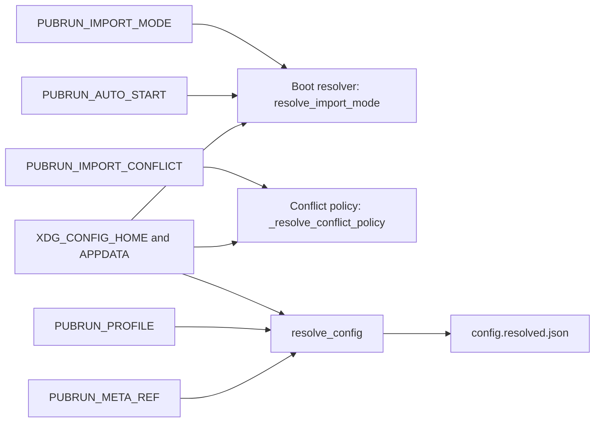

# IPD: Sync functional spec sections 3.4, 10.2, and 10.3 with six import modes, XDG_CONFIG_HOME, and boot env vars

- Date: 2026-11-24
- Kind: child
- Concern: Three sections of `docs/functional_spec.md` disagree with the code. Section 3.4 says pubrun has five import modes, but `src/pubrun/_modes.py::MODES` defines six. Section 10.2 omits `XDG_CONFIG_HOME` from the user home config path and lists `PUBRUN_AUTO_START` as an input to the configuration merge, which it is not. Section 10.3 omits the boot-time environment variables `PUBRUN_IMPORT_MODE` and `PUBRUN_IMPORT_CONFLICT`, and the directory variables `XDG_CONFIG_HOME` and `APPDATA`.
- Scope: Edit `docs/functional_spec.md` sections "3.4 Import Modes", "10.2 Configuration Discovery", and "10.3 Supported Environment Variables" so that they match `src/pubrun/_modes.py`, `src/pubrun/_config_boot.py`, `src/pubrun/config.py`, and `src/pubrun/_bootstrap.py`. No other section or file changes.
- Scope-Paths: docs/functional_spec.md
- Scope-Exceeded: .aw/records/backlog/open/20261125-aqb2bu-01-aqb2bu-document-pubrun-run-mode-override-in-functional-sp.backlog.md (Filed required defect-report backlog carrier aqb2bu for PUBRUN_RUN_MODE_OVERRIDE missing from docs/functional_spec.md sections 10.2 and 10.3 and docs/configuration.md)
- Item-Dependencies: none
- Status: executed
- Readiness: go-pending-approval
- Review-Depth: standard
- Short-Description: Sync docs/functional_spec.md sections 3.4, 10.2, and 10.3 with six import modes, XDG_CONFIG_HOME, and boot env vars
- Work-Kind: followup
- Priority: low
- From-Backlog: mv1g3x
- Set: mv1g3x
- Order: 1
- Highest E allocated: 03
- Author: opencode
- Id: q4f9wi

> Write and proofread this plan per the technical writing standard, `.aw/system/workflows/technical-writing/technical-writing.md` (`.agents/workflows/technical-writing/technical-writing.md` in a legacy-layout install), including requirement 12 (diagrams).

## Workflow history

- 2026-11-25 executed (aw agy run model=Gemini-4-Neon-High): aw agy run self-finalize: q4f9wi verified (set mv1g3x, attempt 1). [Scope reconciliation - out-of-scope .aw/records/backlog/open/20261125-aqb2bu-01-aqb2bu-document-pubrun-run-mode-override-in-functional-sp.backlog.md: Filed required defect-report backlog carrier aqb2bu for PUBRUN_RUN_MODE_OVERRIDE missing from docs/functional_spec.md sections 10.2 and 10.3 and docs/configuration.md]
- 2026-11-25 approved (aw set): status set to approved
- 2026-11-25 /plan-review (Antigravity): APPROVE WITH REVISIONS APPLIED; PR-001, PR-002, PR-003 fixed; review record `.aw/records/reviews/20261124-mv1g3x-01-q4f9wi-sync-functional-spec-sections-3-4-10-2-and-10-3-with-six-imp.review.md`.
- 2026-11-25 to-review (opencode): graduated from backlog item `mv1g3x` into a review-ready plan.
- 2026-11-25 draft (opencode): created.

## Goal

A reader of `docs/functional_spec.md` gets correct answers to three questions: how many import modes exist, where the user home config file lives, and which environment variables pubrun reads and which component reads each one. Backlog item `mv1g3x` asks for this. Plan `mspqm6` (executed) filed the item after it synchronized sections 3.2 and 3.3 of the same file and left sections 3.4, 10.2, and 10.3 unchanged.

## Detailed Implementation Checklist (TODO)

Execution-state rule: mark an `E-*` item complete only after performing the action. That mark is not validation. Right-sizing rule: write for a modest executor that cannot hold much in its head. Each E-item is one step (one concern, about one file, executable in one focused pass) and its V-item names each unit it covers with its own check; a plan stays at about 5 E-items and 8 work Scope-Paths, else split it into more child plans (guidance, `IPD-Z603`). Accepted execution states: blocked, failed, pending, performed; terminal gate demands 'performed'.

### Task group 1: Documentation (`docs/functional_spec.md`)

- [x] E-01 In `docs/functional_spec.md#3.4 Import Modes`, apply "Proposed changes" item 1: change the mode count from five to six, and add the paragraph about name-based mode selection after the mode table.
  - Depends on: none
  - Expected outcome: (1) The line "The library supports five namespaced import modes via submodule imports:" is replaced by the line in "Proposed changes" item 1a. (2) The paragraph in "Proposed changes" item 1b appears directly after the mode table and before the paragraph that starts "These flags express what each mode **permits**". (3) The Python code block, the mode table, and every other line of section 3.4 are unchanged, including the sentence "Only the launch-time `pubrun run --mode <mode>` overrides the in-code import." (see "Deferred / out of scope").
  - Execution state: performed

- [x] E-02 In `docs/functional_spec.md#10.2 Configuration Discovery`, apply "Proposed changes" item 2: replace table rows 2 and 5, and add two paragraphs after the existing paragraph that follows the table.
  - Depends on: none
  - Expected outcome: (1) Table row 2 (User home config) and table row 5 (Environment variables) read exactly as in "Proposed changes" item 2a. (2) The two paragraphs in "Proposed changes" item 2b appear after the paragraph that starts "When both `.pubrun.toml` and `.config/pubrun/config.toml` exist". (3) The introductory line, the other four table rows, and that existing paragraph are unchanged.
  - Execution state: performed

- [x] E-03 In `docs/functional_spec.md#10.3 Supported Environment Variables`, apply "Proposed changes" item 3: replace the three-row table with the seven-row table.
  - Depends on: none
  - Expected outcome: (1) The table in section 10.3 is identical to the table in "Proposed changes" item 3. (2) The `PUBRUN_PROFILE` and `PUBRUN_META_REF` rows keep their current text. (3) No line outside section 10.3 changes as part of this item.
  - Execution state: performed

## Project conventions discovered (Step 0)

- `docs/functional_spec.md` is user-facing documentation. The dash rule in `AGENTS.md` ("Agent execution contract") applies: lines that this plan adds or edits must contain no em dash (U+2014) and no en dash (U+2013). Untouched lines that already contain em dashes (for example the two-item numbered list after the mode table in section 3.4) stay unchanged.
- Section 10.3 rows end with a "Consumed in ..." sentence that names the component that reads the variable. The existing wordings are "Consumed in `resolve_config()` between local config and API overrides." and "Consumed in the boot sequence (not in `resolve_config`)." The new rows reuse these wordings.
- `docs/configuration.md#Configuration Discovery` and `docs/architecture.md#Initialization` already describe the `XDG_CONFIG_HOME` rule and the boot resolver correctly. The new text uses the same terms ("user home config", "boot resolver", "treated as unset").
- Plan `mspqm6` (executed, commit `a47fc45`) is the precedent for this kind of change. It synchronized sections 3.2 and 3.3 of the same file, verified each change with `git diff`, a dash count, and `python3 scripts/sanitize_paths.py --check --all`, and added no `CHANGELOG.md` entry.
- Cite code by SYMBOL (`module.function`) or by a quoted content string, with a line number only appended to one of those and never alone: an offset expires before this plan executes (advisory `IPD-C801`).

## Findings

Measured at authoring on Linux at `HEAD` `aa2cbc9` (and verified at review against `HEAD` `663c2ea`).

### Stale statements

| # | Location in `docs/functional_spec.md` | Current text | What the code does |
|---|---|---|---|
| F-1 | 3.4 Import Modes, first line | "The library supports five namespaced import modes via submodule imports:" | `src/pubrun/_modes.py::MODES` has six keys: `auto`, `noauto`, `nopatch`, `noconsole`, `minimal`, `full`. The table directly below the sentence already has six rows. |
| F-2 | 3.4 Import Modes | No statement that `PUBRUN_IMPORT_MODE` and `[imports].mode` accept the same six names. | `src/pubrun/_config_boot.py::resolve_import_mode` accepts any name in `src/pubrun/_modes.py::VALID_MODES` after `.strip().lower()`. An unrecognized name falls through to the next source. |
| F-3 | 10.2 Configuration Discovery, row 2 | "`~/.config/pubrun/config.toml` (or `%APPDATA%/pubrun/config.toml` on Windows)" | `src/pubrun/config.py::get_global_config_dir` uses `%APPDATA%/pubrun` on Windows when `APPDATA` is non-empty, else `$XDG_CONFIG_HOME/pubrun` when `XDG_CONFIG_HOME` is non-empty, else `~/.config/pubrun`. Empty or whitespace-only values count as unset. `src/pubrun/_config_boot.py::_global_config_dir` applies the same rule. |
| F-4 | 10.2 Configuration Discovery, row 5 | "`PUBRUN_PROFILE`, `PUBRUN_AUTO_START`, `PUBRUN_META_REF`" | `src/pubrun/config.py::_resolve_layers` adds environment layers only for `PUBRUN_PROFILE` and `PUBRUN_META_REF`. `PUBRUN_AUTO_START` is not merged, so `config.resolved.json` does not reflect it. Section 10.3 of the same file already says `PUBRUN_AUTO_START` is "not in `resolve_config`". |
| F-5 | 10.3 Supported Environment Variables | Three rows: `PUBRUN_PROFILE`, `PUBRUN_AUTO_START`, `PUBRUN_META_REF`. | The code also reads `PUBRUN_IMPORT_MODE` (`src/pubrun/_config_boot.py::resolve_import_mode`), `PUBRUN_IMPORT_CONFLICT` (`src/pubrun/_bootstrap.py::_resolve_conflict_policy`), and `XDG_CONFIG_HOME` and `APPDATA` (both config-directory functions named in F-3). |

### Which component reads each environment variable

The flowchart shows the consumers. The boot resolver runs during import-mode resolution, and the conflict-policy check runs lazily when two imports request conflicting modes. `resolve_config` builds the merged configuration that a run writes to `config.resolved.json`. Only `XDG_CONFIG_HOME` and `APPDATA` reach both boot-time and `resolve_config` paths, because both locate the user home config file.



### Runtime probe

The probe runs the real functions with a controlled environment. At authoring it ran from the repository root in a scratch directory `.mv1g3x_probe` (removed at the end):

```sh
mkdir -p .mv1g3x_probe
(cd .mv1g3x_probe && env -u PUBRUN_AUTO_START -u PUBRUN_IMPORT_CONFLICT -u XDG_CONFIG_HOME -u APPDATA HOME=/nonexistent-mv1g3x PUBRUN_IMPORT_MODE=minimal PYTHONPATH=../src python3 - <<'EOF'
import os, sys
from pubrun import config as c, _config_boot as b, _bootstrap as bs
from pubrun._modes import VALID_MODES
def dirs():
    return "%s | %s" % (c.get_global_config_dir(), b._global_config_dir())
print("P1 modes:", len(VALID_MODES), sorted(VALID_MODES))
print("P2 XDG unset:", dirs())
os.environ["XDG_CONFIG_HOME"] = "/xdg-probe"; print("P3 XDG set:", dirs())
os.environ["XDG_CONFIG_HOME"] = "   "; print("P4 XDG blank:", dirs())
os.environ["XDG_CONFIG_HOME"] = "/xdg-probe"
real = sys.platform; sys.platform = "win32"
os.environ["APPDATA"] = "C:/AppData-probe"; print("P5 win32, APPDATA set:", dirs())
os.environ["APPDATA"] = " "; print("P6 win32, APPDATA blank:", dirs())
sys.platform = real; del os.environ["APPDATA"]; del os.environ["XDG_CONFIG_HOME"]
for m in (" FULL ", "bogus"):
    os.environ["PUBRUN_IMPORT_MODE"] = m; print("P7 PUBRUN_IMPORT_MODE=%r:" % m, b.resolve_import_mode())
os.environ["PUBRUN_IMPORT_MODE"] = ""; os.environ["PUBRUN_AUTO_START"] = " Off "
print("P8 PUBRUN_AUTO_START=' Off ':", b.resolve_import_mode())
os.environ["PUBRUN_IMPORT_MODE"] = "noconsole"; os.environ["PUBRUN_IMPORT_CONFLICT"] = "error"
cfg = c.resolve_config()
print("P9 resolve_config:", cfg["core"]["auto_start"], cfg["imports"]["mode"], cfg["imports"]["on_conflict"])
for v in (" ERROR ", "bogus"):
    bs._conflict_policy = None; os.environ["PUBRUN_IMPORT_CONFLICT"] = v
    print("P10 PUBRUN_IMPORT_CONFLICT=%r:" % v, bs._resolve_conflict_policy())
EOF
)
rm -rf .mv1g3x_probe
```

The probe printed this at authoring:

```text
P1 modes: 6 ['auto', 'full', 'minimal', 'noauto', 'noconsole', 'nopatch']
P2 XDG unset: /nonexistent-mv1g3x/.config/pubrun | /nonexistent-mv1g3x/.config/pubrun
P3 XDG set: /xdg-probe/pubrun | /xdg-probe/pubrun
P4 XDG blank: /nonexistent-mv1g3x/.config/pubrun | /nonexistent-mv1g3x/.config/pubrun
P5 win32, APPDATA set: C:/AppData-probe/pubrun | C:/AppData-probe/pubrun
P6 win32, APPDATA blank: /xdg-probe/pubrun | /xdg-probe/pubrun
P7 PUBRUN_IMPORT_MODE=' FULL ': ('full', 'env:PUBRUN_IMPORT_MODE')
P7 PUBRUN_IMPORT_MODE='bogus': ('auto', 'default')
P8 PUBRUN_AUTO_START=' Off ': ('noauto', 'env:PUBRUN_AUTO_START')
P9 resolve_config: True auto warn
P10 PUBRUN_IMPORT_CONFLICT=' ERROR ': error
P10 PUBRUN_IMPORT_CONFLICT='bogus': warn
```

What each line establishes:

- P1 supports F-1: six modes.
- P2 to P6 support F-3. Each line prints the directory from `src/pubrun/config.py::get_global_config_dir`, then the directory from `src/pubrun/_config_boot.py::_global_config_dir`, and the two always agree. P5 and P6 set `sys.platform` to `"win32"` inside the process to reach the Windows branch on Linux. P6 shows that on Windows a blank `APPDATA` falls back to the `XDG_CONFIG_HOME` rule.
- P7 and P8 support F-2 and the new section 10.3 rows: case and surrounding whitespace are ignored, and an unrecognized `PUBRUN_IMPORT_MODE` falls through to the default.
- P9 supports F-4. With `PUBRUN_AUTO_START=" Off "`, `PUBRUN_IMPORT_MODE=noconsole`, and `PUBRUN_IMPORT_CONFLICT=error` all set, `resolve_config()` still returns `core.auto_start = True`, `imports.mode = "auto"`, and `imports.on_conflict = "warn"` (the built-in defaults). A separate check at authoring ran `import pubrun` with `PUBRUN_IMPORT_MODE=noconsole` and `PUBRUN_IMPORT_CONFLICT=error` and read the run's `config.resolved.json`. It contained the same default values.
- P10 supports the `PUBRUN_IMPORT_CONFLICT` row: matching ignores case and whitespace, and an unrecognized value leaves the default `warn` (no config file sets `[imports].on_conflict` in the probe).

A second probe supports the precedence sentence in the new `PUBRUN_IMPORT_MODE` row. A submodule import selects its mode before the boot resolver runs (`src/pubrun/noauto.py` calls `select_mode("noauto", "pubrun.noauto", "explicit")`), so the environment variable does not override it. Run from the repository root:

```sh
env -u PUBRUN_AUTO_START PUBRUN_IMPORT_MODE=full PYTHONPATH=src python3 -c "import pubrun.noauto as p; from pubrun._bootstrap import get_selected_mode; print('P11 selected:', get_selected_mode(), 'run active:', p.get_current_run() is not None)"
```

It printed:

```text
P11 selected: noauto run active: False
```

## Proposed changes (ordered, validatable)

1. **Section 3.4 Import Modes (E-01).**

   a. Replace the line "The library supports five namespaced import modes via submodule imports:" with:

   ```markdown
   The library supports six import modes. A script selects a mode with a submodule import:
   ```

   b. Insert this paragraph, preceded and followed by a blank line, between the mode table and the paragraph that starts "These flags express what each mode **permits**":

   ```markdown
   The `PUBRUN_IMPORT_MODE` environment variable and the `[imports].mode` config key accept the same six mode names (see Section 10.3). Matching ignores case and surrounding whitespace. An unrecognized name is ignored, and the boot resolver continues with the next source.
   ```

2. **Section 10.2 Configuration Discovery (E-02).**

   a. Replace table rows 2 and 5 with these lines:

   ```markdown
   | 2 | User home config | `$XDG_CONFIG_HOME/pubrun/config.toml`, else `~/.config/pubrun/config.toml` (`%APPDATA%/pubrun/config.toml` on Windows when `APPDATA` is set) |
   | 5 | Environment variables | `PUBRUN_PROFILE`, `PUBRUN_META_REF` |
   ```

   b. After the paragraph that starts "When both `.pubrun.toml` and `.config/pubrun/config.toml` exist", insert these two paragraphs, each preceded by a blank line:

   ```markdown
   An empty or whitespace-only `XDG_CONFIG_HOME` or `APPDATA` is treated as unset. On Windows, when `APPDATA` is unset, the user home config follows the `XDG_CONFIG_HOME` rule. The boot resolver (Section 3.2) uses the same user home config path.

   `PUBRUN_IMPORT_MODE`, `PUBRUN_AUTO_START`, and `PUBRUN_IMPORT_CONFLICT` are not part of this merge. The boot sequence reads them during import-mode resolution and conflict handling (Sections 3.2 and 3.3), so they do not change the values recorded in `config.resolved.json`.
   ```

3. **Section 10.3 Supported Environment Variables (E-03).** Replace the whole table with:

   ```markdown
   | Variable | Effect |
   |---|---|
   | `PUBRUN_IMPORT_MODE` | Selects the import mode: `auto`, `noauto`, `nopatch`, `noconsole`, `minimal`, or `full`. Overrides `PUBRUN_AUTO_START` and `[imports].mode`. A submodule import such as `import pubrun.noauto` takes precedence over it (Section 3.4). Matching ignores case and surrounding whitespace; any other value is ignored. `pubrun run --mode` sets it in the child process (Section 11.13). Consumed in the boot sequence (not in `resolve_config`). |
   | `PUBRUN_PROFILE` | Overrides `[core].profile`. Consumed in `resolve_config()` between local config and API overrides. |
   | `PUBRUN_AUTO_START` | Overrides `[core].auto_start`. `"1"`, `"true"`, `"yes"`, and `"on"` select `auto` mode; `"0"`, `"false"`, `"no"`, and `"off"` select `noauto` mode (Section 3.3). Used only when `PUBRUN_IMPORT_MODE` is unset or invalid. Consumed in the boot sequence (not in `resolve_config`). |
   | `PUBRUN_META_REF` | Sets `[core].meta_ref`. Consumed in `resolve_config()` between local config and API overrides. |
   | `PUBRUN_IMPORT_CONFLICT` | Overrides `[imports].on_conflict`: `ignore`, `warn`, or `error`. Matching ignores case and surrounding whitespace; any other value is ignored. Applies when two imports request different modes. Consumed in the boot sequence (not in `resolve_config`). |
   | `XDG_CONFIG_HOME` | Base directory of the user home config (Section 10.2) when not on Windows, or on Windows when `APPDATA` is unset. Empty or whitespace-only means unset, and the base directory is then `~/.config`. Read by both the boot sequence and `resolve_config()`. |
   | `APPDATA` | Windows only. Base directory of the user home config when set. Empty or whitespace-only means unset. Read by both the boot sequence and `resolve_config()`. |
   ```

## Deferred / out of scope (with reason)

- The sentence in section 3.4 "Only the launch-time `pubrun run --mode <mode>` overrides the in-code import." is false. At authoring, `python3 -m pubrun run --mode minimal -- python3 -c 'import pubrun.full as p; ...'` printed `env minimal selected full run active True`: the in-code `import pubrun.full` won. The same claim appears in `docs/api.md`, `docs/configuration.md`, `README.md`, and the `src/pubrun/full.py` docstring. Correcting it needs a maintainer decision (implement the override, or change the documents), so this plan leaves the sentence unchanged. Backlog item `oubh58` was filed during this authoring turn to carry it.
  - Carrier: oubh58
- The `PUBRUN_IMPORT_MODE` row of `docs/configuration.md#Environment Variables` lists five modes and omits `full`. That file is outside this backlog item. Backlog item `4ht7x4` was filed during this authoring turn to carry it.
  - Carrier: 4ht7x4
- Rewording the `PUBRUN_PROFILE` row of section 10.3. `docs/configuration.md` calls `PUBRUN_PROFILE` "Deprecated and inert". The current row is still accurate, because `PUBRUN_PROFILE` does set `[core].profile`, and section 6 of `docs/functional_spec.md` already says the profile value does not map to capture depth.
  - Carrier-Declined: the current row is accurate, and the backlog item names only import modes, `XDG_CONFIG_HOME`, and boot environment variables.
- Documenting `PUBRUN_DEBUG` in section 10.3. `src/pubrun/report/output.py` reads it to show debug lines in command-line output. It is not a boot or configuration variable, and `docs/cli.md` already documents it.
  - Carrier-Declined: `PUBRUN_DEBUG` is outside the boot and configuration scope of the backlog item and is documented in `docs/cli.md`.
- A `CHANGELOG.md` entry. The change corrects documentation and changes no behavior. Plan `mspqm6`, the precedent on the same file, added no entry.
  - Carrier-Declined: documentation-only corrections in this repository do not receive changelog entries (precedent `mspqm6`, commit `a47fc45`).

## Scope check

- Over-scope: none. The plan edits three sections of one file.
- Under-scope: none. No code or test change is needed, because the Findings probe shows the code already behaves as the new text describes. The stale claim about `pubrun run --mode` (carrier `oubh58`) is a separate defect that needs a maintainer decision.

## Required tests / validation

- `git diff -- docs/functional_spec.md` shows changes only inside sections 3.4, 10.2, and 10.3, and each changed line matches "Proposed changes".
- Section 3.4 text check (must print `old=0 new=1` and exit `0`):
  `python3 -c "import pathlib, sys; t = pathlib.Path('docs/functional_spec.md').read_text(encoding='utf-8'); o = t.count('five namespaced'); n = t.count('The library supports six import modes'); print(f'old={o} new={n}'); sys.exit(0 if (o == 0 and n == 1) else 1)"`
- Before committing `docs/functional_spec.md`, run the working-tree dash check (must assert at least one added line and exit `0` with `dashes=0`):
  `python3 -c "import subprocess, sys; lines = [l for l in subprocess.check_output(['git', 'diff', '-U0', '--', 'docs/functional_spec.md'], text=True).splitlines() if l.startswith('+') and not l.startswith('+++')]; assert lines, 'no added docs/functional_spec.md lines in working tree'; bad = [l for l in lines if '\u2014' in l or '\u2013' in l]; print(f'added_lines={len(lines)} dashes={len(bad)}'); sys.exit(1 if bad else 0)"`
- Fail-closed mode-name and environment-variable cross-checks (each prints `OK` and exits `0` only when zero items are missing):

  ```sh
  # Mode-name cross-check: the PUBRUN_IMPORT_MODE row names every mode in VALID_MODES.
  PYTHONPATH=src python3 -c "import pathlib, sys; from pubrun._modes import VALID_MODES; t = pathlib.Path('docs/functional_spec.md').read_text(encoding='utf-8'); rows = [l for l in t.splitlines() if l.startswith('| \`PUBRUN_IMPORT_MODE\` |')]; assert len(rows) == 1, rows; missing = sorted(m for m in VALID_MODES if f'\`{m}\`' not in rows[0]); assert not missing, f'missing modes: {missing}'; print('OK')"
  # Environment-variable cross-check: section 10.3 has a row for each of the seven variables.
  python3 -c "import pathlib; t = pathlib.Path('docs/functional_spec.md').read_text(encoding='utf-8'); s = t[t.index('### 10.3'):t.index('### 10.4')]; need = ['PUBRUN_IMPORT_MODE', 'PUBRUN_PROFILE', 'PUBRUN_AUTO_START', 'PUBRUN_META_REF', 'PUBRUN_IMPORT_CONFLICT', 'XDG_CONFIG_HOME', 'APPDATA']; missing = [v for v in need if f'| \`{v}\` |' not in s]; assert not missing, f'missing vars: {missing}'; print('OK')"
  ```

- Isolated runtime probe (runs outside the repository working tree in `tempfile.TemporaryDirectory()`, leaving no untracked files behind) prints the same P1 to P10 lines as Findings, and the second probe prints the same P11 line. The code paths that produce the observations are `src/pubrun/_modes.py::VALID_MODES`, `src/pubrun/config.py::get_global_config_dir`, `src/pubrun/_config_boot.py::_global_config_dir`, `src/pubrun/_config_boot.py::resolve_import_mode`, `src/pubrun/config.py::resolve_config`, `src/pubrun/_bootstrap.py::_resolve_conflict_policy`, and `src/pubrun/noauto.py` via `src/pubrun/_bootstrap.py::select_mode`:

  ```sh
  env -u PUBRUN_AUTO_START -u PUBRUN_IMPORT_CONFLICT -u XDG_CONFIG_HOME -u APPDATA HOME=/nonexistent-mv1g3x PUBRUN_IMPORT_MODE=minimal python3 - <<'EOF'
  import os, sys, tempfile
  sys.path.insert(0, os.path.abspath("src"))
  orig = os.getcwd()
  with tempfile.TemporaryDirectory() as td:
      os.chdir(td)
      try:
          from pubrun import config as c, _config_boot as b, _bootstrap as bs
          from pubrun._modes import VALID_MODES
          def dirs():
              return "%s | %s" % (c.get_global_config_dir(), b._global_config_dir())
          print("P1 modes:", len(VALID_MODES), sorted(VALID_MODES))
          print("P2 XDG unset:", dirs())
          os.environ["XDG_CONFIG_HOME"] = "/xdg-probe"; print("P3 XDG set:", dirs())
          os.environ["XDG_CONFIG_HOME"] = "   "; print("P4 XDG blank:", dirs())
          os.environ["XDG_CONFIG_HOME"] = "/xdg-probe"
          real = sys.platform; sys.platform = "win32"
          os.environ["APPDATA"] = "C:/AppData-probe"; print("P5 win32, APPDATA set:", dirs())
          os.environ["APPDATA"] = " "; print("P6 win32, APPDATA blank:", dirs())
          sys.platform = real; del os.environ["APPDATA"]; del os.environ["XDG_CONFIG_HOME"]
          for m in (" FULL ", "bogus"):
              os.environ["PUBRUN_IMPORT_MODE"] = m; print("P7 PUBRUN_IMPORT_MODE=%r:" % m, b.resolve_import_mode())
          os.environ["PUBRUN_IMPORT_MODE"] = ""; os.environ["PUBRUN_AUTO_START"] = " Off "
          print("P8 PUBRUN_AUTO_START=' Off ':", b.resolve_import_mode())
          os.environ["PUBRUN_IMPORT_MODE"] = "noconsole"; os.environ["PUBRUN_IMPORT_CONFLICT"] = "error"
          cfg = c.resolve_config()
          print("P9 resolve_config:", cfg["core"]["auto_start"], cfg["imports"]["mode"], cfg["imports"]["on_conflict"])
          for v in (" ERROR ", "bogus"):
              bs._conflict_policy = None; os.environ["PUBRUN_IMPORT_CONFLICT"] = v
              print("P10 PUBRUN_IMPORT_CONFLICT=%r:" % v, bs._resolve_conflict_policy())
      finally:
          os.chdir(orig)
  EOF
  ```

- `python3 -m pytest tests/test_import_modes.py tests/test_config_capture_modes.py tests/test_full_mode.py --no-cov -q` passes. These suites cover import-mode selection, the environment variables, and config-directory resolution. The run shows that the documented behavior is unchanged and tested.
- `python3 scripts/sanitize_paths.py --check --all` exits `0`.

## Spec / documentation sync

- `docs/functional_spec.md` (E-01 to E-03) is the only document that changes. It is a Markdown document, not a `.spec.md` record, so no file under `.aw/records/specs/` is touched.
- `docs/architecture.md#Initialization` and `docs/configuration.md#Configuration Discovery` already describe the `XDG_CONFIG_HOME` rule and the boot variables correctly, so they need no edit. The five-mode list in the `PUBRUN_IMPORT_MODE` row of `docs/configuration.md` is carried by backlog item `4ht7x4`.

## Open questions

### OQ-01: Should section 3.4 also correct the claim that `pubrun run --mode` overrides an in-code import?

- Blocking: no
- Status: resolved
- Owner: plan author
- Resolution or deferral rationale: No. The claim is false (see "Deferred / out of scope"), but the fix is a maintainer decision between changing code and changing five documents. Backlog item `oubh58` carries it. This plan leaves the sentence unchanged so that the six-mode and environment-variable corrections are not blocked by that decision.

### OQ-02: Should section 10.3 list `XDG_CONFIG_HOME` and `APPDATA`, which are not pubrun-specific variables?

- Blocking: no
- Status: resolved
- Owner: plan author
- Resolution or deferral rationale: Yes. The section title is "Supported Environment Variables", and both variables change where pubrun looks for the user home config (Findings F-3, probe lines P2 to P6). The backlog item names `XDG_CONFIG_HOME` explicitly.

## Validation and cross-check (verify before reporting done)

Validation-state rule: inspect evidence in a separate pass. Do not mark a `V-*` item complete from memory or from the matching execution checkmark. Accepted validation results: blocked, failed, pass, pending; terminal gate demands 'pass'. Runtime-demonstration reachability rule: for each `V-*` item demanding the software be observed acting (such as a run, a dispatch, or a transition), as distinct from items demanding a diff, a file's content, or a test result, which are reachable by construction, name the code path that produces the observation or the sibling `E-*` that creates it, else the demand is UNDER-SCOPE.

- [x] V-01 validates E-01
  - Required evidence: (1) Paste the section 3.4 hunks of `git diff -- docs/functional_spec.md`: one removed line ("five namespaced") and the added lines from "Proposed changes" items 1a and 1b, with no other changed line in section 3.4. (2) Paste the output and exit status `0` of the section 3.4 text check in "Required tests / validation" (`old=0 new=1`). (3) Paste the P1, P7, and P8 lines of the isolated runtime probe in "Required tests / validation", produced by `src/pubrun/_modes.py::VALID_MODES` and `src/pubrun/_config_boot.py::resolve_import_mode`, and confirm `git status --short` shows no untracked probe files.
  - Observed evidence:
    - (1) Section 3.4 hunks of `git diff -- docs/functional_spec.md`:
      ~~~diff
      @@ -87,7 +87,7 @@ For `PUBRUN_AUTO_START`, `"1"`, `"true"`, `"yes"`, and `"on"` enable auto-start

       ### 3.4 Import Modes

      -The library supports five namespaced import modes via submodule imports:
      +The library supports six import modes. A script selects a mode with a submodule import:

       ```python
       import pubrun                    # Default: auto mode
      @@ -108,6 +108,8 @@ import pubrun.full as pubrun     # Auto-start, all hooks, and FORCE the console
       | `noconsole` | `true` | `true` | `false` | `true` | `false` | Start tracking, patch subprocesses and signals, but skip stdout/stderr console wrapping. |
       | `minimal` | `false` | `false` | `false` | `false` | `false` | Load API only. No auto-start, no patches, no signal hooks. |

      +The `PUBRUN_IMPORT_MODE` environment variable and the `[imports].mode` config key accept the same six mode names (see Section 10.3). Matching ignores case and surrounding whitespace. An unrecognized name is ignored, and the boot resolver continues with the next source.
      +
       These flags express what each mode **permits**, not what is active. Two layers gate
       actual capture:
      ~~~
    - (2) Section 3.4 text check: `old=0 new=1` (exit `0`).
    - (3) Isolated runtime probe (`src/pubrun/_modes.py::VALID_MODES` and `src/pubrun/_config_boot.py::resolve_import_mode`):
      ```text
      P1 modes: 6 ['auto', 'full', 'minimal', 'noauto', 'noconsole', 'nopatch']
      P7 PUBRUN_IMPORT_MODE=' FULL ': ('full', 'env:PUBRUN_IMPORT_MODE')
      P7 PUBRUN_IMPORT_MODE='bogus': ('auto', 'default')
      P8 PUBRUN_AUTO_START=' Off ': ('noauto', 'env:PUBRUN_AUTO_START')
      ```
      `git status --short` output right after the probe: ` M docs/functional_spec.md` (zero untracked probe files).
  - Result: pass

- [x] V-02 validates E-02
  - Required evidence: (1) Paste the section 10.2 hunks of `git diff -- docs/functional_spec.md`, showing that rows 2 and 5 and the two new paragraphs match "Proposed changes" items 2a and 2b, with no other changed line in section 10.2. (2) Paste the P2 to P6 and P9 lines of the isolated runtime probe in "Required tests / validation", produced by `src/pubrun/config.py::get_global_config_dir`, `src/pubrun/_config_boot.py::_global_config_dir`, and `src/pubrun/config.py::resolve_config`. (3) Paste the output and exit status `0` of the working-tree dash check command in "Required tests / validation", showing `added_lines>=1` and `dashes=0`.
  - Observed evidence:
    - (1) Section 10.2 hunk of `git diff -- docs/functional_spec.md`:
      ```diff
      @@ -367,21 +369,29 @@ Supported locations, applied in precedence order (lowest to highest):
       | Priority | Source | Path |
       |---|---|---|
       | 1 (lowest) | Built-in defaults | `default.toml` (shipped with the library) |
      -| 2 | User home config | `~/.config/pubrun/config.toml` (or `%APPDATA%/pubrun/config.toml` on Windows) |
      +| 2 | User home config | `$XDG_CONFIG_HOME/pubrun/config.toml`, else `~/.config/pubrun/config.toml` (`%APPDATA%/pubrun/config.toml` on Windows when `APPDATA` is set) |
       | 3 | Local deep config | `./.config/pubrun/config.toml` |
       | 4 | Local root config | `./.pubrun.toml` |
      -| 5 | Environment variables | `PUBRUN_PROFILE`, `PUBRUN_AUTO_START`, `PUBRUN_META_REF` |
      +| 5 | Environment variables | `PUBRUN_PROFILE`, `PUBRUN_META_REF` |
       | 6 (highest) | API overrides | `pubrun.start(profile="deep")` |

       When both `.pubrun.toml` and `.config/pubrun/config.toml` exist in the same directory, `.pubrun.toml` takes precedence (it is applied last).

      +An empty or whitespace-only `XDG_CONFIG_HOME` or `APPDATA` is treated as unset. On Windows, when `APPDATA` is unset, the user home config follows the `XDG_CONFIG_HOME` rule. The boot resolver (Section 3.2) uses the same user home config path.
      +
      +`PUBRUN_IMPORT_MODE`, `PUBRUN_AUTO_START`, and `PUBRUN_IMPORT_CONFLICT` are not part of this merge. The boot sequence reads them during import-mode resolution and conflict handling (Sections 3.2 and 3.3), so they do not change the values recorded in `config.resolved.json`.
      +
      ```
    - (2) Isolated runtime probe (`src/pubrun/config.py::get_global_config_dir`, `src/pubrun/_config_boot.py::_global_config_dir`, `src/pubrun/config.py::resolve_config`):
      ```text
      P2 XDG unset: /nonexistent-mv1g3x/.config/pubrun | /nonexistent-mv1g3x/.config/pubrun
      P3 XDG set: /xdg-probe/pubrun | /xdg-probe/pubrun
      P4 XDG blank: /nonexistent-mv1g3x/.config/pubrun | /nonexistent-mv1g3x/.config/pubrun
      P5 win32, APPDATA set: C:/AppData-probe/pubrun | C:/AppData-probe/pubrun
      P6 win32, APPDATA blank: /xdg-probe/pubrun | /xdg-probe/pubrun
      P9 resolve_config: True auto warn
      ```
    - (3) Working-tree dash check: `added_lines=14 dashes=0` (exit `0`).
  - Result: pass

- [x] V-03 validates E-03
  - Required evidence: (1) Paste the section 10.3 hunk of `git diff -- docs/functional_spec.md`, showing that the new table matches "Proposed changes" item 3 and that the `PUBRUN_PROFILE` and `PUBRUN_META_REF` rows are unchanged. (2) Paste the outputs and exit status `0` of both fail-closed cross-checks in "Required tests / validation", both `OK`. (3) Paste the P10 lines of the isolated runtime probe, produced by `src/pubrun/_bootstrap.py::_resolve_conflict_policy`, and the P11 line of the second probe in Findings, produced by `src/pubrun/noauto.py` through `src/pubrun/_bootstrap.py::select_mode`. (4) Paste the summary line of `python3 -m pytest tests/test_import_modes.py tests/test_config_capture_modes.py tests/test_full_mode.py --no-cov -q`. (5) Paste the exit status of `python3 scripts/sanitize_paths.py --check --all`, which must be `0`.
  - Observed evidence:
    - (1) Section 10.3 hunk of `git diff -- docs/functional_spec.md`:
      ```diff
       ### 10.3 Supported Environment Variables

       | Variable | Effect |
       |---|---|
      +| `PUBRUN_IMPORT_MODE` | Selects the import mode: `auto`, `noauto`, `nopatch`, `noconsole`, `minimal`, or `full`. Overrides `PUBRUN_AUTO_START` and `[imports].mode`. A submodule import such as `import pubrun.noauto` takes precedence over it (Section 3.4). Matching ignores case and surrounding whitespace; any other value is ignored. `pubrun run --mode` sets it in the child process (Section 11.13). Consumed in the boot sequence (not in `resolve_config`). |
       | `PUBRUN_PROFILE` | Overrides `[core].profile`. Consumed in `resolve_config()` between local config and API overrides. |
      -| `PUBRUN_AUTO_START` | Overrides `[core].auto_start`. Consumed in the boot sequence (not in `resolve_config`). |
      +| `PUBRUN_AUTO_START` | Overrides `[core].auto_start`. `"1"`, `"true"`, `"yes"`, and `"on"` select `auto` mode; `"0"`, `"false"`, `"no"`, and `"off"` select `noauto` mode (Section 3.3). Used only when `PUBRUN_IMPORT_MODE` is unset or invalid. Consumed in the boot sequence (not in `resolve_config`). |
       | `PUBRUN_META_REF` | Sets `[core].meta_ref`. Consumed in `resolve_config()` between local config and API overrides. |
      +| `PUBRUN_IMPORT_CONFLICT` | Overrides `[imports].on_conflict`: `ignore`, `warn`, or `error`. Matching ignores case and surrounding whitespace; any other value is ignored. Applies when two imports request different modes. Consumed in the boot sequence (not in `resolve_config`). |
      +| `XDG_CONFIG_HOME` | Base directory of the user home config (Section 10.2) when not on Windows, or on Windows when `APPDATA` is unset. Empty or whitespace-only means unset, and the base directory is then `~/.config`. Read by both the boot sequence and `resolve_config()`. |
      +| `APPDATA` | Windows only. Base directory of the user home config when set. Empty or whitespace-only means unset. Read by both the boot sequence and `resolve_config()`. |
      ```
    - (2) Fail-closed cross-checks:
      - Mode-name cross-check: `OK` (exit `0`)
      - Environment-variable cross-check: `OK` (exit `0`)
    - (3) Probes (`src/pubrun/_bootstrap.py::_resolve_conflict_policy`, `src/pubrun/noauto.py` via `src/pubrun/_bootstrap.py::select_mode`):
      ```text
      P10 PUBRUN_IMPORT_CONFLICT=' ERROR ': error
      P10 PUBRUN_IMPORT_CONFLICT='bogus': warn
      P11 selected: noauto run active: False
      ```
    - (4) `python3 -m pytest tests/test_import_modes.py tests/test_config_capture_modes.py tests/test_full_mode.py --no-cov -q`: `186 passed in 28.75s` (exit `0`).
    - (5) `python3 scripts/sanitize_paths.py --check --all`: exit `0`.
  - Result: pass

## Approval and execution gate

- Size assessment: standard
- Cohesion rationale: not required

Execution contract:
1. Precondition: wait for human approval (`- Status: approved`) with no unresolved `Blocking: yes` open question before you change any file. This plan has no blocking open questions.
2. Scope declaration: the expected modified file is the `- Scope-Paths:` entry (`docs/functional_spec.md`). If execution requires an out-of-scope file, justify it with `--scope-reason` at finalization; if a declared file needs no edit, acknowledge it with `--scope-ack`. The isolated runtime probe runs inside a temporary directory outside the repository working tree so it leaves no untracked files behind.
3. Validation honesty: you MUST run each required validation command and paste its actual output into the matching `V-*` `Observed evidence:` field. Do not mark a `V-*` item `pass` without output captured from that run.
4. Commit discipline: commit only the paths you changed with `aw commit q4f9wi -- <paths>`. Do not use `git add -A` or raw `git commit`. Do not push without an explicit human instruction.
5. Lifecycle transition: finalize this plan with `aw ipd finalize q4f9wi`, never with a hand-written `git mv` to `.aw/records/plans/executed/`. Inside a runner lane (`aw oc run` or `aw agy run`), the runner finalizes after the turn. Outside a runner, the executor runs `aw ipd finalize q4f9wi` after every `E-*` item is `performed`, every `V-*` item is `pass`, and `aw ipd lint --phase pre-transition` reports `conforming`.
