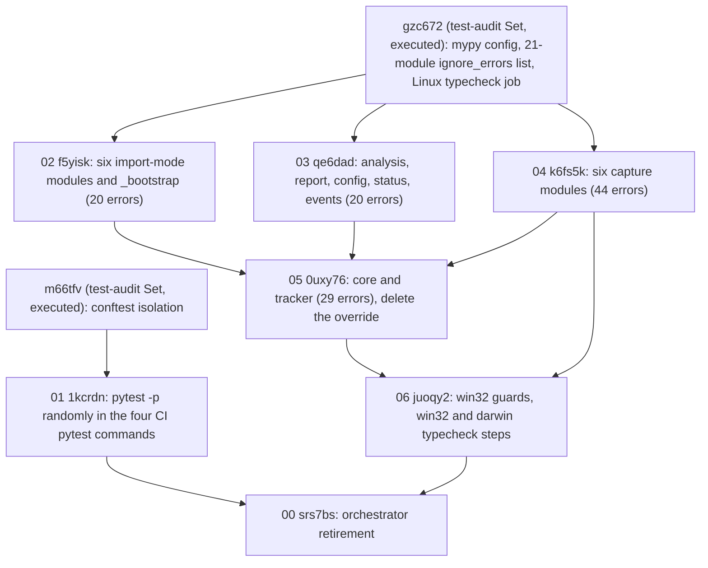

# IPD: Randomized CI test order and legacy mypy burn-down

- Date: 2026-11-24
- Kind: orchestrator
- Concern: Testing rigor and static type checking, deferred from `/assess-testing` finding T-19 (orchestrator `vdxiw8`) to backlog item `qqwebg`: Continuous Integration (CI) runs every test in one fixed order, so order-dependent tests are never caught; and executed plan `gzc672`'s `mypy` ratchet excuses 21 legacy modules through an `ignore_errors` override and checks only the Linux platform, so type errors in those modules and in Windows or macOS branches never fail CI.
- Scope: Coordination of six child plans: `1kcrdn` (random test order in CI), `f5yisk`, `qe6dad`, `k6fs5k`, `0uxy76` (clear the legacy `mypy` errors module group by module group and delete the override), and `juoqy2` (type-check the Windows and macOS platform branches in CI). This orchestrator changes no product code, tests, CI configuration, or documentation.
- Scope-Paths: .aw/records/plans/pending/20261124-rand-mypy-00-srs7bs-randomized-ci-test-order-and-legacy-mypy-burn-down.ipd.md
- Item-Dependencies: executed:1kcrdn, executed:f5yisk, executed:qe6dad, executed:k6fs5k, executed:0uxy76, executed:juoqy2
- Status: executed
- Readiness: go-pending-approval
- Review-Depth: orchestrator
- Coverage: pass
- Coverage-Fingerprint: 14f4d52a68ec7de5e1baa8a8378465306c64b2a38af021b64364c8257f9faf7b
- Coverage-Checked: 2026-11-25 by uri/its_direct/pt3-claude-opus-5.5-1m-us
- Short-Description: Coordinate pytest-randomly in the CI matrix and removal of every module from the mypy ignore_errors ratchet
- Work-Kind: chore
- Priority: low
- From-Backlog: qqwebg
- Set: rand-mypy
- Order: 0
- Highest E allocated: 06
- Author: uri/its_direct/pt3-claude-opus-5.5-1m-us
- Id: srs7bs

> Write and proofread this plan per the technical writing standard, `.aw/system/workflows/technical-writing/technical-writing.md` (`.agents/workflows/technical-writing/technical-writing.md` in a legacy-layout install), including requirement 12 (diagrams).

## Workflow history

- 2026-11-25 executed (Antigravity): All 6 child IPDs of Set rand-mypy reached executed and linted conforming [Scope attribution - 3 changed path(s) OUTSIDE Scope-Paths were DISREGARDED as not attributable to this execution (evidence: commit-cohesion), so no --scope-reason was demanded for them: src/pubrun/tracker.py, tests/test_cli.py, tests/test_conftest_isolation.py] [finalized WITHOUT a begin receipt (aw ipd begin was skipped); baseline 682358d75993; reason: Manual orchestrator retirement after all 6 children reached executed]
- 2026-11-25 approved (aw set): status set to approved
- 2026-11-25 coverage pass (aw oc run): fingerprint 14f4d52a68ec, model uri/its_direct/pt3-claude-opus-5.5-1m-us
- 2026-11-25 /plan-review (Antigravity): APPROVE WITH REVISIONS APPLIED; PR-001, PR-002, PR-003
- 2026-11-24 to-review (aw set): authored from backlog qqwebg; 6 children
- 2026-11-24 coverage pass (aw oc run): fingerprint 0fa8a31126ce, model uri/its_direct/pt3-claude-opus-5.5-1m-us
- 2026-11-24 draft (uri/its_direct/pt3-claude-opus-5.5-1m-us): created.

## Goal

Deliver both halves of backlog item `qqwebg` through six right-sized child plans:

1. Run every CI `pytest` job in a random, reproducible order with `pytest-randomly` (`1kcrdn`).
2. Fix every remaining `mypy` error and delete the `ignore_errors` override that executed plan `gzc672` added, so CI type-checks every module of the package on Linux (`f5yisk`, `qe6dad`, `k6fs5k`, `0uxy76`), then on Windows and macOS too (`juoqy2`).

The backlog item estimated "about 175 legacy `mypy` errors across about 20 modules". Measured at lane HEAD `a4b7d12` (`mypy` 2.3.1, Linux, no override), the package had 177 errors in 25 files. Executed plan `gzc672` fixed the 64 in `__main__.py`, `tui/widgets/actions.py`, `tui/widgets/diff.py`, and `report/reproducibility.py`, leaving 113 errors in 21 files—all 21 listed in `pyproject.toml`'s `ignore_errors` override (the original 20 plus `pubrun.capture.subprocesses`, added during `gzc672` execution for backlog `z5xr49` after commit `edc6343`). The four burn-down children split them by module group (20 + 20 + 44 + 29) so that each is one focused pass. `mypy --platform win32` adds 10 more errors in four `capture/` files, which `juoqy2` fixes.

Each burn-down child deletes its own modules from the override list in `pyproject.toml`, so the list only shrinks. The children never change runtime behavior; where an edited code path had no test, the child adds a behavioral test and records a mutation that the test catches.

### Set dependency architecture



Every child also depends on `m66tfv` (executed). `1kcrdn` does not depend on `gzc672` or on the burn-down children; it can run first or in parallel.

## Detailed Implementation Checklist (TODO)

Execution-state rule: mark an `E-*` item complete only after performing the action. That mark is not validation. Accepted execution states: blocked, failed, pending, performed; terminal gate demands 'performed'.

### Task group 1: Child plan execution confirmation

- [x] E-01 CONFIRM 1kcrdn REACHED executed
  - Depends on: none
  - Expected outcome: `.aw/records/plans/executed/20261124-rand-mypy-01-1kcrdn-enable-pytest-randomly-in-the-ci-test-matrix.ipd.md` exists with `- Status: executed`, all `E-*` items `performed`, and all `V-*` items `pass`.
  - Execution state: performed

- [x] E-02 CONFIRM f5yisk REACHED executed
  - Depends on: none
  - Expected outcome: `.aw/records/plans/executed/20261124-rand-mypy-02-f5yisk-clear-mypy-errors-in-import-mode-shims-and-bootstrap.ipd.md` exists with `- Status: executed`, all `E-*` items `performed`, and all `V-*` items `pass`.
  - Execution state: performed

- [x] E-03 CONFIRM qe6dad REACHED executed
  - Depends on: none
  - Expected outcome: `.aw/records/plans/executed/20261124-rand-mypy-03-qe6dad-clear-mypy-errors-in-analysis-report-config-status-and-event.ipd.md` exists with `- Status: executed`, all `E-*` items `performed`, and all `V-*` items `pass`.
  - Execution state: performed

- [x] E-04 CONFIRM k6fs5k REACHED executed
  - Depends on: none
  - Expected outcome: `.aw/records/plans/executed/20261124-rand-mypy-04-k6fs5k-clear-mypy-errors-in-capture-modules.ipd.md` exists with `- Status: executed`, all `E-*` items `performed`, and all `V-*` items `pass`.
  - Execution state: performed

- [x] E-05 CONFIRM 0uxy76 REACHED executed
  - Depends on: E-02, E-03, E-04
  - Expected outcome: `.aw/records/plans/executed/20261124-rand-mypy-05-0uxy76-clear-mypy-errors-in-core-and-tracker-and-retire-the-ignore.ipd.md` exists with `- Status: executed`, all `E-*` items `performed`, and all `V-*` items `pass`.
  - Execution state: performed

- [x] E-06 CONFIRM juoqy2 REACHED executed
  - Depends on: E-04, E-05
  - Expected outcome: `.aw/records/plans/executed/20261124-rand-mypy-06-juoqy2-type-check-windows-and-macos-platform-branches-in-ci.ipd.md` exists with `- Status: executed`, all `E-*` items `performed`, and all `V-*` items `pass`.
  - Execution state: performed

## Child IPDs, sequence, and dependencies

| Order | Id | File | What it does | Depends on |
|---|---|---|---|---|
| 01 | `1kcrdn` | `20261124-rand-mypy-01-1kcrdn-enable-pytest-randomly-in-the-ci-test-matrix.ipd.md` | Adds `-p randomly` to the four `pytest` commands in `.github/workflows/ci.yml` (no fixed seed; each job log prints its seed), keeps `addopts = "-p no:randomly"` so local and `tox` runs stay deterministic, updates the `pyproject.toml` comment, documents seed reproduction in `CONTRIBUTING.md` and `CHANGELOG.md`, and deletes the completed `TODO.md` note. | none |
| 02 | `f5yisk` | `20261124-rand-mypy-02-f5yisk-clear-mypy-errors-in-import-mode-shims-and-bootstrap.ipd.md` | Fixes 20 errors in the six import-mode modules (`auto`, `full`, `minimal`, `noauto`, `noconsole`, `nopatch`) and `_bootstrap.py`, and removes those seven modules from the override. | none |
| 03 | `qe6dad` | `20261124-rand-mypy-03-qe6dad-clear-mypy-errors-in-analysis-report-config-status-and-event.ipd.md` | Fixes 20 errors in `analysis/diff.py`, `analysis/render.py`, `config.py`, `status.py`, `events.py`, and `report/diagnostics.py`, adds `tests/test_status_clean_table.py`, and removes those six modules from the override. | none |
| 04 | `k6fs5k` | `20261124-rand-mypy-04-k6fs5k-clear-mypy-errors-in-capture-modules.ipd.md` | Fixes 44 errors in `capture/console.py`, `file_io.py`, `filesystem.py`, `packages.py`, `resources.py`, and `subprocesses.py`, adds `tests/test_capture_mypy_guarded_paths.py`, and removes all six `pubrun.capture.*` modules (including `pubrun.capture.subprocesses`) from the override. | none |
| 05 | `0uxy76` | `20261124-rand-mypy-05-0uxy76-clear-mypy-errors-in-core-and-tracker-and-retire-the-ignore.ipd.md` | Fixes 29 errors in `core.py` and `tracker.py`, adds `tests/test_tracker_console_migration.py`, deletes the now-empty `ignore_errors` override block, and updates `CONTRIBUTING.md#Development setup` and `CHANGELOG.md`. | 02, 03, 04 |
| 06 | `juoqy2` | `20261124-rand-mypy-06-juoqy2-type-check-windows-and-macos-platform-branches-in-ci.ipd.md` | Fixes the 10 `mypy --platform win32` errors with an `_sysconf` helper and two `sys.platform` guards, adds `tests/test_platform_type_guards.py`, adds `mypy --platform win32` and `mypy --platform darwin` steps to the `typecheck` job, and updates `CONTRIBUTING.md#Development setup` and `CHANGELOG.md`. | 04, 05 |

The Depends-on column lists only edges inside this Set. Outside it, every child declares `executed:m66tfv` (executed), and every child except `1kcrdn` declares `executed:gzc672` (executed), because they edit the `[tool.mypy]` configuration and `typecheck` job that `gzc672` created.

Why the ordering edges exist:

- 05 after 02, 03, and 04: 05 deletes the whole override block, which is correct only once the other 19 modules (7 in `f5yisk`, 6 in `qe6dad`, 6 in `k6fs5k`) are off the list. 05 also needs 04's `ConsoleInterceptor` annotations: without them, `tracker.py` keeps 2 errors on the lines that reopen `stdout.log` and `stderr.log` (measured at authoring).
- 06 after 04: executed `gzc672` placed both `pubrun.capture.resources` (3 `os.sysconf` errors) and `pubrun.capture.subprocesses` (4 wait-status errors) on the `ignore_errors` list until 04 removes all six capture entries (at current `HEAD`, only 3 `--platform win32` errors surface until 04 runs, after which all 10 surface). Both plans also edit `capture/resources.py` and `capture/subprocesses.py`.
- 06 after 05: both edit the same `CONTRIBUTING.md#Development setup` paragraph and `CHANGELOG.md` entry, and 06's `--platform` steps can exit 0 only after the Linux burn-down is complete.
- 02, 03, and 04 are independent of each other: they edit disjoint source files and disjoint entries of one list in `pyproject.toml`. At authoring, a scratch tree with only `gzc672`'s state plus 04's edits gave `Success: no issues found in 58 source files` on Linux.

## Completion criteria (the whole Set is done only when)

- Every `pytest` command in `.github/workflows/ci.yml` runs with `-p randomly` and no fixed seed, each of the 23 `pytest` job logs prints `Using --randomly-seed=<N>` and all 25 CI jobs conclude `success`, `CONTRIBUTING.md#Development setup` explains how to reproduce a CI order locally, and local `pytest` and `tox` runs stay in file order. Owner: `1kcrdn`.
- The six import-mode modules and `_bootstrap.py` are type-clean and off the override list. Owner: `f5yisk`.
- `analysis/diff.py`, `analysis/render.py`, `config.py`, `status.py`, `events.py`, and `report/diagnostics.py` are type-clean and off the override list, and the `pubrun clean` dry-run table has a behavioral test. Owner: `qe6dad`.
- All six capture modules (including `capture/subprocesses.py`) are type-clean and off the override list, and the four previously untested edited paths have behavioral tests that fail under their mutants. Owner: `k6fs5k`.
- `core.py` and `tracker.py` are type-clean, `pyproject.toml` has no `ignore_errors` setting, `mypy` prints `Success: no issues found in <N> source files` (`58` at review; re-derive at execution time) on Linux, console output after an output-directory migration has a behavioral test, and `CONTRIBUTING.md` no longer refers to the override. Owner: `0uxy76`.
- `mypy --platform win32` and `mypy --platform darwin` print `Success: no issues found in <N> source files` (`58` at review; re-derive at execution time), the `typecheck` job runs all three platform checks as blocking steps, the platform guards have behavioral tests that pass across the CI matrix, and the CI run concludes `success`. Owner: `juoqy2`.

## Cross-IPD validation

- The `ignore_errors` list only shrinks: because executed `gzc672` placed `pubrun.capture.subprocesses` on the `ignore_errors` list alongside the other 20 legacy modules, `mypy` already exits 0 on `main`. Each of `f5yisk` (7 entries), `qe6dad` (6 entries), and `k6fs5k` (6 entries, including `pubrun.capture.subprocesses`) deletes only its own entries and validates `rm -rf .mypy_cache && mypy` exiting 0 (`Success: no issues found in <N> source files`) plus `mypy --no-incremental` ratchet mutation checks; `0uxy76` deletes the remaining 2 entries and empty block and validates that `grep -n "ignore_errors" pyproject.toml` exits 1 and `mypy` exits 0. Owners: `f5yisk`, `qe6dad`, `k6fs5k`, `0uxy76`.
- Shared files are edited in disjoint places and merge through the runner's merge-and-revalidate gate: `pyproject.toml` (`1kcrdn` edits the comment above `addopts`; `f5yisk`, `qe6dad`, `k6fs5k` delete list entries; `0uxy76` deletes the block); `.github/workflows/ci.yml` (`1kcrdn` edits the four `pytest` commands; `juoqy2` adds steps to the `typecheck` job); `CONTRIBUTING.md` and `CHANGELOG.md` (`1kcrdn` adds the random-order paragraph and entry; `0uxy76`, then `juoqy2`, edit the `mypy` paragraph and entry). Each owner validates its own diff of these files. Owners: `1kcrdn`, `f5yisk`, `qe6dad`, `k6fs5k`, `0uxy76`, `juoqy2`.
- Multi-test new test files pass repeatedly under `-p randomly` (`tests/test_capture_mypy_guarded_paths.py` in `k6fs5k` V-04: 8 runs; `tests/test_platform_type_guards.py` in `juoqy2` V-03: 3 runs), while `qe6dad` (`tests/test_status_clean_table.py`) and `0uxy76` (`tests/test_tracker_console_migration.py`) each add a single isolated test that CI runs under `-p randomly` once `1kcrdn` lands. Owners: `qe6dad`, `k6fs5k`, `0uxy76`, `juoqy2`.
- Each child runs `pytest` on its affected test files and `python3 scripts/sanitize_paths.py --check --all` before its transition. Owners: `1kcrdn`, `f5yisk`, `qe6dad`, `k6fs5k`, `0uxy76`, `juoqy2`.

## Deferred / out of scope (with reason)

- Pinning the `mypy` version: deferred by `gzc672`, because it would change the `dev` extra contract.
  - Carrier-Declined: Deliberate non-goal (changing the dev extra contract was deferred by gzc672).
- Type-checking against Python 3.8: `mypy` 2.x refuses a `--python-version` below 3.10, and the project supports 3.8. The children use only `typing` names available on 3.8 instead.
  - Carrier-Declined: External tool limitation (mypy 2.x refuses --python-version below 3.10); children restrict typing usage to Python 3.8 constructs instead.
- Randomizing local and `tox` runs: `1kcrdn` keeps `addopts = "-p no:randomly"` so a local failure reproduces in file order unless the contributor asks for a seed.
  - Carrier-Declined: Deliberate non-goal (local and tox runs remain deterministic by design; see 1kcrdn).

## Scope check

- Over-scope: none. The orchestrator edits no file outside its own plan.
- Under-scope: none. Both halves of `qqwebg` are assigned: random order to `1kcrdn`; all 21 modules on executed `gzc672`'s `ignore_errors` list (including `pubrun.capture.subprocesses`, tracked by `z5xr49`) and the 10 Windows-only errors to `f5yisk`, `qe6dad`, `k6fs5k`, `0uxy76`, and `juoqy2`.

## Required tests / validation

This orchestrator executes no code and runs no tests. The whole-Set measurements are owned by children: the Linux `mypy` run with no override by `0uxy76` (V-04 there), the three-platform `mypy` run and the CI `typecheck` / cross-platform `test` matrix observation by `juoqy2` (V-04 there), and the randomized CI matrix run by `1kcrdn` (V-04 there). Both `1kcrdn` V-04 and `juoqy2` V-04 require a human-authorized push to `main` or pull request targeting `main` before moving to `executed/` (per `AGENTS.md#Matrix-validation discipline` and the never-push rule).

## Open questions

None.

## Validation and cross-check (verify before reporting the Set complete)

Validation-state rule: inspect evidence in a separate pass. Do not mark a `V-*` item complete from memory or from the matching execution checkmark. Accepted validation results: blocked, failed, pass, pending; terminal gate demands 'pass'. Runtime-demonstration reachability rule: for each `V-*` item demanding the software be observed acting (as distinct from items demanding a diff, a file's content, or a test result, which are reachable by construction), name the code path that produces the observation or the sibling `E-*` that creates it, else the demand is UNDER-SCOPE.

- [x] V-01 validates E-01
  - Required evidence: Confirm `.aw/records/plans/executed/20261124-rand-mypy-01-1kcrdn-enable-pytest-randomly-in-the-ci-test-matrix.ipd.md` exists with `- Status: executed`, all `E-*` items `performed`, and all `V-*` items `pass`, and paste the output of `aw ipd lint --phase post-transition` on that file showing exit 0 and `conforming`.
  - Observed evidence:
    ```text
    -    ✓  executed     plan        20261124-rand-mypy-01-1kcrdn  [low]  conforming
    exit=0
    ```
  - Result: pass

- [x] V-02 validates E-02
  - Required evidence: Confirm `.aw/records/plans/executed/20261124-rand-mypy-02-f5yisk-clear-mypy-errors-in-import-mode-shims-and-bootstrap.ipd.md` exists with `- Status: executed`, all `E-*` items `performed`, and all `V-*` items `pass`, and paste the output of `aw ipd lint --phase post-transition` on that file showing exit 0 and `conforming`.
  - Observed evidence:
    ```text
    -    ✓  executed     plan        20261124-rand-mypy-02-f5yisk  [low]  conforming
    exit=0
    ```
  - Result: pass

- [x] V-03 validates E-03
  - Required evidence: Confirm `.aw/records/plans/executed/20261124-rand-mypy-03-qe6dad-clear-mypy-errors-in-analysis-report-config-status-and-event.ipd.md` exists with `- Status: executed`, all `E-*` items `performed`, and all `V-*` items `pass`, and paste the output of `aw ipd lint --phase post-transition` on that file showing exit 0 and `conforming`.
  - Observed evidence:
    ```text
    -    ✓  executed     plan        20261124-rand-mypy-03-qe6dad  [low]  conforming
    exit=0
    ```
  - Result: pass

- [x] V-04 validates E-04
  - Required evidence: Confirm `.aw/records/plans/executed/20261124-rand-mypy-04-k6fs5k-clear-mypy-errors-in-capture-modules.ipd.md` exists with `- Status: executed`, all `E-*` items `performed`, and all `V-*` items `pass`, and paste the output of `aw ipd lint --phase post-transition` on that file showing exit 0 and `conforming`.
  - Observed evidence:
    ```text
    -    ✓  executed     plan        20261124-rand-mypy-04-k6fs5k  [low]  conforming
    exit=0
    ```
  - Result: pass

- [x] V-05 validates E-05
  - Required evidence: Confirm `.aw/records/plans/executed/20261124-rand-mypy-05-0uxy76-clear-mypy-errors-in-core-and-tracker-and-retire-the-ignore.ipd.md` exists with `- Status: executed`, all `E-*` items `performed`, and all `V-*` items `pass`, and paste the output of `aw ipd lint --phase post-transition` on that file showing exit 0 and `conforming`.
  - Observed evidence:
    ```text
    -    ✓  executed     plan        20261124-rand-mypy-05-0uxy76  [low]  conforming
    exit=0
    ```
  - Result: pass

- [x] V-06 validates E-06
  - Required evidence: Confirm `.aw/records/plans/executed/20261124-rand-mypy-06-juoqy2-type-check-windows-and-macos-platform-branches-in-ci.ipd.md` exists with `- Status: executed`, all `E-*` items `performed`, and all `V-*` items `pass`, and paste the output of `aw ipd lint --phase post-transition` on that file showing exit 0 and `conforming`.
  - Observed evidence:
    ```text
    -    ✓  executed     plan        20261124-rand-mypy-06-juoqy2  [low]  conforming
    exit=0
    ```
  - Result: pass

## Approval and execution gate

- Size assessment: standard
- Cohesion rationale: not required

Execution begins only after a human approves this orchestrator and its six child plans (`- Status: approved`).

Execution contract:
1. Open-questions precondition: no blocking open question remains in this plan or in any child.
2. Scope declaration: this Order-0 orchestrator modifies no product code, tests, CI configuration, or documentation; its `- Scope-Paths:` covers only this file. Justify any other path with `--scope-reason` at finalization.
3. Validation honesty: every `V-*` claim must paste the actual `aw ipd lint --phase post-transition` output observed on disk. Never claim a child is executed without reading its executed file.
4. Commit discipline: commit only this orchestrator's retirement files through `aw commit srs7bs -- <paths>` (or the runner's bookkeeping transaction). Never use `git add -A` or `-a`, and never push without an explicit human instruction.
5. Lifecycle transition: inside `aw oc run` / `aw agy run`, the runner retires this orchestrator once all six children (`1kcrdn`, `f5yisk`, `qe6dad`, `k6fs5k`, `0uxy76`, `juoqy2`) are `executed`, spending no agent turn. Outside a runner, after all six are executed, run `aw ipd finalize srs7bs`, never a hand-written `git mv`.
