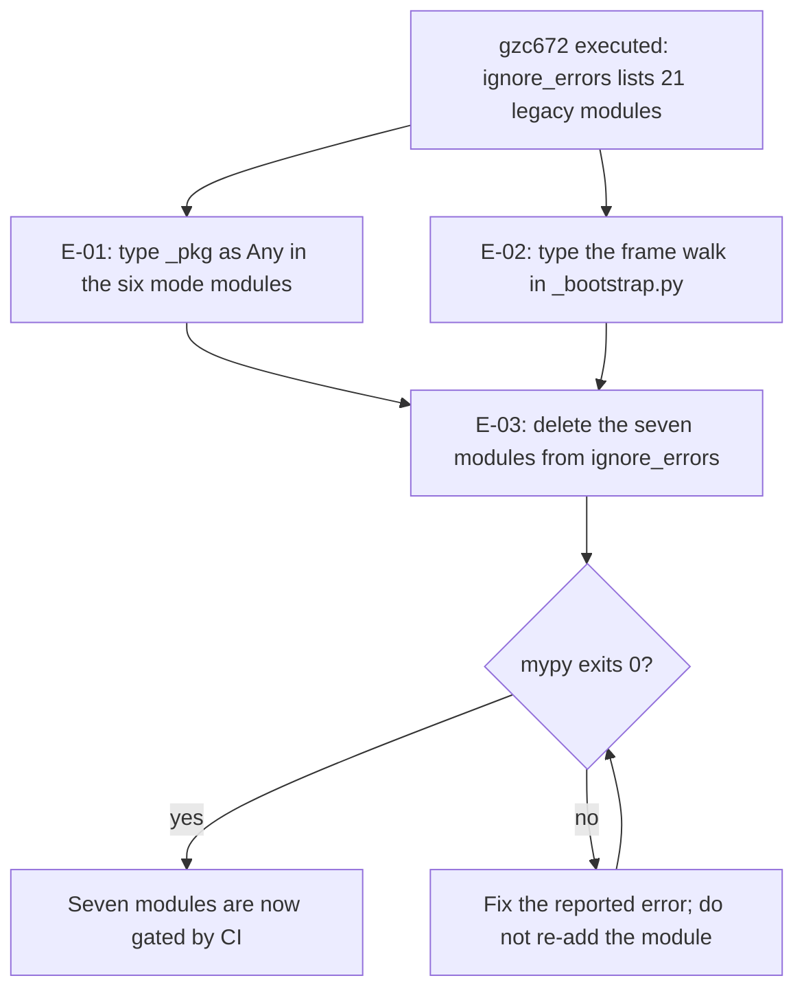

# IPD: Clear mypy errors in import-mode shims and bootstrap

- Date: 2026-11-24
- Kind: child
- Concern: Static type checking: seven modules are excused from `mypy` by the `ignore_errors` override that plan `gzc672` adds, so a new type error in them would not fail the CI `typecheck` job.
- Scope: The six import-mode modules (`src/pubrun/auto.py`, `full.py`, `minimal.py`, `noauto.py`, `noconsole.py`, `nopatch.py`), `src/pubrun/_bootstrap.py`, and their removal from the `ignore_errors` module list in `pyproject.toml`.
- Scope-Paths: src/pubrun/auto.py, src/pubrun/full.py, src/pubrun/minimal.py, src/pubrun/noauto.py, src/pubrun/noconsole.py, src/pubrun/nopatch.py, src/pubrun/_bootstrap.py, pyproject.toml
- Item-Dependencies: executed:gzc672, executed:m66tfv
- Status: executed
- Readiness: go-pending-approval
- Review-Depth: standard
- Short-Description: Fix mypy errors in the six import-mode modules and _bootstrap.py and take them off the ignore_errors list
- Work-Kind: chore
- Priority: low
- From-Backlog: qqwebg
- Set: rand-mypy
- Order: 2
- Highest E allocated: 03
- Author: uri/its_direct/pt3-claude-opus-5.5-1m-us
- Id: f5yisk

> Write and proofread this plan per the technical writing standard, `.aw/system/workflows/technical-writing/technical-writing.md` (`.agents/workflows/technical-writing/technical-writing.md` in a legacy-layout install), including requirement 12 (diagrams).

## Workflow history

- 2026-11-25 executed (aw agy run model=Gemini-4-Neon-High): aw agy run self-finalize: f5yisk verified (set rand-mypy, attempt 1).
- 2026-11-25 approved (aw set): status set to approved
- 2026-11-25 /plan-review (Antigravity): APPROVE WITH REVISIONS APPLIED; PR-001, PR-002, PR-003, PR-004, PR-005
- 2026-11-24 to-review (aw set): authored from backlog qqwebg
- 2026-11-24 draft (uri/its_direct/pt3-claude-opus-5.5-1m-us): created.

## Goal

Fix the 20 `mypy` errors in the six import-mode modules and `_bootstrap.py`, and delete those seven modules from the `ignore_errors` override in `pyproject.toml`, so the CI `typecheck` job checks them. No runtime behavior changes.

An import-mode module is a submodule such as `pubrun.noauto` that a user imports instead of `pubrun` to choose how much `pubrun` captures automatically. Each one starts the bootstrap with its mode and then copies its public functions and classes onto the `pubrun` package object, so `import pubrun.noauto as pubrun` and `import pubrun` expose the same API.

### Ratchet step for this plan



## Detailed Implementation Checklist (TODO)

Execution-state rule: mark an `E-*` item complete only after performing the action. That mark is not validation. Right-sizing rule: write for a modest executor that cannot hold much in its head. Each E-item is one step (one concern, about one file, executable in one focused pass) and its V-item names each unit it covers with its own check; a plan stays at about 5 E-items and 8 work Scope-Paths, else split it into more child plans (guidance, `IPD-Z603`). Accepted execution states: blocked, failed, pending, performed; terminal gate demands 'performed'.

### Task group 1: Fix the type errors

- [x] E-01 In each of `src/pubrun/auto.py`, `full.py`, `minimal.py`, `noauto.py`, `noconsole.py`, and `nopatch.py`, make the same three-line change in the block under the `# Populate the parent pubrun namespace` comment block:
  - Replace the line `import pubrun as _pkg  # noqa: E402` with these three lines:
    ```python
    from typing import Any as _Any  # noqa: E402
    import pubrun as _pkg_module  # noqa: E402
    _pkg: _Any = _pkg_module
    ```
  - Replace the closing line `del _pkg` with `del _pkg, _pkg_module, _Any`.
  - Leave every `_pkg.<name> = <name>` assignment unchanged.
  The import is aliased to `_Any` and deleted at the end so that the mode module gains no new public `Any` attribute. `mypy` reports `Cannot assign to a type` on `_pkg.phase = phase`, `_pkg.paused = paused`, and `_pkg.tracked_run = tracked_run`, because `phase`, `paused`, and `tracked_run` are classes in `pubrun`'s namespace; typing the alias as `Any` tells `mypy` that the rebinding is intended.
  - Depends on: none
  - Expected outcome: Each of the six files shows exactly this diff. Importing each `pubrun.<mode>` module in an isolated temporary working directory with `PYTHONPATH` pointing at this checkout's `src/` resolves `m.__file__` inside this checkout's `src/`, prints `[]` for `[n for n in ('_pkg', '_pkg_module', '_Any') if hasattr(m, n)]`, and leaves no run directory in the checkout.
  - Execution state: performed

- [x] E-02 In `src/pubrun/_bootstrap.py`, add `from types import FrameType` after `import warnings`, and annotate the first assignment of `frame` in two functions as `Optional[FrameType]`:
  - `src/pubrun/_bootstrap.py::_get_caller_info`: `frame = sys._getframe(2)  # skip _get_caller_info and select_mode` becomes `frame: Optional[FrameType] = sys._getframe(2)  # skip _get_caller_info and select_mode`.
  - `src/pubrun/_bootstrap.py::is_mode_submodule_import_in_progress`: `frame = sys._getframe(1)` becomes `frame: Optional[FrameType] = sys._getframe(1)`.
  `Optional` is already imported from `typing`. Both loops already test `if frame is None: break` before they use `frame`, and `frame = frame.f_back` can return `None`, which `mypy` rejects for a variable it inferred as `FrameType`.
  - Depends on: none
  - Expected outcome: The diff of `_bootstrap.py` is one import line and two annotations.
  - Execution state: performed

### Task group 2: Ratchet the type check

- [x] E-03 In `pyproject.toml`, delete these seven entries from the `module` list of the `[[tool.mypy.overrides]]` block that sets `ignore_errors = true` (added by plan `gzc672` E-03): `pubrun._bootstrap`, `pubrun.auto`, `pubrun.full`, `pubrun.minimal`, `pubrun.noauto`, `pubrun.noconsole`, `pubrun.nopatch`. Keep the remaining entries sorted and keep the comment that says the list may only shrink. Change nothing else in `pyproject.toml`.
  - Depends on: E-01, E-02
  - Expected outcome: `mypy` (from the repository root, after deleting `.mypy_cache/`) prints `Success: no issues found in <N> source files` (`58` at review; re-derive at execution time if modules were added) and exits 0, and the override list no longer names any of the seven modules.
  - Execution state: performed

## Project conventions discovered (Step 0)

- Plan `gzc672` (now `executed`; `approved` at authoring) created the `[tool.mypy]` configuration in `pyproject.toml` (E-03): `mypy_path = "src"`, `explicit_package_bases = true`, `files = ["src/pubrun"]`, an `ignore_missing_imports` override for `IPython`, `yappi`, and `tomli`, and an `ignore_errors = true` override for 21 legacy modules (the original 20 plus `pubrun.capture.subprocesses`, added during `gzc672` execution), with a comment saying the list may only shrink and pointing at backlog items `qqwebg` and `z5xr49`. This plan declares `Item-Dependencies: executed:gzc672`.
- Plan `gzc672` E-04 added the blocking `typecheck` CI job that runs `mypy` on Linux with Python 3.12; that job is what enforces this plan's result.
- `mypy` 2.x refuses `--python-version` below 3.10, and the project supports Python 3.8, so `gzc672` sets no `python_version`. Use only syntax and `typing` names available on Python 3.8: `Optional[FrameType]`, not `FrameType | None`.
- The mode modules mark their late imports `# noqa: E402`; the new `from typing import Any as _Any` line follows the same convention. The repository runs no linter in CI or pre-commit (`.pre-commit-config.yaml` has file-hygiene hooks, `gitleaks`, `sanitize-paths`, and the `update-commit-file` post-commit hook only), so the marker is for consistency.
- `tests/test_import_modes.py` drives every mode module through subprocesses and in-process imports and asserts on the resulting `pubrun` namespace and bootstrap state.

## Findings

| ID | Severity | Remediation Risk | Evidence | Finding |
|---|---|---|---|---|
| M-01 | Low | Low | `mypy` at lane HEAD `a4b7d12` with no `ignore_errors` override: `error: Cannot assign to a type  [misc]` on the lines `_pkg.phase = phase`, `_pkg.paused = paused`, and `_pkg.tracked_run = tracked_run` in each of the six mode modules | 18 errors: `mypy` cannot tell that the mode modules deliberately rebind three class attributes on the package. |
| M-02 | Low | Low | `src/pubrun/_bootstrap.py::_get_caller_info` and `src/pubrun/_bootstrap.py::is_mode_submodule_import_in_progress`, at the line `frame = frame.f_back`: `Incompatible types in assignment (expression has type "FrameType \| None", variable has type "FrameType")  [assignment]` | 2 errors: the stack walk assigns `frame.f_back`, which may be `None`, to a variable inferred as `FrameType`. |

Authoring measurements (lane HEAD `a4b7d12`, `mypy` 2.3.1, Python 3.14.6, Linux). A scratch copy of `src/pubrun` had `gzc672`'s `__main__.py` import fix applied, so `mypy` could run at all, and used `gzc672`'s pre-execution 20-module ratchet configuration:

- Without any `ignore_errors` override: `Found 177 errors in 25 files`; with this plan's edits applied: `Found 157 errors in 18 files`. The 20 removed errors are exactly M-01 and M-02.
- With the pre-execution 20-module ratchet configuration and these seven modules deleted from the override: `mypy` on Linux reported only the 2 errors in `capture/subprocesses.py` that child `k6fs5k` fixes (`gzc672` subsequently added `pubrun.capture.subprocesses` to `pyproject.toml`'s override list when it executed, so `mypy` exits 0 on `main` and after E-03). None of the reported errors was in this plan's modules.
- Behavior evidence: with every edit in this Set applied, `python3 -m pytest tests/test_import_modes.py tests/test_full_mode.py tests/test_capture_isolation.py tests/test_config_capture_modes.py tests/test_report_subpackage_integrity.py tests/test_profile_deprecation.py -q` gave `230 passed`. Replacing `_pkg.phase = phase` in `noauto.py` with `pass` made `tests/test_import_modes.py` fail (`1 failed, 77 passed`), so these tests detect a broken namespace copy.

## Proposed changes (ordered, validatable)

1. Type the package alias as `Any` in the six mode modules (E-01; Remediation Risk: Low).
2. Annotate the frame-walk variable in `_bootstrap.py` (E-02; Remediation Risk: Low).
3. Delete the seven modules from the `ignore_errors` override (E-03; Remediation Risk: Low).

Rejected alternatives:

- `# type: ignore[misc]` on each of the 18 assignments: it hides the next real error on those lines and adds 18 suppressions where one annotation per file states the intent.
- `setattr(_pkg, "phase", phase)`: it hides the assignments from readers who search for `_pkg.phase`, and it changes 19 lines per file instead of 2.

## Deferred / out of scope (with reason)

- The other 14 legacy modules on the override list. Children `qe6dad` (six non-capture modules), `k6fs5k` (six capture modules, including `pubrun.capture.subprocesses`), and `0uxy76` (`core.py`, `tracker.py`) own them.
  - Carrier: qe6dad
- Errors that appear only under `mypy --platform win32`. Child `juoqy2` owns them; none is in this plan's modules.
  - Carrier: juoqy2

## Scope check

- Over-scope: none.
- Under-scope: none. No new test is added because E-01 and E-02 change no behavior; the existing `tests/test_import_modes.py` already fails when the namespace copy breaks (Findings), and the `mypy` gate is the check for the type change.

## Required tests / validation

- `rm -rf .mypy_cache && mypy`: prints `Success: no issues found in <N> source files` (`58` at review; re-derive at execution time if modules were added) and exits 0.
- Mutation check of the ratchet: append `_aw_mut: int = "x"` to `src/pubrun/noauto.py`, run `mypy --no-incremental` (expect exit 1 naming `noauto.py`), then restore the file. Repeat for `src/pubrun/_bootstrap.py`.
- `python3 -m pytest tests/test_import_modes.py tests/test_full_mode.py tests/test_capture_isolation.py tests/test_config_capture_modes.py tests/test_report_subpackage_integrity.py tests/test_profile_deprecation.py -q`: exit 0.
- `python3 scripts/sanitize_paths.py --check --all`: exit 0.

## Spec / documentation sync

- No `.spec.md` under `.aw/records/specs/` and no file under `docs/` mentions `mypy` (checked at authoring with `grep -rln "randomly\|mypy" .aw/records/specs docs`: no match). No spec is amended.
- `CONTRIBUTING.md` and `CHANGELOG.md` are updated once for the whole burn-down by child `0uxy76`, which removes the last module from the override.

## Open questions

None.

## Validation and cross-check (verify before reporting done)

Validation-state rule: inspect evidence in a separate pass. Do not mark a `V-*` item complete from memory or from the matching execution checkmark. Accepted validation results: blocked, failed, pass, pending; terminal gate demands 'pass'. Runtime-demonstration reachability rule: for each `V-*` item demanding the software be observed acting (such as a run, a dispatch, or a transition), as distinct from items demanding a diff, a file's content, or a test result, which are reachable by construction, name the code path that produces the observation or the sibling `E-*` that creates it, else the demand is UNDER-SCOPE.

- [x] V-01 validates E-01
  - Required evidence: (1) Pasted `git diff` of the six mode modules, each showing only the three-line import replacement and the `del` change. (2) Pasted output of `python3 -c 'import os, subprocess, sys, tempfile; from pathlib import Path; repo_src = str(Path("src").resolve()); env = {**os.environ, "PYTHONPATH": repo_src}; [sys.exit(r.returncode) if r.returncode else print(m, r.stdout.strip()) for m in ("auto", "full", "minimal", "noauto", "noconsole", "nopatch") for td in [tempfile.TemporaryDirectory()] for r in [subprocess.run([sys.executable, "-c", f"import os, pathlib, pubrun.{m} as mod; assert os.path.commonpath([str(pathlib.Path(mod.__file__).resolve()), {repo_src!r}]) == {repo_src!r}, mod.__file__; leaked = [n for n in (\"_pkg\", \"_pkg_module\", \"_Any\") if hasattr(mod, n)]; print(leaked); assert not leaked"], cwd=td.name, env=env, capture_output=True, text=True)] if (td.cleanup() or True)]'` printing `[]` for all six with exit 0 and leaving `git status --short` free of untracked `runs/` files. (3) The last line of `python3 -m pytest tests/test_import_modes.py tests/test_full_mode.py tests/test_capture_isolation.py tests/test_config_capture_modes.py tests/test_report_subpackage_integrity.py tests/test_profile_deprecation.py -q` showing all passed with exit 0.
  - Observed evidence:
    (1) `git diff src/pubrun/auto.py src/pubrun/full.py src/pubrun/minimal.py src/pubrun/noauto.py src/pubrun/noconsole.py src/pubrun/nopatch.py`:
    ```diff
    diff --git a/src/pubrun/auto.py b/src/pubrun/auto.py
    index 65fd3d7..3cf8011 100644
    --- a/src/pubrun/auto.py
    +++ b/src/pubrun/auto.py
    @@ -50,7 +50,9 @@ _execute_boot_sequence(selected_by="pubrun.auto")
     del _execute_boot_sequence, _behavior

     # Populate the parent pubrun namespace
    -import pubrun as _pkg  # noqa: E402
    +from typing import Any as _Any  # noqa: E402
    +import pubrun as _pkg_module  # noqa: E402
    +_pkg: _Any = _pkg_module
     _pkg.start = start
     _pkg.stop = stop
     _pkg.annotate = annotate
    @@ -75,4 +77,4 @@ _pkg.register_output = register_output
     _pkg.subprocess = subprocess
     _pkg.popen = popen
     _pkg._run_lock = _run_lock
    -del _pkg
    +del _pkg, _pkg_module, _Any
    diff --git a/src/pubrun/full.py b/src/pubrun/full.py
    index 1bf727d..0245b6d 100644
    --- a/src/pubrun/full.py
    +++ b/src/pubrun/full.py
    @@ -55,7 +55,9 @@ _execute_boot_sequence(selected_by="pubrun.full")
     del _execute_boot_sequence, _behavior

     # Populate the parent pubrun namespace
    -import pubrun as _pkg  # noqa: E402
    +from typing import Any as _Any  # noqa: E402
    +import pubrun as _pkg_module  # noqa: E402
    +_pkg: _Any = _pkg_module
     _pkg.start = start
     _pkg.stop = stop
     _pkg.annotate = annotate
    @@ -80,4 +82,4 @@ _pkg.register_output = register_output
     _pkg.subprocess = subprocess
     _pkg.popen = popen
     _pkg._run_lock = _run_lock
    -del _pkg
    +del _pkg, _pkg_module, _Any
    diff --git a/src/pubrun/minimal.py b/src/pubrun/minimal.py
    index 5b94297..67c3b0c 100644
    --- a/src/pubrun/minimal.py
    +++ b/src/pubrun/minimal.py
    @@ -48,7 +48,9 @@ _boot(selected_by="pubrun.minimal")
     del _boot, _behavior

     # Populate the parent pubrun namespace
    -import pubrun as _pkg  # noqa: E402
    +from typing import Any as _Any  # noqa: E402
    +import pubrun as _pkg_module  # noqa: E402
    +_pkg: _Any = _pkg_module
     _pkg.start = start
     _pkg.stop = stop
     _pkg.annotate = annotate
    @@ -73,4 +75,4 @@ _pkg.register_output = register_output
     _pkg.subprocess = subprocess
     _pkg.popen = popen
     _pkg._run_lock = _run_lock
    -del _pkg
    +del _pkg, _pkg_module, _Any
    diff --git a/src/pubrun/noauto.py b/src/pubrun/noauto.py
    index f57b2c0..9eda6a0 100644
    --- a/src/pubrun/noauto.py
    +++ b/src/pubrun/noauto.py
    @@ -51,7 +51,9 @@ del _boot, _behavior

     # Populate the parent pubrun namespace so `from pubrun import X` works
     # after `import pubrun.noauto`. This is needed because __init__.py deferred.
    -import pubrun as _pkg  # noqa: E402
    +from typing import Any as _Any  # noqa: E402
    +import pubrun as _pkg_module  # noqa: E402
    +_pkg: _Any = _pkg_module
     _pkg.start = start
     _pkg.stop = stop
     _pkg.annotate = annotate
    @@ -76,4 +78,4 @@ _pkg.register_output = register_output
     _pkg.subprocess = subprocess
     _pkg.popen = popen
     _pkg._run_lock = _run_lock
    -del _pkg
    +del _pkg, _pkg_module, _Any
    diff --git a/src/pubrun/noconsole.py b/src/pubrun/noconsole.py
    index 1e68d31..cbf554d 100644
    --- a/src/pubrun/noconsole.py
    +++ b/src/pubrun/noconsole.py
    @@ -43,7 +43,9 @@ _boot(selected_by="pubrun.noconsole")
     del _boot, _behavior

     # Populate the parent pubrun namespace
    -import pubrun as _pkg  # noqa: E402
    +from typing import Any as _Any  # noqa: E402
    +import pubrun as _pkg_module  # noqa: E402
    +_pkg: _Any = _pkg_module
     _pkg.start = start
     _pkg.stop = stop
     _pkg.annotate = annotate
    @@ -68,4 +70,4 @@ _pkg.register_output = register_output
     _pkg.subprocess = subprocess
     _pkg.popen = popen
     _pkg._run_lock = _run_lock
    -del _pkg
    +del _pkg, _pkg_module, _Any
    diff --git a/src/pubrun/nopatch.py b/src/pubrun/nopatch.py
    index 7e245bb..2517c50 100644
    --- a/src/pubrun/nopatch.py
    +++ b/src/pubrun/nopatch.py
    @@ -45,7 +45,9 @@ _boot(selected_by="pubrun.nopatch")
     del _boot, _behavior

     # Populate the parent pubrun namespace
    -import pubrun as _pkg  # noqa: E402
    +from typing import Any as _Any  # noqa: E402
    +import pubrun as _pkg_module  # noqa: E402
    +_pkg: _Any = _pkg_module
     _pkg.start = start
     _pkg.stop = stop
     _pkg.annotate = annotate
    @@ -70,4 +72,4 @@ _pkg.register_output = register_output
     _pkg.subprocess = subprocess
     _pkg.popen = popen
     _pkg._run_lock = _run_lock
    -del _pkg
    +del _pkg, _pkg_module, _Any
    ```
    (2) Isolated import check and `git status --short`:
    ```text
    auto []
    full []
    minimal []
    noauto []
    noconsole []
    nopatch []
    exit=0
    ```
    `git status --short` (no untracked `runs/` files):
    ```text
     M pyproject.toml
     M src/pubrun/_bootstrap.py
     M src/pubrun/auto.py
     M src/pubrun/full.py
     M src/pubrun/minimal.py
     M src/pubrun/noauto.py
     M src/pubrun/noconsole.py
     M src/pubrun/nopatch.py
    ```
    (3) `python3 -m pytest tests/test_import_modes.py tests/test_full_mode.py tests/test_capture_isolation.py tests/test_config_capture_modes.py tests/test_report_subpackage_integrity.py tests/test_profile_deprecation.py -q`:
    ```text
    242 passed in 45.77s
    exit=0
    ```
  - Result: pass

- [x] V-02 validates E-02
  - Required evidence: Pasted `git diff src/pubrun/_bootstrap.py` showing the `from types import FrameType` line and the two `frame: Optional[FrameType]` annotations and nothing else; and the last line of `python3 -m pytest tests/test_import_modes.py -q` showing all passed.
  - Observed evidence:
    `git diff src/pubrun/_bootstrap.py`:
    ```diff
    diff --git a/src/pubrun/_bootstrap.py b/src/pubrun/_bootstrap.py
    index 8e7d006..e7dab7d 100644
    --- a/src/pubrun/_bootstrap.py
    +++ b/src/pubrun/_bootstrap.py
    @@ -11,6 +11,7 @@ import sys
     import time
     import threading
     import warnings
    +from types import FrameType
     from typing import Any, Dict, List, Optional, Tuple

     from pubrun._modes import MODES, get_mode_behavior
    @@ -149,7 +150,7 @@ def _get_caller_info(selected_by: str) -> Optional[Dict[str, Any]]:
         """Capture minimal caller info for provenance. Best-effort."""
         try:
             # Walk up the stack to find the first non-pubrun, non-importlib frame
    -        frame = sys._getframe(2)  # skip _get_caller_info and select_mode
    +        frame: Optional[FrameType] = sys._getframe(2)  # skip _get_caller_info and select_mode
             for _ in range(10):
                 if frame is None:
                     break
    @@ -319,7 +320,7 @@ def is_mode_submodule_import_in_progress() -> bool:
         try:
             # Walk up the call stack looking for importlib._bootstrap._find_and_load
             # which will have the module name as a local variable or argument.
    -        frame = sys._getframe(1)
    +        frame: Optional[FrameType] = sys._getframe(1)
             for _ in range(20):
                 if frame is None:
                     break
    ```
    `python3 -m pytest tests/test_import_modes.py -q`:
    ```text
    89 passed in 21.83s
    exit=0
    ```
  - Result: pass

- [x] V-03 validates E-03
  - Required evidence: (1) Pasted `git diff pyproject.toml` showing only the seven deleted list entries. (2) Pasted output of `rm -rf .mypy_cache && mypy; echo "exit=$?"` showing `Success: no issues found in <N> source files` (`58` at review; re-derive at execution time) and `exit=0`. (3) Pasted output of the two `mypy --no-incremental` mutation checks in "Required tests / validation", each showing an `error:` line for the mutated file and `exit=1`, followed by `git diff --stat src/pubrun` showing only the E-01 and E-02 files (mutations restored). (4) `python3 scripts/sanitize_paths.py --check --all` exiting 0.
  - Observed evidence:
    (1) `git diff pyproject.toml`:
    ```diff
    diff --git a/pyproject.toml b/pyproject.toml
    index 6499a7f..c17569a 100644
    --- a/pyproject.toml
    +++ b/pyproject.toml
    @@ -116,10 +116,8 @@ ignore_missing_imports = true
     # Legacy type-check ratchet: this list may only shrink, never grow.
     # Remove each module as its existing errors are fixed (backlog item qqwebg).
     module = [
    -    "pubrun._bootstrap",
         "pubrun.analysis.diff",
         "pubrun.analysis.render",
    -    "pubrun.auto",
         "pubrun.capture.console",
         "pubrun.capture.file_io",
         "pubrun.capture.filesystem",
    @@ -128,11 +126,6 @@ module = [
         "pubrun.config",
         "pubrun.core",
         "pubrun.events",
    -    "pubrun.full",
    -    "pubrun.minimal",
    -    "pubrun.noauto",
    -    "pubrun.noconsole",
    -    "pubrun.nopatch",
         "pubrun.report.diagnostics",
         "pubrun.status",
         "pubrun.tracker",
    ```
    (2) `rm -rf .mypy_cache && mypy; echo "exit=$?"`:
    ```text
    Success: no issues found in 58 source files
    exit=0
    ```
    (3) Mutation checks (`mypy --no-incremental`) and `git diff --stat src/pubrun`:
    ```text
    --- mutation: src/pubrun/noauto.py ---
    src/pubrun/noauto.py:83: error: Incompatible types in assignment (expression has type "str", variable has type "int")  [assignment]
    Found 1 error in 1 file (checked 58 source files)
    exit=1
    --- mutation: src/pubrun/_bootstrap.py ---
    src/pubrun/_bootstrap.py:336: error: Incompatible types in assignment (expression has type "str", variable has type "int")  [assignment]
    Found 1 error in 1 file (checked 58 source files)
    exit=1
    ```
    `git diff --stat src/pubrun`:
    ```text
     src/pubrun/_bootstrap.py | 5 +++--
     src/pubrun/auto.py       | 6 ++++--
     src/pubrun/full.py       | 6 ++++--
     src/pubrun/minimal.py    | 6 ++++--
     src/pubrun/noauto.py     | 6 ++++--
     src/pubrun/noconsole.py  | 6 ++++--
     src/pubrun/nopatch.py    | 6 ++++--
     7 files changed, 27 insertions(+), 14 deletions(-)
    ```
    Post-mutation `rm -rf .mypy_cache && mypy; echo "exit=$?"`:
    ```text
    Success: no issues found in 58 source files
    exit=0
    ```
    (4) `python3 scripts/sanitize_paths.py --check --all`:
    ```text
    exit=0
    ```
  - Result: pass

## Approval and execution gate

- Size assessment: standard
- Cohesion rationale: not required

Execution contract:
1. Precondition: wait for human approval (`- Status: approved`) with no unresolved `Blocking: yes` open question, and for plans `gzc672` and `m66tfv` to be `executed`, before you change any file.
2. Scope declaration: the expected modified files are the `- Scope-Paths:` entries. If execution requires an out-of-scope file, justify it with `--scope-reason` at finalization. If a declared file needs no edit, acknowledge it with `--scope-ack`.
3. Validation honesty: you MUST run each required validation command and paste its actual output into the matching `V-*` `Observed evidence:` field. Do not mark a `V-*` item `pass` without output captured from that run.
4. Commit discipline: commit only the paths you changed with `aw commit f5yisk -- <paths>`. Do not use `git add -A` or raw `git commit`. Do not push without an explicit human instruction.
5. Lifecycle transition: inside `aw oc run` / `aw agy run`, the runner owns finalization once every `E-*` item is `performed` and every `V-*` item is `pass`. Outside a runner, after every `E-*` item is `performed`, every `V-*` item is `pass`, and `aw ipd lint --phase pre-transition` reports `conforming`, finalize this plan with `aw ipd finalize f5yisk` (never with a hand-written `git mv`).
