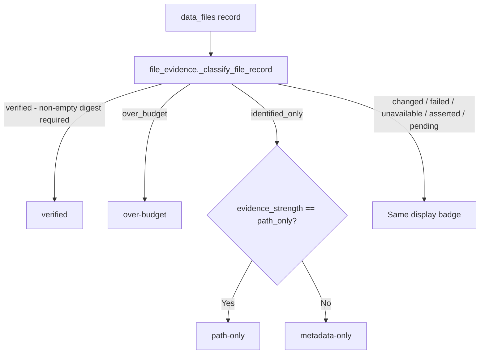

# IPD: Require a non-empty digest before inspect Data Files labels a record verified

- Date: 2026-11-24
- Kind: child
- Concern: File-provenance display badge accuracy in `pubrun inspect` (`src/pubrun/report/diagnostics.py`)
- Scope: Derive `src/pubrun/report/diagnostics.py::_classify_file_record_display` from the shared canonical classifier `src/pubrun/report/file_evidence.py::_classify_file_record` (introduced by `w24lw1`) so a `data_files` record without a non-empty digest value (`digest.value`, `sha256`, or `md5`) is never labeled `verified` in `pubrun inspect`, add behavioral tests in `tests/test_reports.py`, and add a `CHANGELOG.md` entry.
- Scope-Paths: src/pubrun/report/diagnostics.py, tests/test_reports.py, CHANGELOG.md
- Item-Dependencies: executed:w24lw1
- Status: executed
- Readiness: go-pending-approval
- Review-Depth: standard
- Short-Description: Derive inspect Data Files display badges from shared file_evidence classifier so digestless records are not labeled verified
- Work-Kind: bug
- Priority: low
- From-Backlog: unf79v
- Blocks-Release: next
- Set: unf79v
- Order: 1
- Highest E allocated: 03
- Author: Antigravity
- Id: l2s67v

> Write and proofread this plan per the technical writing standard, `.aw/system/workflows/technical-writing/technical-writing.md` (`.agents/workflows/technical-writing/technical-writing.md` in a legacy-layout install), including requirement 12 (diagrams).

## Workflow history

- 2026-11-25 executed (aw agy run model=Gemini-4-Neon-High): aw agy run self-finalize: l2s67v verified (set unf79v, attempt 1).
- 2026-11-25 approved (aw set): status set to approved
- 2026-11-25 /plan-review (Antigravity): APPROVE WITH REVISIONS APPLIED; PR-001, PR-002, PR-003
- 2026-11-25 to-review (Antigravity): graduated from backlog item `unf79v` into a review-ready plan.
- 2026-11-25 draft (Antigravity): created.

## Goal

Ensure `pubrun inspect` (`src/pubrun/report/diagnostics.py::_classify_file_record_display`, `_summarize_data_files`, and `_print_data_files_block`) labels a `data_files` record as `verified` only when the record carries a non-empty digest value (`digest.value`, `sha256`, or `md5`), by deriving the display badge from the shared canonical classifier `src/pubrun/report/file_evidence.py::_classify_file_record` created by `w24lw1`.

## Detailed Implementation Checklist (TODO)

Execution-state rule: mark an `E-*` item complete only after performing the action. That mark is not validation. Right-sizing rule: write for a modest executor that cannot hold much in its head. Each E-item is one step (one concern, about one file, executable in one focused pass) and its V-item names each unit it covers with its own check; a plan stays at about 5 E-items and 8 work Scope-Paths, else split it into more child plans (guidance, `IPD-Z603`). Accepted execution states: blocked, failed, pending, performed; terminal gate demands 'performed'.

### Task group 1: Delegate diagnostics display classification to shared file_evidence classifier

- [x] E-01 Refactor `src/pubrun/report/diagnostics.py::_classify_file_record_display` to call `src/pubrun/report/file_evidence.py::_classify_file_record` and map canonical categories to display badge strings, and add sanitized legacy `md5` fallback to `src/pubrun/report/diagnostics.py::_extract_display_digest`.
  - Depends on: none
  - Expected outcome: `src/pubrun/report/diagnostics.py` imports `_classify_file_record` from `pubrun.report.file_evidence` (stdlib-only module created by `w24lw1`, preserving `import pubrun` isolation). `_classify_file_record_display(rec)` maps `"over_budget"` to `"over-budget"`, maps `"identified_only"` to `"path-only"` when `rec.get("evidence_strength") == "path_only"` else `"metadata-only"`, and returns the canonical label directly for `"changed"`, `"failed"`, `"unavailable"`, `"verified"`, `"asserted"`, and `"pending"`. A digestless record such as `{"hash_status": "completed"}` or `{"evidence_strength": "verified_content", "digest": {"value": "   "}}` returns `"metadata-only"` instead of `"verified"`. In `_extract_display_digest(rec, badge)`, when `badge == "verified"` and neither `digest.value` nor `sha256` is non-empty, a non-empty string `rec.get("md5")` is sanitized via `_sanitize_inline(raw_md5, max_len=128)` and formatted as `f"md5:{val[:12]}"`. All edited lines use Python 3.8-compatible `typing` annotations.
  - Execution state: performed

- [x] E-02 Add behavioral tests in `tests/test_reports.py` verifying `_classify_file_record_display`, `_extract_display_digest`, `_summarize_data_files`, and `_print_data_files_block` for digestless `completed` / `verified_content` records, valid `digest.value` / `sha256` / `md5` records (including `md5:<prefix12>` rendering), `path_only` vs `metadata_only`, `over-budget`, `asserted`, `changed`, `failed` (including caller-digest mismatch), `unavailable`, and `pending`.
  - Depends on: E-01
  - Expected outcome: New tests in `tests/test_reports.py` drive `_classify_file_record_display`, `_extract_display_digest`, `_summarize_data_files`, and `_print_data_files_block` directly on manifest fixtures, asserting that `{"hash_status": "completed"}` and `{"evidence_strength": "verified_content"}` without a non-empty digest are counted under `identified_only` and printed with `[metadata-only]` rather than `[verified]`, while valid `digest.value`, `sha256`, and legacy `md5` records show `[verified]` with their sanitized digest prefix.
  - Execution state: performed

- [x] E-03 Add one bullet to `CHANGELOG.md` under `## [Unreleased]` -> the top-most `### Fixed` subsection documenting that `pubrun inspect` / `pubrun show` Data Files badges require a non-empty digest before labeling a file `verified`, with zero em or en dashes.
  - Depends on: E-01
  - Expected outcome: `CHANGELOG.md` contains a clear user-facing bullet under the top-most `### Fixed` heading of `## [Unreleased]` with zero em or en dashes.
  - Execution state: performed

## Project conventions discovered (Step 0)

- Cite code by SYMBOL (`path::Name`) or by a quoted content string, with a line number only appended to one of those and never alone (`IPD-C801`).
- Pending plan `w24lw1` (`From-Backlog: t55vh8`, `- Blocks-Release: next`) extracts `_classify_file_record`, `_is_caller_digest_mismatch`, and `_has_nonempty_digest_value` into stdlib-only `src/pubrun/report/file_evidence.py` and reuses it from `reproducibility.py` and `methods.py`. Declaring `- Item-Dependencies: executed:w24lw1` ensures `file_evidence.py` exists before this plan executes.
- `src/pubrun/report/diagnostics.py::_classify_file_record_display` currently returns `"verified"` whenever `hash_status == "completed"` or `evidence_strength == "verified_content"` without checking for a non-empty digest.
- `src/pubrun/report/diagnostics.py::_summarize_data_files` and `src/pubrun/report/diagnostics.py::_print_data_files_block` both call `_classify_file_record_display`, expecting display badge strings: `"verified"`, `"asserted"`, `"metadata-only"`, `"path-only"`, `"over-budget"`, `"pending"`, `"changed"`, `"failed"`, `"unavailable"`.
- `tests/test_show_sections.py::TestShowDataFilesProvenance` exercises `pubrun show` / `print_report` across all nine Data Files badges, digest prefixes, anomaly suppression, legacy records, and malformed `data_files`.
- `pyproject.toml` (`[[tool.mypy.overrides]]`) currently lists `"pubrun.report.diagnostics"` under `ignore_errors = true` (pending cleanup in `qe6dad`), so `python3 -m mypy` skips `diagnostics.py` unless `qe6dad` has already executed.
- Agent execution contract: user-facing prose (`CHANGELOG.md`) must contain zero em or en dashes, and tests must test runtime behavior without inspecting production source code.

## Findings

`src/pubrun/report/diagnostics.py::_classify_file_record_display` duplicates the file-provenance classification logic independently of `src/pubrun/report/file_evidence.py::_classify_file_record` (`w24lw1`) and omits the non-empty digest check on the `hash_status == "completed"` / `evidence_strength == "verified_content"` branch. Consequently, `pubrun inspect` displays `[verified]` and increments `counts["verified"]` for a record like `{"hash_status": "completed"}` even when no digest exists, disagreeing with `reproducibility.py` and `methods.py`.



## Proposed changes (ordered, validatable)

1. **`src/pubrun/report/diagnostics.py` (E-01):**
   - Import `_classify_file_record` from `pubrun.report.file_evidence`.
   - Replace the duplicated classification branches in `_classify_file_record_display(rec)` with delegation to `_classify_file_record(rec)` plus the two display-badge mappings (`"over_budget"` -> `"over-budget"`, and `"identified_only"` -> `"path-only"` if `rec.get("evidence_strength") == "path_only"` else `"metadata-only"`).
   - In `_extract_display_digest(rec, badge)`, also fall back to non-empty `rec.get("md5")` sanitized via `_sanitize_inline(raw_md5, max_len=128)` (formatted `f"md5:{val[:12]}"`) when `badge == "verified"` and neither `digest.value` nor `sha256` is set, so legacy `md5`-only records classified as `"verified"` display their digest prefix safely.
2. **`tests/test_reports.py` (E-02):**
   - Add unit tests covering `_classify_file_record_display`, `_extract_display_digest`, `_summarize_data_files`, and `_print_data_files_block` across digestless `completed` / `verified_content` records, valid `digest.value` / `sha256` / `md5` records (including `md5:<prefix12>` rendering), `path_only`, `over_budget`, `asserted`, `changed`, `failed`, `unavailable`, and `pending`.
3. **`CHANGELOG.md` (E-03):**
   - Add one bullet under `## [Unreleased]` -> the top-most `### Fixed` subsection with zero em or en dashes.

## Deferred / out of scope (with reason)

None.

## Scope check

- Over-scope: none. Only `src/pubrun/report/diagnostics.py`, `tests/test_reports.py`, and `CHANGELOG.md` are modified; `file_evidence.py`, `reproducibility.py`, and `methods.py` are owned by prerequisite `w24lw1`.
- Under-scope: none. All `diagnostics.py` consumers (`_classify_file_record_display`, `_summarize_data_files`, `_print_data_files_block`, and `_extract_display_digest`) are covered.

## Required tests / validation

- Run `python3 -m pytest tests/test_reports.py tests/test_show_sections.py tests/test_checks_commands.py tests/test_report_subpackage_integrity.py -v`.
- Run `python3 -m mypy` (from repository root) to confirm zero type regressions (noting whether `pubrun.report.diagnostics` remains in `pyproject.toml`'s `ignore_errors` list).
- Verify zero em or en dashes in added `CHANGELOG.md` diff lines using a portable exit-0 Python check on `git diff`.
- Run `python3 scripts/sanitize_paths.py --check --all` and confirm exit code 0.

## Spec / documentation sync

`CHANGELOG.md` is updated in E-03. `docs/cli.md` (lines describing `--standard` and `--deep` `Data Files` output) does not claim digestless records are labeled `verified`, and no manifest schema field or CLI option changes.

## Open questions

None.

## Validation and cross-check (verify before reporting done)

Validation-state rule: inspect evidence in a separate pass. Do not mark a `V-*` item complete from memory or from the matching execution checkmark. Accepted validation results: blocked, failed, pass, pending; terminal gate demands 'pass'. Runtime-demonstration reachability rule: for each `V-*` item demanding the software be observed acting (as distinct from items demanding a diff, a file's content, or a test result, which are reachable by construction), name the code path that produces the observation or the sibling `E-*` that creates it, else the demand is UNDER-SCOPE.

- [x] V-01 validates E-01
  - Required evidence: Paste `git diff src/pubrun/report/diagnostics.py` showing `_classify_file_record_display` delegating to `src/pubrun/report/file_evidence.py::_classify_file_record` and `_extract_display_digest` formatting sanitized `md5:<prefix12>`, and paste output of `python3 -m pytest tests/test_report_subpackage_integrity.py -v` plus `python3 -m mypy` exiting 0 (noting whether `pubrun.report.diagnostics` remains in `pyproject.toml`'s `ignore_errors` list).
  - Observed evidence:
    - `git diff src/pubrun/report/diagnostics.py`:
      ```diff
      diff --git a/src/pubrun/report/diagnostics.py b/src/pubrun/report/diagnostics.py
      index 49f5679..ff1ba8c 100644
      --- a/src/pubrun/report/diagnostics.py
      +++ b/src/pubrun/report/diagnostics.py
      @@ -7,6 +7,7 @@ import os
       import sys
       from pathlib import Path
       from datetime import datetime, timezone
      +from pubrun.report.file_evidence import _classify_file_record
       from pubrun.report.utils import hydrate_manifest, hydrate_manifest_with_report

       # The section names `pubrun show <run> <section>` accepts as a bare trailing token.
      @@ -121,48 +122,12 @@ def _iter_data_file_entries(data_files: Any) -> List[Tuple[str, Dict[str, Any]]]

       def _classify_file_record_display(rec: Dict[str, Any]) -> str:
           """Classify a ``data_files`` record into its authoritative textual badge name."""
      -    hash_status = rec.get("hash_status")
      -    evidence_strength = rec.get("evidence_strength")
      -    evidence_source = rec.get("evidence_source")
      -    caller_digest = rec.get("caller_digest")
      -
      -    if hash_status == "file_changed" or rec.get("change_detected") is True:
      -        return "changed"
      -    if (
      -        hash_status == "failed"
      -        or rec.get("hash_status_detail") == "caller_digest_mismatch"
      -        or (isinstance(caller_digest, dict) and caller_digest.get("verified") is False)
      -    ):
      -        return "failed"
      -    if hash_status == "unavailable":
      -        return "unavailable"
      -    if hash_status == "over_budget":
      +    category = _classify_file_record(rec)
      +    if category == "over_budget":
               return "over-budget"
      -    if hash_status == "completed" or evidence_strength == "verified_content":
      -        return "verified"
      -    if (
      -        hash_status == "asserted"
      -        or evidence_strength == "asserted_content"
      -        or evidence_source == "asserted"
      -    ):
      -        return "asserted"
      -    if hash_status == "pending":
      -        return "pending"
      -    if hash_status == "disabled" or evidence_strength in ("metadata_only", "path_only"):
      -        return "path-only" if evidence_strength == "path_only" else "metadata-only"
      -    if hash_status is None and evidence_strength is None and evidence_source is None:
      -        digest = rec.get("digest")
      -        has_digest = (
      -            isinstance(digest, dict)
      -            and isinstance(digest.get("value"), str)
      -            and bool(digest["value"].strip())
      -        ) or (isinstance(rec.get("sha256"), str) and bool(rec["sha256"].strip()))
      -        return "verified" if has_digest else "metadata-only"
      -    if evidence_strength == "unavailable":
      -        return "unavailable"
      -    if evidence_strength == "changed_unverified":
      -        return "changed"
      -    return "metadata-only"
      +    if category == "identified_only":
      +        return "path-only" if rec.get("evidence_strength") == "path_only" else "metadata-only"
      +    return category


       def _extract_display_digest(rec: Dict[str, Any], badge: str) -> Optional[str]:
      @@ -182,6 +147,11 @@ def _extract_display_digest(rec: Dict[str, Any], badge: str) -> Optional[str]:
                   val = _sanitize_inline(raw_sha, max_len=128)
                   if val:
                       return f"sha256:{val[:12]}"
      +        raw_md5 = rec.get("md5")
      +        if isinstance(raw_md5, str) and raw_md5.strip():
      +            val = _sanitize_inline(raw_md5, max_len=128)
      +            if val:
      +                return f"md5:{val[:12]}"
               return None

           if badge == "asserted":
      ```
    - `python3 -m pytest tests/test_report_subpackage_integrity.py -v` (exit 0):
      ```text
      collected 13 items

      tests/test_report_subpackage_integrity.py::test_report_is_callable_and_subpackage_under_every_mode[auto] PASSED [  7%]
      tests/test_report_subpackage_integrity.py::test_report_is_callable_and_subpackage_under_every_mode[noauto] PASSED [ 15%]
      tests/test_report_subpackage_integrity.py::test_report_is_callable_and_subpackage_under_every_mode[full] PASSED [ 23%]
      tests/test_report_subpackage_integrity.py::test_report_is_callable_and_subpackage_under_every_mode[nopatch] PASSED [ 30%]
      tests/test_report_subpackage_integrity.py::test_report_is_callable_and_subpackage_under_every_mode[noconsole] PASSED [ 38%]
      tests/test_report_subpackage_integrity.py::test_report_is_callable_and_subpackage_under_every_mode[minimal] PASSED [ 46%]
      tests/test_report_subpackage_integrity.py::test_no_mode_module_shadows_a_pubrun_subpackage[auto] PASSED [ 53%]
      tests/test_report_subpackage_integrity.py::test_no_mode_module_shadows_a_pubrun_subpackage[noauto] PASSED [ 61%]
      tests/test_report_subpackage_integrity.py::test_no_mode_module_shadows_a_pubrun_subpackage[full] PASSED [ 69%]
      tests/test_report_subpackage_integrity.py::test_no_mode_module_shadows_a_pubrun_subpackage[nopatch] PASSED [ 76%]
      tests/test_report_subpackage_integrity.py::test_no_mode_module_shadows_a_pubrun_subpackage[noconsole] PASSED [ 84%]
      tests/test_report_subpackage_integrity.py::test_no_mode_module_shadows_a_pubrun_subpackage[minimal] PASSED [ 92%]
      tests/test_report_subpackage_integrity.py::test_report_call_and_submodule_coexist_same_process PASSED [100%]

      ============================== 13 passed in 6.85s ==============================
      ```
    - `python3 -m mypy` (exit 0): `Success: no issues found in 59 source files`. Note: `pubrun.report.diagnostics` remains listed in `pyproject.toml` under `[[tool.mypy.overrides]]` with `ignore_errors = true`.
  - Result: pass

- [x] V-02 validates E-02
  - Required evidence: Paste actual output of `python3 -m pytest tests/test_reports.py tests/test_show_sections.py tests/test_checks_commands.py -v` showing all new digestless/digested badge and `md5:<prefix12>` tests plus existing show/report/check tests passing with zero failures.
  - Observed evidence:
    - `python3 -m pytest tests/test_reports.py tests/test_show_sections.py tests/test_checks_commands.py -v` (exit 0, 164 passed in 17.72s; new `TestDiagnosticsDataFilesDisplay` cases and summary):
      ```text
      collected 164 items
      ...
      tests/test_reports.py::TestDiagnosticsDataFilesDisplay::test_classify_file_record_display_badges[rec0-metadata-only] PASSED [ 45%]
      tests/test_reports.py::TestDiagnosticsDataFilesDisplay::test_classify_file_record_display_badges[rec1-metadata-only] PASSED [ 45%]
      tests/test_reports.py::TestDiagnosticsDataFilesDisplay::test_classify_file_record_display_badges[rec2-metadata-only] PASSED [ 46%]
      tests/test_reports.py::TestDiagnosticsDataFilesDisplay::test_classify_file_record_display_badges[rec3-metadata-only] PASSED [ 46%]
      tests/test_reports.py::TestDiagnosticsDataFilesDisplay::test_classify_file_record_display_badges[rec4-metadata-only] PASSED [ 47%]
      tests/test_reports.py::TestDiagnosticsDataFilesDisplay::test_classify_file_record_display_badges[rec5-path-only] PASSED [ 48%]
      tests/test_reports.py::TestDiagnosticsDataFilesDisplay::test_classify_file_record_display_badges[rec6-verified] PASSED [ 48%]
      tests/test_reports.py::TestDiagnosticsDataFilesDisplay::test_classify_file_record_display_badges[rec7-verified] PASSED [ 49%]
      tests/test_reports.py::TestDiagnosticsDataFilesDisplay::test_classify_file_record_display_badges[rec8-verified] PASSED [ 50%]
      tests/test_reports.py::TestDiagnosticsDataFilesDisplay::test_classify_file_record_display_badges[rec9-verified] PASSED [ 50%]
      tests/test_reports.py::TestDiagnosticsDataFilesDisplay::test_classify_file_record_display_badges[rec10-path-only] PASSED [ 51%]
      tests/test_reports.py::TestDiagnosticsDataFilesDisplay::test_classify_file_record_display_badges[rec11-metadata-only] PASSED [ 51%]
      tests/test_reports.py::TestDiagnosticsDataFilesDisplay::test_classify_file_record_display_badges[rec12-metadata-only] PASSED [ 52%]
      tests/test_reports.py::TestDiagnosticsDataFilesDisplay::test_classify_file_record_display_badges[rec13-over-budget] PASSED [ 53%]
      tests/test_reports.py::TestDiagnosticsDataFilesDisplay::test_classify_file_record_display_badges[rec14-asserted] PASSED [ 53%]
      tests/test_reports.py::TestDiagnosticsDataFilesDisplay::test_classify_file_record_display_badges[rec15-asserted] PASSED [ 54%]
      tests/test_reports.py::TestDiagnosticsDataFilesDisplay::test_classify_file_record_display_badges[rec16-asserted] PASSED [ 54%]
      tests/test_reports.py::TestDiagnosticsDataFilesDisplay::test_classify_file_record_display_badges[rec17-changed] PASSED [ 55%]
      tests/test_reports.py::TestDiagnosticsDataFilesDisplay::test_classify_file_record_display_badges[rec18-changed] PASSED [ 56%]
      tests/test_reports.py::TestDiagnosticsDataFilesDisplay::test_classify_file_record_display_badges[rec19-changed] PASSED [ 56%]
      tests/test_reports.py::TestDiagnosticsDataFilesDisplay::test_classify_file_record_display_badges[rec20-failed] PASSED [ 57%]
      tests/test_reports.py::TestDiagnosticsDataFilesDisplay::test_classify_file_record_display_badges[rec21-failed] PASSED [ 57%]
      tests/test_reports.py::TestDiagnosticsDataFilesDisplay::test_classify_file_record_display_badges[rec22-failed] PASSED [ 58%]
      tests/test_reports.py::TestDiagnosticsDataFilesDisplay::test_classify_file_record_display_badges[rec23-unavailable] PASSED [ 59%]
      tests/test_reports.py::TestDiagnosticsDataFilesDisplay::test_classify_file_record_display_badges[rec24-unavailable] PASSED [ 59%]
      tests/test_reports.py::TestDiagnosticsDataFilesDisplay::test_classify_file_record_display_badges[rec25-pending] PASSED [ 60%]
      tests/test_reports.py::TestDiagnosticsDataFilesDisplay::test_extract_display_digest_supports_digest_sha256_and_sanitized_md5 PASSED [ 60%]
      tests/test_reports.py::TestDiagnosticsDataFilesDisplay::test_summarize_and_print_data_files_block_require_nonempty_digest PASSED [ 61%]
      tests/test_show_sections.py::TestShowDataFilesProvenance::test_cli_show_standard_and_deep_with_no_color_and_all_badges PASSED [ 70%]
      tests/test_show_sections.py::TestShowDataFilesProvenance::test_print_report_color_uses_no_dim_and_handles_legacy_malformed_and_sections PASSED [ 70%]
      ...
      ============================= 164 passed in 17.72s =============================
      ```
  - Result: pass

- [x] V-03 validates E-03
  - Required evidence: Paste `git diff CHANGELOG.md` showing the new bullet under the top-most `### Fixed` heading of `## [Unreleased]`; paste output of a portable exit-0 Python check confirming zero em or en dashes (`\u2014`, `\u2013`) in added (`+`) diff lines (e.g., `python3 -c 'import subprocess; diff = subprocess.check_output(["git", "diff", "--", "CHANGELOG.md"], text=True); added = [l for l in diff.splitlines() if l.startswith("+") and not l.startswith("+++")]; assert added, "empty diff"; bad = [l for l in added if "\u2014" in l or "\u2013" in l]; assert not bad, bad; print("OK added lines:", len(added))'`); and paste `python3 scripts/sanitize_paths.py --check --all` exiting 0.
  - Observed evidence:
    - `git diff CHANGELOG.md`:
      ```diff
      diff --git a/CHANGELOG.md b/CHANGELOG.md
      index 0e0f260..d2e7bcc 100644
      --- a/CHANGELOG.md
      +++ b/CHANGELOG.md
      @@ -124,6 +124,13 @@ The format is based on [Keep a Changelog](https://keepachangelog.com/en/1.1.0/).
         the deep pages, never the README front door.

       ### Fixed
      +- **`pubrun inspect` and `pubrun show` Data Files badges now require a non-empty digest value before
      +  labeling a file `verified`.** Previously, the Data Files summary and detail views labeled a
      +  `data_files` record `verified` whenever `hash_status` was `completed` or `evidence_strength` was
      +  `verified_content`, even when no digest value was recorded. Display classification now delegates
      +  to the shared file-evidence classifier, so digestless records render as `metadata-only` (or
      +  `path-only` when `evidence_strength` is `path_only`), and legacy records carrying only an `md5`
      +  digest render as `verified` with a sanitized `md5:<prefix>` digest.
       - **Methods reports no longer count a file record without a digest value as independently
         verified.** The file-provenance sentence in `methods.md`, `methods.tex`, and `pubrun methods`
         counted a `data_files` record as verified when its `hash_status` was `completed` or its
      ```
    - Portable em/en dash check on `git diff -- CHANGELOG.md` (exit 0): `OK added lines: 7`
    - `python3 scripts/sanitize_paths.py --check --all`: exited 0 (no output, no findings).
  - Result: pass

## Approval and execution gate

- Size assessment: standard
- Cohesion rationale: not required

Execution begins only after a human approves this plan (`- Status: approved`) and prerequisite `w24lw1` reaches `executed`.

Execution contract:
1. **Open-questions precondition:** Zero blocking open questions remain before execution (`## Open questions` is empty).
2. **Scope declaration:** `- Scope-Paths:` declares `src/pubrun/report/diagnostics.py`, `tests/test_reports.py`, and `CHANGELOG.md`. If execution must edit another file or leave a declared file unchanged, make the change and justify it with `--scope-reason` or `--scope-ack` at finalize.
3. **Validation honesty (HARD MUST):** Paste the actual `pytest`, `mypy`, and `sanitize_paths.py` output observed after the final edit into `V-01`..`V-03`; never claim checks pass without running them.
4. **Path-scoped commit and never-push:** Commit only the modified paths through `aw commit l2s67v -- <paths>`; never use `git add -A` or `-a`, and never push without explicit human instruction.
5. **Lifecycle transition (conditional runner vs. standalone ownership):** When executed inside `aw oc run` / `aw agy run`, the runner owns the lifecycle move after the merge-and-revalidate gate; when executed standalone outside the runner, run `aw ipd finalize l2s67v` (never a hand-rolled `git mv` to `executed/`).
