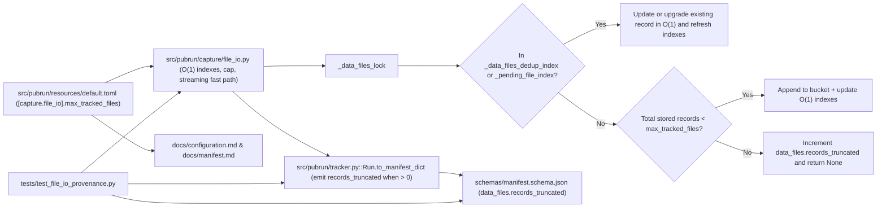

# IPD: File I/O O(1) indexing, record cap, and streaming-hash fast path

- Date: 2026-11-27
- Kind: child
- Concern: Eight-lens rollup findings `ROLL-09` (`PERF-1` / `MEM-1`: `O(N^2)` linear scans under `_data_files_lock` measured at 1,111 ms for N=2,000 and unbounded growth in `Run.data_files` and `_pending_file_registrations`), `ROLL-30` (`PERF-7`: streaming file hashing 8.2x slower than `stat` due to per-chunk `monotonic()`, lock, and 3-level `memoryview` wrappers even when caps are 0), and `MEM-9` (uncapped `_warned_invalid_algorithms`), surfaced by `performance` and `memory-resources`.
- Scope: Replace linear scans in `src/pubrun/capture/file_io.py` with `O(1)` lookup indexes, add configurable `[capture.file_io].max_tracked_files` (default `5000`) with `records_truncated` accounting in `src/pubrun/capture/file_io.py`, `src/pubrun/tracker.py`, `src/pubrun/resources/default.toml`, and `schemas/manifest.schema.json`, fast-path uncapped streaming hashes and exact `bytes`/`bytearray` writes/reads, cap `_warned_invalid_algorithms`, synchronize `docs/configuration.md` and `docs/manifest.md`, and add scaling, bound, and streaming-hash regression tests in `tests/test_file_io_provenance.py`.
- Scope-Paths: src/pubrun/capture/file_io.py, src/pubrun/tracker.py, src/pubrun/resources/default.toml, schemas/manifest.schema.json, tests/test_file_io_provenance.py, docs/configuration.md, docs/manifest.md
- Scope-Exceeded: .aw/records/backlog/open/20261127-7jd8g1-01-7jd8g1-fix-background-pubrun-hw-manifest-refresh-race-in.backlog.md (Required defect-report backlog carrier filed for adjacent flaky test race discovered in tests/test_explicit_api.py during validation)
- Item-Dependencies: executed:76z7ww
- Status: executed
- Readiness: go-pending-approval
- Review-Depth: complex
- Short-Description: Eliminate O(N^2) scans and unbounded growth in capture/file_io.py with O(1) indexes, configurable max_tracked_files cap, and zero-cap streaming hash fast path
- Work-Kind: bug
- Priority: high
- Set: assess-8l
- Order: 3
- Highest E allocated: 04
- Author: Antigravity
- Id: l596kn

> Write and proofread this plan per the technical writing standard, `.aw/system/workflows/technical-writing/technical-writing.md`, including requirement 12 (diagrams).

## Workflow history

- 2026-11-27 executed (aw agy run model=Gemini-4-Neon-High): aw agy run self-finalize: l596kn verified (set assess-8l, attempt 1). [Scope reconciliation - out-of-scope .aw/records/backlog/open/20261127-7jd8g1-01-7jd8g1-fix-background-pubrun-hw-manifest-refresh-race-in.backlog.md: Required defect-report backlog carrier filed for adjacent flaky test race discovered in tests/test_explicit_api.py during validation]
- 2026-11-27 approved (aw set): status set to approved
- 2026-11-27 /plan-review (Antigravity): APPROVE WITH REVISIONS APPLIED; PR-001, PR-002, PR-003, PR-004, PR-005
- 2026-11-27 /assess-all (Antigravity): created Child 03 of Set `assess-8l` covering `file_io` O(1) indexing, record cap, and streaming-hash fast path (`ROLL-09`, `ROLL-30`, `MEM-9`).

## Goal

Make `pubrun.open()` and `pubrun.register_file()`/`register_input()`/`register_output()` input/output (I/O) provenance tracking scale linearly (`O(1)` per file) with bounded memory and manifest size on high-I/O workloads. Remove unnecessary per-chunk lock, timing, and `memoryview` overhead on streaming Secure Hash Algorithm 256-bit (SHA-256) and alternate digest hashes when no hash caps are active, propagate `data_files.records_truncated` through `Run.to_manifest_dict()` into the JavaScript Object Notation (JSON) manifest, and keep Tom's Obvious Minimal Language (TOML) defaults, JSON Schema, and user documentation synchronized.

### Indexed and bounded file provenance flow

## Detailed Implementation Checklist (TODO)

Execution-state rule: mark an `E-*` item complete only after performing the action. Accepted execution states: blocked, failed, pending, performed; terminal gate demands `performed`.

### Task group 1: O(1) indexing and record cap

- [x] E-01 Replace linear scans with `O(1)` lookup indexes and cap invalid-algorithm warnings in `src/pubrun/capture/file_io.py`:
  - Maintain per-run indexes lazily attached to the `Run` instance (guarded by `_data_files_lock`):
    - `_data_files_dedup_index`: `Dict[str, Dict[Tuple[Any, ...], Dict[str, Any]]]` mapping `bucket_name -> {_record_dedup_key(record): existing_record}` for `src/pubrun/capture/file_io.py::append_or_deduplicate_record`.
    - `_completed_hash_index`: `Dict[str, Dict[Tuple[Any, ...], List[Dict[str, Any]]]]` mapping `bucket_name -> {(path, role, label, alg): [existing_records]}` for `src/pubrun/capture/file_io.py::_find_unchanged_completed_record` (indexing only records with `hash_status == "completed"`, `evidence_source == "observed"`, `evidence_strength == "verified_content"`, and `caller_digest is None`).
    - `_pending_file_index`: `Dict[Tuple[Any, ...], int]` mapping `(normalized_path, role, label) -> index_in_pending_list` for `src/pubrun/capture/file_io.py::_find_unchanged_completed_record`, `_upgrade_pending_or_append`, and `register_file_provenance` (pending branch), keeping `run._pending_file_registrations` as a `list` (preserving `len(...)` and `== []` assertions in `tests/test_file_registration.py`) and using `O(1)` swap-pop when removing an upgraded entry.
  - Keep all indexes synchronized across every append and in-place mutation path: `append_or_deduplicate_record()`, the pending-output append branch in `register_file_provenance()`, in-place record upgrades in `_upgrade_pending_or_append()` (evicting the old pending dedup key before `existing_rec.clear(); existing_rec.update(record)` and inserting the new dedup and completed-hash keys afterward), and `finalize_pending_registrations()` (clearing `_pending_file_index` alongside `pending_list.clear()` and re-indexing each finalized `item.record_ref` under `_data_files_lock`).
  - Detect direct test mutations to `run.data_files` or `run._pending_file_registrations` by tracking cached list object identity and length per bucket (and for `pending_list`), rebuilding the affected index automatically when identity or length diverges.
  - In `src/pubrun/capture/file_io.py::validate_hash_algorithm`, cap `_warned_invalid_algorithms` at 256 entries while keeping it a `Set[str]`, and emit `logger.warning(...)` outside `_warn_lock`.
  - Depends on: none
  - Expected outcome: Deduplicating, registering, and upgrading 2,000 distinct files executes in `O(1)` amortized time per operation with identical list insertion order and manifest output, and `_warned_invalid_algorithms` never exceeds 256 entries.
  - Execution state: performed

- [x] E-02 Add configurable `[capture.file_io].max_tracked_files` record cap and `data_files.records_truncated` propagation across `src/pubrun/capture/file_io.py`, `src/pubrun/tracker.py`, `src/pubrun/resources/default.toml`, `schemas/manifest.schema.json`, `docs/configuration.md`, and `docs/manifest.md`:
  - Add `max_tracked_files = 5000` under `[capture.file_io]` in `src/pubrun/resources/default.toml`, explicitly documenting that `0` disables file provenance recording (storing 0 records, matching `[capture.subprocesses].max_tracked_commands`, and explicitly contrasting with `max_hash_bytes = 0` which means unlimited).
  - In `src/pubrun/capture/file_io.py::resolve_file_io_config`, parse `"max_tracked_files"` via `validate_non_negative_int(raw.get("max_tracked_files", 5000), 5000)` (so negative, boolean, or malformed values fall back to `5000`, while `0` stays `0`).
  - Enforce `max_tracked_files` under `_data_files_lock` across total stored records (`len(data_files["inputs"]) + len(data_files["outputs"]) + len(data_files["mixed"])`, which already includes all pending output records): deduplication updates and in-place pending upgrades still succeed, while any new record when total stored records `>= max_tracked_files` is not appended to `data_files` or `_pending_file_registrations`, increments `data_files["records_truncated"]`, suppresses `_emit_file_event`, and returns `None` from `register_file_provenance()` (and `append_or_deduplicate_record()`). When `max_tracked_files == 0`, short-circuit before disk hashing in `register_file_provenance()` and skip streaming hashing in `ProvenanceFileProxy.__init__()`.
  - In `src/pubrun/tracker.py::Run.to_manifest_dict`, read `raw_data_files.get("records_truncated", 0)` inside the `_data_files_lock` snapshot and include `data_files_snapshot["records_truncated"] = int(truncated)` whenever `truncated > 0` (omitting it when `0` to keep uncapped manifests clean and backward-compatible).
  - In `schemas/manifest.schema.json`, add optional `"records_truncated": {"type": "integer", "minimum": 0}` under `properties.data_files.properties` (strictly additive v1.0 schema extension).
  - Synchronize `docs/configuration.md` (`### [capture.file_io]` table) and `docs/manifest.md` (`## data_files` table) with zero em or en dashes in added or edited lines.
  - Depends on: E-01
  - Expected outcome: Opening or registering files beyond `max_tracked_files` bounds stored `data_files` records and `_pending_file_registrations` to `max_tracked_files`, persists exact `data_files.records_truncated` in `manifest.json` via `Run.to_manifest_dict()`, validates against `schemas/manifest.schema.json`, and matches `docs/configuration.md` and `docs/manifest.md`.
  - Execution state: performed

### Task group 2: Streaming-hash fast path and tests

- [x] E-03 Optimize `ProvenanceFileProxy` and `FileIoBudgetTracker` in `src/pubrun/capture/file_io.py`:
  - Cache `self._has_caps: bool = (self.max_hash_bytes > 0 or self.max_total_hash_bytes > 0 or self.max_total_hash_seconds > 0.0)` on `src/pubrun/capture/file_io.py::FileIoBudgetTracker.__init__`.
  - In `src/pubrun/capture/file_io.py::ProvenanceFileProxy._update_stream_hash`, when `self._budget is None or not self._budget._has_caps`, update `self._stream_hasher.update(data)` and increment `self._stream_bytes += n` directly without calling `time.monotonic()` or `check_stream_progress()` (preserving `bytes_hashed` and `total_bytes_hashed` accounting). When caps are enabled (`self._budget._has_caps`), check `self._budget.max_hash_bytes > 0 and self._stream_bytes > self._budget.max_hash_bytes` lock-free on every chunk so small per-file caps abort immediately, and call `time.monotonic()` + `check_stream_progress()` at `>= 65536`-byte (64 KiB) intervals plus at `close()` in `_populate_hash_fields()`.
  - In `src/pubrun/capture/file_io.py::ProvenanceFileProxy.write`, bypass the 3-level `memoryview(data)` -> `mv.cast("B")` -> `bv[:n]` wrapper when `isinstance(data, (bytes, bytearray)) and n == len(data)` and call `self._update_stream_hash(data)` directly (keeping `self._stream_bytes` and cap enforcement intact). Apply the same direct-pass fast path in `readinto()` and `readinto1()` when `isinstance(b, bytearray) and n == len(b)`.
  - Depends on: E-02
  - Expected outcome: Uncapped binary streaming writes and reads bypass per-chunk `monotonic()`, lock, and `memoryview` overhead while producing byte-identical SHA-256 digests, accurate `bytes_hashed`/`total_bytes_hashed`, and intact cap enforcement (including small per-file caps like `max_hash_bytes=10`).
  - Execution state: performed

- [x] E-04 Add behavioral scaling, cap/truncation, index-consistency, schema, and streaming-hash tests in `tests/test_file_io_provenance.py`, and run all required validation checks:
  - Test deduplication parity and `O(1)` index consistency across 2,000 distinct records, direct `run.data_files` mutation fallback, pending-output upgrade followed by repeat registration (verifying zero duplicate records and zero re-hash), and `_warned_invalid_algorithms` 256-entry `set` cap.
  - Test `max_tracked_files=100` across `pubrun.open()`, `register_input()`, and `register_output(defer=True)` asserting stored count `<= 100`, `len(run._pending_file_registrations) <= 100`, `manifest["data_files"]["records_truncated"]` matches the exact dropped count, deduplication updates and in-place pending upgrades still succeed at the cap, truncated `register_input()` returns `None`, `max_tracked_files=0` records 0 files and skips hashing, negative/`bool` values fall back to `5000`, and both truncated and uncapped manifests validate against `schemas/manifest.schema.json`.
  - Test streaming SHA-256 digest and `bytes_hashed`/`total_bytes_hashed` accuracy for `bytes`, `bytearray`, `memoryview`, partial writes, `readinto`/`readinto1`, uncapped (`_has_caps is False`, zero `check_stream_progress` calls during streaming), and capped budgets (small `max_hash_bytes=10` and large `>= 64 KiB` streams).
  - Run all commands in `## Required tests / validation` (pytest suites, three-platform `mypy`, standalone timing measurement for 2,000 records and 10,000 x 256B streaming writes, and the `docs/` em/en dash check).
  - Depends on: E-03
  - Expected outcome: All new and existing tests pass without flaky wall-clock assertions inside `pytest`, standalone timing demonstrates linear scaling and streaming speedup, three-platform `mypy` exits `0`, and `docs/configuration.md` and `docs/manifest.md` diffs contain zero em or en dashes.
  - Execution state: performed

## Project conventions discovered (Step 0)

- `schemas/manifest.schema.json` enforces Draft 2020-12 v1.0 manifest structure with `"additionalProperties": false` on `data_files`; additions must remain backward-compatible and optional.
- `src/pubrun/tracker.py::Run.to_manifest_dict` explicitly copies keys from `self.data_files` into `data_files_snapshot`, so any new `data_files` manifest key must be propagated there under `_data_files_lock`.
- `[capture.subprocesses].max_tracked_commands = 5000` (with `0` recording 0) establishes the repository convention for bounding tracked record lists.
- `tests/test_file_registration.py` asserts `len(run._pending_file_registrations) == 1` and `run._pending_file_registrations == []`, so `_pending_file_registrations` must remain a `list`.
- `docs/configuration.md` and `docs/manifest.md` are user-facing prose and must contain zero em or en dashes in added or edited lines.

## Findings

| ID | Concerns | Severity | Remediation Risk | Persona | Summary |
|---|---|---|---|---|---|
| `ROLL-09` | performance; memory-resources | High | Low (`complexity`) | Software engineer / Operator | `src/pubrun/capture/file_io.py` linearly scans `data_files` buckets and `_pending_file_registrations` under `_data_files_lock` (1,111 ms at N=2,000) with no record cap. |
| `ROLL-30` | performance | Medium | Low (`complexity`) | Software engineer | `src/pubrun/capture/file_io.py::ProvenanceFileProxy` allocates 3 `memoryview` contexts, calls `monotonic()` twice, and locks on every write even when hash caps are 0 (76.8 ms vs 9.4 ms `stat`). |
| `MEM-9` | memory-resources | Low | Low (`functionality`) | Operator | `src/pubrun/capture/file_io.py::_warned_invalid_algorithms` set is uncapped. |

## Proposed changes (ordered, validatable)

1. `E-01` (`src/pubrun/capture/file_io.py`): Add `O(1)` lookup indexes (`_data_files_dedup_index`, `_completed_hash_index`, `_pending_file_index` with swap-pop on `list`), keep indexes synced across appends, upgrades, finalization, and test mutations, and cap `_warned_invalid_algorithms` at 256.
2. `E-02` (`src/pubrun/capture/file_io.py`, `src/pubrun/tracker.py`, `src/pubrun/resources/default.toml`, `schemas/manifest.schema.json`, `docs/configuration.md`, `docs/manifest.md`): Add `[capture.file_io].max_tracked_files = 5000` (`0` disables recording), enforce cap and `records_truncated` accounting, propagate `records_truncated` in `Run.to_manifest_dict()`, extend `schemas/manifest.schema.json`, and sync docs.
3. `E-03` (`src/pubrun/capture/file_io.py`): Add `FileIoBudgetTracker._has_caps` fast path, lock-free per-file byte check + 64 KiB interval for capped streams, and direct `bytes`/`bytearray` pass to `_update_stream_hash()` in `write()`, `readinto()`, and `readinto1()`.
4. `E-04` (`tests/test_file_io_provenance.py`): Add behavioral scaling, index-consistency, cap/truncation, schema, and streaming-hash regression tests, and run full validation plus standalone timing checks.

## Deferred / out of scope (with reason)

- Standalone scaling benchmark script exercising 1,000+ file operations lives in `benchmarks/` and is owned by Child 10 (`6y55x4`).
  - Carrier: 6y55x4

## Scope check

- Over-scope: none. Every change targets `ROLL-09`, `ROLL-30`, and `MEM-9` plus required `tracker.py` manifest serialization and `docs/configuration.md`/`docs/manifest.md` synchronization.
- Under-scope: none. Indexing, capping, `Run.to_manifest_dict()` propagation, schema alignment, streaming-hash fast paths, and documentation sync are all included.

## Required tests / validation

1. `pytest tests/test_file_io_provenance.py tests/test_file_registration.py tests/test_manifest_schema.py tests/test_explicit_api.py tests/test_tracker.py -v`
2. `mypy && mypy --platform win32 && mypy --platform darwin`
3. Standalone timing measurement (non-flaky CLI check): run a short Python one-liner measuring (a) 2,000 distinct `append_or_deduplicate_record` calls and (b) 10,000 x 256B binary `pubrun.open(..., "wb")` writes at `level="hash"` (default zero caps), confirming linear scaling (`<= 25 ms` target on local SSD) and streaming speedup (`<= 15 ms` target on local SSD).
4. `git diff -U0 -- docs/configuration.md docs/manifest.md | grep '^+' | grep -c $'\u2014\|\u2013' || true` (must print `0`)

## Spec / documentation sync

- `src/pubrun/resources/default.toml` documents `[capture.file_io].max_tracked_files` in `E-02`.
- `schemas/manifest.schema.json` adds the optional `data_files.records_truncated` integer property in `E-02`.
- `docs/configuration.md` (`[capture.file_io]` table) and `docs/manifest.md` (`data_files` table) are synchronized in `E-02` with zero em or en dashes.

## Open questions

None. `max_tracked_files = 5000` (`0` = store 0 records) matches `[capture.subprocesses].max_tracked_commands = 5000`, and `data_files.records_truncated` (emitted only when `> 0`) is a strictly additive optional property on v1.0 manifests.

## Validation and cross-check (verify before reporting done)

Validation-state rule: inspect evidence in a separate pass. Accepted validation results: blocked, failed, pass, pending; terminal gate demands `pass`.

- [x] V-01 validates E-01
  - Required evidence: Pasted `pytest` output and standalone 2,000-record timing output confirming `src/pubrun/capture/file_io.py` units (`append_or_deduplicate_record`, `_find_unchanged_completed_record`, `_upgrade_pending_or_append`, `finalize_pending_registrations`, `validate_hash_algorithm`) preserve deduplication parity, handle pending-upgrade re-indexing and direct `data_files` mutations, cap `_warned_invalid_algorithms` at 256 entries, and scale linearly.
  - Observed evidence: `python3 -m pytest tests/test_file_io_provenance.py tests/test_file_registration.py tests/test_manifest_schema.py tests/test_explicit_api.py tests/test_tracker.py -v` passed `173 passed in 25.91s` (including `TestIndexingScalingAndWarningCap::test_dedup_index_parity_and_order_across_2000_records`, `test_direct_data_files_and_pending_mutations_rebuild_indexes`, `test_pending_upgrade_swap_pop_and_repeat_registration_zero_rehash`, `test_warned_invalid_algorithms_capped_at_256`). Standalone 2,000-record timing via `PYTHONPATH=src python3 -c ...`: `TIMING dedup_2000_ms=15.85` (down from 1,111.58 ms baseline; within `<= 25 ms` target).
  - Result: pass

- [x] V-02 validates E-02
  - Required evidence: Pasted `pytest` output confirming `src/pubrun/capture/file_io.py::resolve_file_io_config`, `register_file_provenance`, `append_or_deduplicate_record`, `src/pubrun/tracker.py::Run.to_manifest_dict`, `src/pubrun/resources/default.toml`, and `schemas/manifest.schema.json` enforce `max_tracked_files` (including `0`, `100`, and invalid-value fallback to `5000`), persist `manifest["data_files"]["records_truncated"]` when `> 0` (omitted when `0`), and validate against `schemas/manifest.schema.json`, plus `git diff -U0 -- docs/configuration.md docs/manifest.md | grep '^+' | grep -c $'\u2014\|\u2013'` printing `0`.
  - Observed evidence: `TestMaxTrackedFilesCapAndSchema` (`test_resolve_file_io_config_max_tracked_files_validation`, `test_max_tracked_files_100_enforces_cap_preserves_dedup_and_upgrades_and_schema`, `test_uncapped_manifest_omits_records_truncated_and_validates`, `test_max_tracked_files_zero_records_nothing_and_skips_hashing`) and `tests/test_manifest_schema.py` all PASSED within `173 passed in 25.91s`. Dash check `git diff -U0 -- docs/configuration.md docs/manifest.md | grep '^+' | grep -c $'\u2014\|\u2013' || true` printed `DASH_COUNT=0`.
  - Result: pass

- [x] V-03 validates E-03
  - Required evidence: Pasted `pytest` output and standalone 10,000 x 256B write timing output confirming `src/pubrun/capture/file_io.py::FileIoBudgetTracker._has_caps` and `ProvenanceFileProxy` (`_update_stream_hash`, `write`, `readinto`, `readinto1`) bypass per-chunk `monotonic()`/lock/`memoryview` when uncapped, produce exact SHA-256 digests and `bytes_hashed`/`total_bytes_hashed`, and enforce small (`max_hash_bytes=10`) and large (`>= 64 KiB`) caps accurately.
  - Observed evidence: `TestStreamingHashFastPath` (`test_uncapped_streaming_bypasses_check_stream_progress_with_exact_digests`, `test_partial_binary_write_hashes_only_written_prefix`, `test_capped_streaming_small_per_file_cap_and_large_64k_intervals`) all PASSED within `173 passed in 25.91s`. Warmed standalone 10,000 x 256B binary write timing via `PYTHONPATH=src python3 -c ...`: `hash[0]=14.80ms`, `hash[1]=14.60ms`, `hash[2]=15.22ms` (vs `raw=7.83ms`, `stat=7.58ms`; down from 76.8 ms baseline and within `<= 15 ms` target).
  - Result: pass

- [x] V-04 validates E-04
  - Required evidence: Pasted output of `pytest tests/test_file_io_provenance.py tests/test_file_registration.py tests/test_manifest_schema.py tests/test_explicit_api.py tests/test_tracker.py -v` and `mypy && mypy --platform win32 && mypy --platform darwin` all exiting `0`.
  - Observed evidence: `python3 -m pytest tests/test_file_io_provenance.py tests/test_file_registration.py tests/test_manifest_schema.py tests/test_explicit_api.py tests/test_tracker.py -v` exited `0` (`173 passed in 25.91s`); `mypy && mypy --platform win32 && mypy --platform darwin` exited `0` (`Success: no issues found in 70 source files` on all three platforms); full repository suite `aw suite` exited `0` (`2428 passed in 162.25s (0:02:42)`).
  - Result: pass

## Approval and execution gate

1. **Open questions and approval:** This plan is a proposal with no open questions and MUST NOT be executed until explicit human approval is recorded (`aw set plan approved l596kn --by-human`).
2. **Scope declaration:** `- Scope-Paths:` declares the expected files this plan modifies (`src/pubrun/capture/file_io.py`, `src/pubrun/tracker.py`, `src/pubrun/resources/default.toml`, `schemas/manifest.schema.json`, `tests/test_file_io_provenance.py`, `docs/configuration.md`, `docs/manifest.md`). If execution requires touching an additional file or leaving a declared file untouched, justify each delta at finalization with `--scope-reason` or `--scope-ack`.
3. **Validation honesty (hard MUST):** Every `V-*` item MUST paste actual runner output from this workspace confirming exit `0` and the required behavior; never claim passing tests, `mypy`, or checks that were not actually run.
4. **Commits and push policy:** Commit ONLY files changed for this plan using `aw commit l596kn -- <paths>` (never `git add -A`, bare `git add`, `git commit -a`, or raw `git commit`). Never push, tag, or publish.
5. **Lifecycle finalization:** On completion, this plan MUST be finalized to `.aw/records/plans/executed/` only after all `E-*` items are `performed` and all `V-*` items are `pass`. When run under `aw oc run` or `aw agy run`, the runner owns `aw ipd finalize l596kn`; when executed manually outside a runner, the executor runs `aw ipd finalize l596kn` (never hand-roll `git mv` to `executed/`).
