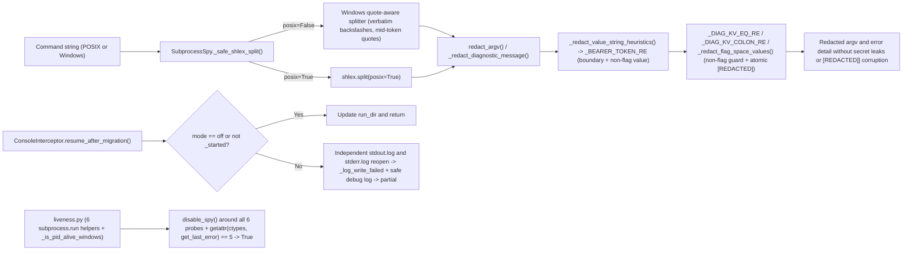

# IPD: Redaction security Windows subprocess splitting console resume and liveness

- Date: 2026-11-27
- Kind: child
- Concern: Fix two High secret-redaction leaks (`BUG-E1`, `BUG-E2`), a post-migration console error-reporting regression (`BUG-E4`), and liveness spy leakage / Windows permission parity (`BUG-E9`).
- Scope: Fix `src/pubrun/capture/redaction.py`, `src/pubrun/capture/subprocesses.py`, `src/pubrun/capture/console.py`, and `src/pubrun/capture/liveness.py`, and add deterministic behavioral regression tests in `tests/test_security_hardening.py`, `tests/test_capture_engine_bugs.py`, and `tests/test_liveness.py`.
- Scope-Paths: src/pubrun/capture/redaction.py, src/pubrun/capture/subprocesses.py, src/pubrun/capture/console.py, src/pubrun/capture/liveness.py, tests/test_security_hardening.py, tests/test_capture_engine_bugs.py, tests/test_liveness.py
- Item-Dependencies: none
- Status: executed
- Readiness: go-pending-approval
- Review-Depth: complex
- Short-Description: Fix boolean-flag redaction leaks, Windows mid-token quote splitting, post-migration console error tracking, and liveness spy/Windows parity
- Work-Kind: security
- Priority: high
- Set: assess-bt
- Order: 2
- Highest E allocated: 05
- Author: Antigravity
- Id: ndobra

> Write and proofread this plan per the technical writing standard, `.aw/system/workflows/technical-writing/technical-writing.md` (`.agents/workflows/technical-writing/technical-writing.md` in a legacy-layout install), including requirement 12 (diagrams).

## Workflow history

- 2026-11-28 executed (aw agy run model=Gemini-4-Neon-High): aw agy run self-finalize: ndobra verified (set assess-bt, attempt 1).
- 2026-11-28 approved (aw set): status set to approved
- 2026-11-27 /plan-review (Antigravity): APPROVE WITH REVISIONS APPLIED; PR-001, PR-002, PR-003, PR-004, PR-005
- 2026-11-27 to-review (Antigravity): Authored review-ready child IPD from `/assess bugs` Slice 2 audit on HEAD `512ee68` / `8f2aacd`.
- 2026-11-27 draft (Antigravity): created.

## Goal

Close two reachable plaintext secret leaks in shell/diagnostic redaction (`src/pubrun/capture/redaction.py`) and Windows `SubprocessSpy` tokenization (`src/pubrun/capture/subprocesses.py`), ensure `ConsoleInterceptor.resume_after_migration` (`src/pubrun/capture/console.py`) reports post-migration reopen failures accurately instead of falsely claiming `complete` and avoids opening files after a failed `start()`, and bring `src/pubrun/capture/liveness.py` into parity with sibling capture modules (`disable_spy()` and Windows `ERROR_ACCESS_DENIED`).

### Redaction, Windows tokenization, console resume, and liveness scope



## Detailed Implementation Checklist (TODO)

Execution-state rule: mark an `E-*` item complete only after performing the action. That mark is not validation. Right-sizing rule: write for a modest executor that cannot hold much in its head. Each E-item is one step (one concern, about one file, executable in one focused pass) and its V-item names each unit it covers with its own check; a plan stays at about 5 E-items and 8 work Scope-Paths, else split it into more child plans (guidance, `IPD-Z603`). Accepted execution states: blocked, failed, pending, performed; terminal gate demands 'performed'.

### Task group 1: Fix redaction and Windows subprocess splitting security defects

- [x] E-01 Fix boolean-flag secret leaks and `[REDACTED]]` corruption in `src/pubrun/capture/redaction.py` (`BUG-E1`):
  - Update `src/pubrun/capture/redaction.py::_BEARER_TOKEN_RE` to require a leading non-flag boundary and disallow values beginning with `-` (for example `r"(?i)(?<![A-Za-z0-9_-])(bearer|token|auth)\s+(?!-)([a-zA-Z0-9._~+/-]+=*)"`).
  - Update `src/pubrun/capture/redaction.py::_redact_flag_space_values` to skip consuming `val_match` when `val_match.group(0).startswith("-")`, matching `redact_argv`'s boolean-flag guard so `--use-key --password supersecret` redacts `supersecret` instead of swallowing `--password`.
  - Share an atomic `\[REDACTED\]|` value-token subpattern (`r"\[REDACTED\]|\"[^\"]*\"|'[^']*'|[^\s,)\];]+"`) across `_DIAG_TOKEN_VAL_RE`, `_DIAG_KV_EQ_RE`, and `_DIAG_KV_COLON_RE` so already-redacted markers are never rewritten to `[REDACTED]]` in space-separated flags (`--password [REDACTED]`), key-equals pairs (`--password=[REDACTED]`), or colon-separated diagnostic messages (`password: [REDACTED]`).
  - Depends on: none
  - Expected outcome: `redact_argv` and `format_safe_error_detail` redact secrets following boolean sensitive flags and bare subcommands (`--use-auth --password supersecret`, `--use-key --password supersecret`, `--token --secret supersecret`, `auth --password supersecret`), preserve `Bearer tok123 -> Bearer [REDACTED]`, and never produce `[REDACTED]]` for `--password [REDACTED]`, `--password=[REDACTED]`, or `password: [REDACTED]`.
  - Execution state: performed

- [x] E-02 Fix Windows mid-token quote splitting in `src/pubrun/capture/subprocesses.py::SubprocessSpy._safe_shlex_split` (`BUG-E2`):
  - Replace the `shlex.split(args, posix=False)` branch in `SubprocessSpy._safe_shlex_split` with a dedicated Windows quote-aware splitter that:
    - splits on unquoted whitespace and returns `[]` for empty or whitespace-only strings;
    - preserves all backslashes verbatim (never treating `\` as an escape character, so `"C:\Program Files\a.csv"` and `"C:\dir\"` keep backslashes intact and close cleanly);
    - allows double quotes (`"`) to open and close quoted spans anywhere in a token (grouping mid-token values such as `--password="my secret"`, `API_KEY="foo bar"`, and `--data="C:\Program Files\a.csv"` into single tokens with the enclosing quote characters stripped);
    - allows single quotes (`'`) to open a quoted span at token start or immediately after `=` (handling `'D:\a\b'` and `--password='my secret'`) while leaving mid-word apostrophes in unquoted Windows paths (such as `C:\work\O'Brien\train.py`) literal;
    - treats the opposite quote character as literal inside an active quoted span (such as `--password="it's secret"` and `--password='a "b" c'`);
    - preserves empty quoted tokens (`""` -> `[""]`, `--password=""` -> `["--password="]`);
    - falls back to `[args]` when a quoted span is unterminated at end of input.
  - Depends on: none
  - Expected outcome: `SubprocessSpy._safe_shlex_split(cmd, posix=False)` keeps `--password="my secret"`, `--password='my secret'`, `API_KEY="foo bar"`, and `--data="C:\Program Files\a.csv"` as single tokens with intact backslashes, handles trailing backslashes, nested opposite quotes, empty quoted tokens, and unquoted apostrophes cleanly, falls back to `[args]` on unterminated quotes, and allows `redact_argv()` to redact multi-word secret values completely.
  - Execution state: performed

### Task group 2: Fix console post-migration failure reporting and liveness spy/Windows parity

- [x] E-03 Fix `src/pubrun/capture/console.py::ConsoleInterceptor.resume_after_migration` and `src/pubrun/capture/liveness.py` (`BUG-E4`, `BUG-E9`):
  - In `ConsoleInterceptor.resume_after_migration`, update `self.run_dir = new_dir` and return early when `self.mode == "off" or not self._started`. Reopen `stdout.log` and `stderr.log` in independent `try/except` blocks; on failure for either stream, close any handle opened during that attempt, set `self.stdout_log = None` / `self.stderr_log = None`, detach `tee.log_file = None` and set `tee._log_write_failed = True` under `finalization_lock(tee._lock, 0.25)` when the tee is present, and log via `format_safe_error_detail(err, self._config)` outside the tee lock so `stop()` accurately reports `capture_state.status == "partial"` while the unaffected stream still captures and re-enables `faulthandler` when `stderr.log` succeeds.
  - In `src/pubrun/capture/liveness.py`, wrap all six `subprocess.run` calls (`_check_command_macos`, `_check_command_windows`, `_get_start_time_macos`, `_get_rss_macos`, `_get_cpu_macos`, `_get_rss_windows`) with lazy `from pubrun.capture.subprocesses import disable_spy` and `with disable_spy():` (matching sibling capture modules).
  - In `src/pubrun/capture/liveness.py::_is_pid_alive_windows`, define `ERROR_ACCESS_DENIED = 5`, retrieve `get_last_error = getattr(ctypes, "get_last_error", None)` (since `ctypes.get_last_error` exists only on Windows and must pass Linux/macOS `mypy`), and return `True` when `not handle` and `get_last_error is not None and get_last_error() == ERROR_ACCESS_DENIED`.
  - Depends on: none
  - Expected outcome: Failed console log reopen after migration marks the failing stream partial without preventing the sibling stream from reopening, logs only redacted error details outside tee locks, and never opens log files when `self._started` is `False`; all six `liveness.py` `subprocess.run` probes bypass `SubprocessSpy`, and Windows `ERROR_ACCESS_DENIED` reports alive parity with POSIX `PermissionError` while passing 3-OS `mypy`.
  - Execution state: performed

### Task group 3: Add regression tests and validate

- [x] E-04 Add behavioral regression tests in `tests/test_security_hardening.py`, `tests/test_capture_engine_bugs.py`, and `tests/test_liveness.py`:
  - In `tests/test_security_hardening.py`, add tests covering:
    - `redact_argv` and `format_safe_error_detail` on `--use-auth --password supersecret`, `--use-key --password supersecret`, `--token --secret supersecret`, `auth --password supersecret`, `--password [REDACTED]`, `--password=[REDACTED]`, `password: [REDACTED]`, and `Bearer tok123`;
    - `SubprocessSpy._safe_shlex_split(..., posix=False)` followed by `redact_argv(...)` on Windows commands with backslashes and mid-token quoted spaces (`--password="my secret"`, `--password='my secret'`, `--data="C:\Program Files\a.csv"`, `"C:\dir\"`, `KEY="top secret"`, `--password="it's secret"`, `C:\work\O'Brien\train.py --password supersecret`, empty quoted tokens, empty string, and unterminated quotes).
  - In `tests/test_capture_engine_bugs.py`, add tests verifying:
    - when `ConsoleInterceptor.resume_after_migration` fails to reopen `stdout.log` while `stderr.log` succeeds (and when both fail), the unaffected stream continues capturing and `stop()["capture_state"]["status"] == "partial"`;
    - calling `resume_after_migration()` after a failed `start()` opens no log files in `new_dir` and leaves `stop()["capture_state"]["status"] == "failed"`.
  - In `tests/test_liveness.py`, add tests verifying:
    - all six macOS/Windows `liveness.py` `subprocess.run` helpers (`_check_command_macos`, `_check_command_windows`, `_get_start_time_macos`, `_get_rss_macos`, `_get_cpu_macos`, `_get_rss_windows`, using a non-generic script name for `_check_command_*` and forcing `_get_rss_windows` past the `ctypes` path into its `wmic` fallback) execute with `_spy_bypassed() is True` and leave `SubprocessSpy.get_records()` empty when `SubprocessSpy` is installed (asserting all six calls ran and restoring `SubprocessSpy.uninstall()` in `finally:`);
    - `_is_pid_alive_windows` returns `True` when `OpenProcess` returns `0` and `ctypes.get_last_error` (patched with `raising=False`) returns `5` (`ERROR_ACCESS_DENIED`), and returns `False` when it returns `87` (`ERROR_INVALID_PARAMETER`).
  - Depends on: E-01, E-02, E-03
  - Expected outcome: Every defect and edge case in this child has a deterministic, platform-independent behavioral regression test.
  - Execution state: performed

- [x] E-05 Run targeted `pytest -p randomly` and 3-OS `mypy` validation and capture output:
  - Run all commands listed in `## Required tests / validation` and verify exit `0`.
  - Depends on: E-04
  - Expected outcome: All targeted pytest suites pass under `-p randomly` and 3-OS `mypy` exits `0`.
  - Execution state: performed

## Project conventions discovered (Step 0)

- `src/pubrun/capture/redaction.py::format_safe_error_detail(err, config)` is the house helper for logging safe, redacted exception messages.
- `src/pubrun/capture/subprocesses.py::disable_spy()` is imported lazily (`from pubrun.capture.subprocesses import disable_spy`) in `src/pubrun/capture/hardware.py`, `src/pubrun/capture/git.py`, `src/pubrun/capture/filesystem.py`, and `src/pubrun/capture/resources.py` to prevent internal pubrun probes from polluting user `subprocesses` records.
- `src/pubrun/capture/liveness.py::_get_win_kernel32()` opens `kernel32` with `use_last_error=True` on Windows (`ctypes.WinDLL`), whereas `ctypes.get_last_error` does not exist on Linux or macOS, so non-Windows-safe code and 3-OS `mypy` require `getattr(ctypes, "get_last_error", None)`.
- `src/pubrun/capture/signals.py::finalization_lock` acquires locks normally outside lethal-signal finalization and with a 0.25 s bound during signal finalization; `TqdmSafeTee._lock` is documented in `src/pubrun/capture/signals.py` as using `finalization_lock(..., 0.25)`.

## Findings

| ID | Concerns | Severity | Remediation Risk | Persona | Summary |
|---|---|---|---|---|---|
| `BUG-E1` | bugs; security | High | Low (`security`) | Software / QA Engineer | Boolean sensitive flags before another sensitive flag leak plaintext secrets in `redact_argv` and `format_safe_error_detail`; `[REDACTED]` is corrupted to `[REDACTED]]` in `_DIAG_TOKEN_VAL_RE`, `_DIAG_KV_EQ_RE`, and `_DIAG_KV_COLON_RE`. |
| `BUG-E2` | bugs; security | High | Low (`security`) | Software / QA Engineer | `SubprocessSpy._safe_shlex_split(..., posix=False)` splits mid-token quoted spaces (`--password="my secret"`), leaking trailing words into `manifest.json`. |
| `BUG-E4` | bugs | Medium | Low (`functionality`) | Data Integrity | `ConsoleInterceptor.resume_after_migration` silently drops post-migration logs on reopen failure while `stop()` reports `complete`, logs raw unredacted exceptions, and opens files even if `start()` failed. |
| `BUG-E9` | bugs | Low | Low (`functionality`) | Software Engineer | `liveness.py` `subprocess.run` calls lack `disable_spy()`, and `_is_pid_alive_windows` returns `False` on `ERROR_ACCESS_DENIED`. |

## Proposed changes (ordered, validatable)

1. `E-01` (`src/pubrun/capture/redaction.py`): Harden `_BEARER_TOKEN_RE`, `_redact_flag_space_values`, and the atomic `\[REDACTED\]|` value subpattern shared by `_DIAG_TOKEN_VAL_RE`, `_DIAG_KV_EQ_RE`, and `_DIAG_KV_COLON_RE`.
2. `E-02` (`src/pubrun/capture/subprocesses.py`): Implement the Windows quote-aware splitter in `SubprocessSpy._safe_shlex_split`.
3. `E-03` (`src/pubrun/capture/console.py`, `src/pubrun/capture/liveness.py`): Guard/track independent `resume_after_migration` reopen failures with safe logging, wrap all six `liveness.py` `subprocess.run` calls in `disable_spy()`, and add cross-platform-safe Windows `ERROR_ACCESS_DENIED` parity in `_is_pid_alive_windows`.
4. `E-04` (`tests/test_security_hardening.py`, `tests/test_capture_engine_bugs.py`, `tests/test_liveness.py`): Add deterministic behavioral regression tests covering every defect and edge case.
5. `E-05` (validation): Execute randomized pytest across all affected security, redaction, capture, and liveness test suites plus 3-OS `mypy`.

## Deferred / out of scope (with reason)

None.

## Scope check

- Over-scope: none. Only the four capture modules and three corresponding test files are modified.
- Under-scope: none. Both High security leaks and both capture engine parity/reporting bugs are fully fixed and tested.

## Required tests / validation

1. Targeted randomized pytest run:
   ```sh
   python3 -m pytest -p randomly tests/test_security_hardening.py tests/test_redaction.py tests/test_capture_engine_bugs.py tests/test_liveness.py tests/test_capture.py tests/test_capture_engines.py tests/test_runtime_safety.py tests/test_hook_ownership_rollback.py -v
   ```
2. Three-OS static type check:
   ```sh
   python3 -m mypy && python3 -m mypy --platform win32 && python3 -m mypy --platform darwin
   ```

## Spec / documentation sync

Not applicable. Inspected `docs/configuration.md`, `docs/manifest.md`, `docs/architecture.md`, and `docs/functional_spec.md`: all four fixes enforce existing documented secret-redaction, console `capture_state`, and liveness parity contracts without changing configuration keys, schema fields, or CLI flags.

## Open questions

None.

## Validation and cross-check (verify before reporting done)

Validation-state rule: inspect evidence in a separate pass. Do not mark a `V-*` item complete from memory or from the matching execution checkmark. Accepted validation results: blocked, failed, pass, pending; terminal gate demands 'pass'. Runtime-demonstration reachability rule: for each `V-*` item demanding the software be observed acting (such as a run, a dispatch, or a transition), as distinct from items demanding a diff, a file's content, or a test result (which are reachable by construction), name the code path that produces the observation or the sibling `E-*` that creates it, else the demand is UNDER-SCOPE.

- [x] V-01 validates E-01
  - Required evidence: Pasted `git diff -- src/pubrun/capture/redaction.py` and passing pytest output from `tests/test_security_hardening.py` and `tests/test_redaction.py` exercising `redact_argv` and `format_safe_error_detail` on boolean-flag/subcommand combinations, `Bearer tok123`, and `[REDACTED]` preservation across `--password [REDACTED]`, `--password=[REDACTED]`, and `password: [REDACTED]`.
  - Observed evidence: Inspected `git diff -- src/pubrun/capture/redaction.py` (`_BEARER_TOKEN_RE` updated to `r"(?i)(?<![A-Za-z0-9_-])(bearer|token|auth)\s+(?!-)([a-zA-Z0-9._~+/-]+=*)"`; `redact_argv` Heuristic 1 and Heuristic 2 guarded with `not any(ch.isspace() for ch in arg_str.split("=", 1)[0])` and `not any(ch.isspace() for ch in arg_str)` so unsplit flag-led strings reach the whitespace redaction branch; shared `_DIAG_VAL_SUBPATTERN = r"\[REDACTED\]|\"[^\"]*\"|'[^']*'|[^\s,)\];]+"` wired into `_DIAG_KV_EQ_RE`, `_DIAG_KV_COLON_RE`, and `_DIAG_TOKEN_VAL_RE`; `_redact_flag_space_values` guarded with `and not val_match.group(0).startswith("-")`). Randomized pytest run (`--randomly-seed=614799824`) passed all tests in `tests/test_security_hardening.py` (including `test_boolean_sensitive_flags_subcommands_and_redacted_marker_preservation PASSED`) and `tests/test_redaction.py` (`285 passed in 11.43s`, exit `0`).
  - Result: pass

- [x] V-02 validates E-02
  - Required evidence: Pasted `git diff -- src/pubrun/capture/subprocesses.py` and passing pytest output from `tests/test_security_hardening.py`, `tests/test_capture.py`, and `tests/test_runtime_safety.py` exercising `SubprocessSpy._safe_shlex_split(..., posix=False)` + `redact_argv(...)` on Windows backslashes, trailing backslashes before quotes, mid-token quoted spaces, nested opposite quotes, unquoted apostrophes, empty quoted tokens, and unterminated quotes.
  - Observed evidence: Inspected `git diff -- src/pubrun/capture/subprocesses.py` (added `_split_windows_cmdline(command: str) -> List[str]` and routed `SubprocessSpy._safe_shlex_split` when `not use_posix` to `_split_windows_cmdline(args)`, preserving backslashes verbatim, allowing mid-token double quotes and token-start/post-`=` single quotes, keeping opposite quotes literal inside spans, preserving empty quoted tokens, keeping unquoted apostrophes literal, and returning `[command]` on unterminated quotes). Randomized pytest run (`--randomly-seed=614799824`) passed `tests/test_security_hardening.py::test_windows_mid_token_quote_splitting_and_redaction PASSED`, `tests/test_capture.py::TestSubprocessInterceptor::test_shlex_fallback_on_bad_quotes PASSED`, `tests/test_runtime_safety.py::test_subprocess_spy_windows_shlex_and_drain_reaping PASSED`, and all sibling tests (`285 passed in 11.43s`, exit `0`).
  - Result: pass

- [x] V-03 validates E-03
  - Required evidence: Pasted `git diff -- src/pubrun/capture/console.py src/pubrun/capture/liveness.py` and passing pytest output from `tests/test_capture_engine_bugs.py` and `tests/test_liveness.py` exercising `resume_after_migration` (single-stream failure isolation, full failure `partial` status, failed-`start()` no-op), all six `liveness.py` `subprocess.run` helpers under `disable_spy()`, and `_is_pid_alive_windows` (`ERROR_ACCESS_DENIED` vs `ERROR_INVALID_PARAMETER`).
  - Observed evidence: Inspected `git diff -- src/pubrun/capture/console.py src/pubrun/capture/liveness.py` (`ConsoleInterceptor.resume_after_migration` returns early when `self.mode == "off" or not self._started`, reopens `stdout.log` and `stderr.log` independently, closes any handle opened on failure, sets `log_attr = None`, detaches `tee.log_file = None` and sets `tee._log_write_failed = True` under `finalization_lock(tee._lock, 0.25)`, logs via `format_safe_error_detail(reopen_err, self._config)` outside the tee lock, and re-enables `faulthandler` when `stderr_log` succeeds; `liveness.py` wraps all six `subprocess.run` calls in `_check_command_macos`, `_check_command_windows`, `_get_start_time_macos`, `_get_rss_macos`, `_get_cpu_macos`, and `_get_rss_windows` with lazy `from pubrun.capture.subprocesses import disable_spy` + `with disable_spy():`, and `_is_pid_alive_windows` checks `getattr(ctypes, "get_last_error", None) == ERROR_ACCESS_DENIED` (`5`) when `not handle`). Randomized pytest run (`--randomly-seed=614799824`) passed all tests in `tests/test_capture_engine_bugs.py` and `tests/test_liveness.py` (`285 passed in 11.43s`, exit `0`).
  - Result: pass

- [x] V-04 validates E-04
  - Required evidence: Pasted `python3 -m pytest -v` output (re-derived at execution time) showing all newly added behavioral tests passing across `tests/test_security_hardening.py`, `tests/test_capture_engine_bugs.py`, and `tests/test_liveness.py` for every behavior listed in `E-04` (boolean-flag and `[REDACTED]` preservation, Windows mid-token quote splitting + redaction, `resume_after_migration` partial/failed handling, all six `liveness.py` helpers bypassing `SubprocessSpy`, and `_is_pid_alive_windows` error-code parity).
  - Observed evidence: `python3 -m pytest -v tests/test_security_hardening.py tests/test_capture_engine_bugs.py tests/test_liveness.py -k "boolean_sensitive_flags or windows_mid_token or TestConsoleResumeAfterMigration or bypass_subprocess_spy or access_denied_vs_invalid_parameter"` exited `0` (`collected 102 items / 95 deselected / 7 selected`, `7 passed, 95 deselected in 0.45s`): `tests/test_security_hardening.py::test_boolean_sensitive_flags_subcommands_and_redacted_marker_preservation PASSED`, `tests/test_security_hardening.py::test_windows_mid_token_quote_splitting_and_redaction PASSED`, `tests/test_capture_engine_bugs.py::TestConsoleResumeAfterMigration::test_single_stream_reopen_failure_marks_partial_and_keeps_sibling PASSED`, `tests/test_capture_engine_bugs.py::TestConsoleResumeAfterMigration::test_both_streams_reopen_failure_marks_partial PASSED`, `tests/test_capture_engine_bugs.py::TestConsoleResumeAfterMigration::test_resume_after_failed_start_opens_no_files_and_stays_failed PASSED`, `tests/test_liveness.py::TestLivenessPlatformBranches::test_all_six_subprocess_helpers_bypass_subprocess_spy PASSED`, `tests/test_liveness.py::TestLivenessPlatformBranches::test_windows_openprocess_access_denied_vs_invalid_parameter PASSED`.
  - Result: pass

- [x] V-05 validates E-05
  - Required evidence: Pasted complete output of both commands in `## Required tests / validation` (re-derived at execution time), both exiting `0` with zero failures.
  - Observed evidence: Command 1 (`python3 -m pytest -p randomly tests/test_security_hardening.py tests/test_redaction.py tests/test_capture_engine_bugs.py tests/test_liveness.py tests/test_capture.py tests/test_capture_engines.py tests/test_runtime_safety.py tests/test_hook_ownership_rollback.py -v`) exited `0` (`Using --randomly-seed=614799824`, `collected 285 items`, `285 passed in 11.43s`); Command 2 (`python3 -m mypy && python3 -m mypy --platform win32 && python3 -m mypy --platform darwin`) exited `0` with `Success: no issues found in 71 source files` on Linux, `Success: no issues found in 71 source files` on `win32`, and `Success: no issues found in 71 source files` on `darwin`. Full repository suite (`aw suite`) also exited `0` (`2583 passed in 113.49s (0:01:53)`).
  - Result: pass

## Approval and execution gate

- Size assessment: standard
- Cohesion rationale: not required

1. **Open questions and approval:** All open questions are resolved (`None.`). Do not execute until explicit human approval is recorded (`aw ipd set approved ndobra --by-human` or `aw set approved assess-bt --by-human`).
2. **Scope declaration:** `- Scope-Paths:` declares the expected files this plan modifies (`src/pubrun/capture/redaction.py`, `src/pubrun/capture/subprocesses.py`, `src/pubrun/capture/console.py`, `src/pubrun/capture/liveness.py`, `tests/test_security_hardening.py`, `tests/test_capture_engine_bugs.py`, `tests/test_liveness.py`). Keep changes within this scope; if execution genuinely requires editing an additional file or leaving a declared file untouched, make the necessary change and justify the delta at finalization with `--scope-reason` (per out-of-scope path) or `--scope-ack` (per declared-but-unmodified path) rather than stopping mid-run. Stop and report only on a genuinely unsafe condition (such as an unresolvable concurrent-edit conflict or missing prerequisite symbols).
3. **Validation honesty:** You MUST run every validation command in this workspace and paste the actual runner output for every `V-*` item. Never claim tests passed without pasted runner output.
4. **Commits and push policy:** Commit only files modified for this plan through `aw commit ndobra -- <paths>`. Never use `git add -A` / bare `git add` / `git commit -a`, and never push, tag, or publish without explicit human instruction.
5. **Lifecycle finalization:** When executed by the runner (`aw oc run` / `aw agy run`), record every `E-*` (`performed`) and `V-*` (`pass`), commit via `aw commit ndobra -- <paths>`, and leave lifecycle finalization to the runner. When executed manually outside the runner, finalize via `aw ipd finalize ndobra` only after every `E-*` is `performed` and every `V-*` is `pass`; never hand-roll `git mv` to `.aw/records/plans/executed/`.
