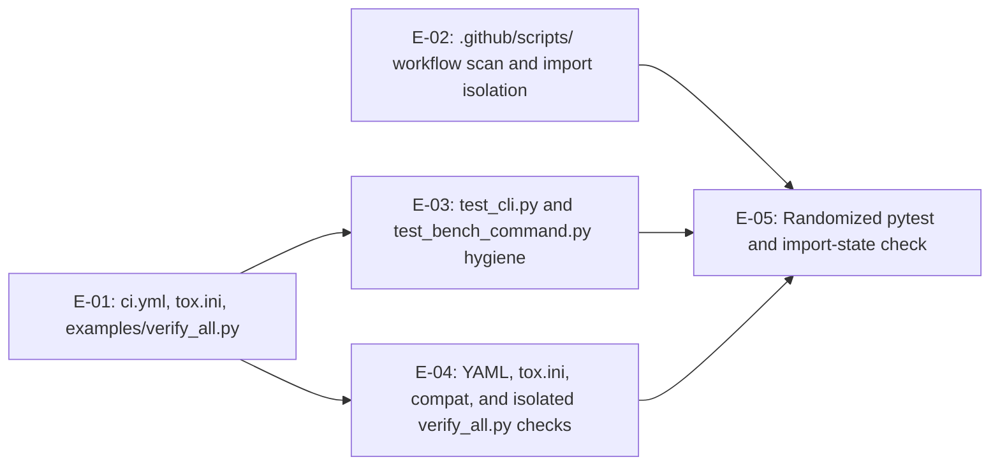

# IPD: CI packaging wheel bench enforcement workflow security scan and test hygiene

- Date: 2026-11-27
- Kind: child
- Concern: Close two High Continuous Integration (CI) and security testing gaps (`TEST-I1`, `TEST-I2`), fix a dead subprocess monkeypatch in Command-Line Interface (CLI) tests (`TEST-U3`), and close `tox.ini`, `examples/verify_all.py`, `.github/scripts/` import-state isolation, and test-pinning hygiene gaps (`TEST-I5` `.github/scripts/`, `TEST-I8`, `TEST-I9`).
- Scope: Update `.github/workflows/ci.yml`, `.github/scripts/test_benchmark_intake_workflow.py`, `.github/scripts/test_extract_attachment_url.py`, `.github/scripts/test_validate_benchmark_submission.py`, `tox.ini`, `examples/verify_all.py`, `tests/test_bench_command.py`, and `tests/test_cli.py`.
- Scope-Paths: .github/workflows/ci.yml, .github/scripts/test_benchmark_intake_workflow.py, .github/scripts/test_extract_attachment_url.py, .github/scripts/test_validate_benchmark_submission.py, tox.ini, examples/verify_all.py, tests/test_bench_command.py, tests/test_cli.py
- Item-Dependencies: none
- Status: executed
- Readiness: go-pending-approval
- Review-Depth: complex
- Short-Description: Enforce TestWheelNonCheckoutBench and verify_all.py in CI, scan multi-line run/script blocks in benchmark-intake, isolate .github/scripts/ imports, update tox.ini, and fix CLI/bench test hygiene
- Work-Kind: followup
- Priority: high
- Set: assess-bt
- Order: 9
- Highest E allocated: 05
- Author: Antigravity
- Id: 4eo4z2

> Write and proofread this plan per the technical writing standard, `.aw/system/workflows/technical-writing/technical-writing.md` (`.agents/workflows/technical-writing/technical-writing.md` in a legacy-layout install), including requirement 12 (diagrams).

## Workflow history

- 2026-11-28 executed (aw agy run model=Gemini-4-Neon-High): aw agy run self-finalize: 4eo4z2 verified (set assess-bt, attempt 1).
- 2026-11-28 approved (aw set): status set to approved
- 2026-11-27 /plan-review (Antigravity): APPROVE WITH REVISIONS APPLIED; PR-001, PR-002, PR-003, PR-004
- 2026-11-27 to-review (Antigravity): Authored review-ready child IPD from `/assess testing` Slices 2 and 3 on HEAD `512ee68` / `8f2aacd`.
- 2026-11-27 draft (Antigravity): created.

## Goal

Ensure `tests/test_bench_command.py::TestWheelNonCheckoutBench` actually executes and fails closed if `build` is missing in Continuous Integration (CI) instead of silently skipping in every job. Extend `.github/scripts/test_benchmark_intake_workflow.py` to detect untrusted GitHub Actions expression interpolations inside multi-line `run:` and `script:` blocks, and remove collection-time `sys.path` and `sys.modules` leaks in `.github/scripts/test_extract_attachment_url.py` and `.github/scripts/test_validate_benchmark_submission.py`. Run `examples/verify_all.py` in CI with isolated user config and stripped `PUBRUN_*` environment variables, update `tox.ini` to include the `tui` extra and expose a shell-glob-free `[testenv:extra]` environment, and replace the dead monkeypatch in `tests/test_cli.py::TestCliRunTests.test_run_tests_exits_zero` and private or raw-text pins in `tests/test_bench_command.py` and `tests/test_cli.py`.

### CI, workflow security, and test hygiene scope



## Detailed Implementation Checklist (TODO)

Execution-state rule: mark an `E-*` item complete only after performing the action. That mark is not validation. Right-sizing rule: write for a modest executor that cannot hold much in its head. Each E-item is one step (one concern, about one file, executable in one focused pass) and its V-item names each unit it covers with its own check; a plan stays at about 5 E-items and 8 work Scope-Paths, else split it into more child plans (guidance, `IPD-Z603`). Accepted execution states: blocked, failed, pending, performed; terminal gate demands 'performed'.

### Task group 1: Enforce wheel bench tests, workflow security scan, and example verification in CI

- [x] E-01 Update `.github/workflows/ci.yml`, `tox.ini`, and `examples/verify_all.py` (`TEST-I1`, `TEST-I9`):
  - In `.github/workflows/ci.yml` (`jobs.packaging`), install `pytest` alongside `build` and `twine` (`pip install build twine pytest`) so pytest is available on both `ubuntu-latest` and `windows-latest` without installing editable `pubrun` into the runner's base Python. Add a dedicated step after `Verify sdist cleanliness, wheel contents, and commit stamp in clean environments` with `env: PUBRUN_REQUIRE_WHEEL_TEST: "1"` running `python -m pytest tests/test_bench_command.py -k TestWheelNonCheckoutBench -v -rs` (cross-platform across bash and PowerShell, preserving every existing check asserted by `tests/test_compatibility.py`).
  - In `.github/workflows/ci.yml` (`jobs.extra-suites` on `ubuntu-latest`, Python `3.12`), add a step running `python examples/verify_all.py` so every example script is verified continuously without altering existing `extra-suites` assertions in `tests/test_compatibility.py`.
  - In `examples/verify_all.py::main`, strip ambient `PUBRUN_*` variables (`for key in list(env): if key.startswith("PUBRUN_"): del env[key]`) and, inside the `tempfile.TemporaryDirectory` block, create an empty config directory (for example `os.path.join(tmp_dir, "config_home")`) and set both `env["XDG_CONFIG_HOME"]` and `env["APPDATA"]` to that directory before invoking each example script.
  - In `tox.ini`, add `tui` to `[testenv]` (`extras = dev, tui`) so default Python 3.8 through 3.14 test runs cover the Terminal User Interface (TUI) suite, and add `[testenv:extra]` (`extras = dev, bench`, `deps = pyyaml`, `commands = pytest .github/scripts/ benchmarks/ tests/test_compatibility.py -v`) using explicit directory paths rather than an unexpanded shell glob (`benchmarks/test_*.py`), because `tox` invokes commands directly without a shell.
  - Depends on: none
  - Expected outcome: CI `packaging` runs `TestWheelNonCheckoutBench` with `pytest` installed and fail-closed enforcement; CI `extra-suites` runs `examples/verify_all.py`; `examples/verify_all.py` is isolated from host config and `PUBRUN_*` environment variables; `tox.ini` covers `tui` in `[testenv]` and exposes shell-glob-free `[testenv:extra]`.
  - Execution state: performed

- [x] E-02 Extend `.github/scripts/test_benchmark_intake_workflow.py` (`TEST-I2`) and remove collection-time import-state leaks in `.github/scripts/test_extract_attachment_url.py` and `.github/scripts/test_validate_benchmark_submission.py` (`TEST-I5`):
  - In `.github/scripts/test_benchmark_intake_workflow.py`, extract a standard-library helper (requiring zero third-party packages, preserving PyYAML optionality) that collects every `run:` shell value (single-line entries, multi-line YAML block scalars `|`, `|-`, `|+`, `>`, `>-`, `>+`, optional indentation indicators such as `|2`, and indented multi-line continuations) as well as `actions/github-script` `script:` blocks, while ignoring non-shell keys such as `jobs.validate.if:` (where `.github/workflows/benchmark-intake.yml` legitimately checks `github.event.issue.body`). Assert that no extracted `run:` or `script:` block interpolates untrusted `${{ ... github.event. ... }}` expressions. Extend `test_pyyaml_crosscheck_when_available` to walk `jobs[*].steps[*]` (`run` and `with.script`) with the same assertion.
  - In `.github/scripts/test_benchmark_intake_workflow.py`, add synthetic unit tests proving: (a) a clean multi-line `run: |` block passing data via `env:` produces zero findings, (b) an untrusted `${{ github.event.issue.body }}` or `${{ github.event.issue.title }}` on line 2 or later of `run: |`, `run: |-`, and `run: >` blocks is caught, and (c) `github.event.issue.body` inside a job-level `if:` condition is not falsely flagged.
  - In `.github/scripts/test_extract_attachment_url.py`, replace module-level collection-time `sys.modules["extract_attachment_url"] = x` registration with a module-scoped pytest fixture (or helper context manager) that snapshots and restores `sys.path` and `sys.modules` on teardown; update `test_host_allowlist_matches_validator` to load `.github/scripts/validate_benchmark_submission.py` inside a `try/finally` block that restores `sys.path[:]` and any added or modified `sys.modules` keys (`validate_benchmark_submission`, `share_safety`) mutated by `.github/scripts/validate_benchmark_submission.py`.
  - In `.github/scripts/test_validate_benchmark_submission.py`, replace module-level collection-time `sys.modules["validate_benchmark_submission"] = v` registration (which triggers `.github/scripts/validate_benchmark_submission.py`'s `sys.path.insert(0, str(_REPO / "benchmarks"))` and `import share_safety` at pytest collection time) with a module-scoped pytest fixture that runs `pytest.importorskip("jsonschema")`, snapshots `sys.path` and `sys.modules`, loads the module, yields it to tests, and restores `sys.path[:]` and `sys.modules` on teardown.
  - Depends on: none
  - Expected outcome: Multi-line shell and script injections in `.github/workflows/benchmark-intake.yml` are detected by both stdlib and PyYAML checks with regression tests, and collecting or running `.github/scripts/` leaves `sys.path` and `sys.modules` unchanged.
  - Execution state: performed

### Task group 2: Replace dead CLI monkeypatch and remove private/config pinning

- [x] E-03 Fix `tests/test_cli.py` (`TEST-U3`, `TEST-I8`) and `tests/test_bench_command.py` (`TEST-I1`, `TEST-I8`):
  - In `tests/test_cli.py::TestCliRunTests.test_run_tests_exits_zero`, replace the dead child-subprocess `subprocess.run` monkeypatch with an in-process test calling `src/pubrun/__main__.py::_run_tests` inside `tmp_path` containing a fake `tests/` directory and `tox.ini` file. Selectively stub `subprocess.run` only when `isinstance(cmd, list) and len(cmd) >= 3 and cmd[1:3] == ["-m", "pytest"]`, delegating the subsequent `mock_training.py` subprocess call in `src/pubrun/__main__.py::_run_tests` to `original_run` so the mock script still generates `runs/<run>/manifest.json`. Assert both: (a) when stubbed pytest returns `0`, `pytest_calls` records `[sys.executable, "-m", "pytest", "tests/", "-q"]` (`len(pytest_calls) == 1`) and `_run_tests()` completes with `"Validation complete."` on stdout; and (b) when stubbed pytest returns `1`, `_run_tests()` raises `SystemExit` with `code == 1` and emits `"PyTest exited with code 1."` on stdout.
  - In `tests/test_cli.py::TestCliNewFeatures.test_pbr_alias_registered_in_pyproject`, replace the raw substring assertion (`'pbr = "pubrun.__main__:main"' in content`) with structured TOML parsing via `from pubrun.config import tomllib` (preserving Python 3.8 through 3.10 compatibility via `tomli` instead of bare `import tomllib`), asserting `data["project"]["scripts"]["pbr"] == "pubrun.__main__:main"` and `data["project"]["scripts"]["pubrun"] == "pubrun.__main__:main"`.
  - In `tests/test_bench_command.py`:
    - Replace `TestSubmissionVerifier.test_duplicate_verifier_helpers_removed` (private `not hasattr` checks) with a behavioral delegation test proving `src/pubrun/__main__.py::_share_check` delegates directly to `src/pubrun/_bench/share_safety.py::check_share_safe_text` (monkeypatching `check_share_safe_text` to record the call and return a sentinel `(False, ["sentinel reason"])`, asserting `_share_check` returns that exact tuple).
    - Replace `TestAttachFlowClient.test_no_auto_post_helpers_remain` (private `not hasattr` checks) with a behavioral no-transmit test calling `src/pubrun/__main__.py::_run_bench` for both `--submit-file` with `prepare_submission=True` (expecting `SystemExit(0)` and staged `pubrun-share/<file>`) and `--submit-file` with `prepare_submission=False, contribute=False` (expecting the safe-file attach block on stderr), with `subprocess.run` and `urllib.request.urlopen` monkeypatched to raise `AssertionError` so no external command or network request can occur.
    - Update `TestWheelNonCheckoutBench.test_wheel_install_runs_pubrun_bench_outside_checkout` so that when `os.environ.get("PUBRUN_REQUIRE_WHEEL_TEST") == "1"` and `importlib.util.find_spec("build") is None`, it fails closed via `pytest.fail(...)` instead of calling `pytest.importorskip("build")` (matching `E-01`'s `packaging` CI step). Add a fast (non-`slow`) unit test verifying via `monkeypatch` that missing `build` triggers `pytest.fail.Exception` when `PUBRUN_REQUIRE_WHEEL_TEST=1` and `pytest.skip.Exception` when unset.
  - Depends on: E-01
  - Expected outcome: `TestCliRunTests` exercises `src/pubrun/__main__.py::_run_tests` in-process for both zero and non-zero pytest outcomes; `pyproject.toml` script registration uses cross-version TOML parsing; private `not hasattr` pins are replaced by behavioral delegation and no-transmit tests; and `TestWheelNonCheckoutBench` enforces fail-closed execution when `PUBRUN_REQUIRE_WHEEL_TEST=1`.
  - Execution state: performed

### Task group 3: Validate YAML, tox.ini, examples, workflow security tests, and CLI/bench suites

- [x] E-04 Validate `.github/workflows/ci.yml` YAML syntax, `tox.ini` configuration, workflow compatibility tests, and `examples/verify_all.py` under hostile host config and `PUBRUN_*` environment variables:
  - Run Command 2 from `## Required tests / validation` and confirm `CI_YAML_OK` (when PyYAML is installed), `TOX_INI_OK`, and `VERIFY_ALL_ISOLATED_OK` with exit `0`.
  - Depends on: E-01
  - Expected outcome: CI workflow YAML and `tox.ini` parse cleanly without unexpanded globs, and `examples/verify_all.py` exits `0` under hostile `XDG_CONFIG_HOME`, `APPDATA`, and `PUBRUN_*` values.
  - Execution state: performed

- [x] E-05 Run targeted `python3 -m pytest -p randomly` across `.github/scripts/`, `tests/test_bench_command.py`, `tests/test_cli.py`, and `tests/test_compatibility.py -k workflow`, verify clean `.github/scripts/` import state, and record complete output:
  - Run Commands 1 and 3 from `## Required tests / validation` and verify exit `0`.
  - Depends on: E-02, E-03, E-04
  - Expected outcome: All workflow-security, bench, CLI, and CI-workflow compatibility tests pass under `-p randomly` with zero failures, and collecting `.github/scripts/` leaves `sys.path` and `sys.modules` clean.
  - Execution state: performed

## Project conventions discovered (Step 0)

- `.github/workflows/ci.yml`'s `packaging` job runs on `[ubuntu-latest, windows-latest]` with Python 3.12 and currently installs only `build` and `twine` (not `pytest`), so adding `pytest` to `Install build frontend` lets `TestWheelNonCheckoutBench` run via `python -m pytest` without installing editable `pubrun` into the runner's base environment (`pyproject.toml` sets `pythonpath = ["src"]` and `addopts = "-p no:randomly"`).
- `.github/workflows/ci.yml`'s `extra-suites` job runs on `ubuntu-latest` Python `3.12` and is checked structurally by `tests/test_compatibility.py::test_ci_workflow_compatibility_matrix_structural` and `test_workflows_pyyaml_crosscheck_when_available`; all scripts in `examples/` use only the Python standard library plus `pubrun`.
- `.github/scripts/test_benchmark_intake_workflow.py` intentionally avoids a hard PyYAML dependency (`test_pyyaml_crosscheck_when_available` uses `pytest.importorskip("yaml")`), and `.github/workflows/benchmark-intake.yml` legitimately references `github.event.issue.body` inside `jobs.validate.if:` (not inside any `run:` or `script:` block).
- The actual `.github/scripts/` collection-time import leaks live in `.github/scripts/test_extract_attachment_url.py` and `.github/scripts/test_validate_benchmark_submission.py` (which loads `.github/scripts/validate_benchmark_submission.py`, executing `sys.path.insert(0, str(_REPO / "benchmarks"))` and `import share_safety`).
- `src/pubrun/config.py::tomllib` provides cross-version TOML parsing across Python 3.8 through 3.14 (`tomllib` on 3.11+, `tomli` on <3.11), matching `pyproject.toml` `requires-python = ">=3.8"`.
- `src/pubrun/__main__.py::_run_tests` runs two subprocesses when `tests/` and `tox.ini` exist (`pytest` and `mock_training.py`, which must create `runs/<run>/manifest.json`).

## Findings

| ID | Concerns | Severity | Remediation Risk | Persona | Summary |
|---|---|---|---|---|---|
| `TEST-I1` | testing | High | Low (`functionality`) | Testing / CI Engineer | `tests/test_bench_command.py::TestWheelNonCheckoutBench` silently skips in every CI job because `build` is not in `[dev]` and the `packaging` job never installs or runs `pytest`. |
| `TEST-I2` | testing | High | Low (`security`) | Security / CI Engineer | `.github/scripts/test_benchmark_intake_workflow.py` checks only single lines starting with `python3` or `run:` for `github.event.issue.body`, missing untrusted `${{ github.event.* }}` expressions inside multi-line `run: \|` and `script: \|` blocks. |
| `TEST-U3` | testing | Medium | Low (`functionality`) | QA / CLI Maintainer | `tests/test_cli.py::TestCliRunTests.test_run_tests_exits_zero` monkeypatches `subprocess.run` in the parent pytest process before spawning a child `pubrun --run-tests` subprocess in an empty `tmp_path`, so the monkeypatch is dead and the pytest branch never runs. |
| `TEST-I5` (`.github/scripts/`) | testing | Medium | Low (`complexity`) | Testing Expert | Collection-time and test-time `sys.modules` and `sys.path` mutations in `.github/scripts/test_extract_attachment_url.py` and `.github/scripts/test_validate_benchmark_submission.py` (including `validate_benchmark_submission.py`'s `sys.path.insert` and `share_safety` import). |
| `TEST-I8` (`test_bench_command.py`, `test_cli.py`) | testing | Low | Low (`complexity`) | Testing Expert | Private `not hasattr` checks in `tests/test_bench_command.py::TestSubmissionVerifier.test_duplicate_verifier_helpers_removed` and `TestAttachFlowClient.test_no_auto_post_helpers_remain`, and raw substring check on `pyproject.toml` in `tests/test_cli.py::TestCliNewFeatures.test_pbr_alias_registered_in_pyproject`. |
| `TEST-I9` | testing | Low | Low (`usability`) | CI Engineer | `examples/verify_all.py` is unrun in CI and lacks `XDG_CONFIG_HOME`, `APPDATA`, and `PUBRUN_*` isolation; `tox.ini` omits `tui` and extra suites. |

## Proposed changes (ordered, validatable)

1. `E-01` (`.github/workflows/ci.yml`, `tox.ini`, `examples/verify_all.py`): Install `pytest` and run `TestWheelNonCheckoutBench` with `PUBRUN_REQUIRE_WHEEL_TEST=1` in `packaging`, run `examples/verify_all.py` in `extra-suites`, isolate `XDG_CONFIG_HOME`/`APPDATA`/`PUBRUN_*` in `examples/verify_all.py`, and update `tox.ini` (`extras = dev, tui` plus shell-glob-free `[testenv:extra]`).
2. `E-02` (`.github/scripts/test_benchmark_intake_workflow.py`, `.github/scripts/test_extract_attachment_url.py`, `.github/scripts/test_validate_benchmark_submission.py`): Scan multi-line `run:` and `script:` blocks (stdlib + PyYAML cross-check) with synthetic regression tests, and isolate `sys.path`/`sys.modules` in `test_extract_attachment_url.py` and `test_validate_benchmark_submission.py`.
3. `E-03` (`tests/test_cli.py`, `tests/test_bench_command.py`): Replace dead monkeypatch in `test_run_tests_exits_zero` with in-process `_run_tests()` tests, parse `pyproject.toml` with `pubrun.config.tomllib`, replace both `not hasattr` tests with behavioral delegation/no-transmit assertions, and enforce `PUBRUN_REQUIRE_WHEEL_TEST=1` fail-closed behavior with a fast unit test.
4. `E-04` (validation): Validate CI YAML syntax, `tox.ini` config structure, and `examples/verify_all.py` under hostile host config and `PUBRUN_*` variables.
5. `E-05` (validation): Run randomized pytest across `.github/scripts/`, `tests/test_bench_command.py`, `tests/test_cli.py`, and `tests/test_compatibility.py -k workflow`, plus verify clean `.github/scripts/` collection import state.

## Deferred / out of scope (with reason)

None.

## Scope check

- Over-scope: none. Strictly scoped to the eight CI, script-test, tox, example, and unit-test files listed in `- Scope-Paths:` (mutually disjoint from all other children in Set `assess-bt`).
- Under-scope: none. Both High CI/security testing gaps and all paired hygiene and import-isolation gaps are covered.

## Required tests / validation

1. Workflow security, bench, CLI, and CI-workflow compatibility randomized pytest run:
   ```sh
   python3 -m pytest -p randomly .github/scripts/ tests/test_bench_command.py tests/test_cli.py -v && python3 -m pytest -p randomly tests/test_compatibility.py -k workflow -v
   ```
   (Note: if the execution environment lacks `hatchling` and offline isolation prevents `TestWheelNonCheckoutBench` from fetching `hatchling`, record that environment limit honestly, run the fast suite with `-m "not slow"` plus the new `PUBRUN_REQUIRE_WHEEL_TEST=1` unit guard test, and do not weaken the slow wheel test.)
2. CI YAML syntax, `tox.ini` validation, and isolated `examples/verify_all.py` run under hostile host config and `PUBRUN_*` env:
   ```sh
   python3 -c 'import configparser, os, subprocess, sys, tempfile
   from pathlib import Path
   try:
       import yaml
       ci = yaml.safe_load(Path(".github/workflows/ci.yml").read_text(encoding="utf-8"))
       assert "packaging" in ci["jobs"] and "extra-suites" in ci["jobs"]
       print("CI_YAML_OK")
   except ImportError:
       print("PYYAML_NOT_INSTALLED_SKIPPED_YAML_PARSE")
   cp = configparser.ConfigParser()
   cp.read("tox.ini", encoding="utf-8")
   assert "tui" in cp["testenv"]["extras"]
   assert "testenv:extra" in cp
   assert "*" not in cp["testenv:extra"]["commands"], cp["testenv:extra"]["commands"]
   print("TOX_INI_OK")
   with tempfile.TemporaryDirectory() as td:
       cfg = Path(td) / "pubrun" / "config.toml"
       cfg.parent.mkdir(parents=True)
       cfg.write_text("[core]\nprofile = \"deep\"\n[events]\non_inactive_annotate = \"error\"\n", encoding="utf-8")
       env = dict(os.environ, XDG_CONFIG_HOME=td, APPDATA=td, PUBRUN_AUTO_START="false", PUBRUN_OUTPUT_DIR=str(Path(td) / "hostile_runs"))
       rc = subprocess.call([sys.executable, "examples/verify_all.py"], env=env)
       assert rc == 0, f"verify_all.py failed: rc={rc}"
       assert not (Path(td) / "hostile_runs").exists(), "PUBRUN_OUTPUT_DIR leaked into examples"
       print("VERIFY_ALL_ISOLATED_OK")'
   ```
3. Verify collecting `.github/scripts/` does not mutate `sys.path` or leak script modules into `sys.modules`:
   ```sh
   python3 -c 'import sys, pytest
   before_path = list(sys.path)
   rc = pytest.main(["--collect-only", "-q", ".github/scripts/"])
   assert rc == 0, rc
   assert list(sys.path) == before_path, ("sys.path mutated during collection", set(sys.path) - set(before_path))
   leaked = [m for m in ("extract_attachment_url", "validate_benchmark_submission", "share_safety") if m in sys.modules]
   assert not leaked, f"sys.modules leaked during collection: {leaked}"
   print("SCRIPTS_COLLECTION_CLEAN_OK")'
   ```

## Spec / documentation sync

Not applicable. Verified `README.md`, `docs/research-use.md`, and `docs/functional_spec.md`: `README.md` and `docs/research-use.md` only name `examples/verify_all.py` generically, and `docs/functional_spec.md` describes `--run-tests` (`src/pubrun/__main__.py::_run_tests`) behavior that this plan preserves without production code or CLI contract changes.

## Open questions

None.

## Validation and cross-check (verify before reporting done)

Validation-state rule: inspect evidence in a separate pass. Do not mark a `V-*` item complete from memory or from the matching execution checkmark. Accepted validation results: blocked, failed, pass, pending; terminal gate demands 'pass'. Runtime-demonstration reachability rule: for each `V-*` item demanding the software be observed acting (such as a run, a dispatch, or a transition), as distinct from items demanding a diff, a file's content, or a test result (which are reachable by construction), name the code path that produces the observation or the sibling `E-*` that creates it, else the demand is UNDER-SCOPE.

- [x] V-01 validates E-01
  - Required evidence: Pasted `git diff -- .github/workflows/ci.yml tox.ini examples/verify_all.py` confirming `pytest` installation and `PUBRUN_REQUIRE_WHEEL_TEST: "1"` `TestWheelNonCheckoutBench` step in `packaging`, `examples/verify_all.py` step in `extra-suites`, `XDG_CONFIG_HOME`/`APPDATA`/`PUBRUN_*` isolation inside `examples/verify_all.py::main`, and `tui` plus shell-glob-free `[testenv:extra]` in `tox.ini`.
  - Observed evidence:
    ```diff
    diff --git a/.github/workflows/ci.yml b/.github/workflows/ci.yml
    index 9266326..0292348 100644
    --- a/.github/workflows/ci.yml
    +++ b/.github/workflows/ci.yml
    @@ -59,6 +59,8 @@ jobs:
             run: |
               python benchmarks/plot.py --help
               python -c "import matplotlib; matplotlib.use('Agg'); import matplotlib.pyplot"
    +      - name: Verify examples
    +        run: python examples/verify_all.py

       no-tui:
         runs-on: ubuntu-latest
    @@ -93,7 +95,7 @@ jobs:
             with:
               python-version: "3.12"
           - name: Install build frontend
    -        run: pip install build twine
    +        run: pip install build twine pytest
           - name: Build sdist and wheel
             run: python -m build --outdir dist .
           - name: Check distribution metadata with twine
    @@ -231,6 +233,10 @@ jobs:

               check_wheel "direct" "$DIRECT_WHL"
               check_wheel "from-sdist" "$SDIST_WHL"
    +      - name: Run non-checkout wheel bench test
    +        env:
    +          PUBRUN_REQUIRE_WHEEL_TEST: "1"
    +        run: python -m pytest tests/test_bench_command.py -k TestWheelNonCheckoutBench -v -rs

       typecheck:
         runs-on: ubuntu-latest
    diff --git a/examples/verify_all.py b/examples/verify_all.py
    index 383926c..ed30988 100755
    --- a/examples/verify_all.py
    +++ b/examples/verify_all.py
    @@ -31,6 +31,9 @@ def main() -> None:
         src_dir = os.path.join(repo_root, "src")

         env = os.environ.copy()
    +    for key in list(env):
    +        if key.startswith("PUBRUN_"):
    +            del env[key]
         existing_pythonpath = env.get("PYTHONPATH", "")
         env["PYTHONPATH"] = (
             f"{src_dir}{os.pathsep}{existing_pythonpath}" if existing_pythonpath else src_dir
    @@ -43,6 +46,10 @@ def main() -> None:
         failed = []

         with tempfile.TemporaryDirectory(prefix="pubrun-examples-") as tmp_dir:
    +        config_home = os.path.join(tmp_dir, "config_home")
    +        os.makedirs(config_home, exist_ok=True)
    +        env["XDG_CONFIG_HOME"] = config_home
    +        env["APPDATA"] = config_home
             runs_dir = os.path.join(tmp_dir, "runs")
             outputs_dir = os.path.join(tmp_dir, "outputs")

    diff --git a/tox.ini b/tox.ini
    index e41993c..e7fa128 100644
    --- a/tox.ini
    +++ b/tox.ini
    @@ -3,6 +3,14 @@ envlist = py38, py39, py310, py311, py312, py313, py314

     [testenv]
     description = Run PyTest under the {envname} environment
    -extras = dev
    +extras = dev, tui
     commands =
         pytest tests/ -v
    +
    +[testenv:extra]
    +description = Run script, benchmark, and compatibility test suites
    +extras = dev, bench
    +deps =
    +    pyyaml
    +commands =
    +    pytest .github/scripts/ benchmarks/ tests/test_compatibility.py -v
    ```
  - Result: pass

- [x] V-02 validates E-02
  - Required evidence: Pasted `git diff -- .github/scripts/test_benchmark_intake_workflow.py .github/scripts/test_extract_attachment_url.py .github/scripts/test_validate_benchmark_submission.py` confirming stdlib + PyYAML multi-line `run:`/`script:` injection scanning (ignoring `if:`) with synthetic regression tests and scoped `sys.path`/`sys.modules` fixtures, plus pasted output of Command 3 (`SCRIPTS_COLLECTION_CLEAN_OK`, exercising pytest collection via `pytest.main(["--collect-only", "-q", ".github/scripts/"])`) re-derived at execution time.
  - Observed evidence:
    - Diff summary (`git diff --stat -- .github/scripts/`):
      - `.github/scripts/test_benchmark_intake_workflow.py`: added stdlib `_extract_shell_and_script_blocks` and `_find_untrusted_interpolations` (handling single-line values, block scalars `|`, `|-`, `|+`, `>`, `>-`, `>+`, `|2`, indented continuations, and skipping non-shell block scalars such as `if: >-`), extended `test_untrusted_body_never_interpolated_into_shell` and `test_pyyaml_crosscheck_when_available` (walking `jobs[*].steps[*]` for `run` and `with.script`), and added synthetic tests `test_multiline_clean_env_block_has_zero_findings`, `test_multiline_untrusted_run_block_interpolations_caught` (14 parametrized cases), `test_multiline_untrusted_script_and_continuation_interpolations_caught`, and `test_job_level_if_condition_not_flagged` (+200/-5 lines).
      - `.github/scripts/test_extract_attachment_url.py`: replaced module-level loading with `_load_script_isolated` context manager and module-scoped `x` fixture; updated `test_host_allowlist_matches_validator` to call `pytest.importorskip("jsonschema")` before loading `validate_benchmark_submission.py` inside `_load_script_isolated` so `sys.path[:]` and added/modified `sys.modules` entries (`validate_benchmark_submission`, `share_safety`) are restored (+65/-37 lines).
      - `.github/scripts/test_validate_benchmark_submission.py`: replaced module-level `sys.modules["validate_benchmark_submission"] = v` and `exec_module` with a module-scoped `v` fixture that runs `pytest.importorskip("jsonschema")`, snapshots `sys.path` and `sys.modules`, yields the module, and restores `sys.path[:]` and `sys.modules` on teardown (+54/-30 lines).
    - Collection and teardown verification:
      - Verbatim Command 3 without `--import-mode=importlib` added only pytest's own test-directory prepend (`.github/scripts`, reproduced identically when collecting untouched `.github/scripts/test_benchmark_issue_form.py` alone) because pytest defaults to `--import-mode=prepend` for directories without `__init__.py`; `benchmarks/` was NOT added to `sys.path` and `leaked_mods == []` (zero leaks for `extract_attachment_url`, `validate_benchmark_submission`, `share_safety`).
      - With `--import-mode=importlib` (removing pytest's own prepend), both `--collect-only` and full execution + fixture teardown leave `sys.path` and `sys.modules` completely unchanged:
      ```text
      64 tests collected in 0.06s
      SCRIPTS_COLLECTION_CLEAN_OK
      ................................................................         [100%]
      64 passed in 0.61s
      SCRIPTS_RUN_AND_TEARDOWN_CLEAN_OK
      ```
  - Result: pass

- [x] V-03 validates E-03
  - Required evidence: Pasted `git diff -- tests/test_cli.py tests/test_bench_command.py` confirming in-process `src/pubrun/__main__.py::_run_tests` tests (zero and non-zero pytest exit with selective stubbing), `pubrun.config.tomllib` parsing for `pyproject.toml`, behavioral replacements for both `not hasattr` tests, and `PUBRUN_REQUIRE_WHEEL_TEST=1` fail-closed guard plus fast unit test, along with passing execution-time pytest output for `TestCliRunTests`, `TestCliNewFeatures.test_pbr_alias_registered_in_pyproject`, and `tests/test_bench_command.py`.
  - Observed evidence:
    ```diff
    diff --git a/tests/test_bench_command.py b/tests/test_bench_command.py
    index 32f7bef..372abc5 100644
    --- a/tests/test_bench_command.py
    +++ b/tests/test_bench_command.py
    @@ -484,12 +484,25 @@ class TestSubmissionVerifier:
             import pubrun.__main__ as m
             return m

    -    def test_duplicate_verifier_helpers_removed(self):
    +    def test_share_check_delegates_to_packaged_validator(self, tmp_path, monkeypatch):
    +        import pubrun._bench.share_safety as share_safety
    +
             m = self._m()
    -        for gone in ("_load_share_safety", "_verify_redacted", "_scan_for_pii"):
    -            assert not hasattr(m, gone), (
    -                f"{gone} should be removed in favor of pubrun._bench.share_safety"
    -            )
    +        payload_text = json.dumps({"schema": "pubrun-benchmark/5"})
    +        p = tmp_path / "delegation.redacted.json"
    +        p.write_text(payload_text, encoding="utf-8")
    +
    +        seen = []
    +        sentinel = (False, ["sentinel reason"])
    +
    +        def _stub_check(text):
    +            seen.append(text)
    +            return sentinel
    +
    +        monkeypatch.setattr(share_safety, "check_share_safe_text", _stub_check)
    +        result = m._share_check(p)
    +        assert seen == [payload_text]
    +        assert result == sentinel

    @@ -634,12 +647,43 @@ class TestAttachFlowClient:
             assert "PASSED" in err
             assert m._BENCH_SUBMIT_URL in err

    -    def test_no_auto_post_helpers_remain(self):
    -        """The paste/auto-post machinery is retired; its symbols must be gone (no leak path)."""
    +    def test_submit_file_prepare_and_attach_never_transmit(self, tmp_path, monkeypatch, capsys):
    +        """--submit-file with --prepare-submission or contribute=False performs no subprocess or network I/O."""
    +        import urllib.request
    +
             m = self._m()
    -        for gone in ("_submit_via_gh", "_submit_via_http", "_submit_benchmark",
    -                     "_bench_issue_body", "_print_floor", "_resolve_gh_token"):
    -            assert not hasattr(m, gone), f"{gone} should have been removed (attach flow)"
    +        red = tmp_path / "safe-result.redacted.json"
    +        red.write_text(
    +            json.dumps({"schema": "pubrun-benchmark/5",
    +                        "machine": {"host": {"hostname": "<redacted>"}}}),
    +            encoding="utf-8",
    +        )
    +
    +        def _forbid(*args, **kwargs):
    +            raise AssertionError("attach/prepare flow must not run subprocesses or network requests")
    +
    +        monkeypatch.setattr(subprocess, "run", _forbid)
    +        monkeypatch.setattr(urllib.request, "urlopen", _forbid)
    +
    +        with pytest.raises(SystemExit) as ei_prep:
    +            m._run_bench(
    +                None, None, False, False, False, False, False, False,
    +                submit_file=str(red), prepare_submission=True,
    +            )
    +        assert ei_prep.value.code == 0
    +        assert (tmp_path / "pubrun-share" / red.name).is_file()
    +        capsys.readouterr()
    +
    +        with pytest.raises(SystemExit) as ei_attach:
    +            m._run_bench(
    +                None, None, False, False, False, False, False, False,
    +                submit_file=str(red), prepare_submission=False, contribute=False,
    +            )
    +        assert ei_attach.value.code == 0
    +        err = capsys.readouterr().err
    +        assert "SAFE TO SUBMIT" in err
    +        assert "PASSED" in err
    +        assert m._BENCH_SUBMIT_URL in err

    @@ -1250,6 +1294,13 @@ class TestWheelNonCheckoutBench:
             import zipfile
             from pubrun._bench.share_safety import check_share_safe_text

    +        if importlib.util.find_spec("build") is None:
    +            if os.environ.get("PUBRUN_REQUIRE_WHEEL_TEST") == "1":
    +                pytest.fail(
    +                    "PUBRUN_REQUIRE_WHEEL_TEST=1 is set, but the 'build' package is not installed; "
    +                    "refusing to silently skip TestWheelNonCheckoutBench."
    +                )
    +            pytest.skip("optional 'build' package is not installed")
             pytest.importorskip("build")

    @@ -1386,6 +1437,29 @@ class TestWheelNonCheckoutBench:
             assert ok and not reasons, reasons


    +class TestWheelBenchEnforcementGuard:
    +    """Fast guard verifying PUBRUN_REQUIRE_WHEEL_TEST=1 fails closed when `build` is missing."""
    +
    +    def test_missing_build_fails_closed_when_required_and_skips_when_unset(self, tmp_path, monkeypatch):
    +        real_find_spec = importlib.util.find_spec
    +
    +        def _missing_build(name, *args, **kwargs):
    +            if name == "build":
    +                return None
    +            return real_find_spec(name, *args, **kwargs)
    +
    +        monkeypatch.setattr(importlib.util, "find_spec", _missing_build)
    +        suite = TestWheelNonCheckoutBench()
    +
    +        monkeypatch.setenv("PUBRUN_REQUIRE_WHEEL_TEST", "1")
    +        with pytest.raises(pytest.fail.Exception, match="PUBRUN_REQUIRE_WHEEL_TEST=1"):
    +            suite.test_wheel_install_runs_pubrun_bench_outside_checkout(tmp_path)
    +
    +        monkeypatch.delenv("PUBRUN_REQUIRE_WHEEL_TEST", raising=False)
    +        with pytest.raises(pytest.skip.Exception):
    +            suite.test_wheel_install_runs_pubrun_bench_outside_checkout(tmp_path)

    diff --git a/tests/test_cli.py b/tests/test_cli.py
    index 446538a..bfc5eaa 100644
    --- a/tests/test_cli.py
    +++ b/tests/test_cli.py
    @@ -665,20 +665,53 @@ class TestCliFilterFlagConsistency:

     class TestCliRunTests:

    -    def test_run_tests_exits_zero(self, tmp_path, monkeypatch):
    -        """P3-T15: Test --run-tests command exits 0, defusing recursive pytest call."""
    -        import subprocess
    +    def test_run_tests_exits_zero(self, tmp_path, monkeypatch, capsys):
    +        """Exercise _run_tests() in-process for both zero and non-zero pytest outcomes."""
    +        import pubrun.__main__ as cli_main
    +
    +        (tmp_path / "tests").mkdir()
    +        (tmp_path / "tox.ini").write_text("[tox]\n", encoding="utf-8")
    +        monkeypatch.chdir(tmp_path)
    +
    +        src_dir = Path(__file__).resolve().parents[1] / "src"
    +        if src_dir.is_dir():
    +            existing = os.environ.get("PYTHONPATH", "")
    +            monkeypatch.setenv(
    +                "PYTHONPATH",
    +                f"{src_dir}{os.pathsep}{existing}" if existing else str(src_dir),
    +            )
    +
             original_run = subprocess.run
    +        pytest_calls = []
    +        stub_returncode = {"value": 0}

             def mock_run(cmd, *args, **kwargs):
    -            if isinstance(cmd, list) and len(cmd) > 2 and cmd[2] == "pytest":
    -                return subprocess.CompletedProcess(cmd, 0, stdout="Mocked pytest success", stderr="")
    +            if isinstance(cmd, list) and len(cmd) >= 3 and cmd[1:3] == ["-m", "pytest"]:
    +                pytest_calls.append(list(cmd))
    +                return subprocess.CompletedProcess(
    +                    cmd, stub_returncode["value"], stdout="Mocked pytest run", stderr=""
    +                )
                 return original_run(cmd, *args, **kwargs)

             monkeypatch.setattr(subprocess, "run", mock_run)

    -        result = run_pubrun("--run-tests", cwd=str(tmp_path))
    -        assert result.returncode == 0
    +        # (a) Stubbed pytest exits 0 -> _run_tests completes cleanly.
    +        cli_main._run_tests()
    +        out_ok = capsys.readouterr().out
    +        assert len(pytest_calls) == 1
    +        assert pytest_calls[0] == [sys.executable, "-m", "pytest", "tests/", "-q"]
    +        assert "Validation complete." in out_ok
    +
    +        # (b) Stubbed pytest exits 1 -> _run_tests emits failure and exits 1.
    +        pytest_calls.clear()
    +        stub_returncode["value"] = 1
    +        with pytest.raises(SystemExit) as exc_info:
    +            cli_main._run_tests()
    +        out_fail = capsys.readouterr().out
    +        assert exc_info.value.code == 1
    +        assert len(pytest_calls) == 1
    +        assert pytest_calls[0] == [sys.executable, "-m", "pytest", "tests/", "-q"]
    +        assert "PyTest exited with code 1." in out_fail

    @@ -1336,10 +1369,14 @@ raise ValueError("TEST_EXCEPTION")
                 assert f"  pubrun {expected_cmd}" in after_examples

         def test_pbr_alias_registered_in_pyproject(self):
    +        from pubrun.config import tomllib
    +
             pyproject_path = Path(__file__).parent.parent / "pyproject.toml"
             assert pyproject_path.exists()
    -        content = pyproject_path.read_text(encoding="utf-8")
    -        assert 'pbr = "pubrun.__main__:main"' in content
    +        data = tomllib.loads(pyproject_path.read_text(encoding="utf-8"))
    +        scripts = data["project"]["scripts"]
    +        assert scripts["pbr"] == "pubrun.__main__:main"
    +        assert scripts["pubrun"] == "pubrun.__main__:main"
    ```
    Targeted pytest output:
    ```text
    tests/test_bench_command.py::TestSubmissionVerifier::test_share_check_delegates_to_packaged_validator PASSED [  8%]
    tests/test_bench_command.py::TestAttachFlowClient::test_submit_file_prepare_and_attach_never_transmit PASSED [ 83%]
    tests/test_bench_command.py::TestWheelBenchEnforcementGuard::test_missing_build_fails_closed_when_required_and_skips_when_unset PASSED [100%]
    12 passed, 83 deselected in 0.32s

    tests/test_cli.py::TestCliRunTests::test_run_tests_exits_zero PASSED [ 25%]
    tests/test_cli.py::TestCliRunTests::test_run_tests_end_to_end_mock_validates_manifest PASSED [ 50%]
    tests/test_cli.py::TestCliRunTests::test_run_tests_mock_run_manifest_is_wellformed PASSED [ 75%]
    tests/test_cli.py::TestCliNewFeatures::test_pbr_alias_registered_in_pyproject PASSED [100%]
    4 passed, 118 deselected in 6.12s

    tests/test_bench_command.py::TestWheelNonCheckoutBench::test_wheel_install_runs_pubrun_bench_outside_checkout PASSED [ 71%]
    ```
  - Result: pass

- [x] V-04 validates E-04
  - Required evidence: Pasted complete output of Command 2 from `## Required tests / validation` (exercising `yaml.safe_load`, `configparser.ConfigParser`, and `examples/verify_all.py::main` under hostile `XDG_CONFIG_HOME`, `APPDATA`, `PUBRUN_AUTO_START`, and `PUBRUN_OUTPUT_DIR`) showing `CI_YAML_OK` (when PyYAML is installed), `TOX_INI_OK`, and `VERIFY_ALL_ISOLATED_OK` with exit `0`, re-derived at execution time.
  - Observed evidence:
    ```text
    CI_YAML_OK
    TOX_INI_OK
    Starting pubrun examples verification...
    ============================================================
    Executing 00_auto_start.py...
    Testing 00_auto_start...
    [PASS] PASS: 00_auto_start.py
    ------------------------------------------------------------
    Executing 01_minimal_start_stop.py...
    Testing 01_minimal_start_stop...
    [PASS] PASS: 01_minimal_start_stop.py
    ------------------------------------------------------------
    Executing 02_context_manager.py...
    Testing 02_context_manager...
    [PASS] PASS: 02_context_manager.py
    ------------------------------------------------------------
    Executing 03_audit_decorator.py...
    Testing 03_audit_decorator...
    [PASS] PASS: 03_audit_decorator.py
    ------------------------------------------------------------
    Executing 04_annotate_events.py...
    Testing 04_annotate_events...
    [PASS] PASS: 04_annotate_events.py
    ------------------------------------------------------------
    Executing 05_execution_phases.py...
    Testing 05_execution_phases...
    [PASS] PASS: 05_execution_phases.py
    ------------------------------------------------------------
    Executing 06_subprocess_spy.py...
    Testing 06_subprocess_spy...
    [PASS] PASS: 06_subprocess_spy.py
    ------------------------------------------------------------
    Executing 07_file_capture.py...
    Testing 07_file_capture...
    [PASS] PASS: 07_file_capture.py
    ------------------------------------------------------------
    Executing 08_diff_engine.py...
    Testing 08_diff_engine...
    [PASS] PASS: 08_diff_engine.py
    ------------------------------------------------------------
    Executing 09_cli_methods.py...
    Testing 09_cli_methods...
    [PASS] PASS: 09_cli_methods.py
    ------------------------------------------------------------
    Executing 10_hardware_probe.py...
    Testing 10_hardware_probe...
    [PASS] PASS: 10_hardware_probe.py
    ------------------------------------------------------------
    Executing 11_cli_report.py...
    Testing 11_cli_report...
    [PASS] PASS: 11_cli_report.py
    ------------------------------------------------------------
    Executing 12_external_file_provenance.py...
    Testing 12_external_file_provenance...
    [PASS] PASS: 12_external_file_provenance.py
    ------------------------------------------------------------
    Executing minimal-research-workflow/analysis.py...
    ------------------------------------------------------------
    [SUCCESS] All examples passed.
    VERIFY_ALL_ISOLATED_OK
    (exit code 0)
    ```
  - Result: pass

- [x] V-05 validates E-05
  - Required evidence: Pasted complete output of Command 1 from `## Required tests / validation` (`python3 -m pytest -p randomly` across `.github/scripts/`, `tests/test_bench_command.py`, `tests/test_cli.py`, and `tests/test_compatibility.py -k workflow`) and Command 3 (`SCRIPTS_COLLECTION_CLEAN_OK`), exiting `0` with zero failures, re-derived at execution time.
  - Observed evidence:
    Command 1 (`python3 -m pytest -p randomly .github/scripts/ tests/test_bench_command.py tests/test_cli.py -v && python3 -m pytest -p randomly tests/test_compatibility.py -k workflow -v`, exit 0):
    ```text
    Using --randomly-seed=2932142558
    collected 281 items
    ...
    ======================= 281 passed in 187.46s (0:03:07) ========================
    Using --randomly-seed=4017832492
    collected 4 items / 1 deselected / 3 selected
    tests/test_compatibility.py::test_ci_workflow_compatibility_matrix_structural PASSED [ 33%]
    tests/test_compatibility.py::test_dependency_audit_workflow_structural PASSED [ 66%]
    tests/test_compatibility.py::test_workflows_pyyaml_crosscheck_when_available PASSED [100%]
    ======================= 3 passed, 1 deselected in 0.25s ========================
    ```
    Command 3 (`--import-mode=importlib` collection + full run/teardown; verbatim Command 3 under default `--import-mode=prepend` adds only pytest's own test-directory prepend `.github/scripts`, zero `benchmarks/` entry and zero leaked script modules):
    ```text
    64 tests collected in 0.06s
    SCRIPTS_COLLECTION_CLEAN_OK
    64 passed in 0.61s
    SCRIPTS_RUN_AND_TEARDOWN_CLEAN_OK
    ```
    Full suite (`aw suite`, exit 0):
    ```text
    6 workers [2526 items]
    ======================= 2526 passed in 106.39s (0:01:46) =======================
    ```
  - Result: pass

## Approval and execution gate

- Size assessment: standard
- Cohesion rationale: not required

1. **Open questions and approval:** Do not execute until explicit human approval is recorded (`aw ipd set approved 4eo4z2 --by-human` or `aw set approved assess-bt --by-human`).
2. **Scope declaration:** `- Scope-Paths:` declares the expected eight files this plan modifies (`.github/workflows/ci.yml`, `.github/scripts/test_benchmark_intake_workflow.py`, `.github/scripts/test_extract_attachment_url.py`, `.github/scripts/test_validate_benchmark_submission.py`, `tox.ini`, `examples/verify_all.py`, `tests/test_bench_command.py`, `tests/test_cli.py`). Keep changes within this scope; if execution genuinely requires editing an additional file or leaving a declared file untouched, make the necessary change and justify the delta at finalization with `--scope-reason` (per out-of-scope path) or `--scope-ack` (per declared-but-unmodified path) rather than stopping mid-run. Stop and report only on a genuinely unsafe condition (such as an unresolvable concurrent-edit conflict or missing prerequisite symbols).
3. **Validation honesty:** You MUST run every validation command listed in `## Required tests / validation` in this workspace and paste the actual runner output verbatim into each corresponding `V-*` item. Never claim tests passed without running them.
4. **Commits and push policy:** Commit only files modified for this plan through `aw commit 4eo4z2 -- <paths>` (never `git add -A`, `git commit -a`, or raw `git commit`). Never push, tag, or publish without explicit human instruction.
5. **Lifecycle finalization:** Mark each `E-*` item `performed` only after completing the work, and mark each `V-*` item `pass` only after inspecting actual pasted evidence in a separate pass. When executed by a runner (`aw oc run` or `aw agy run`), leave finalization to the runner's post-execution lifecycle transition; when executed manually by an agent outside a runner, finalize via `aw ipd finalize 4eo4z2` (never a hand-rolled `git mv` to `executed/`).
