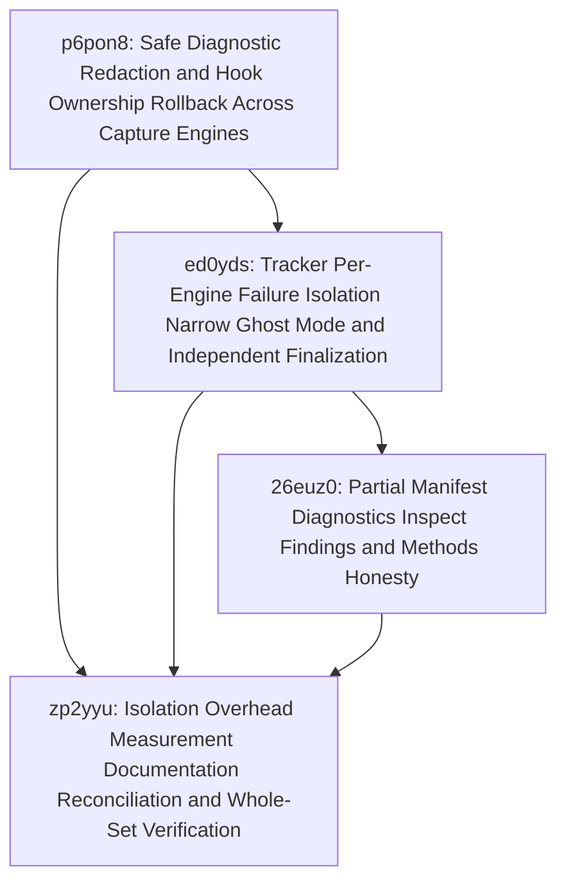
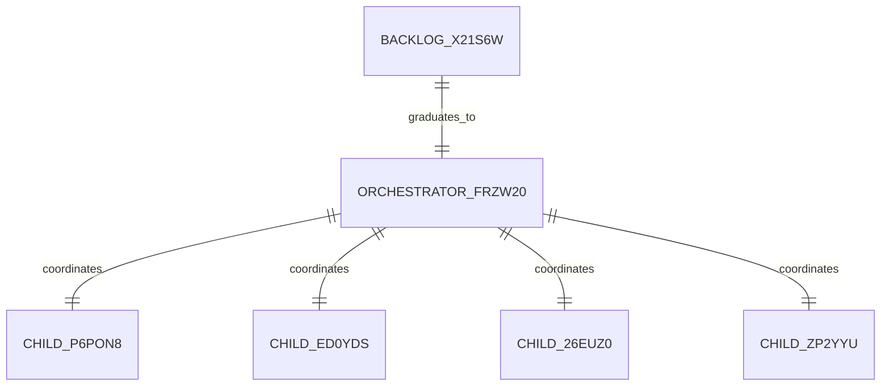

# IPD: Capture Failure Isolation and Transactional Hook Rollback

- Date: 2026-11-21
- Kind: orchestrator
- Concern: Per-engine capture failure isolation, narrow ghost-mode boundary, transactional hook ownership and rollback, independent finalization cleanup, honest partial-manifest reporting, and measured isolation overhead.
- Scope: Full-Set coordination for backlog item `x21s6w` across capture-engine hook ownership and safe error redaction, tracker per-engine isolation and narrow ghost-mode rollback, partial-manifest diagnostics and consumer honesty, overhead measurement, documentation reconciliation, and whole-Set verification.
- Scope-Paths: .aw/records/plans/pending/20261121-cap-isolation-00-frzw20-capture-failure-isolation-and-transactional-hook-rollback.ipd.md
- Item-Dependencies: none
- Status: to-review
- Coverage: pass
- Coverage-Fingerprint: 20cdcee01e70518aaaadaad41110279f68ee6db9af3c0eec85355334a7b68476
- Coverage-Checked: 2026-11-22 by uri/its_direct/pt3-claude-opus-5.5-1m-us
- Short-Description: Coordinate hook ownership rollback, tracker failure isolation, partial-manifest consumers, overhead measurement, and docs
- Work-Kind: bug
- Priority: high
- From-Backlog: x21s6w
- Blocks-Release: next
- Set: cap-isolation
- Order: 0
- Highest E allocated: 04
- Author: agent
- Id: frzw20

> Write and proofread this plan per the technical writing standard, `.aw/system/workflows/technical-writing/technical-writing.md` (`.agents/workflows/technical-writing/technical-writing.md` in a legacy-layout install), including requirement 12 (diagrams).

## Workflow history

- 2026-11-22 coverage pass (aw oc run): fingerprint 20cdcee01e70, model uri/its_direct/pt3-claude-opus-5.5-1m-us
- 2026-11-22 draft (agent): created.
- 2026-11-22 to-review (agent): authored review-ready orchestrator plan graduating backlog item `x21s6w` into Set `cap-isolation` with four child plans (`p6pon8`, `ed0yds`, `26euz0`, `zp2yyu`).

## Goal

Graduate open backlog item `x21s6w` into four bounded, verifiable child Implementation Plan Documents (IPDs) that isolate individual capture-engine failures into honest partial manifests, restrict ghost mode to genuinely unusable run output, enforce transactional hook installation and ownership-guarded rollback across process-global hooks and background workers, execute finalization cleanup steps independently, surface partial capture honestly in diagnostic consumers and documentation, and measure isolation overhead with reproducible local benchmarks.

### Set structure and execution sequence

The child table and text below are normative. These diagrams summarize the execution sequence and entity relationships in Set `cap-isolation`.

## Detailed Implementation Checklist (TODO)

Execution-state rule: mark an `E-*` item complete only after performing the action. That mark is not validation. Right-sizing rule: write for a modest executor that cannot hold much in its head. Each E-item is one step (one concern, about one file, executable in one focused pass) and its V-item names each unit it covers with its own check; a plan stays at about 5 E-items and 8 work Scope-Paths, else split it into more child plans (guidance, `IPD-Z603`). Accepted execution states: blocked, failed, pending, performed; terminal gate demands 'performed'.

### Task group 1: Confirm child IPD completion

- [ ] E-01 CONFIRM p6pon8 REACHED executed
  - Depends on: none
  - Expected outcome: Child plan `p6pon8` is moved to `.aw/records/plans/executed/` with `- Status: executed`, all `E-*` items marked `performed`, and all `V-*` items marked `pass`.
  - Execution state: pending

- [ ] E-02 CONFIRM ed0yds REACHED executed
  - Depends on: E-01
  - Expected outcome: Child plan `ed0yds` is moved to `.aw/records/plans/executed/` with `- Status: executed`, all `E-*` items marked `performed`, and all `V-*` items marked `pass`.
  - Execution state: pending

- [ ] E-03 CONFIRM 26euz0 REACHED executed
  - Depends on: E-02
  - Expected outcome: Child plan `26euz0` is moved to `.aw/records/plans/executed/` with `- Status: executed`, all `E-*` items marked `performed`, and all `V-*` items marked `pass`.
  - Execution state: pending

- [ ] E-04 CONFIRM zp2yyu REACHED executed
  - Depends on: E-01, E-02, E-03
  - Expected outcome: Child plan `zp2yyu` is moved to `.aw/records/plans/executed/` with `- Status: executed`, all `E-*` items marked `performed`, and all `V-*` items marked `pass`.
  - Execution state: pending

## Child IPDs, sequence, and dependencies

| Order | Id | File | What it does | Depends on |
|---|---|---|---|---|
| 01 | `p6pon8` | `20261121-cap-isolation-01-p6pon8-safe-diagnostic-redaction-and-hook-ownership-rollback-across.ipd.md` | Adds bounded, redacted diagnostic formatting (`format_safe_error_detail`), implements transactional install and ownership-guarded uninstall across `SubprocessSpy`, `ConsoleInterceptor` (including `faulthandler`), `SignalExitCapture`, and `ResourceWatcher`, fixes unredacted fallback details in `get_invocation`, and verifies third-party wrapper preservation and rollback in `tests/test_hook_ownership_rollback.py`. | none |
| 02 | `ed0yds` | `20261121-cap-isolation-02-ed0yds-tracker-per-engine-failure-isolation-narrow-ghost-mode-and-i.ipd.md` | Extends `$defs.error_record` additively in `schemas/manifest.schema.json`, isolates every capture engine call in `Run` (including independent `hardware`, `host`, and `filesystem` calls), narrows ghost mode to unusable output with transactional rollback of owned hooks, executes every cleanup step independently in `_finalize_state()`, bounds runtime I/O warnings in `EventStream` and `ArtifactWriter`, guards ghost-run `core.py` lifecycle paths, updates `tests/test_tracker.py` and `tests/test_manifest_schema.py`, and adds fault-injection coverage in `tests/test_capture_isolation.py`. | 01 |
| 03 | `26euz0` | `20261121-cap-isolation-03-26euz0-partial-manifest-diagnostics-inspect-findings-and-methods-ho.ipd.md` | Makes `pubrun report` (`src/pubrun/report/diagnostics.py`), `pubrun inspect` (`src/pubrun/report/checks.py`), and `pubrun methods` (`src/pubrun/report/methods.py`) safe and honest when reading partial manifests with failed sections and `errors.records`, and verifies them in `tests/test_reports.py`, `tests/test_checks_commands.py`, and `tests/test_edge_cases.py`. | 02 |
| 04 | `zp2yyu` | `20261121-cap-isolation-04-zp2yyu-isolation-overhead-measurement-documentation-reconciliation.ipd.md` | Measures startup and hot-path overhead of capture isolation and ownership guards with full environment, revision, workload, baseline, repetitions, cold/warm passes, and dispersion, reconciles `docs/architecture.md`, `docs/functional_spec.md`, `docs/manifest.md`, `docs/api.md`, and `docs/performance.md`, and runs whole-Set verification across tests, examples, and path sanitization. | 01, 02, 03 |

## Completion criteria (the whole Set is done only when)

- Every process-global hook and background worker (`SubprocessSpy`, `ConsoleInterceptor` including `faulthandler`, `SignalExitCapture` including `sys.excepthook`, and `ResourceWatcher`) installs transactionally, rolls back only resources owned by the failing run, restores prior handlers/wrappers without removing later third-party wrappers, runs teardown steps independently, and formats failure details through bounded, redacted diagnostics with no raw secrets or traceback spam. Owner: `p6pon8`.
- Fault injection into each individual capture engine (`invocation`, `git`, `process`, `python`, `packages`, `environment`, `hardware`, `host`, `filesystem`, `subprocesses`, `console`, `events`, `resources`, `signals`) preserves unrelated healthy sections, preserves the host script's normal result and exit code, records section `capture_state.status == "failed"` plus bounded redacted `errors.records` entries without requiring the failed subsystem, and writes a schema-valid partial manifest when storage is writable; genuine output failure at startup enters documented ghost mode and rolls back all owned hooks without leaking threads or open file handles. Owner: `ed0yds`.
- Cleanup isolation, idempotence, reference counting, concurrent stop/background writes, finalized-manifest race protection, second cleanup failures, output loss or read-only storage at startup and mid-run, nested runs, multiple `stop()` calls, automatic `atexit` exit, slow background workers, and all six import modes (`auto`, `full`, `noauto`, `nopatch`, `noconsole`, `minimal`) are verified by behavioral tests. Owner: `ed0yds`.
- Downstream consumers (`pubrun report`, `pubrun inspect`, `pubrun methods`, and `pubrun status`) tolerate partial manifests with failed or null section fields without crashing, surface failed sections and `capture-error` records explicitly, and do not claim complete capture or standard-library-only dependencies when a section failed. Owner: `26euz0`.
- Startup and hot-path overhead from capture isolation is measured with recorded environment, git revision, workload, baseline, repetitions, cold/warm passes, and dispersion; `docs/architecture.md`, `docs/functional_spec.md`, `docs/manifest.md`, `docs/api.md`, and `docs/performance.md` match the implemented behavior; and whole-Set verification (`pytest tests/ -v`, `python examples/verify_all.py`, and `python3 scripts/sanitize_paths.py --check --all`) passes with exit code 0. Owner: `zp2yyu`.

## Cross-IPD validation

- Hook ownership to tracker integration check: child `p6pon8` verifies per-engine transactional install, rollback, and third-party wrapper preservation in isolation; child `ed0yds` exercises those exact engine APIs through `Run.__init__()`, `Run._rollback_owned_hooks()`, `Run._finalize_state()`, and `Run.stop()` under fault injection and output-loss scenarios.
- Partial-manifest producer-to-consumer check: child `ed0yds` validates real partial manifests containing failed sections and `errors.records` against `schemas/manifest.schema.json` in `tests/test_manifest_schema.py`; child `26euz0` feeds real partial manifests produced by isolated engine failures into `pubrun report`, `pubrun inspect`, `pubrun methods`, and `pubrun status`.
- Whole-Set regression, documentation, and benchmark check: child `zp2yyu` runs the full test suite (`pytest tests/ -v`), `python examples/verify_all.py`, `python3 scripts/sanitize_paths.py --check --all`, and the local isolation-overhead measurement after `p6pon8`, `ed0yds`, and `26euz0` are executed.

## Deferred / out of scope (with reason)

- Monotonic timing intervals belong to sibling Set `timing-acc` (`nr63qr`, backlog item `6hp1zu`). Child `ed0yds` preserves any monotonic timing anchor calls (`_mark_finalization_end()`) if present, keeping both Sets independently executable.
- Startup commit-identity optimization and snapshot durability/write coalescing belong to sibling Set `startup-perf` (`9ppa0r`, backlog item `t1xqpw`). Child `ed0yds` preserves any write lock, durability parameter, or `hardware.depth == "off"` fast path if present, keeping both Sets independently executable.
- Dependency capture accuracy (`6s7k9e`), reproducibility preflight (`osjxbz`), and file provenance (`x6alw4`) are unrelated backlog items and remain out of scope.
- Multi-operating-system and multi-Python Continuous Integration (CI) matrix execution (`ubuntu-latest`, `ubuntu-24.04`, `windows-latest`, `macos-latest` across Python 3.8 through 3.14 in `.github/workflows/ci.yml`) runs in GitHub Actions after local work lands and is recorded by child `zp2yyu` as a required post-merge release gate.
- External benchmark submission, GitHub Gist creation, and High-Performance Computing (HPC) scheduler job submission are out of scope and prohibited without explicit maintainer authorization.

## Scope check

- Over-scope: none. Every child plan maps directly to the capture-isolation, transactional rollback, independent cleanup, bounded-warning, consumer-honesty, documentation, and overhead-measurement requirements of backlog item `x21s6w`.
- Under-scope: none. Every requirement and acceptance criterion in `x21s6w` is assigned to a named child plan (`p6pon8`, `ed0yds`, `26euz0`, or `zp2yyu`).

## Required tests / validation

This orchestrator plan runs no tests directly. Whole-Set validation is performed by its child plans:

- Child `p6pon8` runs `pytest tests/test_hook_ownership_rollback.py tests/test_signals.py tests/test_capture.py tests/test_resources.py tests/test_redaction.py tests/test_quality.py -v`.
- Child `ed0yds` runs `pytest tests/test_capture_isolation.py tests/test_tracker.py tests/test_writer.py tests/test_events.py tests/test_import_modes.py tests/test_manifest_schema.py tests/test_quality.py -v`.
- Child `26euz0` runs `pytest tests/test_reports.py tests/test_checks_commands.py tests/test_edge_cases.py tests/test_status.py -v`.
- Child `zp2yyu` runs `pytest tests/ -v`, `python examples/verify_all.py`, `python3 scripts/sanitize_paths.py --check --all`, and the local isolation-overhead measurement benchmark.

## Open questions

### OQ-01: Additive manifest fields for structured capture-error records

- Blocking: no
- Status: resolved
- Owner: maintainer (confirmed upon plan approval)
- Resolution or deferral rationale: Backlog item `x21s6w` states that new API or schema names are proposals rather than pre-approved contracts and directs reusing existing section `capture_state` fields. Child `ed0yds` reuses existing `capture_state` (`status = "failed"`, bounded redacted `detail`) on each section, sets `capture.capture_state.status = "partial"` when any section fails, and populates the existing `errors.records` array (`kind = "capture-error"`, `traceback = null`) with two optional additive fields (`section`, `stage`) on `$defs.error_record` in `schemas/manifest.schema.json`. Existing manifests remain valid, and the maintainer may rename or omit `section`/`stage` during review before approving `ed0yds`.

### OQ-02: Ownership rule when a third-party library wraps a global hook after `pubrun`

- Blocking: no
- Status: resolved
- Owner: maintainer (confirmed upon plan approval)
- Resolution or deferral rationale: When a third-party wrapper sits outside `pubrun`'s installed hook (`sys.stdout`, `sys.stderr`, `sys.excepthook`, a signal handler, `subprocess.Popen.__init__`, `subprocess.Popen.wait`, or `os.system`), restoring the earlier target blindly would break the third-party wrapper. Child `p6pon8` follows the existing identity-guarded rule already established for `sys.stdout`/`sys.stderr` and `sys.excepthook` (EC-15): restore only when the current global target is still `pubrun`'s own installed wrapper; otherwise leave the third-party wrapper intact and flip `pubrun`'s wrapper into passive passthrough mode so it stops recording and leaks no state.

## Validation and cross-check (verify before reporting the Set complete)

Validation-state rule: inspect evidence in a separate pass. Do not mark a `V-*` item complete from memory or from the matching execution checkmark. Accepted validation results: blocked, failed, pass, pending; terminal gate demands 'pass'. Runtime-demonstration reachability rule: for each `V-*` item demanding the software be observed acting (such as a run, a dispatch, or a transition)—as distinct from items demanding a diff, a file's content, or a test result, which are reachable by construction—name the code path that produces the observation or the sibling `E-*` that creates it, else the demand is UNDER-SCOPE.

- [ ] V-01 validates E-01
  - Required evidence: Path `.aw/records/plans/executed/20261121-cap-isolation-01-p6pon8-safe-diagnostic-redaction-and-hook-ownership-rollback-across.ipd.md` exists, shows `- Status: executed`, has all `E-*` items `performed` and all `V-*` items `pass`, and `aw ipd lint --phase post-transition` exits 0 on it.
  - Observed evidence:
  - Result: pending

- [ ] V-02 validates E-02
  - Required evidence: Path `.aw/records/plans/executed/20261121-cap-isolation-02-ed0yds-tracker-per-engine-failure-isolation-narrow-ghost-mode-and-i.ipd.md` exists, shows `- Status: executed`, has all `E-*` items `performed` and all `V-*` items `pass`, and `aw ipd lint --phase post-transition` exits 0 on it.
  - Observed evidence:
  - Result: pending

- [ ] V-03 validates E-03
  - Required evidence: Path `.aw/records/plans/executed/20261121-cap-isolation-03-26euz0-partial-manifest-diagnostics-inspect-findings-and-methods-ho.ipd.md` exists, shows `- Status: executed`, has all `E-*` items `performed` and all `V-*` items `pass`, and `aw ipd lint --phase post-transition` exits 0 on it.
  - Observed evidence:
  - Result: pending

- [ ] V-04 validates E-04
  - Required evidence: Path `.aw/records/plans/executed/20261121-cap-isolation-04-zp2yyu-isolation-overhead-measurement-documentation-reconciliation.ipd.md` exists, shows `- Status: executed`, has all `E-*` items `performed` and all `V-*` items `pass`, and `aw ipd lint --phase post-transition` exits 0 on it.
  - Observed evidence:
  - Result: pending

## Approval and execution gate

- Size assessment: standard
- Cohesion rationale: not required

This orchestrator plan coordinates Set `cap-isolation` (`p6pon8`, `ed0yds`, `26euz0`, `zp2yyu`) and executes no application code directly.

Execution contract:
1. All open questions (OQ-01, OQ-02) are resolved for review and become binding upon human approval of this Set.
2. Scope fence: this orchestrator modifies only its own plan file during lifecycle retirement; do not expand scope or add non-confirmation steps to this orchestrator.
3. Honesty rule: confirm child completion only by inspecting the executed child plan files on disk and running `aw ipd lint --phase post-transition`; never claim a child reached `executed` without verifying its file state.
4. Commit discipline: retire this orchestrator via `aw commit` path-scoped to its moved plan file; never use `git add -A`, `git add .`, or `git commit -a`; never push without explicit human instruction.
5. Lifecycle move on completion: after all four child plans (`p6pon8`, `ed0yds`, `26euz0`, `zp2yyu`) reach `executed` on disk, move this orchestrator from `.aw/records/plans/pending/` to `.aw/records/plans/executed/`, set `- Status: executed`, and append a dated `## Workflow history` line.
