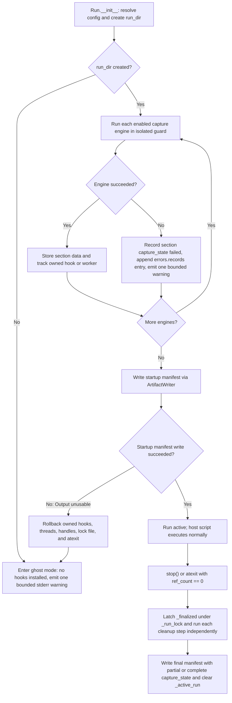
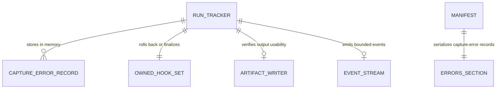

# IPD: Tracker Per-Engine Failure Isolation Narrow Ghost Mode and Independent Finalization

- Date: 2026-11-21
- Kind: child
- Concern: Narrowing ghost mode to unusable output, isolating every capture engine into honest partial manifests with bounded redacted error records, rolling back owned hooks transactionally on ghost transition, and executing finalization cleanup steps independently.
- Scope: Extend `$defs.error_record` additively in `schemas/manifest.schema.json`; refactor `Run` in `src/pubrun/tracker.py`, `ArtifactWriter` in `src/pubrun/writer.py`, `EventStream` in `src/pubrun/events.py`, and ghost/nested guards in `src/pubrun/core.py`; update `tests/test_tracker.py` and `tests/test_manifest_schema.py`; add comprehensive fault-injection and lifecycle tests in `tests/test_capture_isolation.py`.
- Scope-Paths: schemas/manifest.schema.json, src/pubrun/tracker.py, src/pubrun/writer.py, src/pubrun/events.py, src/pubrun/core.py, tests/test_tracker.py, tests/test_capture_isolation.py, tests/test_manifest_schema.py
- Item-Dependencies: executed:p6pon8
- Status: to-review
- Short-Description: Isolate per-engine capture calls, narrow ghost mode to unusable output, roll back owned hooks on ghost transition, and run finalization steps independently
- Work-Kind: bug
- Priority: high
- From-Backlog: x21s6w
- Blocks-Release: next
- Set: cap-isolation
- Order: 2
- Highest E allocated: 05
- Author: agent
- Id: ed0yds

> Write and proofread this plan per the technical writing standard, `.aw/system/workflows/technical-writing/technical-writing.md` (`.agents/workflows/technical-writing/technical-writing.md` in a legacy-layout install), including requirement 12 (diagrams).

## Workflow history

- 2026-11-22 draft (agent): created.
- 2026-11-22 to-review (agent): authored review-ready child plan from backlog item `x21s6w`.

## Goal

Isolate every capture engine call in `Run` so a failure in one engine never promotes healthy tracking into ghost mode, narrow ghost mode strictly to genuinely unusable output with transactional rollback of any hooks this run owns, run every finalization cleanup step independently even when another cleanup step fails, bound runtime I/O failure warnings in `EventStream` and `ArtifactWriter`, and record bounded, redacted failure evidence in section `capture_state` and `errors.records`.

### Isolated bootstrap, ghost-mode rollback, and independent finalization flow

The text in `## Proposed changes (ordered, validatable)` is normative. These diagrams summarize the narrowed ghost-mode boundary, per-engine isolation loop, and independent cleanup sequence.





## Detailed Implementation Checklist (TODO)

Execution-state rule: mark an `E-*` item complete only after performing the action. That mark is not validation. Right-sizing rule: write for a modest executor that cannot hold much in its head. Each E-item is one step (one concern, about one file, executable in one focused pass) and its V-item names each unit it covers with its own check; a plan stays at about 5 E-items and 8 work Scope-Paths, else split it into more child plans (guidance, `IPD-Z603`). Accepted execution states: blocked, failed, pending, performed; terminal gate demands 'performed'.

### Task group 1: Schema, writer, event stream, and tracker isolation

- [ ] E-01 Extend `$defs.error_record` additively in `schemas/manifest.schema.json` with optional `section` and `stage` string-or-null fields while keeping existing `required` fields unchanged.
  - Depends on: none
  - Expected outcome: `schemas/manifest.schema.json` validates both existing manifests and manifests containing `errors.records` entries with `kind = "capture-error"`, `type`, bounded redacted `message`, `traceback = null`, `section`, and `stage`, as well as partial manifests where any optional or required section carries `capture_state.status == "failed"`.
  - Execution state: pending

- [ ] E-02 Update `src/pubrun/writer.py` (`ArtifactWriter`) and `src/pubrun/events.py` (`EventStream`) to report output-write success/failure explicitly, bound failure warnings without retrying broken handles indefinitely, support `unregister_atexit()`, and prevent redundant finalized rewrites.
  - Depends on: E-01
  - Expected outcome: `ArtifactWriter.write_startup_manifest()` returns `bool` (`True` when `manifest.json` wrote, `False` on failure) and stores a bounded redacted `last_error`; `ArtifactWriter.write_artifacts()` returns `bool`, guards against rewriting an already-written finalized run on redundant `stop()`/`atexit`, logs at most one bounded redacted warning on finalization write failure, and supports `unregister_atexit()`; `EventStream` logs at most one bounded redacted warning per write failure episode, closes/disables a broken handle cleanly instead of retrying failing writes indefinitely, and keeps `emit()`, `close()`, and `migrate_directory()` thread-safe.
  - Execution state: pending

- [ ] E-03 Refactor `Run` in `src/pubrun/tracker.py` and lifecycle guards in `src/pubrun/core.py` for per-engine capture isolation, independent background `hardware`/`host`/`filesystem` isolation, narrow ghost mode with transactional `_rollback_owned_hooks()`, independent cleanup steps in `_finalize_state()`, and protected `to_manifest_dict()`.
  - Depends on: E-02
  - Expected outcome: Every capture engine in `Run._bootstrap_engines()` runs in its own isolated guard so an escaping exception marks only that section `"failed"` (with bounded redacted `detail` and an in-memory `errors.records` entry) and preserves all unrelated sections; `get_hardware()`, `get_host()`, and `get_filesystem()` run in separate `try/except` blocks inside the background thread; if `run_dir.mkdir()` or initial `write_startup_manifest()` fails, `Run` rolls back all owned hooks/threads/handles/lock/`atexit` and enters ghost mode cleanly; `_finalize_state()` executes every cleanup step independently even if earlier steps raise; `Run.stop()` clears `_active_run` in `finally` when `ref_count <= 0`; `_merge_and_migrate()` is a safe no-op on ghost/inactive runs and isolates mid-run `SubprocessSpy` activation; `to_manifest_dict()` isolates dynamic providers, populates `errors.records`, and sets `capture.capture_state` to `"partial"` whenever any section failed.
  - Execution state: pending

### Task group 2: Fault-injection, rollback, lifecycle, and schema verification

- [ ] E-04 Update outdated engine-crash ghost tests in `tests/test_tracker.py` and add partial-manifest schema conformance tests in `tests/test_manifest_schema.py`.
  - Depends on: E-03
  - Expected outcome: `tests/test_tracker.py` verifies that failing `get_invocation`, `get_git`, `get_environment`, or `get_hardware` produces an active partial run (not ghost mode) while genuine output-directory failure enters ghost mode and preserves `outcome == "ghost"` across `stop()`; `tests/test_manifest_schema.py` validates real partial manifests produced under per-engine fault injection against `schemas/manifest.schema.json`.
  - Execution state: pending

- [ ] E-05 Create `tests/test_capture_isolation.py` verifying per-engine fault injection, output-loss rollback, second cleanup failures, lifecycle edge cases, and import modes across the targeted test suite.
  - Depends on: E-04
  - Expected outcome: `pytest tests/test_capture_isolation.py tests/test_tracker.py tests/test_writer.py tests/test_events.py tests/test_import_modes.py tests/test_manifest_schema.py tests/test_quality.py -v` exits 0 with all tests passing.
  - Execution state: pending

## Project conventions discovered (Step 0)

- `src/pubrun/tracker.py` (`Run.__init__`) wraps the entire `self._bootstrap_engines()` call in one outer `try/except` that demotes the entire run to ghost mode (`_outcome = "ghost"`, `_finalized = True`) without rolling back already-installed hooks, threads, open file handles, or `.pubrun.lock`, and leaves `self.writer` unset on that return path.
- `src/pubrun/tracker.py` (`Run._bootstrap_engines`) runs `get_hardware()` and `get_host()` in a single `try/except`, so a failure in `get_hardware()` skips `get_host()` and a failure in `get_host()` overwrites healthy `hardware_data` with `{"capture_state": {"status": "failed"}}`.
- `src/pubrun/tracker.py` (`Run._finalize_state`) executes `SubprocessSpy.finalize_all()`, `SubprocessSpy.uninstall()`, `console_interceptor.stop()`, `resource_watcher.stop()`, `event_stream.close()`, profiler disable, `signal_capture.uninstall()`, and `_remove_lock_file()` sequentially without individual `try/except` guards, so one cleanup failure skips every later cleanup step.
- `src/pubrun/tracker.py` (`Run.to_manifest_dict`) hardcodes `"errors": {"records": [], "capture_state": {"status": "complete"}}` and `"capture": {..., "capture_state": {"status": "complete"}}`, and reports `"suppressed"` when `resource_watcher` or `signal_capture` is `None` even if initialization failed.
- `src/pubrun/tracker.py` protects `_finalized` latching and the background hardware startup manifest re-write with `pubrun._run_lock` to prevent a Time-Of-Check to Time-Of-Use (TOCTOU) race where a slow hardware thread overwrites a finalized manifest.
- `src/pubrun/writer.py` (`ArtifactWriter.write_startup_manifest`) swallows all exceptions silently, so `Run.__init__()` cannot detect that `run_dir` is read-only or unwritable after `mkdir(exist_ok=True)`.
- `src/pubrun/core.py` (`start`) calls `active._merge_and_migrate(kwargs)` whenever `get_current_run()` is truthy, even if `active` is a ghost run whose `run_dir` does not exist.
- `tests/test_tracker.py` (`test_engine_crash_promotes_to_ghost`, `TestBootstrapEnginesFailures`) currently asserts the legacy behavior where `get_invocation`, `get_git`, and `get_environment` failures enter ghost mode; those tests must be updated to match the new narrow ghost-mode contract.
- Sibling pending Sets `timing-acc` (`e1fwy2`) and `startup-perf` (`tkmm5p`) may also modify `tracker.py` and `writer.py`. Implementations here must preserve any `_mark_finalization_end()`, monotonic timing anchors, `_write_lock`, `durability`, `is_refresh`, or `hardware.depth == "off"` synchronous path if already present when this plan executes.

## Findings

- **F-01 (Broad ghost-mode blast radius):** One failing capture engine in `Run._bootstrap_engines()` discards all healthy sections, suppresses tracking completely, and leaks earlier hooks, threads, file handles, and `.pubrun.lock`.
- **F-02 (Coupled background capture):** `get_hardware()` and `get_host()` share one `try/except`, allowing either failure to corrupt or skip the other section.
- **F-03 (Silent startup output loss):** `ArtifactWriter.write_startup_manifest()` hides write failures, leaving a run nominally active with hooks attached on read-only storage instead of rolling back and entering ghost mode.
- **F-04 (Cascading cleanup failures):** An exception in any teardown step in `Run._finalize_state()` aborts all subsequent teardown steps and skips `write_artifacts()` and `_active_run` reset in `Run.stop()`.
- **F-05 (Unpopulated `errors` section and false `"complete"` / `"suppressed"` claims):** Failed sections have no recorded `errors.records` entries, `capture.capture_state` stays `"complete"`, and failed `resources`/`signals` report `"suppressed"` instead of `"failed"`.
- **F-06 (Ghost-run re-entry hazard):** Nested `pubrun.start(output_dir=...)` while a ghost run is active calls `_merge_and_migrate()` on a nonexistent directory, and mid-run `SubprocessSpy.install()` in `_merge_and_migrate()` is unguarded and omits `config=merged`.

## Proposed changes (ordered, validatable)

1. **Additive schema update (`schemas/manifest.schema.json`):**
   - Under `$defs.error_record.properties`, add two optional properties:
     - `"section": {"type": ["string", "null"]}` (manifest section or subsystem name such as `"git"`, `"packages"`, `"console"`, `"subprocesses"`, `"resources"`, `"signals"`, `"events"`, `"writer"`).
     - `"stage": {"type": ["string", "null"]}` (lifecycle stage such as `"bootstrap"`, `"runtime"`, `"finalization"`, `"rollback"`, `"writer"`).
   - Keep `$defs.error_record.required` as `["kind"]` and keep all other section definitions unchanged so legacy and current manifests remain valid.

2. **Output-usability reporting and bounded failure behavior (`src/pubrun/writer.py`, `src/pubrun/events.py`):**
   - In `src/pubrun/writer.py` (`ArtifactWriter`):
     - Track `self.last_error: Optional[str] = None`, `self._artifacts_written: bool = False`, and `self._write_failure_warned: bool = False`.
     - Add `unregister_atexit(self) -> None`: if `self._registered`, call `atexit.unregister(self.write_artifacts)` inside `try/except` and set `self._registered = False`.
     - Update `write_startup_manifest(self, *args, **kwargs) -> bool` (preserving compatibility with any `is_refresh` parameter from `startup-perf`):
       - Return `True` when `manifest.json` is written atomically.
       - On exception, record `self.last_error = format_safe_error_detail(e, getattr(self.run, "config", None))`, log at `DEBUG`, and return `False` without raising.
     - Update `write_artifacts(self) -> bool`:
       - If `self._artifacts_written` and `getattr(self.run, "_finalized", False)`: return `True` without rewriting the finalized manifest (preserving `test_double_stop_preserves_manifest` and idempotent `atexit`).
       - Preserve existing `_finalize_state()` call, atomic write order (including any `timing-acc` `_mark_finalization_end()` or `startup-perf` `_write_lock` / durability logic if present), and non-fatal `methods.{md,tex}` write.
       - Set `self._artifacts_written = True` and return `True` after `manifest.json` succeeds.
       - On exception writing `manifest.json`, record `self.last_error`, emit at most ONE bounded redacted warning via `logger.warning(...)` (guarded by `self._write_failure_warned`), never dump tracebacks or config, and return `False` without raising.
   - In `src/pubrun/events.py` (`EventStream`):
     - Track `self._write_failed: bool = False` and `self._last_error: Optional[str] = None`.
     - If opening `events.jsonl` fails in `__init__` or `migrate_directory`, store `self._last_error = format_safe_error_detail(e, config)` and set `self._file = None`.
     - In `emit()`, if writing/flushing raises an `OSError` or other exception: close and clear `self._file = None` cleanly (so a broken filesystem does not incur repeated failing syscalls on every event), record `self._last_error`, and emit at most ONE bounded redacted warning (guarded by `self._write_failed = True`). Keep `self._lock` safety across `emit()`, `close()`, and `migrate_directory()`.

3. **Per-engine isolation, narrow ghost mode, transactional rollback, and independent cleanup (`src/pubrun/tracker.py`, `src/pubrun/core.py`):**
   - Define `MAX_CAPTURE_ERRORS = 50` in `src/pubrun/tracker.py`.
   - On `Run.__init__`:
     - Initialize `self._errors_lock = threading.Lock()`, `self._capture_errors: list = []`, `self._capture_errors_truncated: int = 0`, `self._warned_errors: set = set()`, `self._failed_sections: set = set()`, `self._spy_owner_token = object()`, `self._spying_subprocesses = False`, `self.writer = None`, and section fallback fields (`self.resources_data`, `self.signals_data`, `self.filesystem_data`, etc.).
     - Add helper `self._record_capture_error(section: str, stage: str, exc: BaseException, *, warn: bool = True) -> str`:
       - Formats `detail = format_safe_error_detail(exc, self.config)`.
       - Under `self._errors_lock`: if `not self._finalized` or `stage in ("finalization", "rollback", "writer")`, appends `{"kind": "capture-error", "type": type(exc).__name__, "message": detail, "traceback": None, "section": section, "stage": stage}` up to `MAX_CAPTURE_ERRORS` (incrementing `_capture_errors_truncated` past the cap) and records `section` in `self._failed_sections`.
       - Emits at most ONE bounded warning per `(section, stage)` via `logging.getLogger("pubrun").warning("pubrun: %s capture failed (%s): %s", section, stage, detail)` when `warn` is True. Never dumps tracebacks or config dicts, and never depends on `event_stream` or `console_interceptor`.
     - Keep the fatal/ghost boundary strictly for unusable run output:
       1. `self.run_dir.mkdir(parents=True, exist_ok=True)` failure -> call `self._enter_ghost_mode(reason)` immediately (no hooks installed, one bounded redacted stderr warning).
       2. After `self._bootstrap_engines()` (which isolates every engine internally), instantiate `self.writer = ArtifactWriter(self)` and call `ok = self.writer.write_startup_manifest()`.
       3. If `not ok`: output is unusable (e.g., read-only directory or lost storage). Call `self._rollback_owned_hooks()` to undo every hook, thread, handle, and lock file THIS run installed, then call `self._enter_ghost_mode(self.writer.last_error or "unable to write startup manifest")`, emit one bounded redacted stderr warning, and return cleanly without registering `atexit`.
       4. Only when startup manifest succeeded: call `self.writer.register_atexit()` and publish `_active_run = self`.
   - In `Run._bootstrap_engines()`:
     - Run each static engine (`invocation`, `git`, `process`, `python`, `packages`, `environment`) inside its own isolated guard:
       - On failure, call `self._record_capture_error(section, "bootstrap", exc)` and assign a schema-valid failed section dict:
         - For `invocation`: `{"argv": safe_redacted_argv_or_empty, "capture_state": {"status": "failed", "detail": detail}}`
         - For all other static sections: `{"capture_state": {"status": "failed", "detail": detail}}`
     - Inside `_collect_hardware()` (the background `pubrun-hw` thread):
       - Isolate `get_hardware(self.config)`, `get_host(self.config)`, and `get_filesystem(self.config, ...)` in THREE SEPARATE `try/except` blocks so a failure in one never skips or overwrites the others.
       - For each failure, store `{"capture_state": {"status": "failed", "detail": detail}}` and record a `capture-error` entry under `_run_lock` only if `not self._finalized` (protecting finalized state from late background mutations).
       - Keep the `_run_lock` check (`self.writer and self.is_active and not self._finalized`) before calling `self.writer.write_startup_manifest()` so a slow background worker can never clobber a finalized manifest.
     - Isolate each hook/worker engine independently:
       - **Subprocesses:** call `installed = SubprocessSpy.install(max_tracked, config=self.config, owner=self._spy_owner_token)`. Set `self._spying_subprocesses = bool(installed)`. On exception, `self._spying_subprocesses = False` and record `capture-error` for `"subprocesses"`.
       - **Console:** construct `ConsoleInterceptor(self.run_dir, console_mode, config=self.config)` and call `started = self.console_interceptor.start()`. If `start()` raises or returns `False`, record `capture-error` for `"console"`, preserve its failed `console_data` (`capture_state.status == "failed"`), and clear `self.console_interceptor = None` (already rolled back transactionally). Otherwise seed pending `console_data` when `mode != "off"` (or keep existing startup `console_data` shape when `mode == "off"`).
       - **EventStream:** construct `EventStream(self.run_dir, config=self.config)` inside `try/except`. If construction raises or `self.event_stream._file is None`, record `capture-error` for `"events"` and set `self.event_stream = None`.
       - **ResourceWatcher:** construct and `.start()` inside `try/except`. On exception, safely call `watcher.stop()` if constructed, set `self.resource_watcher = None`, record `capture-error` for `"resources"`, and store `self.resources_data = {"capture_state": {"status": "failed", "detail": detail}}`.
       - **SignalExitCapture:** construct and `.install()` inside `try/except`. On exception, set `self.signal_capture = None`, record `capture-error` for `"signals"`, and store `self.signals_data = {"capture_state": {"status": "failed", "detail": detail}}`.
   - Add `Run._rollback_owned_hooks(self, *, stage: str = "rollback") -> None` and reuse independent cleanup steps in `Run._finalize_state()`:
     - Run each teardown step in its own independent `try/except` block (so a first failure AND a second failure never block later steps):
       1. `SubprocessSpy`: if `self._spying_subprocesses`, finalize/save records (only during normal finalization, not ghost rollback) and call `SubprocessSpy.uninstall(owner=self._spy_owner_token)`, setting `self._spying_subprocesses = False`.
       2. `ConsoleInterceptor`: if `self.console_interceptor`, call `stop()` (capturing `console_data` during finalization) and clear reference.
       3. `ResourceWatcher`: if `self.resource_watcher`, call `stop()` (and snapshot `to_manifest_dict()` during finalization if safe).
       4. `EventStream`: if `self.event_stream`, call `close()`.
       5. Active profilers (`_active_profilers`): disable each profiler independently and clear list.
       6. `SignalExitCapture`: if `self.signal_capture`, call `uninstall()`.
       7. Lock file: call `self._remove_lock_file()`.
       8. On ghost rollback (`stage == "rollback"`): unregister `atexit` on `self.writer` if present, wait briefly (bounded, e.g., `<= 0.5s`) or detach `_hardware_thread` after marking `_finalized = True` so it cannot rewrite anything.
     - Record any cleanup exception via `self._record_capture_error(section, stage, exc)`.
   - In `Run.stop()`:
     - Preserve sticky `"failed"` and `"ghost"` outcomes and `ref_count` decrement under `_run_lock`.
     - If `self.ref_count > 0`, return without finalizing.
     - Wrap finalization and artifact writing so `try: self._finalize_state(); ... finally: unregister_atexit + clear _active_run if _active_run is self` ALWAYS clears `_active_run` and unregisters `atexit` even if something unexpected fails.
   - In `Run._merge_and_migrate()`:
     - Return immediately if `self._outcome == "ghost"` or `not self.is_active` or `self._finalized`.
     - Wrap mid-run `SubprocessSpy.install(max_tracked, config=merged, owner=self._spy_owner_token)` in `try/except`, recording a bounded `capture-error` on failure instead of crashing `start()`.
   - In `Run.to_manifest_dict()`:
     - Safely evaluate `resource_watcher.to_manifest_dict()` and `signal_capture.get_records()` inside `try/except` (falling back to `self.resources_data`/`self.signals_data` or `{"capture_state": {"status": "failed", "detail": ...}}`, and distinguishing `"suppressed"` from `"failed"`).
     - Emit `"errors": {"records": list(self._capture_errors), "capture_state": {"status": "partial", "detail": f"{self._capture_errors_truncated} additional capture error(s) omitted"} if self._capture_errors_truncated else {"status": "complete"}}`.
     - Compute `capture.capture_state`: `{"status": "partial", "detail": f"capture degraded in: {', '.join(sorted(self._failed_sections))}"}` when `self._failed_sections` is non-empty, else `{"status": "complete"}`.
   - In `src/pubrun/core.py`:
     - In `start()`: if `active` is a ghost run (`active._outcome == "ghost"` or `not active.is_active`), increment `ref_count` and return `active` without calling `_merge_and_migrate(kwargs)`.

4. **Behavioral and schema tests (`tests/test_tracker.py`, `tests/test_manifest_schema.py`, `tests/test_capture_isolation.py`):**
   - Update `tests/test_tracker.py` (`test_engine_crash_promotes_to_ghost`, `TestBootstrapEnginesFailures`) to assert that engine crashes stay active with partial manifests while read-only/unwritable output enters ghost mode and preserves `outcome == "ghost"` on `stop()`.
   - Add schema tests in `tests/test_manifest_schema.py` verifying partial manifests with failed `invocation`, `git`, `packages`, `hardware`, `console`, `resources`, and `signals` plus populated `errors.records` validate against `schemas/manifest.schema.json`.
   - Create `tests/test_capture_isolation.py` with behavioral tests covering:
     1. Parametrized fault injection into EVERY capture engine (`invocation`, `git`, `process`, `python`, `packages`, `environment`, `hardware`, `host`, `filesystem`, `subprocesses`, `console`, `events`, `resources`, `signals`): verify unrelated sections survive with `"complete"`, host function returns its normal value and exit code, manifest validates, failed section has `capture_state.status == "failed"` with bounded redacted `detail` (inject a fake secret into the raised exception and assert it is redacted!), `errors.records` contains a `capture-error` entry, and `capture.capture_state.status == "partial"`.
     2. Startup output failure AFTER hooks are installed (e.g., `write_startup_manifest` fails on read-only storage): verify `Run` enters ghost mode, rolls back `SubprocessSpy`, `ConsoleInterceptor`, `ResourceWatcher` thread, `EventStream` handle, `SignalExitCapture`, and `.pubrun.lock`, and emits a bounded warning without traceback spam.
     3. Mid-run output loss / read-only storage: `EventStream.emit()` and `ArtifactWriter.write_artifacts()` fail safely with bounded warnings while cleanup still restores all hooks and host script finishes cleanly.
     4. Second cleanup failure: inject exceptions into BOTH `SubprocessSpy.uninstall()` AND `ConsoleInterceptor.stop()` during `stop()`, verify `ResourceWatcher`, `EventStream`, `SignalExitCapture`, `.pubrun.lock` removal, `_active_run` reset, and manifest writing all still complete and record both cleanup errors.
     5. Nested runs (`start()`/`start()`/`stop()`/`stop()`, `tracked_run`, `audit_run`), double/triple `stop()` idempotency, automatic `atexit` exit (subprocess test checking normal exit code + manifest), and slow background hardware worker finishing after `stop()` (verifying finalized manifest is never overwritten).
     6. All six import modes (`auto`, `full`, `noauto`, `nopatch`, `noconsole`, `minimal`) under engine failure: verify mode permissions hold and rollback never removes hooks the mode did not install.

## Deferred / out of scope (with reason)

- Engine-level hook ownership primitives and `format_safe_error_detail()` are implemented by prerequisite child plan `p6pon8`.
- Consumer rendering of partial manifests and `errors.records` (`pubrun report`, `pubrun inspect`, `pubrun methods`) belongs to child plan `26euz0`.
- Overhead benchmarking and documentation reconciliation belong to child plan `zp2yyu`.

## Scope check

- Over-scope: none. Touches only `manifest.schema.json`, `tracker.py`, `writer.py`, `events.py`, `core.py`, and three test files (8 Scope-Paths, 5 E-items).
- Under-scope: none. Covers every tracker isolation, narrow ghost-mode, transactional rollback, independent cleanup, bounded warning, import-mode, and lifecycle requirement in `x21s6w`.

## Required tests / validation

Run inside the repository root and capture actual runner output and exit code:

```bash
pytest tests/test_capture_isolation.py tests/test_tracker.py tests/test_writer.py tests/test_events.py tests/test_import_modes.py tests/test_manifest_schema.py tests/test_quality.py -v
```

## Spec / documentation sync

Deferred to child plan `zp2yyu`, which updates `docs/architecture.md`, `docs/functional_spec.md`, `docs/manifest.md`, `docs/api.md`, and `docs/performance.md` after `p6pon8`, `ed0yds`, and `26euz0` execute.

## Open questions

### OQ-01: Run `status.outcome` when capture is partially degraded

- Blocking: no
- Status: resolved
- Owner: maintainer (confirmed upon plan approval)
- Resolution or deferral rationale: `status.outcome` represents the host script's execution outcome (`completed`, `failed`, `interrupted`, or `ghost` when tracking output itself is unusable). When one optional capture engine fails while writing remains possible, the host script still completed normally; therefore `status.outcome` remains the host script's outcome (e.g., `"completed"`), while the failed section records `capture_state.status = "failed"`, `errors.records` logs the `"capture-error"`, and `capture.capture_state.status` records `"partial"`. This keeps `pubrun status` exit semantics accurate while clearly surfacing partial capture.

### OQ-02: Coordination with pending sibling Sets `timing-acc` and `startup-perf`

- Blocking: no
- Status: resolved
- Owner: maintainer (confirmed upon plan approval)
- Resolution or deferral rationale: Both `timing-acc` (`e1fwy2`) and `startup-perf` (`tkmm5p`) also touch `src/pubrun/tracker.py` and `src/pubrun/writer.py`. To remain independently executable in any order, `ed0yds` preserves any `_mark_finalization_end()`, monotonic timing anchor, `_write_lock`, `durability`, `is_refresh`, or `hardware.depth == "off"` synchronous path already present on `HEAD` at execution time.

## Validation and cross-check (verify before reporting done)

Validation-state rule: inspect evidence in a separate pass. Do not mark a `V-*` item complete from memory or from the matching execution checkmark. Accepted validation results: blocked, failed, pass, pending; terminal gate demands 'pass'. Runtime-demonstration reachability rule: for each `V-*` item demanding the software be observed acting (such as a run, a dispatch, or a transition)—as distinct from items demanding a diff, a file's content, or a test result, which are reachable by construction—name the code path that produces the observation or the sibling `E-*` that creates it, else the demand is UNDER-SCOPE.

- [ ] V-01 validates E-01
  - Required evidence: Diff of `schemas/manifest.schema.json` showing optional `section` and `stage` properties under `$defs.error_record` with unchanged `required` arrays, plus pasted `pytest tests/test_manifest_schema.py -v` output (exit code 0).
  - Observed evidence:
  - Result: pending

- [ ] V-02 validates E-02
  - Required evidence: Diff of `src/pubrun/writer.py` and `src/pubrun/events.py` showing `bool` return values on `write_startup_manifest()`/`write_artifacts()`, `unregister_atexit()`, duplicate finalized write guard, and bounded one-time error warnings without infinite retry loops.
  - Observed evidence:
  - Result: pending

- [ ] V-03 validates E-03
  - Required evidence: Diff of `src/pubrun/tracker.py` and `src/pubrun/core.py` showing per-engine isolation guards, three independent `hardware`/`host`/`filesystem` blocks in `_collect_hardware()`, narrow ghost-mode rollback via `_rollback_owned_hooks()`, independent cleanup steps in `_finalize_state()`, populated `errors.records`, and honest `capture.capture_state`.
  - Observed evidence:
  - Result: pending

- [ ] V-04 validates E-04
  - Required evidence: Pasted `pytest tests/test_tracker.py tests/test_manifest_schema.py -v` output (exit code 0) showing updated partial-capture and ghost-mode tracker tests and schema validation of partial manifests.
  - Observed evidence:
  - Result: pending

- [ ] V-05 validates E-05
  - Required evidence: Pasted `pytest tests/test_capture_isolation.py tests/test_tracker.py tests/test_writer.py tests/test_events.py tests/test_import_modes.py tests/test_manifest_schema.py tests/test_quality.py -v` output showing exit code 0 and zero failures across all engine fault injections, output-loss rollback, second cleanup failure, nested runs, multi-stop, auto-exit, slow worker, and six import modes.
  - Observed evidence:
  - Result: pending

## Approval and execution gate

- Size assessment: standard
- Cohesion rationale: not required

Execution contract:
1. All open questions (OQ-01, OQ-02) are resolved for review; do not execute until prerequisite `p6pon8` is `executed` and a human approves this plan (`- Status: approved`).
2. Scope fence: edit only `schemas/manifest.schema.json`, `src/pubrun/tracker.py`, `src/pubrun/writer.py`, `src/pubrun/events.py`, `src/pubrun/core.py`, `tests/test_tracker.py`, `tests/test_capture_isolation.py`, and `tests/test_manifest_schema.py`. Do not expand scope; if additional files seem required, STOP and report.
3. Honesty rule: paste the actual `pytest` runner output and exit code into each `V-*` `Observed evidence:` field; never claim tests passed without running them.
4. Commit discipline: commit only the files listed in `- Scope-Paths:` using `aw commit ed0yds -- <paths>`; never use `git add -A`, `git add .`, or `git commit -a`; never push without explicit human instruction.
5. Lifecycle move on completion: after `aw ipd lint --phase pre-transition` passes, move this plan from `.aw/records/plans/pending/` to `.aw/records/plans/executed/`, set `- Status: executed`, append a dated `## Workflow history` line, and commit the lifecycle move path-scoped.
