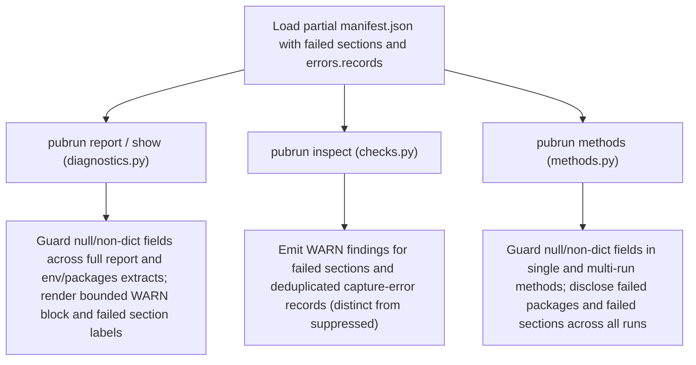
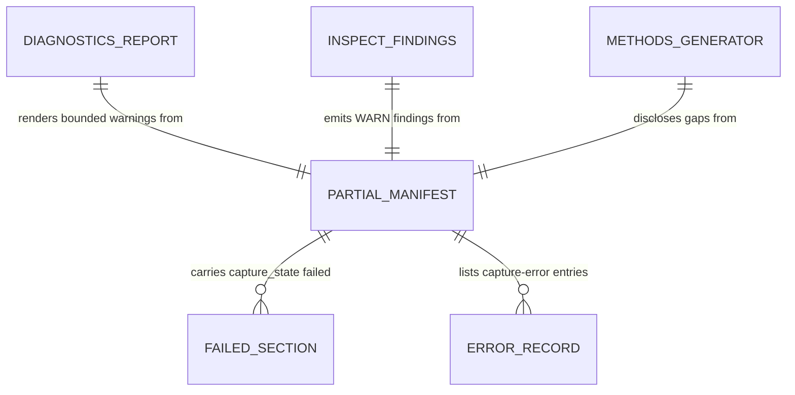

# IPD: Partial Manifest Diagnostics Inspect Findings and Methods Honesty

- Date: 2026-11-21
- Kind: child
- Concern: Honest, crash-free consumption of partial manifests with failed capture sections and `errors.records` across diagnostic reports, `pubrun inspect` findings, and methodology exports.
- Scope: Update `src/pubrun/report/diagnostics.py`, `src/pubrun/report/checks.py`, and `src/pubrun/report/methods.py` to tolerate failed or null section fields and surface capture failures honestly; add behavioral tests in `tests/test_reports.py`, `tests/test_checks_commands.py`, and `tests/test_edge_cases.py`.
- Scope-Paths: src/pubrun/report/diagnostics.py, src/pubrun/report/checks.py, src/pubrun/report/methods.py, tests/test_reports.py, tests/test_checks_commands.py, tests/test_edge_cases.py
- Item-Dependencies: executed:ed0yds
- Status: approved
- Readiness: go-pending-approval
- Review-Depth: complex
- Short-Description: Surface capture errors and failed sections accurately across report, inspect, methods, and status without crashing on degraded manifests
- Work-Kind: bug
- Priority: high
- From-Backlog: x21s6w
- Blocks-Release: next
- Set: cap-isolation
- Order: 3
- Highest E allocated: 05
- Author: agent
- Id: 26euz0
- Approval: 2026-11-22, recorded via aw ipd set: status set to approved

> Write and proofread this plan per the technical writing standard, `.aw/system/workflows/technical-writing/technical-writing.md` (`.agents/workflows/technical-writing/technical-writing.md` in a legacy-layout install), including requirement 12 (diagrams).

## Workflow history

- 2026-11-22 approved (aw set): status set to approved
- 2026-11-22 /plan-review (Antigravity / Gemini 4 Neon (High)): APPROVE WITH REVISIONS APPLIED; PR-001, PR-002, PR-003, PR-004, PR-005, PR-006
- 2026-11-22 draft (agent): created.
- 2026-11-22 to-review (agent): authored review-ready child plan from backlog item `x21s6w`.

## Goal

Ensure that `pubrun report`, `pubrun inspect`, and `pubrun methods` handle partial manifests produced by isolated capture failures without crashing on missing, null, or malformed fields. Surface failed sections and `errors.records` entries clearly, and avoid claiming complete capture or standard-library-only dependencies where a section failed.

### Partial-manifest consumption flow

The text in `## Proposed changes (ordered, validatable)` is normative. These diagrams summarize how each consumer handles healthy versus failed manifest sections.





## Detailed Implementation Checklist (TODO)

Execution-state rule: mark an `E-*` item complete only after performing the action. That mark is not validation. Right-sizing rule: write for a modest executor that cannot hold much in its head. Each E-item is one step (one concern, about one file, executable in one focused pass) and its V-item names each unit it covers with its own check; a plan stays at about 5 E-items and 8 work Scope-Paths, else split it into more child plans (guidance, `IPD-Z603`). Accepted execution states: blocked, failed, pending, performed; terminal gate demands 'performed'.

### Task group 1: Consumer safety and honesty updates

- [x] E-01 Update `src/pubrun/report/diagnostics.py::print_report` to guard null, missing, or non-dict section fields and display recorded `errors.records` plus degraded capture states clearly.
  - Depends on: none
  - Expected outcome: `src/pubrun/report/diagnostics.py::print_report` renders partial and degraded manifests across `basic`, `standard`, `deep`, and `section="env"`/`"packages"` extracts without raising `AttributeError`, `TypeError`, `IndexError`, or `OverflowError`. It prints a bounded `[WARN ]` block summarizing failed capture sections, `errors.records` entries (capped cleanly with overflow and `errors.capture_state` truncation detail), displays `capture failed` on failed sections instead of misleading empty counts, and emits zero ANSI escapes under `NO_COLOR`.
  - Execution state: performed

- [x] E-02 Update `src/pubrun/report/checks.py::manifest_findings` to emit `WARN` findings for every section with `capture_state.status == "failed"` and deduplicated `WARN` findings for `capture-error` records in `errors.records`.
  - Depends on: none
  - Expected outcome: `src/pubrun/report/checks.py::manifest_findings` distinguishes `"suppressed"` (configured off) from `"failed"` (attempted and failed), emits a structured `WARN` finding with bounded `detail` for each failed section and deduplicated per-section `WARN` findings for additional `capture-error` records not already covered by a failed section (plus truncation notice if `errors.capture_state.status == "partial"`), remains exception-safe and command-line interface (CLI)-only (never imported by `pubrun/__init__.py`), and preserves compatibility if sibling plan `0b8i7x` (shared reproducibility evidence model) has already landed.
  - Execution state: performed

- [x] E-03 Update `src/pubrun/report/methods.py::generate_report`, `generate_report_multi`, and `extract_highlighted_packages` to guard null or malformed fields safely and disclose failed sections across single-run and multi-run exports instead of claiming complete capture.
  - Depends on: none
  - Expected outcome: `generate_report()`, `generate_report_multi()`, `extract_highlighted_packages()`, and all `_VARIANCE_FIELDS` extractors never crash when section dicts or fields (`host.os_name`, `hardware.cpu`, `hardware.memory_total_bytes`, `python.version`, `python.implementation`, `git.commit`, `git.remote_url`, `packages.records`, `record.name`) are missing, `None`, or non-dict. When `packages.capture_state.status == "failed"`, single-run methods state that package capture failed and multi-run `_packages_of()` returns `"(package capture failed)"` rather than claiming standard-library-only dependencies. Single-run and multi-run exports append a concise Markdown or LaTeX disclosure (with underscores escaped in LaTeX) whenever any manifest in scope has failed sections, while healthy complete manifests remain byte-identical.
  - Execution state: performed

### Task group 2: Consumer behavioral tests

- [x] E-04 Add partial-manifest and `errors.records` behavioral tests in `tests/test_reports.py` and `tests/test_checks_commands.py`.
  - Depends on: E-01, E-02, E-03
  - Expected outcome: `tests/test_reports.py` verifies `print_report()` (basic, standard, deep, `section="env"`/`"packages"`, with and without `NO_COLOR`) and `generate_report()` / `generate_report_multi()` (Markdown and LaTeX, including failures in `manifests[0]` and `manifests[1:]`, failed `packages`, `hardware`, `host`, `python`, and populated/truncated `errors.records`) on real partial manifests produced under engine fault injection, while confirming healthy complete manifests remain unchanged. `tests/test_checks_commands.py` verifies `manifest_findings()` emits `WARN` findings for failed sections and deduplicated `capture-error` records while remaining distinct from `"suppressed"` and preserving `test_import_pubrun_does_not_import_checks`.
  - Execution state: performed

- [x] E-05 Add degraded-manifest tolerance regression tests in `tests/test_edge_cases.py` and run the targeted consumer test suite.
  - Depends on: E-04
  - Expected outcome: `tests/test_edge_cases.py` verifies partial manifests with failed sections, null/non-dict fields, non-string `argv`, non-dict `signals_received`, and invalid timestamps render cleanly across `status.scan_runs()`, `diagnostics.print_report()`, `checks.manifest_findings()`, and `methods.generate_report()` / `generate_report_multi()`. `pytest tests/test_reports.py tests/test_methods_multi.py tests/test_show_sections.py tests/test_example_minimal_research_workflow.py tests/test_checks_commands.py tests/test_edge_cases.py tests/test_status.py -v` exits 0 with all tests passing.
  - Execution state: performed

## Project conventions discovered (Step 0)

- `src/pubrun/report/diagnostics.py::print_report` prints hydration warnings and `config.notices` using `[WARN ]`, but does not inspect `manifest.get("errors", {}).get("records")` or section `capture_state.status == "failed"`, and assumes non-`None` dicts and strings in `section="env"`, `section="packages"`, `Basic Information` (`signals_received`, `started_at_utc`), `Standard Information` (`inv.argv`, `python.version`, `hw.cpu`, `git.remote_url`), and `Deep Information` (`subprocesses`).
- `src/pubrun/report/checks.py::manifest_findings` checks `capture_state.status == "suppressed"` for `resources`, `hardware`, `packages`, and `git`, and must never be imported by `src/pubrun/__init__.py` (CLI-only module pinned by `tests/test_checks_commands.py::test_import_pubrun_does_not_import_checks`). Sibling reviewed plan `0b8i7x` (Set `repro-check`) delegates `manifest_findings()` to `pubrun.report.reproducibility`; preserving that delegation if present avoids cross-Set conflicts.
- `src/pubrun/report/methods.py::generate_report`, `extract_highlighted_packages`, and `_VARIANCE_FIELDS` assume non-`None` strings and dicts (`os_name.replace(...)`, `py.get("version", "unknown").split(" ")[0]`, `python_impl.capitalize()`, `record.get("name", "").lower()`, `hw.get("cpu", {}).get("model", ...)`), fall back to `"Standard library dependencies were utilized."` / `"(standard library only)"` when `packages` failed, and `generate_report_multi()` checks only `manifests[0]` for the base paragraph.
- `tests/test_reports.py::TestGenerateReportDegradedManifests` pins existing defaults for manifests lacking `packages` or having empty `packages.records` without a `"failed"` status (`"Standard library dependencies"`), and `tests/test_methods_multi.py::TestSingleRunParity` and `tests/test_example_minimal_research_workflow.py` pin byte-identical output for healthy manifests.
- `src/pubrun/status.py::RunInfo._load_from_manifest` already uses `_as_float()`, `_as_int()`, and `_as_signal_list()` to tolerate partial manifests, and `tests/test_edge_cases.py` guards reader resilience.
- Prerequisite plan `ed0yds` (tracker per-engine failure isolation) caps `errors.records` at 50 entries and sets `errors.capture_state` to `{"status": "partial", "detail": "<N> additional capture error(s) omitted"}` when truncated.
- Tests must assert on observable outputs and findings rather than inspecting source code.

## Findings

- **F-01 (`pubrun report` hides capture failures and crashes on null/malformed section fields):** `src/pubrun/report/diagnostics.py::print_report` does not display `errors.records` or failed section `capture_state` diagnostics (including in `section="env"` and `section="packages"`), and raises `AttributeError`/`TypeError`/`IndexError` when degraded sections contain `None`, non-dict values, non-string `argv` items, or invalid timestamps.
- **F-02 (`pubrun inspect` ignores failed sections and `errors.records`):** `src/pubrun/report/checks.py::manifest_findings` reports `"suppressed"` sections but emits zero findings when a section has `capture_state.status == "failed"` or when `errors.records` contains `"capture-error"` entries.
- **F-03 (`pubrun methods` can crash on `None`/non-dict values and overclaims on failed `packages` in single and multi-run modes):** A failed `packages` section produces an empty `records` list and causes `generate_report()` to state `"Standard library dependencies were utilized."` and `_packages_of()` to return `"(standard library only)"`; `generate_report_multi()` ignores failures in `manifests[1:]`; and `None` or non-dict values in `host`, `hardware`, `python`, `git`, or `packages` raise `AttributeError` or `TypeError`.

## Proposed changes (ordered, validatable)

1. **`src/pubrun/report/diagnostics.py` (`print_report`):**
   - Add small internal helpers `_as_dict(val)` and `_section_status(manifest, name)` and guard ALL field extractions against `None`, non-dict, non-list, and non-numeric values across `section="env"`, `section="packages"`, `Basic Information` (`config.notices`, `inv.script`, `signals_received`, `started_at_utc`, `elapsed_seconds`), `Standard Information` (`inv.argv` coerced via `str(...)`, `python.version` whitespace-safe split, unwrapped `host.hostname` dict, `hw.cpu`, `bytes_to_gb`, `git.commit`, `git.remote_url`), and `Deep Information` (`envs`, `pkgs`, `subprocesses`).
   - In `section="env"` and `section="packages"`, if the section's `capture_state.status == "failed"`, print `(capture failed: <detail>)` (bounded) instead of `(None captured)`.
   - Collect failed sections from top-level manifest sections whose `capture_state.status == "failed"` and read `errors = _as_dict(manifest.get("errors"))` (`records` list and `capture_state`).
   - When failed sections or `errors.records` are present, render bounded `[WARN ]` lines near the top of the report (right after config notices, visible at all verbosity depths including `basic`, respecting `NO_COLOR` with zero ANSI escapes): list failed sections with bounded detail and up to 10 `capture-error` records (appending a concise `... (+N more capture error(s))` overflow line and surfacing `errors.capture_state.detail` when `errors.capture_state.status == "partial"`).
   - For standard/deep section lines (`Git Commit`, `Packages`, `Env Vars`, `Host`, `Python`), show `capture failed` when that section's `capture_state.status == "failed"` rather than misleadingly printing `0 recorded` or `Not found or un-tracked`.

2. **`src/pubrun/report/checks.py` (`manifest_findings`):**
   - Inspect every tracked manifest section (`invocation`, `process`, `host`, `python`, `packages`, `environment`, `git`, `hardware`, `filesystem`, `resources`, `console`, `signals`, `capture`):
     - If `_capture_state_status(sec) == "failed"`, append a `WARN` finding with `code = f"{section_name}_capture_failed"`, message naming the section and bounded `detail` (if present), and suggestion pointing to `errors` / diagnostic logs.
   - Inspect `manifest.get("errors", {}).get("records", [])`:
     - Filter for dict entries with `kind == "capture-error"` whose normalized `section` was not already reported above (such as `"subprocesses"`, `"events"`, `"writer"`, or `"general"` when `section` is missing/non-string). Deduplicate per section (recording the first bounded message plus a count suffix if multiple errors occurred for that section) and emit a `WARN` finding with `code = f"capture_error_{section}"`.
     - If `errors.capture_state.status == "partial"` and carries a non-empty `detail`, include that truncation detail cleanly without spamming findings.
   - Keep `manifest_findings()` completely exception-safe and CLI-only (never imported by `src/pubrun/__init__.py`). If sibling plan `0b8i7x` (Set `repro-check`) has already wired `manifest_findings()` to `pubrun.report.reproducibility`, preserve that integration while ensuring `{section}_capture_failed` and deduplicated `capture_error_*` `WARN` findings are emitted cleanly without duplicating findings.

3. **`src/pubrun/report/methods.py` (`extract_highlighted_packages`, `generate_report`, `generate_report_multi`):**
   - Guard `bytes_to_gb` against non-numeric values and guard `extract_highlighted_packages` against `None`/non-dict `packages`, non-list `records`, non-dict entries, and `None`/non-string `name` or `version`.
   - Use null-safe and type-safe dict/string extraction across `host`, `hardware`, `python`, `git`, `packages`, and `run` in both `generate_report()` and all seven `_VARIANCE_FIELDS` extractors so missing, `None`, or non-dict fields degrade cleanly to `"unknown"` / `"unavailable"` placeholders in both Markdown and LaTeX formats (preserving `tests/test_reports.py::TestGenerateReportDegradedManifests` behavior).
   - Check `packages_status = _section_status(manifest, "packages")`:
     - If `packages_status == "failed"`, set `packages_text = "Package provenance was unavailable because package capture failed."` in `generate_report()` and return `"(package capture failed)"` in `_packages_of()` instead of `"Standard library dependencies were utilized."` / `"(standard library only)"`.
     - If `packages_status == "suppressed"`, set `packages_text = "Package capture was disabled by configuration."` in `generate_report()` and return `"(package capture disabled)"` in `_packages_of()`.
   - Identify any top-level manifest sections with `capture_state.status == "failed"`:
     - In `generate_report()`: if non-empty, append a concise disclosure line (`*Note: partial provenance; capture failed for: <sections>.*` in Markdown; `% Note: partial provenance; capture failed for: <sections>.` with underscores escaped in LaTeX).
     - In `generate_report_multi()`: aggregate failed sections across ALL manifests in `manifests` (not only `manifests[0]`). When `manifests[1:]` has failed sections beyond `manifests[0]`, append a concise multi-run partial-provenance disclosure line (Markdown and LaTeX-commented with escaped underscores) naming the failed sections and affected run count.
   - Keep output for healthy, complete single and multi-run manifests byte-identical to existing behavior so `tests/test_methods_multi.py::TestSingleRunParity`, `tests/test_reports.py`, and `tests/test_example_minimal_research_workflow.py` stay green.

4. **Behavioral tests (`tests/test_reports.py`, `tests/test_checks_commands.py`, `tests/test_edge_cases.py`):**
   - `tests/test_reports.py`: test `print_report()` (`basic`, `standard`, `deep`, `section="env"`, `section="packages"`, with and without `NO_COLOR`, and >10/truncated `errors.records`) on a real partial manifest produced by `Run` with an injected engine failure; test `generate_report()` and `generate_report_multi()` (Markdown and LaTeX, including failure in `manifests[1]` only) when `packages`, `hardware`, `host`, and `python` fail, verifying zero crashes, honest wording (no `"Standard library dependencies were utilized."` / `"(standard library only)"` on failed `packages`), escaped LaTeX underscores, and partial-provenance disclosure; verify healthy manifests remain unchanged.
   - `tests/test_checks_commands.py`: test `manifest_findings()` on manifests with failed sections (`git`, `hardware`, `packages`, `resources`, `console`) and repeated/truncated `errors.records` (`subprocesses`, `events`, `writer`), verifying `WARN` severity, deduplication, distinct codes from `*_off` (`suppressed`), bounded redacted detail propagation, and `test_import_pubrun_does_not_import_checks`.
   - `tests/test_edge_cases.py`: test a heavily degraded manifest with `None`/non-dict fields, non-string `argv`, non-dict `signals_received`, invalid `started_at_utc`, and failed sections through `scan_runs()`, `print_report()`, `manifest_findings()`, `generate_report()`, and `generate_report_multi()`.

## Deferred / out of scope (with reason)

- Engine hook ownership and safe diagnostic redaction primitives belong to prerequisite plan `p6pon8` (safe diagnostic redaction and hook ownership rollback across capture engines).
  - Carrier: p6pon8
  - Carrier-Evidence: .aw/records/plans/executed/20261121-cap-isolation-01-p6pon8-safe-diagnostic-redaction-and-hook-ownership-rollback-across.ipd.md
- Tracker per-engine failure isolation, narrow ghost mode, and independent finalization belong to prerequisite plan `ed0yds` (tracker per-engine failure isolation, narrow ghost mode, and independent finalization).
  - Carrier: ed0yds
  - Carrier-Evidence: .aw/records/plans/executed/20261121-cap-isolation-02-ed0yds-tracker-per-engine-failure-isolation-narrow-ghost-mode-and-i.ipd.md
- Documentation updates and overhead benchmarking belong to child plan `zp2yyu` (isolation overhead measurement, documentation reconciliation, and whole-Set verification).
  - Carrier: zp2yyu
- Reproducibility gap assessment (`repro-check`, orchestrator `osjxbz`) belongs to a separate Set and remains untouched here.
  - Carrier: osjxbz
- Timing semantic labeling (`timing-acc`, child `vrr1fv`) belongs to a separate Set and remains untouched here.
  - Carrier: vrr1fv

## Scope check

- Over-scope: none. Touches only the three report/check/methods consumer modules and their three test files (6 Scope-Paths, 5 E-items).
- Under-scope: none. Covers every consumer-side partial-manifest and no-false-complete-claim requirement in backlog item `x21s6w` (isolate capture failures and roll back partially installed hooks).

## Required tests / validation

Run inside the repository root and capture actual runner output and exit code:

```bash
pytest tests/test_reports.py tests/test_methods_multi.py tests/test_show_sections.py tests/test_example_minimal_research_workflow.py tests/test_checks_commands.py tests/test_edge_cases.py tests/test_status.py -v
```

## Spec / documentation sync

Deferred to child plan `zp2yyu` (isolation overhead measurement, documentation reconciliation, and whole-Set verification), which reconciles `docs/architecture.md`, `docs/functional_spec.md`, `docs/manifest.md`, `docs/api.md`, and `docs/performance.md` after `p6pon8`, `ed0yds`, and `26euz0` execute.

## Open questions

### OQ-01: Preserving byte-identical `methods` output for complete manifests

- Blocking: no
- Status: resolved
- Owner: plan author (binding upon plan approval)
- Resolution or deferral rationale: Existing tests (`tests/test_methods_multi.py::TestSingleRunParity`, `tests/test_example_minimal_research_workflow.py`) and user workflows depend on the established `generate_report()` wording for healthy manifests. The partial-provenance disclosure line and failed-packages wording activate ONLY when a section's `capture_state.status` is `"failed"` (or `"suppressed"` for packages), keeping healthy complete single and multi-run manifests byte-identical.

## Validation and cross-check (verify before reporting done)

Validation-state rule: inspect evidence in a separate pass. Do not mark a `V-*` item complete from memory or from the matching execution checkmark. Accepted validation results: blocked, failed, pass, pending; terminal gate demands 'pass'. Runtime-demonstration reachability rule: for each `V-*` item demanding the software be observed acting (such as a run, a dispatch, or a transition) (as distinct from items demanding a diff, a file's content, or a test result, which are reachable by construction), name the code path that produces the observation or the sibling `E-*` that creates it, else the demand is UNDER-SCOPE.

- [x] V-01 validates E-01
  - Required evidence: Diff of `src/pubrun/report/diagnostics.py` showing null/non-dict section access guards across full report and `env`/`packages` section extracts, bounded `[WARN ]` rendering of failed sections and `errors.records` (with overflow and truncation detail), `NO_COLOR` compliance, and honest section labels when `capture_state.status == "failed"`.
  - Observed evidence: Inspected `git diff src/pubrun/report/diagnostics.py` (+281/-71 lines): adds `_is_finite_number`, `_as_dict`, `_as_dict_list`, `_section_status`, `_section_detail`, `_bound_text` (160-char single-line cap), `_unwrap_value`, `_format_report_timestamp`, and finite-safe `bytes_to_gb`; guards all section/field access across `section="env"`, `section="packages"`, `Basic Information`, `Standard Information`, and `Deep Information`; renders `(capture failed: <detail>)` on failed `env`/`packages` extracts and `capture failed` on failed `Python`, `Host`/`hardware`, `Git Commit`, `Packages`, and `Env Vars` lines; prints bounded `[WARN ]` block for failed sections, up to 10 `capture-error` records with `... (+N more capture error(s))` overflow and `errors.capture_state.detail` truncation notice; uses empty color strings under `NO_COLOR`.
  - Result: pass

- [x] V-02 validates E-02
  - Required evidence: Diff of `src/pubrun/report/checks.py` showing `WARN` findings emitted for failed sections and deduplicated per-section `capture-error` records in `manifest_findings()` while remaining distinct from `suppressed`, exception-safe, CLI-only, and compatible with `0b8i7x`.
  - Observed evidence: Inspected `git diff src/pubrun/report/checks.py` (+163/-5 lines): preserves delegation to `assess_manifest_reproducibility()` (sibling plan `0b8i7x`, verified by `python3 -m pytest tests/test_reproducibility_assessment.py tests/test_reproducibility_preflight.py -q --no-cov` -> `32 passed in 1.30s`, exit 0); emits `WARN` `{section}_capture_failed` with bounded detail (160-char single-line cap) across all 13 `_TRACKED_CAPTURE_SECTIONS` (normalizing `git_failed`/`packages_failed` in place without duplicates and staying distinct from `*_off` suppressed codes); deduplicates additional `errors.records` `kind == "capture-error"` entries per normalized section into `WARN` `capture_error_{section}` (replacing generic `capture_errors_recorded` and skipping already-failed sections); surfaces bounded `errors_capture_partial` truncation detail; remains exception-safe (`try/except`) and CLI-only.
  - Result: pass

- [x] V-03 validates E-03
  - Required evidence: Diff of `src/pubrun/report/methods.py` showing null/type-safe extraction in `extract_highlighted_packages`, `generate_report`, `generate_report_multi`, and `_VARIANCE_FIELDS`, honest failed-packages wording in both single and multi-run paths, and partial-provenance disclosure across all runs in Markdown and LaTeX (with escaped underscores) while preserving byte-identical complete-manifest output.
  - Observed evidence: Inspected `git diff src/pubrun/report/methods.py` (+145/-36 lines): adds `_as_dict`, `_section_status`, `_failed_sections`, and finite-safe `bytes_to_gb`; guards all field accesses in `extract_highlighted_packages()`, `generate_report()`, `generate_report_multi()`, and all seven `_VARIANCE_FIELDS` extractors; emits `"Package provenance was unavailable because package capture failed."` / `"(package capture failed)"` on failed `packages` and `"Package capture was disabled by configuration."` / `"(package capture disabled)"` on suppressed `packages`; appends Markdown (`*Note: partial provenance...*`) and LaTeX (`% Note: partial provenance...` with `\_`-escaped section names) disclosures for failed sections across single runs and multi-run `manifests[1:]`; preserves byte-identical output on healthy complete manifests.
  - Result: pass

- [x] V-04 validates E-04
  - Required evidence: Pasted `pytest tests/test_reports.py tests/test_checks_commands.py -v` output (exit code 0) showing new partial-manifest, multi-run failure, `NO_COLOR`, and deduplicated `capture-error` tests passing alongside `test_import_pubrun_does_not_import_checks`.
  - Observed evidence: Command `python3 -m pytest tests/test_reports.py tests/test_checks_commands.py -v` exited with code 0:
    ```text
    collected 86 items
    tests/test_reports.py::TestPartialManifestDiagnosticsAndMethods::test_print_report_real_partial_manifest_all_depths_sections_and_no_color PASSED [ 58%]
    tests/test_reports.py::TestPartialManifestDiagnosticsAndMethods::test_print_report_caps_errors_records_and_surfaces_truncation PASSED [ 59%]
    tests/test_reports.py::TestPartialManifestDiagnosticsAndMethods::test_methods_single_and_multi_honest_on_real_failed_engines PASSED [ 60%]
    tests/test_checks_commands.py::test_import_pubrun_does_not_import_checks PASSED [ 61%]
    tests/test_checks_commands.py::TestManifestFindings::test_failed_sections_emit_warn_distinct_from_suppressed PASSED [ 81%]
    tests/test_checks_commands.py::TestManifestFindings::test_capture_error_records_deduplicated_and_truncation_surfaced PASSED [ 82%]
    tests/test_checks_commands.py::TestManifestFindings::test_real_fault_injected_manifest_propagates_redacted_detail PASSED [ 83%]
    ============================== 86 passed in 6.44s ==============================
    ```
  - Result: pass

- [x] V-05 validates E-05
  - Required evidence: Pasted `pytest tests/test_reports.py tests/test_methods_multi.py tests/test_show_sections.py tests/test_example_minimal_research_workflow.py tests/test_checks_commands.py tests/test_edge_cases.py tests/test_status.py -v` output showing exit code 0 and zero failures.
  - Observed evidence: Command `python3 -m pytest tests/test_reports.py tests/test_methods_multi.py tests/test_show_sections.py tests/test_example_minimal_research_workflow.py tests/test_checks_commands.py tests/test_edge_cases.py tests/test_status.py -v` exited with code 0:
    ```text
    collected 190 items
    tests/test_reports.py::TestPartialManifestDiagnosticsAndMethods::test_print_report_real_partial_manifest_all_depths_sections_and_no_color PASSED [ 26%]
    tests/test_reports.py::TestPartialManifestDiagnosticsAndMethods::test_print_report_caps_errors_records_and_surfaces_truncation PASSED [ 26%]
    tests/test_reports.py::TestPartialManifestDiagnosticsAndMethods::test_methods_single_and_multi_honest_on_real_failed_engines PASSED [ 27%]
    tests/test_checks_commands.py::test_import_pubrun_does_not_import_checks PASSED [ 40%]
    tests/test_checks_commands.py::TestManifestFindings::test_failed_sections_emit_warn_distinct_from_suppressed PASSED [ 49%]
    tests/test_checks_commands.py::TestManifestFindings::test_capture_error_records_deduplicated_and_truncation_surfaced PASSED [ 50%]
    tests/test_checks_commands.py::TestManifestFindings::test_real_fault_injected_manifest_propagates_redacted_detail PASSED [ 50%]
    tests/test_edge_cases.py::TestDegradedPartialManifestConsumers::test_degraded_manifest_with_nulls_and_failed_sections_across_all_consumers PASSED [ 67%]
    ======================= 188 passed, 2 skipped in 13.04s ========================
    ```
  - Result: pass

## Approval and execution gate

- Size assessment: standard
- Cohesion rationale: not required

Execution contract:
1. Open questions: `OQ-01` is resolved for review; do not execute until prerequisite `ed0yds` (tracker per-engine failure isolation, narrow ghost mode, and independent finalization) is `executed` and a human approves this plan (`- Status: approved`).
2. Scope fence: restrict edits to `- Scope-Paths:` (`src/pubrun/report/diagnostics.py`, `src/pubrun/report/checks.py`, `src/pubrun/report/methods.py`, `tests/test_reports.py`, `tests/test_checks_commands.py`, `tests/test_edge_cases.py`). If an out-of-scope edit is genuinely required, justify it with `--scope-reason` at finalization; if a declared path needs no edit, acknowledge it with `--scope-ack`. Stop and report only for genuinely unsafe conditions (such as an unresolvable concurrent-edit conflict or a missing prerequisite symbol).
3. Honesty rule (HARD MUST): paste actual `pytest` runner output and exit codes into each `V-*` `Observed evidence:` field; never claim tests passed without running them.
4. Commit and push discipline: commit only the files changed for this plan using `aw commit 26euz0 -- <paths>`; never use `git add -A`, `git add .`, or `git commit -a`; never push without explicit human instruction.
5. Lifecycle transition: this plan must reach `.aw/records/plans/executed/` with `- Status: executed` through `aw ipd finalize` once all `E-*` are `performed` and all `V-*` are `pass`. In a runner-managed lane, the runner owns `aw ipd finalize`; in standalone execution, run `aw ipd lint --phase pre-transition` and finalize directly through `aw ipd finalize`. Never hand-roll a raw `git mv` to `executed/`.
