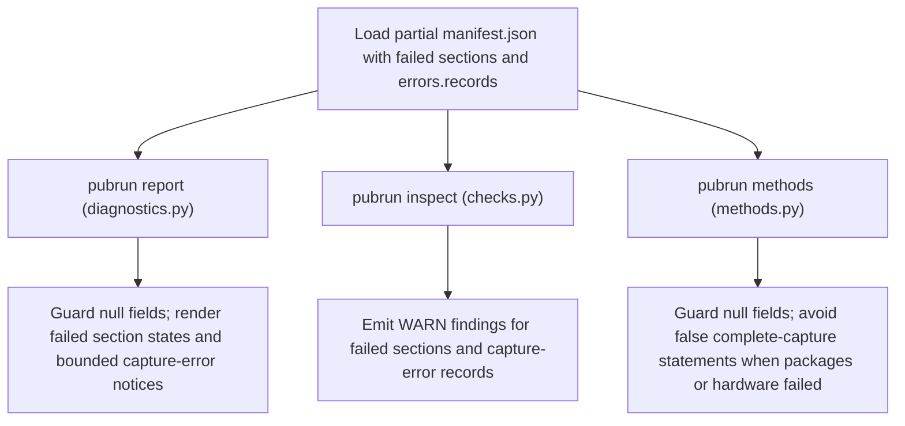
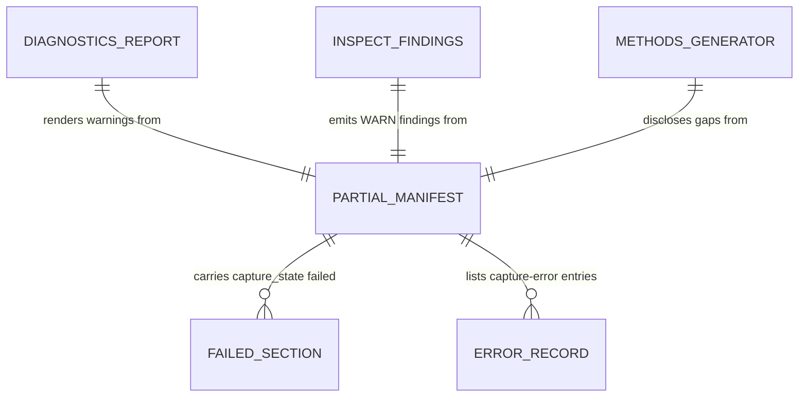

# IPD: Partial Manifest Diagnostics Inspect Findings and Methods Honesty

- Date: 2026-11-21
- Kind: child
- Concern: Honest, crash-free consumption of partial manifests with failed capture sections and `errors.records` across diagnostic reports, `pubrun inspect` findings, and methodology exports.
- Scope: Update `src/pubrun/report/diagnostics.py`, `src/pubrun/report/checks.py`, and `src/pubrun/report/methods.py` to tolerate failed or null section fields and surface capture failures honestly; add behavioral tests in `tests/test_reports.py`, `tests/test_checks_commands.py`, and `tests/test_edge_cases.py`.
- Scope-Paths: src/pubrun/report/diagnostics.py, src/pubrun/report/checks.py, src/pubrun/report/methods.py, tests/test_reports.py, tests/test_checks_commands.py, tests/test_edge_cases.py
- Item-Dependencies: executed:ed0yds
- Status: to-review
- Short-Description: Surface capture errors and failed sections accurately across report, inspect, methods, and status without crashing on degraded manifests
- Work-Kind: bug
- Priority: high
- From-Backlog: x21s6w
- Blocks-Release: next
- Set: cap-isolation
- Order: 3
- Highest E allocated: 05
- Author: agent
- Id: 26euz0

> Write and proofread this plan per the technical writing standard, `.aw/system/workflows/technical-writing/technical-writing.md` (`.agents/workflows/technical-writing/technical-writing.md` in a legacy-layout install), including requirement 12 (diagrams).

## Workflow history

- 2026-11-22 draft (agent): created.
- 2026-11-22 to-review (agent): authored review-ready child plan from backlog item `x21s6w`.

## Goal

Ensure that `pubrun report`, `pubrun inspect`, and `pubrun methods` handle partial manifests produced by isolated capture failures without crashing on missing or null fields, surface failed sections and `errors.records` entries clearly, and avoid claiming complete capture where a section failed.

### Partial-manifest consumption flow

The text in `## Proposed changes (ordered, validatable)` is normative. These diagrams summarize how each consumer handles healthy versus failed manifest sections.





## Detailed Implementation Checklist (TODO)

Execution-state rule: mark an `E-*` item complete only after performing the action. That mark is not validation. Right-sizing rule: write for a modest executor that cannot hold much in its head. Each E-item is one step (one concern, about one file, executable in one focused pass) and its V-item names each unit it covers with its own check; a plan stays at about 5 E-items and 8 work Scope-Paths, else split it into more child plans (guidance, `IPD-Z603`). Accepted execution states: blocked, failed, pending, performed; terminal gate demands 'performed'.

### Task group 1: Consumer safety and honesty updates

- [ ] E-01 Update `src/pubrun/report/diagnostics.py` (`print_report`) to guard null or missing section fields and display recorded `errors.records` plus degraded capture states clearly.
  - Depends on: none
  - Expected outcome: `print_report()` renders partial manifests without raising `AttributeError` or `TypeError` when `invocation`, `host`, `hardware`, `python`, `packages`, `environment`, `git`, `resources`, `console`, or `signals` failed, prints a bounded `[WARN ]` block summarizing failed capture sections and `errors.records` entries, and honors `NO_COLOR`.
  - Execution state: pending

- [ ] E-02 Update `src/pubrun/report/checks.py` (`manifest_findings`) to emit `WARN` findings for every section with `capture_state.status == "failed"` and for `capture-error` records in `errors.records`.
  - Depends on: none
  - Expected outcome: `manifest_findings()` distinguishes `"suppressed"` (configured off) from `"failed"` (attempted and failed), emits a structured `WARN` finding with bounded `detail` for each failed section and any additional `capture-error` record not already covered by a failed section, and never raises on malformed or partial manifests.
  - Execution state: pending

- [ ] E-03 Update `src/pubrun/report/methods.py` (`generate_report` and `generate_report_multi`) to guard null/missing fields safely and disclose failed sections instead of claiming complete capture.
  - Depends on: none
  - Expected outcome: `generate_report()` and `generate_report_multi()` never crash when `host.os_name`, `hardware.cpu`, `python.version`, `python.implementation`, `git.commit`, or `packages.records` are missing or `None`; when `packages.capture_state.status == "failed"`, methods output states that package capture failed/was unavailable instead of claiming `"Standard library dependencies were utilized."`, and appends a brief, accurate note in markdown or LaTeX when any manifest section failed.
  - Execution state: pending

### Task group 2: Consumer behavioral tests

- [ ] E-04 Add partial-manifest and `errors.records` behavioral tests in `tests/test_reports.py` and `tests/test_checks_commands.py`.
  - Depends on: E-01, E-02, E-03
  - Expected outcome: `tests/test_reports.py` verifies `print_report()` and `generate_report()`/`generate_report_multi()` on real partial manifests generated under engine fault injection (including markdown and LaTeX formats, failed `packages`, failed `hardware`, failed `host`, failed `python`, and populated `errors.records`); `tests/test_checks_commands.py` verifies `manifest_findings()` emits `WARN` findings for failed sections and `capture-error` records while staying distinct from `"suppressed"`.
  - Execution state: pending

- [ ] E-05 Add degraded-manifest tolerance regression tests in `tests/test_edge_cases.py` and run the targeted consumer test suite.
  - Depends on: E-04
  - Expected outcome: `tests/test_edge_cases.py` verifies partial manifests with failed sections and null fields render cleanly across `status.scan_runs()`, `diagnostics.print_report()`, `checks.manifest_findings()`, and `methods.generate_report()`, and `pytest tests/test_reports.py tests/test_checks_commands.py tests/test_edge_cases.py tests/test_status.py -v` exits 0 with all tests passing.
  - Execution state: pending

## Project conventions discovered (Step 0)

- `src/pubrun/report/diagnostics.py` (`print_report`) prints hydration warnings and `config.notices` using `[WARN ]`, but never inspects `manifest.get("errors", {}).get("records")` or section `capture_state.status == "failed"`.
- `src/pubrun/report/checks.py` (`manifest_findings`) checks `capture_state.status == "suppressed"` for `resources`, `hardware`, `packages`, and `git`, and must never be imported by `pubrun/__init__.py` (CLI-only module).
- `src/pubrun/report/methods.py` (`generate_report`) calls `os_name.replace(...)`, `py.get("version", "unknown").split(" ")[0]`, `python_impl.capitalize()`, and `hw.get("cpu", {}).get("model", ...)` assuming non-`None` values, and falls back to `"Standard library dependencies were utilized."` whenever `extract_highlighted_packages()` returns an empty list, even if `packages` capture failed.
- `src/pubrun/status.py` (`RunInfo._load_from_manifest`) already uses `_as_float()`, `_as_int()`, and `_as_signal_list()` to tolerate partial manifests, and `tests/test_edge_cases.py` guards reader resilience.
- Tests must assert on observable outputs and findings rather than inspecting source code.

## Findings

- **F-01 (`pubrun report` hides capture failures):** `print_report()` does not display `errors.records` or failed section `capture_state` diagnostics, so users inspecting a partial manifest cannot see why a section is empty.
- **F-02 (`pubrun inspect` ignores failed sections):** `manifest_findings()` reports `"suppressed"` sections but emits zero findings when a section has `capture_state.status == "failed"` or when `errors.records` contains `"capture-error"` entries.
- **F-03 (`pubrun methods` can crash on `None` values and overclaims when `packages` fails):** A failed `packages` section produces an empty `records` list and causes `generate_report()` to falsely state `"Standard library dependencies were utilized."`; a `None` value in `host.os_name`, `python.version`, `python.implementation`, or `hardware.cpu` raises `AttributeError`.

## Proposed changes (ordered, validatable)

1. **`src/pubrun/report/diagnostics.py` (`print_report`):**
   - Guard all field extractions against `None` and non-dict section shapes (e.g., `(inv.get("script") or {}).get("basename")`, `(hw.get("cpu") or {}).get("model")`, `(python.get("version") or "").split()`, `(git.get("remote_url") or {}).get("value")`).
   - Collect failed sections from top-level manifest sections whose `capture_state.status == "failed"` and read `manifest.get("errors", {}).get("records", [])`.
   - When failed sections or `errors.records` are present, render bounded `[WARN ]` lines near the top of the report (right after config notices, visible at all verbosity depths including `basic`) listing the section name and bounded detail/message (capping displayed error lines cleanly with a summary count if many exist).
   - For standard/deep section lines (e.g., `Git Commit`, `Packages`, `Host`), show `capture failed` when that section's `capture_state.status == "failed"` rather than misleadingly printing `0 recorded` or `Not found or un-tracked`.

2. **`src/pubrun/report/checks.py` (`manifest_findings`):**
   - Inspect every tracked manifest section (`invocation`, `process`, `host`, `python`, `packages`, `environment`, `git`, `hardware`, `filesystem`, `resources`, `console`, `signals`, `capture`):
     - If `_capture_state_status(sec) == "failed"`, append a `WARN` finding with `code = f"{section_name}_capture_failed"`, message naming the section and bounded `detail` (if present), and suggestion pointing to `errors` / diagnostic logs.
   - Inspect `manifest.get("errors", {}).get("records", [])`:
     - For `capture-error` records whose `section` was not already reported above (such as `"subprocesses"`, `"events"`, or `"writer"`), emit a `WARN` finding with `code = f"capture_error_{section}"` (or `"capture_error"`) and the bounded redacted message.
   - Keep `manifest_findings()` completely exception-safe and CLI-only (never imported by `pubrun/__init__.py`).

3. **`src/pubrun/report/methods.py` (`generate_report`, `generate_report_multi`):**
   - Use null-safe dict/string extraction across `host`, `hardware`, `python`, `git`, and `packages` so missing or `None` fields degrade cleanly to `"unknown"` placeholders in both Markdown and LaTeX formats.
   - Check `packages_status = (manifest.get("packages") or {}).get("capture_state", {}).get("status")`:
     - If `packages_status == "failed"`, set `packages_text = "Package provenance was unavailable because package capture failed."` instead of `"Standard library dependencies were utilized."`.
     - If `packages_status == "suppressed"`, set `packages_text = "Package capture was disabled by configuration."`.
   - Identify any top-level manifest sections with `capture_state.status == "failed"`. If non-empty, append a concise disclosure line (`*Note: partial provenance; capture failed for: <sections>.*` in Markdown, `% Note: partial provenance; capture failed for: <sections>.` in LaTeX) so generated methods text never implies complete capture when a section failed.
   - Keep output for healthy, complete manifests byte-identical to existing behavior so existing snapshot/report tests stay green.

4. **Behavioral tests (`tests/test_reports.py`, `tests/test_checks_commands.py`, `tests/test_edge_cases.py`):**
   - `tests/test_reports.py`: test `print_report()` (basic, standard, deep, with and without `NO_COLOR`) on a real partial manifest produced by `Run` with an injected engine failure; test `generate_report()` (markdown and LaTeX) when `packages`, `hardware`, `host`, and `python` fail, verifying zero crashes, honest wording (no `"Standard library dependencies were utilized."` on failed `packages`), and partial-provenance disclosure; verify healthy manifests remain unchanged.
   - `tests/test_checks_commands.py`: test `manifest_findings()` on manifests with failed sections (`git`, `hardware`, `packages`, `resources`, `console`) and `errors.records` (`subprocesses`, `events`, `writer`), verifying `WARN` severity, distinct codes from `*_off` (`suppressed`), and redacted detail propagation.
   - `tests/test_edge_cases.py`: test a heavily degraded manifest with `None` fields and failed sections through `scan_runs()`, `print_report()`, `manifest_findings()`, and `generate_report()`.

## Deferred / out of scope (with reason)

- Engine rollback and tracker isolation are owned by prerequisite plans `p6pon8` and `ed0yds`.
- Documentation updates and overhead benchmarking are owned by child plan `zp2yyu`.
- Reproducibility gap scoring (`repro-check` Set `osjxbz`) and timing semantic labeling (`timing-acc` Set `vrr1fv`) are separate Sets and remain untouched.

## Scope check

- Over-scope: none. Touches only the three report/check/methods consumer modules and their three test files (6 Scope-Paths, 5 E-items).
- Under-scope: none. Covers every consumer-side partial-manifest and no-false-complete-claim requirement in `x21s6w`.

## Required tests / validation

Run inside the repository root and capture actual runner output and exit code:

```bash
pytest tests/test_reports.py tests/test_checks_commands.py tests/test_edge_cases.py tests/test_status.py -v
```

## Spec / documentation sync

Deferred to child plan `zp2yyu`, which reconciles `docs/architecture.md`, `docs/functional_spec.md`, `docs/manifest.md`, `docs/api.md`, and `docs/performance.md` after `p6pon8`, `ed0yds`, and `26euz0` execute.

## Open questions

### OQ-01: Preserving byte-identical `methods` output for complete manifests

- Blocking: no
- Status: resolved
- Owner: maintainer (confirmed upon plan approval)
- Resolution or deferral rationale: Existing tests and user workflows depend on the established `generate_report()` wording for healthy manifests. The partial-provenance disclosure line and failed-packages wording activate ONLY when a section's `capture_state.status` is `"failed"` (or `"suppressed"` for packages), keeping healthy manifests byte-identical.

## Validation and cross-check (verify before reporting done)

Validation-state rule: inspect evidence in a separate pass. Do not mark a `V-*` item complete from memory or from the matching execution checkmark. Accepted validation results: blocked, failed, pass, pending; terminal gate demands 'pass'. Runtime-demonstration reachability rule: for each `V-*` item demanding the software be observed acting (such as a run, a dispatch, or a transition)—as distinct from items demanding a diff, a file's content, or a test result, which are reachable by construction—name the code path that produces the observation or the sibling `E-*` that creates it, else the demand is UNDER-SCOPE.

- [ ] V-01 validates E-01
  - Required evidence: Diff of `src/pubrun/report/diagnostics.py` showing null-safe section access, `[WARN ]` rendering of failed sections and `errors.records`, and honest section labels when `capture_state.status == "failed"`.
  - Observed evidence:
  - Result: pending

- [ ] V-02 validates E-02
  - Required evidence: Diff of `src/pubrun/report/checks.py` showing `WARN` findings emitted for failed sections and `capture-error` records in `manifest_findings()` while remaining distinct from `suppressed`.
  - Observed evidence:
  - Result: pending

- [ ] V-03 validates E-03
  - Required evidence: Diff of `src/pubrun/report/methods.py` showing null-safe extraction, honest failed-packages wording, and partial-provenance disclosure in Markdown and LaTeX while preserving complete-manifest output.
  - Observed evidence:
  - Result: pending

- [ ] V-04 validates E-04
  - Required evidence: Pasted `pytest tests/test_reports.py tests/test_checks_commands.py -v` output (exit code 0) showing new partial-manifest tests passing.
  - Observed evidence:
  - Result: pending

- [ ] V-05 validates E-05
  - Required evidence: Pasted `pytest tests/test_reports.py tests/test_checks_commands.py tests/test_edge_cases.py tests/test_status.py -v` output showing exit code 0 and zero failures.
  - Observed evidence:
  - Result: pending

## Approval and execution gate

- Size assessment: standard
- Cohesion rationale: not required

Execution contract:
1. Open question OQ-01 is resolved for review; do not execute until prerequisite `ed0yds` is `executed` and a human approves this plan (`- Status: approved`).
2. Scope fence: edit only `src/pubrun/report/diagnostics.py`, `src/pubrun/report/checks.py`, `src/pubrun/report/methods.py`, `tests/test_reports.py`, `tests/test_checks_commands.py`, and `tests/test_edge_cases.py`. Do not expand scope; if additional files seem required, STOP and report.
3. Honesty rule: paste the actual `pytest` runner output and exit code into each `V-*` `Observed evidence:` field; never claim tests passed without running them.
4. Commit discipline: commit only the files listed in `- Scope-Paths:` using `aw commit 26euz0 -- <paths>`; never use `git add -A`, `git add .`, or `git commit -a`; never push without explicit human instruction.
5. Lifecycle move on completion: after `aw ipd lint --phase pre-transition` passes, move this plan from `.aw/records/plans/pending/` to `.aw/records/plans/executed/`, set `- Status: executed`, append a dated `## Workflow history` line, and commit the lifecycle move path-scoped.
