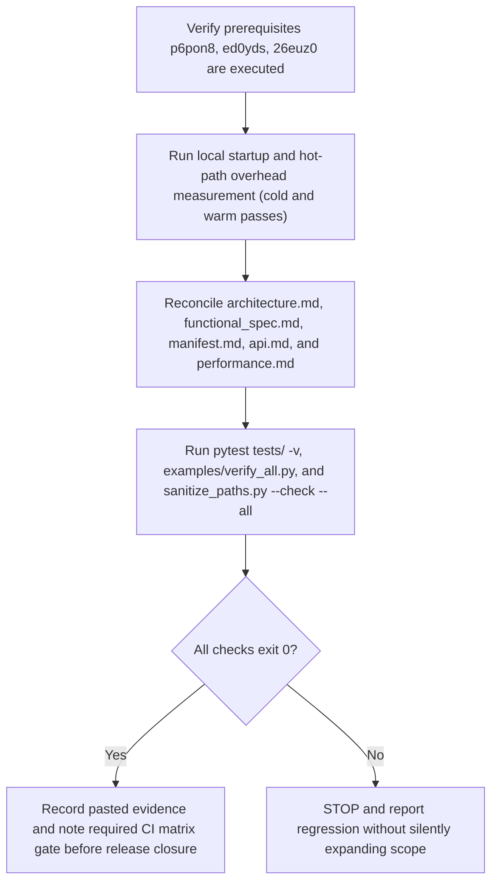

# IPD: Isolation Overhead Measurement Documentation Reconciliation and Whole-Set Verification

- Date: 2026-11-21
- Kind: child
- Concern: Reproducible local measurement of capture-isolation startup and hot-path overhead, reconciliation of architecture/spec/manifest/API/performance documentation, and whole-Set regression verification.
- Scope: Measure startup and hot-path (`TqdmSafeTee.write`, `SubprocessSpy` wrapper, `EventStream.emit`) overhead locally against a pre-isolation baseline without publishing or submitting; reconcile `docs/architecture.md`, `docs/functional_spec.md`, `docs/manifest.md`, `docs/api.md`, and `docs/performance.md` against the implemented behavior from `p6pon8`, `ed0yds`, and `26euz0`; run the full test suite, example verification, and path sanitizer.
- Scope-Paths: docs/architecture.md, docs/functional_spec.md, docs/manifest.md, docs/api.md, docs/performance.md
- Item-Dependencies: executed:p6pon8, executed:ed0yds, executed:26euz0
- Status: to-review
- Short-Description: Benchmark capture-isolation startup and hot-path overhead, reconcile architecture/spec/manifest/API docs, and run whole-Set verification
- Work-Kind: bug
- Priority: high
- From-Backlog: x21s6w
- Blocks-Release: next
- Set: cap-isolation
- Order: 4
- Highest E allocated: 05
- Author: agent
- Id: zp2yyu

> Write and proofread this plan per the technical writing standard, `.aw/system/workflows/technical-writing/technical-writing.md` (`.agents/workflows/technical-writing/technical-writing.md` in a legacy-layout install), including requirement 12 (diagrams).

## Workflow history

- 2026-11-22 draft (agent): created.
- 2026-11-22 to-review (agent): authored review-ready child plan from backlog item `x21s6w`.

## Goal

Quantify any startup and hot-path overhead added by capture isolation and hook ownership guards using reproducible local measurements (environment, git revision, workload, baseline, repetitions, cold/warm passes, and dispersion), reconcile all affected documentation and specifications against the implemented behavior, and verify the whole `cap-isolation` Set across the full repository test suite, examples, and path sanitizer.

### Measurement, reconciliation, and whole-Set verification flow

The text in `## Proposed changes (ordered, validatable)` is normative. This diagram summarizes the verification sequence after `p6pon8`, `ed0yds`, and `26euz0` land.



## Detailed Implementation Checklist (TODO)

Execution-state rule: mark an `E-*` item complete only after performing the action. That mark is not validation. Right-sizing rule: write for a modest executor that cannot hold much in its head. Each E-item is one step (one concern, about one file, executable in one focused pass) and its V-item names each unit it covers with its own check; a plan stays at about 5 E-items and 8 work Scope-Paths, else split it into more child plans (guidance, `IPD-Z603`). Accepted execution states: blocked, failed, pending, performed; terminal gate demands 'performed'.

### Task group 1: Local overhead measurement and documentation reconciliation

- [ ] E-01 Measure startup and hot-path (`TqdmSafeTee.write`, `SubprocessSpy` active/bypassed wrapper, `EventStream.emit`, and `Run` start/stop) overhead locally across cold and warm passes and compare against a clean pre-isolation baseline revision or unisolated baseline path.
  - Depends on: none
  - Expected outcome: Measured results record host Operating System (OS), Central Processing Unit (CPU), Python version, filesystem type, git revision(s), exact workload, baseline definition, repetition count (`>= 20` warm iterations plus explicit cold pass), median, Interquartile Range (IQR), and standard deviation, with zero network calls, zero benchmark submission, and zero unmeasured claims.
  - Execution state: pending

- [ ] E-02 Reconcile `docs/architecture.md` and `docs/functional_spec.md` against the implemented narrow ghost-mode boundary, per-engine capture isolation, transactional hook rollback, independent cleanup, and bounded warning discipline.
  - Depends on: E-01
  - Expected outcome: `docs/architecture.md` (Run Lifecycle, Console/Subprocess Models, Failure Model) and `docs/functional_spec.md` (Ghost Mode, Writer and Finalization, Failure Behavior) accurately describe partial capture versus ghost mode, third-party hook ownership rules, and independent cleanup without em or en dashes in user-facing prose.
  - Execution state: pending

- [ ] E-03 Reconcile `docs/manifest.md` and `docs/api.md` against the implemented `errors.records` schema, `capture.capture_state` partial status, bounded redacted `detail` rules, and third-party hook ownership guarantees.
  - Depends on: E-01
  - Expected outcome: `docs/manifest.md` documents `errors.records` (`kind = "capture-error"`, `type`, bounded redacted `message`, `traceback = null`, optional `section`, optional `stage`), per-section `failed` status, and `capture.capture_state = "partial"`; `docs/api.md` documents narrow ghost mode, `stop()` idempotence, and ownership rules for `sys.stdout`/`sys.stderr`, `faulthandler`, signal handlers, `sys.excepthook`, and `subprocess.Popen`/`os.system`, with zero em or en dashes in user-facing prose.
  - Execution state: pending

- [ ] E-04 Update `docs/performance.md` with the measured capture-isolation overhead summary from `E-01` (recording environment, revision, workload, baseline, repetitions, cold/warm distinction, and dispersion, labeled honestly as single-machine measurements).
  - Depends on: E-01
  - Expected outcome: `docs/performance.md` records the measured startup and hot-path isolation delta honestly with complete experimental metadata, makes no unmeasured performance claims, and uses no em or en dashes in newly authored user-facing prose.
  - Execution state: pending

### Task group 2: Whole-Set regression, example, and hygiene verification

- [ ] E-05 Run the full repository test suite, example verification script, and local-path sanitizer across the whole `cap-isolation` Set, and record the required multi-OS/Python Continuous Integration (CI) matrix gate.
  - Depends on: E-02, E-03, E-04
  - Expected outcome: `pytest tests/ -v`, `python examples/verify_all.py`, and `python3 scripts/sanitize_paths.py --check --all` all exit 0 with actual runner output captured, and the post-merge GitHub Actions CI matrix requirement (`.github/workflows/ci.yml`: `ubuntu-latest`, `ubuntu-24.04`, `windows-latest`, `macos-latest`, Python 3.8 through 3.14) is recorded explicitly.
  - Execution state: pending

## Project conventions discovered (Step 0)

- `docs/architecture.md`, `docs/functional_spec.md`, `docs/manifest.md`, `docs/api.md`, and `docs/performance.md` are user-facing documentation files; per `AGENTS.md`, newly authored user-facing prose must contain no em or en dashes and must follow `.aw/system/workflows/technical-writing/technical-writing.md`.
- `docs/architecture.md` Section 18 and `docs/functional_spec.md` Section 17/20 already state that `pubrun` must emit partial manifests, record capture errors in `errors`, and reserve ghost mode for filesystem failures, but need exact reconciliation with the implemented transactional rollback, hook ownership rules, and `errors.records` fields.
- `benchmarks/harness.py` runs local subprocess benchmarks without network activity when invoked directly without `--contribute`; local measurements must never invoke benchmark submission, GitHub Gist publishing, or High-Performance Computing (HPC) scheduler scripts.
- `scripts/sanitize_paths.py --check --all` verifies that no machine-local paths or hostnames leaked into tracked files (important when recording benchmark environment metadata in `docs/performance.md`: record generic CPU, OS, Python, and filesystem metadata, and never record local usernames, home paths, or hostnames).
- `examples/verify_all.py` runs all numbered examples plus `examples/minimal-research-workflow/analysis.py` end to end.

## Findings

- **F-01 (Unmeasured isolation cost):** Adding per-engine `try/except` boundaries, generation-scoped `SubprocessSpy` closures, and `TqdmSafeTee`/`EventStream` degraded-state guards touches both startup and per-write/per-subprocess hot paths; the overhead must be measured rather than assumed negligible.
- **F-02 (Documentation drift on failure and ownership semantics):** Current docs do not specify the exact boundary between partial capture and ghost mode, do not document the `errors.records` `capture-error` contract (`section`, `stage`, bounded redacted `message`, no traceback), and do not document third-party hook ownership rules for `faulthandler`, signals, and `SubprocessSpy`.

## Proposed changes (ordered, validatable)

1. **Reproducible local overhead measurement (`E-01`):**
   - Run a local Python measurement (via `benchmarks/harness.py --passes 2 --iters 20` on `startup` and `hotpath` groups plus a focused micro-benchmark comparing: (a) `Run` start/stop startup+finalization wall time, (b) `TqdmSafeTee.write()` loop over 10,000 lines, (c) `SubprocessSpy` bypassed/active wrapper overhead, and (d) `EventStream.emit()` loop over 10,000 events) against the pre-`p6pon8` baseline commit (using a temporary git worktree or comparison against baseline commit recorded by SHA, leaving zero untracked artifacts in the workspace).
   - Capture and record:
     - Environment (OS name/release, architecture, CPU model/core count, Python version, filesystem type from `get_filesystem()`, with NO local hostname, username, or home path so `sanitize_paths.py` stays clean).
     - Git revisions (baseline commit SHA and post-`26euz0` commit SHA).
     - Workload definitions, repetition counts, cold pass vs warm passes, median, Interquartile Range (IQR), and standard deviation.
   - Do not submit, publish, or commit unredacted benchmark files.

2. **Documentation reconciliation (`docs/architecture.md`, `docs/functional_spec.md`, `docs/manifest.md`, `docs/api.md`, `docs/performance.md`):**
   - `docs/architecture.md`: update Section 3 (Run Lifecycle), Section 12 (Console Capture Model: `faulthandler` ownership and non-recursive error isolation), Section 15 (Subprocess Model: live target chaining and ownership-guarded uninstall), and Section 18 (Failure Model: narrow ghost boundary for unusable output, per-engine isolation, transactional rollback, independent cleanup, and bounded redacted `errors.records`).
   - `docs/functional_spec.md`: update Section 17 (Ghost Mode: triggers only when run output is unusable at startup, with transactional rollback of owned hooks), Section 19 (Writer and Finalization: independent cleanup steps, idempotence, and bounded write-failure warnings), and Section 20 (Failure Behavior: section `capture_state.status = "failed"`, `capture.capture_state.status = "partial"`, populated `errors.records`, and no traceback spam).
   - `docs/manifest.md`: update `errors` section with exact `error_record` table (`kind`, `type`, `message`, `traceback`, `section`, `stage`), bounded/redacted policy, and `capture.capture_state` partial status behavior.
   - `docs/api.md`: document partial capture vs ghost mode under `start()`/`stop()`, `stop()` idempotence, and explicit third-party wrapper/handler ownership rules (`sys.stdout`/`sys.stderr`, `faulthandler`, signal handlers, `sys.excepthook`, `subprocess.Popen`, `os.system`).
   - `docs/performance.md`: add a concise, clearly labeled single-machine measurement note reporting the measured capture-isolation startup and hot-path overhead with all required metadata (environment, revisions, workloads, baseline, repetitions, cold/warm passes, median, IQR, stdev).
   - Ensure all newly authored text in these five user-facing docs contains zero em dashes or en dashes and passes technical-writing proofreading.

3. **Whole-Set verification (`E-05`):**
   - Run:
     - `pytest tests/ -v`
     - `python examples/verify_all.py`
     - `python3 scripts/sanitize_paths.py --check --all`
   - Paste actual exit codes and summary outputs into `V-05`.
   - Record explicitly that the full OS/Python matrix in `.github/workflows/ci.yml` (`ubuntu-latest`, `ubuntu-24.04`, `windows-latest`, `macos-latest` across Python 3.8 through 3.14) must pass in GitHub Actions before closing backlog item `x21s6w` for release.

## Deferred / out of scope (with reason)

- Application code and test changes belong to prerequisite child plans `p6pon8`, `ed0yds`, and `26euz0`; if `E-05` uncovers a code regression, STOP and report rather than expanding this plan's scope fence.
- Multi-OS and multi-Python CI matrix execution runs in GitHub Actions after local commits are pushed by a human and cannot be simulated inside a single local Linux runner.
- Benchmark submission, GitHub Gist publication, and HPC scheduler jobs are prohibited without explicit maintainer authorization.

## Scope check

- Over-scope: none. Touches only the five documentation files (5 Scope-Paths, 5 E-items).
- Under-scope: none. Covers the overhead-measurement, documentation/spec-reconciliation, example-verification, sanitizer, and CI-matrix-gate requirements of `x21s6w`.

## Required tests / validation

Run inside the repository root and capture actual runner output and exit code:

```bash
pytest tests/ -v
python examples/verify_all.py
python3 scripts/sanitize_paths.py --check --all
```

## Spec / documentation sync

This plan directly reconciles `docs/architecture.md`, `docs/functional_spec.md`, `docs/manifest.md`, `docs/api.md`, and `docs/performance.md` against the implemented changes from `p6pon8`, `ed0yds`, and `26euz0`.

## Open questions

### OQ-01: Single-machine local measurement scope versus multi-platform CI matrix

- Blocking: no
- Status: resolved
- Owner: maintainer (confirmed upon plan approval)
- Resolution or deferral rationale: Local execution runs on one machine and operating system. `docs/performance.md` will label the recorded isolation-overhead numbers explicitly as single-machine measurements with full environment and dispersion metadata (never claiming representative cross-platform numbers), and `V-05` will record the GitHub Actions OS/Python matrix in `.github/workflows/ci.yml` as a required post-merge gate before release closure.

## Validation and cross-check (verify before reporting done)

Validation-state rule: inspect evidence in a separate pass. Do not mark a `V-*` item complete from memory or from the matching execution checkmark. Accepted validation results: blocked, failed, pass, pending; terminal gate demands 'pass'. Runtime-demonstration reachability rule: for each `V-*` item demanding the software be observed acting (such as a run, a dispatch, or a transition)—as distinct from items demanding a diff, a file's content, or a test result, which are reachable by construction—name the code path that produces the observation or the sibling `E-*` that creates it, else the demand is UNDER-SCOPE.

- [ ] V-01 validates E-01
  - Required evidence: Pasted local benchmark runner output showing environment (without local hostnames/paths), baseline and post-change git revisions, workloads (startup + `TqdmSafeTee` + `SubprocessSpy` + `EventStream`), repetition counts, cold and warm passes, medians, IQRs, and standard deviations.
  - Observed evidence:
  - Result: pending

- [ ] V-02 validates E-02
  - Required evidence: Diff of `docs/architecture.md` and `docs/functional_spec.md` showing reconciled narrow ghost-mode boundary, per-engine isolation, transactional rollback, independent cleanup, and bounded warning semantics with zero em/en dashes in newly authored prose.
  - Observed evidence:
  - Result: pending

- [ ] V-03 validates E-03
  - Required evidence: Diff of `docs/manifest.md` and `docs/api.md` showing `errors.records` (`capture-error`, `section`, `stage`), partial `capture.capture_state`, `stop()` idempotence, and third-party hook ownership rules with zero em/en dashes in newly authored prose.
  - Observed evidence:
  - Result: pending

- [ ] V-04 validates E-04
  - Required evidence: Diff of `docs/performance.md` showing the measured capture-isolation overhead summary matching `V-01` with complete experimental metadata and zero unmeasured claims or em/en dashes.
  - Observed evidence:
  - Result: pending

- [ ] V-05 validates E-05
  - Required evidence: Pasted runner output and exit codes (all 0) for `pytest tests/ -v`, `python examples/verify_all.py`, and `python3 scripts/sanitize_paths.py --check --all`, plus explicit note of the required post-merge GitHub Actions OS/Python CI matrix gate.
  - Observed evidence:
  - Result: pending

## Approval and execution gate

- Size assessment: standard
- Cohesion rationale: not required

Execution contract:
1. Open question OQ-01 is resolved for review; do not execute until prerequisites `p6pon8`, `ed0yds`, and `26euz0` are `executed` and a human approves this plan (`- Status: approved`).
2. Scope fence: edit only `docs/architecture.md`, `docs/functional_spec.md`, `docs/manifest.md`, `docs/api.md`, and `docs/performance.md`. Do not expand scope; if additional files seem required, STOP and report.
3. Honesty rule: paste actual benchmark, `pytest`, `examples/verify_all.py`, and `sanitize_paths.py` outputs and exit codes into each `V-*` `Observed evidence:` field; never claim measurements or tests passed without running them.
4. Commit discipline: commit only the files listed in `- Scope-Paths:` using `aw commit zp2yyu -- <paths>`; never use `git add -A`, `git add .`, or `git commit -a`; never push without explicit human instruction.
5. Lifecycle move on completion: after `aw ipd lint --phase pre-transition` passes, move this plan from `.aw/records/plans/pending/` to `.aw/records/plans/executed/`, set `- Status: executed`, append a dated `## Workflow history` line, and commit the lifecycle move path-scoped.
