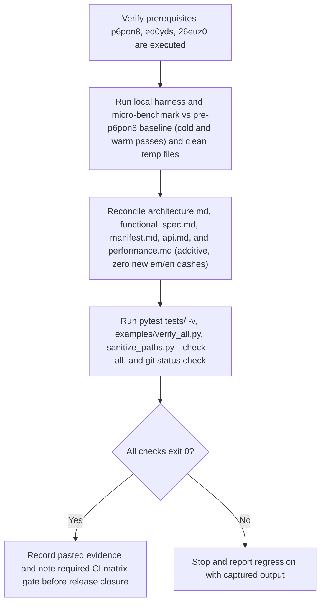
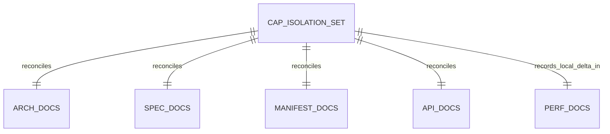

# IPD: Isolation Overhead Measurement Documentation Reconciliation and Whole-Set Verification

- Date: 2026-11-21
- Kind: child
- Concern: Reproducible local measurement of capture-isolation startup and hot-path overhead, reconciliation of architecture/spec/manifest/API/performance documentation, and whole-Set regression verification.
- Scope: Measure startup and hot-path (`TqdmSafeTee.write`, `SubprocessSpy` wrapper, `EventStream.emit`) overhead locally against a pre-isolation baseline without publishing or submitting; reconcile `docs/architecture.md`, `docs/functional_spec.md`, `docs/manifest.md`, `docs/api.md`, and `docs/performance.md` against the implemented behavior from `p6pon8`, `ed0yds`, and `26euz0`; run the full test suite, example verification, and path sanitizer.
- Scope-Paths: docs/architecture.md, docs/functional_spec.md, docs/manifest.md, docs/api.md, docs/performance.md
- Item-Dependencies: executed:p6pon8, executed:ed0yds, executed:26euz0
- Status: reviewed
- Readiness: go-pending-approval
- Review-Depth: complex
- Short-Description: Benchmark capture-isolation startup and hot-path overhead, reconcile architecture/spec/manifest/API docs, and run whole-Set verification
- Work-Kind: bug
- Priority: high
- From-Backlog: x21s6w
- Blocks-Release: next
- Set: cap-isolation
- Order: 4
- Highest E allocated: 05
- Author: agent
- Id: zp2yyu

> Write and proofread this plan per the technical writing standard, `.aw/system/workflows/technical-writing/technical-writing.md` (`.agents/workflows/technical-writing/technical-writing.md` in a legacy-layout install), including requirement 12 (diagrams).

## Workflow history

- 2026-11-22 /plan-review (Antigravity / Gemini 4 Neon (High)): APPROVE WITH REVISIONS APPLIED; PR-001, PR-002, PR-003, PR-004, PR-005
- 2026-11-22 to-review (agent): authored review-ready child plan from backlog item `x21s6w`.
- 2026-11-22 draft (agent): created.

## Goal

Quantify any startup and hot-path overhead added by capture isolation and hook ownership guards using reproducible local measurements (environment, Git revision, workload, baseline, repetitions, cold and warm passes, and dispersion). Reconcile all five affected documentation and specification files against the implemented behavior from prerequisite child plans `p6pon8` (safe diagnostic redaction and hook ownership rollback), `ed0yds` (tracker per-engine failure isolation, narrow ghost mode, and independent finalization), and `26euz0` (partial-manifest diagnostics, inspect findings, and methods honesty). Verify the whole `cap-isolation` Set across the full repository test suite, examples, and path sanitizer.

### Measurement, reconciliation, and whole-Set verification flow

The text in `## Proposed changes (ordered, validatable)` is normative. These diagrams summarize the verification sequence and the documentation artifacts reconciled after `p6pon8`, `ed0yds`, and `26euz0` execute.





## Detailed Implementation Checklist (TODO)

Execution-state rule: mark an `E-*` item complete only after performing the action. That mark is not validation. Right-sizing rule: write for a modest executor that cannot hold much in its head. Each E-item is one step (one concern, about one file, executable in one focused pass) and its V-item names each unit it covers with its own check; a plan stays at about 5 E-items and 8 work Scope-Paths, else split it into more child plans (guidance, `IPD-Z603`). Accepted execution states: blocked, failed, pending, performed; terminal gate demands 'performed'.

### Task group 1: Local overhead measurement and documentation reconciliation

- [ ] E-01 Measure startup and hot-path (`TqdmSafeTee.write`, `SubprocessSpy` active/bypassed wrapper, `EventStream.emit`, and `Run` start/stop) overhead locally across cold and warm passes and compare against a clean pre-`p6pon8` baseline revision.
  - Depends on: none
  - Expected outcome: Local benchmark execution (`python3 benchmarks/harness.py --passes 2 --iterations 20 --redacted-out <temp_path>` plus an ephemeral Python micro-benchmark comparing post-`26euz0` HEAD against the pre-`p6pon8` baseline commit in a cleaned-up temporary Git worktree) captures host Operating System (OS), Central Processing Unit (CPU), Python version, detected filesystem type via `pubrun.capture.filesystem.get_filesystem({}, {"workdir": ...})`, baseline and post-change Git commit SHAs, exact workloads, repetition counts (`>= 20` warm iterations plus explicit cold pass), median, Interquartile Range (IQR), and standard deviation. Zero network calls, zero benchmark submission, zero leaked hostnames/home paths, and zero leftover temp files or worktrees remain.
  - Execution state: pending

- [ ] E-02 Reconcile `docs/architecture.md` and `docs/functional_spec.md` against the implemented narrow ghost-mode boundary, per-engine capture isolation, transactional hook rollback, independent cleanup, consumer honesty, and bounded warning discipline.
  - Depends on: E-01
  - Expected outcome: `docs/architecture.md` (`## 3. Run Lifecycle`, `## 12. Console Capture Model`, `## 15. Subprocess Model`, `## 18. Failure Model`) and `docs/functional_spec.md` (`## 17. Ghost Mode`, `## 19. Writer and Finalization`, `## 20. Failure Behavior`) accurately describe partial capture versus narrow ghost mode, third-party hook ownership rules (including `faulthandler.is_enabled()` preservation and passive passthrough), independent cleanup, `MAX_CAPTURE_ERRORS = 50` truncation, and honest partial-manifest reporting. Edits preserve any additive sibling-Set documentation already on disk and introduce zero em dashes (`U+2014`) or en dashes (`U+2013`) in added or modified lines.
  - Execution state: pending

- [ ] E-03 Reconcile `docs/manifest.md` and `docs/api.md` against the implemented `errors.records` schema, `capture.capture_state` partial status, bounded redacted `detail` rules, and third-party hook ownership guarantees.
  - Depends on: E-01
  - Expected outcome: `docs/manifest.md` (`## errors`, `## capture`) documents `errors.records` (`kind = "capture-error"`, `type`, bounded redacted `message`, `traceback = null`, optional `section`, optional `stage`), `MAX_CAPTURE_ERRORS = 50` truncation (`errors.capture_state.status = "partial"`), per-section `failed` status, and `capture.capture_state = "partial"` (for both escaping exceptions and self-caught failed returns). `docs/api.md` (`### pubrun.start`, `### pubrun.stop`, `## 8. Provenance-Tracked I/O`) documents narrow ghost mode, `stop()` idempotence, and ownership rules for `sys.stdout`/`sys.stderr`, `faulthandler`, signal handlers, `sys.excepthook`, and `subprocess.Popen`/`os.system`. Edits preserve any additive sibling-Set documentation already on disk and introduce zero em dashes (`U+2014`) or en dashes (`U+2013`) in added or modified lines.
  - Execution state: pending

- [ ] E-04 Update `docs/performance.md` with the measured capture-isolation overhead summary from `E-01` (recording environment, Git revisions, workloads, baseline, repetitions, cold/warm distinction, and dispersion, labeled honestly as single-machine measurements).
  - Depends on: E-01
  - Expected outcome: `docs/performance.md` leaves `## Representative results` untouched as a multi-machine placeholder, preserves any sibling-Set subsections, and adds a dedicated, clearly labeled single-machine subsection recording the measured startup and hot-path isolation delta with complete experimental metadata, zero raw hostnames or local home paths, zero unmeasured performance claims, and zero newly introduced em dashes (`U+2014`) or en dashes (`U+2013`).
  - Execution state: pending

### Task group 2: Whole-Set regression, example, and hygiene verification

- [ ] E-05 Run the full repository test suite, example verification script, and local-path sanitizer across the whole `cap-isolation` Set, and record the required multi-OS/Python Continuous Integration (CI) matrix gate.
  - Depends on: E-02, E-03, E-04
  - Expected outcome: `pytest tests/ -v` (confirming `test_hook_ownership_rollback.py`, `test_capture_isolation.py`, `test_tracker.py`, `test_reports.py`, `test_checks_commands.py`, `test_edge_cases.py`, and `test_manifest_schema.py` pass), `python3 examples/verify_all.py`, and `python3 scripts/sanitize_paths.py --check --all` all exit 0 with actual runner output captured, `git status --short` shows only the five scoped doc files (zero stray benchmark artifacts or temporary worktrees), and the post-merge GitHub Actions CI matrix requirement (`.github/workflows/ci.yml`: `ubuntu-latest`, `ubuntu-24.04`, `windows-latest`, `macos-latest`, Python 3.8 through 3.14) is recorded explicitly.
  - Execution state: pending

## Project conventions discovered (Step 0)

- `docs/architecture.md`, `docs/functional_spec.md`, `docs/manifest.md`, `docs/api.md`, and `docs/performance.md` are user-facing documentation files; per `AGENTS.md`, newly authored or edited lines must contain zero em dashes (`U+2014`) or en dashes (`U+2013`) and must follow `.aw/system/workflows/technical-writing/technical-writing.md`. Because untouched lines in these docs already contain pre-existing em dashes, verification runs a diff-scoped Python check over added (`+`) lines.
- `docs/architecture.md## 18. Failure Model` and `docs/functional_spec.md## 17. Ghost Mode` / `## 19. Writer and Finalization` / `## 20. Failure Behavior` already state that `pubrun` must emit partial manifests, record capture errors in `errors`, and reserve ghost mode for filesystem failures, but need exact reconciliation with the implemented transactional rollback, hook ownership rules, `MAX_CAPTURE_ERRORS = 50` cap, and `errors.records` fields from prerequisite reviewed plans `p6pon8`, `ed0yds`, and `26euz0`.
- `docs/performance.md## Representative results` explicitly prohibits overwriting its multi-machine placeholder table with single-machine figures; single-machine measurements belong in a dedicated labeled subsection.
- `benchmarks/harness.py` accepts `--passes N --iterations N --redacted-out <temp_path>` (there is no `--iters` or group-filter flag); omitting `--redacted-out` writes a file into `benchmarks/results/`, so local measurements must pass `--redacted-out` pointing to a temporary path and delete it after reading. Local measurements must never invoke `--contribute`, GitHub Gist publishing, or High-Performance Computing (HPC) scheduler scripts.
- `src/pubrun/capture/filesystem.py::get_filesystem` takes `(config: Dict[str, Any], paths: Dict[str, str])` and reports `fstype` / `is_network` without blocking `statvfs`.
- `scripts/sanitize_paths.py --check --all` verifies that zero machine-local paths or hostnames leaked into tracked files.
- `examples/verify_all.py` runs all numbered examples plus `examples/minimal-research-workflow/analysis.py` end to end.
- Concurrent reviewed sibling plans `ckc3vl` (Set `startup-perf`), `3tvesf` (Set `timing-acc`), `iflqsl` (Set `dep-capture`), `sdg31l` (Set `repro-check`), and `4gpguy` (Set `file-prov`) also edit subsets of these five docs; all edits here must remain strictly additive/targeted and preserve any sibling-Set documentation already on disk.

## Findings

- **F-01 (Unmeasured isolation cost):** Adding per-engine `try/except` boundaries, generation-scoped `SubprocessSpy` closures, and `TqdmSafeTee`/`EventStream` degraded-state guards touches both startup and per-write/per-subprocess hot paths; the overhead must be measured locally with valid harness flags rather than assumed negligible.
- **F-02 (Documentation drift on failure, truncation, consumer honesty, and ownership semantics):** Current docs do not specify the exact boundary between partial capture and narrow ghost mode, do not document the `errors.records` `capture-error` contract (`section`, `stage`, bounded redacted `message`, `traceback = null`, `MAX_CAPTURE_ERRORS = 50` truncation) or partial-manifest consumer behavior (`26euz0`), and do not document third-party hook ownership rules for `faulthandler`, signals, `sys.excepthook`, and `SubprocessSpy`.

## Proposed changes (ordered, validatable)

1. **Reproducible local overhead measurement (`E-01`):**
   - Identify the baseline commit immediately preceding `p6pon8`'s first product commit (recorded by SHA) and the current post-`26euz0` HEAD SHA.
   - Run `python3 benchmarks/harness.py --passes 2 --iterations 20 --redacted-out /tmp/pubrun-cap-isolation-harness.redacted.json` on the current checkout (and optionally on a temporary detached Git worktree of the pre-`p6pon8` baseline commit for apples-to-apples startup/hotpath comparison), reading the `startup` and `hotpath` scenario results and deleting `/tmp/pubrun-cap-isolation-harness.redacted.json` afterward.
   - Run a focused ephemeral Python micro-benchmark (invoked via `python3 -c` against both the temporary pre-`p6pon8` worktree and the current tree, with 1 explicit cold pass + `>= 20` warm iterations) comparing: (a) `Run` start/stop startup+finalization wall time, (b) `TqdmSafeTee.write()` loop over 10,000 lines, (c) `SubprocessSpy` bypassed/active wrapper overhead, and (d) `EventStream.emit()` loop over 10,000 events.
   - Remove the temporary baseline worktree (`git worktree remove --force <tmp_wt>`) and temporary JSON file before proceeding so zero stray artifacts remain.
   - Capture and record:
     - Environment (OS name/release, architecture, CPU model/core count, Python version, filesystem type from `get_filesystem({}, {"workdir": ...})`, with NO local hostname, username, or home path so `sanitize_paths.py` stays clean).
     - Git revisions (baseline commit SHA and post-`26euz0` commit SHA).
     - Workload definitions, repetition counts, cold pass vs warm passes, median, IQR, and standard deviation.
   - Do not submit, publish, or commit unredacted benchmark files.

2. **Documentation reconciliation (`docs/architecture.md`, `docs/functional_spec.md`, `docs/manifest.md`, `docs/api.md`, `docs/performance.md`):**
   - `docs/architecture.md`: update `## 3. Run Lifecycle`, `## 12. Console Capture Model` (`faulthandler.is_enabled()` ownership preservation and non-recursive error isolation), `## 15. Subprocess Model` (live target chaining, generation-scoped records, and ownership-guarded passive passthrough on uninstall), and `## 18. Failure Model` (narrow ghost boundary for unusable output, per-engine isolation, transactional rollback, independent cleanup, `MAX_CAPTURE_ERRORS = 50` bounded redacted `errors.records`, and honest consumer reporting).
   - `docs/functional_spec.md`: update `## 17. Ghost Mode` (triggers only when run output is unusable at startup, with transactional rollback of owned hooks), `## 19. Writer and Finalization` (independent cleanup steps, idempotence, non-fatal `methods` write, and bounded write-failure warnings), and `## 20. Failure Behavior` (section `capture_state.status = "failed"`, `capture.capture_state.status = "partial"`, populated bounded `errors.records`, no traceback spam, and `pubrun report`/`inspect`/`methods` partial-manifest honesty).
   - `docs/manifest.md`: update `## errors` with the exact `error_record` table (`kind`, `type`, `message`, `traceback`, `section`, `stage`), bounded/redacted policy, `MAX_CAPTURE_ERRORS = 50` truncation (`errors.capture_state.status = "partial"`), and `## capture` `capture.capture_state` partial status behavior (covering both escaping exceptions and self-caught failed returns).
   - `docs/api.md`: document partial capture vs narrow ghost mode under `### pubrun.start` / `### pubrun.stop`, `stop()` idempotence, and explicit third-party wrapper/handler ownership rules (`sys.stdout`/`sys.stderr`, `faulthandler`, signal handlers, `sys.excepthook`, `subprocess.Popen`, `os.system`).
   - `docs/performance.md`: leave `## Representative results` untouched as a multi-machine placeholder and add a concise, clearly labeled single-machine subsection (e.g., `## Capture-isolation startup and hot-path overhead (single-machine local measurements)`) reporting the measured capture-isolation startup and hot-path overhead with all required metadata (environment, revisions, workloads, baseline, repetitions, cold/warm passes, median, IQR, stdev, and zero raw hostnames/paths).
   - Preserve any sibling-Set additions already present in these five docs, and ensure all added or modified lines contain zero em dashes (`U+2014`) or en dashes (`U+2013`).

3. **Whole-Set verification (`E-05`):**
   - Run:
     - `pytest tests/ -v`
     - `python3 examples/verify_all.py`
     - `python3 scripts/sanitize_paths.py --check --all`
     - `git status --short`
   - Paste actual exit codes and summary outputs into `V-05`.
   - Record explicitly that the full OS/Python matrix in `.github/workflows/ci.yml` (`ubuntu-latest`, `ubuntu-24.04`, `windows-latest`, `macos-latest` across Python 3.8 through 3.14) must pass in GitHub Actions before closing backlog item `x21s6w` for release.

## Deferred / out of scope (with reason)

- Application code and test changes belong to prerequisite child plans `p6pon8` (hook ownership rollback), `ed0yds` (tracker isolation), and `26euz0` (consumer honesty); if `E-05` uncovers a code regression, stop and report with captured output rather than silently editing application code.
  - Carrier: ed0yds
- Multi-OS and multi-Python CI matrix execution runs in GitHub Actions after local commits are pushed by a human and cannot be simulated inside a single local Linux runner.
  - Carrier-Declined: local Linux worktree cannot execute Windows/macOS runners; enforced via `.github/workflows/ci.yml` on push/PR.
- Benchmark submission, GitHub Gist publication, and HPC scheduler jobs are prohibited without explicit maintainer authorization per orchestrator `frzw20`.
  - Carrier-Declined: prohibited by policy without explicit maintainer consent.

## Scope check

- Over-scope: none. Touches only the five documentation files (5 Scope-Paths, 5 E-items).
- Under-scope: none. Covers the overhead-measurement, documentation/spec-reconciliation, example-verification, sanitizer, and CI-matrix-gate requirements of backlog item `x21s6w` (capture failure isolation and hook rollback).

## Required tests / validation

Run inside the repository root and capture actual runner output and exit code:

```bash
pytest tests/ -v
python3 examples/verify_all.py
python3 scripts/sanitize_paths.py --check --all
git status --short
```

Verify added (`+`) lines of `git diff -U0 -- docs/architecture.md docs/functional_spec.md docs/manifest.md docs/api.md docs/performance.md` contain zero `U+2014` or `U+2013` characters.

## Spec / documentation sync

This plan directly reconciles `docs/architecture.md`, `docs/functional_spec.md`, `docs/manifest.md`, `docs/api.md`, and `docs/performance.md` against the implemented changes from prerequisite child plans `p6pon8`, `ed0yds`, and `26euz0`.

## Open questions

### OQ-01: Single-machine local measurement scope versus multi-platform CI matrix

- Blocking: no
- Status: resolved
- Owner: plan author (binding upon plan approval)
- Resolution or deferral rationale: Local execution runs on one machine and operating system. `docs/performance.md` keeps `## Representative results` untouched as a multi-machine placeholder and labels the recorded isolation-overhead numbers explicitly as single-machine measurements with full environment and dispersion metadata (never claiming representative cross-platform numbers), and `V-05` records the GitHub Actions OS/Python matrix in `.github/workflows/ci.yml` as a required post-merge gate before release closure.

## Validation and cross-check (verify before reporting done)

Validation-state rule: inspect evidence in a separate pass. Do not mark a `V-*` item complete from memory or from the matching execution checkmark. Accepted validation results: blocked, failed, pass, pending; terminal gate demands 'pass'. Runtime-demonstration reachability rule: for each `V-*` item demanding the software be observed acting (such as a run, a dispatch, or a transition) (as distinct from items demanding a diff, a file's content, or a test result, which are reachable by construction), name the code path that produces the observation or the sibling `E-*` that creates it, else the demand is UNDER-SCOPE.

- [ ] V-01 validates E-01
  - Required evidence: Pasted local benchmark runner output (`python3 benchmarks/harness.py --passes 2 --iterations 20 --redacted-out <temp_path>` plus ephemeral micro-benchmark) showing environment (without local hostnames/paths), baseline and post-change Git commit SHAs, workloads (startup + `TqdmSafeTee` + `SubprocessSpy` + `EventStream`), repetition counts (`>= 20` warm + cold pass), medians, IQRs, and standard deviations, plus confirmation that temporary worktree and `--redacted-out` files were removed.
  - Observed evidence:
  - Result: pending

- [ ] V-02 validates E-02
  - Required evidence: Paste `git diff --stat -- docs/architecture.md docs/functional_spec.md` and key diff excerpts showing reconciled narrow ghost-mode boundary, per-engine isolation, transactional rollback, `faulthandler` and third-party ownership rules, independent cleanup, `MAX_CAPTURE_ERRORS = 50` truncation, and consumer honesty, plus a Python check over added (`+`) lines of `git diff -U0 -- docs/architecture.md docs/functional_spec.md` reporting zero `U+2014` or `U+2013` characters.
  - Observed evidence:
  - Result: pending

- [ ] V-03 validates E-03
  - Required evidence: Paste `git diff --stat -- docs/manifest.md docs/api.md` and key diff excerpts showing `errors.records` (`capture-error`, `section`, `stage`, `MAX_CAPTURE_ERRORS = 50` truncation), partial `capture.capture_state`, `stop()` idempotence, and third-party hook ownership rules, plus a Python check over added (`+`) lines of `git diff -U0 -- docs/manifest.md docs/api.md` reporting zero `U+2014` or `U+2013` characters.
  - Observed evidence:
  - Result: pending

- [ ] V-04 validates E-04
  - Required evidence: Paste `git diff -- docs/performance.md` showing the dedicated single-machine capture-isolation overhead subsection matching `V-01` with complete experimental metadata, intact `## Representative results` placeholder, zero raw hostnames/paths, and zero unmeasured claims, plus a Python check over added (`+`) lines of `git diff -U0 -- docs/performance.md` reporting zero `U+2014` or `U+2013` characters.
  - Observed evidence:
  - Result: pending

- [ ] V-05 validates E-05
  - Required evidence: Pasted runner output and exit codes (all 0) for `pytest tests/ -v` (confirming `test_hook_ownership_rollback.py`, `test_capture_isolation.py`, `test_tracker.py`, `test_reports.py`, `test_checks_commands.py`, `test_edge_cases.py`, and `test_manifest_schema.py` pass), `python3 examples/verify_all.py`, `python3 scripts/sanitize_paths.py --check --all`, and `git status --short` (no stray untracked benchmark files or temporary worktrees), plus an explicit note of the required post-merge GitHub Actions OS/Python CI matrix gate (`.github/workflows/ci.yml`).
  - Observed evidence:
  - Result: pending

## Approval and execution gate

- Size assessment: standard
- Cohesion rationale: not required

Execution contract:
1. Open questions: `OQ-01` is resolved for review (plan author default); do not execute until prerequisites `p6pon8` (safe diagnostic redaction and hook ownership rollback), `ed0yds` (tracker per-engine failure isolation, narrow ghost mode, and independent finalization), and `26euz0` (partial-manifest diagnostics, inspect findings, and methods honesty) are `executed` and a human approves this plan (`- Status: approved`).
2. Scope declaration: expected modified files are `docs/architecture.md`, `docs/functional_spec.md`, `docs/manifest.md`, `docs/api.md`, and `docs/performance.md`. Keep edits within this scope; if execution genuinely requires an out-of-scope path or leaves a declared path unmodified, justify it via `--scope-reason` or `--scope-ack` at finalize rather than stopping mid-run. Stop and report only for genuinely unsafe conditions (such as an unresolvable concurrent-edit conflict, missing prerequisite work, or a whole-Set test regression).
3. Honesty rule (HARD MUST): paste actual benchmark, `pytest`, `examples/verify_all.py`, `sanitize_paths.py`, and `git diff` outputs and exit codes into each `V-*` `Observed evidence:` field; never claim measurements or tests passed without running them.
4. Commit and push discipline: commit only the files listed in `- Scope-Paths:` using `aw commit zp2yyu -- <paths>`; never use `git add -A`, `git add .`, or `git commit -a`; never push without explicit human instruction.
5. Lifecycle transition on completion: this plan must reach `.aw/records/plans/executed/` with `- Status: executed` through `aw ipd finalize` once all `E-*` are `performed` and all `V-*` are `pass`. In a runner-managed lane, the runner performs `aw ipd finalize`; in standalone execution, run `aw ipd lint --phase pre-transition` and finalize directly through `aw ipd finalize`. Never hand-roll a raw `git mv` to `.aw/records/plans/executed/`.
