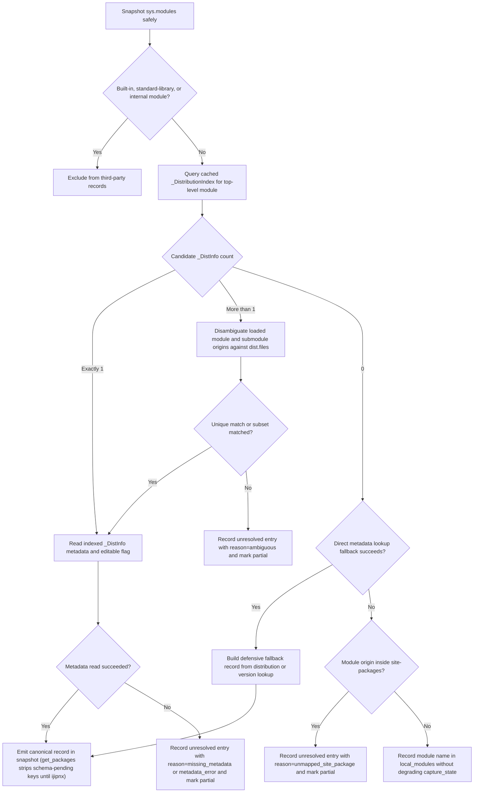
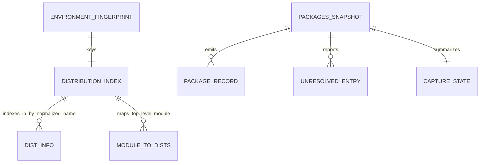

# IPD: Distribution identity resolution, caching, and module edge cases

- Date: 2026-11-21
- Kind: child
- Concern: Resolving loaded Python modules to installed distribution identities accurately on Python 3.8 through 3.14 with environment-fingerprinted caching and explicit edge-case handling.
- Scope: Implement Python Enhancement Proposal (PEP) 503 normalization, a cached distribution index with Python 3.8 through 3.14 single-pass mapping, shared installed-distribution lookup helpers, safe concurrent `sys.modules` snapshotting, and explicit resolution of import-name mismatches, namespace packages, ambiguous mappings, standard-library modules, local-only modules, editable installs, and missing metadata in `src/pubrun/capture/packages.py`, with deterministic local fixture tests in `tests/test_package_resolution.py` and `tests/test_capture_engines.py`.
- Scope-Paths: src/pubrun/capture/packages.py, tests/test_capture_engines.py, tests/test_package_resolution.py
- Item-Dependencies: none
- Status: approved
- Readiness: go-pending-approval
- Review-Depth: complex
- Short-Description: Resolve import names to distributions with Python 3.8+ fallback, environment-fingerprinted cache, and explicit edge-case handling
- Work-Kind: bug
- Priority: high
- From-Backlog: w4hxkh
- Blocks-Release: next
- Set: dep-capture
- Order: 1
- Highest E allocated: 04
- Author: agent
- Id: uil22c
- Approval: 2026-11-22, recorded via aw ipd set: status set to approved

> Write and proofread this plan per the technical writing standard, `.aw/system/workflows/technical-writing/technical-writing.md` (`.agents/workflows/technical-writing/technical-writing.md` in a legacy-layout install), including requirement 12 (diagrams).

## Workflow history

- 2026-11-22 approved (aw set): status set to approved
- 2026-11-21 /plan-review (Antigravity/Gemini): APPROVE WITH REVISIONS APPLIED; PR-001, PR-002, PR-003, PR-004, PR-005, PR-006, PR-007, PR-008, PR-009, PR-010, PR-011
- 2026-11-21 draft (agent): created.
- 2026-11-21 to-review (agent): authored review-ready child plan 01 of Set `dep-capture` graduating backlog item `w4hxkh`.

## Goal

Replace naive `importlib.metadata.version(mod_name)` lookups in `src/pubrun/capture/packages.py` with a standard-library, cached module-to-distribution resolver that works on Python 3.8 through 3.14, never imports a target module merely to identify it, handles concurrent `sys.modules` changes safely, and produces truthful outcomes for import-name mismatches, namespace packages, ambiguous mappings, standard-library modules, local-only modules, editable installs, and corrupt or missing metadata.

### Module-to-distribution resolution flow and data model

The text in `## Proposed changes (ordered, validatable)` is normative. These diagrams summarize the `resolve_packages_snapshot()` decision flow and the entities managed by `src/pubrun/capture/packages.py`.





## Detailed Implementation Checklist (TODO)

Execution-state rule: mark an `E-*` item complete only after performing the action. That mark is not validation. Right-sizing rule: write for a modest executor that cannot hold much in its head. Each E-item is one step (one concern, about one file, executable in one focused pass) and its V-item names each unit it covers with its own check; a plan stays at about 5 E-items and 8 work Scope-Paths, else split it into more child plans (guidance, `IPD-Z603`). Accepted execution states: blocked, failed, pending, performed; terminal gate demands 'performed'.

### Task group 1: Distribution normalization, indexing, and caching

- [x] E-01 Add PEP 503 normalization (`normalize_package_name`), an environment-fingerprinted distribution index and cache (`_DistributionIndex`, `_get_distribution_index`, `invalidate_package_cache`) using a single-pass `importlib.metadata.distributions()` mapper compatible with Python 3.8 through 3.14, and shared `get_installed_distribution_versions()` in `src/pubrun/capture/packages.py`.
  - Depends on: none
  - Expected outcome: `src/pubrun/capture/packages.py` provides `normalize_package_name(name)`, `invalidate_package_cache()`, `_get_distribution_index(use_cache=True)`, and `get_installed_distribution_versions(use_cache=True)` (matching the signature and return shape expected by sibling Set `repro-check` plan `tusvtd`, upgrading in place if `tusvtd` landed first), scans `importlib.metadata.distributions()` strictly once per unchanged environment fingerprint (`sys.path`, `sys.meta_path` types, `sys.path` directory mtimes, and `id(importlib.metadata.distributions)`), deduplicates identical distributions while keeping first-wins `sys.path` precedence, detects mid-run `sys.path`, directory-mtime, or provider changes, and never imports any user module.
  - Execution state: performed

### Task group 2: Concurrent snapshotting and explicit edge-case resolution

- [x] E-02 Implement retry-safe `sys.modules` snapshotting, Python 3.8 through 3.14 standard-library classification, PEP 420 namespace package disambiguation via loaded submodule origins and `dist.files`, PEP 610 editable install detection without exposing `direct_url.json` URLs, local-only module classification, and missing or corrupt metadata degradation in `src/pubrun/capture/packages.py`.
  - Depends on: E-01
  - Expected outcome: Snapshotting `sys.modules` tolerates concurrent mutation without raising `RuntimeError`; reading attributes from lazy or broken module proxies never raises; mismatched import names (`sklearn` -> `scikit-learn`, `PIL` -> `Pillow`, or synthetic equivalents) resolve to canonical distribution names with `import_names`; PEP 420 namespace packages resolve only the distribution(s) backing actually loaded submodules; truly ambiguous mappings, unmapped site-packages modules, and corrupt or missing metadata emit structured `unresolved` entries matching child `ijipnx`'s schema shape and set `capture_state.status = "partial"` with warnings; standard-library modules (including generated modules such as `_sysconfigdata__*` on Python 3.10+) and local-only modules are classified cleanly without marking capture `partial`; editable installs set `editable = True` from parsed `direct_url.json` without emitting raw `url` strings.
  - Execution state: performed

- [x] E-03 Update `get_packages()` in `src/pubrun/capture/packages.py` for `imported-only`, `top-level-installed`, and `full-environment` modes to use the cached resolver while keeping `mode = "imported-only"` as the default, keeping `get_packages()` output compliant with the current `schemas/manifest.schema.json` until child `ijipnx` extends the schema, and preserving `mode = "off"` suppression and `imported-transitive` functionality until child `fdqkrz` refactors transitive closure.
  - Depends on: E-02
  - Expected outcome: `resolve_packages_snapshot(config)` returns the full structured snapshot (canonical `records` with `location`, `editable`, `source`, and `import_names`, plus `unresolved`, `local_modules`, and `capture_state`); `get_packages(config)` returns sorted canonical distribution records using only keys and non-null types accepted by the current `schemas/manifest.schema.json` (never emitting `name: None` or `capture_state.detail: None`) while surfacing `capture_state.status = "partial"` and `capture_state.warnings` for unresolved, ambiguous, or missing-metadata cases; `top-level-installed` computes installed distributions not required by any other installed distribution via `importlib.metadata` (ignoring self-requirements and extra-gated requirements); `src/pubrun/capture/packages.py::_parse_req_name`, `tests/test_edge_cases.py::TestPackagesNullName`, and `tests/test_new_features.py::TestImportedTransitiveMode` remain green; and metadata errors never crash the host.
  - Execution state: performed

### Task group 3: Deterministic fixture-based behavioral tests

- [x] E-04 Create `tests/test_package_resolution.py` with deterministic local `.dist-info` and module fixtures and update `tests/test_capture_engines.py` if needed to verify all identity-resolution, `top-level-installed`, caching, concurrency, schema-key, and no-import behaviors.
  - Depends on: E-03
  - Expected outcome: `tests/test_package_resolution.py` builds synthetic distributions in `tmp_path` (requiring no `scikit-learn` or `Pillow` installation) and passes via `pytest` for mismatched import and distribution names, PEP 420 multi-distribution namespace packages, ambiguous mappings, standard-library modules, local-only modules, unmapped site-packages modules, editable installs (`direct_url.json` with `editable: true` vs `editable: false`, omitted `editable`, and non-dict JSON), missing or corrupt metadata, Python 3.8 and 3.9 compatibility (parity with `packages_distributions()` on Python 3.10+ and resilience when `packages_distributions` is absent), single-scan cache reuse and deterministic invalidation on `sys.path`, directory-mtime (`os.utime`), monkeypatched `distributions`, or `invalidate_package_cache()`, duplicate `sys.path` deduplication, `top-level-installed` root filtering (including self-requirements), concurrent `sys.modules` mutation thread stress, a guard proving `get_packages()` never imports any uninstalled or unloaded target module, and `get_installed_distribution_versions()`.
  - Execution state: performed

## Project conventions discovered (Step 0)

- `src/pubrun/capture/packages.py::get_packages` and `src/pubrun/capture/packages.py::_parse_req_name` use only the Python standard library (`importlib.metadata`, `re`, `sys`) and support Python 3.8 through 3.14 (`pyproject.toml` `requires-python = ">=3.8"`).
- `src/pubrun/capture/packages.py::get_packages` currently filters `'.' not in mod_name and mod_name != '_ast'`, calls `importlib.metadata.version(mod_name)` directly, sets `location = None` and `editable = None` in `imported-only` and `imported-transitive` modes, and runs the same full `distributions()` scan for both `top-level-installed` and `full-environment`.
- `tests/test_edge_cases.py::TestPackagesNullName.test_none_name_yields_partial_not_crash` monkeypatches `importlib.metadata.distributions` to return a minimal `FakeDist` (`metadata = {"Name": None}`, no `.files` or `.requires` attributes) and verifies that `get_packages()` does not crash and yields `capture_state.status` in `("complete", "partial")`.
- `tests/test_new_features.py::TestImportedTransitiveMode.test_transitive_deps_discovered` injects `sys.modules["pubrun_fake_pkg"] = object()` and monkeypatches `importlib.metadata.version` and `importlib.metadata.distribution` (returning a minimal `MockDist` defining only `.requires`, without `.metadata`, `.version`, `.locate_file`, or `.read_text`), so a defensive direct `importlib.metadata.distribution()` / `version()` fallback for unmapped non-local modules preserves compatibility with both custom metadata finders and existing tests.
- Sibling Set `repro-check` child plan `tusvtd` expects `normalize_package_name(name: str) -> str` and `get_installed_distribution_versions() -> Dict[str, Dict[str, Any]]` in `src/pubrun/capture/packages.py`.
- `schemas/manifest.schema.json` enforces `"additionalProperties": false` on `$defs.packages_section`, `$defs.package_record`, and `$defs.capture_state`, requires `$defs.package_record.properties.name` to be `"type": "string"` (non-nullable), and requires `$defs.capture_state.properties.detail` to be `"type": "string"` (non-nullable). `tests/test_manifest_schema.py` validates real runs against that schema. In this plan (before child `ijipnx` extends `schemas/manifest.schema.json`), `resolve_packages_snapshot()` exposes the full structured resolution result while `get_packages()` emits only currently schema-valid keys and types.

## Findings

- **F-01 (Import-name vs distribution-name mismatch):** Calling `importlib.metadata.version(mod_name)` fails for every distribution whose import name differs from its distribution name (such as `sklearn` vs `scikit-learn` or `PIL` vs `Pillow`), silently dropping real dependencies while reporting `capture_state.status == "complete"`.
- **F-02 (Namespace packages ignored or misattributed):** Ignoring dotted module names (`'.' not in mod_name`) prevents inspecting loaded submodules of PEP 420 namespace packages, making it impossible to determine which namespace distribution actually loaded code.
- **F-03 (No caching or Python 3.8/3.9 mapping fallback):** `importlib.metadata.packages_distributions()` was added in Python 3.10 and is absent on Python 3.8 and 3.9; without caching, resolving modules repeatedly or across startup and finalization rescans site-packages unnecessarily.
- **F-04 (Unclassified failures and missing editable/location metadata):** `imported-only` omits `location` and `editable`, conflates standard-library modules, local script helpers, ambiguous mappings, and missing metadata under silent `PackageNotFoundError` catches, and iterates `sys.modules.keys()` without protecting against concurrent thread imports.

## Proposed changes (ordered, validatable)

1. **Schema-compatibility boundary between `uil22c` and `ijipnx`:**
   - Because `tests/test_manifest_schema.py` validates `manifest["packages"]` against `schemas/manifest.schema.json` (`additionalProperties: false`, non-nullable `package_record.name` and `capture_state.detail`) on every full-suite run, `uil22c` must keep `get_packages(config)` returning schema-valid keys (`mode`, `records` with string `name`, `version`, `location`, `editable`, `source`, `required_by`, and `capture_state` with `status`, optional non-empty string `detail`, and optional `warnings` list of strings) while exposing the full structured resolution result (`records`, `unresolved`, `local_modules`, `capture_state`, per-record `import_names`) via `resolve_packages_snapshot(config: Dict[str, Any]) -> Dict[str, Any]`.
   - `get_packages(config)` populates `capture_state.status = "partial"` plus `capture_state.warnings` for unresolved, ambiguous, or missing-metadata cases immediately, and omits `"detail"` from `capture_state` whenever no non-empty detail string is present.
   - Child `ijipnx` then extends `schemas/manifest.schema.json` and enables the extended manifest fields (`import_names`, `observed_at`, `snapshot_stage`, `unresolved`, `local_modules`, `coverage_notes`) in `get_packages()` in the same plan that updates the schema. This keeps `tests/test_manifest_schema.py` green after `uil22c`, after `fdqkrz`, and after `ijipnx`.

2. **`src/pubrun/capture/packages.py` (normalization, fingerprinting, and cached distribution index):**
   - Add `normalize_package_name(name: str) -> str` applying standard PEP 503 normalization (`re.sub(r"[-_.]+", "-", name).lower()`). If sibling Set `repro-check` plan `tusvtd` has already added `normalize_package_name` or `get_installed_distribution_versions` in `src/pubrun/capture/packages.py`, upgrade `get_installed_distribution_versions` in place to use the cached index while keeping its call signature and returned keys (`name`, `version`, `editable`, plus `location`) compatible.
   - Add a thread-safe module-level cache protected by a `threading.Lock`, an internal accessor `_get_distribution_index(use_cache: bool = True) -> _DistributionIndex` (also consumed by child `fdqkrz`), and `invalidate_package_cache() -> None`:
     - Compute a cheap environment fingerprint `_environment_fingerprint()`: `(tuple(sys.path), tuple(type(f) for f in sys.meta_path), dir_mtimes, id(importlib.metadata.distributions))` where `dir_mtimes` stats existing directory entries in `sys.path` once per fingerprint check (`(path, st.st_mtime_ns)`), catching `OSError` per entry without failing. Including `id(importlib.metadata.distributions)` ensures monkeypatched distribution providers in tests (such as `tests/test_edge_cases.py::TestPackagesNullName`) never receive stale cached entries.
     - Define `_DistInfo` (dataclass or namedtuple): `name`, `normalized_name`, `version`, `location`, `editable`, `requires`, `top_levels`, `dist` (reference to the underlying distribution object for lazy `dist.files` inspection only when disambiguating multiple candidates), and `metadata_error` (optional error string).
     - Build `_DistributionIndex` in a single pass over `importlib.metadata.distributions()` (never also calling `importlib.metadata.packages_distributions()`, which internally re-iterates `distributions()` and would double-scan site-packages):
       - Deduplicate identical distributions encountered through duplicate or symlinked `sys.path` entries using the resolved metadata path (`os.path.realpath(str(dist._path))` when `_path` is present) or `(normalized_name, version, location)`.
       - Read `dist.metadata["Name"]`, `dist.version`, `locate_file("")`, `requires`, and `read_text(...)` defensively via `getattr` inside a per-distribution `try/except`; if `Name` is missing or `None` or reading metadata raises, record an unresolved metadata-error entry `{"module": <dist hint or "<unknown>">, "reason": "missing_metadata" | "metadata_error", "candidates": [], "detail": <concise error>}` on the index instead of crashing or emitting a `name: None` package record.
       - Detect editable status via `_is_editable_dist(dist)`: call `read_text = getattr(dist, "read_text", None)`; if `direct_url.json` is present, parse JSON safely and verify `isinstance(data, dict)`, returning `True` if `isinstance(data.get("dir_info"), dict)` and `data["dir_info"].get("editable") is True` (returning `False` when `editable` is `False` or omitted, per PEP 610). If `direct_url.json` is non-JSON text containing `"dir_info"`, fall back to `True`. Otherwise return `False`. Never copy or log the raw `direct_url.json` `"url"` value into `location`, `detail`, or `warnings` (because VCS or archive URLs may contain embedded credentials).
       - Derive top-level module names per distribution identically on Python 3.8 through 3.14, mirroring CPython's `packages_distributions()` algorithm inside the same single pass:
         1. Read `top_level.txt` and split on whitespace; if non-empty, use those names.
         2. Otherwise, inspect `getattr(dist, "files", None) or ()`: for each `PackagePath`, if `len(f.parts) > 1` take `f.parts[0]`; otherwise take `inspect.getmodulename(str(f)) or str(f)`. Keep only names with `'.' not in name` and `name != "__pycache__"` (this excludes `..` parent-traversal entries such as `../../../bin/pubrun`, `*.dist-info`, `*.egg-info`, `*.data`, and `*.pth` files while stripping multi-suffix extension tags such as `.cpython-314-x86_64-linux-gnu.so`).
       - Populate `module_to_dists: Dict[str, List[_DistInfo]]` (without appending duplicate `_DistInfo` entries for the same top-level name) and `by_normalized_name: Dict[str, _DistInfo]` using first-wins `sys.path` precedence (`setdefault`, matching `importlib.metadata.distribution()`).
   - Add `get_installed_distribution_versions(use_cache: bool = True) -> Dict[str, Dict[str, Any]]`:
     - Returns `{normalized_name: {"name": info.name, "version": info.version, "editable": info.editable, "location": info.location}}` using `_get_distribution_index(use_cache=use_cache)`, never importing any package. Preserves full compatibility with sibling Set `repro-check` plan `tusvtd`.

3. **`src/pubrun/capture/packages.py` (safe `sys.modules` snapshotting and module resolution):**
   - Add `_safe_getattr(obj: Any, attr: str, default: Any = None) -> Any` catching `Exception` so lazy or broken module proxies in `sys.modules` never crash resolution.
   - Add `_path_is_within(path_str: str, root_str: str) -> bool` using normalized `os.path.normcase(os.path.realpath(...))` and `os.path.commonpath` (catching `ValueError` and `OSError`) for boundary-safe path containment across Unix and Windows (avoiding naive `str.startswith` prefix collisions).
   - Add `_snapshot_sys_modules() -> List[Tuple[str, Any]]`: retry up to 3 times on `RuntimeError` ("dictionary changed size during iteration") copying `list(sys.modules.items())` (falling back to iterating `list(sys.modules.keys())` with `sys.modules.get()` if contention persists). Never call `importlib.import_module` or `importlib.util.find_spec` on unloaded modules.
   - Add `_is_stdlib_module(top_level: str, module_obj: Any) -> bool`:
     - Return `True` if `top_level in sys.builtin_module_names`.
     - On Python 3.10+, return `True` if `top_level in sys.stdlib_module_names`.
     - Check `_safe_getattr(_safe_getattr(module_obj, "__spec__"), "origin")`: return `True` if it is `"built-in"` or `"frozen"`.
     - On all Python versions (3.8 through 3.14, covering both Python 3.8/3.9 and generated platform standard-library modules absent from `sys.stdlib_module_names` such as `_sysconfigdata__*`), compare the module's `__file__` (when a string) against resolved `sysconfig.get_paths()["stdlib"]` and `sysconfig.get_paths()["platstdlib"]` using `_path_is_within`, while excluding paths inside `site-packages` or `dist-packages` subdirectories.
   - Add `_is_site_packages_path(path_str: Optional[str]) -> bool`: check whether `path_str` has `"site-packages"` or `"dist-packages"` as an exact path component (`Path(path_str).parts`) or is contained within `site.getsitepackages()`, `site.getusersitepackages()`, `sysconfig.get_paths()["purelib"]`, or `sysconfig.get_paths()["platlib"]` via `_path_is_within`.
   - Resolve loaded modules grouped by top-level name (`top = name.split(".", 1)[0]`):
     - Ignore internal or placeholder entries (`mod_obj is None`, `not top`, `top == "__main__"`, `top == "_ast"`, `top.startswith("__")`).
     - Skip standard-library and built-in top-level modules cleanly (not recorded in `records`, `unresolved`, or `local_modules`).
     - Collect all loaded module objects under each non-standard-library top-level name (`top` plus any `top.*` submodules in the snapshot) and extract their existing `__file__`, `__spec__.origin` (ignoring `"namespace"`, `"built-in"`, `"frozen"`, and `None`), and `__path__` strings using `_safe_getattr`.
     - Look up `candidates = index.module_to_dists.get(top, [])`:
       - **1 candidate**: resolve directly to that `_DistInfo` and record `top` in its `import_names`.
       - **More than 1 candidate (namespace package or shadowed/ambiguous mapping)**:
         - Attempt path/`dist.files` disambiguation: prioritize concrete loaded module and submodule file paths (`__file__` and file-backed `__spec__.origin`) over shared `_NamespacePath` entries so an untouched sibling namespace package sharing the same parent directory is never falsely matched. Normalize candidate `dist.files` resolved relative to `dist.locate_file("")` via `os.path.normcase(os.path.realpath(...))` lazily only for candidate distributions (handling `dist.files is None` safely).
         - If disambiguation matches one or more specific distributions whose loaded submodules were actually imported (for example, `myns.pkg_a` maps uniquely to `myns-pkg-a` while `myns-pkg-b` is untouched): record only the matched distribution(s) with the observed module/submodule import name(s).
         - If multiple candidates remain tied for the same loaded module (or a bare namespace top-level has no distinguishing loaded submodule path): do not guess; record an `unresolved` entry `{"module": top, "reason": "ambiguous", "candidates": sorted(c.name for c in tied), "detail": ...}` and mark `capture_state.status = "partial"` with a concise warning naming `top` and the candidate distributions.
       - **0 candidates**:
         - Try defensive direct metadata fallback: call `importlib.metadata.distribution(top)` inside `try/except PackageNotFoundError`. When a distribution object is returned, read its name from `metadata["Name"]` (falling back to `top` if `.metadata` is absent or incomplete), version from `.version` (falling back to `importlib.metadata.version(top)` if `.version` is absent, supporting minimal mocks such as `MockDist` in `tests/test_new_features.py::TestImportedTransitiveMode`), and `location`/`editable` defensively (defaulting to `None` when `locate_file`/`read_text` are absent). If `distribution(top)` raises `PackageNotFoundError`, also try `importlib.metadata.version(top)` directly; if that succeeds, emit `name=top, version=ver, location=None, editable=None`.
         - Otherwise, check whether any loaded module object for `top` has a file origin under site-packages/dist-packages (`_is_site_packages_path`):
           - If yes: record an `unresolved` entry `{"module": top, "reason": "unmapped_site_package", "candidates": [], "detail": ...}` and mark `capture_state.status = "partial"` with a warning (installed library missing `.dist-info` metadata).
           - If no: classify as a local-only module (`local_modules.append(top)`); do not degrade `capture_state.status` to `"partial"`.
   - For `top-level-installed` mode:
     - Compute installed distributions from the cached index that are not listed as dependencies by any other installed distribution (using PEP 503 normalized names from `dist.requires`, excluding self-requirements where `dep_norm == dist.normalized_name` and skipping requirements gated on an `extra ==` marker clause), so `top-level-installed` is genuinely distinct from `full-environment` while using pure `importlib.metadata` (no `pip` or `conda` subprocesses).
   - For `full-environment` mode:
     - Return all valid distributions from the cached index; if the index recorded any missing or corrupt metadata (`Name is None` or exception), emit those entries in `unresolved`, add concise warnings to `capture_state.warnings`, set `capture_state.status = "partial"`, omit corrupt `Name is None` records from `records` so `schemas/manifest.schema.json` stays valid, and preserve the null-safe sort key `(x.get("name") or "").lower()` as defense in depth.

4. **`tests/test_package_resolution.py` and `tests/test_capture_engines.py`:**
   - Build a clean reusable fixture helper in `tests/test_package_resolution.py` that constructs real PEP 376 `.dist-info` directories (`METADATA`, `top_level.txt`, `RECORD`, optional `direct_url.json`) plus real importable `.py` modules inside `tmp_path` and adds `tmp_path` via `monkeypatch.syspath_prepend`.
   - Test all required cases behaviorally:
     1. Import name != distribution name (for example, synthetic import `synth_skl` -> distribution `synth-scikit-learn` `2.3.4`, verifying canonical name, version, location, `editable=False`, and `import_names=["synth_skl"]`).
     2. PEP 420 namespace package (`synth_ns.part_a` from `synth-ns-a` and `synth_ns.part_b` from `synth-ns-b` installed together; importing only `synth_ns.part_a` resolves only `synth-ns-a`, not `synth-ns-b`).
     3. Ambiguous mapping (two distributions claiming the same top-level module with no distinguishing `RECORD` path, and bare namespace import with no loaded submodule) -> recorded in `unresolved` with `reason == "ambiguous"`, candidates listed, and `capture_state.status == "partial"`.
     4. Standard-library and built-in modules (`json`, `sys`, `math`, and a synthetic module under `stdlib` path) -> excluded from third-party `records` and `unresolved`; `capture_state.status == "complete"`.
     5. Local-only module (script helper `local_helper.py` in `tmp_path/work` with no `.dist-info`) -> classified in `local_modules`, excluded from third-party `records` and `unresolved`, `capture_state.status == "complete"`.
     6. Unmapped site-packages module (`.py` file inside a `tmp_path/site-packages/` directory with no `.dist-info`) -> recorded in `unresolved` with `reason == "unmapped_site_package"` and `capture_state.status == "partial"`.
     7. Editable install (`direct_url.json` with `{"dir_info": {"editable": true}, "url": "file:///..."}` -> `editable is True`; `editable: false` or omitted `editable` -> `editable is False`; non-dict JSON `[]` -> `editable is False` without crashing; embedded credential URL is never echoed into `location`, `detail`, or `warnings`).
     8. Missing or corrupt metadata (`METADATA` missing `Name` or unreadable distribution) -> omitted from `records`, recorded in `unresolved`, degrades cleanly to `capture_state.status == "partial"` without crashing host.
     9. Python 3.8 and 3.9 compatibility (verify single-pass `module_to_dists` matches `importlib.metadata.packages_distributions()` on Python 3.10+ for fixture distributions, and verify resolution still succeeds when `packages_distributions` is removed via `monkeypatch.delattr(..., raising=False)` and when `RECORD` includes `../bin/script` and `.pth` entries).
     10. Caching, deduplication, and invalidation (verify `importlib.metadata.distributions` is called strictly once across repeated lookups in an unchanged environment; automatically re-scans when `sys.path` changes, directory mtime is bumped deterministically with `os.utime`, `importlib.metadata.distributions` is monkeypatched, or `invalidate_package_cache()` is called; and duplicate `sys.path` entries pointing to the same directory do not create false `ambiguous` matches).
     11. Concurrent `sys.modules` mutation (background thread rapidly adding and deleting synthetic keys in `sys.modules` while `get_packages()` runs repeatedly -> zero `RuntimeError`s and coherent output) plus a lazy module proxy whose `__getattr__` raises does not crash `get_packages()`.
     12. No-import invariant (unloaded synthetic module whose top-level code raises `AssertionError("must not be imported")` or writes a sentinel file -> calling `get_packages()` in every mode never executes or imports it).
     13. `top-level-installed` mode (fixture environment with `root-pkg` requiring `dep-pkg` and self-requiring `root-pkg[all]` -> `top-level-installed` includes `root-pkg` and excludes `dep-pkg`, while `full-environment` includes both).
     14. Shared helper `get_installed_distribution_versions()` returns PEP 503 normalized keys with `name`, `version`, `editable`, and `location`, and `get_packages()` emits only keys and non-null types accepted by `schemas/manifest.schema.json`.

## Deferred / out of scope (with reason)

- Recursive, marker-aware, extra-honest `imported-transitive` closure: implemented in child plan `fdqkrz` (`Order: 2`).
  - Carrier: fdqkrz
- Startup-to-finalization snapshot merging, `Run._finalize_state()` wiring, `schemas/manifest.schema.json` additive fields, and `methods`/`diagnostics`/`tui` updates: implemented in child plan `ijipnx` (`Order: 3`).
  - Carrier: ijipnx
- Benchmarking and documentation updates: implemented in child plan `iflqsl` (`Order: 4`).
  - Carrier: iflqsl

## Scope check

- Over-scope: none. Touches only `src/pubrun/capture/packages.py` and package-resolution tests while keeping `get_packages()` output compliant with the current `schemas/manifest.schema.json`.
- Under-scope: none. Covers every identity-resolution, caching, Python 3.8+ compatibility, `top-level-installed`, concurrency, no-import, and edge-case requirement in `w4hxkh` guidance items 2, 3, and 5 and acceptance criteria 2, 3, and 5.

## Required tests / validation

- Run `pytest tests/test_package_resolution.py tests/test_capture_engines.py tests/test_edge_cases.py tests/test_new_features.py tests/test_manifest_schema.py -v` and paste actual runner output.

## Spec / documentation sync

- Schema updates (`schemas/manifest.schema.json`) are performed in child plan `ijipnx` (`Order: 3`).
- Documentation updates (`docs/manifest.md`, `docs/configuration.md`, `docs/architecture.md`, `docs/performance.md`, `src/pubrun/resources/default.toml`) are performed in child plan `iflqsl` (`Order: 4`).

## Open questions

### OQ-01: Behavior of `top-level-installed` mode without shelling out to `pip` or `conda`

- Blocking: no
- Status: resolved
- Owner: plan author
- Resolution or deferral rationale: `top-level-installed` previously ran the identical `full-environment` loop (never invoking `pip` or `conda`). Computing installed distributions not required by any other installed distribution via `importlib.metadata.distributions()` (excluding self-requirements and extra-gated requirements) makes `top-level-installed` truthful, fast, offline, and standard-library-only without spawning `pip` or `conda` subprocesses. This reversible author decision becomes binding upon human plan approval; child `iflqsl` reconciles `docs/configuration.md` and `src/pubrun/resources/default.toml` to match this exact behavior.

## Validation and cross-check (verify before reporting done)

Validation-state rule: inspect evidence in a separate pass. Do not mark a `V-*` item complete from memory or from the matching execution checkmark. Accepted validation results: blocked, failed, pass, pending; terminal gate demands 'pass'. Runtime-demonstration reachability rule: for each `V-*` item demanding the software be observed acting (such as a run, a dispatch, or a transition, as distinct from items demanding a diff, a file's content, or a test result, which are reachable by construction), name the code path that produces the observation or the sibling `E-*` that creates it, else the demand is UNDER-SCOPE.

- [x] V-01 validates E-01
  - Required evidence: Paste `pytest tests/test_package_resolution.py -k "normalize or cache or fallback or dedup or installed_distribution_versions" -v` output showing exit code 0 (with non-zero collected tests), proving PEP 503 normalization, strictly single-scan caching with invalidation on `sys.path`/mtime/provider change, duplicate `sys.path` deduplication, Python 3.8/3.9 compatibility when `packages_distributions` is absent, and `get_installed_distribution_versions()` behavior.
  - Observed evidence:
    Command: `pytest tests/test_package_resolution.py -k "normalize or cache or fallback or dedup or installed_distribution_versions" -v` (exit code 0)
    ```text
    collected 17 items / 12 deselected / 5 selected

    tests/test_package_resolution.py::test_normalize_package_name_pep503 PASSED [ 20%]
    tests/test_package_resolution.py::test_cache_single_scan_and_invalidation PASSED [ 40%]
    tests/test_package_resolution.py::test_dedup_duplicate_and_symlinked_sys_path PASSED [ 60%]
    tests/test_package_resolution.py::test_fallback_python38_39_parity_and_record_filtering PASSED [ 80%]
    tests/test_package_resolution.py::test_installed_distribution_versions_helper PASSED [100%]
    ======================= 5 passed, 12 deselected in 5.36s =======================
    ```
  - Result: pass

- [x] V-02 validates E-02
  - Required evidence: Paste `pytest tests/test_package_resolution.py -k "mismatch or namespace or ambiguous or stdlib or local or site_package or editable or missing_metadata or concurrent or lazy or no_import" -v` output showing exit code 0 (with non-zero collected tests), proving every module/distribution edge case, `direct_url.json` URL non-leakage, lazy-proxy and concurrent `sys.modules` safety, and the no-import invariant.
  - Observed evidence:
    Command: `pytest tests/test_package_resolution.py -k "mismatch or namespace or ambiguous or stdlib or local or site_package or editable or missing_metadata or concurrent or lazy or no_import" -v` (exit code 0)
    ```text
    collected 17 items / 7 deselected / 10 selected

    tests/test_package_resolution.py::test_import_name_mismatch_resolves_canonical_distribution PASSED [ 10%]
    tests/test_package_resolution.py::test_namespace_package_resolves_only_loaded_submodule_distribution PASSED [ 20%]
    tests/test_package_resolution.py::test_ambiguous_mapping_and_bare_namespace_mark_partial PASSED [ 30%]
    tests/test_package_resolution.py::test_stdlib_and_builtin_modules_excluded_cleanly PASSED [ 40%]
    tests/test_package_resolution.py::test_local_only_module_classified_without_partial PASSED [ 50%]
    tests/test_package_resolution.py::test_unmapped_site_package_module_marks_partial PASSED [ 60%]
    tests/test_package_resolution.py::test_editable_direct_url_variants_and_no_url_leak PASSED [ 70%]
    tests/test_package_resolution.py::test_missing_metadata_and_corrupt_dist_degrade_to_partial PASSED [ 80%]
    tests/test_package_resolution.py::test_concurrent_sys_modules_mutation_and_lazy_proxy_safety PASSED [ 90%]
    tests/test_package_resolution.py::test_no_import_invariant_never_executes_unloaded_module PASSED [100%]
    ======================= 10 passed, 7 deselected in 5.07s =======================
    ```
  - Result: pass

- [x] V-03 validates E-03
  - Required evidence: Paste `pytest tests/test_package_resolution.py -k "top_level or schema" -v` and `pytest tests/test_capture_engines.py tests/test_edge_cases.py tests/test_new_features.py tests/test_manifest_schema.py -v` output showing exit code 0, proving `get_packages()` works across `off`, `imported-only`, `imported-transitive`, `top-level-installed`, and `full-environment`, keeps `imported-only` default, preserves `TestPackagesNullName` and `TestImportedTransitiveMode`, and stays conformant with `schemas/manifest.schema.json`.
  - Observed evidence:
    Command 1: `pytest tests/test_package_resolution.py -k "top_level or schema" -v` (exit code 0)
    ```text
    collected 17 items / 15 deselected / 2 selected

    tests/test_package_resolution.py::test_top_level_installed_filters_dependencies_and_ignores_self_and_extras PASSED [ 50%]
    tests/test_package_resolution.py::test_get_packages_schema_conformance_and_default_mode PASSED [100%]
    ======================= 2 passed, 15 deselected in 3.19s =======================
    ```
    Command 2: `pytest tests/test_capture_engines.py tests/test_edge_cases.py tests/test_new_features.py tests/test_manifest_schema.py -v` (exit code 0)
    ```text
    collected 81 items
    ...
    tests/test_capture_engines.py::TestPackages::test_default_mode_is_imported_only PASSED [ 30%]
    tests/test_capture_engines.py::TestPackages::test_top_level_installed_is_subset_of_full_environment PASSED [ 32%]
    tests/test_edge_cases.py::TestPackagesNullName::test_none_name_yields_partial_not_crash PASSED [ 48%]
    tests/test_new_features.py::TestImportedTransitiveMode::test_transitive_deps_discovered PASSED [ 62%]
    tests/test_new_features.py::TestImportedTransitiveMode::test_pep508_parser_edge_cases PASSED [ 64%]
    tests/test_manifest_schema.py::test_full_manifest_conforms_to_schema PASSED [ 87%]
    tests/test_manifest_schema.py::test_manifest_variants_conform_to_schema[packages-transitive] PASSED [ 93%]
    tests/test_manifest_schema.py::test_startup_manifest_conforms_to_schema PASSED [100%]
    ============================== 81 passed in 5.17s ==============================
    ```
  - Result: pass

- [x] V-04 validates E-04
  - Required evidence: Paste complete `pytest tests/test_package_resolution.py tests/test_capture_engines.py tests/test_edge_cases.py tests/test_new_features.py tests/test_manifest_schema.py -v` runner output showing exit code 0 with zero skipped fixture tests and zero third-party test-only package installations required.
  - Observed evidence:
    Command: `pytest tests/test_package_resolution.py tests/test_capture_engines.py tests/test_edge_cases.py tests/test_new_features.py tests/test_manifest_schema.py -v` (exit code 0; 98 passed, 0 skipped, 0 failed)
    ```text
    collected 98 items

    tests/test_package_resolution.py::test_normalize_package_name_pep503 PASSED [  1%]
    tests/test_package_resolution.py::test_cache_single_scan_and_invalidation PASSED [  2%]
    tests/test_package_resolution.py::test_dedup_duplicate_and_symlinked_sys_path PASSED [  3%]
    tests/test_package_resolution.py::test_fallback_python38_39_parity_and_record_filtering PASSED [  4%]
    tests/test_package_resolution.py::test_installed_distribution_versions_helper PASSED [  5%]
    tests/test_package_resolution.py::test_import_name_mismatch_resolves_canonical_distribution PASSED [  6%]
    tests/test_package_resolution.py::test_namespace_package_resolves_only_loaded_submodule_distribution PASSED [  7%]
    tests/test_package_resolution.py::test_ambiguous_mapping_and_bare_namespace_mark_partial PASSED [  8%]
    tests/test_package_resolution.py::test_stdlib_and_builtin_modules_excluded_cleanly PASSED [  9%]
    tests/test_package_resolution.py::test_local_only_module_classified_without_partial PASSED [ 10%]
    tests/test_package_resolution.py::test_unmapped_site_package_module_marks_partial PASSED [ 11%]
    tests/test_package_resolution.py::test_editable_direct_url_variants_and_no_url_leak PASSED [ 12%]
    tests/test_package_resolution.py::test_missing_metadata_and_corrupt_dist_degrade_to_partial PASSED [ 13%]
    tests/test_package_resolution.py::test_concurrent_sys_modules_mutation_and_lazy_proxy_safety PASSED [ 14%]
    tests/test_package_resolution.py::test_no_import_invariant_never_executes_unloaded_module PASSED [ 15%]
    tests/test_package_resolution.py::test_top_level_installed_filters_dependencies_and_ignores_self_and_extras PASSED [ 16%]
    tests/test_package_resolution.py::test_get_packages_schema_conformance_and_default_mode PASSED [ 17%]
    tests/test_capture_engines.py (28 tests) PASSED [ 18%..51%]
    tests/test_edge_cases.py (18 tests) PASSED [ 52%..68%]
    tests/test_new_features.py (17 tests) PASSED [ 69%..85%]
    tests/test_manifest_schema.py (14 tests) PASSED [ 86%..100%]
    ============================= 98 passed in 13.94s ==============================
    ```
  - Result: pass

## Approval and execution gate

- Size assessment: standard
- Cohesion rationale: not required

Execution contract:
1. Open question `OQ-01` is resolved as a reversible author decision and becomes binding upon human approval (`- Status: approved`).
2. Scope fence: declared paths are `src/pubrun/capture/packages.py`, `tests/test_capture_engines.py`, and `tests/test_package_resolution.py`. Keep edits within this scope; if execution genuinely requires an out-of-scope path or leaves a declared path unmodified, justify it at finalize time via `--scope-reason` or `--scope-ack` rather than stopping mid-run. Stop only on a genuinely unsafe condition (such as an unresolvable concurrent-edit conflict).
3. Honesty rule: paste actual runner output and exit codes into `Observed evidence`; never claim tests passed without running them.
4. Commit discipline: commit only this plan's changed files via `aw commit uil22c -- <paths>`; never use `git add -A`, `git add .`, or `git commit -a`; never push.
5. Lifecycle transition on completion: after all `E-*` items are `performed` and all `V-*` items are `pass`, the plan must be finalized to `.aw/records/plans/executed/` with `- Status: executed` and a dated `## Workflow history` line. When executed under a runner (`aw oc run` / `aw agy run`), leave finalization to the runner; when executed manually outside a runner, run `aw ipd finalize uil22c --actor <actor> -m "<summary>" --apply` (never hand-roll `git mv`).
