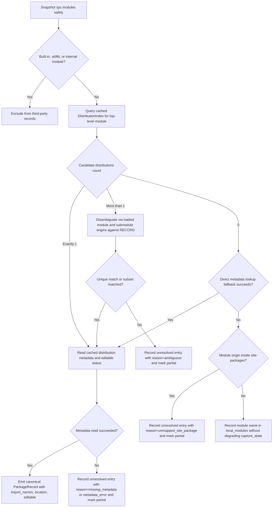
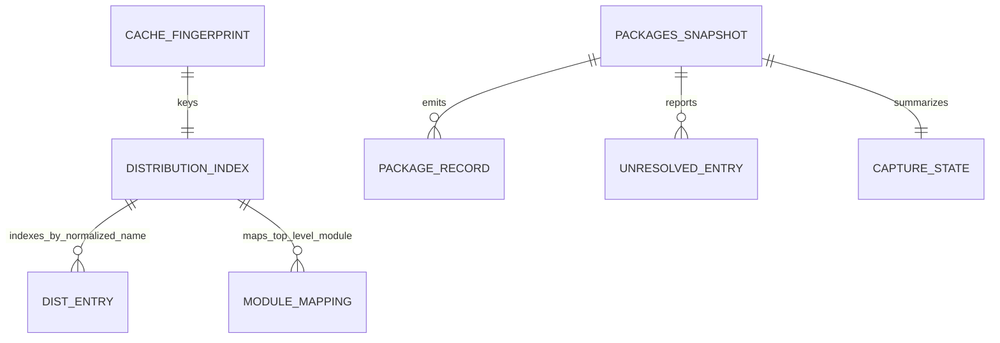

# IPD: Distribution identity resolution, caching, and module edge cases

- Date: 2026-11-21
- Kind: child
- Concern: Resolving loaded Python modules to installed distribution identities accurately on Python 3.8 through 3.14 with environment-fingerprinted caching and explicit edge-case handling.
- Scope: Implement Python Enhancement Proposal (PEP) 503 normalization, a cached distribution index with Python 3.8 and 3.9 fallback, shared installed-distribution lookup helpers, safe concurrent `sys.modules` snapshotting, and explicit resolution of import-name mismatches, namespace packages, ambiguous mappings, standard-library modules, local-only modules, editable installs, and missing metadata in `src/pubrun/capture/packages.py`, with deterministic local fixture tests in `tests/test_package_resolution.py` and `tests/test_capture_engines.py`.
- Scope-Paths: src/pubrun/capture/packages.py, tests/test_capture_engines.py, tests/test_package_resolution.py
- Item-Dependencies: none
- Status: to-review
- Short-Description: Resolve import names to distributions with Python 3.8+ fallback, environment-fingerprinted cache, and explicit edge-case handling
- Work-Kind: bug
- Priority: high
- From-Backlog: w4hxkh
- Blocks-Release: next
- Set: dep-capture
- Order: 1
- Highest E allocated: 04
- Author: agent
- Id: uil22c

> Write and proofread this plan per the technical writing standard, `.aw/system/workflows/technical-writing/technical-writing.md` (`.agents/workflows/technical-writing/technical-writing.md` in a legacy-layout install), including requirement 12 (diagrams).

## Workflow history

- 2026-11-21 draft (agent): created.
- 2026-11-21 to-review (agent): authored review-ready child plan 01 of Set `dep-capture` graduating backlog item `w4hxkh`.

## Goal

Replace naive `importlib.metadata.version(mod_name)` lookups in `src/pubrun/capture/packages.py` with a standard-library, cached module-to-distribution resolver that works on Python 3.8 through 3.14, never imports a target module merely to identify it, handles concurrent `sys.modules` changes safely, and produces truthful outcomes for import-name mismatches, namespace packages, ambiguous mappings, standard-library modules, local-only modules, editable installs, and corrupt or missing metadata.

### Module-to-distribution resolution flow and data model

The text in `## Proposed changes (ordered, validatable)` is normative. These diagrams summarize the resolution decision flow and the entities managed by `src/pubrun/capture/packages.py`.

## Detailed Implementation Checklist (TODO)

Execution-state rule: mark an `E-*` item complete only after performing the action. That mark is not validation. Right-sizing rule: write for a modest executor that cannot hold much in its head. Each E-item is one step (one concern, about one file, executable in one focused pass) and its V-item names each unit it covers with its own check; a plan stays at about 5 E-items and 8 work Scope-Paths, else split it into more child plans (guidance, `IPD-Z603`). Accepted execution states: blocked, failed, pending, performed; terminal gate demands 'performed'.

### Task group 1: Distribution normalization, indexing, and caching

- [ ] E-01 Add PEP 503 normalization (`normalize_package_name`), an environment-fingerprinted distribution index and cache (`_DistributionIndex`, `invalidate_package_cache`), a Python 3.8 and 3.9 fallback for `packages_distributions()`, and shared `get_installed_distribution_versions()` in `src/pubrun/capture/packages.py`.
  - Depends on: none
  - Expected outcome: `pubrun.capture.packages` provides `normalize_package_name(name)`, `invalidate_package_cache()`, and `get_installed_distribution_versions(use_cache=True)` (matching the signature and return shape expected by sibling Set `repro-check` plan `tusvtd`), scans `importlib.metadata.distributions()` at most once per unchanged environment fingerprint (`sys.path`, `sys.meta_path` types, and `sys.path` directory mtimes), detects mid-run `sys.path` or directory-mtime changes, and never imports any user module.
  - Execution state: pending

### Task group 2: Concurrent snapshotting and explicit edge-case resolution

- [ ] E-02 Implement retry-safe `sys.modules` snapshotting, Python 3.8+ standard-library classification, PEP 420 namespace package disambiguation via loaded submodule origins and distribution `RECORD` files, PEP 610 editable install detection, local-only module classification, and missing/corrupt metadata degradation in `src/pubrun/capture/packages.py`.
  - Depends on: E-01
  - Expected outcome: Snapshotting `sys.modules` tolerates concurrent mutation without raising `RuntimeError`; mismatched import names (`sklearn` -> `scikit-learn`, `PIL` -> `Pillow`, or synthetic equivalents) resolve to canonical distribution names with `import_names`; PEP 420 namespace packages resolve only the distribution(s) backing actually loaded submodules; truly ambiguous mappings, unmapped site-packages modules, and corrupt/missing metadata emit structured `unresolved` entries and set `capture_state.status = "partial"` with reasons; standard-library and local-only modules are classified cleanly without marking capture `partial`; editable installs set `editable = True` from parsed `direct_url.json`.
  - Execution state: pending

- [ ] E-03 Update `get_packages()` in `src/pubrun/capture/packages.py` for `imported-only`, `top-level-installed`, and `full-environment` modes to use the cached resolver while keeping `mode = "imported-only"` as the default, keeping `get_packages()` output compliant with the current `schemas/manifest.schema.json` until child `ijipnx` extends the schema, and preserving `mode = "off"` suppression and `imported-transitive` functionality until child `fdqkrz` refactors transitive closure.
  - Depends on: E-02
  - Expected outcome: `resolve_packages_snapshot()` returns the full structured snapshot (canonical `records` with `location`, `editable`, `source`, and `import_names`, plus `unresolved`, `local_modules`, and `capture_state`); `get_packages()` returns sorted canonical distribution records using only keys accepted by the current `schemas/manifest.schema.json` while surfacing `capture_state.status = "partial"` and `capture_state.warnings` for unresolved, ambiguous, or missing-metadata cases; `top-level-installed` computes distributions not required by another installed distribution via `importlib.metadata`; `_parse_req_name` and `test_edge_cases.TestPackagesNullName` remain green; and metadata errors never crash the host.
  - Execution state: pending

### Task group 3: Deterministic fixture-based behavioral tests

- [ ] E-04 Create `tests/test_package_resolution.py` with deterministic local `.dist-info` and module fixtures and update `tests/test_capture_engines.py` if needed to verify all identity-resolution, caching, concurrency, and no-import behaviors.
  - Depends on: E-03
  - Expected outcome: `tests/test_package_resolution.py` builds synthetic wheels/distributions in `tmp_path` (requiring no `scikit-learn` or `Pillow` installation) and passes via `pytest` for mismatched import/distribution names, PEP 420 multi-distribution namespace packages, ambiguous mappings, standard-library modules, local-only modules, editable installs (`direct_url.json` with `editable: true` vs `editable: false`), missing/corrupt metadata, Python 3.8/3.9 fallback path (`packages_distributions` absent), cache reuse and invalidation on `sys.path` or directory-mtime change, concurrent `sys.modules` mutation thread stress, and a guard proving `get_packages()` never imports any uninstalled or unloaded target module.
  - Execution state: pending

## Project conventions discovered (Step 0)

- `src/pubrun/capture/packages.py` (`get_packages`, `_parse_req_name`) uses only the Python standard library (`importlib.metadata`, `re`, `sys`) and supports Python 3.8 through 3.14 (`pyproject.toml` `requires-python = ">=3.8"`).
- `src/pubrun/capture/packages.py` currently filters `'.' not in mod_name and mod_name != '_ast'`, calls `importlib.metadata.version(mod_name)` directly, sets `location = None` and `editable = None` in `imported-only`/`imported-transitive` modes, and runs the same full `distributions()` scan for both `top-level-installed` and `full-environment`.
- `tests/test_edge_cases.py` (`TestPackagesNullName.test_none_name_yields_partial_not_crash`) verifies that a distribution whose `metadata["Name"]` is `None` does not crash `get_packages()` and yields `capture_state.status` in `("complete", "partial")`.
- `tests/test_new_features.py` (`TestImportedTransitiveMode.test_transitive_deps_discovered`) injects `sys.modules["pubrun_fake_pkg"] = object()` and monkeypatches `importlib.metadata.version` and `importlib.metadata.distribution` (without monkeypatching `distributions()`), so a direct `importlib.metadata.distribution()` fallback for unmapped non-local modules preserves compatibility with both custom metadata finders and existing tests.
- Sibling Set `repro-check` child plan `tusvtd` expects `normalize_package_name(name: str) -> str` and `get_installed_distribution_versions() -> Dict[str, Dict[str, Any]]` in `src/pubrun/capture/packages.py`.
- `schemas/manifest.schema.json` enforces `"additionalProperties": false` on `$defs.packages_section` and `$defs.package_record`, and `tests/test_manifest_schema.py` validates real runs against that schema. In this plan (before child `ijipnx` extends `schemas/manifest.schema.json`), `get_packages()` must keep its returned dictionary compatible with the current schema (either by exposing rich metadata via an internal/structured helper `capture_packages_snapshot()` consumed by `get_packages()`, or by keeping `get_packages()` emitting only schema-valid keys until child `ijipnx` updates `schemas/manifest.schema.json` in lockstep).

## Findings

- **F-01 (Import-name vs distribution-name mismatch):** Calling `importlib.metadata.version(mod_name)` fails for every distribution whose import name differs from its distribution name (such as `sklearn` vs `scikit-learn` or `PIL` vs `Pillow`), silently dropping real dependencies while reporting `capture_state.status == "complete"`.
- **F-02 (Namespace packages ignored or misattributed):** Ignoring dotted module names (`'.' not in mod_name`) prevents inspecting loaded submodules of PEP 420 namespace packages, making it impossible to determine which namespace distribution actually loaded code.
- **F-03 (No caching or Python 3.8/3.9 mapping fallback):** `importlib.metadata.packages_distributions()` was added in Python 3.10 and is absent on Python 3.8 and 3.9; without caching, resolving modules repeatedly or across startup and finalization rescans site-packages unnecessarily.
- **F-04 (Unclassified failures and missing editable/location metadata):** `imported-only` omits `location` and `editable`, conflates standard-library modules, local script helpers, ambiguous mappings, and missing metadata under silent `PackageNotFoundError` catches, and iterates `sys.modules.keys()` without protecting against concurrent thread imports.

## Proposed changes (ordered, validatable)

1. **Schema-compatibility boundary between `uil22c` and `ijipnx`:**
   - Because `tests/test_manifest_schema.py` validates `manifest["packages"]` against `schemas/manifest.schema.json` (`additionalProperties: false`) on every full-suite run, `uil22c` MUST keep `get_packages()` returning schema-valid keys (`mode`, `records` with `name`, `version`, `location`, `editable`, `source`, `required_by`, and `capture_state` with `status`, `detail`, `warnings`) while exposing the full structured resolution result (`records`, `unresolved`, `local_modules`, `capture_state`, per-record `import_names`) via `resolve_packages_snapshot(config, *, resolver=None, include_extended_fields=True)` (and `get_packages()` populates `capture_state.status = "partial"` plus `capture_state.warnings` for unresolved/ambiguous/missing-metadata cases right away). Child `ijipnx` then extends `schemas/manifest.schema.json` and enables the extended manifest fields (`import_names`, `observed_at`, `snapshot_stage`, `unresolved`, `local_modules`, `coverage_notes`) in `get_packages()` in the same plan that updates the schema. This guarantees `tests/test_manifest_schema.py` stays green after `uil22c`, after `fdqkrz`, and after `ijipnx`.

2. **`src/pubrun/capture/packages.py` (normalization, fingerprinting, and cached distribution index):**
   - Add `normalize_package_name(name: str) -> str` applying standard PEP 503 normalization (`re.sub(r"[-_.]+", "-", name).lower()`).
   - Add thread-safe module-level cache protected by a `threading.Lock` plus `invalidate_package_cache() -> None`:
     - Compute a cheap environment fingerprint `_environment_fingerprint()`: `(tuple(sys.path), tuple(type(f) for f in sys.meta_path), dir_mtimes)` where `dir_mtimes` stats existing directory entries in `sys.path` once per fingerprint check (`(path, st.st_mtime_ns)`), catching `OSError` per entry without failing.
     - Define `_DistInfo` (namedtuple/dataclass): `name`, `normalized_name`, `version`, `location`, `editable`, `requires`, `top_levels`, `file_paths` (lazily normalized relative paths from `dist.files` only when needed for namespace/ambiguous disambiguation), and `metadata_error` (optional error string).
     - Build `_DistributionIndex` in a single pass over `importlib.metadata.distributions()`:
       - Read `dist.metadata["Name"]` and `dist.version` inside a per-distribution `try/except`; if `Name` is missing or `None` or reading metadata raises, record a metadata error entry instead of crashing.
       - Detect editable status via `_is_editable_dist(dist)`: read `direct_url.json`, parse JSON safely, return `True` if `isinstance(dir_info, dict)` and `dir_info.get("editable") is True` (or legacy fallback: if `direct_url.json` is non-JSON and contains `"dir_info"`, return `True`; if `direct_url.json` has `dir_info` with `editable: false`, return `False`). Also return `False` when no editable indicator is present.
       - Build `module_to_dists: Dict[str, List[_DistInfo]]`:
         - On Python 3.10+ when `hasattr(importlib.metadata, "packages_distributions")` and `importlib.metadata.distributions` has not been monkeypatched away from the default index (or by merging `packages_distributions()` with the single `distributions()` pass): extract top-level names from `top_level.txt` (each non-empty stripped line), and if `top_level.txt` is missing or empty, derive top-level package/module names from `dist.files` (first path component of `.py`, `.so`, `.pyd`, or directory entries, excluding `*.dist-info`, `*.egg-info`, `*.data`, `__pycache__`), mirroring Python 3.10+ `packages_distributions()` behavior identically on Python 3.8 and 3.9!
         - Keep `by_normalized_name: Dict[str, _DistInfo]` for O(1) distribution lookup.
   - Add `get_installed_distribution_versions(use_cache: bool = True) -> Dict[str, Dict[str, Any]]`:
     - Returns `{normalized_name: {"name": info.name, "version": info.version, "editable": info.editable, "location": info.location}}` using the cached index (or fresh scan if `use_cache=False`), never importing any package. Preserves full compatibility with `repro-check` (`tusvtd`).

3. **`src/pubrun/capture/packages.py` (safe `sys.modules` snapshotting and module resolution):**
   - Add `_snapshot_sys_modules() -> List[Tuple[str, Any]]`: retry up to 3 times on `RuntimeError` ("dictionary changed size during iteration") copying `list(sys.modules.items())` (falling back to iterating `list(sys.modules.keys())` with `.get()` if contention persists). Never call `importlib.import_module` or `importlib.util.find_spec` on unloaded modules.
   - Add `_is_stdlib_module(top_level: str, module_obj: Any) -> bool`:
     - Return `True` if `top_level in sys.builtin_module_names`.
     - On Python 3.10+, return `True` if `top_level in sys.stdlib_module_names`.
     - On Python 3.8 and 3.9 (and as a path fallback for extension/stdlib modules), compare the module's `__file__` (if a string) against resolved `sysconfig.get_paths()["stdlib"]` and `sysconfig.get_paths()["platstdlib"]` while excluding `site-packages` and `dist-packages` subdirectories under stdlib!
   - Add `_is_site_packages_path(path_str: Optional[str]) -> bool`: check whether a module file path lives inside `site.getsitepackages()`, `site.getusersitepackages()`, `sysconfig.get_paths()["purelib"]`, `sysconfig.get_paths()["platlib"]`, or contains a `site-packages` / `dist-packages` path component.
   - Resolve loaded modules grouped by top-level name (`top = name.split(".", 1)[0]`):
     - Ignore internal/placeholder entries (`mod_obj is None`, `top == "__main__"`, `top == "_ast"`, `top.startswith("__")`).
     - Skip standard-library / built-in top-level modules cleanly (not recorded in `records` or `unresolved`).
     - Collect all loaded module objects under each non-stdlib top-level name (`top` plus any `top.*` submodules in the snapshot) and extract their existing `__file__` / `__spec__.origin` / `__path__` strings (read-only attribute access via `getattr(..., None)`).
     - Look up `candidates = index.module_to_dists.get(top, [])`:
       - **1 candidate**: resolve directly to that distribution and record `top` in its `import_names`.
       - **>1 candidates (namespace package or shadowed/ambiguous mapping)**:
         - Attempt path/RECORD disambiguation: match loaded module and submodule file paths against each candidate's `dist.files` resolved relative to `dist.locate_file("")` (using normalized paths via `os.path.normcase(os.path.realpath(...))` lazily only for candidate distributions).
         - If disambiguation matches one or more specific distributions whose loaded submodules were actually imported (e.g., `myns.pkg_a` maps uniquely to `myns-pkg-a` while `myns-pkg-b` is untouched): record ONLY the matched distribution(s) with the observed module/submodule import name(s).
         - If multiple candidates remain tied for the same loaded module (or a namespace top-level has no distinguishing loaded submodule path): do NOT guess; record an `unresolved` entry `{"module": top, "reason": "ambiguous", "candidates": sorted(c.name for c in tied), "detail": ...}` and mark `capture_state.status = "partial"` with a warning.
       - **0 candidates**:
         - Try direct `importlib.metadata.distribution(top)` / `version(top)` fallback (handles custom `MetaPathFinder`s and unit tests that mock `importlib.metadata.distribution`/`version` directly). If found, emit its record safely.
         - Otherwise, check whether any loaded module object for `top` has an origin under site-packages/dist-packages:
           - If yes -> record an `unresolved` entry `{"module": top, "reason": "unmapped_site_package", "candidates": [], "detail": ...}` and mark `capture_state.status = "partial"` with a warning (installed library missing `.dist-info` metadata).
           - If no -> classify as a local-only module (`local_modules.append(top)`); do NOT degrade `capture_state.status` to `"partial"`.
   - For `top-level-installed` mode:
     - Compute installed distributions from the cached index that are not listed as dependencies by any other installed distribution (using PEP 503 normalized names from `dist.requires`), so `top-level-installed` is genuinely distinct from `full-environment` while using pure `importlib.metadata` (no `pip`/`conda` subprocesses).
   - For `full-environment` mode:
     - Return all distributions from the cached index; if any distribution had missing/corrupt metadata (`Name is None` or exception), record a warning, set `capture_state.status = "partial"`, and preserve the safe sort key `(x.get("name") or "").lower()`.

4. **`tests/test_package_resolution.py` and `tests/test_capture_engines.py`:**
   - Build a clean reusable fixture helper in `tests/test_package_resolution.py` that constructs real PEP 376 `.dist-info` directories (`METADATA`, `top_level.txt`, `RECORD`, optional `direct_url.json`) plus real importable `.py` modules inside `tmp_path` and adds `tmp_path` via `monkeypatch.syspath_prepend`.
   - Test all required cases behaviorally:
     1. Import name != distribution name (e.g., synthetic import `synth_skl` -> distribution `synth-scikit-learn` `2.3.4`, verifying canonical name, version, location, `editable=False`, and `import_names=["synth_skl"]`).
     2. PEP 420 namespace package (`synth_ns.part_a` from `synth-ns-a` and `synth_ns.part_b` from `synth-ns-b` installed together; importing only `synth_ns.part_a` resolves ONLY `synth-ns-a`, not `synth-ns-b`).
     3. Ambiguous mapping (two distributions claiming the same top-level module with no distinguishing `RECORD` path) -> recorded in `unresolved` with `reason == "ambiguous"`, candidates listed, and `capture_state.status == "partial"`.
     4. Standard-library and built-in modules (`json`, `sys`, `math`) -> excluded from third-party `records` and `unresolved`; `capture_state.status == "complete"`.
     5. Local-only module (script helper `local_helper.py` in `tmp_path/work` with no `.dist-info`) -> classified in `local_modules`, excluded from third-party `records` and `unresolved`, `capture_state.status == "complete"`.
     6. Unmapped site-packages module (`.py` file inside a `site-packages/` directory with no `.dist-info`) -> recorded in `unresolved` with `reason == "unmapped_site_package"` and `capture_state.status == "partial"`.
     7. Editable install (`direct_url.json` with `{"dir_info": {"editable": true}, "url": "file:///..."}` -> `editable is True`; `editable: false` -> `editable is False`).
     8. Missing/corrupt metadata (`METADATA` missing `Name` or unreadable distribution) -> degrades cleanly to `capture_state.status == "partial"` without crashing host.
     9. Python 3.8/3.9 fallback (monkeypatch `importlib.metadata` to remove `packages_distributions`) -> still resolves mismatched names via `top_level.txt` and `RECORD` fallback.
     10. Caching and invalidation (verify `importlib.metadata.distributions` is called once across repeated lookups in an unchanged environment, and automatically re-scans when `sys.path` changes, directory mtime changes, or `invalidate_package_cache()` is called).
     11. Concurrent `sys.modules` mutation (background thread rapidly adding/deleting synthetic keys in `sys.modules` while `get_packages()` runs repeatedly -> zero `RuntimeError`s and coherent output).
     12. No-import invariant (unloaded synthetic module whose top-level code raises `AssertionError("must not be imported")` or writes a sentinel file -> calling `get_packages()` in every mode never executes or imports it).
     13. Shared helper `get_installed_distribution_versions()` returns PEP 503 normalized keys with `name`, `version`, `editable`, and `location`.

## Deferred / out of scope (with reason)

- Recursive, marker-aware, extra-honest `imported-transitive` closure: implemented in child plan `fdqkrz` (`Order: 2`).
- Startup-to-finalization snapshot merging, `Run._finalize_state()` wiring, `schemas/manifest.schema.json` additive fields, and `methods`/`diagnostics`/`tui` updates: implemented in child plan `ijipnx` (`Order: 3`).
- Benchmarking and documentation updates: implemented in child plan `iflqsl` (`Order: 4`).

## Scope check

- Over-scope: none. Touches only `src/pubrun/capture/packages.py` and package-resolution tests while keeping `get_packages()` output compliant with the current `schemas/manifest.schema.json`.
- Under-scope: none. Covers every identity-resolution, caching, Python 3.8+ fallback, concurrency, no-import, and edge-case requirement in `w4hxkh` guidance items 2, 3, and 5 and acceptance criteria 2, 3, and 5.

## Required tests / validation

- Run `pytest tests/test_package_resolution.py tests/test_capture_engines.py tests/test_edge_cases.py tests/test_manifest_schema.py -v` and paste actual runner output.

## Spec / documentation sync

- Schema updates (`schemas/manifest.schema.json`) are performed in child plan `ijipnx` (`Order: 3`).
- Documentation updates (`docs/manifest.md`, `docs/configuration.md`, `docs/architecture.md`, `docs/performance.md`, `src/pubrun/resources/default.toml`) are performed in child plan `iflqsl` (`Order: 4`).

## Open questions

### OQ-01: Behavior of `top-level-installed` mode without shelling out to `pip` or `conda`

- Blocking: no
- Status: resolved
- Owner: maintainer (confirmed upon plan approval)
- Resolution or deferral rationale: `top-level-installed` previously ran the identical `full-environment` loop. Computing installed distributions not required by another installed distribution via `importlib.metadata.distributions()` makes `top-level-installed` truthful, fast, offline, and standard-library-only without spawning `pip` or `conda` subprocesses. Child `iflqsl` reconciles `docs/configuration.md` and `default.toml` to match this exact behavior.

## Validation and cross-check (verify before reporting done)

Validation-state rule: inspect evidence in a separate pass. Do not mark a `V-*` item complete from memory or from the matching execution checkmark. Accepted validation results: blocked, failed, pass, pending; terminal gate demands 'pass'. Runtime-demonstration reachability rule: for each `V-*` item demanding the software be observed acting (such as a run, a dispatch, or a transition)—as distinct from items demanding a diff, a file's content, or a test result, which are reachable by construction—name the code path that produces the observation or the sibling `E-*` that creates it, else the demand is UNDER-SCOPE.

- [ ] V-01 validates E-01
  - Required evidence: Paste `pytest tests/test_package_resolution.py -k "normalize or cache or fallback or installed_distribution_versions" -v` output showing exit code 0, proving PEP 503 normalization, single-scan caching with invalidation on `sys.path`/mtime change, Python 3.8/3.9 fallback when `packages_distributions` is absent, and `get_installed_distribution_versions()` behavior.
  - Observed evidence:
  - Result: pending

- [ ] V-02 validates E-02
  - Required evidence: Paste `pytest tests/test_package_resolution.py -k "mismatch or namespace or ambiguous or stdlib or local or editable or missing_metadata or concurrent or no_import" -v` output showing exit code 0, proving every module/distribution edge case, concurrent `sys.modules` safety, and the no-import invariant.
  - Observed evidence:
  - Result: pending

- [ ] V-03 validates E-03
  - Required evidence: Paste `pytest tests/test_capture_engines.py tests/test_edge_cases.py tests/test_manifest_schema.py -v` output showing exit code 0, proving `get_packages()` works across `off`, `imported-only`, `top-level-installed`, and `full-environment`, keeps `imported-only` default, handles `None` distribution names without crashing, and stays schema-conformant.
  - Observed evidence:
  - Result: pending

- [ ] V-04 validates E-04
  - Required evidence: Paste complete `pytest tests/test_package_resolution.py tests/test_capture_engines.py tests/test_edge_cases.py tests/test_manifest_schema.py -v` runner output showing exit code 0 with zero skipped fixture tests and zero third-party test-only package installations required.
  - Observed evidence:
  - Result: pending

## Approval and execution gate

- Size assessment: standard
- Cohesion rationale: not required

Execution contract:
1. All open questions (OQ-01) are resolved for review and become binding upon human approval (`- Status: approved`).
2. Scope fence: modify only `src/pubrun/capture/packages.py`, `tests/test_capture_engines.py`, and `tests/test_package_resolution.py`; do not expand scope; if execution seems to need more files, STOP and report.
3. Honesty rule: paste actual runner output and exit codes into `Observed evidence`; never claim tests passed without running them.
4. Commit discipline: commit only this plan's changed files via `aw commit uil22c -- <paths>`; never use `git add -A`, `git add .`, or `git commit -a`; never push.
5. Lifecycle move on completion: after all `E-*` items are `performed` and all `V-*` items are `pass`, run the post-gate `aw ipd` transition to `.aw/records/plans/executed/`, set `- Status: executed`, and append a dated `## Workflow history` line.
