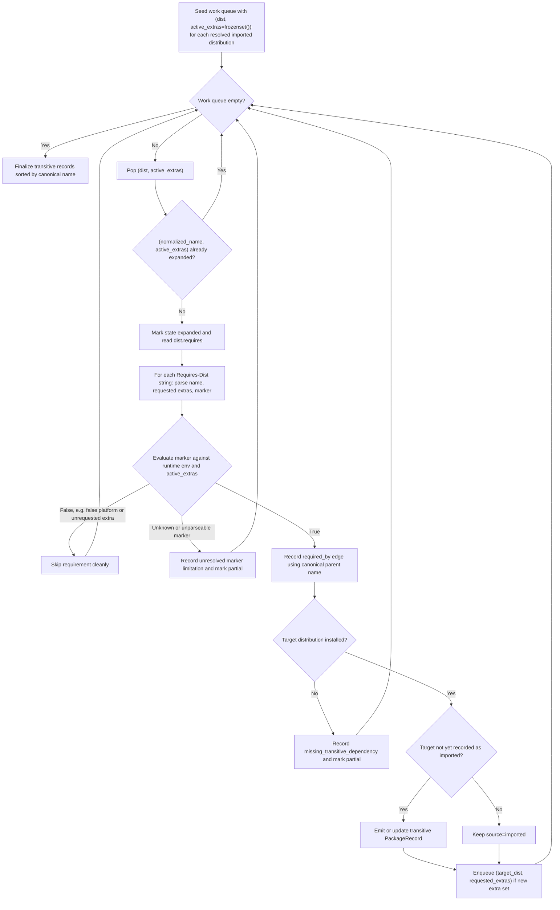

# IPD: Recursive marker-aware transitive dependency resolution

- Date: 2026-11-21
- Kind: child
- Concern: Recursive, cycle-safe, PEP 508 marker-aware, and extra-honest transitive dependency resolution in `imported-transitive` mode without adding a mandatory `packaging` dependency.
- Scope: Create a pure standard-library PEP 508 requirement and marker evaluator in `src/pubrun/capture/_markers.py`, refactor `imported-transitive` in `src/pubrun/capture/packages.py` to compute a recursive marker-aware closure with honest handling of optional extras, missing transitive dependencies, and unparseable markers, add behavioral tests in `tests/test_package_transitive.py`, and reconcile `tests/test_new_features.py`.
- Scope-Paths: src/pubrun/capture/_markers.py, src/pubrun/capture/packages.py, tests/test_package_transitive.py, tests/test_new_features.py
- Item-Dependencies: executed:uil22c
- Status: to-review
- Short-Description: Add stdlib PEP 508 requirement/marker evaluator and recursive, cycle-safe, extra-honest imported-transitive closure
- Work-Kind: bug
- Priority: high
- From-Backlog: w4hxkh
- Blocks-Release: next
- Set: dep-capture
- Order: 2
- Highest E allocated: 04
- Author: agent
- Id: fdqkrz

> Write and proofread this plan per the technical writing standard, `.aw/system/workflows/technical-writing/technical-writing.md` (`.agents/workflows/technical-writing/technical-writing.md` in a legacy-layout install), including requirement 12 (diagrams).

## Workflow history

- 2026-11-21 draft (agent): created.
- 2026-11-21 to-review (agent): authored review-ready child plan 02 of Set `dep-capture` graduating backlog item `w4hxkh`.

## Goal

Replace the single-hop, marker-blind `imported-transitive` loop in `src/pubrun/capture/packages.py` with a clearly specified recursive, cycle-safe, Python Enhancement Proposal (PEP) 508 marker-aware closure using only the Python standard library. Installed optional extras must never be mislabeled as required dependencies, parent-requested extras must propagate accurately, and missing applicable transitive dependencies or unsupported marker syntax must degrade honestly to `partial` capture with explicit reasons.

### Recursive transitive closure and marker evaluation flow

The text in `## Proposed changes (ordered, validatable)` is normative. This diagram summarizes the recursive transitive closure loop and marker decision branches.

## Detailed Implementation Checklist (TODO)

Execution-state rule: mark an `E-*` item complete only after performing the action. That mark is not validation. Right-sizing rule: write for a modest executor that cannot hold much in its head. Each E-item is one step (one concern, about one file, executable in one focused pass) and its V-item names each unit it covers with its own check; a plan stays at about 5 E-items and 8 work Scope-Paths, else split it into more child plans (guidance, `IPD-Z603`). Accepted execution states: blocked, failed, pending, performed; terminal gate demands 'performed'.

### Task group 1: Standard-library PEP 508 requirement and marker evaluator

- [ ] E-01 Create `src/pubrun/capture/_markers.py` implementing a pure Python standard-library PEP 508 requirement parser and marker evaluator with PEP 440 version comparison and explicit tri-state evaluation (`True`, `False`, or unknown/unparseable error reason).
  - Depends on: none
  - Expected outcome: `src/pubrun/capture/_markers.py` parses requirement name, requested extras (`foo[bar, baz]`), and optional semicolon marker clause; evaluates all standard PEP 508 environment variables (`os_name`, `sys_platform`, `platform_machine`, `platform_python_implementation`, `platform_release`, `platform_system`, `platform_version`, `python_version`, `python_full_version`, `implementation_name`, `implementation_version`, `extra`) with proper `and`/`or`/parentheses precedence and PEP 440 version tuple ordering; returns an explicit `MarkerEvalResult(matched: Optional[bool], error: Optional[str])` so unsupported or malformed syntax is never guessed; uses zero third-party packages and supports Python 3.8 through 3.14.
  - Execution state: pending

### Task group 2: Recursive, cycle-safe, extra-honest transitive closure

- [ ] E-02 Refactor `imported-transitive` in `src/pubrun/capture/packages.py` to compute the recursive, cycle-safe closure over the cached distribution index using `src/pubrun/capture/_markers.py`, propagating parent-requested extras, skipping unrequested optional extras, and degrading to `partial` on missing applicable transitive dependencies or unparseable markers.
  - Depends on: E-01
  - Expected outcome: `imported-transitive` resolves multi-hop chains (`A -> B -> C`) recursively, terminates cleanly on direct and indirect cycles (`A -> B -> A`, `A -> A`), skips false environment markers and unrequested `extra == ...` requirements even when those extra packages are installed in the environment, follows `extra == "fast"` when a parent requires `dep[fast]`, keeps already-imported distributions marked `source = "imported"`, populates sorted canonical `required_by` lists on transitive records, flags missing applicable transitive dependencies and unparseable markers as `partial` with warnings/unresolved details, preserves `_parse_req_name`, and leaves the default mode as `imported-only`.
  - Execution state: pending

### Task group 3: Transitive behavioral tests and regression reconciliation

- [ ] E-03 Create `tests/test_package_transitive.py` with deterministic local `.dist-info` fixtures testing multi-hop chains, cycles, true and false environment markers, unrequested optional extras, parent-requested extras, missing applicable transitive dependencies, unparseable markers, PEP 503 name variants, and the no-import invariant.
  - Depends on: E-02
  - Expected outcome: `tests/test_package_transitive.py` passes via `pytest` with zero external package dependencies, proving every transitive closure contract case and verifying `imported-only` remains the default mode.
  - Execution state: pending

- [ ] E-04 Reconcile `tests/test_new_features.py` (`TestImportedTransitiveMode`) if needed and run the combined package capture test suite.
  - Depends on: E-03
  - Expected outcome: `pytest tests/test_package_transitive.py tests/test_package_resolution.py tests/test_new_features.py tests/test_capture_engines.py tests/test_edge_cases.py tests/test_manifest_schema.py -v` passes with exit code 0.
  - Execution state: pending

## Project conventions discovered (Step 0)

- `src/pubrun/capture/packages.py` (`get_packages`, `_parse_req_name`) previously iterated `list(imported_names)` once (one hop only), ignored PEP 508 markers and `extra == ...` clauses entirely, matched names with `.lower()` rather than PEP 503 normalization, and silently dropped `PackageNotFoundError` under the assumption every missing package was an uninstalled extra.
- `tests/test_new_features.py` (`TestImportedTransitiveMode`) tests `_parse_req_name` directly on seven PEP 508 strings and tests `imported-transitive` with synthetic `pubrun_fake_pkg -> pubrun_fake_dep>=1.0.0` via monkeypatched `importlib.metadata.version` and `importlib.metadata.distribution`.
- `pyproject.toml` permits only standard-library runtime code (plus `tomli` on Python `<3.11`); adding `packaging` as a mandatory dependency is prohibited by `w4hxkh`.
- Child plan `uil22c` (`Order: 1`) establishes `normalize_package_name`, the cached `_DistributionIndex`, and `resolve_packages_snapshot()` in `src/pubrun/capture/packages.py`.

## Findings

- **F-01 (One-hop truncation):** The prior `imported-transitive` implementation visits only direct requirements of initially imported packages (`A -> B`) and misses deeper transitive dependencies (`B -> C`), while reporting `capture_state.status == "complete"`.
- **F-02 (Marker and extra blindness):** Ignoring PEP 508 markers causes false-positive inclusion of platform-inapplicable dependencies (for example, `pywin32; sys_platform == "win32"` on Linux if somehow present) and installed optional extras (`pytest; extra == "dev"`), falsely describing development or test extras as required runtime dependencies.
- **F-03 (Silent missing-dependency drops):** Treating every `PackageNotFoundError` during transitive traversal as an uninstalled extra hides genuinely missing unconditional dependencies when markers are not evaluated.

## Proposed changes (ordered, validatable)

1. **`src/pubrun/capture/_markers.py`** (new module, Python standard library only):
   - Implement `ParsedRequirement` (dataclass): `name: str`, `normalized_name: str`, `extras: Tuple[str, ...]` (PEP 503 normalized), `marker: Optional[str]`, `raw: str`.
   - Implement `parse_requirement(req_str: str) -> Optional[ParsedRequirement]`:
     - Extract distribution name using PEP 508 name grammar (`^[A-Za-z0-9]([A-Za-z0-9._-]*[A-Za-z0-9])?`).
     - Parse optional bracketed extras list (`[extra1, extra2]`) normalized with PEP 503 rules.
     - Split optional marker clause on the first unquoted `;` (handling direct URL requirements `name @ https://... ; marker` safely without splitting inside URLs or quotes).
   - Implement `default_marker_environment() -> Dict[str, str]` computing all PEP 508 standard variables from `os`, `sys`, and `platform` (`os_name`, `sys_platform`, `platform_machine`, `platform_python_implementation`, `platform_release`, `platform_system`, `platform_version`, `python_version`, `python_full_version`, `implementation_name`, `implementation_version`), matching PEP 508 definitions (including `implementation_version` formatting for CPython/PyPy and `python_full_version` stripping trailing `+`).
   - Implement a small recursive-descent tokenizer and evaluator `evaluate_marker(marker_str: str, *, active_extras: FrozenSet[str] = frozenset(), env: Optional[Dict[str, str]] = None) -> MarkerEvalResult`:
     - Grammar: `expr := or_expr`, `or_expr := and_expr ('or' and_expr)*`, `and_expr := atom ('and' atom)*`, `atom := '(' expr ')' | value op value`.
     - Operators: `==`, `!=`, `<`, `<=`, `>`, `>=`, `===`, `~=`, `in`, `not in`.
     - Version comparison: when either operand is a version marker variable (`python_version`, `python_full_version`, `implementation_version`), parse standard PEP 440 versions (`[N!]N(.N)*[{a|b|rc}N][.postN][.devN]`) for ordering (`<`, `<=`, `>`, `>=`, `==`, `!=`, `~=`). If a version string cannot be parsed cleanly (for example, malformed local/exotic version), return `MarkerEvalResult(matched=None, error=...)` instead of guessing.
     - `extra` variable semantics: when evaluating against `active_extras`, `extra == "foo"` (or `"foo" == extra`) matches if `normalize_package_name("foo") in active_extras`; when `active_extras` is empty, `extra == "foo"` is `False` and `extra != "foo"` is `True`; if a compound expression mixes `extra` with `or`/`and` and multiple `active_extras` are active (for example, parent requested `dep[a, b]`), evaluate the marker across each active extra (returning `True` if any active extra satisfies it, or evaluating with `extra=""` when `active_extras` is empty).
     - Unknown identifier, trailing tokens, unmatched quotes/parentheses, or unsupported operator -> return `MarkerEvalResult(matched=None, error="<concise reason>")` (never raise).

2. **`src/pubrun/capture/packages.py`**:
   - Keep `_parse_req_name(req_str: str) -> str` backed by `parse_requirement` (preserving exact return value for all `test_pep508_parser_edge_cases` inputs).
   - Replace the one-hop `imported-transitive` block with `_resolve_transitive_closure(imported_records, index, *, fallback_dist_lookup)`:
     - Use a `collections.deque` initialized with `(dist_key, canonical_name, frozenset())` for every resolved imported distribution.
     - Maintain `expanded_states: Set[Tuple[str, FrozenSet[str]]]` to prevent infinite loops on cycles (`A -> B -> A`, `A -> A`) while still expanding a distribution again if a later edge requests an additional extra (`dep[fast]`).
     - Maintain `imported_keys: Set[str]` (PEP 503 normalized names of directly imported distributions) so directly imported distributions retain `source = "imported"` and are never downgraded to `"transitive"`.
     - Maintain `transitive_by_key: Dict[str, Dict[str, Any]]` and `required_by: Dict[str, Set[str]]` (storing canonical parent distribution names).
     - For each requirement in `dist.requires or []`:
       - Parse via `parse_requirement(req_str)`. If empty/unparseable non-blank string, record an unresolved warning and mark `partial`.
       - Evaluate marker (if present) via `evaluate_marker(parsed.marker, active_extras=current_extras)`.
       - If `result.matched is False`: skip cleanly (do NOT mark `partial`; unrequested extras and false platform markers are expected skips).
       - If `result.matched is None`: record an unresolved entry (`reason = "unparseable_marker"`, `module = parsed.name`, `detail = result.error`) and mark `capture_state.status = "partial"` with a warning so limitations are never hidden behind `"complete"`.
       - If `result.matched is True`:
         - Look up target distribution in `index.by_normalized_name` (falling back to `importlib.metadata.distribution(parsed.name)` for monkeypatched tests or custom finders).
         - If target is NOT installed: record an unresolved entry (`reason = "missing_transitive_dependency"`, `module = parsed.name`, `detail = f"required by {parent_name}"`) and mark `capture_state.status = "partial"` with a warning.
         - If target IS installed:
           - Record `parent_name` in `required_by[target_key]` (if `target_key != parent_key`).
           - If `target_key not in imported_keys` and `target_key not in transitive_by_key`: create its transitive record (`name`, `version`, `location`, `editable`, `source = "transitive"`, `required_by = []`).
           - If `(target_key, parsed_extras_frozenset)` has not been expanded yet, enqueue it!
     - Attach `sorted(required_by[key])` to each transitive record.
     - Keep `get_packages()` output schema-valid with the current `schemas/manifest.schema.json` (surfacing partial status and warnings in `capture_state`, while `resolve_packages_snapshot()` also returns the structured `unresolved` list for child `ijipnx`).

3. **`tests/test_package_transitive.py`** (new test file) and **`tests/test_new_features.py`**:
   - Add deterministic local `.dist-info` fixture tests in `tests/test_package_transitive.py` covering:
     1. Multi-hop chain (`app_pkg -> mid_pkg -> leaf_pkg`): all three appear; `app_pkg` has `source="imported"`, `mid_pkg` has `source="transitive"`, `required_by=["app-pkg"]`, and `leaf_pkg` has `source="transitive"`, `required_by=["mid-pkg"]`.
     2. Dependency cycles (`cyc_a -> cyc_b -> cyc_a` and `self_pkg -> self_pkg`): terminates cleanly without error, `cyc_a` stays `source="imported"`, `cyc_b` has `source="transitive"`, `required_by=["cyc-a"]`.
     3. False environment marker (`dep_other_os; sys_platform == "nonexistent_os"` and `dep_old_py; python_version < "2.0"`): installed in the fixture environment, yet excluded from transitive records and capture remains `"complete"`.
     4. True environment marker (`dep_curr_py; python_version >= "3.8"` and compound `and`/`or`/parentheses): included accurately.
     5. Optional extras:
        - Unrequested extra (`opt_dev; extra == "dev"`) installed in the fixture environment -> NOT included in transitive records; capture remains `"complete"`.
        - Parent-requested extra (`parent` requires `mid[fast]`, and `mid` requires `fast_dep; extra == "fast"` plus `slow_dep; extra == "slow"`) -> `fast_dep` IS included with `required_by=["mid"]`, while `slow_dep` is excluded!
     6. Missing applicable transitive dependency (`parent` unconditionally requires `missing_dep>=1.0`, not installed) -> `capture_state.status == "partial"`, warning/unresolved reason names `missing_dep`.
     7. Unsupported/unparseable marker (`parent` requires `weird_dep; unknown_var == "x"` or malformed syntax) -> does not crash, degrades honestly to `capture_state.status == "partial"` with warning/unresolved reason.
     8. PEP 503 normalization in transitive edges (`My_Dep` vs `my-dep`) and no-import invariant (transitive dependencies are never imported during resolution).
   - Verify `tests/test_new_features.py` (`TestImportedTransitiveMode`) continues to pass unchanged (or reconcile cleanly if any mock needs minimal adjustment without weakening its contract).

## Deferred / out of scope (with reason)

- Startup-to-finalization package refresh, manifest schema extensions (`unresolved`, `observed_at`, `snapshot_stage`, `import_names`, `local_modules`, `coverage_notes`), and report/TUI integration: implemented in child plan `ijipnx` (`Order: 3`).
- Benchmarking and documentation updates (`docs/configuration.md` removing the stale "(one level)" statement, `docs/manifest.md`, `docs/performance.md`): implemented in child plan `iflqsl` (`Order: 4`).
- Full PEP 440 version-specifier satisfaction checking against installed versions (beyond marker version comparisons): out of scope for capture; version conflict checking belongs to preflight/reproducibility analysis.

## Scope check

- Over-scope: none. Adds only the pure standard-library PEP 508 marker module, refactors `imported-transitive` in `packages.py`, and adds targeted transitive tests.
- Under-scope: none. Covers every requirement in `w4hxkh` guidance item 4 and acceptance criterion 4.

## Required tests / validation

- Run `pytest tests/test_package_transitive.py tests/test_package_resolution.py tests/test_new_features.py tests/test_capture_engines.py tests/test_edge_cases.py tests/test_manifest_schema.py -v` and paste actual runner output.

## Spec / documentation sync

- `docs/configuration.md`, `docs/manifest.md`, and `src/pubrun/resources/default.toml` are updated in child plan `iflqsl` (`Order: 4`) to document recursive marker-aware transitive resolution and replace the stale "(one level)" note.
- `schemas/manifest.schema.json` is updated in child plan `ijipnx` (`Order: 3`).

## Open questions

### OQ-01: Top-level optional extra inference in `imported-transitive` mode

- Blocking: no
- Status: resolved
- Owner: maintainer (confirmed upon plan approval)
- Resolution or deferral rationale: Python runtime metadata (`sys.modules` and `.dist-info`) does not record which optional extras a user passed to `pip install` for a root package. Evaluating root imported distributions with `active_extras=frozenset()` prevents falsely labeling installed `dev`/`test`/`docs` extras as required runtime dependencies; any extra library that the script actually imports is captured directly as `source = "imported"`, and any extra explicitly required by another distribution (`pkg[extra]`) is propagated accurately. Child `iflqsl` documents this contract clearly.

## Validation and cross-check (verify before reporting done)

Validation-state rule: inspect evidence in a separate pass. Do not mark a `V-*` item complete from memory or from the matching execution checkmark. Accepted validation results: blocked, failed, pass, pending; terminal gate demands 'pass'. Runtime-demonstration reachability rule: for each `V-*` item demanding the software be observed acting (such as a run, a dispatch, or a transition)—as distinct from items demanding a diff, a file's content, or a test result, which are reachable by construction—name the code path that produces the observation or the sibling `E-*` that creates it, else the demand is UNDER-SCOPE.

- [ ] V-01 validates E-01
  - Required evidence: Paste `pytest tests/test_package_transitive.py -k "marker or parse" -v` output showing exit code 0, proving `src/pubrun/capture/_markers.py` parses PEP 508 requirements and evaluates environment markers, version comparisons, extras, and unknown/malformed markers using only the Python standard library.
  - Observed evidence:
  - Result: pending

- [ ] V-02 validates E-02
  - Required evidence: Paste `pytest tests/test_package_transitive.py -k "chain or cycle or extra or missing or unparseable or no_import" -v` output showing exit code 0, proving recursive closure, cycle safety, extra honesty, missing-dependency and unknown-marker `partial` degradation, and no-import behavior.
  - Observed evidence:
  - Result: pending

- [ ] V-03 validates E-03
  - Required evidence: Paste full `pytest tests/test_package_transitive.py -v` runner output showing exit code 0 with all deterministic fixture tests passing and confirming `imported-only` remains the default mode.
  - Observed evidence:
  - Result: pending

- [ ] V-04 validates E-04
  - Required evidence: Paste full `pytest tests/test_package_transitive.py tests/test_package_resolution.py tests/test_new_features.py tests/test_capture_engines.py tests/test_edge_cases.py tests/test_manifest_schema.py -v` runner output showing exit code 0.
  - Observed evidence:
  - Result: pending

## Approval and execution gate

- Size assessment: standard
- Cohesion rationale: not required

Execution contract:
1. All open questions (OQ-01) are resolved for review and become binding upon human approval (`- Status: approved`) and completion of dependency `uil22c`.
2. Scope fence: modify only `src/pubrun/capture/_markers.py`, `src/pubrun/capture/packages.py`, `tests/test_package_transitive.py`, and `tests/test_new_features.py`; do not expand scope; if execution seems to need more files, STOP and report.
3. Honesty rule: paste actual runner output and exit codes into `Observed evidence`; never claim tests passed without running them.
4. Commit discipline: commit only this plan's changed files via `aw commit fdqkrz -- <paths>`; never use `git add -A`, `git add .`, or `git commit -a`; never push.
5. Lifecycle move on completion: after all `E-*` items are `performed` and all `V-*` items are `pass`, run the post-gate `aw ipd` transition to `.aw/records/plans/executed/`, set `- Status: executed`, and append a dated `## Workflow history` line.
