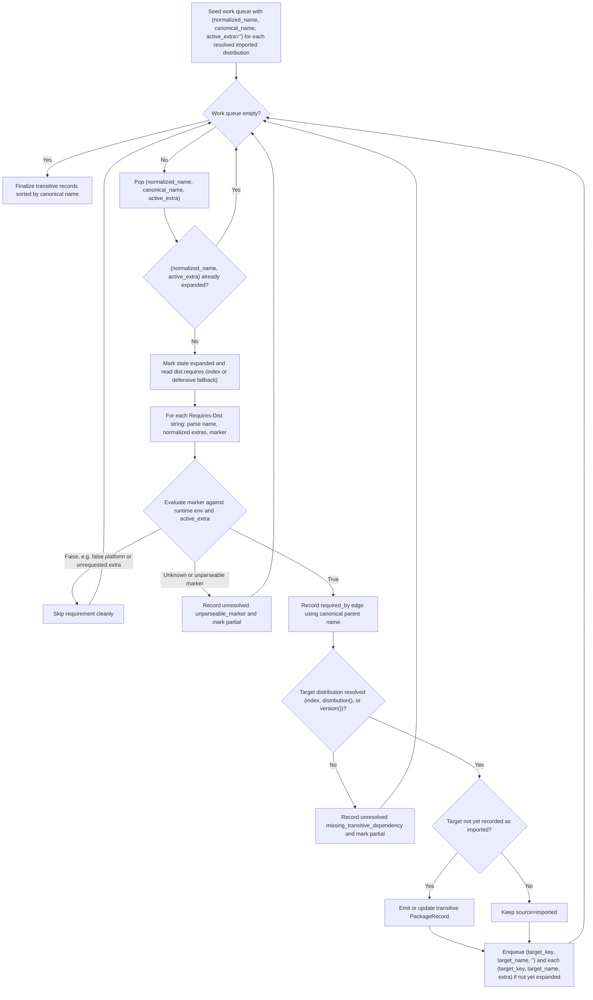

# IPD: Recursive marker-aware transitive dependency resolution

- Date: 2026-11-21
- Kind: child
- Concern: Recursive, cycle-safe, Python Enhancement Proposal (PEP) 508 marker-aware, and extra-honest transitive dependency resolution in `imported-transitive` mode without adding a mandatory `packaging` dependency.
- Scope: Create a pure standard-library PEP 508 requirement and marker evaluator in `src/pubrun/capture/_markers.py`, refactor `imported-transitive` in `src/pubrun/capture/packages.py` to compute a recursive marker-aware closure with honest handling of optional extras, missing transitive dependencies, and unparseable markers, add behavioral tests in `tests/test_package_transitive.py`, and reconcile `tests/test_new_features.py`.
- Scope-Paths: src/pubrun/capture/_markers.py, src/pubrun/capture/packages.py, tests/test_package_transitive.py, tests/test_new_features.py
- Item-Dependencies: executed:uil22c
- Status: reviewed
- Readiness: go-pending-approval
- Review-Depth: standard
- Short-Description: Add stdlib PEP 508 requirement/marker evaluator and recursive, cycle-safe, extra-honest imported-transitive closure
- Work-Kind: bug
- Priority: high
- From-Backlog: w4hxkh
- Blocks-Release: next
- Set: dep-capture
- Order: 2
- Highest E allocated: 04
- Author: agent
- Id: fdqkrz

> Write and proofread this plan per the technical writing standard, `.aw/system/workflows/technical-writing/technical-writing.md` (`.agents/workflows/technical-writing/technical-writing.md` in a legacy-layout install), including requirement 12 (diagrams).

## Workflow history

- 2026-11-22 /plan-review (Antigravity / Gemini): APPROVE WITH REVISIONS APPLIED; PR-001, PR-002, PR-003, PR-004, PR-005, PR-006
- 2026-11-21 draft (agent): created.
- 2026-11-21 to-review (agent): authored review-ready child plan 02 of Set `dep-capture` graduating backlog item `w4hxkh`.

## Goal

Replace the single-hop, marker-blind `imported-transitive` loop in `src/pubrun/capture/packages.py` with a clearly specified recursive, cycle-safe, PEP 508 marker-aware closure using only the Python standard library. Installed optional extras must never be mislabeled as required dependencies, parent-requested extras must propagate accurately, and missing applicable transitive dependencies or unsupported marker syntax must degrade honestly to `partial` capture with explicit reasons.

### Recursive transitive closure and marker evaluation flow

The text in `## Proposed changes (ordered, validatable)` is normative. This diagram summarizes the recursive transitive closure loop and marker decision branches.

## Detailed Implementation Checklist (TODO)

Execution-state rule: mark an `E-*` item complete only after performing the action. That mark is not validation. Right-sizing rule: write for a modest executor that cannot hold much in its head. Each E-item is one step (one concern, about one file, executable in one focused pass) and its V-item names each unit it covers with its own check; a plan stays at about 5 E-items and 8 work Scope-Paths, else split it into more child plans (guidance, `IPD-Z603`). Accepted execution states: blocked, failed, pending, performed; terminal gate demands 'performed'.

### Task group 1: Standard-library PEP 508 requirement and marker evaluator

- [ ] E-01 Create `src/pubrun/capture/_markers.py` implementing a pure Python standard-library PEP 508 requirement parser and marker evaluator with PEP 440 version comparison and explicit tri-state evaluation (`True`, `False`, or unknown/unparseable error reason).
  - Depends on: none
  - Expected outcome: `src/pubrun/capture/_markers.py` parses requirement name, PEP 503 normalized requested extras (`foo[bar, baz]`), direct Uniform Resource Locator (URL) requirements, and optional semicolon marker clauses. It evaluates all standard PEP 508 environment variables (plus PEP 508 legacy dotted aliases such as `os.name` and `sys.platform`) with proper `and`/`or`/parentheses precedence, PEP 440 version comparison (including trailing-zero equivalence, `.*` prefix wildcards on `==`/`!=`, `~=` compatible release, and strict string `===` and `in`/`not in`), and PEP 503 normalized `extra` comparisons. It returns an explicit `MarkerEvalResult(matched: Optional[bool], error: Optional[str])` so unsupported or malformed syntax is never guessed, uses zero third-party packages, and supports Python 3.8 through 3.14.
  - Execution state: pending

### Task group 2: Recursive, cycle-safe, extra-honest transitive closure

- [ ] E-02 Refactor `imported-transitive` in `src/pubrun/capture/packages.py` to compute the recursive, cycle-safe closure over the cached distribution index using `src/pubrun/capture/_markers.py`, propagating parent-requested extras, skipping unrequested optional extras, and degrading to `partial` on missing applicable transitive dependencies or unparseable markers.
  - Depends on: E-01
  - Expected outcome: `imported-transitive` resolves multi-hop chains (`A -> B -> C`) recursively and terminates cleanly on direct and indirect cycles (`A -> B -> A`, `A -> A`). It expands each `(normalized_name, active_extra)` state at most once (always enqueueing both base `""` and each requested extra), skips false environment markers and unrequested `extra == ...` requirements even when installed, and follows `extra == "fast"` when a parent requires `dep[fast]`. Directly imported distributions stay `source = "imported"`, transitive records carry sorted canonical `required_by` lists, and fallback lookup checks both `importlib.metadata.distribution()` and `importlib.metadata.version()` (preserving `tests/test_new_features.py::TestImportedTransitiveMode`). Missing applicable transitive dependencies and unparseable requirements or markers degrade to `partial` with `unresolved` entries matching child plan `ijipnx`'s schema shape, `_parse_req_name` is preserved, and `imported-only` remains the default mode.
  - Execution state: pending

### Task group 3: Transitive behavioral tests and regression reconciliation

- [ ] E-03 Create `tests/test_package_transitive.py` with deterministic local `.dist-info` fixtures testing multi-hop chains, cycles, true and false environment markers, PEP 440 version edge cases (`.*`, `~=`, `3.9 < 3.10`), unrequested optional extras, parent-requested extras, missing applicable transitive dependencies, unparseable markers, PEP 503 name variants, and the no-import invariant.
  - Depends on: E-02
  - Expected outcome: `tests/test_package_transitive.py` passes via `pytest` with zero external package dependencies, proving every transitive closure and marker-evaluator contract case and verifying `imported-only` remains the default mode.
  - Execution state: pending

- [ ] E-04 Reconcile `tests/test_new_features.py::TestImportedTransitiveMode` if needed and run the combined package capture test suite.
  - Depends on: E-03
  - Expected outcome: `pytest tests/test_package_transitive.py tests/test_package_resolution.py tests/test_new_features.py tests/test_capture_engines.py tests/test_edge_cases.py tests/test_manifest_schema.py -v` passes with exit code 0.
  - Execution state: pending

## Project conventions discovered (Step 0)

- `src/pubrun/capture/packages.py::get_packages` and `src/pubrun/capture/packages.py::_parse_req_name` previously iterated `list(imported_names)` once (one hop only), ignored PEP 508 markers and `extra == ...` clauses entirely, matched names with `.lower()` rather than PEP 503 normalization, and silently dropped `PackageNotFoundError` under the assumption every missing package was an uninstalled extra.
- `tests/test_new_features.py::TestImportedTransitiveMode` tests `_parse_req_name` directly on seven PEP 508 strings and tests `imported-transitive` with synthetic `pubrun_fake_pkg -> pubrun_fake_dep>=1.0.0` via monkeypatched `importlib.metadata.version` (returning versions for both) and `importlib.metadata.distribution` (returning a minimal `MockDist` defining only `.requires` for `pubrun_fake_pkg` and raising `PackageNotFoundError` for `pubrun_fake_dep`).
- `pyproject.toml` permits only standard-library runtime code (plus `tomli` on Python `<3.11`); adding `packaging` as a mandatory dependency is prohibited by backlog item `w4hxkh` (dependency capture).
- Prerequisite child plan `uil22c` (`Order: 1`, distribution identity resolution and caching) establishes `normalize_package_name`, the cached `_DistributionIndex` (`_get_distribution_index`), and `resolve_packages_snapshot()` in `src/pubrun/capture/packages.py`.
- Downstream child plan `ijipnx` (`Order: 3`, startup-to-finalization merge and manifest schema) defines `$defs.unresolved_package_record` (`additionalProperties: false`, `required: ["module", "reason"]`, properties `module`, `reason`, `candidates`, `observed_at`, `detail`) with `reason` enum including `"missing_transitive_dependency"` and `"unparseable_marker"`.

## Findings

- **F-01 (One-hop truncation):** The prior `imported-transitive` implementation visits only direct requirements of initially imported packages (`A -> B`) and misses deeper transitive dependencies (`B -> C`), while reporting `capture_state.status == "complete"`.
- **F-02 (Marker and extra blindness):** Ignoring PEP 508 markers causes false-positive inclusion of platform-inapplicable dependencies (for example, `pywin32; sys_platform == "win32"` on Linux if present) and installed optional extras (`pytest; extra == "dev"`), falsely describing development or test extras as required runtime dependencies.
- **F-03 (Silent missing-dependency drops):** Treating every `PackageNotFoundError` during transitive traversal as an uninstalled extra hides genuinely missing unconditional dependencies when markers are not evaluated.

## Proposed changes (ordered, validatable)

1. **`src/pubrun/capture/_markers.py`** (new module, Python standard library only):
   - Implement `ParsedRequirement` (dataclass): `name: str`, `normalized_name: str`, `extras: Tuple[str, ...]` (PEP 503 normalized), `marker: Optional[str]`, `raw: str`.
   - Implement `MarkerEvalResult` (dataclass): `matched: Optional[bool]`, `error: Optional[str] = None`.
   - Implement `parse_requirement(req_str: str) -> Optional[ParsedRequirement]`:
     - Strip whitespace; return `None` for empty strings (so `_parse_req_name("")` returns `""` cleanly without error, while non-blank strings that fail parsing return `None` and signal an unparseable requirement to the caller).
     - Extract distribution name using PEP 508 name grammar (`^[A-Za-z0-9]([A-Za-z0-9._-]*[A-Za-z0-9])?`).
     - Parse optional bracketed extras list (`[extra1, extra2]`, tolerating internal whitespace) normalized with PEP 503 rules; reject unclosed brackets as unparseable (`None`).
     - Handle optional direct URL specs (`@ <non-whitespace-URI>`) before splitting the optional marker clause on the first unquoted `;` so a `;` inside a URL or quoted string is not misread as a marker separator.
   - Implement `default_marker_environment() -> Dict[str, str]` computing all PEP 508 standard variables from `os`, `sys`, and `platform`: `os_name`, `sys_platform`, `platform_machine`, `platform_python_implementation`, `platform_release`, `platform_system`, `platform_version`, `python_version` (`".".join(platform.python_version_tuple()[:2])`), `python_full_version` (`platform.python_version().rstrip("+")` or prefix before `+`), `implementation_name` (`sys.implementation.name`), and `implementation_version` (formatted from `sys.implementation.version` using PEP 508's `major.minor.micro[kind[0]serial]` rule when `releaselevel != "final"`). Also resolve the 6 legacy PEP 508 dotted/short aliases (`os.name` -> `os_name`, `sys.platform` -> `sys_platform`, `platform.version` -> `platform_version`, `platform.machine` -> `platform_machine`, `platform.python_implementation` -> `platform_python_implementation`, `python_implementation` -> `platform_python_implementation`) so older wheel metadata does not produce spurious `partial` warnings.
   - Implement a small recursive-descent tokenizer and evaluator `evaluate_marker(marker_str: str, *, active_extra: str = "", active_extras: Optional[FrozenSet[str]] = None, env: Optional[Dict[str, str]] = None) -> MarkerEvalResult`:
     - Grammar: `expr := or_expr`, `or_expr := and_expr ('or' and_expr)*`, `and_expr := atom ('and' atom)*`, `atom := '(' expr ')' | value op value`.
     - Operators: `==`, `!=`, `<`, `<=`, `>`, `>=`, `===`, `~=`, `in`, `not in`.
     - Version comparison (when either operand is `python_version`, `python_full_version`, or `implementation_version`):
       - For `in` and `not in`: use standard PEP 508 string substring semantics (do NOT attempt PEP 440 version parsing on substring lists like `python_version in "3.8 3.9 3.10"`).
       - For `===`: use PEP 440 arbitrary equality (case-insensitive string equality).
       - For `==`, `!=`, `<`, `<=`, `>`, `>=`, `~=`: parse standard PEP 440 versions (`[N!]N(.N)*[{a|b|rc}N][.postN][.devN]`), normalizing trailing release zeros (`3.10` == `3.10.0`) so numeric comparison handles `"3.9" < "3.10"` accurately. Support PEP 440 prefix wildcards `.*` on `==` and `!=` (for example `python_version == "3.11.*"` comparing release prefix tuple). Support PEP 440 compatible release `~=` (`V >= target` AND `V.release[:len(target.release)-1] == target.release[:len(target.release)-1]`, requiring at least 2 release components else returning `matched=None`). If a version string cannot be parsed cleanly (for example, malformed local/exotic version), return `MarkerEvalResult(matched=None, error=...)` instead of guessing.
     - `extra` variable semantics: normalize both the active extra and string literals compared against `extra` using PEP 503 normalization (so `extra == "dev_tools"` matches requested extra `"dev-tools"`). When `active_extras` is provided and non-empty, evaluate once per normalized extra in `active_extras` (returning `MarkerEvalResult(matched=True)` if any satisfies the marker, `MarkerEvalResult(matched=None, error=...)` if an error occurs and none matched, else `False`); when evaluating a single `active_extra` (default `""`), evaluate with `extra = normalize_package_name(active_extra)` if non-empty else `""`.
     - Unknown identifier, trailing tokens, unmatched quotes/parentheses, or unsupported operator -> return `MarkerEvalResult(matched=None, error="<concise reason>")` (never raise).

2. **`src/pubrun/capture/packages.py`**:
   - Keep `src/pubrun/capture/packages.py::_parse_req_name(req_str: str) -> str` backed by `src/pubrun/capture/_markers.py::parse_requirement` (preserving exact return value for all `tests/test_new_features.py::TestImportedTransitiveMode.test_pep508_parser_edge_cases` inputs, including `""` -> `""`).
   - Replace the one-hop `imported-transitive` block with `_resolve_transitive_closure(imported_records, index, *, env=None)`:
     - Use a `collections.deque` initialized with `(normalize_package_name(rec["name"]), rec["name"], "")` for every resolved imported distribution (evaluating root distributions with base `active_extra = ""`, never guessing unrequested optional extras).
     - Maintain `expanded_states: Set[Tuple[str, str]]` keyed by `(normalized_name, active_extra)` to prevent infinite loops on cycles (`A -> B -> A`, `A -> A`) and prevent subset blow-up while still expanding a distribution again whenever a parent requests a specific extra (`dep[fast]`).
     - Maintain `imported_keys: Set[str]` (PEP 503 normalized names of directly imported distributions) so directly imported distributions retain `source = "imported"` and are never downgraded to `"transitive"`.
     - Maintain `transitive_by_key: Dict[str, Dict[str, Any]]` and `required_by: Dict[str, Set[str]]` (storing canonical parent distribution names).
     - To read `requires` for `(parent_key, parent_name)`: check `index.by_normalized_name.get(parent_key)` first; if absent (for example, monkeypatched custom finder in `TestImportedTransitiveMode`), call `importlib.metadata.distribution(parent_name)` defensively inside `try/except Exception` and read `getattr(dist, "requires", None) or []`.
     - For each requirement string `req_str` in `requires`:
       - Skip blank/whitespace-only strings cleanly.
       - Parse via `parse_requirement(req_str)`. If `None` on a non-blank string, record an unresolved entry `{"module": req_str.strip()[:80], "reason": "unparseable_marker", "candidates": [], "detail": "unparseable requirement string"}` and mark `partial` with a warning.
       - Evaluate marker (if `parsed.marker` is present) via `evaluate_marker(parsed.marker, active_extra=current_extra, env=env)`.
       - If `result.matched is False`: skip cleanly (do NOT mark `partial`; unrequested extras and false platform markers are expected skips).
       - If `result.matched is None`: record an unresolved entry `{"module": parsed.name, "reason": "unparseable_marker", "candidates": [], "detail": result.error}` and mark `capture_state.status = "partial"` with a warning so limitations are never hidden behind `"complete"`.
       - If `result.matched is True`:
         - Resolve target distribution:
           1. Check `index.by_normalized_name.get(parsed.normalized_name)`.
           2. If absent, try `importlib.metadata.distribution(parsed.name)` defensively (reading `metadata["Name"]` or `parsed.name`, `.version` or `importlib.metadata.version(parsed.name)`, `location`, `editable`).
           3. If `distribution(parsed.name)` raises `PackageNotFoundError`, also try `importlib.metadata.version(parsed.name)` directly (preserving `tests/test_new_features.py::TestImportedTransitiveMode.test_transitive_deps_discovered`, where `mock_distribution("pubrun_fake_dep")` raises `PackageNotFoundError` while `mock_version("pubrun_fake_dep")` returns `"2.0.0"`).
         - If target still cannot be resolved: record an unresolved entry `{"module": parsed.name, "reason": "missing_transitive_dependency", "candidates": [], "detail": f"required by {parent_name}"}` and mark `capture_state.status = "partial"` with a warning.
         - If target IS resolved:
           - Record `parent_name` in `required_by[target_key]` (if `target_key != parent_key`).
           - If `target_key not in imported_keys` and `target_key not in transitive_by_key`: create its transitive record (`name`, `version`, `location`, `editable`, `source = "transitive"`, `required_by = []`).
           - Always enqueue `(target_key, target_name, "")` if not yet in `expanded_states` (so base requirements are traversed even when first reached via `dep[fast]`), AND enqueue `(target_key, target_name, extra)` for each normalized `extra` in `parsed.extras` if not yet in `expanded_states`.
     - Attach `sorted(required_by[key])` to each transitive record.
     - Keep `get_packages()` output schema-valid with the current `schemas/manifest.schema.json` (surfacing partial status and warnings in `capture_state`, omitting `"detail"` when `None`, while `resolve_packages_snapshot()` also returns the structured `unresolved` list for child plan `ijipnx`).

3. **`tests/test_package_transitive.py`** (new test file) and **`tests/test_new_features.py`**:
   - Add deterministic local `.dist-info` fixture tests in `tests/test_package_transitive.py` covering:
     1. Multi-hop chain (`app_pkg -> mid_pkg -> leaf_pkg`): all three appear; `app_pkg` has `source="imported"`, `mid_pkg` has `source="transitive"`, `required_by=["app-pkg"]`, and `leaf_pkg` has `source="transitive"`, `required_by=["mid-pkg"]`.
     2. Dependency cycles (`cyc_a -> cyc_b -> cyc_a` and `self_pkg -> self_pkg`): terminates cleanly without error, `cyc_a` stays `source="imported"`, `cyc_b` has `source="transitive"`, `required_by=["cyc-a"]`.
     3. False environment markers (`dep_other_os; sys_platform == "nonexistent_os"` and `dep_old_py; python_version < "2.0"`): installed in the fixture environment, yet excluded from transitive records and capture remains `"complete"`.
     4. True environment markers and PEP 440 comparisons (`python_version >= "3.8"`, `"3.9" < "3.10"`, `python_version == "3.11.*"`, `python_version ~= "3.8"`, `python_version in "3.8 3.9 3.10"`, legacy `sys.platform` alias, direct URL with `;`, and compound `and`/`or`/parentheses): evaluated accurately.
     5. Optional extras:
        - Unrequested extra (`opt_dev; extra == "dev"`) installed in the fixture environment -> NOT included in transitive records; capture remains `"complete"`.
        - Parent-requested extra (`parent` requires `mid[fast_mode]`, and `mid` has unconditional `base_dep`, `fast_dep; extra == "fast-mode"`, and `slow_dep; extra == "slow"`) -> BOTH `base_dep` and `fast_dep` ARE included with `required_by=["mid"]`, while `slow_dep` is excluded.
     6. Missing applicable transitive dependency (`parent` unconditionally requires `missing_dep>=1.0`, not installed) -> `capture_state.status == "partial"`, warning/unresolved entry has `reason == "missing_transitive_dependency"` and names `missing_dep`.
     7. Unsupported/unparseable marker (`parent` requires `weird_dep; unknown_var == "x"` or malformed syntax) -> does not crash, degrades honestly to `capture_state.status == "partial"` with `reason == "unparseable_marker"`.
     8. PEP 503 normalization in transitive edges (`My_Dep` vs `my-dep`), no-import invariant (transitive dependencies are never imported during resolution), and `imported-only` remaining the default mode.
   - Verify `tests/test_new_features.py::TestImportedTransitiveMode` passes unchanged (or reconcile cleanly if any mock needs minimal adjustment without weakening its contract; acknowledge `tests/test_new_features.py` with `--scope-ack` at finalize if unmodified).

## Deferred / out of scope (with reason)

- Startup-to-finalization package refresh, manifest schema extensions (`unresolved`, `observed_at`, `snapshot_stage`, `import_names`, `local_modules`, `coverage_notes`), and report/Terminal User Interface (TUI) integration: implemented in child plan `ijipnx` (`Order: 3`, startup-to-finalization merge and manifest schema).
  - Carrier: ijipnx
- Benchmarking and documentation updates (`docs/configuration.md` removing the stale "(one level)" statement, `docs/manifest.md`, `docs/performance.md`): implemented in child plan `iflqsl` (`Order: 4`, package capture benchmarking and documentation sync).
  - Carrier: iflqsl
- Full PEP 440 version-specifier satisfaction checking against installed versions (beyond marker version comparisons): out of scope for runtime capture; version-conflict analysis belongs to reproducibility analysis rather than runtime dependency capture.
  - Carrier-Declined: out of scope for runtime dependency capture; version-conflict checking is handled separately from package capture

## Scope check

- Over-scope: none. Adds only the pure standard-library PEP 508 marker module, refactors `imported-transitive` in `src/pubrun/capture/packages.py`, and adds targeted transitive tests (4 Scope-Paths, 4 E-items).
- Under-scope: none. Covers every requirement in backlog item `w4hxkh` (dependency capture) guidance item 4 and acceptance criterion 4.

## Required tests / validation

- Run `pytest tests/test_package_transitive.py tests/test_package_resolution.py tests/test_new_features.py tests/test_capture_engines.py tests/test_edge_cases.py tests/test_manifest_schema.py -v` and paste actual runner output.

## Spec / documentation sync

- `docs/configuration.md`, `docs/manifest.md`, and `src/pubrun/resources/default.toml` are updated in child plan `iflqsl` (`Order: 4`, package capture benchmarking and documentation sync) to document recursive marker-aware transitive resolution and replace the stale "(one level)" note.
- `schemas/manifest.schema.json` is updated in child plan `ijipnx` (`Order: 3`, startup-to-finalization merge and manifest schema).

## Open questions

### OQ-01: Top-level optional extra inference in `imported-transitive` mode

- Blocking: no
- Status: resolved
- Owner: plan author (binding upon plan approval)
- Resolution or deferral rationale: Python runtime metadata (`sys.modules` and `.dist-info`) does not record which optional extras a user passed to `pip install` for a root package. Evaluating root imported distributions with `active_extra=""` prevents falsely labeling installed `dev`/`test`/`docs` extras as required runtime dependencies; any extra library that the script actually imports is captured directly as `source = "imported"`, and any extra explicitly required by another distribution (`pkg[extra]`) is propagated accurately. Child plan `iflqsl` documents this contract clearly.

## Validation and cross-check (verify before reporting done)

Validation-state rule: inspect evidence in a separate pass. Do not mark a `V-*` item complete from memory or from the matching execution checkmark. Accepted validation results: blocked, failed, pass, pending; terminal gate demands 'pass'. Runtime-demonstration reachability rule: for each `V-*` item demanding the software be observed acting (such as a run, a dispatch, or a transition) (as distinct from items demanding a diff, a file's content, or a test result, which are reachable by construction), name the code path that produces the observation or the sibling `E-*` that creates it, else the demand is UNDER-SCOPE.

- [ ] V-01 validates E-01
  - Required evidence: Paste `pytest tests/test_package_transitive.py -k "marker or parse" -v` output showing exit code 0 (with non-zero collected tests), proving `src/pubrun/capture/_markers.py` parses PEP 508 requirements (including direct URLs and extras) and evaluates environment markers, PEP 440 comparisons (`.*`, `~=`, numeric ordering), legacy aliases, normalized extras, and unknown/malformed markers using only the Python standard library.
  - Observed evidence:
  - Result: pending

- [ ] V-02 validates E-02
  - Required evidence: Paste `pytest tests/test_package_transitive.py -k "chain or cycle or extra or missing or unparseable or no_import" -v` output showing exit code 0 (with non-zero collected tests), proving recursive closure, cycle safety, extra honesty (both base and requested-extra expansion), missing-dependency and unknown-marker `partial` degradation with `ijipnx`-compatible `unresolved` entries, and no-import behavior.
  - Observed evidence:
  - Result: pending

- [ ] V-03 validates E-03
  - Required evidence: Paste full `pytest tests/test_package_transitive.py -v` runner output showing exit code 0 with all deterministic fixture tests passing and confirming `imported-only` remains the default mode.
  - Observed evidence:
  - Result: pending

- [ ] V-04 validates E-04
  - Required evidence: Paste full `pytest tests/test_package_transitive.py tests/test_package_resolution.py tests/test_new_features.py tests/test_capture_engines.py tests/test_edge_cases.py tests/test_manifest_schema.py -v` runner output showing exit code 0.
  - Observed evidence:
  - Result: pending

## Approval and execution gate

- Size assessment: standard
- Cohesion rationale: not required

Execution contract:
1. All open questions (OQ-01) are resolved for review and become binding upon human approval (`- Status: approved`) and completion of prerequisite child plan `uil22c` (distribution identity resolution and caching).
2. Scope declaration: expected modified or created files are `src/pubrun/capture/_markers.py`, `src/pubrun/capture/packages.py`, `tests/test_package_transitive.py`, and `tests/test_new_features.py`. If `tests/test_new_features.py` passes unchanged without edits, acknowledge it via `--scope-ack` at finalize; if execution requires editing an additional file or leaving another declared path unmodified, record the justification via `--scope-reason` or `--scope-ack` at finalize. Stop only for a genuinely unsafe condition such as an unresolvable concurrent-edit conflict or missing prerequisite symbols.
3. Honesty rule: paste actual runner output and exit codes into `Observed evidence`; never claim tests passed without running them.
4. Commit discipline: commit only this plan's changed files via `aw commit fdqkrz -- <paths>`; never use `git add -A`, `git add .`, or `git commit -a`; never push.
5. Lifecycle transition on completion: all `E-*` items must be `performed` and all `V-*` items `pass` before completion; when executed directly (outside an `aw` runner lane), run `aw ipd finalize fdqkrz` rather than a hand-rolled `git mv` to `.aw/records/plans/executed/`; when executed inside an `aw` runner lane, leave lifecycle finalization to the runner's post-turn finalize step.
