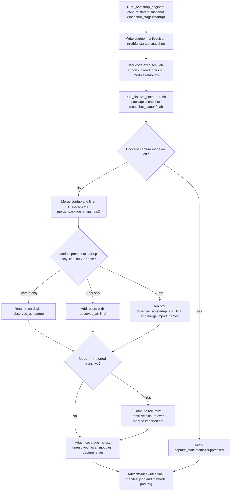
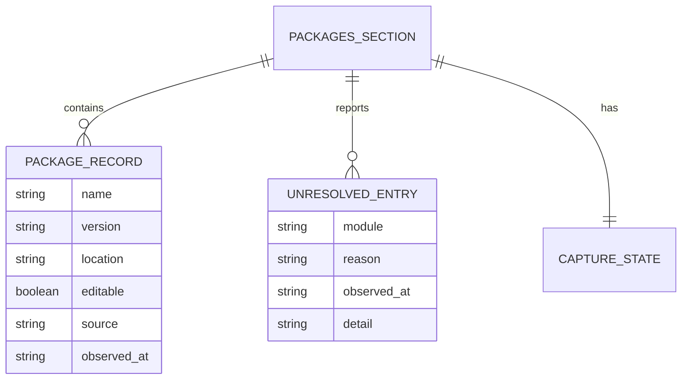

# IPD: Startup-to-finalization package merge, manifest schema, and report integration

- Date: 2026-11-21
- Kind: child
- Concern: Capturing late imports at finalization, retaining startup observations for removed modules, keeping startup and final snapshots distinguishable, extending the manifest JSON Schema additively, and updating downstream report and TUI consumers.
- Scope: Extend `schemas/manifest.schema.json` additively for richer package metadata, implement `merge_package_snapshots()` and stage-aware package capture in `src/pubrun/capture/packages.py`, wire startup snapshot plus finalization refresh and merge into `src/pubrun/tracker.py`, update `src/pubrun/report/methods.py`, `src/pubrun/report/diagnostics.py`, and `src/pubrun/tui/widgets/details.py`, and add lifecycle and schema conformance tests in `tests/test_package_lifecycle.py` and `tests/test_manifest_schema.py`.
- Scope-Paths: schemas/manifest.schema.json, src/pubrun/capture/packages.py, src/pubrun/tracker.py, src/pubrun/report/methods.py, src/pubrun/report/diagnostics.py, src/pubrun/tui/widgets/details.py, tests/test_manifest_schema.py, tests/test_package_lifecycle.py
- Item-Dependencies: executed:fdqkrz
- Status: to-review
- Short-Description: Extend manifest schema additively, refresh and merge packages at finalization, and update methods, diagnostics, and TUI consumers
- Work-Kind: bug
- Priority: high
- From-Backlog: w4hxkh
- Blocks-Release: next
- Set: dep-capture
- Order: 3
- Highest E allocated: 05
- Author: agent
- Id: ijipnx

> Write and proofread this plan per the technical writing standard, `.aw/system/workflows/technical-writing/technical-writing.md` (`.agents/workflows/technical-writing/technical-writing.md` in a legacy-layout install), including requirement 12 (diagrams).

## Workflow history

- 2026-11-21 draft (agent): created.
- 2026-11-21 to-review (agent): authored review-ready child plan 03 of Set `dep-capture` graduating backlog item `w4hxkh`.

## Goal

Ensure that placing `import pubrun` at the top of a script still records every library imported later during execution in the final manifest and methods report without installing a global import hook by default. Keep the startup manifest truthful for crash diagnosis, retain modules observed at startup even if removed from `sys.modules` before finalization, validate all new additive manifest fields against `schemas/manifest.schema.json`, and keep methods, diagnostics, and Terminal User Interface (TUI) views accurate and null-safe.

### Startup-to-finalization capture lifecycle and manifest entities

The text in `## Proposed changes (ordered, validatable)` is normative. These diagrams summarize the `Run` package capture lifecycle and the extended manifest `packages` entities.

## Detailed Implementation Checklist (TODO)

Execution-state rule: mark an `E-*` item complete only after performing the action. That mark is not validation. Right-sizing rule: write for a modest executor that cannot hold much in its head. Each E-item is one step (one concern, about one file, executable in one focused pass) and its V-item names each unit it covers with its own check; a plan stays at about 5 E-items and 8 work Scope-Paths, else split it into more child plans (guidance, `IPD-Z603`). Accepted execution states: blocked, failed, pending, performed; terminal gate demands 'performed'.

### Task group 1: Additive manifest schema and snapshot merge logic

- [ ] E-01 Extend `schemas/manifest.schema.json` additively under `$defs.package_record` and `$defs.packages_section` (plus new `$defs.unresolved_package_record`) without modifying any existing `required` arrays.
  - Depends on: none
  - Expected outcome: `$defs.package_record` adds optional `import_names` (`array` of strings or `null`) and `observed_at` (`enum: ["startup", "final", "startup_and_final", null]`); `$defs.packages_section` adds optional `snapshot_stage` (`enum: ["startup", "final", "single", null]`), `unresolved` (`array` of `$defs.unresolved_package_record`), `local_modules` (`array` of strings), and `coverage_notes` (`array` of strings); `schemas/manifest.schema.json` passes `jsonschema` meta-schema validation and accepts both legacy v1.0 manifests and new manifests.
  - Execution state: pending

- [ ] E-02 Add `merge_package_snapshots(startup_data, final_data, config=None)` and stage-aware `get_packages(config, *, stage="single")` in `src/pubrun/capture/packages.py` emitting the schema-valid extended fields cleanly.
  - Depends on: E-01
  - Expected outcome: `get_packages(config, stage="startup")` stamps `snapshot_stage = "startup"` and `observed_at = "startup"` on imported records; `merge_package_snapshots()` combines startup and final observations, retains modules observed at startup even if deleted from `sys.modules` before finalization (`observed_at = "startup"`), marks newly late-imported modules `observed_at = "final"`, marks persistent modules `observed_at = "startup_and_final"`, unions `import_names`, recomputes recursive transitive closure over the merged imported set in `imported-transitive` mode, merges `unresolved` and `local_modules`, computes honest combined `capture_state`, and attaches `coverage_notes` stating that transient mid-run import-and-unload without an import hook is not observable.
  - Execution state: pending

### Task group 2: Tracker lifecycle wiring and downstream consumer updates

- [ ] E-03 Wire startup package snapshotting (`stage="startup"`) in `Run._bootstrap_engines()` and finalization refresh plus merge (`stage="final"`) in `Run._finalize_state()` inside `src/pubrun/tracker.py`, preserving crash safety, `mode = "off"`, and mid-run `_merge_and_migrate()` config updates.
  - Depends on: E-02
  - Expected outcome: `Run._bootstrap_engines()` stores the startup snapshot (`self._startup_packages_data` and `self.packages_data` with `snapshot_stage = "startup"`) without installing any global import hook; `Run._finalize_state()` refreshes packages against current `sys.modules` and merges with `self._startup_packages_data` inside a protective `try/except` so a metadata failure degrades `packages.capture_state` to `"partial"` with warning detail and never crashes finalization or host exit; if `_merge_and_migrate()` turned package capture off (or on) mid-run, finalization respects the resolved config honestly.
  - Execution state: pending

- [ ] E-04 Update `src/pubrun/report/methods.py`, `src/pubrun/report/diagnostics.py`, and `src/pubrun/tui/widgets/details.py` to use PEP 503 normalized highlight matching, handle `None` versions safely, and surface partial or unresolved package capture diagnostics cleanly.
  - Depends on: E-03
  - Expected outcome: `extract_highlighted_packages()` in `src/pubrun/report/methods.py` normalizes names via `normalize_package_name` (so `scikit-learn` / `scikit_learn` highlights accurately) and guards `version is None`; `src/pubrun/report/diagnostics.py` guards `version is None` and notes unresolved package count when `packages.unresolved` is non-empty in `pubrun show packages` and standard/deep reports without breaking existing `test_show_sections.py` or `test_reports.py` expectations; `src/pubrun/tui/widgets/details.py` guards `pkg.get("version") or ""` so `None` versions never raise `AttributeError` when filtering.
  - Execution state: pending

### Task group 3: Lifecycle and schema conformance tests

- [ ] E-05 Create `tests/test_package_lifecycle.py` and extend `tests/test_manifest_schema.py` to test late imports, startup truthfulness, removed startup modules, `methods.md` late-import reflection, finalization error resilience, and schema conformance for startup, final, partial, and legacy manifests.
  - Depends on: E-04
  - Expected outcome: `pytest tests/test_package_lifecycle.py tests/test_manifest_schema.py tests/test_tracker.py tests/test_reports.py tests/test_show_sections.py tests/test_methods_multi.py tests/test_tui.py tests/test_quality.py -v` exits 0 with all tests passing.
  - Execution state: pending

## Project conventions discovered (Step 0)

- `src/pubrun/tracker.py` (`Run._bootstrap_engines`) calls `self.packages_data = get_packages(self.config)` once at startup; `Run._finalize_state` shuts down engines and never refreshes `self.packages_data`.
- `src/pubrun/writer.py` (`ArtifactWriter.write_artifacts`) calls `self.run._finalize_state()` first, then calls `self.run.to_manifest_dict()`, writes `manifest.json`, and calls `pubrun.report.methods.generate_report(manifest_data, methods_format)`. Updating `self.packages_data` inside `Run._finalize_state()` therefore feeds both the final `manifest.json` and `methods.{md,tex}` with no extra manifest writes.
- Coordination with sibling pending Sets `timing-acc` (`e1fwy2`) and `startup-perf` (`tkmm5p`): in `timing-acc`, workload end `t2` is recorded at the top of `Run._finalize_state()`, so refreshing packages during `_finalize_state()` is correctly accounted as finalization overhead rather than workload time; in `startup-perf`, `write_artifacts()` writes `manifest.json` once after `_finalize_state()`.
- `src/pubrun/report/templates.py` (`HIGHLIGHT_PACKAGES`) already lists `"scikit-learn"`, which could not match previously when `packages.py` emitted `"sklearn"`.
- `src/pubrun/tui/widgets/details.py` (`RunDetailsView.update_packages_pane`) does `version = pkg.get("version", "")` and `filter_text not in version.lower()`, which raises `AttributeError` if `pkg["version"]` is `None`.
- `schemas/manifest.schema.json` enforces `"additionalProperties": false` on `$defs.package_record` and `$defs.packages_section`.
- `src/pubrun/report/meta_snapshot.py` (`generate_meta_snapshot`) calls `get_packages(cfg)` standalone; defaulting `stage="single"` keeps meta snapshots clean and valid.

## Findings

- **F-01 (Late imports dropped):** Scripts following the documented one-import pattern (`import pubrun` on line 1, scientific imports below) never record those libraries in `manifest.json` or `methods.md` because `Run._finalize_state()` never refreshes packages.
- **F-02 (Startup vs final provenance indistinguishable):** Neither the manifest schema nor `packages.py` distinguishes a startup snapshot from a finalized merged snapshot or indicates whether a package was observed at startup, finalization, or both.
- **F-03 (Consumer null-version hazard and highlight mismatch):** `RunDetailsView.update_packages_pane` crashes on `version: None`, and `extract_highlighted_packages` uses `.lower()` instead of PEP 503 normalization.

## Proposed changes (ordered, validatable)

1. **`schemas/manifest.schema.json`:**
   - Add `$defs.unresolved_package_record` (`type: "object"`, `additionalProperties: false`, `required: ["module", "reason"]`, properties: `module` string, `reason` enum `["ambiguous", "unmapped_site_package", "missing_metadata", "metadata_error", "missing_transitive_dependency", "unparseable_marker"]`, `candidates` array of strings default `[]`, `observed_at` enum `["startup", "final", "startup_and_final", null]`, `detail` string or null).
   - Add optional properties to `$defs.package_record`:
     - `import_names`: `{"type": ["array", "null"], "items": {"type": "string"}}`
     - `observed_at`: `{"type": ["string", "null"], "enum": ["startup", "final", "startup_and_final", null]}`
   - Add optional properties to `$defs.packages_section`:
     - `snapshot_stage`: `{"type": ["string", "null"], "enum": ["startup", "final", "single", null]}`
     - `unresolved`: `{"type": "array", "items": {"$ref": "#/$defs/unresolved_package_record"}, "default": []}`
     - `local_modules`: `{"type": "array", "items": {"type": "string"}, "default": []}`
     - `coverage_notes`: `{"type": "array", "items": {"type": "string"}, "default": []}`
   - Keep `required` arrays unchanged so every existing v1.0 manifest (including `tests/fixtures/sample_manifest.json`) continues to validate without change.

2. **`src/pubrun/capture/packages.py`:**
   - Extend `get_packages(config: Dict[str, Any], *, stage: str = "single") -> Dict[str, Any]` (backwards-compatible default `stage="single"`) to emit the additive schema fields:
     - `snapshot_stage = stage`
     - `import_names` (sorted list of observed import names for imported records, `None` for transitive/full-environment records)
     - `observed_at` (`"startup"` when `stage == "startup"`, `"final"` when `stage == "final"`, `None` when `stage == "single"` or for non-import modes where stage distinction is not applicable)
     - `unresolved`: sorted list of unresolved records (`[]` when none exist)
     - `local_modules`: sorted list of local-only module names (`[]` when none exist)
     - `coverage_notes`: list of factual coverage-boundary notes (`[]` when none apply; on `imported-only` and `imported-transitive` snapshots at `stage == "final"`, includes a concise note stating that without a global import hook, modules imported after startup and removed from `sys.modules` before finalization cannot be observed).
   - Implement `merge_package_snapshots(startup_data: Dict[str, Any], final_data: Dict[str, Any], config: Optional[Dict[str, Any]] = None) -> Dict[str, Any]`:
     - Handle `mode == "off"` (return suppressed) and missing/malformed startup snapshot gracefully.
     - For `imported-only` and `imported-transitive`:
       - Key imported records by `normalize_package_name(rec["name"])`.
       - Record present in startup only (e.g., module deleted from `sys.modules` before finalization): retain with `observed_at = "startup"`.
       - Record present in final only (late import): include with `observed_at = "final"`.
       - Record present in both: merge with `observed_at = "startup_and_final"`, union sorted `import_names`, prefer the final snapshot's `version`/`location`/`editable` (reflecting any in-run environment change; if version changed mid-run, append a warning note in `capture_state.warnings`).
       - If `mode == "imported-transitive"`, compute the recursive transitive closure over the merged imported set so late-imported distributions AND startup-only retained distributions both have their transitive dependencies resolved cleanly!
       - Merge `unresolved` entries (deduplicated by `(module, reason)` with combined `observed_at`) and `local_modules` (sorted union).
       - Set `snapshot_stage = "final"` and combine `capture_state` (`"partial"` if either snapshot had unresolved/metadata errors or partial status, with deduplicated `warnings`).
     - For `top-level-installed` and `full-environment`:
       - Use the refreshed `final_data` (which re-checks cache fingerprint and updates if environment changed during the run), stamp `snapshot_stage = "final"`, and preserve any warning if startup failed.

3. **`src/pubrun/tracker.py`:**
   - In `Run.__init__`, initialize `self._startup_packages_data: Dict[str, Any] = {}` (including in the ghost-mode early-return block for attribute symmetry).
   - In `Run._bootstrap_engines()`, capture startup snapshot via `self._startup_packages_data = get_packages(self.config, stage="startup")` and assign `self.packages_data = self._startup_packages_data`.
   - In `Run._finalize_state()` (after marking `_finalized` and before shutting down / writing artifacts):
     - Refresh packages inside `try/except Exception as pkg_err`:
       - Read effective mode from `self.config.get("capture", {}).get("packages", {}).get("mode", "imported-only")`.
       - If `mode == "off"`: set `self.packages_data = {"capture_state": {"status": "suppressed"}}`.
       - Else: compute `final_pkg = get_packages(self.config, stage="final")` and `self.packages_data = merge_package_snapshots(self._startup_packages_data, final_pkg, config=self.config)`.
       - On exception: preserve `self._startup_packages_data` (or `{}`), set `capture_state` to `{"status": "partial", "detail": f"finalization package refresh failed: {pkg_err}", "warnings": [...]}`, log at debug/warning level, and NEVER raise into the host script.

4. **`src/pubrun/report/methods.py`, `src/pubrun/report/diagnostics.py`, `src/pubrun/tui/widgets/details.py`:**
   - `methods.py`: normalize candidate record names via `normalize_package_name(record.get("name") or "")` when matching against `HIGHLIGHT_PACKAGES` (normalized once), and use `record.get("version") or "unknown"`.
   - `diagnostics.py`: guard `p.get("version") or "unknown"` in `section == "packages"`; if `manifest.get("packages", {}).get("unresolved")` is non-empty, print a concise `Unresolved:` summary block under `[ Packages ]` and note `(N unresolved)` beside the `Packages` count line in standard/deep diagnostics.
   - `tui/widgets/details.py`: coerce `name = pkg.get("name") or ""` and `version = pkg.get("version") or ""` before calling `.lower()` in `update_packages_pane()`.

5. **`tests/test_package_lifecycle.py`** (new) and **`tests/test_manifest_schema.py`**:
   - In `tests/test_package_lifecycle.py`, test behaviorally using real `Run` / `pubrun.start()` / `pubrun.stop()` and fresh subprocess `import pubrun` scripts with deterministic local `.dist-info` fixtures:
     1. **One-import late-import capture**: script runs `import pubrun` first, then imports a synthetic distribution whose import name differs from its distribution name (e.g., `synth_skl` -> `scikit-learn` or `synth-late-dist` in a temp `site-packages`); final `manifest.json` contains the distribution with `observed_at == "final"`, `import_names == [...]`, and `snapshot_stage == "final"`.
     2. **Startup snapshot truthfulness**: while run is still active (before `stop()`), on-disk startup `manifest.json` has `snapshot_stage == "startup"` and does NOT yet contain the not-yet-imported distribution, while containing modules already imported before `start()`.
     3. **Removed startup module retained**: module imported before `start()`, then removed via `del sys.modules[name]` before `stop()`, is still present in final `manifest.json` with `observed_at == "startup"`.
     4. **Transient mid-run import+removal documented limitation**: module imported after `start()` and removed from `sys.modules` before `stop()` is not fabricated; `packages.coverage_notes` documents the no-import-hook limitation honestly; `sys.meta_path` and `builtins.__import__` are unchanged by `import pubrun`.
     5. **`methods.md` late-import reflection**: late-importing a synthetic `scikit-learn` distribution (`sklearn` import name -> `scikit-learn` dist name) causes `methods.md` to highlight `scikit-learn`.
     6. **Finalization metadata error resilience**: monkeypatching `get_packages` to raise during finalization retains startup snapshot, sets `capture_state.status == "partial"`, writes `manifest.json`, and does not crash host exit.
     7. **`mode = "off"`**: stays `suppressed` at both startup and finalization; no package scan runs.
     8. **TUI and diagnostics null-version safety**: verify `pubrun show <run> packages` surfaces unresolved entries cleanly and handles `version: None` without error.
   - In `tests/test_manifest_schema.py`, add schema validation tests for startup manifests (`snapshot_stage == "startup"`), finalized manifests with extended package fields (`import_names`, `observed_at`, `unresolved`, `local_modules`, `coverage_notes`), `imported-transitive` manifests, and legacy v1.0 manifests (without any of the new optional fields).

## Deferred / out of scope (with reason)

- Startup-versus-finalization performance benchmarking in small and large environments and full documentation reconciliation (`docs/manifest.md`, `docs/configuration.md`, `docs/architecture.md`, `docs/performance.md`, `default.toml`): implemented in child plan `iflqsl` (`Order: 4`).
- Reproducibility gap analysis and preflight consumption of `unresolved` and `snapshot_stage`: owned by sibling Set `repro-check` (`0b8i7x`, `tusvtd`), which already anticipates optional `unresolved` and startup-only markers defensively.

## Scope check

- Over-scope: none. Touches only the manifest schema, `packages.py`, `tracker.py`, the three directly affected consumers (`methods.py`, `diagnostics.py`, `tui/widgets/details.py`), and schema/lifecycle tests.
- Under-scope: none. Covers `w4hxkh` guidance items 1 and 5, acceptance criterion 1, and consumer/methods/schema requirements.

## Required tests / validation

- Run `pytest tests/test_package_lifecycle.py tests/test_manifest_schema.py tests/test_tracker.py tests/test_reports.py tests/test_show_sections.py tests/test_methods_multi.py tests/test_tui.py tests/test_quality.py -v` and paste actual runner output.

## Spec / documentation sync

- `schemas/manifest.schema.json` is updated in E-01 of this plan and validated by `tests/test_manifest_schema.py`.
- User-facing documentation (`docs/manifest.md`, `docs/configuration.md`, `docs/architecture.md`, `docs/performance.md`) and `src/pubrun/resources/default.toml` comments are synchronized in child plan `iflqsl` (`Order: 4`).

## Open questions

### OQ-01: Additive manifest schema field names (`snapshot_stage`, `observed_at`, `import_names`, `unresolved`, `local_modules`, `coverage_notes`)

- Blocking: no
- Status: resolved
- Owner: maintainer (confirmed upon plan approval)
- Resolution or deferral rationale: All six proposed fields are additive and optional under `schemas/manifest.schema.json` v1.0, preserving backwards compatibility with existing manifests and downstream readers. Names follow existing `snake_case` manifest conventions and align with `repro-check` (`0b8i7x`) expectations (`unresolved`, startup-only markers). The maintainer may rename any field before approving this plan.

## Validation and cross-check (verify before reporting done)

Validation-state rule: inspect evidence in a separate pass. Do not mark a `V-*` item complete from memory or from the matching execution checkmark. Accepted validation results: blocked, failed, pass, pending; terminal gate demands 'pass'. Runtime-demonstration reachability rule: for each `V-*` item demanding the software be observed acting (such as a run, a dispatch, or a transition)—as distinct from items demanding a diff, a file's content, or a test result, which are reachable by construction—name the code path that produces the observation or the sibling `E-*` that creates it, else the demand is UNDER-SCOPE.

- [ ] V-01 validates E-01
  - Required evidence: Paste `pytest tests/test_manifest_schema.py -v` output showing exit code 0, confirming the updated `schemas/manifest.schema.json` passes `check_schema` and validates startup, final, partial, `imported-transitive`, and legacy v1.0 manifests.
  - Observed evidence:
  - Result: pending

- [ ] V-02 validates E-02
  - Required evidence: Paste `pytest tests/test_package_lifecycle.py -k "merge or removed or stage or transitive" -v` output showing exit code 0, proving `merge_package_snapshots()` retains startup-only removed modules, tags `observed_at` accurately, merges `import_names`/`unresolved`/`local_modules`, and recomputes transitive closure on the merged set.
  - Observed evidence:
  - Result: pending

- [ ] V-03 validates E-03
  - Required evidence: Paste `pytest tests/test_package_lifecycle.py -k "late_import or startup_truthful or no_import_hook or finalization_error or mode_off" -v` output showing exit code 0, proving a script running `import pubrun` before importing a synthetic distribution records it in the final manifest while keeping the startup snapshot truthful, installing no global import hook, and surviving finalization metadata errors.
  - Observed evidence:
  - Result: pending

- [ ] V-04 validates E-04
  - Required evidence: Paste `pytest tests/test_reports.py tests/test_show_sections.py tests/test_methods_multi.py tests/test_tui.py tests/test_package_lifecycle.py -k "methods or diagnostics or show or tui or null_version" -v` output showing exit code 0.
  - Observed evidence:
  - Result: pending

- [ ] V-05 validates E-05
  - Required evidence: Paste complete `pytest tests/test_package_lifecycle.py tests/test_manifest_schema.py tests/test_tracker.py tests/test_reports.py tests/test_show_sections.py tests/test_methods_multi.py tests/test_tui.py tests/test_quality.py -v` runner output showing exit code 0.
  - Observed evidence:
  - Result: pending

## Approval and execution gate

- Size assessment: standard
- Cohesion rationale: not required

Execution contract:
1. All open questions (OQ-01) are resolved for review and become binding upon human approval (`- Status: approved`) and completion of dependency `fdqkrz`.
2. Scope fence: modify only `schemas/manifest.schema.json`, `src/pubrun/capture/packages.py`, `src/pubrun/tracker.py`, `src/pubrun/report/methods.py`, `src/pubrun/report/diagnostics.py`, `src/pubrun/tui/widgets/details.py`, `tests/test_manifest_schema.py`, and `tests/test_package_lifecycle.py`; do not expand scope; if execution seems to need more files, STOP and report.
3. Honesty rule: paste actual runner output and exit codes into `Observed evidence`; never claim tests passed without running them.
4. Commit discipline: commit only this plan's changed files via `aw commit ijipnx -- <paths>`; never use `git add -A`, `git add .`, or `git commit -a`; never push.
5. Lifecycle move on completion: after all `E-*` items are `performed` and all `V-*` items are `pass`, run the post-gate `aw ipd` transition to `.aw/records/plans/executed/`, set `- Status: executed`, and append a dated `## Workflow history` line.
