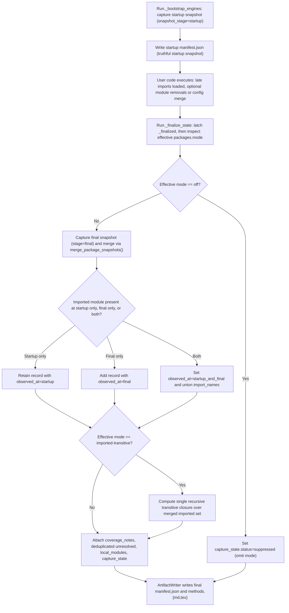
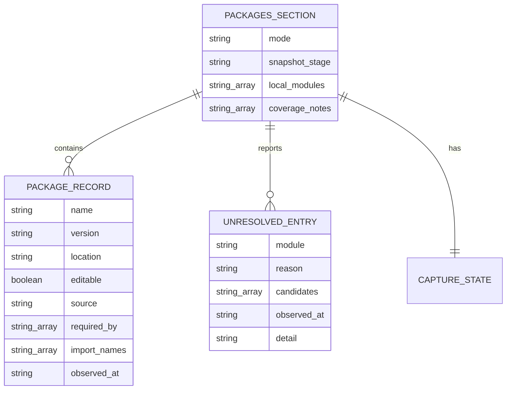

# IPD: Startup-to-finalization package merge, manifest schema, and report integration

- Date: 2026-11-21
- Kind: child
- Concern: Capturing late imports at finalization, retaining startup observations for removed modules, keeping startup and final snapshots distinguishable, extending the manifest JavaScript Object Notation (JSON) Schema additively, and updating downstream report and Terminal User Interface (TUI) consumers.
- Scope: Extend `schemas/manifest.schema.json` additively for richer package metadata, implement `merge_package_snapshots()` and stage-aware package capture in `src/pubrun/capture/packages.py`, wire startup snapshot plus finalization refresh and merge into `src/pubrun/tracker.py`, update `src/pubrun/report/methods.py`, `src/pubrun/report/diagnostics.py`, and `src/pubrun/tui/widgets/details.py`, and add lifecycle and schema conformance tests in `tests/test_package_lifecycle.py` and `tests/test_manifest_schema.py`.
- Scope-Paths: schemas/manifest.schema.json, src/pubrun/capture/packages.py, src/pubrun/tracker.py, src/pubrun/report/methods.py, src/pubrun/report/diagnostics.py, src/pubrun/tui/widgets/details.py, tests/test_manifest_schema.py, tests/test_package_lifecycle.py
- Item-Dependencies: executed:fdqkrz
- Status: approved
- Readiness: go-pending-approval
- Review-Depth: complex
- Short-Description: Extend manifest schema additively, refresh and merge packages at finalization, and update methods, diagnostics, and TUI consumers
- Work-Kind: bug
- Priority: high
- From-Backlog: w4hxkh
- Blocks-Release: next
- Set: dep-capture
- Order: 3
- Highest E allocated: 05
- Author: agent
- Id: ijipnx
- Approval: 2026-11-22, recorded via aw ipd set: status set to approved

> Write and proofread this plan per the technical writing standard, `.aw/system/workflows/technical-writing/technical-writing.md` (`.agents/workflows/technical-writing/technical-writing.md` in a legacy-layout install), including requirement 12 (diagrams).

## Workflow history

- 2026-11-22 approved (aw set): status set to approved
- 2026-11-22 /plan-review (Antigravity / Gemini 4 Neon (High)): APPROVE WITH REVISIONS APPLIED; PR-001, PR-002, PR-003, PR-004, PR-005, PR-006, PR-007, PR-008
- 2026-11-21 to-review (agent): authored review-ready child plan 03 of Set `dep-capture` graduating backlog item `w4hxkh`.
- 2026-11-21 draft (agent): created.

## Goal

Ensure that placing `import pubrun` at the top of a script records every library imported later during execution in the final manifest and methods report without installing a global import hook by default. Keep the startup manifest truthful for crash diagnosis, retain modules observed at startup even if removed from `sys.modules` before finalization, validate all additive manifest fields against `schemas/manifest.schema.json`, and keep methods, diagnostics, and TUI views accurate and null-safe.

### Startup-to-finalization capture lifecycle and manifest entities

The text in `## Proposed changes (ordered, validatable)` is normative. These diagrams summarize the `Run` package capture lifecycle and the extended manifest `packages` entities.

## Detailed Implementation Checklist (TODO)

Execution-state rule: mark an `E-*` item complete only after performing the action. That mark is not validation. Right-sizing rule: write for a modest executor that cannot hold much in its head. Each E-item is one step (one concern, about one file, executable in one focused pass) and its V-item names each unit it covers with its own check; a plan stays at about 5 E-items and 8 work Scope-Paths, else split it into more child plans (guidance, `IPD-Z603`). Accepted execution states: blocked, failed, pending, performed; terminal gate demands 'performed'.

### Task group 1: Additive manifest schema and snapshot merge logic

- [ ] E-01 Extend `schemas/manifest.schema.json` additively under `$defs.package_record` and `$defs.packages_section` (plus new `$defs.unresolved_package_record`) without modifying any existing `required` arrays.
  - Depends on: none
  - Expected outcome: `$defs.package_record` adds optional `import_names` (`array` of strings or `null`) and `observed_at` (`enum: ["startup", "final", "startup_and_final", null]`). `$defs.packages_section` adds optional `snapshot_stage` (`enum: ["startup", "final", "single", null]`), `unresolved` (`array` of `$defs.unresolved_package_record`), `local_modules` (`array` of strings), and `coverage_notes` (`array` of strings). `$defs.unresolved_package_record` enforces `additionalProperties: false` and `required: ["module", "reason"]`. `schemas/manifest.schema.json` passes `jsonschema` meta-schema validation, accepts legacy v1.0 manifests and new manifests, and rejects invalid enum values or unknown properties.
  - Execution state: pending

- [ ] E-02 Add stage-aware `get_packages(config, *, stage="single")` (removing the temporary schema-compatibility field strip from prerequisite child plans `uil22c` and `fdqkrz`) and `merge_package_snapshots(startup_data, final_data, config=None)` in `src/pubrun/capture/packages.py`.
  - Depends on: E-01
  - Expected outcome: `resolve_packages_snapshot(config, *, stage="single", include_transitive=True)` and `get_packages(config, *, stage="single")` emit the additive schema-valid fields cleanly (`snapshot_stage`, `import_names`, `observed_at`, `unresolved`, `local_modules`, `coverage_notes`) while honoring existing schema invariants (`mode == "off"` returns `{"capture_state": {"status": "suppressed"}}` with `"mode"` omitted; `capture_state` omits `"detail"` when absent). `merge_package_snapshots()` does not mutate its inputs, handles `mode == "off"`, suppressed or missing startup snapshots, and mid-run mode switches cleanly, retains startup-only removed modules with `observed_at = "startup"`, marks late imports `observed_at = "final"`, merges persistent modules as `observed_at = "startup_and_final"` with unioned `import_names`, recomputes recursive transitive closure once over the merged imported set in `imported-transitive` mode without duplicating transitive `unresolved` entries, and attaches factual `coverage_notes`.
  - Execution state: pending

### Task group 2: Tracker lifecycle wiring and downstream consumer updates

- [ ] E-03 Wire startup package snapshotting (`stage="startup"`) in `src/pubrun/tracker.py::Run._bootstrap_engines` and finalization refresh plus merge (`stage="final"`) in `src/pubrun/tracker.py::Run._finalize_state`, preserving crash safety, `mode = "off"`, mid-run `_merge_and_migrate()` config changes, and compatibility with sibling pending Sets.
  - Depends on: E-02
  - Expected outcome: `Run.__init__` initializes `self._startup_packages_data = {}` before `mkdir()` so every ghost-mode and normal path defines the attribute. `Run._bootstrap_engines` captures the startup snapshot (`stage="startup"`, installing no global import hook) while preserving per-engine bootstrap isolation if `cap-isolation` (`ed0yds`) is present. `Run._finalize_state` refreshes packages against current `sys.modules` and merges with `self._startup_packages_data` after latching `_finalized` (and after `t2` / before `_mark_finalization_end()` if `timing-acc` `e1fwy2` is present) inside a protective `try/except`: a failure copies `self._startup_packages_data` without mutating it, degrades `packages.capture_state` to schema-valid `"partial"` (or `"failed"` if startup itself had failed) with a non-empty string `detail` and warning, calls `_record_capture_error` if present, and never crashes finalization or host exit.
  - Execution state: pending

- [ ] E-04 Update `src/pubrun/report/methods.py`, `src/pubrun/report/diagnostics.py`, and `src/pubrun/tui/widgets/details.py` to use Python Enhancement Proposal (PEP) 503 normalized highlight matching, guard `None` versions and names everywhere, and surface unresolved package diagnostics cleanly.
  - Depends on: E-03
  - Expected outcome: `src/pubrun/report/methods.py::extract_highlighted_packages` normalizes candidate names via `normalize_package_name`, guards `name is None` and `version is None`, and avoids duplicate highlighted entries. `src/pubrun/report/diagnostics.py::print_report` guards `p.get("name") or "<unknown>"` and `p.get("version") or "unknown"` in both `section == "packages"` and `depth == "deep"` `[ Packages ]` blocks via a shared helper, prints an `Unresolved:` summary block under `[ Packages ]` and appends ` (N unresolved)` to the standard/deep `Packages` summary line only when `packages.unresolved` is non-empty, leaving existing output unchanged when `unresolved` is empty. `src/pubrun/tui/widgets/details.py::RunDetailsView.update_packages_pane` guards `pkg.get("name") or ""` and `pkg.get("version") or ""` through a pure filter/row helper testable even when `textual` is not installed.
  - Execution state: pending

### Task group 3: Lifecycle and schema conformance tests

- [ ] E-05 Create `tests/test_package_lifecycle.py` and extend `tests/test_manifest_schema.py` to verify late imports, startup truthfulness, removed startup modules, mid-run mode switches, `methods.md` late-import reflection, finalization error resilience, diagnostics/TUI null-version safety, and positive plus negative schema conformance.
  - Depends on: E-04
  - Expected outcome: `pytest tests/test_package_lifecycle.py tests/test_manifest_schema.py tests/test_package_resolution.py tests/test_package_transitive.py tests/test_capture_engines.py tests/test_edge_cases.py tests/test_new_features.py tests/test_tracker.py tests/test_reports.py tests/test_show_sections.py tests/test_methods_multi.py tests/test_tui.py tests/test_quality.py -v` exits 0 with all tests passing and deterministic non-skipped coverage for every new behavior.
  - Execution state: pending

## Project conventions discovered (Step 0)

- `src/pubrun/tracker.py::Run._bootstrap_engines` calls `self.packages_data = get_packages(self.config)` once at startup; `src/pubrun/tracker.py::Run._finalize_state` shuts down engines and never refreshes `self.packages_data`.
- `src/pubrun/writer.py::ArtifactWriter.write_artifacts` calls `self.run._finalize_state()` first, then calls `self.run.to_manifest_dict()`, writes `manifest.json`, and calls `src/pubrun/report/methods.py::generate_report`. Updating `self.packages_data` inside `Run._finalize_state()` therefore feeds both the final `manifest.json` and `methods.{md,tex}` in a single write.
- Prerequisite child plans `uil22c` (`Order: 1`, distribution identity resolution and caching) and `fdqkrz` (`Order: 2`, recursive marker-aware transitive closure) keep `get_packages()` stripping schema-pending keys while `resolve_packages_snapshot()` returns the full structured snapshot so `tests/test_manifest_schema.py` stays green until this plan updates `schemas/manifest.schema.json`.
- Coordination with sibling pending Sets `timing-acc` (`e1fwy2`, manifest timing schema and tracker monotonic lifecycle), `startup-perf` (`tkmm5p`, snapshot write coalescing and bounded capture), and `cap-isolation` (`ed0yds`, per-engine failure isolation and narrow ghost mode): in `e1fwy2`, workload end `t2` is recorded when `_finalized` latches at the top of `Run._finalize_state()`, so refreshing packages afterward is accounted as finalization overhead rather than workload time; in `tkmm5p`, `write_artifacts()` writes `manifest.json` once after `_finalize_state()`; in `ed0yds`, per-engine errors are recorded via `_record_capture_error(section, stage, exc)`.
- `schemas/manifest.schema.json` enforces `"additionalProperties": false` on `$defs.package_record`, `$defs.packages_section`, and `$defs.capture_state`. `$defs.package_record.properties.version` already allows `["string", "null"]`, `$defs.capture_state.properties.detail` requires non-nullable `"type": "string"`, and `$defs.packages_section.properties.mode.enum` omits `"off"` (suppressed runs omit `"mode"`).
- `src/pubrun/report/templates.py::HIGHLIGHT_PACKAGES` already lists `"scikit-learn"`, which failed to match when `packages.py` emitted `"sklearn"`.
- `src/pubrun/report/diagnostics.py::print_report` duplicates the `[ Packages ]` rendering loop at both `section == "packages"` (lines 205-227) and `depth == "deep"` (lines 438-453), and both sites use `p.get('version', 'unknown')`, which prints `None` when `version` is explicitly `None`.
- `src/pubrun/tui/widgets/details.py::RunDetailsView.update_packages_pane` runs `version = pkg.get("version", "")` and `filter_text not in version.lower()`, which raises `AttributeError` when `pkg["version"]` is `None`. `tests/test_tui.py` gates `RunDetailsView` Pilot tests on optional `textual` via `pytest.importorskip("textual")`.
- `src/pubrun/report/meta_snapshot.py::generate_meta_snapshot` calls `get_packages(cfg)` standalone; defaulting `stage="single"` keeps meta snapshots valid.

## Findings

- **F-01 (Late imports dropped):** Scripts following the documented one-import pattern (`import pubrun` on line 1, scientific imports below) never record those libraries in `manifest.json` or `methods.md` because `src/pubrun/tracker.py::Run._finalize_state` never refreshes packages.
- **F-02 (Startup versus final provenance indistinguishable):** Neither `schemas/manifest.schema.json` nor `src/pubrun/capture/packages.py` distinguishes a startup snapshot from a finalized merged snapshot or indicates whether a package was observed at startup, finalization, or both.
- **F-03 (Consumer null-version hazards and highlight mismatch):** `src/pubrun/tui/widgets/details.py::RunDetailsView.update_packages_pane` crashes on `version: None`, both `[ Packages ]` render blocks in `src/pubrun/report/diagnostics.py::print_report` print `None` for null versions, and `src/pubrun/report/methods.py::extract_highlighted_packages` uses `.lower()` instead of PEP 503 normalization and does not guard `name: None` or `version: None`.

## Proposed changes (ordered, validatable)

1. **`schemas/manifest.schema.json`:**
   - Add `$defs.unresolved_package_record`:
     - `type: "object"`, `additionalProperties: false`, `required: ["module", "reason"]`.
     - Properties:
       - `module`: `{"type": "string", "minLength": 1}`
       - `reason`: `{"type": "string", "enum": ["ambiguous", "unmapped_site_package", "missing_metadata", "metadata_error", "missing_transitive_dependency", "unparseable_marker"]}`
       - `candidates`: `{"type": "array", "items": {"type": "string"}, "default": []}`
       - `observed_at`: `{"type": ["string", "null"], "enum": ["startup", "final", "startup_and_final", null]}`
       - `detail`: `{"type": ["string", "null"]}`
   - Add optional properties to `$defs.package_record`:
     - `import_names`: `{"type": ["array", "null"], "items": {"type": "string"}}`
     - `observed_at`: `{"type": ["string", "null"], "enum": ["startup", "final", "startup_and_final", null]}`
   - Add optional properties to `$defs.packages_section`:
     - `snapshot_stage`: `{"type": ["string", "null"], "enum": ["startup", "final", "single", null]}`
     - `unresolved`: `{"type": "array", "items": {"$ref": "#/$defs/unresolved_package_record"}, "default": []}`
     - `local_modules`: `{"type": "array", "items": {"type": "string"}, "default": []}`
     - `coverage_notes`: `{"type": "array", "items": {"type": "string"}, "default": []}`
   - Keep all existing `required` arrays unchanged so every existing v1.0 manifest (including `tests/fixtures/sample_manifest.json`) validates without change. This matches the `unresolved` record shapes emitted by `uil22c` and `fdqkrz` and the optional fields anticipated by sibling Set `repro-check` (`0b8i7x`, recorded reproducibility gap analysis).

2. **`src/pubrun/capture/packages.py`:**
   - Extend `resolve_packages_snapshot(config: Dict[str, Any], *, stage: str = "single", include_transitive: bool = True) -> Dict[str, Any]` and `get_packages(config: Dict[str, Any], *, stage: str = "single") -> Dict[str, Any]` (backwards-compatible default `stage="single"`):
     - Remove the temporary `uil22c`/`fdqkrz` schema-stripping filter in `get_packages()` so `get_packages()` emits the full schema-valid snapshot returned by `resolve_packages_snapshot(config, stage=stage)`.
     - Preserve `mode == "off"` returning `{"capture_state": {"status": "suppressed"}}` (omitting `"mode"`, which is not allowed to be `"off"` by `schemas/manifest.schema.json`).
     - Always omit `"detail"` from `capture_state` when no non-empty string detail exists (since `$defs.capture_state.properties.detail` is non-nullable `"type": "string"`).
     - Populate additive fields cleanly:
       - `snapshot_stage = stage` (`"startup"`, `"final"`, or `"single"`).
       - `import_names`: sorted list of observed import names for `source == "imported"` records; `None` for `source == "transitive"`, `top-level-installed`, and `full-environment` records.
       - `observed_at`: `"startup"` when `stage == "startup"` and `source == "imported"`; `"final"` when `stage == "final"` and `source == "imported"`; `None` when `stage == "single"`, for `source == "transitive"`, or for `top-level-installed` / `full-environment`.
       - `unresolved`: sorted list of unresolved entries (each stamped with `observed_at = stage` when `stage in ("startup", "final")`, else `None`; `[]` when none exist).
       - `local_modules`: sorted deduplicated list of local-only module names (`[]` when none exist).
       - `coverage_notes`: list of factual coverage-boundary notes (`[]` when none apply; on `imported-only` and `imported-transitive` snapshots at `stage == "final"`, includes a concise note stating that without a global import hook, modules imported after startup and removed from `sys.modules` before finalization cannot be observed).
     - When `include_transitive=False` in `imported-transitive` mode, resolve imported modules only and defer `_resolve_transitive_closure()` to `merge_package_snapshots()` so finalization computes the recursive closure once instead of twice.
   - Implement `merge_package_snapshots(startup_data: Optional[Dict[str, Any]], final_data: Optional[Dict[str, Any]], config: Optional[Dict[str, Any]] = None) -> Dict[str, Any]`:
     - Never mutate `startup_data` or `final_data` in place (copy every retained record dict and list).
     - Determine effective `mode` from `config.get("capture", {}).get("packages", {}).get("mode")` if `config` is provided, falling back to `final_data.get("mode")` (never trusting a stale `startup_data.get("mode")` after a mid-run `_merge_and_migrate()` config change).
     - If effective `mode == "off"`: return `{"capture_state": {"status": "suppressed"}}`.
     - Treat missing, non-dict, or `"suppressed"` `startup_data` (such as an `off -> imported-only` mid-run switch) cleanly as an empty startup observation without marking the final `capture_state` `"partial"` or `"suppressed"`.
     - For `imported-only` and `imported-transitive`:
       - Extract only `source == "imported"` records from `startup_data` and `final_data` (preventing uninstalled records from leaking if mode switched from `full-environment` to `imported-only` mid-run), keyed by `normalize_package_name(rec["name"])`.
       - Present in startup only (for example, deleted from `sys.modules` before finalization): retain a copy with `observed_at = "startup"`.
       - Present in final only (late import): include a copy with `observed_at = "final"`.
       - Present in both: copy the final record (`version`, `location`, `editable` reflect any in-run environment change), set `observed_at = "startup_and_final"`, set `import_names` to the sorted union of both snapshots' `import_names`, and append a concise warning to `capture_state.warnings` if `version` changed between startup and finalization.
       - Separate non-transitive `unresolved` entries (`reason` in `{"ambiguous", "unmapped_site_package", "missing_metadata", "metadata_error"}`) from prior transitive `unresolved` entries (`reason` in `{"missing_transitive_dependency", "unparseable_marker"}`). Merge non-transitive `unresolved` entries by `(module, reason)` with unioned sorted `candidates` and combined `observed_at` (`"startup"`, `"final"`, or `"startup_and_final"`).
       - If effective `mode == "imported-transitive"`, compute `_resolve_transitive_closure(merged_imported_records, _get_distribution_index())` once over the merged imported set so late-imported distributions and startup-only retained distributions both resolve transitive dependencies cleanly. Stamp transitive records with `import_names = None` and `observed_at = None`, and stamp fresh transitive `unresolved` entries with `observed_at = "final"` (avoiding duplicate or stale startup transitive unresolved entries).
       - Compute `local_modules` as the sorted union of both snapshots' `local_modules`.
       - Set `snapshot_stage = "final"`, attach the final `coverage_notes`, and compute combined `capture_state` (`"partial"` if any unresolved entry exists, any non-suppressed input snapshot was `"partial"` or `"failed"`, or a mid-run version change occurred; otherwise `"complete"`), with deduplicated `warnings` and `"detail"` omitted when empty.
     - For `top-level-installed` and `full-environment`:
       - Copy the refreshed `final_data`, stamp `snapshot_stage = "final"`, preserve any non-suppressed startup warning (degrading to `"partial"` if startup had failed or reported warnings), and keep `observed_at = None` and `import_names = None` on non-import records.

3. **`src/pubrun/tracker.py`:**
   - In `src/pubrun/tracker.py::Run.__init__`, initialize `self._startup_packages_data: Dict[str, Any] = {}` BEFORE the `self.run_dir.mkdir(...)` `try/except` block so both ghost-mode early-return paths and normal initialization always define the attribute.
   - In `src/pubrun/tracker.py::Run._bootstrap_engines`, capture the startup snapshot via `self._startup_packages_data = get_packages(self.config, stage="startup")` and assign `self.packages_data = self._startup_packages_data` (preserving per-engine `try/except` isolation and `_record_capture_error("packages", "bootstrap", exc)` if sibling plan `ed0yds` has already landed, in which case `self._startup_packages_data` is set to the failed section dict as well).
   - In `src/pubrun/tracker.py::Run._finalize_state`, AFTER latching `self._finalized = True` under `_run_lock` (and after `t2` / `ended_at_utc` if `timing-acc` `e1fwy2` is present, and before `_mark_finalization_end()` if present):
     - Refresh and merge packages inside a protective `try/except Exception as pkg_err`:
       - Read effective mode from `self.config.get("capture", {}).get("packages", {}).get("mode", "imported-only")`.
       - If `mode == "off"`: set `self.packages_data = {"capture_state": {"status": "suppressed"}}`.
       - Else: accept optional `include_transitive: bool = True` on `get_packages(config, *, stage="single", include_transitive=True)` so `Run._finalize_state()` calls `get_packages(self.config, stage="final", include_transitive=False)` when `mode == "imported-transitive"` (falling back to `get_packages(self.config, stage="final")` on `TypeError` for simple test mocks) and `get_packages(self.config, stage="final")` otherwise. This keeps `pubrun.tracker.get_packages` as the single monkeypatch target while avoiding double transitive traversal. Then assign `self.packages_data = merge_package_snapshots(self._startup_packages_data, final_pkg, config=self.config)`.
       - On exception: copy `self._startup_packages_data` shallowly (or start from `{}` if non-dict/empty), preserve any valid startup `records`/`mode`/`unresolved`/`local_modules`, build a schema-valid degraded `capture_state` (`status = "failed"` if startup itself had status `"failed"`, else `"partial"`; non-empty string `detail` summarizing the error safely without raw tracebacks; deduplicated `warnings` list), call `self._record_capture_error("packages", "finalization", pkg_err)` if available (compatibility with `ed0yds`), log a concise warning via `logging.getLogger("pubrun")`, and NEVER raise into the host script.

4. **`src/pubrun/report/methods.py`, `src/pubrun/report/diagnostics.py`, `src/pubrun/tui/widgets/details.py`:**
   - `src/pubrun/report/methods.py`:
     - Precompute `_NORMALIZED_HIGHLIGHTS = {normalize_package_name(n) for n in HIGHLIGHT_PACKAGES}` using `normalize_package_name` from `pubrun.capture.packages` (standard-library-only, no import-isolation regression).
     - In `extract_highlighted_packages(manifest)`: guard `raw_name = record.get("name") or ""`, compute `norm_name = normalize_package_name(raw_name)`, check `norm_name in _NORMALIZED_HIGHLIGHTS`, deduplicate by `norm_name`, and format `version = record.get("version") or "unknown"` as `f"{norm_name} (v{version})"`.
   - `src/pubrun/report/diagnostics.py`:
     - Extract a shared helper `_print_packages_block(manifest, use_color)` used by BOTH `section == "packages"` (lines 205-227) and `depth == "deep"` `[ Packages ]` (lines 438-453): guard `packages_sec = manifest.get("packages") or {}`, `name = p.get("name") or "<unknown>"`, and `ver = p.get("version") or "unknown"`. If `unresolved = packages_sec.get("unresolved") or []` is non-empty, print a concise `Unresolved:` summary block listing module, reason, and candidate count/names.
     - In standard and deep summary output (line 401): keep `Packages    : {len(pkgs)} recorded` identical when `unresolved` is empty, and append ` ({len(unresolved)} unresolved)` when `unresolved` is non-empty.
   - `src/pubrun/tui/widgets/details.py`:
     - Extract a pure, zero-`textual` helper `_filter_package_rows(records, filter_text="") -> list[tuple[str, str, str]]` that coerces `name = pkg.get("name") or ""`, `version = pkg.get("version") or ""`, and `location = pkg.get("location") or ""` before calling `.lower()`, and call it from `RunDetailsView.update_packages_pane()`. This fixes the `AttributeError` crash on `version: None` and enables deterministic unit testing even when optional `textual` is absent, in addition to full `Pilot` coverage when `textual` is installed.

5. **`tests/test_package_lifecycle.py`** (new) and **`tests/test_manifest_schema.py`**:
   - In `tests/test_package_lifecycle.py`, test behaviorally using real `Run` / `pubrun.start()` / `pubrun.stop()` and fresh subprocess `import pubrun` scripts with deterministic local `.dist-info` fixtures:
     1. **One-import late-import capture**: subprocess runs `import pubrun` first, then imports a synthetic distribution whose import name differs from its distribution name (`synth_skl` -> `scikit-learn` or `synth-late-dist` in a temp `site-packages`); final `manifest.json` contains the distribution with `observed_at == "final"`, `import_names == ["synth_skl"]`, and `snapshot_stage == "final"`.
     2. **Startup snapshot truthfulness**: while run is still active (before `stop()`), on-disk startup `manifest.json` has `snapshot_stage == "startup"` and does NOT yet contain the not-yet-imported distribution, while containing distributions already imported before `start()`.
     3. **Removed startup module retained**: distribution imported before `start()`, then removed via `del sys.modules[name]` before `stop()`, remains in final `manifest.json` with `observed_at == "startup"`; persistent module has `observed_at == "startup_and_final"` with unioned `import_names`.
     4. **Merged transitive closure and `unresolved` deduplication**: in `imported-transitive` mode, both a startup-only removed module and a late-imported module resolve their transitive dependencies in the finalized manifest without duplicating transitive `unresolved` entries, and `merge_package_snapshots()` does not mutate input dicts.
     5. **Transient mid-run import-and-removal documented limitation**: module imported after `start()` and removed from `sys.modules` before `stop()` is not fabricated; `packages.coverage_notes` documents the no-import-hook limitation honestly; `sys.meta_path` and `builtins.__import__` are unchanged by `import pubrun`.
     6. **`methods.md` late-import reflection and PEP 503 highlight matching**: late-importing a synthetic `scikit-learn` distribution (`sklearn` import name -> `scikit-learn` dist name) causes `methods.md` to highlight `scikit-learn`, and `extract_highlighted_packages()` handles `Scikit_Learn` and `version: None` safely.
     7. **Finalization metadata error resilience**: monkeypatching `get_packages` to raise during finalization retains startup snapshot records without mutating `_startup_packages_data`, sets schema-valid `capture_state.status == "partial"` with non-empty string `detail`, writes `manifest.json`, and does not crash host exit.
     8. **`mode = "off"` and mid-run `_merge_and_migrate()` switches**: `mode = "off"` stays `suppressed` (with `"mode"` omitted) at startup and finalization; switching `off -> imported-only` or `imported-only -> off` mid-run produces honest, schema-valid final manifests.
     9. **Diagnostics and TUI null-version safety**: verify `pubrun show <run> packages`, `print_report(..., depth="standard")`, and `print_report(..., depth="deep")` handle `version: None` without printing `None` and surface `unresolved` entries cleanly; verify `_filter_package_rows()` (unconditional) and `RunDetailsView.update_packages_pane()` (when `textual` is installed) filter records with `version: None` without raising `AttributeError`.
   - In `tests/test_manifest_schema.py`, add positive and negative schema validation tests for startup manifests (`snapshot_stage == "startup"`), finalized manifests with extended package fields (`import_names`, `observed_at`, `unresolved`, `local_modules`, `coverage_notes`), `imported-transitive` manifests, partial degraded manifests, legacy v1.0 manifests (without any of the new optional fields), and negative rejections (invalid `snapshot_stage`, invalid `observed_at`, invalid `unresolved[].reason`, and unknown extra keys).

## Deferred / out of scope (with reason)

- Startup-versus-finalization performance benchmarking in small and large environments and full documentation reconciliation (`docs/manifest.md`, `docs/configuration.md`, `docs/architecture.md`, `docs/performance.md`, `src/pubrun/resources/default.toml`): implemented in child plan `iflqsl` (`Order: 4`, package capture benchmarking and documentation sync).
  - Carrier: iflqsl
- Reproducibility gap analysis and preflight consumption of `unresolved` and `snapshot_stage`: owned by sibling Set `repro-check` (`0b8i7x`, recorded reproducibility gap analysis, and `tusvtd`, offline preflight comparison), which already anticipates optional `unresolved` and startup-only markers defensively.
  - Carrier: 0b8i7x

## Scope check

- Over-scope: none. Touches only `schemas/manifest.schema.json`, `src/pubrun/capture/packages.py`, `src/pubrun/tracker.py`, the three directly affected consumers (`methods.py`, `diagnostics.py`, `tui/widgets/details.py`), and schema/lifecycle tests (5 E-items, 8 Scope-Paths).
- Under-scope: none. Covers backlog item `w4hxkh` (dependency capture) guidance items 1 and 5, acceptance criterion 1, and consumer/methods/schema requirements.

## Required tests / validation

- Run `pytest tests/test_package_lifecycle.py tests/test_manifest_schema.py tests/test_package_resolution.py tests/test_package_transitive.py tests/test_capture_engines.py tests/test_edge_cases.py tests/test_new_features.py tests/test_tracker.py tests/test_reports.py tests/test_show_sections.py tests/test_methods_multi.py tests/test_tui.py tests/test_quality.py -v` and paste actual runner output.

## Spec / documentation sync

- `schemas/manifest.schema.json` is updated in `E-01` of this plan and validated by `tests/test_manifest_schema.py`.
- User-facing documentation (`docs/manifest.md`, `docs/configuration.md`, `docs/architecture.md`, `docs/performance.md`) and `src/pubrun/resources/default.toml` comments are synchronized in child plan `iflqsl` (`Order: 4`, package capture benchmarking and documentation sync).

## Open questions

### OQ-01: Additive manifest schema field names (`snapshot_stage`, `observed_at`, `import_names`, `unresolved`, `local_modules`, `coverage_notes`)

- Blocking: no
- Status: resolved
- Owner: plan author (binding upon plan approval)
- Resolution or deferral rationale: All six proposed fields are additive and optional under `schemas/manifest.schema.json` v1.0, preserving backwards compatibility with existing manifests and downstream readers. Names follow existing `snake_case` manifest conventions and match `uil22c`, `fdqkrz`, `iflqsl`, and sibling Set `repro-check` (`0b8i7x`, which reads `packages.unresolved` and `packages.snapshot_stage == "startup"`). The maintainer may rename any field before approving this plan.

## Validation and cross-check (verify before reporting done)

Validation-state rule: inspect evidence in a separate pass. Do not mark a `V-*` item complete from memory or from the matching execution checkmark. Accepted validation results: blocked, failed, pass, pending; terminal gate demands 'pass'. Runtime-demonstration reachability rule: for each `V-*` item demanding the software be observed acting (such as a run, a dispatch, or a transition) (as distinct from items demanding a diff, a file's content, or a test result, which are reachable by construction), name the code path that produces the observation or the sibling `E-*` that creates it, else the demand is UNDER-SCOPE.

- [ ] V-01 validates E-01
  - Required evidence: Paste `pytest tests/test_manifest_schema.py -v` output showing exit code 0, confirming the updated `schemas/manifest.schema.json` passes `check_schema`, validates startup, final, partial, `imported-transitive`, and legacy v1.0 manifests, and rejects invalid `snapshot_stage`, `observed_at`, `unresolved[].reason`, and unknown keys.
  - Observed evidence:
  - Result: pending

- [ ] V-02 validates E-02
  - Required evidence: Paste `pytest tests/test_package_lifecycle.py -k "merge or removed or stage or transitive or mode_switch" -v` output showing exit code 0 (with non-zero collected tests), proving `get_packages()` emits the extended schema fields cleanly, `merge_package_snapshots()` does not mutate inputs, retains startup-only removed modules, tags `observed_at` accurately, handles mid-run mode switches and suppressed startup snapshots, deduplicates non-transitive `unresolved` entries, and recomputes transitive closure once over the merged imported set.
  - Observed evidence:
  - Result: pending

- [ ] V-03 validates E-03
  - Required evidence: Paste `pytest tests/test_package_lifecycle.py -k "late_import or startup_truthful or no_import_hook or finalization_error or mode_off" -v` output showing exit code 0 (with non-zero collected tests), proving a script running `import pubrun` before importing a synthetic distribution records it in the final manifest while keeping the startup snapshot truthful, installing no global import hook, and surviving finalization metadata errors with schema-valid degraded `capture_state`.
  - Observed evidence:
  - Result: pending

- [ ] V-04 validates E-04
  - Required evidence: Paste `pytest tests/test_reports.py tests/test_show_sections.py tests/test_methods_multi.py tests/test_tui.py tests/test_package_lifecycle.py -k "methods or diagnostics or show or tui or null_version" -v` output showing exit code 0 (with non-zero collected tests), confirming PEP 503 highlight matching in `methods.py`, null-version and `unresolved` rendering in both `section == "packages"` and `depth == "deep"` of `diagnostics.py`, and non-skipped TUI null-version filter safety.
  - Observed evidence:
  - Result: pending

- [ ] V-05 validates E-05
  - Required evidence: Paste complete `pytest tests/test_package_lifecycle.py tests/test_manifest_schema.py tests/test_package_resolution.py tests/test_package_transitive.py tests/test_capture_engines.py tests/test_edge_cases.py tests/test_new_features.py tests/test_tracker.py tests/test_reports.py tests/test_show_sections.py tests/test_methods_multi.py tests/test_tui.py tests/test_quality.py -v` runner output showing exit code 0.
  - Observed evidence:
  - Result: pending

## Approval and execution gate

- Size assessment: standard
- Cohesion rationale: not required

Execution contract:
1. All open questions (OQ-01) are resolved for review and become binding upon human approval (`- Status: approved`) and completion of prerequisite child plan `fdqkrz` (recursive marker-aware transitive dependency resolution).
2. Scope declaration: expected modified or created files are `schemas/manifest.schema.json`, `src/pubrun/capture/packages.py`, `src/pubrun/tracker.py`, `src/pubrun/report/methods.py`, `src/pubrun/report/diagnostics.py`, `src/pubrun/tui/widgets/details.py`, `tests/test_manifest_schema.py`, and `tests/test_package_lifecycle.py`. Keep edits within this scope; if execution genuinely requires an out-of-scope path or leaves a declared path unmodified, record the justification via `--scope-reason` or `--scope-ack` at finalize rather than stopping mid-run. Stop only for a genuinely unsafe condition such as an unresolvable concurrent-edit conflict or missing prerequisite symbols from `fdqkrz`.
3. Honesty rule: paste actual runner output and exit codes into `Observed evidence`; never claim tests passed without running them.
4. Commit discipline: commit only this plan's changed files via `aw commit ijipnx -- <paths>`; never use `git add -A`, `git add .`, or `git commit -a`; never push.
5. Lifecycle transition on completion: all `E-*` items must be `performed` and all `V-*` items `pass` before completion; when executed directly (outside an `aw` runner lane), run `aw ipd finalize ijipnx --actor <actor> -m "
" --apply` rather than a hand-rolled `git mv` to `.aw/records/plans/executed/`; when executed inside an `aw` runner lane, leave lifecycle finalization to the runner's post-turn finalize step.
