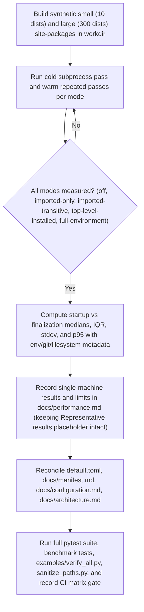
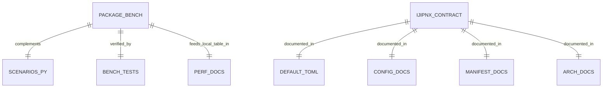

# IPD: Package capture benchmarking, documentation sync, and whole-Set verification

- Date: 2026-11-21
- Kind: child
- Concern: Measuring startup and finalization package-capture overhead separately in small and large environments, reconciling configuration comments and documentation, and validating the complete `dep-capture` Set.
- Scope: Create a local, non-publishing benchmark script `benchmarks/package_capture_bench.py`, add an `imported-transitive` scenario in `benchmarks/scenarios.py`, add behavioral benchmark tests in `tests/test_package_benchmark.py`, update `src/pubrun/resources/default.toml`, `docs/manifest.md`, `docs/configuration.md`, `docs/architecture.md`, and `docs/performance.md` with actual measured results and remaining limits, and run whole-Set validation.
- Scope-Paths: benchmarks/package_capture_bench.py, benchmarks/scenarios.py, tests/test_package_benchmark.py, src/pubrun/resources/default.toml, docs/manifest.md, docs/configuration.md, docs/architecture.md, docs/performance.md
- Item-Dependencies: executed:ijipnx
- Status: approved
- Readiness: go-pending-approval
- Review-Depth: complex
- Short-Description: Benchmark startup and finalization package capture in small and large environments, sync docs/config comments, and run full-Set validation
- Work-Kind: bug
- Priority: high
- From-Backlog: w4hxkh
- Blocks-Release: next
- Set: dep-capture
- Order: 4
- Highest E allocated: 05
- Author: agent
- Id: iflqsl
- Approval: 2026-11-22, recorded via aw ipd set: status set to approved

> Write and proofread this plan per the technical writing standard, `.aw/system/workflows/technical-writing/technical-writing.md` (`.agents/workflows/technical-writing/technical-writing.md` in a legacy-layout install), including requirement 12 (diagrams).

## Workflow history

- 2026-11-22 approved (aw set): status set to approved
- 2026-11-22 /plan-review (Antigravity / Gemini 4 Neon (High)): APPROVE WITH REVISIONS APPLIED; PR-001, PR-002, PR-003, PR-004, PR-005
- 2026-11-21 to-review (agent): authored review-ready child plan 04 of Set `dep-capture` graduating backlog item `w4hxkh`.
- 2026-11-21 draft (agent): created.

## Goal

Measure startup and finalization package-capture overhead separately across small, large, and ambient Python environments with cold and warm passes, repetitions, dispersion, and detected filesystem metadata. Reconcile all package-capture documentation and default configuration comments against the implemented behavior from prerequisite child plans `uil22c` (distribution identity resolution and caching), `fdqkrz` (recursive marker-aware transitive resolution), and `ijipnx` (startup-to-finalization merge and manifest schema). Verify whole-Set correctness without publishing external artifacts or submitting cluster jobs.

### Benchmarking, documentation, and verification workflow

The text in `## Proposed changes (ordered, validatable)` is normative. These diagrams summarize the local benchmarking, documentation update, and whole-Set validation flow and the components synchronized in this plan.

## Detailed Implementation Checklist (TODO)

Execution-state rule: mark an `E-*` item complete only after performing the action. That mark is not validation. Right-sizing rule: write for a modest executor that cannot hold much in its head. Each E-item is one step (one concern, about one file, executable in one focused pass) and its V-item names each unit it covers with its own check; a plan stays at about 5 E-items and 8 work Scope-Paths, else split it into more child plans (guidance, `IPD-Z603`). Accepted execution states: blocked, failed, pending, performed; terminal gate demands 'performed'.

### Task group 1: Local startup-versus-finalization package benchmark

- [ ] E-01 Create `benchmarks/package_capture_bench.py` (Python standard library only, local, non-publishing) and extend `benchmarks/scenarios.py` with `feature-packages-transitive`.
  - Depends on: none
  - Expected outcome: `benchmarks/package_capture_bench.py` creates deterministic synthetic small (default 10 distributions) and large (default 300 distributions) `site-packages` fixtures under `--workdir` (defaulting to a temporary directory cleaned up on exit) with `.dist-info` metadata, `Requires-Dist` chains, and mismatched import-vs-distribution names, and also measures the ambient environment. It times **startup snapshot** and **finalization refresh + merge** separately across `off` (baseline), `imported-only`, `imported-transitive` (matching `ijipnx`'s `include_transitive=False` finalization call so transitive closure runs once inside `merge_package_snapshots()`), `top-level-installed`, and `full-environment`. It separates cold runs (fresh subprocess per run, uncached `importlib.metadata`) from warm runs (repeated in-process iterations after warmup using the environment-fingerprinted cache), records environment metadata (Python version, operating system (OS), central processing unit (CPU) count/model, Git revision, and detected filesystem type via `pubrun.capture.filesystem.get_filesystem({}, {"workdir": ...})`), computes repetitions, median, interquartile range (IQR), standard deviation, 95th percentile (p95), min, max, and delta vs `off`, emits sanitized Markdown/JavaScript Object Notation (JSON) summaries containing zero raw home paths or hostnames, and never publishes results or submits High-Performance Computing (HPC) scheduler jobs. `benchmarks/scenarios.py` adds `feature-packages-transitive` without breaking `benchmarks/test_benchmarks.py` or sibling-Set edits.
  - Execution state: pending

- [ ] E-02 Create `tests/test_package_benchmark.py` and run `benchmarks/package_capture_bench.py` locally to collect actual post-change measurements.
  - Depends on: E-01
  - Expected outcome: `tests/test_package_benchmark.py` exercises `benchmarks/package_capture_bench.py` with minimal parameters (`--small-count 4 --large-count 12 --repetitions 2 --cold-runs 1 --workdir <tmp_path> --json-out <tmp_path>/out.json`) and verifies JSON structure, separate `startup_ms` and `finalization_ms` cold and warm statistics across all five modes, filesystem and revision metadata, zero raw home/user paths or hostnames in Markdown output, and clean workdir handling. Running the full local benchmark (`--small-count 10 --large-count 300 --repetitions 10 --cold-runs 3`) produces real measured data for `docs/performance.md` without leaving untracked artifacts in the repository.
  - Execution state: pending

### Task group 2: Configuration comments and documentation sync

- [ ] E-03 Reconcile `src/pubrun/resources/default.toml`, `docs/configuration.md`, `docs/manifest.md`, and `docs/architecture.md` with the implemented package-capture contract.
  - Depends on: E-02
  - Expected outcome: `src/pubrun/resources/default.toml` (`[capture.packages]`) and `docs/configuration.md### [capture.packages]` document `"off"` alongside `"imported-only"` (default), `"imported-transitive"`, `"top-level-installed"`, and `"full-environment"`, remove stale `"(one level)"` and `"pip/conda"` descriptions, explain startup+finalization refresh, recursive Python Enhancement Proposal (PEP) 508 marker-aware closure, and extra handling (root optional extras are not guessed; parent-requested `pkg[extra]` extras are propagated), and accurately describe `top-level-installed`. `docs/manifest.md## packages` documents `version` as `string | null`, `mode = "off"` (`suppressed` with `"mode"` omitted), `snapshot_stage`, `observed_at`, `import_names`, `unresolved` (including the 6-value `reason` enum), `local_modules`, `coverage_notes`, `capture_state.status == "partial"` conditions, and the documented no-import-hook transient-unload limitation. `docs/architecture.md## 3. Run Lifecycle` reflects both startup package capture (`### Initialization`) and finalization refresh/merge (`### Finalization`). All edits preserve any additive sibling-Set documentation already present, and all newly added or modified lines in `docs/*.md` contain zero em dashes (`U+2014`) or en dashes (`U+2013`).
  - Execution state: pending

- [ ] E-04 Record the measured startup and finalization package-capture benchmark numbers (environment, Git revision, filesystem type, workload, `mode = "off"` baseline, repetitions, cold vs warm passes, median and dispersion) and remaining overhead/limits in `docs/performance.md`.
  - Depends on: E-02
  - Expected outcome: `docs/performance.md` adds a dedicated, clearly labeled single-machine subsection for package-capture startup and finalization overhead across small, large, and ambient environments while leaving `docs/performance.md## Representative results` untouched as a multi-machine placeholder and preserving any sibling-Set subsections. The new subsection states explicitly whether measurements ran on local storage only (noting how to run `--workdir` on shared Network File System (NFS) or Lustre storage), includes zero raw hostnames or machine-local home paths, documents remaining overhead and limits, makes no unmeasured speedup claims, and introduces zero em dashes (`U+2014`) or en dashes (`U+2013`).
  - Execution state: pending

### Task group 3: Whole-Set validation and hygiene gate

- [ ] E-05 Run the full repository test suite, benchmark test suite, example verification, and path-sanitization check, recording the Continuous Integration (CI) matrix requirement for multi-OS and Python 3.8 through 3.14.
  - Depends on: E-03, E-04
  - Expected outcome: `pytest tests/ -v` (explicitly confirming `tests/test_package_resolution.py`, `tests/test_package_transitive.py`, `tests/test_package_lifecycle.py`, `tests/test_package_benchmark.py`, and `tests/test_manifest_schema.py` pass), `pytest benchmarks/test_benchmarks.py benchmarks/test_share_safety.py -o addopts="" -v`, `python3 examples/verify_all.py`, and `python3 scripts/sanitize_paths.py --check --all` all exit 0 with actual output captured in `Observed evidence`, `git status --short` shows no stray untracked benchmark outputs, and the post-merge GitHub Actions CI matrix gate (`.github/workflows/ci.yml`: `ubuntu-latest`, `ubuntu-24.04`, `windows-latest`, `macos-latest` across Python 3.8 through 3.14) is recorded as required before release.
  - Execution state: pending

## Project conventions discovered (Step 0)

- `benchmarks/scenarios.py::all_scenarios` is declarative and standard-library-only, currently containing `feature-packages-imported` and `feature-packages-full` (no `imported-transitive` scenario), and is tested by `benchmarks/test_benchmarks.py` (which uses `-o addopts=""` to clear `pyproject.toml`'s global `--cov` flags).
- `src/pubrun/capture/filesystem.py::get_filesystem` has signature `get_filesystem(config: Dict[str, Any], paths: Dict[str, str]) -> Dict[str, Any]` and returns `fstype` and `is_network` without blocking `statvfs` calls.
- `src/pubrun/resources/default.toml` (`[capture.packages]`, lines 177-185) and `docs/configuration.md### [capture.packages]` (lines 130-136) currently state `"imported-transitive"` is `(one level)` and `"top-level-installed"` is `"pip/conda"` list, and omit `"off"`.
- `docs/manifest.md## packages` (lines 155-175) currently lists `packages.records[].version` as `string` rather than `string | null` and omits the additive fields from reviewed child plan `ijipnx` (`snapshot_stage`, `unresolved`, `local_modules`, `coverage_notes`, `import_names`, `observed_at`).
- `docs/architecture.md## 3. Run Lifecycle` (`### Initialization` and `### Finalization`, lines 29-42) currently describes packages as captured only during initialization.
- `docs/performance.md## Representative results` (lines 50-73) explicitly states that single-machine figures must not overwrite the multi-machine placeholder table; single-machine measurements belong in a dedicated labeled subsection (matching reviewed sibling plans `ckc3vl` and `3tvesf`).
- `docs/functional_spec.md` (line 191) already lists the four active package modes (`imported-only`, `imported-transitive`, `top-level-installed`, `full-environment`) accurately with no stale one-level claim.
- Prerequisite reviewed plans `uil22c` (`Order: 1`), `fdqkrz` (`Order: 2`), and `ijipnx` (`Order: 3`) establish `get_packages(config, *, stage="single", include_transitive=True)`, `merge_package_snapshots(startup_data, final_data, config=None)`, `invalidate_package_cache()`, root extra evaluation (`active_extra=""`), parent extra propagation, and the 6-value `unresolved[].reason` enum.
- Concurrent reviewed sibling plans `ckc3vl` (Set `startup-perf`), `3tvesf` (Set `timing-acc`), `4gpguy` (Set `file-prov`), and `zp2yyu` (Set `cap-isolation`) also update shared files (`src/pubrun/resources/default.toml`, `docs/configuration.md`, `docs/manifest.md`, `docs/architecture.md`, `docs/performance.md`, `benchmarks/scenarios.py`); all edits in this plan must remain strictly additive/targeted and preserve any sibling-Set sections already on disk.
- `AGENTS.md` prohibits newly authored em dashes (`U+2014`) or en dashes (`U+2013`) in user-facing prose (`docs/*.md`), while existing untouched lines in those docs contain pre-existing dashes; diff-scoped checks over added (`+`) lines enforce the rule without false positives. `scripts/sanitize_paths.py --check --all` enforces zero machine-local path leakage.
- `.github/workflows/ci.yml` defines the repository's supported OS and Python matrix (`ubuntu-latest`, `ubuntu-24.04`, `windows-latest`, `macos-latest` across Python 3.8 through 3.14).

## Findings

- **F-01 (No separate startup vs finalization package benchmark):** Existing `benchmarks/scenarios.py` times whole-subprocess wall time for `feature-packages-imported` and `feature-packages-full` on the ambient environment only; it does not isolate startup vs finalization package capture (including `ijipnx`'s `include_transitive=False` merge path), compare small vs large synthetic environments, or separate cold vs warm cache behavior.
- **F-02 (Stale documentation and config comments):** `docs/configuration.md`, `docs/manifest.md`, `docs/architecture.md`, and `src/pubrun/resources/default.toml` do not reflect startup-to-finalization merging, `version: string | null`, distribution identity resolution, additive manifest fields, `mode = "off"`, or recursive marker-aware transitive closure with extra honesty.

## Proposed changes (ordered, validatable)

1. **`benchmarks/package_capture_bench.py`** (new local, non-publishing benchmark script):
   - Pure Python standard library only (imports `pubrun.capture.packages` and `pubrun.capture.filesystem`; zero third-party or network dependencies).
   - CLI arguments: `--small-count` (default `10`), `--large-count` (default `300`), `--repetitions` (default `10`), `--cold-runs` (default `3`), `--workdir` (optional path, allowing the maintainer to run on shared NFS/Lustre storage when available; defaults to a `tempfile.TemporaryDirectory` cleaned up on exit), `--json-out` (optional local file path, never auto-published).
   - Synthetic environment builder: for `small` and `large` profiles, generates an isolated `site-packages` directory under the workdir containing `N` synthetic `.dist-info` distributions (`METADATA` with realistic `Requires-Dist` chains and optional markers/extras, `top_level.txt` including mismatched import-vs-distribution names, and importable `.py` modules) and defines a fixed startup-imported subset plus a fixed late-imported subset.
   - For each environment profile (`small`, `large`, `ambient`) and each mode (`off`, `imported-only`, `imported-transitive`, `top-level-installed`, `full-environment`):
     - **Cold measurements** (fresh `sys.executable` subprocess per run with synthetic `site-packages` prepended to `PYTHONPATH` / `sys.path`, starting with an uncached `importlib.metadata` state): measure startup `get_packages(cfg, stage="startup")` wall duration (`time.perf_counter`), execute the fixed late-import workload, and measure finalization `get_packages(cfg, stage="final", include_transitive=(mode != "imported-transitive"))` + `merge_package_snapshots(startup_snap, final_snap, config=cfg)` wall duration separately (matching `ijipnx`'s actual `Run._finalize_state()` code path so `imported-transitive` does not double-count transitive traversal).
     - **Warm measurements** (repeated iterations in a dedicated subprocess or isolated `sys.path`/`sys.modules` context after 1 warmup pass, exercising the environment-fingerprinted cache from `uil22c`, with `invalidate_package_cache()` called only between profiles): measure startup snapshot and finalization refresh+merge separately, and compute overhead delta against the `mode = "off"` baseline.
   - Report per-scenario `median_ms`, `iqr_ms`, `stdev_ms`, `p95_ms`, `min_ms`, `max_ms`, `n`, plus sanitized machine metadata: `python_version`, `platform`, `cpu_count`, `git_revision` (short SHA if available), `workdir_fstype` and `workdir_is_network` (via `get_filesystem({}, {"workdir": str(workdir)})`, emitting NO hostname, username, or raw home/workdir path in Markdown or JSON summaries).

2. **`benchmarks/scenarios.py`**:
   - Add `Scenario("feature-packages-transitive", "feature", "auto", "cpu_burn.py", config=_off_plus({"capture": {"packages": {"mode": "imported-transitive"}}}))` directly after `feature-packages-imported` so the standard harness tracks `imported-transitive`, preserving all other scenarios and any sibling-Set scenario additions.

3. **`tests/test_package_benchmark.py`** (new test file):
   - Run `benchmarks/package_capture_bench.py` via `subprocess.run([sys.executable, ...])` with tiny counts (`--small-count 4 --large-count 12 --repetitions 2 --cold-runs 1 --workdir <tmp_path> --json-out <tmp_path>/out.json`).
   - Assert exit code 0, JSON parses cleanly, contains `environment`, `git_revision`, `filesystem`, and separate `startup_ms` and `finalization_ms` cold and warm statistics (`median_ms`, `iqr_ms`, `stdev_ms`, `p95_ms`) for `off`, `imported-only`, `imported-transitive`, `top-level-installed`, and `full-environment` across `small` and `large` environments, emits zero raw home-directory paths or hostnames in stdout Markdown summary, and makes no network calls.

4. **`src/pubrun/resources/default.toml`**, **`docs/configuration.md`**, **`docs/manifest.md`**, **`docs/architecture.md`**, **`docs/performance.md`**:
   - `src/pubrun/resources/default.toml` (`[capture.packages]`) and `docs/configuration.md### [capture.packages]`: update mode descriptions (removing stale `"(one level)"` and `"pip/conda"` text):
     - `off`: disable package capture (`capture_state.status = "suppressed"`, `"mode"` omitted).
     - `imported-only` (default): resolve imported modules in `sys.modules` to installed distributions at startup and refresh/merge at finalization (no global import hook).
     - `imported-transitive`: recursive, cycle-safe, PEP 508 marker-aware closure of applicable declared dependencies for all resolved imported distributions; root optional extras are not guessed, unrequested optional extras are not mislabeled as required, and parent-requested extras (`pkg[extra]`) are propagated.
     - `top-level-installed`: installed distributions in the environment not required by another installed distribution (via `importlib.metadata`, offline, no subprocesses).
     - `full-environment`: every installed distribution in the environment.
   - `docs/manifest.md## packages` and `### packages.records[]`:
     - Update `version` type to `string | null` and note that `mode = "off"` yields `{"capture_state": {"status": "suppressed"}}` with `"mode"` omitted.
     - Document optional section fields `snapshot_stage` (`"startup"`, `"final"`, `"single"`, or `null`), `unresolved` (with a subsection/table documenting `module`, `reason` enum `["ambiguous", "unmapped_site_package", "missing_metadata", "metadata_error", "missing_transitive_dependency", "unparseable_marker"]`, `candidates`, `observed_at`, `detail`), `local_modules`, and `coverage_notes`.
     - Document optional record fields `import_names` and `observed_at` (`"startup"`, `"final"`, `"startup_and_final"`, or `null`).
     - Document `capture_state.status == "partial"` conditions (unresolved entries, mid-run version change, or finalization refresh error) and the no-import-hook limitation (modules imported after startup and removed from `sys.modules` before finalization are not observed).
   - `docs/architecture.md## 3. Run Lifecycle` (`### Initialization` and `### Finalization`): note that `packages` captures a startup snapshot during initialization for crash safety and refreshes/merges at finalization to record late imports without installing a global import hook.
   - `docs/performance.md`: leave `## Representative results` untouched as a multi-machine placeholder. Add a dedicated, dated, clearly labeled single-machine subsection (e.g., `## Package capture startup and finalization overhead (single-machine local measurements)`) recording the actual measured startup and finalization results across small (10 distributions), large (300 distributions), and ambient environments (cold and warm, median, IQR, stdev, p95, `mode = "off"` baseline, repetitions, Python version, OS, CPU count, Git revision, detected filesystem type, with zero hostnames or local paths), explain how to re-run with `--workdir` on shared NFS/Lustre storage, and document remaining overhead and limits honestly (no unmeasured speedup claims).
   - Preserve any additive documentation edits already landed by sibling Sets (`ckc3vl`, `3tvesf`, `4gpguy`, `zp2yyu`), and verify zero em dashes (`U+2014`) or en dashes (`U+2013`) in newly added or modified `docs/*.md` lines.

5. **Whole-Set verification**:
   - Run `pytest tests/ -v`, `pytest benchmarks/test_benchmarks.py benchmarks/test_share_safety.py -o addopts="" -v`, `python3 examples/verify_all.py`, and `python3 scripts/sanitize_paths.py --check --all`, and check `git status --short` for cleanliness.
   - Record explicitly that the multi-OS and Python 3.8 through 3.14 CI matrix (`.github/workflows/ci.yml`) must pass on pull request or push before release.

## Deferred / out of scope (with reason)

- Automated publication of benchmark results (GitHub Gist, GitHub Issue submission, or `benchmarks/results/*.json` intake): out of scope and prohibited without explicit maintainer approval per orchestrator `6s7k9e`.
  - Carrier-Declined: automated external benchmark publication is prohibited by policy without explicit maintainer consent.
- Running the benchmark on a remote HPC cluster scheduler (`sbatch`/`qsub`/`bsub`): prohibited without explicit maintainer authorization; `--workdir` enables manual shared-storage runs.
  - Carrier-Declined: unattended HPC scheduler submission is prohibited by policy; `--workdir` provides the operator-controlled local path.
- Modifying `docs/functional_spec.md` beyond existing accurate mode lists: verified at `docs/functional_spec.md:191` that all four active package modes are already listed cleanly with no stale one-level claim.
  - Carrier-Declined: verified accurate at `docs/functional_spec.md:191`; no documentation drift exists to repair.

## Scope check

- Over-scope: none. Touches only the local package benchmark, scenario entry, benchmark test, default config comments, and the four affected documentation files.
- Under-scope: none. Covers backlog item `w4hxkh` (dependency capture) acceptance criterion 6 and all shared validation, benchmarking, and documentation requirements.

## Required tests / validation

- Run `python3 benchmarks/package_capture_bench.py --small-count 10 --large-count 300 --repetitions 10 --cold-runs 3` and paste actual summary output.
- Run `pytest tests/test_package_benchmark.py -v` and paste actual output.
- Run `pytest tests/ -v` and paste actual output (confirming `test_package_resolution.py`, `test_package_transitive.py`, `test_package_lifecycle.py`, `test_package_benchmark.py`, and `test_manifest_schema.py` pass).
- Run `pytest benchmarks/test_benchmarks.py benchmarks/test_share_safety.py -o addopts="" -v`, `python3 examples/verify_all.py`, and `python3 scripts/sanitize_paths.py --check --all` and paste actual output.
- Verify added (`+`) lines of `git diff -U0 -- docs/configuration.md docs/manifest.md docs/architecture.md docs/performance.md` contain zero `U+2014` or `U+2013` characters.

## Spec / documentation sync

- Synchronizes `src/pubrun/resources/default.toml`, `docs/manifest.md`, `docs/configuration.md`, `docs/architecture.md`, and `docs/performance.md` in `E-03` and `E-04` of this plan.
- `schemas/manifest.schema.json` was synchronized in prerequisite child plan `ijipnx` (`Order: 3`, startup-to-finalization merge and manifest schema).

## Open questions

### OQ-01: Synthetic large-environment distribution count in `benchmarks/package_capture_bench.py`

- Blocking: no
- Status: resolved
- Owner: plan author (binding upon plan approval)
- Resolution or deferral rationale: Defaulting `--small-count` to `10` and `--large-count` to `300` mirrors typical minimal versus scientific machine-learning virtual environments while completing in under one minute locally, and both values remain CLI-configurable for larger sweeps.

## Validation and cross-check (verify before reporting done)

Validation-state rule: inspect evidence in a separate pass. Do not mark a `V-*` item complete from memory or from the matching execution checkmark. Accepted validation results: blocked, failed, pass, pending; terminal gate demands 'pass'. Runtime-demonstration reachability rule: for each `V-*` item demanding the software be observed acting (such as a run, a dispatch, or a transition) (as distinct from items demanding a diff, a file's content, or a test result, which are reachable by construction), name the code path that produces the observation or the sibling `E-*` that creates it, else the demand is UNDER-SCOPE.

- [ ] V-01 validates E-01
  - Required evidence: Paste `pytest benchmarks/test_benchmarks.py benchmarks/test_share_safety.py -o addopts="" -v` output (exit code 0) and `python3 benchmarks/package_capture_bench.py --help` output (exit code 0) confirming CLI options (`--small-count`, `--large-count`, `--repetitions`, `--cold-runs`, `--workdir`, `--json-out`) and scenario compatibility (`feature-packages-transitive`).
  - Observed evidence:
  - Result: pending

- [ ] V-02 validates E-02
  - Required evidence: Paste `pytest tests/test_package_benchmark.py -v` output (exit code 0) and actual sanitized output from running `python3 benchmarks/package_capture_bench.py --small-count 10 --large-count 300 --repetitions 10 --cold-runs 3` showing separate startup and finalization cold/warm medians and dispersion across small, large, and ambient environments for all five modes (`off`, `imported-only`, `imported-transitive`, `top-level-installed`, `full-environment`) with zero leaked home paths or hostnames.
  - Observed evidence:
  - Result: pending

- [ ] V-03 validates E-03
  - Required evidence: Paste `git diff --stat -- src/pubrun/resources/default.toml docs/configuration.md docs/manifest.md docs/architecture.md` plus command output confirming zero stale `"(one level)"` or `"pip/conda"` text in `src/pubrun/resources/default.toml` and `docs/configuration.md`, all new schema fields (`version` nullable, `mode = "off"`, `snapshot_stage`, `observed_at`, `import_names`, `unresolved` with 6-value `reason` enum, `local_modules`, `coverage_notes`) documented in `docs/manifest.md`, startup+finalization lifecycle documented in `docs/architecture.md`, and a Python check over added (`+`) lines of `git diff -U0 -- docs/configuration.md docs/manifest.md docs/architecture.md` reporting zero `U+2014` or `U+2013` characters.
  - Observed evidence:
  - Result: pending

- [ ] V-04 validates E-04
  - Required evidence: Paste the new single-machine package-capture subsection in `docs/performance.md` showing environment, Git revision, filesystem type, workload, `mode = "off"` baseline, repetitions, cold/warm separation, median and dispersion, shared-storage `--workdir` instructions, remaining limits, and intact `## Representative results` placeholder, plus a Python check over added (`+`) lines of `git diff -U0 -- docs/performance.md` reporting zero `U+2014` or `U+2013` characters.
  - Observed evidence:
  - Result: pending

- [ ] V-05 validates E-05
  - Required evidence: Paste actual runner output (all exit code 0) from `pytest tests/ -v` (confirming `test_package_resolution.py`, `test_package_transitive.py`, `test_package_lifecycle.py`, `test_package_benchmark.py`, and `test_manifest_schema.py` pass), `pytest benchmarks/test_benchmarks.py benchmarks/test_share_safety.py -o addopts="" -v`, `python3 examples/verify_all.py`, `python3 scripts/sanitize_paths.py --check --all`, and `git status --short` (no stray untracked benchmark files), and state explicitly that the GitHub Actions OS/Python CI matrix (`.github/workflows/ci.yml`) must pass prior to release.
  - Observed evidence:
  - Result: pending

## Approval and execution gate

- Size assessment: standard
- Cohesion rationale: not required

Execution contract:
1. Open questions: `OQ-01` is resolved for review (plan author default) and becomes binding upon human approval (`- Status: approved`) and completion of prerequisite child plan `ijipnx` (startup-to-finalization package merge, manifest schema, and report integration).
2. Scope declaration: expected modified or created files are `benchmarks/package_capture_bench.py`, `benchmarks/scenarios.py`, `tests/test_package_benchmark.py`, `src/pubrun/resources/default.toml`, `docs/manifest.md`, `docs/configuration.md`, `docs/architecture.md`, and `docs/performance.md`. Keep edits within this scope; if execution genuinely requires an out-of-scope path or leaves a declared path unmodified, justify it via `--scope-reason` or `--scope-ack` at finalize rather than stopping mid-run. Stop and report only for genuinely unsafe conditions (such as an unresolvable concurrent-edit conflict or missing prerequisite symbols from `ijipnx`).
3. Honesty rule (HARD MUST): paste actual runner output, benchmark measurements, and exit codes into each `V-*` `Observed evidence:` field; never claim tests or benchmarks passed without running them.
4. Commit and push discipline: commit only this plan's changed files via `aw commit iflqsl -- <paths>`; never use `git add -A`, `git add .`, or `git commit -a`; never push without explicit human authorization.
5. Lifecycle transition on completion: this plan must reach `.aw/records/plans/executed/` with `- Status: executed` through `aw ipd finalize` once all `E-*` are `performed` and all `V-*` are `pass`. In a runner-managed lane, the runner performs `aw ipd finalize`; in standalone execution, run `aw ipd lint --phase pre-transition` and finalize directly through `aw ipd finalize`. Never hand-roll a raw `git mv` to `.aw/records/plans/executed/`.
