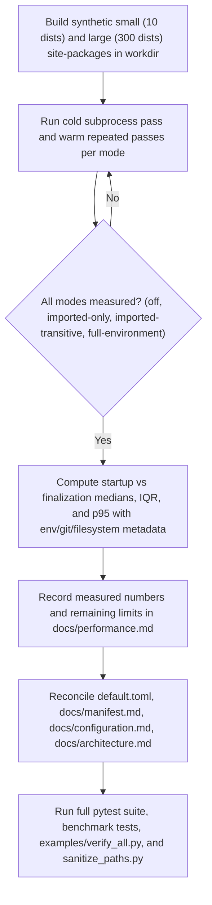

# IPD: Package capture benchmarking, documentation sync, and whole-Set verification

- Date: 2026-11-21
- Kind: child
- Concern: Measuring startup and finalization package-capture overhead separately in small and large environments, reconciling configuration comments and documentation, and validating the complete `dep-capture` Set.
- Scope: Create a local, non-publishing benchmark script `benchmarks/package_capture_bench.py`, add an `imported-transitive` scenario in `benchmarks/scenarios.py`, add behavioral benchmark tests in `tests/test_package_benchmark.py`, update `src/pubrun/resources/default.toml`, `docs/manifest.md`, `docs/configuration.md`, `docs/architecture.md`, and `docs/performance.md` with actual measured results and remaining limits, and run whole-Set validation.
- Scope-Paths: benchmarks/package_capture_bench.py, benchmarks/scenarios.py, tests/test_package_benchmark.py, src/pubrun/resources/default.toml, docs/manifest.md, docs/configuration.md, docs/architecture.md, docs/performance.md
- Item-Dependencies: executed:ijipnx
- Status: to-review
- Short-Description: Benchmark startup and finalization package capture in small and large environments, sync docs/config comments, and run full-Set validation
- Work-Kind: bug
- Priority: high
- From-Backlog: w4hxkh
- Blocks-Release: next
- Set: dep-capture
- Order: 4
- Highest E allocated: 05
- Author: agent
- Id: iflqsl

> Write and proofread this plan per the technical writing standard, `.aw/system/workflows/technical-writing/technical-writing.md` (`.agents/workflows/technical-writing/technical-writing.md` in a legacy-layout install), including requirement 12 (diagrams).

## Workflow history

- 2026-11-21 draft (agent): created.
- 2026-11-21 to-review (agent): authored review-ready child plan 04 of Set `dep-capture` graduating backlog item `w4hxkh`.

## Goal

Measure startup and finalization package-capture overhead separately across small, large, and ambient Python environments (with cold and warm passes, repetitions, dispersion, and detected filesystem metadata), reconcile all package-capture documentation and default configuration comments against the implemented behavior from child plans `uil22c`, `fdqkrz`, and `ijipnx`, and verify whole-Set correctness without publishing external artifacts or submitting cluster jobs.

### Benchmarking and verification workflow

The text in `## Proposed changes (ordered, validatable)` is normative. This diagram summarizes the local benchmarking, documentation update, and whole-Set validation flow.

## Detailed Implementation Checklist (TODO)

Execution-state rule: mark an `E-*` item complete only after performing the action. That mark is not validation. Right-sizing rule: write for a modest executor that cannot hold much in its head. Each E-item is one step (one concern, about one file, executable in one focused pass) and its V-item names each unit it covers with its own check; a plan stays at about 5 E-items and 8 work Scope-Paths, else split it into more child plans (guidance, `IPD-Z603`). Accepted execution states: blocked, failed, pending, performed; terminal gate demands 'performed'.

### Task group 1: Local startup-versus-finalization package benchmark

- [ ] E-01 Create `benchmarks/package_capture_bench.py` (Python standard library only, local, non-publishing) and extend `benchmarks/scenarios.py` with `feature-packages-transitive`.
  - Depends on: none
  - Expected outcome: `benchmarks/package_capture_bench.py` creates deterministic small (e.g., 10 synthetic distributions) and large (e.g., 300 synthetic distributions) temporary environments under `--workdir` (defaulting to a temporary directory), also measures the ambient environment, times **startup snapshot** and **finalization refresh + merge** separately across `off` (baseline), `imported-only`, `imported-transitive`, and `full-environment` modes with cold (fresh subprocess, uncached) and warm (cached, repeated) passes, records environment metadata (Python version, OS, CPU model/cores, git revision, detected filesystem type via `pubrun.capture.filesystem.get_filesystem()`), repetitions, median, Interquartile Range (IQR), standard deviation, and p95, prints a concise Markdown/JSON summary, and never publishes results or submits High-Performance Computing (HPC) scheduler jobs; `benchmarks/scenarios.py` adds `feature-packages-transitive` without breaking `benchmarks/test_benchmarks.py`.
  - Execution state: pending

- [ ] E-02 Create `tests/test_package_benchmark.py` and run `benchmarks/package_capture_bench.py` locally to collect actual post-change measurements.
  - Depends on: E-01
  - Expected outcome: `tests/test_package_benchmark.py` exercises `benchmarks/package_capture_bench.py` with minimal parameters (`--small-count 4 --large-count 12 --repetitions 2 --cold-runs 1`) and verifies JSON structure, separate `startup_ms` and `finalization_ms` stats, cold/warm separation, and filesystem/revision metadata; running the full local benchmark produces real measured data for `docs/performance.md`.
  - Execution state: pending

### Task group 2: Configuration comments and documentation sync

- [ ] E-03 Reconcile `src/pubrun/resources/default.toml`, `docs/configuration.md`, `docs/manifest.md`, and `docs/architecture.md` with the implemented package-capture contract.
  - Depends on: E-02
  - Expected outcome: `src/pubrun/resources/default.toml` and `docs/configuration.md` describe startup+finalization capture, remove the stale "(one level)" note for `imported-transitive`, document recursive PEP 508 marker-aware closure and extra handling, and accurately describe `top-level-installed`; `docs/manifest.md` documents `snapshot_stage`, `observed_at`, `import_names`, `unresolved`, `local_modules`, `coverage_notes`, `capture_state.status == "partial"` reasons, and the documented no-import-hook transient-unload limitation; `docs/architecture.md` reflects both startup capture and finalization refresh/merge. User-facing docs follow the repository no-em/en-dash rule and technical writing standard.
  - Execution state: pending

- [ ] E-04 Record the measured startup and finalization package-capture benchmark numbers (environment, git revision, filesystem type, workload, `mode = "off"` baseline, repetitions, cold vs warm passes, median and dispersion) and remaining overhead/limits in `docs/performance.md`.
  - Depends on: E-02
  - Expected outcome: `docs/performance.md` includes a dedicated subsection for package-capture startup and finalization overhead across small, large, and ambient environments, states explicitly whether measurements ran on local storage only (noting how to run `--workdir` on shared Network File System (NFS) or Lustre storage), documents remaining overhead and limits, and makes no unmeasured speedup claims.
  - Execution state: pending

### Task group 3: Whole-Set validation and hygiene gate

- [ ] E-05 Run the full repository test suite, benchmark test suite, example verification, and path-sanitization check, recording the Continuous Integration (CI) matrix requirement for multi-OS and Python 3.8 through 3.14.
  - Depends on: E-03, E-04
  - Expected outcome: `pytest tests/ -v`, `pytest benchmarks/test_benchmarks.py benchmarks/test_share_safety.py -o addopts="" -v`, `python examples/verify_all.py`, and `python3 scripts/sanitize_paths.py --check --all` all exit 0 with actual output captured in `Observed evidence`, and the post-merge GitHub Actions CI matrix gate (`.github/workflows/ci.yml`: `ubuntu-latest`, `ubuntu-24.04`, `windows-latest`, `macos-latest` across Python 3.8 through 3.14) is explicitly noted as required before release.
  - Execution state: pending

## Project conventions discovered (Step 0)

- `benchmarks/scenarios.py` is declarative and standard-library-only, currently containing `feature-packages-imported` and `feature-packages-full` (no `imported-transitive` scenario), and is tested by `benchmarks/test_benchmarks.py`.
- `docs/configuration.md` (`[capture.packages]`) currently states `"imported-transitive" — imported packages plus their declared dependencies (one level)` and `"top-level-installed" — pip/conda list`, both of which become stale once `uil22c` and `fdqkrz` land.
- `docs/architecture.md` (`Lifecycle` / step 1) currently describes packages as captured only at startup.
- `docs/performance.md` has `_TBD_` rows for `packages imported-only` and `packages full-environment` and notes how local harness runs are reproduced.
- `AGENTS.md` requires no em dashes or en dashes in newly authored user-facing prose (`docs/*.md`), and `scripts/sanitize_paths.py --check --all` enforces zero machine-local path leakage.
- `.github/workflows/ci.yml` defines the repository's supported OS and Python matrix (`ubuntu-latest`, `ubuntu-24.04`, `windows-latest`, `macos-latest` across Python 3.8 through 3.14).

## Findings

- **F-01 (No separate startup vs finalization package benchmark):** Existing `benchmarks/scenarios.py` times whole-subprocess wall time for `feature-packages-imported` and `feature-packages-full` on the ambient environment only; it does not isolate startup vs finalization package capture or compare small vs large environments (or cold vs warm cache behavior).
- **F-02 (Stale documentation and config comments):** `docs/configuration.md`, `docs/manifest.md`, `docs/architecture.md`, and `src/pubrun/resources/default.toml` do not reflect startup-to-finalization merging, distribution identity resolution, additive manifest fields, or recursive marker-aware transitive closure.

## Proposed changes (ordered, validatable)

1. **`benchmarks/package_capture_bench.py`** (new local, non-publishing benchmark script):
   - Pure Python standard library only (imports `pubrun.capture.packages`, `pubrun.capture.filesystem`, `pubrun.tracker`).
   - CLI arguments: `--small-count` (default `10`), `--large-count` (default `300`), `--repetitions` (default `10`), `--cold-runs` (default `3`), `--workdir` (optional path, allowing the maintainer to run on shared NFS/Lustre storage when available), `--json-out` (optional local file path, never auto-published).
   - For each environment profile (`small`, `large`, `ambient`) and each mode (`off`, `imported-only`, `imported-transitive`, `full-environment`):
     - **Cold measurements** (fresh subprocess per run, uncached `importlib.metadata`): measure startup `get_packages(cfg, stage="startup")` wall duration (`perf_counter`), late-import synthetic workload (fixed number of synthetic imports loaded after startup), and finalization `get_packages(cfg, stage="final")` + `merge_package_snapshots(...)` wall duration separately.
     - **Warm measurements** (repeated iterations in-process after warmup, exercising the environment-fingerprinted cache): measure startup snapshot and finalization refresh+merge separately, plus compute overhead delta against the `mode = "off"` baseline.
   - Report per-scenario `median_ms`, `iqr_ms`, `stdev_ms`, `p95_ms`, `min_ms`, `max_ms`, `n`, plus machine metadata: `python_version`, `platform`, `cpu_count`, `git_revision` (short SHA if available), `workdir_fstype` and `workdir_is_network` (from `get_filesystem()`, with NO raw home/user paths leaked in Markdown summaries).

2. **`benchmarks/scenarios.py`**:
   - Add `Scenario("feature-packages-transitive", "feature", "auto", "cpu_burn.py", config=_off_plus({"capture": {"packages": {"mode": "imported-transitive"}}}))` right after `feature-packages-imported` so the standard harness also tracks `imported-transitive`.

3. **`tests/test_package_benchmark.py`** (new test file):
   - Run `benchmarks/package_capture_bench.py` via `subprocess.run` (or direct `run_benchmark(...)` call) with tiny counts (`--small-count 4 --large-count 12 --repetitions 2 --cold-runs 1 --workdir <tmp_path> --json-out <tmp_path>/out.json`).
   - Assert exit code 0, JSON parses cleanly, contains `environment`, `git_revision`, `filesystem`, and separate `startup_ms` and `finalization_ms` cold and warm statistics (`median_ms`, `iqr_ms`, `p95_ms`) for `off`, `imported-only`, `imported-transitive`, and `full-environment` across `small` and `large` environments, and makes no network calls.

4. **`src/pubrun/resources/default.toml`**, **`docs/configuration.md`**, **`docs/manifest.md`**, **`docs/architecture.md`**, **`docs/performance.md`**:
   - `default.toml` and `docs/configuration.md`: update `[capture.packages]` descriptions:
     - `imported-only` (default): resolve imported modules in `sys.modules` to installed distributions at startup and refresh/merge at finalization (no global import hook).
     - `imported-transitive`: recursive, cycle-safe, PEP 508 marker-aware closure of applicable declared dependencies for all resolved imported distributions; unrequested optional extras are not mislabeled as required.
     - `top-level-installed`: installed distributions in the environment not required by another installed distribution (via `importlib.metadata`, offline, no subprocesses).
     - `full-environment`: every installed distribution in the environment.
   - `docs/manifest.md`: update `## packages` and `### packages.records[]` tables to document `snapshot_stage`, `unresolved`, `local_modules`, `coverage_notes`, `import_names`, `observed_at`, `capture_state.status == "partial"` reasons (ambiguous mapping, unmapped site-packages module, missing/corrupt metadata, missing applicable transitive dependency, unparseable marker), and the documented limit that modules both imported after startup and removed from `sys.modules` before finalization are not observed without an import hook.
   - `docs/architecture.md`: update startup/lifecycle summary to note that `packages` captures a startup snapshot for crash safety and refreshes/merges at finalization to record late imports.
   - `docs/performance.md`: add a dated, labeled single-machine measurement table for package capture startup and finalization across small (10 distributions), large (300 distributions), and ambient environments (cold and warm, median and IQR/p95, `mode = "off"` baseline, repetitions, Python version, OS, git revision, filesystem type), explain how to re-run with `--workdir` on shared NFS/Lustre storage, and document remaining overhead and limits honestly (making no unmeasured speedup claims).
   - Ensure all newly written prose in `docs/*.md` contains zero em dashes and zero en dashes.

5. **Whole-Set verification**:
   - Run `pytest tests/ -v`, `pytest benchmarks/test_benchmarks.py benchmarks/test_share_safety.py -o addopts="" -v`, `python examples/verify_all.py`, and `python3 scripts/sanitize_paths.py --check --all`.
   - Record explicitly that the multi-OS and Python 3.8 through 3.14 CI matrix (`.github/workflows/ci.yml`) must pass on pull request or push before release.

## Deferred / out of scope (with reason)

- Automated publication of benchmark results (GitHub Gist, GitHub Issue submission, or `benchmarks/results/*.json` intake): out of scope and prohibited without explicit maintainer approval.
- Running the benchmark on a remote HPC cluster scheduler (`sbatch`/`qsub`/`bsub`): prohibited without explicit maintainer authorization; `--workdir` enables manual shared-storage runs.
- Modifying `docs/functional_spec.md` beyond existing accurate mode lists: `docs/functional_spec.md` already lists the four package modes cleanly without stale one-level claims.

## Scope check

- Over-scope: none. Touches only the local package benchmark, scenario entry, benchmark test, default config comments, and the four affected docs.
- Under-scope: none. Covers `w4hxkh` acceptance criterion 6 and all shared validation, benchmarking, and documentation requirements.

## Required tests / validation

- Run `python benchmarks/package_capture_bench.py --small-count 10 --large-count 300 --repetitions 10 --cold-runs 3` and paste actual summary output.
- Run `pytest tests/test_package_benchmark.py -v` and paste actual output.
- Run `pytest tests/ -v` and paste actual output.
- Run `pytest benchmarks/test_benchmarks.py benchmarks/test_share_safety.py -o addopts="" -v`, `python examples/verify_all.py`, and `python3 scripts/sanitize_paths.py --check --all` and paste actual output.

## Spec / documentation sync

- Synchronizes `src/pubrun/resources/default.toml`, `docs/manifest.md`, `docs/configuration.md`, `docs/architecture.md`, and `docs/performance.md` in E-03 and E-04 of this plan.
- `schemas/manifest.schema.json` was synchronized in child plan `ijipnx` (`Order: 3`).

## Open questions

### OQ-01: Synthetic large-environment distribution count in `benchmarks/package_capture_bench.py`

- Blocking: no
- Status: resolved
- Owner: maintainer (confirmed upon plan approval)
- Resolution or deferral rationale: Defaulting `--small-count` to `10` and `--large-count` to `300` mirrors typical minimal vs scientific ML virtual environments while completing in under one minute locally, and both values remain CLI-configurable for larger sweeps.

## Validation and cross-check (verify before reporting done)

Validation-state rule: inspect evidence in a separate pass. Do not mark a `V-*` item complete from memory or from the matching execution checkmark. Accepted validation results: blocked, failed, pass, pending; terminal gate demands 'pass'. Runtime-demonstration reachability rule: for each `V-*` item demanding the software be observed acting (such as a run, a dispatch, or a transition)—as distinct from items demanding a diff, a file's content, or a test result, which are reachable by construction—name the code path that produces the observation or the sibling `E-*` that creates it, else the demand is UNDER-SCOPE.

- [ ] V-01 validates E-01
  - Required evidence: Paste `pytest benchmarks/test_benchmarks.py benchmarks/test_share_safety.py -o addopts="" -v` output (exit code 0) and `python benchmarks/package_capture_bench.py --help` output (exit code 0) confirming CLI options (`--small-count`, `--large-count`, `--repetitions`, `--cold-runs`, `--workdir`, `--json-out`) and scenario compatibility.
  - Observed evidence:
  - Result: pending

- [ ] V-02 validates E-02
  - Required evidence: Paste `pytest tests/test_package_benchmark.py -v` output (exit code 0) and actual output from running `python benchmarks/package_capture_bench.py --small-count 10 --large-count 300 --repetitions 10 --cold-runs 3` showing separate startup and finalization cold/warm medians and dispersion across small, large, and ambient environments.
  - Observed evidence:
  - Result: pending

- [ ] V-03 validates E-03
  - Required evidence: Paste `git diff -- src/pubrun/resources/default.toml docs/configuration.md docs/manifest.md docs/architecture.md` summary plus check confirming zero stale "(one level)" text in `docs/configuration.md`, all new schema fields documented in `docs/manifest.md`, and zero em/en dashes introduced in edited `docs/*.md` lines.
  - Observed evidence:
  - Result: pending

- [ ] V-04 validates E-04
  - Required evidence: Paste the new measured package-capture section in `docs/performance.md` showing environment, git revision, filesystem type, workload, `mode = "off"` baseline, repetitions, cold/warm separation, median and dispersion, shared-storage `--workdir` instructions, and remaining limits, with zero em/en dashes in added text.
  - Observed evidence:
  - Result: pending

- [ ] V-05 validates E-05
  - Required evidence: Paste actual runner output (all exit code 0) from `pytest tests/ -v`, `pytest benchmarks/test_benchmarks.py benchmarks/test_share_safety.py -o addopts="" -v`, `python examples/verify_all.py`, and `python3 scripts/sanitize_paths.py --check --all`, and state explicitly that the GitHub Actions OS/Python CI matrix (`.github/workflows/ci.yml`) must pass prior to release.
  - Observed evidence:
  - Result: pending

## Approval and execution gate

- Size assessment: standard
- Cohesion rationale: not required

Execution contract:
1. All open questions (OQ-01) are resolved for review and become binding upon human approval (`- Status: approved`) and completion of dependency `ijipnx`.
2. Scope fence: modify only `benchmarks/package_capture_bench.py`, `benchmarks/scenarios.py`, `tests/test_package_benchmark.py`, `src/pubrun/resources/default.toml`, `docs/manifest.md`, `docs/configuration.md`, `docs/architecture.md`, and `docs/performance.md`; do not expand scope; if execution seems to need more files, STOP and report.
3. Honesty rule: paste actual runner output, benchmark measurements, and exit codes into `Observed evidence`; never claim tests or benchmarks passed without running them.
4. Commit discipline: commit only this plan's changed files via `aw commit iflqsl -- <paths>`; never use `git add -A`, `git add .`, or `git commit -a`; never push.
5. Lifecycle move on completion: after all `E-*` items are `performed` and all `V-*` items are `pass`, run the post-gate `aw ipd` transition to `.aw/records/plans/executed/`, set `- Status: executed`, and append a dated `## Workflow history` line.
