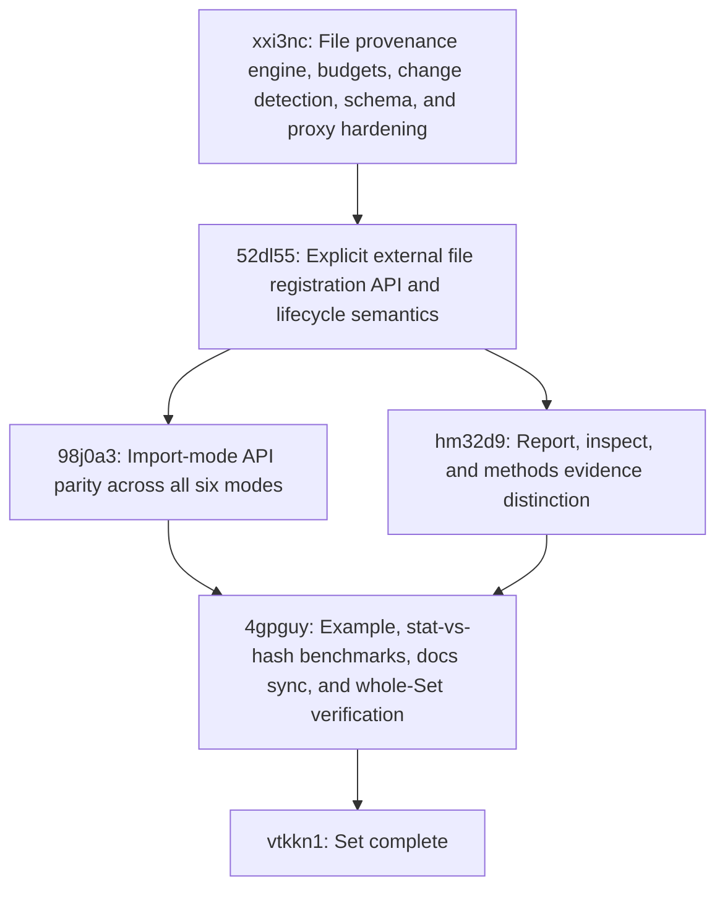

# IPD: External file registration and explicit hashing guarantees

- Date: 2026-11-21
- Kind: orchestrator
- Concern: Explicit external file registration, explicit hashing outcomes and budgets, file-change detection, streaming-hash evaluation, report honesty, and benchmarks for backlog item `x6alw4`
- Scope: Orchestrate five child plans implementing the core file-provenance engine and proxy hardening, explicit external file registration, import-mode application programming interface (API) parity, report and check evidence distinction, and example, benchmark, documentation, and whole-Set verification for backlog item `x6alw4`.
- Scope-Paths: .aw/records/plans/pending/20261121-file-prov-00-vtkkn1-external-file-registration-and-explicit-hashing-guarantees.ipd.md
- Item-Dependencies: executed:xxi3nc, executed:52dl55, executed:98j0a3, executed:hm32d9, executed:4gpguy
- Status: to-review
- Coverage: pass
- Coverage-Fingerprint: 594ad82ba2543330a4004fbffd80f7f69539aabecf0be27c755052e5d67d1663
- Coverage-Checked: 2026-11-22 by uri/its_direct/pt3-claude-opus-5.5-1m-us
- Short-Description: Orchestrate file provenance engine, explicit registration API, mode parity, report honesty, and benchmarks/docs
- Work-Kind: feature
- Priority: medium
- From-Backlog: x6alw4
- Set: file-prov
- Order: 0
- Highest E allocated: 05
- Author: agent
- Id: vtkkn1

> Write and proofread this plan per the technical writing standard, `.aw/system/workflows/technical-writing/technical-writing.md` (`.agents/workflows/technical-writing/technical-writing.md` in a legacy-layout install), including requirement 12 (diagrams).

## Workflow history

- 2026-11-22 coverage pass (aw oc run): fingerprint 594ad82ba254, model uri/its_direct/pt3-claude-opus-5.5-1m-us
- 2026-11-21 to-review (agent): authored orchestrator plan `vtkkn1` for Set `file-prov` graduating backlog item `x6alw4`.

## Goal

Graduate open backlog item `x6alw4` (`.aw/records/backlog/open/20261121-pubrun-improve-01-x6alw4-file-provenance.backlog.md`) through five ordered, independently verifiable child plans. Together, these plans let users register external input and output files without replacing library input/output (I/O), record explicit hashing outcomes, budgets, evidence strength, and file-change detection across both `pubrun.open()` and explicit registration, distinguish identified paths from verified content in reports, and validate overhead with reproducible benchmarks. All five child plans preserve one-import adoption, the Python 3.8+ standard-library runtime, optional capture, host-program behavior and exceptions, redaction, all six import modes, offline operation, and no global `builtins.open` monkeypatch.

### Plan Set dependency flow

This diagram summarizes the execution order of the five child plans. The text and table below are normative.

## Detailed Implementation Checklist (TODO)

Execution-state rule: mark an `E-*` item complete only after performing the action. That mark is not validation. Right-sizing rule: write for a modest executor that cannot hold much in its head. Each E-item is one step (one concern, about one file, executable in one focused pass) and its V-item names each unit it covers with its own check; a plan stays at about 5 E-items and 8 work Scope-Paths, else split it into more child plans (guidance, `IPD-Z603`). Accepted execution states: blocked, failed, pending, performed; terminal gate demands 'performed'.

### Task group 1: Confirm child IPD execution

- [ ] E-01 CONFIRM xxi3nc REACHED executed
  - Depends on: none
  - Expected outcome: Child plan `xxi3nc` (`20261121-file-prov-01-xxi3nc-file-provenance-engine-hashing-guarantees-and-proxy-hardenin.ipd.md`) is in `.aw/records/plans/executed/` with `- Status: executed`, all `E-*` items marked `performed`, and all `V-*` items marked `pass`.
  - Execution state: pending

- [ ] E-02 CONFIRM 52dl55 REACHED executed
  - Depends on: E-01
  - Expected outcome: Child plan `52dl55` (`20261121-file-prov-02-52dl55-explicit-external-file-registration-api-and-lifecycle-semant.ipd.md`) is in `.aw/records/plans/executed/` with `- Status: executed`, all `E-*` items marked `performed`, and all `V-*` items marked `pass`.
  - Execution state: pending

- [ ] E-03 CONFIRM 98j0a3 REACHED executed
  - Depends on: E-02
  - Expected outcome: Child plan `98j0a3` (`20261121-file-prov-03-98j0a3-import-mode-api-parity-for-file-registration.ipd.md`) is in `.aw/records/plans/executed/` with `- Status: executed`, all `E-*` items marked `performed`, and all `V-*` items marked `pass`.
  - Execution state: pending

- [ ] E-04 CONFIRM hm32d9 REACHED executed
  - Depends on: E-02
  - Expected outcome: Child plan `hm32d9` (`20261121-file-prov-04-hm32d9-report-inspect-and-methods-file-provenance-evidence-distinct.ipd.md`) is in `.aw/records/plans/executed/` with `- Status: executed`, all `E-*` items marked `performed`, and all `V-*` items marked `pass`.
  - Execution state: pending

- [ ] E-05 CONFIRM 4gpguy REACHED executed
  - Depends on: E-03, E-04
  - Expected outcome: Child plan `4gpguy` (`20261121-file-prov-05-4gpguy-external-file-example-stat-vs-hash-benchmarks-docs-sync-and.ipd.md`) is in `.aw/records/plans/executed/` with `- Status: executed`, all `E-*` items marked `performed`, and all `V-*` items marked `pass`.
  - Execution state: pending

## Child IPDs, sequence, and dependencies

| Order | Id | File | What it does | Depends on |
|---|---|---|---|---|
| 01 | `xxi3nc` | `20261121-file-prov-01-xxi3nc-file-provenance-engine-hashing-guarantees-and-proxy-hardenin.ipd.md` | Builds `src/pubrun/capture/file_io.py`, adds run-wide hashing budgets in `default.toml`, fixes and extends `data_files` in `schemas/manifest.schema.json`, hardens `ProvenanceFileProxy` with change detection, mixed-mode classification, and safe sequential-binary streaming evaluation, and adds unit and schema tests. | none |
| 02 | `52dl55` | `20261121-file-prov-02-52dl55-explicit-external-file-registration-api-and-lifecycle-semant.ipd.md` | Adds `pubrun.register_file()`, `pubrun.register_input()`, and `pubrun.register_output()` with logical labels, asserted versus verified caller digests, pending pre-creation outputs, deduplication, edge-case handling, and tests while keeping `pubrun.artifact()` unchanged. | 01 |
| 03 | `98j0a3` | `20261121-file-prov-03-98j0a3-import-mode-api-parity-for-file-registration.ipd.md` | Re-exports `register_file`, `register_input`, and `register_output` across all six import-mode modules (`auto`, `full`, `noauto`, `nopatch`, `noconsole`, `minimal`) and extends `tests/test_import_modes.py` parity and behavioral subprocess tests. | 02 |
| 04 | `hm32d9` | `20261121-file-prov-04-hm32d9-report-inspect-and-methods-file-provenance-evidence-distinct.ipd.md` | Updates `pubrun.report.checks`, `pubrun.report.diagnostics`, `pubrun.report.methods`, `docs/cli.md`, and report tests so reports, `pubrun inspect`, `pubrun show`, and `pubrun methods` distinguish identified paths, asserted digests, verified hashes, over-budget skips, failures, and changed files. | 02 |
| 05 | `4gpguy` | `20261121-file-prov-05-4gpguy-external-file-example-stat-vs-hash-benchmarks-docs-sync-and.ipd.md` | Adds dependency-free example `examples/12_external_file_provenance.py`, updates stat-versus-hash benchmarks measuring latency and extra bytes read, reconciles API/config/manifest/performance/functional-spec docs, and runs whole-Set validation. | 03, 04 |

## Completion criteria (the whole Set is done only when)

- Every `data_files` record produced by `pubrun.open()` carries explicit `hash_status`, `hash_status_detail`, `hash_algorithm`, `digest`, `observation_time`, `evidence_source`, `evidence_strength`, `role`, and `change_detected` fields, honors per-file and run-wide byte/time hashing budgets (proven with a large sparse fixture or mocked reader without creating large files), detects observable identity/metadata changes between open, close, and hash, classifies `r+`/`w+`/`a+`/`x+` as mixed access (`data_files.mixed`), evaluates streaming hashing only for sequential binary streams without substituting a stream-of-reads hash for a whole-file digest, preserves host exceptions without patching `builtins.open`, and validates against `schemas/manifest.schema.json`. Owner: `xxi3nc`
- Explicit external file registration (`pubrun.register_file()`, `pubrun.register_input()`, `pubrun.register_output()`) records local paths with role, optional logical label, optional caller-supplied digest (treated as asserted evidence unless explicitly verified), pre-creation and post-creation output registration, deterministic deduplication, and honest handling of missing files, directories, symlinks, special files, and out-of-scope remote Uniform Resource Identifiers (URIs) while keeping `pubrun.artifact()` unchanged as a run-internal file writer and adding zero third-party runtime dependencies. Owner: `52dl55`
- All six import-mode modules (`auto`, `full`, `noauto`, `nopatch`, `noconsole`, `minimal`) expose `register_file`, `register_input`, and `register_output` with full parity and no global `builtins.open` patch. Owner: `98j0a3`
- `pubrun.report.checks`, `pubrun.report.diagnostics`, `pubrun.report.methods`, and `docs/cli.md` clearly distinguish verified content hashes from caller-asserted digests, path/metadata-only registrations, over-budget skips, failed or unavailable hashes, and changed files, while keeping `import pubrun` isolated from `pubrun.report.checks`. Owner: `hm32d9`
- Dependency-free example `examples/12_external_file_provenance.py`, updated stat-versus-hash benchmarks reporting close-time/registration latency and extra bytes read (with environment, revision, workload, baseline, repetitions, cold/warm passes, and dispersion), reconciled documentation (`docs/api.md`, `docs/configuration.md`, `docs/manifest.md`, `docs/functional_spec.md`, `docs/performance.md`), and the full test, example, and benchmark-test suites pass with captured output. Owner: `4gpguy`

## Cross-IPD validation

- Verify that `data_files` records written by `pubrun.open()` (`xxi3nc`) and by `pubrun.register_file()` / `register_input()` / `register_output()` (`52dl55`) share one canonical record structure, share the run's thread-safe hashing budget tracker, and conform to `schemas/manifest.schema.json`. Owner: `52dl55`
- Verify that all six import modes (`auto`, `full`, `noauto`, `nopatch`, `noconsole`, `minimal`) expose the external file registration APIs identically to root `import pubrun` without patching `builtins.open`. Owner: `98j0a3`
- Verify that `pubrun inspect`, `pubrun show`, and `pubrun methods` consume the new `data_files` fields (and degrade honestly on legacy manifests) without overstating path-only, stat-only, or caller-asserted records as verified content. Owner: `hm32d9`
- Verify that the full repository test suite (`pytest tests/ -v`), all examples (`python examples/verify_all.py`), benchmark tests (`pytest benchmarks/test_benchmarks.py -v`), and import-isolation checks pass together after all children merge. Owner: `4gpguy`

## Deferred / out of scope (with reason)

- Remote object-store inspection and hashing (`s3://`, `gs://`, `abfs://`, `http://`, `https://`): explicitly out of scope per `x6alw4` ("Start with local files; remote object-store support can remain explicitly out of scope") and `pubrun`'s offline, standard-library-only runtime constraint. Remote URIs passed to `register_*()` are recorded honestly as `entry_type = "unsupported_remote_uri"` and `hash_status = "unavailable"` without network access.
- Global `builtins.open` monkeypatching or automatic `sys.addaudithook` interception: explicitly rejected by `x6alw4` and `docs/design/file-io-provenance-evaluation.md`.
- Mandatory scientific-framework dependencies (`pandas`, `pyarrow`, `h5py`), hosted services, schedulers, dashboards, or automatic replay: explicitly prohibited by `x6alw4`.
- Multi-OS and multi-Python continuous integration (CI) matrix execution (`ubuntu-latest`, `ubuntu-24.04`, `windows-latest`, `macos-latest` across Python 3.8 through 3.14 in `.github/workflows/ci.yml`): cannot run inside a single local Linux worktree and must pass on pull request or push before release; noted explicitly by `4gpguy`.

## Scope check

- Over-scope: none. Every child plan maps directly to requirements in `x6alw4` without introducing global I/O patching, third-party runtime dependencies, or unrequested services.
- Under-scope: none. All six implementation guidance items, all five acceptance criteria, and all shared validation, benchmark, schema, and documentation requirements in `x6alw4` are assigned to child plans `xxi3nc`, `52dl55`, `98j0a3`, `hm32d9`, and `4gpguy`.

## Required tests / validation

This orchestrator plan runs no tests directly. Whole-Set validation (`pytest tests/ -v`, `python examples/verify_all.py`, `pytest benchmarks/test_benchmarks.py -v`, stat-versus-hash benchmark measurement, and import-isolation verification) is performed by child plan `4gpguy`.

## Open questions

### OQ-01: Approval of proposed public API and manifest field names

- Blocking: no
- Status: resolved
- Owner: none
- Resolution or deferral rationale: Backlog item `x6alw4` notes that names for new API and configuration fields are proposals, not yet approved contracts. This Set proposes `pubrun.register_file()`, `pubrun.register_input()`, `pubrun.register_output()`, configuration keys `[capture.file_io].max_total_hash_bytes`, `[capture.file_io].max_total_hash_seconds`, and `[capture.file_io].hash_algorithm`, and manifest fields `data_files.mixed`, `data_files.hashing_summary`, `hash_status`, `evidence_source`, `evidence_strength`, `observation_time`, `digest`, and `caller_digest`. Human approval of this plan Set confirms those contracts before any code is executed. RESOLVED 2026-11-21 by the user via /askme: Approved the proposed public API names (`register_file`, `register_input`, `register_output`), configuration keys (`[capture.file_io].max_total_hash_bytes`, `max_total_hash_seconds`, `hash_algorithm`), and manifest field names (`data_files.mixed`, `data_files.hashing_summary`, `hash_status`, `evidence_source`, `evidence_strength`, `observation_time`, `digest`, `caller_digest`). No reason was given.

### OQ-02: Coordination with pending sibling Set `repro-check` (`0b8i7x`)

- Blocking: no
- Status: resolved
- Owner: none
- Resolution or deferral rationale: Pending sibling plan `0b8i7x` (from backlog item `q3bll1`) checks `data_files` entries defensively for `evidence_source == "asserted"` and `hash_status`. This Set adopts those exact field names so both Sets compose cleanly in either execution order without creating a cross-Set execution dependency. RESOLVED 2026-11-21 by the user via /askme: Confirmed adopting `evidence_source` and `hash_status` (settled with OQ-01) so `file-prov` and `repro-check` (`0b8i7x`) compose in either execution order without a cross-Set dependency. No reason was given.

## Validation and cross-check (verify before reporting the Set complete)

Validation-state rule: inspect evidence in a separate pass. Do not mark a `V-*` item complete from memory or from the matching execution checkmark. Accepted validation results: blocked, failed, pass, pending; terminal gate demands 'pass'. Runtime-demonstration reachability rule: for each `V-*` item demanding the software be observed acting (such as a run, a dispatch, or a transition)—as distinct from items demanding a diff, a file's content, or a test result, which are reachable by construction—name the code path that produces the observation or the sibling `E-*` that creates it, else the demand is UNDER-SCOPE.

- [ ] V-01 validates E-01
  - Required evidence: Confirm `.aw/records/plans/executed/20261121-file-prov-01-xxi3nc-file-provenance-engine-hashing-guarantees-and-proxy-hardenin.ipd.md` exists with `- Status: executed`, all `E-*` items marked `performed`, and all `V-*` items marked `pass`.
  - Observed evidence:
  - Result: pending

- [ ] V-02 validates E-02
  - Required evidence: Confirm `.aw/records/plans/executed/20261121-file-prov-02-52dl55-explicit-external-file-registration-api-and-lifecycle-semant.ipd.md` exists with `- Status: executed`, all `E-*` items marked `performed`, and all `V-*` items marked `pass`.
  - Observed evidence:
  - Result: pending

- [ ] V-03 validates E-03
  - Required evidence: Confirm `.aw/records/plans/executed/20261121-file-prov-03-98j0a3-import-mode-api-parity-for-file-registration.ipd.md` exists with `- Status: executed`, all `E-*` items marked `performed`, and all `V-*` items marked `pass`.
  - Observed evidence:
  - Result: pending

- [ ] V-04 validates E-04
  - Required evidence: Confirm `.aw/records/plans/executed/20261121-file-prov-04-hm32d9-report-inspect-and-methods-file-provenance-evidence-distinct.ipd.md` exists with `- Status: executed`, all `E-*` items marked `performed`, and all `V-*` items marked `pass`.
  - Observed evidence:
  - Result: pending

- [ ] V-05 validates E-05
  - Required evidence: Confirm `.aw/records/plans/executed/20261121-file-prov-05-4gpguy-external-file-example-stat-vs-hash-benchmarks-docs-sync-and.ipd.md` exists with `- Status: executed`, all `E-*` items marked `performed`, and all `V-*` items marked `pass`.
  - Observed evidence:
  - Result: pending

## Approval and execution gate

- Size assessment: standard
- Cohesion rationale: not required

Execution of this Set requires explicit human approval (`- Status: approved`). The runner executes child plans `xxi3nc`, `52dl55`, `98j0a3`, `hm32d9`, and `4gpguy` in dependency order and retires this orchestrator plan to `.aw/records/plans/executed/` only after all five child plans reach `executed` on disk and pass post-transition validation.
