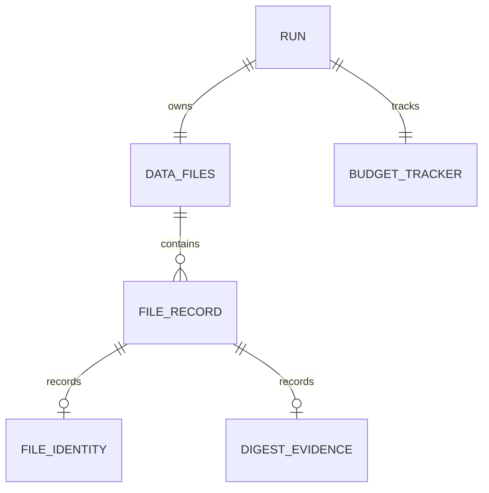
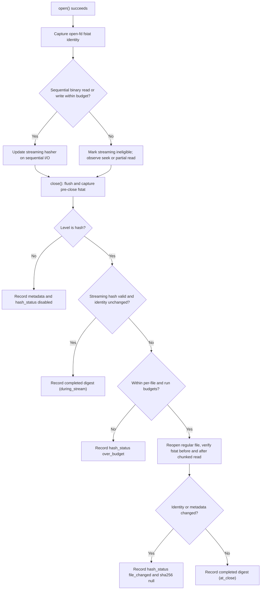

# IPD: File provenance engine, hashing guarantees, and proxy hardening

- Date: 2026-11-21
- Kind: child
- Concern: File provenance record contract, per-file and run-wide hashing budgets, identity and change detection, streaming-hash evaluation, manifest schema reconciliation, and `ProvenanceFileProxy` hardening
- Scope: Add run-wide hashing budget defaults in `src/pubrun/resources/default.toml`, reconcile and extend `data_files` in `schemas/manifest.schema.json`, create `src/pubrun/capture/file_io.py`, wire `src/pubrun/core.py` and `src/pubrun/tracker.py`, and add behavioral and schema tests in `tests/test_file_io_provenance.py` and `tests/test_manifest_schema.py`.
- Scope-Paths: src/pubrun/resources/default.toml, schemas/manifest.schema.json, src/pubrun/capture/file_io.py, src/pubrun/core.py, src/pubrun/tracker.py, tests/test_file_io_provenance.py, tests/test_manifest_schema.py
- Item-Dependencies: none
- Status: to-review
- Short-Description: Build file provenance core, budgets, change detection, streaming evaluation, schema, and proxy hardening
- Work-Kind: feature
- Priority: medium
- From-Backlog: x6alw4
- Set: file-prov
- Order: 1
- Highest E allocated: 05
- Author: agent
- Id: xxi3nc

> Write and proofread this plan per the technical writing standard, `.aw/system/workflows/technical-writing/technical-writing.md` (`.agents/workflows/technical-writing/technical-writing.md` in a legacy-layout install), including requirement 12 (diagrams).

## Workflow history

- 2026-11-21 to-review (agent): authored child plan 01 of Set `file-prov` graduating backlog item `x6alw4`.

## Goal

Establish a dedicated, Python standard-library file-provenance engine in `src/pubrun/capture/file_io.py` with explicit hashing outcomes, per-file and run-wide byte and time budgets, file-identity change detection, honest mixed-mode (`r+`, `w+`, `a+`, `x+`) classification, and safe sequential-binary streaming hashing with whole-file fallback. Fix existing `data_files` schema drift in `schemas/manifest.schema.json` and harden `pubrun.open()` without patching `builtins.open`, adding startup import cost, or altering host exceptions.

### File provenance entities and hashing flow

These diagrams summarize the core entities and the `ProvenanceFileProxy` close-time decision flow. The text below is normative.

## Detailed Implementation Checklist (TODO)

Execution-state rule: mark an `E-*` item complete only after performing the action. That mark is not validation. Right-sizing rule: write for a modest executor that cannot hold much in its head. Each E-item is one step (one concern, about one file, executable in one focused pass) and its V-item names each unit it covers with its own check; a plan stays at about 5 E-items and 8 work Scope-Paths, else split it into more child plans (guidance, `IPD-Z603`). Accepted execution states: blocked, failed, pending, performed; terminal gate demands 'performed'.

### Task group 1: Configuration defaults and manifest schema contract

- [ ] E-01 Add run-wide hashing budget and algorithm keys under `[capture.file_io]` in `src/pubrun/resources/default.toml` and update `schemas/manifest.schema.json` for `data_files`.
  - Depends on: none
  - Expected outcome: `src/pubrun/resources/default.toml` defines `[capture.file_io].max_total_hash_bytes = 0`, `max_total_hash_seconds = 0.0`, and `hash_algorithm = "sha256"` alongside existing `level = "stat"` and `max_hash_bytes = 0`, and updates the comment to describe `fstat` and budget behavior accurately. `schemas/manifest.schema.json` fixes existing `data_files` drift (making `sha256` nullable and `size_bytes` optional at `name` level, and allowing `mtime`, `ctime`, `realpath`) and adds definitions for `data_files.mixed`, `data_files.hashing_summary`, and explicit provenance record fields (`role`, `label`, `mode`, `registration_source`, `entry_type`, `is_symlink`, `symlink_target`, `mtime_ns`, `inode`, `device`, `digest`, `caller_digest`, `hash_status`, `hash_status_detail`, `hash_algorithm`, `observation_time`, `evidence_source`, `evidence_strength`, `change_detected`, `change_details`, `access_observations`, `hash_stats`, `registration_count`, `registered_before_creation`, `registered_at_utc`, `last_observed_at_utc`, `metadata`).
  - Execution state: pending

### Task group 2: Core file provenance module and proxy hardening

- [ ] E-02 Create `src/pubrun/capture/file_io.py` with identity snapshots, budget tracking, checked hashing, mode classification, deduplication, and hardened `ProvenanceFileProxy`.
  - Depends on: E-01
  - Expected outcome: `src/pubrun/capture/file_io.py` uses only the Python standard library (Python 3.8+) and implements: `FileIoBudgetTracker` (thread-safe per-file byte cap, run-wide total byte cap, run-wide monotonic time cap, and summary export), `FileIdentity` snapshots from `os.fstat`/`os.lstat`/`os.stat` (comparing `st_ino`/`st_dev` only when non-zero for cross-platform safety), `classify_open_mode(mode)` mapping pure read to `"input"`, pure write/append/exclusive-create to `"output"`, and any `"+"` mode (`r+`, `w+`, `a+`, `x+`) to `"input_output"`, `hash_file_checked(...)` guarding regular files (`stat.S_ISREG`), checking budgets before and during 64 KiB chunk reads, and comparing `fstat` before and after hashing to detect replacement or modification, `append_or_deduplicate_record(...)`, and `ProvenanceFileProxy` capturing open-fd `fstat`, evaluating streaming hashing strictly for sequential binary reads/writes without seeks or partial reads, falling back to checked whole-file on-disk hashing for text mode, seek, reread, partial read, append, or mixed access, and never substituting a partial or stream-of-reads hash for a whole-file digest.
  - Execution state: pending

### Task group 3: Wire `pubrun.core` and `pubrun.tracker`

- [ ] E-03 Integrate `pubrun.capture.file_io` into `src/pubrun/core.py` and `src/pubrun/tracker.py`.
  - Depends on: E-02
  - Expected outcome: `src/pubrun/core.py` loads `pubrun.capture.file_io` lazily inside `pubrun.open()` (adding zero import cost to `import pubrun` when `pubrun.open()` is unused), keeps `ProvenanceFileProxy` importable from `pubrun.core` for backward compatibility, and preserves exact `builtins.open()` return values and exceptions when no run is active or `level == "none"`. `src/pubrun/tracker.py` initializes `self.data_files = {"inputs": [], "outputs": [], "mixed": []}`, attaches a run-scoped `FileIoBudgetTracker` (lazily initialized on first file provenance call), invokes pending-output finalization hooks in `Run._finalize_state()` before `ArtifactWriter.write_artifacts()`, and includes `data_files` (with `hashing_summary` when budget state exists) in `Run.to_manifest_dict()`.
  - Execution state: pending

### Task group 4: Behavioral and schema conformance tests

- [ ] E-04 Expand `tests/test_file_io_provenance.py` to test every hashing guarantee, budget cap, change-detection case, streaming-vs-fallback read pattern, and mixed mode.
  - Depends on: E-03
  - Expected outcome: `tests/test_file_io_provenance.py` proves with targeted behavioral tests: (1) all five detail levels (`none`, `name`, `stat`, `realpath`, `hash`) produce distinct honest `hash_status` and `evidence_strength` values; (2) a large sparse file (or mocked reader) exceeding `max_hash_bytes` or `max_total_hash_bytes` records `hash_status == "over_budget"` with zero content-read calls and without allocating large disk data; (3) `max_total_hash_seconds` stops hashing cleanly with `hash_status == "over_budget"`; (4) permission error records `hash_status == "failed"`; (5) replacing or modifying a file between open, close, and hash records `hash_status == "file_changed"`, `change_detected == True`, and `sha256 is None`; (6) sequential binary `"rb"` and `"wb"` streams hash in a single pass (`observation_time == "during_stream"`, `extra_read_bytes == 0`), while partial read, `seek()`, reread, `readinto()` after seek, text decoding (`"r"`), append (`"a"`), and mixed modes (`"r+"`, `"w+"`, `"a+"`, `"x+"`) preserve exact file semantics and never substitute a partial/stream-of-reads hash for a whole-file digest; (7) `r+`/`w+`/`a+`/`x+` land in `data_files["mixed"]` with `role == "input_output"`; (8) `builtins.open` is never monkeypatched and host exceptions (`FileNotFoundError`, `ValueError` on bad mode) propagate unchanged.
  - Execution state: pending

- [ ] E-05 Add populated `data_files` schema conformance tests in `tests/test_manifest_schema.py`.
  - Depends on: E-04
  - Expected outcome: `tests/test_manifest_schema.py` validates real manifests containing populated `data_files` (`inputs`, `outputs`, `mixed`, `hashing_summary`) across `name`, `stat`, `realpath`, and `hash` levels, over-budget skips, and changed-file records against `schemas/manifest.schema.json` using `jsonschema.validate`.
  - Execution state: pending

## Project conventions discovered (Step 0)

- `src/pubrun/core.py` currently defines `_FILE_IO_LEVELS`, `_file_io_level`, `ProvenanceFileProxy`, and `open` inline; `ProvenanceFileProxy._is_read_mode` uses `"r" in self._mode and "w" not in self._mode and "a" not in self._mode`.
- `src/pubrun/tracker.py` initializes `self.data_files = {"inputs": [], "outputs": []}` in `Run.__init__` and serializes it in `Run.to_manifest_dict`.
- `src/pubrun/resources/default.toml` defines `[capture.file_io]` with `level = "stat"` and `max_hash_bytes = 0`.
- `schemas/manifest.schema.json` defines `properties.data_files` with `additionalProperties: false` and currently requires `size_bytes` (integer) and `sha256` (non-null string) on every item in `inputs` and `outputs`.
- `tests/test_manifest_schema.py` validates real manifests via `jsonschema.validate`, but currently only generates manifests with empty `data_files`.
- `tests/test_explicit_api.py` (`test_pubrun_open_provenance`), `tests/test_new_features.py` (`TestWriteModeHashing`), and `tests/test_file_io_provenance.py` assert that `inputs[0]["path"]`, `size_bytes`, `mtime`, `ctime`, `realpath`, and `sha256` remain populated at their respective levels.
- Runtime code supports Python 3.8+ using only the Python standard library (`tomli` on Python < 3.11 is the sole third-party dependency in `pyproject.toml`).

## Findings

1. **Silent `sha256: null` ambiguity (`src/pubrun/core.py` `ProvenanceFileProxy._compute_hash_on_disk`)**: Returns `None` identically when hashing is disabled (`level != "hash"`), when `size > max_hash_bytes`, when the file does not exist, or when reading raises `OSError`/`PermissionError`.
2. **Post-close path reopen race (`src/pubrun/core.py` `ProvenanceFileProxy.close` and `_register_provenance`)**: Closes `_file_obj` first, then calls `os.stat(self._path)` and reopens `self._path` by name. No open-time `os.fstat(fd)` identity is recorded, so a file replaced or modified between open and close is silently hashed as if it were the consumed input. Meanwhile, comments in `src/pubrun/resources/default.toml` and `docs/api.md` inaccurately state that `stat` uses `fstat` on the open file descriptor.
3. **Mixed-mode misclassification (`src/pubrun/core.py` `ProvenanceFileProxy._is_read_mode`)**: Treats `"r+"` / `"rb+"` as read-only inputs even though they can mutate the file, and treats `"w+"` / `"a+"` / `"x+"` as write-only outputs even though they allow reads.
4. **Duplicate full-file I/O at `level = "hash"` (`src/pubrun/core.py` `ProvenanceFileProxy._compute_hash_on_disk`)**: Always reopens and reads every byte a second time after `close()`, even for sequential binary reads or writes where a single-pass hash would match the exact on-disk bytes.
5. **No run-wide hashing budget**: Only per-file `max_hash_bytes` exists; batch workloads opening or registering many medium files have no total byte or time cap.
6. **Pre-existing schema drift (`schemas/manifest.schema.json` `properties.data_files`)**: Requires non-null string `sha256` and integer `size_bytes` on all `data_files` items, which fails validation for real runs at default `level = "stat"` (`sha256: null`) and `level = "name"` (no `size_bytes`).

## Proposed changes (ordered, validatable)

1. **`src/pubrun/resources/default.toml`**:
   - Under `[capture.file_io]`, keep `level = "stat"` and `max_hash_bytes = 0` unchanged for backward compatibility.
   - Add `max_total_hash_bytes = 0` (`0` = no run-wide byte cap), `max_total_hash_seconds = 0.0` (`0.0` = no run-wide time cap), and `hash_algorithm = "sha256"`.
   - Correct the `[capture.file_io]` comment so it accurately describes open-fd `fstat` capture, streaming vs post-close hashing, and budget behavior.

2. **`schemas/manifest.schema.json`**:
   - Add `$defs.file_provenance_record` describing every record in `data_files.inputs`, `data_files.outputs`, and `data_files.mixed`:
     - Required: `path` (string).
     - Optional/typed fields: `realpath` (`string | null`), `label` (`string | null`), `role` (`"input" | "output" | "input_output"`), `mode` (`string | null`), `open_disposition` (`"read" | "write" | "append" | "exclusive_create" | "read_write" | null`), `registration_source` (`"pubrun.open" | "register_file" | "register_input" | "register_output"`), `entry_type` (`"file" | "directory" | "symlink" | "special" | "missing" | "unsupported_remote_uri"`), `is_symlink` (`boolean`), `symlink_target` (`string | null`), `size_bytes` (`integer | null`), `mtime` (`number | null`), `ctime` (`number | null`), `mtime_ns` (`integer | null`), `inode` (`integer | null`), `device` (`integer | null`), `sha256` (`string | null`), `digest` (`$ref: #/$defs/hash_record` or `null`), `caller_digest` (object with `algorithm`, `value`, `verified` (`boolean | null`), or `null`), `hash_status` (`"completed" | "disabled" | "over_budget" | "unavailable" | "failed" | "file_changed" | "asserted" | "pending"`), `hash_status_detail` (`string | null`), `hash_algorithm` (`string | null`), `observation_time` (`"during_stream" | "at_close" | "at_registration" | "at_finalization" | "caller_supplied" | "not_observed"`), `evidence_source` (`"observed" | "asserted" | "none"`), `evidence_strength` (`"verified_content" | "asserted_content" | "metadata_only" | "path_only" | "changed_unverified" | "unavailable"`), `change_detected` (`boolean`), `change_details` (`object | null`), `access_observations` (`object | null`), `hash_stats` (`object | null`), `registration_count` (`integer`, minimum 1), `registered_before_creation` (`boolean`), `accessed_at_utc` (`number`), `modified_at_utc` (`number`), `registered_at_utc` (`number`), `last_observed_at_utc` (`number`), `metadata` (`object`).
   - Update `properties.data_files` to include `inputs`, `outputs`, `mixed` (default `[]`), and optional `hashing_summary` (object reporting configured caps, `total_bytes_hashed`, `total_hash_seconds`, `files_hashed`, `files_skipped_over_budget`, `files_changed`, `files_failed`).

3. **`src/pubrun/capture/file_io.py`** (new stdlib-only module):
   - Constants: `FILE_IO_LEVELS = ("none", "name", "stat", "realpath", "hash")`, `HASH_STATUSES`, `EVIDENCE_SOURCES`, `EVIDENCE_STRENGTHS`, `OBSERVATION_TIMES`, `SUPPORTED_HASH_ALGORITHMS = ("sha256", "sha512", "sha1", "md5")` (default `"sha256"`).
   - `FileIdentity` helper capturing `(device, inode, size_bytes, mtime, ctime, mtime_ns, mode)` from `os.fstat(fd)` or `os.stat(path)`; identity equality compares `(size_bytes, mtime_ns)` always and compares `(device, inode)` whenever both sides have non-zero `inode` (avoiding false positives on Windows/virtual filesystems that report `st_ino == 0`).
   - `FileIoBudgetTracker`: thread-safe (`threading.Lock`) tracker storing `max_hash_bytes`, `max_total_hash_bytes`, `max_total_hash_seconds`, cumulative `total_bytes_hashed`, `total_hash_seconds`, and outcome counters. Provides `check_before_hash(size_bytes) -> Optional[str]` (returns over-budget reason or `None`), `consume_chunk(n_bytes, elapsed_seconds) -> Optional[str]` (returns over-budget reason if total byte or time cap is exceeded mid-hash), and `to_summary_dict()`.
   - `classify_open_mode(mode: str) -> Tuple[str, str]`: returns `(role, open_disposition)`. Pure `"r"` (no `"+"`) -> `("input", "read")`; `"w"` without `"+"` -> `("output", "write")`; `"a"` without `"+"` -> `("output", "append")`; `"x"` without `"+"` -> `("output", "exclusive_create")`; any mode with `"+"` -> `("input_output", "read_write")`.
   - `hash_file_checked(path, *, algorithm="sha256", budget=None, expected_identity=None, chunk_size=65536)`:
     - Checks `os.lstat` / `os.stat` safely; refuses directories and non-regular files (`not stat.S_ISREG(st.st_mode)`) with `hash_status="unavailable"` before opening.
     - Checks `budget.check_before_hash(st.st_size)` BEFORE opening the file for reads so over-budget files perform zero content reads (critical for large sparse files and slow network filesystems).
     - Opens `path` in `"rb"`, captures `start_id = fstat(fd)`, verifies `stat.S_ISREG` and compares `start_id` against `expected_identity` (if supplied); on mismatch (replaced inode or changed size/mtime), closes immediately without reading and returns `hash_status="file_changed"` with `change_details`.
     - Streams 64 KiB chunks measuring monotonic time with `time.monotonic()`, calling `budget.consume_chunk(...)` per chunk; aborts cleanly with `hash_status="over_budget"` if a run-wide cap is hit mid-file.
     - Captures `end_id = fstat(fd)` before closing; if `end_id` differs from `start_id` or `bytes_hashed != end_id.size_bytes`, returns `hash_status="file_changed"`, `sha256=None`, `digest=None`.
     - Otherwise returns `hash_status="completed"`, `digest={"algorithm": algorithm, "value": hex}`, `sha256=hex` (when `algorithm == "sha256"`), and `hash_stats={"bytes_hashed": bytes_hashed, "extra_read_bytes": bytes_hashed, "hash_duration_seconds": duration}`.
   - `ProvenanceFileProxy`:
     - Captures `open_identity` immediately in `__init__` via `os.fstat(file_obj.fileno())` (when available) so `stat` metadata truly uses the open file descriptor and establishes a baseline for change detection.
     - Evaluates streaming eligibility cleanly:
       - Binary pure-read (`role == "input"` and `"b" in mode` and `level == "hash"`): eligible only if `open_identity` is a regular file and within `budget.check_before_hash(open_identity.size_bytes)`. Intercepts `read`, `read1`, `readline`, `readlines`, `__next__`, `readinto`, `readinto1`, and `seek`. Any `seek()` call sets `_seek_used = True` and invalidates streaming. Tracks `_bytes_read` and `_eof_reached`. At `close()`, streaming result is accepted ONLY if `_stream_valid and _eof_reached and _bytes_read == close_identity.size_bytes` and `open_identity` matches `close_identity` (recording `observation_time="during_stream"`, `extra_read_bytes=0`). If caller did a partial read (`not _eof_reached`) or seeked, falls back to `hash_file_checked(...)` using `expected_identity=open_identity` so a stream-of-reads hash is never substituted for a whole-file digest.
       - Binary pure-write (`open_disposition in ("write", "exclusive_create")` and `"b" in mode` and `level == "hash"`): streams written bytes through hasher on `write()` / `writelines()`, invalidating on `seek()` or `truncate()` or mid-stream budget overflow. At `close()`, flushes `_file_obj`, captures `close_identity = fstat(fd)`, and accepts the streaming hash if `_stream_valid and _bytes_written == close_identity.size_bytes` (`observation_time="during_stream"`, `extra_read_bytes=0`); otherwise falls back to `hash_file_checked(...)` after closing using `expected_identity=close_identity`.
       - Text mode (`"b" not in mode`), append (`"a"`), and mixed (`"+"`) modes: never use streaming hashing; observe `seek()`/`read()`/`write()` activity and fall back to checked on-disk whole-file hashing after flush and close with `expected_identity` verification.
     - Always closes `_file_obj` inside `try ... finally`, never suppresses host exceptions, and wraps provenance registration in a failure-isolated `try ... except` logging a warning.
     - Populates `sha256` ONLY when `hash_status == "completed"` and `hash_algorithm == "sha256"` (otherwise `None`), preserving backward compatibility for existing consumers.
   - `append_or_deduplicate_record(run_instance, record)`: thread-safe append into `data_files["inputs"]`, `data_files["outputs"]`, or `data_files["mixed"]` (deduplicating identical unchanged `(path, role, label, identity, hash_status, digest)` entries by incrementing `registration_count` while preserving distinct records whenever content or identity changed).

4. **`src/pubrun/core.py` and `src/pubrun/tracker.py`**:
   - In `src/pubrun/core.py`, replace the inline `ProvenanceFileProxy` implementation with a thin lazy import from `pubrun.capture.file_io` inside `open()`, and expose `ProvenanceFileProxy` via lazy module lookup or lightweight import so existing callers importing `from pubrun.core import ProvenanceFileProxy` continue to work without importing `hashlib` unnecessarily on cold `import pubrun`.
   - In `src/pubrun/tracker.py`:
     - Initialize `self.data_files = {"inputs": [], "outputs": [], "mixed": []}` (and in Ghost Mode as well).
     - Add `self._file_io_budget = None` and `self._pending_file_registrations = []`.
     - In `Run._finalize_state()`, call `finalize_pending_registrations(self)` only when `self._pending_file_registrations` is non-empty (so runs that never register deferred outputs pay zero import or execution cost).
     - In `Run.to_manifest_dict()`, emit `data_files` containing `inputs`, `outputs`, `mixed`, and `hashing_summary` (when `self._file_io_budget is not None`).

5. **`tests/test_file_io_provenance.py` and `tests/test_manifest_schema.py`**:
   - Keep all existing assertions passing while adding targeted behavioral tests for every scenario listed in `E-04` and `E-05`.
   - For the large-file cap test, create a sparse file (via `f.truncate(10 * 1024 * 1024 * 1024)` where supported, or a monkeypatched `os.stat` / mocked reader returning a multi-terabyte `st_size` with a spy on `builtins.open` proving zero read calls occur when `st_size > max_hash_bytes`), ensuring cross-platform determinism on Linux, macOS, and Windows.

## Deferred / out of scope (with reason)

- Public external file registration functions (`pubrun.register_file()`, `pubrun.register_input()`, `pubrun.register_output()`): implemented in child plan `52dl55` (`Order: 2`) on top of `src/pubrun/capture/file_io.py`.
- Import-mode alias parity (`auto`, `full`, `noauto`, `nopatch`, `noconsole`, `minimal`): implemented in child plan `98j0a3` (`Order: 3`).
- Report, inspect, and methods rendering of the new evidence fields: implemented in child plan `hm32d9` (`Order: 4`).
- Example script, stat-versus-hash benchmarks, and user documentation updates: implemented in child plan `4gpguy` (`Order: 5`).

## Scope check

- Over-scope: none. Touches only file-I/O config defaults, manifest schema, the new `capture/file_io.py` engine, minimal `core.py`/`tracker.py` hooks, and unit/schema tests.
- Under-scope: none. Delivers the full hashing-guarantee, budget, change-detection, streaming-evaluation, mixed-mode, and schema foundation required by `x6alw4` items 2, 3, 4, 5, and 6.

## Required tests / validation

- Run `pytest tests/test_file_io_provenance.py tests/test_manifest_schema.py tests/test_explicit_api.py tests/test_new_features.py -v` and paste actual runner output.
- Run a fresh Python subprocess check verifying `import pubrun` does not monkeypatch `builtins.open` and does not eagerly import `pubrun.capture.file_io` when `pubrun.open()` is not called.

## Spec / documentation sync

- `schemas/manifest.schema.json` and `src/pubrun/resources/default.toml` are updated in `E-01` of this plan.
- User documentation (`docs/api.md`, `docs/configuration.md`, `docs/manifest.md`, `docs/functional_spec.md`, `docs/performance.md`) is synchronized in child plan `4gpguy` (`Order: 5`) once all APIs and benchmarks are complete.

## Open questions

### OQ-01: Default value for `[capture.file_io].max_total_hash_bytes` and `max_total_hash_seconds`

- Blocking: no
- Status: resolved
- Owner: none
- Resolution or deferral rationale: Existing `[capture.file_io].max_hash_bytes` defaults to `0` (unlimited) and `[capture.file_io].level` defaults to `"stat"` (hashing disabled unless explicitly enabled). Keeping `max_total_hash_bytes = 0` and `max_total_hash_seconds = 0.0` as defaults preserves exact backward compatibility for existing callers who explicitly set `level = "hash"`, while allowing batch workloads to set explicit byte and wall-time limits in `.pubrun.toml` or `pubrun.start(...)`. RESOLVED 2026-11-21 by the user via /askme: Default both `[capture.file_io].max_total_hash_bytes` to `0` (unlimited) and `[capture.file_io].max_total_hash_seconds` to `0.0` (unlimited). No reason was given.

## Validation and cross-check (verify before reporting done)

Validation-state rule: inspect evidence in a separate pass. Do not mark a `V-*` item complete from memory or from the matching execution checkmark. Accepted validation results: blocked, failed, pass, pending; terminal gate demands 'pass'. Runtime-demonstration reachability rule: for each `V-*` item demanding the software be observed acting (such as a run, a dispatch, or a transition)—as distinct from items demanding a diff, a file's content, or a test result, which are reachable by construction—name the code path that produces the observation or the sibling `E-*` that creates it, else the demand is UNDER-SCOPE.

- [ ] V-01 validates E-01
  - Required evidence: Paste `pytest tests/test_manifest_schema.py tests/test_config.py -v` output showing exit code 0, plus command output confirming `[capture.file_io]` in `src/pubrun/resources/default.toml` resolves `max_total_hash_bytes`, `max_total_hash_seconds`, and `hash_algorithm` via `pubrun.config.load_default_config()` and `schemas/manifest.schema.json` passes `check_schema`.
  - Observed evidence:
  - Result: pending

- [ ] V-02 validates E-02
  - Required evidence: Paste `pytest tests/test_file_io_provenance.py -v` output showing exit code 0 and passing assertions covering `FileIoBudgetTracker`, `FileIdentity`, `classify_open_mode`, `hash_file_checked`, `append_or_deduplicate_record`, and `ProvenanceFileProxy` streaming-versus-fallback behavior.
  - Observed evidence:
  - Result: pending

- [ ] V-03 validates E-03
  - Required evidence: Paste output of `pytest tests/test_explicit_api.py tests/test_new_features.py tests/test_tracker.py -v` (exit code 0) and fresh subprocess output of `python -c "import builtins, sys; orig = builtins.open; import pubrun; assert builtins.open is orig; assert 'pubrun.capture.file_io' not in sys.modules; pubrun.stop(); print('LAZY_AND_UNPATCHED')"` printing `LAZY_AND_UNPATCHED` with exit code 0.
  - Observed evidence:
  - Result: pending

- [ ] V-04 validates E-04
  - Required evidence: Paste full `pytest tests/test_file_io_provenance.py -v` output (exit code 0) listing passing tests for: all five detail levels, sparse-file/mocked-reader cap preventing content reads, total byte and time budgets, permission error, replaced/modified file detection, sequential binary streaming vs text/seek/reread/`readinto`/iteration/append/partial-read fallback, `r+`/`w+`/`a+`/`x+` mixed access, and host exception preservation.
  - Observed evidence:
  - Result: pending

- [ ] V-05 validates E-05
  - Required evidence: Paste `pytest tests/test_manifest_schema.py -v` output (exit code 0) confirming real manifests with populated `data_files` (`inputs`, `outputs`, `mixed`, `hashing_summary`) across levels and hash outcomes validate against `schemas/manifest.schema.json`.
  - Observed evidence:
  - Result: pending

## Approval and execution gate

- Size assessment: standard
- Cohesion rationale: not required

Execution requires explicit human approval (`- Status: approved`). Commit only the scoped files through `aw commit xxi3nc -- <paths>`, paste actual runner output into `Observed evidence`, and run the post-gate `aw ipd` lifecycle transition to `.aw/records/plans/executed/`.
