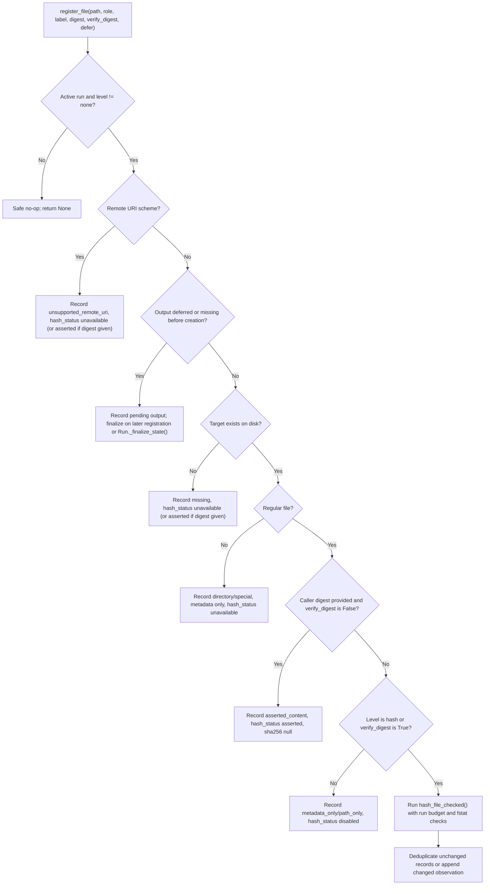

# IPD: Explicit external file registration API and lifecycle semantics

- Date: 2026-11-21
- Kind: child
- Concern: Explicit registration of external input and output paths with logical labels, caller-supplied asserted versus verified digests, pre-creation and post-creation output lifecycles, deduplication, and edge-case handling
- Scope: Implement external file registration and pending-output finalization in `src/pubrun/capture/file_io.py`, expose `register_file`, `register_input`, and `register_output` in `src/pubrun/core.py` and `src/pubrun/__init__.py`, and add behavioral tests in `tests/test_file_registration.py`.
- Scope-Paths: src/pubrun/capture/file_io.py, src/pubrun/core.py, src/pubrun/__init__.py, tests/test_file_registration.py
- Item-Dependencies: executed:xxi3nc
- Status: to-review
- Short-Description: Add register_file, register_input, and register_output with labels, asserted/verified digests, and deduplication
- Work-Kind: feature
- Priority: medium
- From-Backlog: x6alw4
- Set: file-prov
- Order: 2
- Highest E allocated: 04
- Author: agent
- Id: 52dl55

> Write and proofread this plan per the technical writing standard, `.aw/system/workflows/technical-writing/technical-writing.md` (`.agents/workflows/technical-writing/technical-writing.md` in a legacy-layout install), including requirement 12 (diagrams).

## Workflow history

- 2026-11-21 to-review (agent): authored child plan 02 of Set `file-prov` graduating backlog item `x6alw4`.

## Goal

Enable scripts using external data libraries (such as pandas, PyArrow, NumPy, or C-extension readers/writers) to register local input, output, and mixed-role file paths explicitly via `pubrun.register_file()`, `pubrun.register_input()`, and `pubrun.register_output()` without replacing library input/output (I/O) or adding third-party runtime dependencies. Keep caller-supplied checksums explicitly labeled as asserted evidence unless verified, support registering outputs both before and after creation, deduplicate unchanged repeated registrations cleanly, and preserve `pubrun.artifact()` as a run-internal file writer.

### External file registration flow

This diagram summarizes how `register_file()` processes local paths, remote Uniform Resource Identifiers (URIs), pre-creation outputs, caller digests, and hashing budgets. The text below is normative.

## Detailed Implementation Checklist (TODO)

Execution-state rule: mark an `E-*` item complete only after performing the action. That mark is not validation. Right-sizing rule: write for a modest executor that cannot hold much in its head. Each E-item is one step (one concern, about one file, executable in one focused pass) and its V-item names each unit it covers with its own check; a plan stays at about 5 E-items and 8 work Scope-Paths, else split it into more child plans (guidance, `IPD-Z603`). Accepted execution states: blocked, failed, pending, performed; terminal gate demands 'performed'.

### Task group 1: External registration engine and pending-output lifecycle

- [ ] E-01 Implement `register_file_provenance(...)` and `finalize_pending_registrations(run_instance)` in `src/pubrun/capture/file_io.py`.
  - Depends on: none
  - Expected outcome: `src/pubrun/capture/file_io.py` implements local path registration supporting `role` (`"input"`, `"output"`, `"input_output"`), optional `label`, optional `digest` and `digest_algorithm`, `verify_digest: bool = False`, optional per-call `level` override, `defer: bool = False`, and optional JSON-serializable `metadata`. Caller-supplied digests are recorded in `caller_digest` and `digest` with `evidence_source = "asserted"`, `evidence_strength = "asserted_content"`, `hash_status = "asserted"`, and `sha256 = None` unless `verify_digest=True` confirms the on-disk bytes match (on mismatch: `hash_status = "failed"`, `hash_status_detail = "caller_digest_mismatch"`, `caller_digest.verified = False`, `sha256 = None`). Missing outputs (or outputs with `defer=True`) register as `hash_status = "pending"` with `registered_before_creation = True` and are finalized either by a subsequent post-creation `register_output()` call or automatically by `finalize_pending_registrations(run_instance)` during `Run._finalize_state()`. Handles missing inputs, directories, valid and broken symlinks, special files, remote URIs (`s3://`, `gs://`, `abfs://`, `http://`, `https://`, etc., without network access), event-stream emission, and deduplication of unchanged repeated registrations while preserving changed observations.
  - Execution state: pending

### Task group 2: Public API wrappers and root package export

- [ ] E-02 Add `register_file`, `register_input`, and `register_output` to `src/pubrun/core.py` and export them in `src/pubrun/__init__.py`.
  - Depends on: E-01
  - Expected outcome: `src/pubrun/core.py` defines `register_file(path, role="input", *, label=None, digest=None, digest_algorithm="sha256", level=None, verify_digest=False, defer=False, metadata=None)`, `register_input(path, *, label=None, digest=None, digest_algorithm="sha256", level=None, verify_digest=False, metadata=None)`, and `register_output(path, *, label=None, digest=None, digest_algorithm="sha256", level=None, verify_digest=False, defer=False, metadata=None)`. Each imports `pubrun.capture.file_io` lazily, returns the recorded dict (or `None` when inactive or `level == "none"`), respects `[events].on_inactive_annotate` safely without crashing default runs, and leaves `pubrun.artifact()` unchanged as the run-internal file writer. `src/pubrun/__init__.py` exports all three in `__all__`, the root import block, and `_ensure_core_loaded`.
  - Execution state: pending

### Task group 3: Behavioral tests and cross-path verification

- [ ] E-03 Create `tests/test_file_registration.py` covering all external registration semantics, edge cases, budgets, and schema conformance.
  - Depends on: E-02
  - Expected outcome: `tests/test_file_registration.py` proves: (1) a library-style reader/writer using `builtins.open` can register external inputs and outputs with logical labels without replacing its I/O; (2) caller-supplied digest with default `verify_digest=False` records `evidence_source == "asserted"`, `evidence_strength == "asserted_content"`, `hash_status == "asserted"`, and `sha256 is None` without reading the file; (3) `verify_digest=True` records `hash_status == "completed"` and `caller_digest["verified"] is True` on match, and `hash_status == "failed"` with `caller_digest["verified"] is False` on mismatch; (4) `register_output()` before file creation (both automatic missing-output detection and explicit `defer=True`) resolves at post-creation re-registration or `pubrun.stop()`, and marks `hash_status == "unavailable"` if still missing at stop; (5) repeated unchanged registrations deduplicate (`registration_count == 2`) without double-hashing, while registrations after file modification preserve both observations; (6) missing files, directories, valid/broken symlinks, permission errors, per-file/total budgets shared with `pubrun.open()`, and remote URIs (`s3://bucket/key`) produce distinct honest records without raising into host code or touching the network; (7) invalid `role` values raise `ValueError` clearly (or fail predictably as documented), inactive runs honor `on_inactive_annotate`, and resulting manifests validate against `schemas/manifest.schema.json`.
  - Execution state: pending

- [ ] E-04 Run combined file-provenance, explicit-API, and manifest-schema tests to verify `pubrun.open()`, `pubrun.register_*()`, and `pubrun.artifact()` coexist cleanly.
  - Depends on: E-03
  - Expected outcome: `pytest tests/test_file_registration.py tests/test_file_io_provenance.py tests/test_explicit_api.py tests/test_manifest_schema.py -v` exits 0, confirming shared record structure, shared run budget accounting across `pubrun.open()` and `pubrun.register_*()`, schema conformance, and unchanged `pubrun.artifact()` behavior.
  - Execution state: pending

## Project conventions discovered (Step 0)

- `src/pubrun/core.py` defines `artifact(filename, content)` to write caller-supplied `bytes` or `str` to `run.run_dir / filename` and emit an `artifact: <filename>` annotation event; it does not touch `run.data_files`.
- `src/pubrun/core.py` defines `_handle_inactive(context)` reading `[events].on_inactive_annotate` (`"ignore"`, `"warn"`, or `"error"`) for explicit APIs called without an active run (`annotate`, `phase`, `report`, `artifact`).
- `src/pubrun/__init__.py` maintains three export lists that must stay synchronized: `__all__`, the root `from pubrun.core import (...)` block, and `_ensure_core_loaded()`.
- Child plan `xxi3nc` (`Order: 1`) establishes `src/pubrun/capture/file_io.py`, `FileIoBudgetTracker`, `hash_file_checked`, `append_or_deduplicate_record`, `Run._pending_file_registrations`, and the `schemas/manifest.schema.json` `data_files` contract.

## Findings

1. **No explicit external path registration API**: Users calling pandas, PyArrow, h5py, NumPy, or external C libraries have no API to record external input/output datasets in `manifest["data_files"]`.
2. **Role boundary with `pubrun.artifact()`**: `pubrun.artifact(filename, content)` writes supplied content into the run directory rather than registering an existing external dataset path. Conflating the two would break existing callers (`tests/test_explicit_api.py` `test_report_and_artifact`) and copy large datasets into `runs/`.
3. **Output timing gap**: Workflows often know an output path before calling a library writer (`df.to_parquet(out_path)`) or only register after writing; supporting both pre-creation (deferred until post-creation call or `Run._finalize_state()`) and post-creation registration avoids fragile ordering requirements.
4. **Remote URI safety**: Passing `s3://...` or `https://...` to `Path(uri).exists()` treats it as a missing relative local path without explaining that remote object stores are out of scope. Explicitly detecting URI schemes (`^[a-zA-Z][a-zA-Z0-9+.-]{1,15}://`) prevents confusion with Windows drive letters (`C:\...`) and records an honest out-of-scope status without network access.

## Proposed changes (ordered, validatable)

1. **`src/pubrun/capture/file_io.py`**:
   - Add `_is_remote_uri(path_str: str) -> bool` matching URI schemes of length >= 2 (`^[a-zA-Z][a-zA-Z0-9+.-]+://`, explicitly excluding Windows single-letter drive paths like `C:\...` or `C:/...`).
   - Implement `register_file_provenance(run_instance, path, *, role="input", label=None, digest=None, digest_algorithm="sha256", level=None, verify_digest=False, defer=False, metadata=None, registration_source="register_file") -> Optional[Dict[str, Any]]`:
     - Validate `role in ("input", "output", "input_output")` (raise `ValueError` on invalid role, matching standard Python API conventions; never swallow explicit programmer misuse of `role` while still isolating unexpected OS/filesystem errors).
     - Resolve effective detail level: explicit `level` override (if valid in `FILE_IO_LEVELS`) else run's `[capture.file_io].level`. If effective level is `"none"`, return `None`.
     - Remote URI branch: never touch network or local filesystem; record `entry_type="unsupported_remote_uri"`, `path=str(path)`, `role=role`, `label=label`, `registration_source=registration_source`, and either `hash_status="asserted"`, `evidence_source="asserted"`, `evidence_strength="asserted_content"`, `caller_digest=...`, `digest=...`, `sha256=None` when `digest` is supplied, or `hash_status="unavailable"`, `hash_status_detail="remote object-store URIs are out of scope"`, `evidence_source="none"`, `evidence_strength="unavailable"`, `sha256=None`.
     - Pending-output branch: when `role in ("output", "input_output")` and (`defer=True` or not `os.path.lexists(path)`): create record with `hash_status="pending"`, `hash_status_detail="registered before creation; awaiting file creation or run finalization"`, `registered_before_creation=True`, `observation_time="not_observed"`, `evidence_source="none"`, `evidence_strength="unavailable"` (or asserted if caller digest given), store it in `data_files`, and append a pending reference to `run_instance._pending_file_registrations`.
     - Local inspection branch (reusing `FileIdentity` and `hash_file_checked` from `xxi3nc`):
       - Inspect `os.lstat` (detect symlink) and `os.stat` (resolve target). Classify `entry_type` as `"missing"` (including broken symlink with `is_symlink=True` and `hash_status_detail="broken symlink"`), `"directory"`, `"special"`, or `"file"`.
       - Populate `path` (raw at `name`, `os.path.abspath` at `stat`+), `size_bytes`/`mtime`/`ctime`/`mtime_ns`/`inode`/`device` at `stat`+, and `realpath`/`symlink_target` at `realpath`+.
       - Digest policy:
         - Caller supplied `digest` and `verify_digest=False`: record `caller_digest={"algorithm": alg, "value": digest, "verified": None}`, `digest={"algorithm": alg, "value": digest}`, `sha256=None`, `hash_status="asserted"`, `observation_time="caller_supplied"`, `evidence_source="asserted"`, `evidence_strength="asserted_content"`. Do NOT read file bytes.
         - Caller supplied `digest` and `verify_digest=True`: run `hash_file_checked(...)` using `digest_algorithm` and the run's shared `FileIoBudgetTracker`. On completed hash matching `digest.lower()`: set `hash_status="completed"`, `caller_digest["verified"]=True`, `evidence_source="observed"`, `evidence_strength="verified_content"`, `observation_time="at_registration"`, and `sha256=computed` (when `alg == "sha256"`). On mismatch: set `hash_status="failed"`, `hash_status_detail="caller_digest_mismatch"`, `caller_digest["verified"]=False`, `evidence_source="observed"`, `evidence_strength="changed_unverified"`, `sha256=None`. On budget/OS/change failure: preserve the honest `over_budget`/`failed`/`file_changed`/`unavailable` status and `caller_digest["verified"]=None`.
         - No caller digest and effective `level == "hash"`: run `hash_file_checked(...)` using the run's configured `hash_algorithm` and shared `FileIoBudgetTracker`; record `observation_time="at_registration"` when completed.
         - No caller digest and effective `level != "hash"`: record `hash_status="disabled"`, `hash_status_detail=f"level is '{effective_level}'"`, `evidence_source="observed"` (at `stat`/`realpath`/`name`), `evidence_strength="metadata_only"` (at `stat`/`realpath`) or `"path_only"` (at `name`), `sha256=None`.
       - Deduplication & pending upgrade: if an existing pending record matches `(normalized_path, role, label)`, update it in place and mark it finalized; otherwise call `append_or_deduplicate_record(...)`.
       - Emit event (`input_dataset`, `output_artifact`, or `mixed_dataset`) when `run_instance.event_stream` is active.
   - Implement `finalize_pending_registrations(run_instance)`: iterate remaining pending output records at `Run._finalize_state()`; for each pending entry, inspect the path now on disk (honoring its recorded `level`, caller digest, and run budget) and update the entry in place with `observation_time="at_finalization"` (or `entry_type="missing"`, `hash_status="unavailable"`, `hash_status_detail="output file did not exist at run finalization"` if still absent). Clear the pending list afterward.

2. **`src/pubrun/core.py` and `src/pubrun/__init__.py`**:
   - Add `register_file`, `register_input`, and `register_output` to `src/pubrun/core.py`, calling `_handle_inactive(...)` and returning `None` when no active run exists. Keep `pubrun.artifact()` completely unchanged.
   - Re-export `register_file`, `register_input`, and `register_output` in `src/pubrun/__init__.py` (`__all__`, root import, `_ensure_core_loaded`).

3. **`tests/test_file_registration.py`** (new test file):
   - Add behavioral tests covering every scenario in `E-03` plus schema conformance via `jsonschema.validate`.

## Deferred / out of scope (with reason)

- Re-exporting `register_file`, `register_input`, and `register_output` in all six import-mode modules (`auto`, `full`, `noauto`, `nopatch`, `noconsole`, `minimal`): implemented in child plan `98j0a3` (`Order: 3`).
- Report, inspect, and methods rendering of registered files and asserted-versus-verified distinction: implemented in child plan `hm32d9` (`Order: 4`).
- Example script (`examples/12_external_file_provenance.py`), benchmarks, and user documentation updates: implemented in child plan `4gpguy` (`Order: 5`).

## Scope check

- Over-scope: none. Touches only `capture/file_io.py`, `core.py`, `__init__.py`, and `tests/test_file_registration.py`.
- Under-scope: none. Delivers the full external path registration API, caller-supplied digest semantics, pre/post-creation output lifecycle, deduplication, and local/remote edge cases required by `x6alw4` items 1, 3, and 6.

## Required tests / validation

- Run `pytest tests/test_file_registration.py tests/test_file_io_provenance.py tests/test_explicit_api.py tests/test_manifest_schema.py -v` and paste actual runner output.

## Spec / documentation sync

- User API and manifest documentation (`docs/api.md`, `docs/manifest.md`, `docs/functional_spec.md`) is updated in child plan `4gpguy` (`Order: 5`) after mode parity and report integration complete.

## Open questions

### OQ-01: Default `verify_digest` behavior when a caller supplies `digest`

- Blocking: no
- Status: resolved
- Owner: none
- Resolution or deferral rationale: Defaulting `verify_digest=False` when a caller supplies `digest` avoids re-reading large datasets whose checksum the caller already obtained from a catalog or upstream tool, while keeping the record strictly honest (`evidence_source="asserted"`, `evidence_strength="asserted_content"`, `hash_status="asserted"`, `sha256=None`). Callers who want independent verification opt in explicitly with `verify_digest=True`. RESOLVED 2026-11-21 by the user via /askme: Default `verify_digest=False` when a caller supplies `digest` (recording caller-asserted evidence unless `verify_digest=True` is passed). No reason was given.

## Validation and cross-check (verify before reporting done)

Validation-state rule: inspect evidence in a separate pass. Do not mark a `V-*` item complete from memory or from the matching execution checkmark. Accepted validation results: blocked, failed, pass, pending; terminal gate demands 'pass'. Runtime-demonstration reachability rule: for each `V-*` item demanding the software be observed acting (such as a run, a dispatch, or a transition)—as distinct from items demanding a diff, a file's content, or a test result, which are reachable by construction—name the code path that produces the observation or the sibling `E-*` that creates it, else the demand is UNDER-SCOPE.

- [ ] V-01 validates E-01
  - Required evidence: Paste `pytest tests/test_file_registration.py -v` output (exit code 0) showing passing assertions for `register_file_provenance` and `finalize_pending_registrations`, including asserted vs verified digests, pre-creation and post-creation outputs, deduplication of unchanged vs changed files, missing/directory/symlink/special/remote-URI cases, and shared budget enforcement.
  - Observed evidence:
  - Result: pending

- [ ] V-02 validates E-02
  - Required evidence: Paste command output of `python -c "import pubrun; assert all(hasattr(pubrun, n) for n in ('register_file', 'register_input', 'register_output', 'artifact')); pubrun.stop(); print('EXPORTS_OK')"` (printing `EXPORTS_OK`, exit code 0) and `pytest tests/test_explicit_api.py -v` (exit code 0, proving `pubrun.artifact()` remains unchanged).
  - Observed evidence:
  - Result: pending

- [ ] V-03 validates E-03
  - Required evidence: Paste full `pytest tests/test_file_registration.py -v` output (exit code 0) listing all passing behavioral and schema-conformance tests.
  - Observed evidence:
  - Result: pending

- [ ] V-04 validates E-04
  - Required evidence: Paste full `pytest tests/test_file_registration.py tests/test_file_io_provenance.py tests/test_explicit_api.py tests/test_manifest_schema.py -v` output showing exit code 0 and zero failures.
  - Observed evidence:
  - Result: pending

## Approval and execution gate

- Size assessment: standard
- Cohesion rationale: not required

Execution requires explicit human approval (`- Status: approved`). Commit only the scoped files through `aw commit 52dl55 -- <paths>`, paste actual runner output into `Observed evidence`, and run the post-gate `aw ipd` lifecycle transition to `.aw/records/plans/executed/`.
