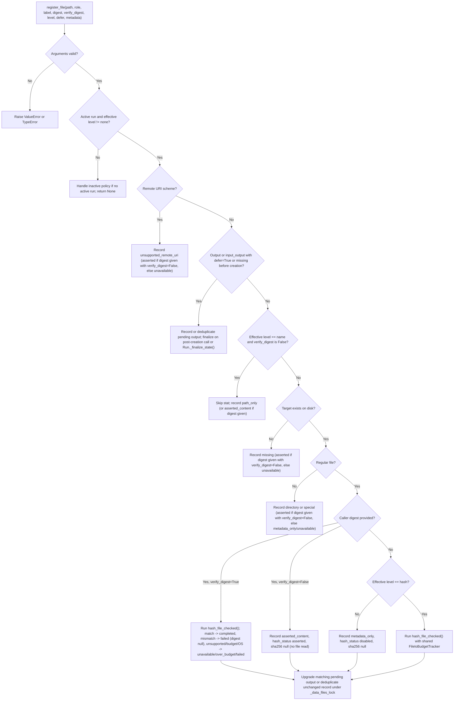

# IPD: Explicit external file registration API and lifecycle semantics

- Date: 2026-11-21
- Kind: child
- Concern: Explicit registration of external input and output paths with logical labels, caller-supplied asserted versus verified digests, pre-creation and post-creation output lifecycles, deduplication, and edge-case handling
- Scope: Implement external file registration and pending-output finalization in `src/pubrun/capture/file_io.py`, expose `register_file`, `register_input`, and `register_output` in `src/pubrun/core.py` and `src/pubrun/__init__.py`, and add behavioral tests in `tests/test_file_registration.py`.
- Scope-Paths: src/pubrun/capture/file_io.py, src/pubrun/core.py, src/pubrun/__init__.py, tests/test_file_registration.py
- Item-Dependencies: executed:xxi3nc
- Status: approved
- Readiness: go-pending-approval
- Review-Depth: complex
- Short-Description: Add register_file, register_input, and register_output with labels, asserted/verified digests, and deduplication
- Work-Kind: feature
- Priority: medium
- From-Backlog: x6alw4
- Set: file-prov
- Order: 2
- Highest E allocated: 04
- Author: agent
- Id: 52dl55
- Approval: 2026-11-22, recorded via aw ipd set: status set to approved

> Write and proofread this plan per the technical writing standard, `.aw/system/workflows/technical-writing/technical-writing.md` (`.agents/workflows/technical-writing/technical-writing.md` in a legacy-layout install), including requirement 12 (diagrams).

## Workflow history

- 2026-11-22 approved (aw set): status set to approved
- 2026-11-22 /plan-review (Antigravity / Gemini 4 Neon (High)): APPROVE WITH REVISIONS APPLIED; PR-001, PR-002, PR-003, PR-004, PR-005
- 2026-11-21 to-review (agent): authored child plan 02 of Set `file-prov` graduating backlog item `x6alw4`.

## Goal

Enable scripts using external data libraries (such as pandas, PyArrow, NumPy, or C-extension readers and writers) to register local input, output, and mixed-role file paths explicitly through the `pubrun.register_file()`, `pubrun.register_input()`, and `pubrun.register_output()` application programming interface (API) without replacing library input/output (I/O) or adding third-party runtime dependencies. Keep caller-supplied checksums explicitly labeled as asserted evidence unless verified, support registering outputs both before and after creation, deduplicate unchanged repeated registrations cleanly, and preserve `pubrun.artifact()` as a run-internal file writer.

### External file registration flow

This diagram summarizes how `register_file()` processes validation, remote Uniform Resource Identifiers (URIs), pre-creation outputs, caller digests, detail levels, and hashing budgets. The text in `## Proposed changes (ordered, validatable)` is normative.

## Detailed Implementation Checklist (TODO)

Execution-state rule: mark an `E-*` item complete only after performing the action. That mark is not validation. Right-sizing rule: write for a modest executor that cannot hold much in its head. Each E-item is one step (one concern, about one file, executable in one focused pass) and its V-item names each unit it covers with its own check; a plan stays at about 5 E-items and 8 work Scope-Paths, else split it into more child plans (guidance, `IPD-Z603`). Accepted execution states: blocked, failed, pending, performed; terminal gate demands 'performed'.

### Task group 1: External registration engine and pending-output lifecycle

- [ ] E-01 Implement `register_file_provenance(...)` and `finalize_pending_registrations(run_instance)` in `src/pubrun/capture/file_io.py`.
  - Depends on: none
  - Expected outcome: `src/pubrun/capture/file_io.py` implements local path registration supporting `role` (`"input"`, `"output"`, `"input_output"`), optional `label`, optional `digest` and `digest_algorithm`, `verify_digest: bool = False`, optional per-call `level` override, `defer: bool = False`, optional JavaScript Object Notation (JSON)-serializable `metadata` dict, and `registration_source`. Programmer-error arguments (invalid `role`, invalid `level`, empty/non-string `digest`, `verify_digest=True` without `digest`, non-dict or non-JSON-serializable `metadata`, `None`/empty `path`) raise `ValueError` or `TypeError` predictably, while unexpected operating system (OS) errors are isolated. Caller-supplied digests record `evidence_source = "asserted"`, `evidence_strength = "asserted_content"`, `hash_status = "asserted"`, and `sha256 = None` without reading file bytes unless `verify_digest=True` verifies on-disk bytes via `hash_file_checked` (setting `hash_status = "completed"` and `caller_digest.verified = True` on match, or `hash_status = "failed"`, `hash_status_detail = "caller_digest_mismatch"`, `caller_digest.verified = False`, `digest = None`, `sha256 = None` on mismatch). Pending outputs (`defer=True` or missing before creation) deduplicate repeated pending calls, keep internal pending metadata outside the manifest record dict (preserving `"additionalProperties": false`), synchronize updates under `_data_files_lock` without holding the lock during disk I/O, and finalize on post-creation re-registration or `finalize_pending_registrations(run_instance)` during `Run._finalize_state()` (including Ghost Mode and closed `event_stream` safety).
  - Execution state: pending

### Task group 2: Public API wrappers and root package export

- [ ] E-02 Add `register_file`, `register_input`, and `register_output` to `src/pubrun/core.py` and export them in `src/pubrun/__init__.py`.
  - Depends on: E-01
  - Expected outcome: `src/pubrun/core.py` defines `register_file(path, role="input", *, label=None, digest=None, digest_algorithm="sha256", level=None, verify_digest=False, defer=False, metadata=None)`, `register_input(path, *, label=None, digest=None, digest_algorithm="sha256", level=None, verify_digest=False, metadata=None)`, and `register_output(path, *, label=None, digest=None, digest_algorithm="sha256", level=None, verify_digest=False, defer=False, metadata=None)`. Each validates programmer-error arguments early, obeys `[events].on_inactive_annotate` via `_handle_inactive(...)` when no active run exists, imports `pubrun.capture.file_io` lazily (keeping cold `import pubrun` free of `pubrun.capture.file_io` and leaving `builtins.open` unpatched), passes the matching `registration_source` (`"register_file"`, `"register_input"`, `"register_output"`), returns the recorded dict (or `None` when inactive or `level == "none"`), and leaves `pubrun.artifact()` unchanged. `src/pubrun/__init__.py` exports all three in `__all__`, the root import block, and `_ensure_core_loaded()`.
  - Execution state: pending

### Task group 3: Behavioral tests and cross-path verification

- [ ] E-03 Create `tests/test_file_registration.py` covering all external registration semantics, edge cases, budgets, concurrency/lifecycle safety, and schema conformance.
  - Depends on: E-02
  - Expected outcome: `tests/test_file_registration.py` proves: (1) a library-style reader/writer using `builtins.open` can register external inputs and outputs with logical labels without replacing its I/O; (2) caller-supplied digest with default `verify_digest=False` records `evidence_source == "asserted"`, `evidence_strength == "asserted_content"`, `hash_status == "asserted"`, and `sha256 is None` without reading file bytes; (3) `verify_digest=True` records `hash_status == "completed"` and `caller_digest["verified"] is True` on match, `hash_status == "failed"` with `caller_digest["verified"] is False`, `digest is None`, and `sha256 is None` on mismatch, and `hash_status == "unavailable"` for unsupported `digest_algorithm` or missing/directory/special/remote targets; (4) `register_output()` before file creation (both automatic missing-output detection and explicit `defer=True`, including repeated pre-creation calls and overwrite of pre-existing output with `defer=True`) upgrades cleanly at post-creation re-registration or `pubrun.stop()` without double-hashing, and marks `hash_status == "unavailable"` (or `"asserted"` if caller digest was supplied with `verify_digest=False`) if still missing at stop; (5) `level="name"` skips `stat` and omits `size_bytes`, while repeated unchanged registrations deduplicate (`registration_count == 2`) without double-hashing and registrations after file modification preserve both observations; (6) missing files, directories, valid/broken symlinks, permission errors, non-regular files, shared per-file/total budgets with `pubrun.open()`, Ghost Mode safety, and remote URIs (`s3://bucket/key`, `https://...`, distinct from Windows drive paths) produce honest schema-valid records without raising into host code or touching the network; (7) invalid `role`, invalid `level`, empty `digest`, `verify_digest=True` without `digest`, and non-dict/non-JSON `metadata` raise `ValueError`/`TypeError`, inactive runs honor `on_inactive_annotate`, and resulting manifests validate against `schemas/manifest.schema.json`.
  - Execution state: pending

- [ ] E-04 Run combined file-provenance, explicit-API, public-API, and manifest-schema tests to verify `pubrun.open()`, `pubrun.register_*()`, and `pubrun.artifact()` coexist cleanly.
  - Depends on: E-03
  - Expected outcome: `pytest tests/test_file_registration.py tests/test_file_io_provenance.py tests/test_explicit_api.py tests/test_api.py tests/test_manifest_schema.py -v` exits `0`, confirming shared canonical record structure, shared run budget accounting across `pubrun.open()` and `pubrun.register_*()`, root `__all__` export conformance, schema validation, and unchanged `pubrun.artifact()` behavior.
  - Execution state: pending

## Project conventions discovered (Step 0)

- `src/pubrun/core.py::artifact` writes caller-supplied `bytes` or `str` to `run.run_dir / filename` and emits an `artifact: <filename>` annotation event; it does not touch `run.data_files`.
- `src/pubrun/core.py::_handle_inactive` reads `[events].on_inactive_annotate` (`"ignore"`, `"warn"`, or `"error"`) for explicit APIs called without an active run (`annotate`, `phase`, `report`, `artifact`).
- `src/pubrun/__init__.py` maintains three export lists that must stay synchronized: `__all__`, the root `from pubrun.core import (...)` block, and `_ensure_core_loaded()`. `tests/test_api.py::TestModuleExports` validates that every symbol in `pubrun.__all__` exists on `pubrun`.
- `src/pubrun/tracker.py::Run._finalize_state` closes `self.event_stream` during shutdown, so `finalize_pending_registrations(run_instance)` must guard `event_stream.emit(...)` defensively against closed or absent streams (including Ghost Mode runs where `event_stream` and `run_dir` are `None`).
- Prerequisite reviewed plan `xxi3nc` (file provenance engine, hashing guarantees, and proxy hardening, `Order: 1`) establishes `src/pubrun/capture/file_io.py`, `FILE_IO_LEVELS`, `SUPPORTED_HASH_ALGORITHMS`, `FileIoBudgetTracker`, `FileIdentity`, `hash_file_checked`, `append_or_deduplicate_record`, `Run._data_files_lock`, `Run._pending_file_registrations`, the `Run._finalize_state()` hook calling `finalize_pending_registrations(self)`, and `$defs.file_provenance_record` (with `"additionalProperties": false`) in `schemas/manifest.schema.json`.
- `tests/test_file_io_provenance.py::TestFileIoLevels.test_name_level_no_stat_no_hash` pins that `level == "name"` omits `size_bytes` and performs no `stat` call; `tests/test_import_modes.py::TestModeAliasApiParity` uses an explicit `_PUBLIC` list (updated in downstream plan `98j0a3`, `Order: 3`), so updating `pubrun.__all__` in this plan does not break `tests/test_import_modes.py`.

## Findings

1. **No explicit external path registration API**: Users calling pandas, PyArrow, h5py, NumPy, or external C libraries have no API to record external input/output datasets in `manifest["data_files"]`.
2. **Role boundary with `pubrun.artifact()`**: `src/pubrun/core.py::artifact` writes supplied content into the run directory rather than registering an existing external dataset path. Conflating the two would break existing callers (`tests/test_explicit_api.py::test_report_and_artifact`) and copy large datasets into `runs/`.
3. **Output timing gap**: Workflows often know an output path before calling a library writer (`df.to_parquet(out_path)`) or only register after writing; supporting both pre-creation (deferred until post-creation call or `Run._finalize_state()`) and post-creation registration avoids fragile ordering requirements.
4. **Remote URI safety**: Passing `s3://...` or `https://...` to `Path(uri).exists()` treats it as a missing relative local path without explaining that remote object stores are out of scope. Explicitly detecting URI schemes (`^[a-zA-Z][a-zA-Z0-9+.-]{1,15}://`) prevents confusion with Windows drive letters (`C:\...`) and records an honest out-of-scope status without network access.

## Proposed changes (ordered, validatable)

1. **`src/pubrun/capture/file_io.py`**:
   - Add `_is_remote_uri(path_str: str) -> bool` matching RFC 3986 URI schemes of length 2 to 16 (`^[a-zA-Z][a-zA-Z0-9+.-]{1,15}://`, explicitly excluding Windows single-letter drive paths like `C:\...` or `C:/...`).
   - Add helper `_validate_registration_args(path, role, level, digest, digest_algorithm, verify_digest, metadata)` called before run-state lookup so programmer misuse fails predictably regardless of whether a run is active:
     - Require `path` to be a non-empty `str` or `os.PathLike` via `os.fspath(path)` (raise `TypeError` for non-pathlike objects such as `None`/`int`, `ValueError` for empty/whitespace-only strings).
     - Validate `role in ("input", "output", "input_output")` (raise `ValueError` otherwise).
     - Validate `level is None or level in FILE_IO_LEVELS` (raise `ValueError` on explicit invalid `level`).
     - Validate `digest` when not `None`: must be a non-empty `str` after `.strip()` (raise `ValueError` otherwise, keeping `$defs.hash_record.properties.value.minLength = 1` valid). Validate `digest_algorithm` is a non-empty `str` after `.strip().lower()` (raise `ValueError` otherwise).
     - Validate that `verify_digest=True` requires `digest is not None` (raise `ValueError("verify_digest=True requires a non-empty digest")` otherwise).
     - Validate `metadata` when not `None`: must be a `dict` (`ValueError` otherwise) and JSON-serializable, deep-copied via `json.loads(json.dumps(metadata))` (raising `TypeError`/`ValueError` if non-serializable and preventing later caller mutation).
   - Implement `register_file_provenance(run_instance, path, *, role="input", label=None, digest=None, digest_algorithm="sha256", level=None, verify_digest=False, defer=False, metadata=None, registration_source="register_file") -> Optional[Dict[str, Any]]`:
     - Resolve effective detail level: explicit `level` if given, else run's `[capture.file_io].level`. If effective level is `"none"`, return `None`.
     - Populate canonical timestamps (`registered_at_utc`, `last_observed_at_utc`, plus `accessed_at_utc` for `input`/`input_output` and `modified_at_utc` for `output`/`input_output`), `role`, `label`, `registration_source`, `registration_count = 1`, `registered_before_creation = False`, `change_detected = False`, and `metadata` (when supplied), keeping every key strictly within `$defs.file_provenance_record` (`"additionalProperties": false`).
     - **Remote URI branch**: never touch network or local filesystem; record `entry_type="unsupported_remote_uri"`, `path=path_str`, `sha256=None`:
       - If `digest` supplied and `verify_digest=False`: `hash_status="asserted"`, `hash_algorithm=alg`, `caller_digest={"algorithm": alg, "value": digest_val, "verified": None}`, `digest={"algorithm": alg, "value": digest_val}`, `observation_time="caller_supplied"`, `evidence_source="asserted"`, `evidence_strength="asserted_content"`, `hash_status_detail="remote object-store URIs are out of scope; caller digest asserted without local verification"`.
       - If `digest` supplied and `verify_digest=True`: `hash_status="unavailable"`, `hash_algorithm=alg`, `caller_digest={"algorithm": alg, "value": digest_val, "verified": None}`, `digest={"algorithm": alg, "value": digest_val}`, `observation_time="not_observed"`, `evidence_source="asserted"`, `evidence_strength="asserted_content"`, `hash_status_detail="remote object-store URIs are out of scope; caller digest not verified"`.
       - If no `digest`: `hash_status="unavailable"`, `hash_algorithm=None`, `digest=None`, `observation_time="not_observed"`, `evidence_source="none"`, `evidence_strength="unavailable"`, `hash_status_detail="remote object-store URIs are out of scope"`.
     - **Pending-output branch**: when `role in ("output", "input_output")` and (`defer=True` or (`effective_level != "name"` and not `os.path.lexists(path_str)`)):
       - Compute `normalized_path = os.path.normpath(os.path.abspath(path_str))`.
       - Under `run_instance._data_files_lock`: check if an existing pending entry in `run_instance._pending_file_registrations` matches `(normalized_path, role, label)`. If found, increment its `registration_count`, update `last_observed_at_utc` (and update pending spec / `metadata` / `digest` if supplied), and return that record without appending a duplicate.
       - Otherwise create a schema-clean pending record (`path=path_str` at `name` else `normalized_path`, `hash_status="pending"`, `hash_status_detail="registered before creation; awaiting file creation or run finalization"`, `registered_before_creation=True`, `observation_time="not_observed"`, `evidence_source="asserted" if digest else "none"`, `evidence_strength="asserted_content" if digest else "unavailable"`, `sha256=None`, plus `caller_digest`/`digest` if `digest` supplied), store it in `data_files` (under `_data_files_lock`), and append a separate pending-spec object `(record_ref, path_str, normalized_path, effective_level, digest_val, alg, verify_digest, role, label)` to `run_instance._pending_file_registrations` so internal pending state never leaks onto the manifest record dict.
     - **`level == "name"` fast path (when `verify_digest=False`)**:
       - Skip `os.lstat` and `os.stat` (omitting `size_bytes`, `mtime`, `ctime`, `mtime_ns`, `inode`, `device`, preserving the `name`-level no-stat contract).
       - Record `path=path_str`, `sha256=None`; if `digest` is supplied, record `hash_status="asserted"`, `hash_algorithm=alg`, `caller_digest=...`, `digest=...`, `observation_time="caller_supplied"`, `evidence_source="asserted"`, `evidence_strength="asserted_content"`; else record `hash_status="disabled"`, `hash_status_detail="level is 'name'"`, `observation_time="at_registration"`, `evidence_source="observed"`, `evidence_strength="path_only"`.
     - **Local inspection branch** (reusing `FileIdentity` and `hash_file_checked` from prerequisite plan `xxi3nc`, performing all disk I/O OUTSIDE `_data_files_lock`):
       - Inspect `os.lstat(path_str)` (detecting symlinks) and `os.stat(path_str)` (resolving target), wrapping unexpected `OSError`/`PermissionError` cleanly without raising into host code:
         - Missing target or broken symlink (`os.lstat` or `os.stat` raises `FileNotFoundError`): `entry_type="missing"` (with `is_symlink=True` and `symlink_target` / `hash_status_detail="broken symlink"` when `lstat` succeeded as symlink).
         - Permission/OS error on `lstat`/`stat`: `hash_status="failed"`, `hash_status_detail=f"{type(e).__name__}: {e}"`, `evidence_source="none"`, `evidence_strength="unavailable"`, `sha256=None`.
         - Directory (`stat.S_ISDIR`) -> `entry_type="directory"`; non-regular file (`not stat.S_ISREG`) -> `entry_type="special"`; regular file (`stat.S_ISREG`) -> `entry_type="file"`.
       - Populate `path` (`os.path.abspath(path_str)` at `stat`+, raw `path_str` at `name`), `size_bytes`/`mtime`/`ctime`/`mtime_ns`/`inode`/`device` at `stat`+ (when `stat` succeeded), and `realpath` / `symlink_target` at `realpath`+.
       - Non-file targets (`entry_type in ("missing", "directory", "special")`):
         - If `digest` supplied and `verify_digest=False`: record `hash_status="asserted"`, `hash_algorithm=alg`, `caller_digest={"algorithm": alg, "value": digest_val, "verified": None}`, `digest={"algorithm": alg, "value": digest_val}`, `sha256=None`, `observation_time="caller_supplied"`, `evidence_source="asserted"`, `evidence_strength="asserted_content"`, `hash_status_detail=f"{entry_type}; caller digest asserted without local verification"`.
         - If `digest` supplied and `verify_digest=True`: record `hash_status="unavailable"`, `hash_algorithm=alg`, `caller_digest={"algorithm": alg, "value": digest_val, "verified": None}`, `digest={"algorithm": alg, "value": digest_val}`, `sha256=None`, `observation_time="not_observed"`, `evidence_source="asserted"`, `evidence_strength="asserted_content"`, `hash_status_detail=f"cannot verify caller digest: target is {entry_type}"`.
         - If no `digest`: record `hash_status="unavailable"`, `digest=None`, `sha256=None`, `evidence_source="none"` (if `missing`) or `"observed"` (if `directory`/`special` metadata was observed), `evidence_strength="unavailable"` (if `missing`) or `"metadata_only"` (if `directory`/`special` at `stat`+).
       - Regular-file (`entry_type == "file"`) digest policy:
         - Caller supplied `digest` and `verify_digest=False`: record `caller_digest={"algorithm": alg, "value": digest_val, "verified": None}`, `digest={"algorithm": alg, "value": digest_val}`, `hash_algorithm=alg`, `sha256=None`, `hash_status="asserted"`, `observation_time="caller_supplied"`, `evidence_source="asserted"`, `evidence_strength="asserted_content"`. Do NOT read file bytes.
         - Caller supplied `digest` and `verify_digest=True`:
           - If `alg not in SUPPORTED_HASH_ALGORITHMS`: do NOT fall back to `"sha256"`; record `hash_status="unavailable"`, `hash_status_detail=f"unsupported digest algorithm '{alg}'"`, `hash_algorithm=alg`, `caller_digest={"algorithm": alg, "value": digest_val, "verified": None}`, `digest={"algorithm": alg, "value": digest_val}`, `sha256=None`, `observation_time="not_observed"`, `evidence_source="asserted"`, `evidence_strength="asserted_content"`.
           - Otherwise run `hash_file_checked(...)` using `algorithm=alg` and the run's shared `FileIoBudgetTracker`.
           - On completed hash matching `digest_val.lower()`: set `hash_status="completed"`, `hash_algorithm=alg`, `caller_digest={"algorithm": alg, "value": digest_val, "verified": True}`, `digest={"algorithm": alg, "value": computed}`, `evidence_source="observed"`, `evidence_strength="verified_content"`, `observation_time="at_registration"`, and `sha256=computed` (when `alg == "sha256"`, else `None`).
           - On completed hash mismatch: set `hash_status="failed"`, `hash_status_detail="caller_digest_mismatch"`, `hash_algorithm=alg`, `caller_digest={"algorithm": alg, "value": digest_val, "verified": False}`, `digest=None`, `sha256=None`, `evidence_source="observed"`, `evidence_strength="changed_unverified"`, `observation_time="at_registration"`.
           - On budget/OS/change failure: preserve the honest `over_budget`/`failed`/`file_changed`/`unavailable` status, `caller_digest={"algorithm": alg, "value": digest_val, "verified": None}`, `digest=None`, and `sha256=None`.
         - No caller digest and `effective_level == "hash"`: run `hash_file_checked(...)` using the run's configured `hash_algorithm` and shared `FileIoBudgetTracker`; record `observation_time="at_registration"` when completed (`sha256=computed` only when `hash_algorithm == "sha256"`).
         - No caller digest and `effective_level != "hash"`: record `hash_status="disabled"`, `hash_status_detail=f"level is '{effective_level}'"`, `evidence_source="observed"`, `evidence_strength="metadata_only"`, `digest=None`, `sha256=None`.
       - **Pending upgrade and deduplication (under `run_instance._data_files_lock`)**: if an existing pending entry in `run_instance._pending_file_registrations` matches `(normalized_path, role, label)`, update its referenced record dict in place (preserving `registered_before_creation=True`, incrementing `registration_count`, updating `last_observed_at_utc`), and remove that entry from `run_instance._pending_file_registrations` so `finalize_pending_registrations` does not re-process it. Otherwise call `append_or_deduplicate_record(run_instance, record)`.
       - Emit event (`"input_dataset"`, `"output_artifact"`, or `"mixed_dataset"`) guarded by `try/except` when `getattr(run_instance, "event_stream", None)` is active.
   - Implement `finalize_pending_registrations(run_instance)`:
     - Pop all remaining pending entries from `run_instance._pending_file_registrations` under `run_instance._data_files_lock` (releasing the lock before any disk I/O).
     - For each pending entry, inspect the path now on disk (honoring its recorded `effective_level`, caller `digest`, `verify_digest`, and the run's shared `FileIoBudgetTracker`) using the exact local-inspection/digest logic above with `observation_time="at_finalization"` (or `"caller_supplied"` when caller `digest` is asserted with `verify_digest=False`; and if still absent at finalization, setting `entry_type="missing"`, `hash_status="unavailable"` — or `"asserted"` if caller digest with `verify_digest=False` — with clear `hash_status_detail` noting the file did not exist at run finalization).
     - Update the referenced record dict in place under `run_instance._data_files_lock` and emit a guarded event only if `event_stream` is still open (wrapping in `try/except` so closed streams or Ghost Mode never fail finalization).

2. **`src/pubrun/core.py` and `src/pubrun/__init__.py`**:
   - In `src/pubrun/core.py`: add `register_file`, `register_input`, and `register_output`. Each validates arguments early via a lightweight helper (or lazily after importing `pubrun.capture.file_io` — validating `role`/`level`/`digest`/`verify_digest`/`metadata` cleanly without importing `file_io` at module load time), checks `run = get_current_run()`, calls `_handle_inactive(...)` and returns `None` when `not run or not run.is_active`, and otherwise lazily imports `register_file_provenance` from `pubrun.capture.file_io` and passes `registration_source="register_file"`, `"register_input"`, or `"register_output"` respectively. Keep `src/pubrun/core.py::artifact` completely unchanged.
   - In `src/pubrun/__init__.py`: re-export `register_file`, `register_input`, and `register_output` in `__all__`, the root `from pubrun.core import (...)` block, and `_ensure_core_loaded()`.

3. **`tests/test_file_registration.py`** (new test file):
   - Add targeted behavioral tests covering every scenario in `E-03` (including `Path` and `str` inputs, `level="name"` no-stat, repeated pre-creation output deduplication, pre-existing output overwrite with `defer=True`, Ghost Mode safety, shared budget accounting with `pubrun.open()`, concurrent registration thread safety, unsupported `digest_algorithm` under `verify_digest=True`, Windows drive-letter vs remote URI distinction, and `jsonschema.validate` against `schemas/manifest.schema.json`).

## Deferred / out of scope (with reason)

- Re-exporting `register_file`, `register_input`, and `register_output` in all six import-mode modules (`auto`, `full`, `noauto`, `nopatch`, `noconsole`, `minimal`): implemented in child plan `98j0a3` (import-mode API parity for file registration, `Order: 3`).
  - Carrier: 98j0a3
- Report, inspect, and methods rendering of registered files and asserted-versus-verified distinction: implemented in child plan `hm32d9` (report, inspect, and methods file-provenance evidence distinction, `Order: 4`).
  - Carrier: hm32d9
- Example script (`examples/12_external_file_provenance.py`), stat-versus-hash benchmarks, and user documentation updates: implemented in child plan `4gpguy` (external file example, stat-vs-hash benchmarks, docs sync, and whole-Set verification, `Order: 5`).
  - Carrier: 4gpguy

## Scope check

- Over-scope: none. Touches only `src/pubrun/capture/file_io.py`, `src/pubrun/core.py`, `src/pubrun/__init__.py`, and `tests/test_file_registration.py`.
- Under-scope: none. Delivers the full external path registration API, caller-supplied digest semantics, pre/post-creation output lifecycle, deduplication, shared budget enforcement, local/remote edge cases, and schema conformance required by backlog item `x6alw4` (items 1, 3, and 6) and orchestrator `vtkkn1`.

## Required tests / validation

- Run `pytest tests/test_file_registration.py tests/test_file_io_provenance.py tests/test_explicit_api.py tests/test_api.py tests/test_manifest_schema.py -v` and paste actual runner output.
- Verify in a fresh Python subprocess that `import pubrun` exports `register_file`, `register_input`, `register_output`, and `artifact`, does not eagerly import `pubrun.capture.file_io`, and leaves `builtins.open` unpatched.

## Spec / documentation sync

- User API and manifest documentation (`docs/api.md`, `docs/manifest.md`, `docs/functional_spec.md`) is updated in child plan `4gpguy` (external file example, stat-vs-hash benchmarks, docs sync, and whole-Set verification, `Order: 5`) after mode parity (`98j0a3`) and report integration (`hm32d9`) complete.
- `schemas/manifest.schema.json`: already extended in prerequisite plan `xxi3nc` (`Order: 1`); validated here in `E-03` and `E-04`.

## Open questions

### OQ-01: Default `verify_digest` behavior when a caller supplies `digest`

- Blocking: no
- Status: resolved
- Owner: maintainer
- Resolution or deferral rationale: Defaulting `verify_digest=False` when a caller supplies `digest` avoids re-reading large datasets whose checksum the caller already obtained from a catalog or upstream tool, while keeping the record strictly honest (`evidence_source="asserted"`, `evidence_strength="asserted_content"`, `hash_status="asserted"`, `sha256=None`). Callers who want independent verification opt in explicitly with `verify_digest=True`. RESOLVED 2026-11-21 by the user via /askme: Default `verify_digest=False` when a caller supplies `digest` (recording caller-asserted evidence unless `verify_digest=True` is passed). No reason was given.

## Validation and cross-check (verify before reporting done)

Validation-state rule: inspect evidence in a separate pass. Do not mark a `V-*` item complete from memory or from the matching execution checkmark. Accepted validation results: blocked, failed, pass, pending; terminal gate demands 'pass'. Runtime-demonstration reachability rule: for each `V-*` item demanding the software be observed acting (such as a run, a dispatch, or a transition) (as distinct from items demanding a diff, a file's content, or a test result, which are reachable by construction), name the code path that produces the observation or the sibling `E-*` that creates it, else the demand is UNDER-SCOPE.

- [ ] V-01 validates E-01
  - Required evidence: Paste `pytest tests/test_file_registration.py -v` output (exit code 0) showing passing assertions for `register_file_provenance` and `finalize_pending_registrations`, including argument validation, asserted vs verified digests (match, mismatch with `digest=None`, unsupported algorithm), `level="name"` no-stat behavior, pre-creation/deferred and post-creation outputs (deduplication, upgrade without double-hashing, missing at stop), deduplication of unchanged vs changed files, missing/directory/symlink/special/permission-error/remote-URI cases, Ghost Mode safety, and shared budget enforcement.
  - Observed evidence:
  - Result: pending

- [ ] V-02 validates E-02
  - Required evidence: Paste fresh subprocess output of `python -c "import builtins, sys; orig = builtins.open; import pubrun; assert builtins.open is orig; assert 'pubrun.capture.file_io' not in sys.modules; assert all(hasattr(pubrun, n) for n in ('register_file', 'register_input', 'register_output', 'artifact')); pubrun.stop(); print('EXPORTS_AND_LAZY_OK')"` (printing `EXPORTS_AND_LAZY_OK`, exit code 0) and `pytest tests/test_explicit_api.py tests/test_api.py -v` (exit code 0, proving `pubrun.artifact()` remains unchanged and `pubrun.__all__` passes `TestModuleExports`).
  - Observed evidence:
  - Result: pending

- [ ] V-03 validates E-03
  - Required evidence: Paste full `pytest tests/test_file_registration.py -v` output (exit code 0) listing all passing behavioral, edge-case, inactive-policy, and `schemas/manifest.schema.json` conformance tests.
  - Observed evidence:
  - Result: pending

- [ ] V-04 validates E-04
  - Required evidence: Paste full `pytest tests/test_file_registration.py tests/test_file_io_provenance.py tests/test_explicit_api.py tests/test_api.py tests/test_manifest_schema.py -v` output showing exit code 0 and zero failures.
  - Observed evidence:
  - Result: pending

## Approval and execution gate

- Size assessment: standard
- Cohesion rationale: not required

Execution contract:
1. Open questions: all open questions are resolved (`OQ-01` resolved by the maintainer on 2026-11-21); do not execute until prerequisite `xxi3nc` (file provenance engine, hashing guarantees, and proxy hardening) is `executed` and a human approves this plan (`- Status: approved`).
2. Scope fence: restrict edits to `- Scope-Paths:` (`src/pubrun/capture/file_io.py`, `src/pubrun/core.py`, `src/pubrun/__init__.py`, `tests/test_file_registration.py`). If an out-of-scope edit is genuinely required, justify it with `--scope-reason` at finalization; if a declared path needs no edit, acknowledge it with `--scope-ack`. Stop and report only for genuinely unsafe conditions (such as an unresolvable concurrent-edit conflict or a missing prerequisite symbol).
3. Honesty rule (HARD MUST): paste actual `pytest` and Python subprocess runner output and exit codes into each `V-*` `Observed evidence:` field; never claim tests passed without running them.
4. Commit and push discipline: commit only the files changed for this plan through `aw commit 52dl55 -- <paths>`; never use `git add -A`, `git add .`, or `git commit -a`, and never push without explicit human authorization.
5. Lifecycle transition: this plan must reach `.aw/records/plans/executed/` with `- Status: executed` through `aw ipd finalize` once all `E-*` are `performed` and all `V-*` are `pass`. In a runner-managed lane, the runner performs `aw ipd finalize`; in standalone execution, run `aw ipd lint --phase pre-transition` and finalize directly through `aw ipd finalize`. Never hand-roll a raw `git mv` to `executed/`.
