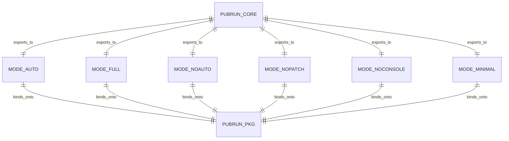

# IPD: Import-mode API parity for file registration

- Date: 2026-11-21
- Kind: child
- Concern: Re-exporting external file registration application programming interface (API) functions across all six `pubrun` import modes and verifying parity
- Scope: Re-export `register_file`, `register_input`, and `register_output` in `src/pubrun/auto.py`, `src/pubrun/full.py`, `src/pubrun/noauto.py`, `src/pubrun/nopatch.py`, `src/pubrun/noconsole.py`, and `src/pubrun/minimal.py`, and expand `tests/test_import_modes.py`.
- Scope-Paths: src/pubrun/auto.py, src/pubrun/full.py, src/pubrun/noauto.py, src/pubrun/nopatch.py, src/pubrun/noconsole.py, src/pubrun/minimal.py, tests/test_import_modes.py
- Item-Dependencies: executed:52dl55
- Status: to-review
- Short-Description: Re-export external file registration APIs across all six pubrun import modes with parity tests
- Work-Kind: feature
- Priority: medium
- From-Backlog: x6alw4
- Set: file-prov
- Order: 3
- Highest E allocated: 03
- Author: agent
- Id: 98j0a3

> Write and proofread this plan per the technical writing standard, `.aw/system/workflows/technical-writing/technical-writing.md` (`.agents/workflows/technical-writing/technical-writing.md` in a legacy-layout install), including requirement 12 (diagrams).

## Workflow history

- 2026-11-21 to-review (agent): authored child plan 03 of Set `file-prov` graduating backlog item `x6alw4`.

## Goal

Ensure every `pubrun` import mode (`import pubrun.auto as pubrun`, `full`, `noauto`, `nopatch`, `noconsole`, and `minimal`) exposes `register_file`, `register_input`, and `register_output` identically to root `import pubrun`, and prove via subprocess tests that explicit external file registration works in hook-free modes (`nopatch`, `minimal`) without patching `builtins.open`.

### Mode-alias re-export relationships

This diagram shows how all six import-mode modules re-export the registration functions from `pubrun.core` and bind them back onto the `pubrun` package namespace. The text below is normative.

## Detailed Implementation Checklist (TODO)

Execution-state rule: mark an `E-*` item complete only after performing the action. That mark is not validation. Right-sizing rule: write for a modest executor that cannot hold much in its head. Each E-item is one step (one concern, about one file, executable in one focused pass) and its V-item names each unit it covers with its own check; a plan stays at about 5 E-items and 8 work Scope-Paths, else split it into more child plans (guidance, `IPD-Z603`). Accepted execution states: blocked, failed, pending, performed; terminal gate demands 'performed'.

### Task group 1: Re-export in auto-start and explicit-start modes

- [ ] E-01 Re-export `register_file`, `register_input`, and `register_output` in `src/pubrun/auto.py`, `src/pubrun/full.py`, and `src/pubrun/noauto.py`.
  - Depends on: none
  - Expected outcome: Each of `src/pubrun/auto.py`, `src/pubrun/full.py`, and `src/pubrun/noauto.py` imports `register_file`, `register_input`, and `register_output` from `pubrun.core` and assigns `_pkg.register_file`, `_pkg.register_input`, and `_pkg.register_output` on the parent `pubrun` package without altering `pubrun.report` CallableModule binding.
  - Execution state: pending

### Task group 2: Re-export in restricted-hook modes

- [ ] E-02 Re-export `register_file`, `register_input`, and `register_output` in `src/pubrun/nopatch.py`, `src/pubrun/noconsole.py`, and `src/pubrun/minimal.py`.
  - Depends on: none
  - Expected outcome: Each of `src/pubrun/nopatch.py`, `src/pubrun/noconsole.py`, and `src/pubrun/minimal.py` imports `register_file`, `register_input`, and `register_output` from `pubrun.core` and assigns `_pkg.register_file`, `_pkg.register_input`, and `_pkg.register_output` on the parent `pubrun` package without altering `pubrun.report` CallableModule binding.
  - Execution state: pending

### Task group 3: Subprocess parity and hook-free behavioral tests

- [ ] E-03 Update `tests/test_import_modes.py` to enforce parity for `register_file`, `register_input`, and `register_output` across all six import modes and prove registration works in `nopatch` and `minimal` modes.
  - Depends on: E-01, E-02
  - Expected outcome: `TestModeAliasApiParity._PUBLIC` in `tests/test_import_modes.py` includes `"register_file"`, `"register_input"`, and `"register_output"`, and new subprocess tests verify that `import pubrun.nopatch as pubrun` and `import pubrun.minimal as pubrun` (after `pubrun.start()`) record external input and output files in `manifest.json` while leaving `builtins.open` unpatched.
  - Execution state: pending

## Project conventions discovered (Step 0)

- All six import-mode modules (`src/pubrun/auto.py`, `full.py`, `noauto.py`, `nopatch.py`, `noconsole.py`, `minimal.py`) import public symbols from `pubrun.core` and assign them onto `_pkg` (`import pubrun as _pkg`) so both `pubrun_alias.X` and subsequent `from pubrun import X` work.
- Every mode module preserves `import pubrun.report` (never `_pkg.report = report`) so `pubrun.report` stays a `CallableModule`.
- `tests/test_import_modes.py` (`TestModeAliasApiParity`) tests every mode alias in fresh subprocesses because import mode selection is process-global.

## Findings

1. **Manual re-export drift risk**: Each of the six mode submodules explicitly enumerates the symbols imported from `pubrun.core` and rebound onto `_pkg`. Without updating all six modules and `TestModeAliasApiParity._PUBLIC`, users importing `pubrun.noauto`, `pubrun.nopatch`, `pubrun.noconsole`, `pubrun.minimal`, `pubrun.auto`, or `pubrun.full` would get `AttributeError` when calling `pubrun.register_input()` or `pubrun.register_output()`.

## Proposed changes (ordered, validatable)

1. **`src/pubrun/auto.py`, `src/pubrun/full.py`, `src/pubrun/noauto.py`**:
   - Add `register_file`, `register_input`, and `register_output` to the `from pubrun.core import (...)` list and bind `_pkg.register_file = register_file`, `_pkg.register_input = register_input`, and `_pkg.register_output = register_output`.
2. **`src/pubrun/nopatch.py`, `src/pubrun/noconsole.py`, `src/pubrun/minimal.py`**:
   - Add `register_file`, `register_input`, and `register_output` to the `from pubrun.core import (...)` list and bind `_pkg.register_file = register_file`, `_pkg.register_input = register_input`, and `_pkg.register_output = register_output`.
3. **`tests/test_import_modes.py`**:
   - Add `"register_file"`, `"register_input"`, and `"register_output"` to `TestModeAliasApiParity._PUBLIC`.
   - Add subprocess behavioral tests in `TestModeAliasApiParity` exercising `pubrun.register_input()` and `pubrun.register_output()` via `pubrun.nopatch` and `pubrun.minimal` (with explicit `pubrun.start()`/`stop()`), confirming `data_files` records appear in `manifest.json` and `builtins.open` is untouched.

## Deferred / out of scope (with reason)

- Refactoring the six mode modules to share a single re-export helper: deferred to avoid touching unrelated import-bootstrap invariants while maintaining minimal diff scope for `x6alw4`.

## Scope check

- Over-scope: none. Touches only the six import-mode modules and `tests/test_import_modes.py`.
- Under-scope: none. Covers all six import modes and verifies both attribute parity and runtime behavior in hook-free modes.

## Required tests / validation

- Run `pytest tests/test_import_modes.py tests/test_report_subpackage_integrity.py -v` and paste actual runner output.

## Spec / documentation sync

- N/A for this plan; user-facing API documentation for all import modes is updated in child plan `4gpguy` (`Order: 5`).

## Open questions

None.

## Validation and cross-check (verify before reporting done)

Validation-state rule: inspect evidence in a separate pass. Do not mark a `V-*` item complete from memory or from the matching execution checkmark. Accepted validation results: blocked, failed, pass, pending; terminal gate demands 'pass'. Runtime-demonstration reachability rule: for each `V-*` item demanding the software be observed acting (such as a run, a dispatch, or a transition)—as distinct from items demanding a diff, a file's content, or a test result, which are reachable by construction—name the code path that produces the observation or the sibling `E-*` that creates it, else the demand is UNDER-SCOPE.

- [ ] V-01 validates E-01
  - Required evidence: Paste `pytest tests/test_import_modes.py -k "auto or full or noauto" -v` output (exit code 0) confirming `auto`, `full`, and `noauto` aliases expose `register_file`, `register_input`, and `register_output` without breaking `pubrun.report`.
  - Observed evidence:
  - Result: pending

- [ ] V-02 validates E-02
  - Required evidence: Paste `pytest tests/test_import_modes.py -k "nopatch or noconsole or minimal" -v` output (exit code 0) confirming `nopatch`, `noconsole`, and `minimal` aliases expose `register_file`, `register_input`, and `register_output` without breaking `pubrun.report`.
  - Observed evidence:
  - Result: pending

- [ ] V-03 validates E-03
  - Required evidence: Paste full `pytest tests/test_import_modes.py tests/test_report_subpackage_integrity.py -v` output showing exit code 0, all six parametrized mode parity tests passing, and the `nopatch`/`minimal` subprocess registration tests passing.
  - Observed evidence:
  - Result: pending

## Approval and execution gate

- Size assessment: standard
- Cohesion rationale: not required

Execution requires explicit human approval (`- Status: approved`). Commit only the scoped files through `aw commit 98j0a3 -- <paths>`, paste actual runner output into `Observed evidence`, and run the post-gate `aw ipd` lifecycle transition to `.aw/records/plans/executed/`.
